# Owner Material 037 — Star Wars D20 Drive folder (Core, Revised Core and Saga Edition): Sourcebooks/Hero's Guide.pdf [Star Wars Roleplaying Game Revised Core (d20, 2002)] (scan pages 61–120)

- **Source:** Wizards of the Coast Star Wars Roleplaying Game books, web enhancements, Living Force campaign modules and articles (2000–2010), from the owner's "Star Wars D20" Drive folder (only the three edition subfolders; "General" was not read, as instructed). Secondary source (licensed Legends reference). Scan OCR'd on the box; the scan stays box-only and is **not** published.
- **Method:** every scanned page was OCR'd and machine-screened sentence by sentence for power-relevant statements (fights, kills, defeats, Force feats, rankings, superweapons) that name a character on our roster; each kept sentence is quoted verbatim from the OCR text and has a crop of the printed passage directly under it. Pages with nothing power-relevant are still listed with what is on them.
- **Citation:** "*Hero's Guide* (SWRPG d20 Revised Core), p.X" by printed page ("scan p.X" where no printed number applies). **Weight:** Licensed RPG material: a secondary source. Narrative text sums up Legends lore; game statistics are rules for players, not canon power levels, and rank lowest.

## scan p.61 (scan page 61)

Page contents: Loyal Protector Ignore Pain, Remain Conscious; Martial Arts Master description, requirements, Uncanny Dodge. (hand-read)

## scan p.62 (scan page 62)

Page contents: Martial Arts Master bonus feats, Dodge Blasters, Improvisation, Grand Master. (hand-read)

## scan p.63 (scan page 63)

Page contents: Master Duelist description (Adumar), requirements, Table 4-5, Canny Defense, Showmanship. (hand-read)

## scan p.64 (scan page 64)

Page contents: Master Duelist bonus feats, True Strike, Elaborate Parry, Acrobatic Attack, Delayed Strike; Outlaw Slicer description begins. (hand-read)

## scan p.65 (scan page 65)

Page contents: Outlaw Slicer description, class skills, requirements (custom slicing computer), False Identity. (hand-read)

## scan p.66 (scan page 66)

Page contents: Table 4-6 Outlaw Slicer; Bonus Class Skill, Slicer Specialization, Bonus Feat, Skill Mastery; Priest description (Ithorians, B'omarr, Dim-U) and requirements. (hand-read)

## scan p.67 (scan page 67)

Page contents: Priest class skills, Bonus Class Skill, Bonus Feat, Authority, Inspire Faith. (hand-read)

## scan p.68 (scan page 68)

Page contents: Table 4-7 Priest; Act of Faith; Sharpshooter description (Myn Donos, Wraith Squadron) and requirements. (hand-read)

- **Myn Donos; Wedge Antilles** — entry/section: Myn Donos, famous New Republic sharpshooter: "One of the most famous sharpshooters in the New Republic was Myn Donos, a former member of the Corellian militia who earned his Corellian bloodstripes as a sniper. His shooting and flying skill prompted Wedge Antilles to recruit him as a member of Wraith Squadron, the New Republic Special Forces group that was instrumental in defeating Imperial Warlord Zsinj." Source: *Hero's Guide* (SWRPG d20 Revised Core), scan p.68
  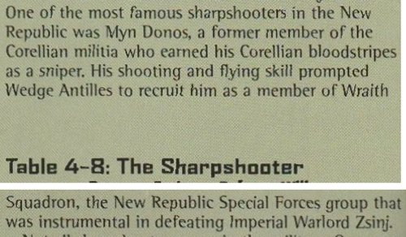

## scan p.69 (scan page 69)

Page contents: Sharpshooter class features: Preferred Weapon, Ranged Sneak Attack, Follow Target, Improved Range, Deadly Aim. (hand-read)

## scan p.70 (scan page 70)

Page contents: Treasure Hunter description (Sith artifacts, Jedi relics, Great Hyperspace War). (hand-read)

## scan p.71 (scan page 71)

Page contents: Table 4-9 Treasure Hunter; requirements; Archaic Lore, Find Passage, Sense Traps, Decipher Script, Resist Curse. (hand-read)

## scan p.72 (scan page 72)

Page contents: Chapter Five art page. (hand-read)

## scan p.73 (scan page 73)

Page contents: Ch5 Factions intro; Sympathy; Gaining Sympathy. (hand-read)

## scan p.74 (scan page 74)

Page contents: Sympathy examples (Verius the smuggler); Table 5-1 Faction Alignments. (hand-read)

## scan p.75 (scan page 75)

Page contents: Conflicting Sympathies cont.; Losing Sympathy (Betrayal, Neglect). Joining a Faction; Antarian Rangers description (founded ~600 years before the Clone Wars by Jedi Marus Timpel and Gotal Kaskutal). (hand-read)

## scan p.76 (scan page 76)

Page contents: Antarian Rangers history: decline, Clone Wars revival, hunted by Vader and Inquisitors, Toprawa enclave, revival under Luke Skywalker's Jedi Order. (hand-read)

## scan p.77 (scan page 77)

Page contents: Antarian Ranger Sympathy, Joining, Leaving; faction feats Field Guide, Jedi Petitioner. (hand-read)

## scan p.78 (scan page 78)

Page contents: Table 5-2 Antarian Ranger prestige class; requirements, Teamwork, Reconnaissance, Contact. (hand-read)

## scan p.79 (scan page 79)

Page contents: Antarian Ranger Jedi Familiarity, Jedi Reputation; Black Sun description (Prince Xizor, Guri). (hand-read)

- **Prince Xizor; Darth Vader (Anakin Skywalker); Palpatine (Darth Sidious); Guri** — entry/section: Xizor, third most powerful person in the galaxy: "In the Rebellion era, the leader of Black Sun, the Falleen Prince Xizor, has close ties with the Emperor— almost as close as Darth Vader's. As such, Xizor is perhaps the third most powerful person in the galaxy. To increase his standing, he constantly plots and schemes Darth Vader's downfall—just as Vader plots Xizor's. Emperor Palpatine, meanwhile, plays one off against the other, perhaps to keep two such powerful individuals from allying against him." Source: *Hero's Guide* (SWRPG d20 Revised Core), scan p.79
  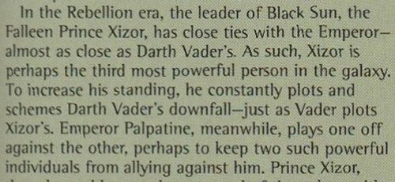
- **Guri; Prince Xizor** — entry/section: Guri, Xizor's bodyguard: "Assisting Xizor in his rise to power is his lovely aide Guri—a cunningly designed Human replica droid virtually indistinguishable from a real Human woman. Xizor is the hidden power behind Black Sun, and Guri is his bodyguard and personal enforcer." Source: *Hero's Guide* (SWRPG d20 Revised Core), scan p.79
  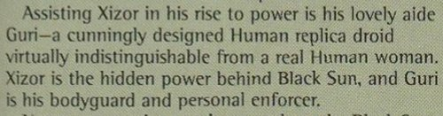

## scan p.80 (scan page 80)

Page contents: Black Sun joining and leaving; Underworld Connections feat; Black Sun Enforcer prestige class description and Table 5-3. (hand-read)

## scan p.81 (scan page 81)

Page contents: Black Sun Enforcer requirements and features (Inspire Fear); Black Sun Vigo description and requirements. (hand-read)

## scan p.82 (scan page 82)

Page contents: Black Sun Vigo class skills, Resource Access, Favor. (hand-read)

## scan p.83 (scan page 83)

Page contents: Table 5-4 Black Sun Vigo; Minions, Inspire Fear, Exceptional Minions, Ex-Vigos; Bothan Spynet description (Koth Melan). (hand-read)

## scan p.84 (scan page 84)

Page contents: Bothan Spynet Sympathy, Joining, Leaving; faction feats False Identity, Information Debt. (hand-read)

## scan p.85 (scan page 85)

Page contents: Master Spy prestige class (Bothan Spynet): requirements, Table 5-5, Popular, False Loyalty, Six Questions. (hand-read)

## scan p.86 (scan page 86)

Page contents: Bounty Hunters' Guild description (Boba Fett never joined; Tresario, Mantis, Ragnar guilds); Sympathy; Joining. (hand-read)

- **Boba Fett; Darth Vader (Anakin Skywalker)** — entry/section: Boba Fett never joined the Guild: "Not all bounty hunters are members of the Guild, but many of the best and brightest are. The infamous Boba Fett never joined the Guild, but several of Lord Vader's other preferred bounty hunters did." Source: *Hero's Guide* (SWRPG d20 Revised Core), scan p.86
  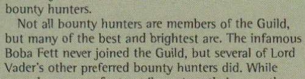

## scan p.87 (scan page 87)

Page contents: Leaving the Guild; Contract Hunter feat; Confederacy of Independent Systems description (Count Dooku, Commerce Guilds). (hand-read)

## scan p.88 (scan page 88)

Page contents: Confederacy Sympathy, Joining, Leaving; Favored Customer feat; Corellian Security Force description. (hand-read)

## scan p.89 (scan page 89)

Page contents: CorSec Sympathy; Kirtan Loor as Imperial Liaison; CorSec training and investigations; Joining. (hand-read)

## scan p.90 (scan page 90)

Page contents: CorSec Joining cont.; Leaving (Corran Horn went undercover); Criminal Investigation feat; CorSec Officer prestige class and Table 5-6. (hand-read)

## scan p.91 (scan page 91)

Page contents: CorSec Officer Teamwork, Undercover, Contact, Urban Track, Safehouse; Corporate Sector description (ExO, Direx Board). (hand-read)

## scan p.92 (scan page 92)

Page contents: Corporate Sector history (Clone Wars, Palpatine's 3% levy); Sympathy; Joining. (hand-read)

## scan p.93 (scan page 93)

Page contents: Leaving the Corporate Sector; feats Corporate Credit Line, Premier Credit Line; Corporate Troubleshooter prestige class and Table 5-7. (hand-read)

## scan p.94 (scan page 94)

Page contents: Corporate Troubleshooter class skills, Bonus Feat, Contact, Resource Access; The Galactic Empire description begins. (hand-read)

## scan p.95 (scan page 95)

Page contents: Galactic Empire history from the Imperial viewpoint (Death Star, Yavin, Imperial Remnant); Imperial Sympathy; Joining. (hand-read)

- **Palpatine (Darth Sidious)** — entry/section: Palpatine's rise (Imperial view): "Even before he was Supreme Chancellor of the Old Republic, Emperor Palpatine's dream had long been a new, stronger Republic—reborn healthy and able from the festering remains of the old. Through a series of fortunate appointments and Senate votes, Palpatine went from an obscure minor political functionary from Naboo to Republic Senator, then Supreme Chancellor, and, finally, to Emperor." Source: *Hero's Guide* (SWRPG d20 Revised Core), scan p.95
  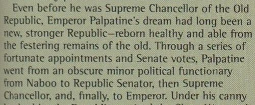
- **Darth Vader (Anakin Skywalker); Grand Moff Tarkin** — entry/section: Vader the sole survivor of the Death Star: "Even worse, the Rebels stole the plans for the battle station, then lured it to the remote world of Yavin, where they treacherously destroyed it with all hands aboard—including its respected administrator, Grand Moff Tarkin, who was conducting a final inspection. Only Darth Vader— battling the Rebel ships in his own custom TIE fighter—survived the devastation." Source: *Hero's Guide* (SWRPG d20 Revised Core), scan p.95
  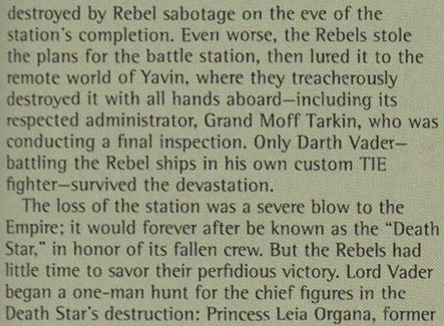
- **Darth Vader (Anakin Skywalker); Leia Organa Solo; Han Solo; Chewbacca; Luke Skywalker** — entry/section: Vader's one-man hunt (Imperial view): "Lord Vader began a one-man hunt for the chief figures in the Death Star's destruction: Princess Leia Organa, former senator of Alderaan, who had couriered the station's stolen plans; Han Solo and Chewbacca, her smuggler accomplices, who had liberated Leia after she had been arrested for the crime; and Luke Skywalker, a misguided (perhaps even delusional) young starfighter pilot who had personally fired the shot that had destroyed the battle station." Source: *Hero's Guide* (SWRPG d20 Revised Core), scan p.95
  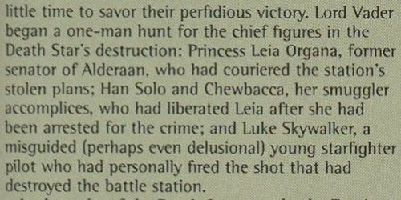

## scan p.96 (scan page 96)

Page contents: Leaving the Empire; feats Flight Academy Training, Imperial Command Training; ISB Special Agent prestige class, requirements, Backup. (hand-read)

## scan p.97 (scan page 97)

Page contents: Table 5-8 ISB Special Agent; Bonus Feat, Personal Transport; Hutt Criminal Syndicate description (Jabba, kajidics, Nal Hutta). (hand-read)

- **Jabba the Hutt; Luke Skywalker** — entry/section: Jabba, leader of the Desilijic clan: "Among the most powerful of these, for many years at least, was Jabba, leader of the Desilijic clan. Though he was a criminal mastermind, many considered him little more than a decadent thug. Jabba ruled his clan from his palace on the edge of Tatooine's Dune Sea—an awful place from which few were lucky enough to ever return. Sooner or later, all smuggling, all loan-sharking, all assassination, slavery, piracy, protection, and spice passed across Jabba's plate, and he always helped himself to a hefty slice. The rest of the Hutt leaders would gladly have eliminated him, but Jabba is nothing if not well defended; his palace is a veritable fortress, virtually unassailable. It wasn't until he crossed paths with Jedi Luke Skywalker that his reign—and life—came to an end." Source: *Hero's Guide* (SWRPG d20 Revised Core), scan p.97
  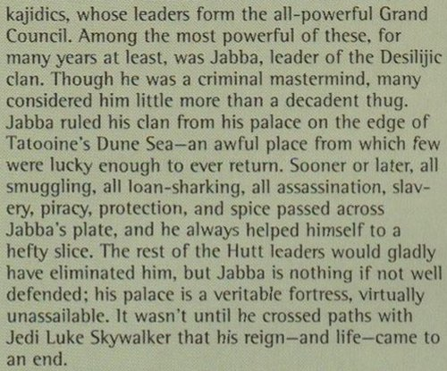

## scan p.98 (scan page 98)

Page contents: Hutt business; Hutt Sympathy; Joining; Leaving; feats Hutt Favor, Piece of the Action. (hand-read)

## scan p.99 (scan page 99)

Page contents: Piece of the Action benefit; Crime Broker prestige class, requirements, Table 5-9, Criminal Influence, Bonus Feat. (hand-read)

## scan p.100 (scan page 100)

Page contents: Crime Broker Patron, Minions; Mistryl Shadow Guards description and history (Emberlene, Variise, Eleven Elders). (hand-read)

## scan p.101 (scan page 101)

Page contents: Mistryl Sympathy; Joining; Leaving. (hand-read)

## scan p.102 (scan page 102)

Page contents: Heart of Vengeance feat; Mistryl Shadow Guard prestige class, requirements, Table 5-10, Teamwork, Camouflage Prematch Files. (hand-read)

## scan p.103 (scan page 103)

Page contents: Mistryl Exotic Weapon Proficiency, Dash, Bonus Feat, Uncanny Dodge; Noble Houses intro (TaggeCo); Core World Nobles (Princess Leia of Alderaan). (hand-read)

- **Leia Organa Solo** — entry/section: Princess Leia, best-known Core World noble: "Some of the most famous nobles in the galaxy hail from the Core Worlds. Princess Leia of Alderaan is among the best-known. From her early political career, when she used the considerable respect her homeworld commanded in the Imperial Senate, to her later days as a freedom fighter, the princess used her noble upbringing to achieve her goals and bring herself firmly into the public eye." Source: *Hero's Guide* (SWRPG d20 Revised Core), scan p.103
  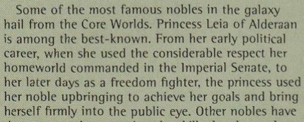

## scan p.104 (scan page 104)

Page contents: Hapes Cluster Nobles; Tapani Sector Nobles; Noble House Sympathy; Joining. (hand-read)

## scan p.105 (scan page 105)

Page contents: Table 5-11 Lord of the Expanse; Leaving a Noble House; Untouchable feat; Lord of the Expanse prestige class (Mecetti, Calipsa, Pelagia, Cadriaan) and requirements. (hand-read)

## scan p.106 (scan page 106)

Page contents: Lord of the Expanse features (Moment of Weakness, Minions, Resource Access, Commanding Presence, Personal Transport); Peace Brigade description (Yuuzhan Vong, attack on Yavin 4 academy). (hand-read)

## scan p.107 (scan page 107)

Page contents: Peace Brigade Sympathy (Nom Anor), Joining, Leaving; feats Biotech Familiarity, Jedi Hunter. (hand-read)

## scan p.108 (scan page 108)

Page contents: Rebel Alliance description and history (Mon Mothma, Bail Organa, Garm Bel Iblis, Ackbar, Crix Madine, Dodonna, Ghorman); Sympathy. (hand-read)

- **Mon Mothma; Bail Organa; Admiral Ackbar** — entry/section: Mon Mothma, recognized leader of the Alliance: "The recognized leader of the Alliance is Mon Mothma, the former Senator of Chandrila. Assisted initially by the Corellian military strategist Garm Bel Iblis and Senator Bail Organa of Alderaan, Mon Mothma carried on virtually alone after Bel Iblis went into hiding and Bail Organa died along with his homeworld. A strong, intelligent woman, Mon Mothma is also poised and graceful—a paragon of diplomacy and an inspiration to every member of the Alliance. She is aided by the Mon Calamari tactician Ackbar and the Imperial defector Crix Madine, the replacement for General Jan Dodonna (lost in the Battle of Yavin)." Source: *Hero's Guide* (SWRPG d20 Revised Core), scan p.108
  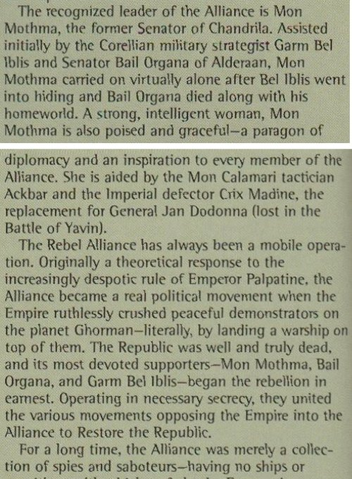

## scan p.109 (scan page 109)

Page contents: Rebel Sympathy cont.; Joining; Leaving; Rebel Training feat; Rebel Organizer prestige class and Table 5-12. (hand-read)

## scan p.110 (scan page 110)

Page contents: Rebel Organizer requirements and features (Culture Shift, Resource Access, Inspire Greatness, Skill Mastery, Inspire Heroism); Sienar Fleet Systems description. (hand-read)

## scan p.111 (scan page 111)

Page contents: Sienar Fleet Systems (Raith Sienar; TIE line, Vader's TIE Advanced x1); Sienar Sympathy. (hand-read)

- **Raith Sienar; Darth Vader (Anakin Skywalker)** — entry/section: Raith Sienar and the Death Star rumor: "The same goes for company head and founder Raith Sienar. Despite being something of a dreamer himself—rumor has it that the Death Star was originally his idea—Sienar has a keen grasp of his company's value to the Empire. So long as Sienar Fleet Systems continues to develop and produce weapons of destruction for the Emperor, SFS—and, by extension, its CEO—will survive. He doesn't like to think about the alternative." Source: *Hero's Guide* (SWRPG d20 Revised Core), scan p.111
  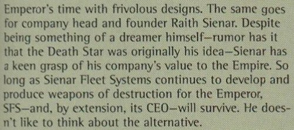

## scan p.112 (scan page 112)

Page contents: Sienar Joining (Raith Sienar interviews), Leaving; feats Sienar Service Contract, Starship Power Override; Sienar Engineer prestige class and Table 5-13. (hand-read)

## scan p.113 (scan page 113)

Page contents: Sienar Engineer features (Sienar Certification, Engineering Wizardry, Starship Mastercrafter); Other Factions intro; Other Factions: The Jedi. (hand-read)

## scan p.114 (scan page 114)

Page contents: Jedi joining/leaving; The Republic; The Sith; The Yuuzhan Vong; Other Time Periods (Rise of the Empire). (hand-read)

- **Palpatine (Darth Sidious); Darth Vader (Anakin Skywalker)** — entry/section: The only true Sith of the Empire: "Much as the Jedi served the Old Republic, the Sith served the Galactic Empire—or, rather, their cronies did, for the true Sith consisted at that time only of the Emperor and Darth Vader, and the Empire existed to serve them." Source: *Hero's Guide* (SWRPG d20 Revised Core), scan p.114
  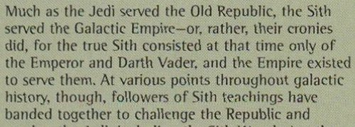

## scan p.115 (scan page 115)

Page contents: Rise of the Empire factions cont.; The New Republic era (Thrawn, Daala, Pellaeon, Xizor's death); The New Jedi Order era; Creating New Factions (Talon Karrde's Smugglers' Alliance). (hand-read)

- **Grand Admiral Thrawn; Admiral Daala; Gilad Pellaeon** — entry/section: Imperial task forces after Endor: "Though various Imperial task forces arise to challenge the New Republic, including the cunning Grand Admiral Thrawn and the infamous Admiral Daala, their efforts ultimately fail, and the military leader of what's left of the Empire, Grand Admiral Pellaeon, sues for peace with the New Republic." Source: *Hero's Guide* (SWRPG d20 Revised Core), scan p.115
  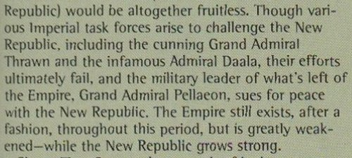
- **Prince Xizor; Luke Skywalker** — entry/section: Black Sun after Xizor; Luke's academy: "Sienar Fleet Systems loses much of its importance as well, and Black Sun all but disappears after the death of its greatest leader, Prince Xizor, shortly before the Battle of Endor. ... This era also sees the return of the Jedi Order, in the form of Luke Skywalker's training academy on Yavin 4—but the group is too small to be considered a true faction." Source: *Hero's Guide* (SWRPG d20 Revised Core), scan p.115
  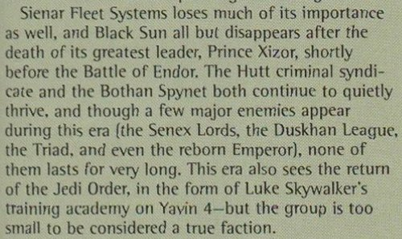
- **Talon Karrde; Grand Admiral Thrawn** — entry/section: Talon Karrde's Smugglers' Alliance: "Talon Karrde's Smugglers' Alliance, for example, is more of a guild than a faction. Even though it includes a great many members scattered throughout the galaxy, the group was founded to stand against the threat of Grand Admiral Thrawn. With Thrawn gone, the Smugglers' Alliance had little reason to stay together, and it ceased to exist." Source: *Hero's Guide* (SWRPG d20 Revised Core), scan p.115
  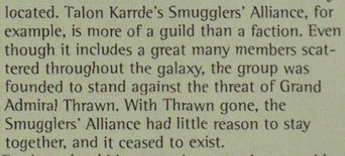

## scan p.116 (scan page 116)

Page contents: Blank/art page (no text). (hand-read)

## scan p.117 (scan page 117)

Page contents: Ch6 Equipment intro; Starting Credits for Higher-Level Characters (Jedi and nobles); Character Loans. (hand-read)

## scan p.118 (scan page 118)

Page contents: Table 6-1 Starting Credits; Getting a Loan: Amount, Interest, Payments, Missing a Payment. (hand-read)

## scan p.119 (scan page 119)

Page contents: Defaulting on a Loan (institutions, loan sharks); Communications Systems: comlinks, terminals. (hand-read)

## scan p.120 (scan page 120)

Page contents: Starship transmitters; com codes; messaging; pirate codes; local communications. (hand-read)

