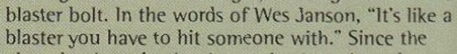
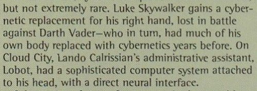

# Owner Material 037 — Star Wars D20 Drive folder (Core, Revised Core and Saga Edition): Sourcebooks/Hero's Guide.pdf [Star Wars Roleplaying Game Revised Core (d20, 2002)] (scan pages 121–180)

- **Source:** Wizards of the Coast Star Wars Roleplaying Game books, web enhancements, Living Force campaign modules and articles (2000–2010), from the owner's "Star Wars D20" Drive folder (only the three edition subfolders; "General" was not read, as instructed). Secondary source (licensed Legends reference). Scan OCR'd on the box; the scan stays box-only and is **not** published.
- **Method:** every scanned page was OCR'd and machine-screened sentence by sentence for power-relevant statements (fights, kills, defeats, Force feats, rankings, superweapons) that name a character on our roster; each kept sentence is quoted verbatim from the OCR text and has a crop of the printed passage directly under it. Pages with nothing power-relevant are still listed with what is on them.
- **Citation:** "*Hero's Guide* (SWRPG d20 Revised Core), p.X" by printed page ("scan p.X" where no printed number applies). **Weight:** Licensed RPG material: a secondary source. Narrative text sums up Legends lore; game statistics are rules for players, not canon power levels, and rank lowest.

## scan p.121 (scan page 121)

Page contents: Locator services; interstellar communications, subspace transceivers. (hand-read)

## scan p.122 (scan page 122)

Page contents: The HoloNet; New Equipment: Adumari blastsword (Wes Janson quote), AR-1 blaster rifle, discblade, hand claws. (hand-read)

- **Wes Janson** — entry/section: Wes Janson on the blastsword: "In the words of Wes Janson, "It's like a blaster you have to hit someone with."" Source: *Hero's Guide* (SWRPG d20 Revised Core), scan p.122
  

## scan p.123 (scan page 123)

Page contents: Military-grade comlink; targeting scope; shock whip; wan-shen. (hand-read)

## scan p.124 (scan page 124)

Page contents: Wan-shen cont.; zenji needle; Computers: dedicated terminal, mainframe. (hand-read)

## scan p.125 (scan page 125)

Page contents: Mainframe mastercraft; private computer; handheld computer; Cybernetics intro (Luke, Vader, Lobot); Cybernetic Technology. (hand-read)

- **Luke Skywalker; Darth Vader (Anakin Skywalker); Lobot; Lando Calrissian** — entry/section: Cybernetics of Luke, Vader and Lobot: "Luke Skywalker gains a cybernetic replacement for his right hand, lost in battle against Darth Vader—who in turn, had much of his own body replaced with cybernetics years before. On Cloud City, Lando Calrissian's administrative assistant, Lobot, had a sophisticated computer system attached to his head, with a direct neural interface." Source: *Hero's Guide* (SWRPG d20 Revised Core), scan p.125
  

## scan p.126 (scan page 126)

Page contents: Cybernetics availability; Limitations of Cybernetics; Disabling Injuries; Lost Limbs. (hand-read)

## scan p.127 (scan page 127)

Page contents: Tables 6-2 Disabled Limb and 6-3 Limb Sever Points; Lost Cyborged Limbs; Installing Cybernetics; Cybernetic Rejection; Elective Cybernetic Surgery. (hand-read)

## scan p.128 (scan page 128)

Page contents: Cybernetics and ion weapons; ion shielding; cybernetics and the Force; cybernetic equipment format; prosthetic limbs. (hand-read)

## scan p.129 (scan page 129)

Page contents: Table 6-4 Prosthetic Limbs; custom duplicate, improved/advanced, leg packages; cybernetic eye. (hand-read)

## scan p.130 (scan page 130)

Page contents: Table 6-5 Cybernetic Eyes; BioTech Borg Construct AJ^6; BioTech Superstruct skeletal reinforcement. (hand-read)

## scan p.131 (scan page 131)

Page contents: Neuro-Saav sensory package; subcutaneous comlink; tremor sensor; weapon mount. (hand-read)

## scan p.132 (scan page 132)

Page contents: Art page (no text). (hand-read)

## scan p.133 (scan page 133)

Page contents: Ch7 Combat intro; New Combat Actions; Aiming. (hand-read)

## scan p.134 (scan page 134)

Page contents: Aiming modifiers (position, support); suppression fire; pulling a blow; sidebar How Many Shots Can I Take? (hand-read)

## scan p.135 (scan page 135)

Page contents: Ion weapons vs. electronics; Burst of Speed in action; Lightsaber Deflection; Throwing Lightsabers. (hand-read)

## scan p.136 (scan page 136)

Page contents: Retrieving lightsabers; Clarifying Flanking; center-to-center line; flanking big creatures (Diagrams 7-1, 7-2). (hand-read)

## scan p.137 (scan page 137)

Page contents: Flanking big creatures cont.; Flanking with Reach (Diagram 7-3); Diagonal Corners and Flanking (Diagram 7-4). (hand-read)

## scan p.138 (scan page 138)

Page contents: Chapter Eight art page. (hand-read)

## scan p.139 (scan page 139)

Page contents: Ch8 The Force intro; New Force Techniques; Empower Force; Enlarge Force. (hand-read)

## scan p.140 (scan page 140)

Page contents: Multiplier sidebar; Extend Force; Maximize Force; Split Force; Alternative Force Traditions; Baran Do Sages description. (hand-read)

## scan p.141 (scan page 141)

Page contents: Baran Do (hid from Vader's Jedi hunting squads); philosophy; Force tradition; training. (hand-read)

## scan p.142 (scan page 142)

Page contents: Baran Do Force powers; feats Enhanced Danger Sense, Weather Sense; Baran Do Sage prestige class, requirements, Skill Mastery, Bonus Feat. (hand-read)

## scan p.143 (scan page 143)

Page contents: Table 8-1 Baran Do Sage; Uncanny Dodge, Guidance of the Force, Knowledge and Defense; Matukai history (Karvoss II, Inquisitors, Luke Skywalker's academy). (hand-read)

## scan p.144 (scan page 144)

Page contents: Matukai philosophy, Force tradition (wan-shen), training. (hand-read)

## scan p.145 (scan page 145)

Page contents: Matukai Force powers; Body Adjustment feat; Matukai Adept prestige class, Table 8-2, requirements. (hand-read)

## scan p.146 (scan page 146)

Page contents: Matukai Adept features (Wan-Shen, One-Handed Fighting, Resistance, Weapon Kata, Bonus Feat, Soft to Solid); Zeison Sha history (Yanibar). (hand-read)

## scan p.147 (scan page 147)

Page contents: Zeison Sha philosophy, Force tradition, training (discblade). (hand-read)

## scan p.148 (scan page 148)

Page contents: Zeison Sha Force powers; feats Force Shield, Recover Weapon; Zeison Sha Warrior prestige class and Table 8-3. (hand-read)

## scan p.149 (scan page 149)

Page contents: Zeison Sha Warrior features (Discblade Affinity, Bonus Feat, Second Nature, Move Object Mastery, Intercept Projectile); Creating New Force Traditions. (hand-read)

## scan p.150 (scan page 150)

Page contents: Creating New Force Traditions cont.; Force Spirits; Force Spirit Template (vitality, wounds, speed, defense, Force powers, DSP, manifestation). (hand-read)

## scan p.151 (scan page 151)

Page contents: Force spirit manifestation cont.; Force Travel (Will DCs); dark side modifiers; sample Force Spirit (Force Adept 6/Fringer 3); abilities, skills, equipment. (hand-read)

## scan p.152 (scan page 152)

Page contents: Art page (no text). (hand-read)

## scan p.153 (scan page 153)

Page contents: Ch9 Droids intro; Droids as Henchmen (extra set of eyes, designated ambulance). (hand-read)

## scan p.154 (scan page 154)

Page contents: One More Blaster (B1/B2 battle droids); drawbacks (restraining bolts); training remotes; Marksman H series stats; Combat by Remote. (hand-read)

## scan p.155 (scan page 155)

Page contents: Combat by Remote cont.; Droid Feats: Advanced Martial Programming, Chassis Compatibility. (hand-read)

## scan p.156 (scan page 156)

Page contents: Droid feats cont.: Defensive Martial Programming, Finely Tuned, Improved Martial Programming, Martial Programming, Persistent Personality; Droid Prestige Classes. (hand-read)

## scan p.157 (scan page 157)

Page contents: Table 9-1 Extended Droid Unarmed Damage; Espionage Droid prestige class, Table 9-2, requirements. (hand-read)

## scan p.158 (scan page 158)

Page contents: Espionage Droid features (Hidden Programming, Probe, Hard Backup, No Restraint); Berserker Droid prestige class and Table 9-3. (hand-read)

## scan p.159 (scan page 159)

Page contents: Berserker Droid requirements, class skills, Target Focus. (hand-read)

## scan p.160 (scan page 160)

Page contents: Berserker Droid Target Focus cont., Bonus Feat, Sneak Attack, Killing Machine. (hand-read)

## scan p.161 (scan page 161)

Page contents: Back cover: "Follow your own path" blurb, ISBN 0-7869-2883-2. (hand-read)

## scan p.162 (scan page 162)

Page contents: Appended Hero's Guide Web Enhancement title page: Character Templates and Prestige Classes, by JD Wiker and Rodney Thompson. (hand-read)

## scan p.163 (scan page 163)

Page contents: Web enhancement credits/legal; Character Templates intro; Clone template (Jango Fett, Thrawn, Palpatine; same text already logged from d646 p2); Shaped template intro. (hand-read)

## scan p.164 (scan page 164)

Page contents: Shaped (Yuuzhan Vong) template; Spice-Addicted template; Prestige Classes intro; Holovid Star. (hand-read)

## scan p.165 (scan page 165)

Page contents: Holovid Star requirements, class skills, Celebrity, Bonus Class Skill, Bonus Feat, Favor, Table 1. (hand-read)

## scan p.166 (scan page 166)

Page contents: Holovid Star Look-a-likes, Major Celebrity, Ex-Stars; Spirit Master prestige class, requirements, Table 2. (hand-read)

## scan p.167 (scan page 167)

Page contents: Spirit Master features: Spirit Totem, Spirit Lore, Spirit Focus, Unseen Defender, Spirit Form. (hand-read)

## scan p.168 (scan page 168)

Page contents: Spirit Form cont.; Corporate Viceprex prestige class: requirements, Resource Access, Personal Transport, Favor, Table 3. (hand-read)

## scan p.169 (scan page 169)

Page contents: Corporate Viceprex Favor cont., Minions, Signing Authority, Ex-Corporate; Imperial Moff prestige class, requirements, Table 4. (hand-read)

## scan p.170 (scan page 170)

Page contents: Imperial Moff class skills, Backup (stormtroopers), Resource Access, Bonus Feat, Overlord, Flagship, Personal Transport, Former Moffs; About the Authors. (hand-read)

## scan p.171 (scan page 171)

Page contents: Appended Hero's Guide Web Enhancement title page: Commerce and the Shadow Wing, by JD Wiker, Michael Mikaelian and Rodney Thompson. (hand-read)

## scan p.172 (scan page 172)

Page contents: Credits/legal; Commerce intro; Table 1 Container. (hand-read)

## scan p.173 (scan page 173)

Page contents: Table 2 Contents and subtables 2-A to 2-G (ore, medical, electronics, parts, chemicals, creatures, droids). (hand-read)

## scan p.174 (scan page 174)

Page contents: Tables 2-H Armor, 2-I Weapons, 2-J Vehicles, 2-K Starships; Supply and Demand; Availability; Supply, Table 3. (hand-read)

## scan p.175 (scan page 175)

Page contents: Price negotiation; Travel Time (Deel Surool example); Demand. (hand-read)

## scan p.176 (scan page 176)

Page contents: Table 4 Commodity Demand; saturating the market; Shipping; Cargo Size, Table 5; Travel Time; picking up additional cargo. (hand-read)

## scan p.177 (scan page 177)

Page contents: Cargo Priority; low/high-priority and overdue shipments; Operating Costs and license fees; The Shadow Wing pirates (Abin-Ral-Xufush). (hand-read)

## scan p.178 (scan page 178)

Page contents: Shadow Wing fleet and raids; Shadow Wing Sympathy (Hutt crime lord tale); Joining; Leaving. (hand-read)

## scan p.179 (scan page 179)

Page contents: Leaving cont.; Nest Egg faction feat; Shadow Wing Captain prestige class: requirements, Teamwork, Disabling Shot, Recruits. (hand-read)

## scan p.180 (scan page 180)

Page contents: Shadow Wing Captain Boarding Party, Cooperative Mark, Table; About the Authors. (hand-read)

