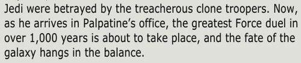
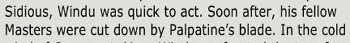
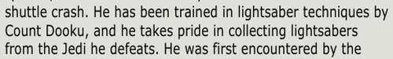
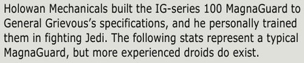
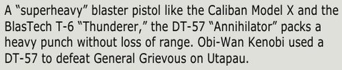
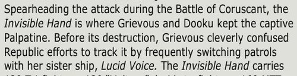
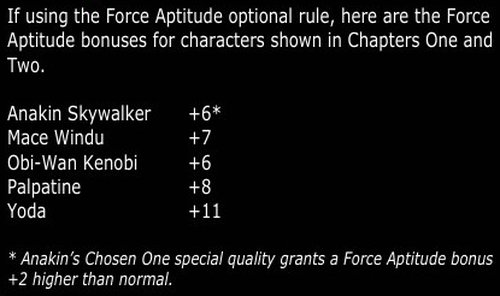
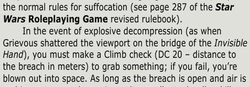

# Owner Material 037 — Star Wars D20 Drive folder (Core, Revised Core and Saga Edition): Sourcebooks/Revenge of the Sith Collection.pdf [Star Wars Roleplaying Game Revised Core (d20, 2002)]

- **Source:** Wizards of the Coast Star Wars Roleplaying Game books, web enhancements, Living Force campaign modules and articles (2000–2010), from the owner's "Star Wars D20" Drive folder (only the three edition subfolders; "General" was not read, as instructed). Secondary source (licensed Legends reference). Scan OCR'd on the box; the scan stays box-only and is **not** published.
- **Method:** every scanned page was OCR'd and machine-screened sentence by sentence for power-relevant statements (fights, kills, defeats, Force feats, rankings, superweapons) that name a character on our roster; each kept sentence is quoted verbatim from the OCR text and has a crop of the printed passage directly under it. Pages with nothing power-relevant are still listed with what is on them.
- **Citation:** "*Revenge of the Sith Collection* (SWRPG d20 Revised Core), p.X" by printed page ("scan p.X" where no printed number applies). **Weight:** Licensed RPG material: a secondary source. Narrative text sums up Legends lore; game statistics are rules for players, not canon power levels, and rank lowest.

## scan p.1 (scan page 1)

Page contents: Cover: Revenge of the Sith Collection, by Gary M. Sarli. (hand-read)

## scan p.2 (scan page 2)

Page contents: Credits; introduction (compiles Villains/Heroes/Starships and Vehicles of ROTS web articles plus Jedi Counseling rules); source abbreviations. (hand-read)

## scan p.3 (scan page 3)

Page contents: Ch1 Heroes: Obi-Wan Kenobi bio + stat block (Jedi guardian 7/Jedi Master 5/Jedi investigator 2); Yoda bio + stat block (Jedi consular 7/Jedi Master 9/Jedi instructor 4) - same as d140. (hand-read)

- **Palpatine (Darth Sidious)**: "Now, as he arrives in Palpatine's office, the greatest Force duel in over 1,000 years is about to take place, and the fate of the galaxy hangs in the balance." Source: *Revenge of the Sith Collection* (SWRPG d20 Revised Core), scan p.3
  

## scan p.4 (scan page 4)

Page contents: Yoda youth-feats note and Enhance Ability stats; Mace Windu bio + stats (Jedi guardian 5/weapon master 7/Jedi Master 7); Bail Organa (noble 9) - same as d140. (hand-read)

- **Palpatine (Darth Sidious)**: "Soon after, his fellow Masters were cut down by Palpatine's blade." Source: *Revenge of the Sith Collection* (SWRPG d20 Revised Core), scan p.4
  

## scan p.5 (scan page 5)

Page contents: Captain Raymus Antilles stats; Tarfful bio + stats (Male Wookiee soldier 9, read from image; Wrruushi feats); Chewbacca (scout 4/tech specialist 1) - same as d140. (hand-read)

## scan p.6 (scan page 6)

Page contents: Ch2 Villains: Emperor Palpatine bio + stat block (noble 3/dark side marauder 3/Sith warrior 4/Sith lord 10; DSP 24; Challenge Code I); Anakin Skywalker (Darth Vader) bio + stats begin - same as d152. (hand-read)

## scan p.7 (scan page 7)

Page contents: Anakin stats end (Devastating Strike 10/day); General Grievous bio + stat block (Kaleesh cyborg hybrid soldier 9/officer 5, read from image) - same as d152. (hand-read)

- **General Grievous; Count Dooku** — entry/section: General Grievous: "He has been trained in lightsaber techniques by Count Dooku, and he takes pride in collecting lightsabers from the Jedi he defeats." Source: *Revenge of the Sith Collection* (SWRPG d20 Revised Core), scan p.7
  

## scan p.8 (scan page 8)

Page contents: Ch3 Equipment and Droids: IG-series 100 MagnaGuard bodyguard droid (trained by Grievous to fight Jedi) stats and loyal protector features; buzz droid; buzz-droid missile. (hand-read)

- **General Grievous** — entry/section: IG-100 MagnaGuards trained by Grievous: "Holowan Mechanicals built the IG-series 100 MagnaGuard to General Grievous’s specifications, and he personally trained them in fighting Jedi. The following stats represent a typical MagnaGuard, but more experienced droids do exist." Source: *Revenge of the Sith Collection* (SWRPG d20 Revised Core), scan p.8
  

## scan p.9 (scan page 9)

Page contents: Buzz droid stats; new weapons: BlasTech DT-57 Annihilator (Obi-Wan used one to defeat Grievous on Utapau); electrostaff (phrik alloy retains DR vs lightsabers). (hand-read)

- **Obi-Wan Kenobi; General Grievous** — entry/section: DT-57 Annihilator: Obi-Wan defeats Grievous: "A “superheavy” blaster pistol like the Caliban Model X and the BlasTech T-6 “Thunderer,” the DT-57 “Annihilator” packs a heavy punch without loss of range. Obi-Wan Kenobi used a DT-57 to defeat General Grievous on Utapau." Source: *Revenge of the Sith Collection* (SWRPG d20 Revised Core), scan p.9
  

## scan p.10 (scan page 10)

Page contents: Kashyyyk long-gun; new droid equipment (adjoining limbs, climbing claws, grappling claw, jump servos); cyborg hybrid cybernetic rules. (hand-read)

## scan p.11 (scan page 11)

Page contents: Ch4 Starships: Venator-class Star Destroyer; Grievous's flagship Invisible Hand (Providence-class carrier/destroyer) stats. (hand-read)

- **General Grievous; Count Dooku; Palpatine (Darth Sidious)** — entry/section: Invisible Hand: "Spearheading the attack during the Battle of Coruscant, the Invisible Hand is where Grievous and Dooku kept the captive Palpatine. Before its destruction, Grievous cleverly confused Republic efforts to track it by frequently switching patrols with her sister ship, Lucid Voice." Source: *Revenge of the Sith Collection* (SWRPG d20 Revised Core), scan p.11
  

## scan p.12 (scan page 12)

Page contents: Invisible Hand weapons cont.; Recusant-class light destroyer; Munificent-class star frigate (hyperwave jammer). (hand-read)

## scan p.13 (scan page 13)

Page contents: Munificent weapons cont.; ARC-170 starfighter; Eta-2 Actis Jedi interceptor. (hand-read)

## scan p.14 (scan page 14)

Page contents: V-wing; Tri-fighter; Palpatine's Theta-class shuttle (sensor masks). (hand-read)

## scan p.15 (scan page 15)

Page contents: Theta shuttle cont.; HMP droid gunship; Wookiee Oevvaor jet catamaran. (hand-read)

## scan p.16 (scan page 16)

Page contents: Wookiee Raddaugh Gnasp fluttercraft; HAVw A6 Juggernaut. (hand-read)

## scan p.17 (scan page 17)

Page contents: Juggernaut weapons cont.; AT-AP; AT-RT; swamp speeder intro. (hand-read)

## scan p.18 (scan page 18)

Page contents: ISP swamp speeder; Grievous's Tsmeu-6 wheel bike. (hand-read)

## scan p.19 (scan page 19)

Page contents: Ch5 New Rules: optional Force Aptitude (class Force bonus) with NPC Force ratings (Yoda +11, Palpatine +8, Mace +7, Obi-Wan +6, Anakin +6 incl. Chosen One +2); Deepest Commitment; Block errata; Lightsaber Mastery options. (hand-read)

- **Yoda; Palpatine (Darth Sidious); Mace Windu; Obi-Wan Kenobi; Darth Vader (Anakin Skywalker)** — entry/section: NPC Force Ratings (Force Aptitude): "If using the Force Aptitude optional rule, here are the Force Aptitude bonuses for characters shown in Chapters One and Two.
Anakin Skywalker +6* Mace Windu +7 Obi-Wan Kenobi +6 Palpatine +8 Yoda +11
* Anakin’s Chosen One special quality grants a Force Aptitude bonus +2 higher than normal." Source: *Revenge of the Sith Collection* (SWRPG d20 Revised Core), scan p.19
  

## scan p.20 (scan page 20)

Page contents: Reduced Lightsaber Damage variant; Alchemy (mask) technique; Disable Device sabotage; Force Grip errata/Force Choke; Force Lightning skill. (hand-read)

## scan p.21 (scan page 21)

Page contents: Force Lightning cont.; Force Strike errata/Force Push; revised Move Object (moving objects, characters, vehicles; hurling). (hand-read)

## scan p.22 (scan page 22)

Page contents: Move Object cont. (Force Jump, Force Fall); Melee Advantage and Maiming optional rules; Opposed Force Skills. (hand-read)

## scan p.23 (scan page 23)

Page contents: Opposed Force Skills cont. (feedback); My Ally is the Force; The Force is Strong in This One; Resisting Temptation; hyperspace travel errata. (hand-read)

## scan p.24 (scan page 24)

Page contents: Missile speed errata; falling damage errata; slower suffocation; vacuum and explosive decompression (Grievous shattering the Invisible Hand viewport). (hand-read)

- **General Grievous** — entry/section: Grievous shatters the Invisible Hand viewport: "In the event of explosive decompression (as when Grievous shattered the viewport on the bridge of the Invisible Hand), you must make a Climb check (DC 20 - distance to the breach in meters) to grab something; if you fail, you're blown out into space." Source: *Revenge of the Sith Collection* (SWRPG d20 Revised Core), scan p.24
  
