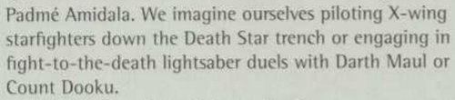

# Owner Material 037 — Star Wars D20 Drive folder (Core, Revised Core and Saga Edition): Sourcebooks/Revised Core Rulebook.pdf [Star Wars Roleplaying Game Revised Core (d20, 2002)] (scan pages 1–60)

- **Source:** Wizards of the Coast Star Wars Roleplaying Game books, web enhancements, Living Force campaign modules and articles (2000–2010), from the owner's "Star Wars D20" Drive folder (only the three edition subfolders; "General" was not read, as instructed). Secondary source (licensed Legends reference). Scan OCR'd on the box; the scan stays box-only and is **not** published.
- **Method:** every scanned page was OCR'd and machine-screened sentence by sentence for power-relevant statements (fights, kills, defeats, Force feats, rankings, superweapons) that name a character on our roster; each kept sentence is quoted verbatim from the OCR text and has a crop of the printed passage directly under it. Pages with nothing power-relevant are still listed with what is on them.
- **Citation:** "*Revised Core Rulebook* (SWRPG d20 Revised Core), p.X" by printed page ("scan p.X" where no printed number applies). **Weight:** Licensed RPG material: a secondary source. Narrative text sums up Legends lore; game statistics are rules for players, not canon power levels, and rank lowest.

## scan p.1 (scan page 1)

Page contents: 23 words, 6 paragraphs | headings/entries: GAME; ROLE Rr LAY tn G; REVISED CORE RULEBOOK; BILL SLAVICSEK, ANDY COLLINS, JD WIKER; WITH A FOREWORD BY STEVE SANSWEET

## scan p.2 (scan page 2)

Page contents: 11 words, 3 paragraphs | headings/entries: ROLCE\F EAYIN GS GAME; BILL SLAVICSEK, ANDY COLLINS, JD WIKER

## scan p.3 (scan page 3)

Page contents: 0 words, 0 paragraphs | headings/entries: 

## scan p.4 (scan page 4)

Page contents: 485 words, 61 paragraphs | headings/entries: I\P@user 4A; O A m 0 aa ms; DESIGNERS; BILL SLAVICSEK, ANDY COLLINS, JD WIKER; DESIGN ASSISTANCE; REVISED EDITION DEVELOPMENT AND EDITING; BILL SLAVICSEK, CHRISTOPHER PERKINS; EDITORS; BRIAN CAMPBELL, CORY J. HERNDON; MANAGING EDITOR; KIM MOHAN; STAR WARS RPG CREATIVE DIRECTOR; CHRISTOPHER PERKINS; VISUAL CREATIVE DIRECTOR; JON SCHINDEHETTE; ART DIRECTOR; SEAN GLENN; GRAPHIC DESIGNER; ABIGAIL FEIN, MARK GOETZ; CARTOGRAPHERS; TODD GAMBLE, KYLE HUNTER; TYPESETTER; ANGELIKA LOKOTZ; PRODUCTION; JEFFERSON DUNLAP, CHRIS HANIS; COVER ARTIST; TOMMY LEE EDWARDS; INTERIOR ARTISTS; VICE PRESIDENT AND DIRECTOR OF RPG R&D; BILL SLAVICSEK; VIGE PRESIDENT OF PUBLISHING; MARY KIRCHOFF; STAR WARS RPG BUSINESS MANAGER; DAVID WISE; PROWVECT MANAGER; DOUGLAS STEVES; PRODUCTION MANAGER; CHAS DELONG; LUCAS LICENSING EDITOR; MICHELLE VUCKOVICH; LUCAS LICENSING ART EDITOR; IAIN MORRIS; U.S., CANADA; P.O. Box 7

## scan p.5 (scan page 5)

Page contents: 609 words, 36 paragraphs | headings/entries: FOREWORD DESIGNER'S PREFACE; PLAYER'S SECTION; INTRODUCTION; THE BASICS; PLAYING STAR WARS 12; CHARACTER CREATION _ 14; CHAFTIRG HEROIC 118; GAMEMASTER'S SECTION; CHAPTER A ALLIES ° 38 AND OPPONENTS; APPENDIX; PLAYTESTERS 376; TERMS AND; DEFINITIONS 377; INDEX 379; CHARACTER SHEET 382

## scan p.6 (scan page 6)

Page contents: 820 words, 17 paragraphs | headings/entries: Foreword; Stephen J. Sansweet October 14, 2001

## scan p.7 (scan page 7)

Page contents: 879 words, 22 paragraphs | headings/entries: Designer's Preface; SS Se |; Bill Slavicsek October 18, 2001; Lo ao an

## scan p.8 (scan page 8)

Page contents: 766 words, 32 paragraphs | headings/entries: D>; NOILOMNQOALNI; Introduction; This Is Star Wars; This Is a Roleplaying Game; This Is the Star Wars Roleplaying Game; Characters; BO OBO DBABDOOBODDD

## scan p.9 (scan page 9)

Page contents: 541 words, 13 paragraphs | headings/entries: The Three Eras of Play

## scan p.10 (scan page 10)

Page contents: 921 words, 31 paragraphs | headings/entries: The Basics; The Galaxy; THIS BOOK; The Core Mechanic; The Gamemaster; Heroes

- **Darth Maul; Count Dooku**: "We imagine ourselves piloting X-wing starfighters down the Death Star trench or engaging in fight-to-the-death lightsaber duels with Darth Maul or Count Dooku." Source: *Revised Core Rulebook* (SWRPG d20 Revised Core), scan p.10
  

## scan p.11 (scan page 11)

Page contents: 918 words, 28 paragraphs | headings/entries: Species; Level; Abilities; Vitality and Wound Points; Skills and Feats; Rolling Dice

## scan p.12 (scan page 12)

Page contents: 939 words, 43 paragraphs | headings/entries: A Game Session; What Characters Can Do; Listen at a door; Use a computer terminal; Explore a location; Converse with an alien; Bargain with a merchant; Intimidate a thug; Talk to an ally; Pilot a vehicle; Search for a clue; Bluff an official; Repair an item; Swing across a turbolift shaft; Move; Duck behind a bulkhead; Attack an opponent; MDAMDDADODDDADDODAO@; Skill Checks; Ability Checks; Attack Rolls

## scan p.13 (scan page 13)

Page contents: 852 words, 31 paragraphs | headings/entries: The Combat Round; Attack Actions; Move Actions; THE Force © EDI LIKE MY FATHER."; Full-Round Actions; Free Actions; Reactions; Force Points; What's Next?

## scan p.14 (scan page 14)

Page contents: 1063 words, 21 paragraphs | headings/entries: Playing Star Wars; Setup; General Advice; The First Game Session

## scan p.15 (scan page 15)

Page contents: 1078 words, 43 paragraphs | headings/entries: Mike (Rorwaorr): 17 for Rorworr!; Penny (Vor'en): The soldier got an 8,; Everyone make an initiative check!; Mike (Rorworr): 10 for Rorworr!; Sia-Lan 18; Deel 15; Thugs 13 ther roll); Vor'en 12; Rorworr 10; Senator 7 (her roll); SaVM AVLS DNIAV 1d

## scan p.16 (scan page 16)

Page contents: 682 words, 41 paragraphs | headings/entries: Character Creation; Generate Ability Scores; Select Your Species; Choose Your Class; Assign Ability Scores; Write Down Your Species Features; Write Down Your Class Features; Vitality Points; Wound Points; Speed; Base Attack Bonus; Reputation

## scan p.17 (scan page 17)

Page contents: 836 words, 30 paragraphs | headings/entries: Finishing Your Character Find Out More

## scan p.18 (scan page 18)

Page contents: 4 words, 2 paragraphs | headings/entries: CHAPTER ONE; ABILITIES |

## scan p.19 (scan page 19)

Page contents: 455 words, 12 paragraphs | headings/entries: Your Ability Scores; Random Generation; Ability Modifiers

## scan p.20 (scan page 20)

Page contents: 726 words, 39 paragraphs | headings/entries: Reraolling; Planned Generation; The standard score package is:; The Abilities; You apply your character's Strength modifier to:; Table 1-1: Ability Modifiers; You apply your character's Dexterity modifier to:; You apply your Constitution modifier to:; You apply your character's Intelligence modifier to:; Wisdom (Wis)

## scan p.21 (scan page 21)

Page contents: 841 words, 38 paragraphs | headings/entries: You apply your character's Wisdom modifier to:; Charisma (Cha); Charisma measures a character's force of personality,; Example of Generating and Assigning Ability Scores

## scan p.22 (scan page 22)

Page contents: 3 words, 2 paragraphs | headings/entries: CHAPTER TWO; SPEcIES|2

## scan p.23 (scan page 23)

Page contents: 478 words, 13 paragraphs | headings/entries: Choosing a Species; Species Characteristics; Ability Adjustments

## scan p.24 (scan page 24)

Page contents: 710 words, 28 paragraphs | headings/entries: Table 2-1: Species Ability Adjustments; Species and Languages; Gungan +2 Con, —2 Wis; Mon Calamari; Humans; The New Jedi Order (25+ years after; Star Wars Episode IV: A New Hope); HUMAN

## scan p.25 (scan page 25)

Page contents: 704 words, 33 paragraphs | headings/entries: Human Species Traits; Bothans; Bothan Species Traits

## scan p.26 (scan page 26)

Page contents: 478 words, 19 paragraphs | headings/entries: Salosds; TS CEREAN; Cereans; Q2®@; Duros

## scan p.27 (scan page 27)

Page contents: 612 words, 38 paragraphs | headings/entries: Duros Species Traits; Ewoks; EwoK; Group Proficiency (primitive weapons) and Weapon; OD; Sighs Baer UP ANOTHER PATHETIC LIFE FORM"; Y) U mM 0] m vA

## scan p.28 (scan page 28)

Page contents: 650 words, 31 paragraphs | headings/entries: Gamorreans; GAMORREAN; Gungans

## scan p.29 (scan page 29)

Page contents: 467 words, 21 paragraphs | headings/entries: GUNGAN; Gungan Species Traits

## scan p.30 (scan page 30)

Page contents: 705 words, 34 paragraphs | headings/entries: Ithorian Species Traits; Kel Dor; Kel Dor Species Traits; Mon Calamari

## scan p.31 (scan page 31)

Page contents: 449 words, 23 paragraphs | headings/entries: MON CALAMARI; Mon Calamari Species Traits; Quarren; QUARREN; U m C] Mm i)

## scan p.32 (scan page 32)

Page contents: 624 words, 34 paragraphs | headings/entries: Quarren Species Traits; Rodians; Sullustans

## scan p.33 (scan page 33)

Page contents: 464 words, 24 paragraphs | headings/entries: Y U m C] mM vA); Trandoshan Species Traits; SULLUSTAN; Trandoshans; TRANDOSHAN

## scan p.34 (scan page 34)

Page contents: 669 words, 35 paragraphs | headings/entries: Y U m C] m WA); Twi leks; Twi'lek Species Traits; O®; Wookiees; Wookiee Species Traits

## scan p.35 (scan page 35)

Page contents: 514 words, 27 paragraphs | headings/entries: WOOKIEE; Zabrak; Zabrak Species Traits; ZABRAK

## scan p.36 (scan page 36)

Page contents: 3 words, 2 paragraphs | headings/entries: CHAPTER THREE; CLASSES|@

## scan p.37 (scan page 37)

Page contents: 473 words, 16 paragraphs | headings/entries: The Classes; The Multiclass Character

## scan p.38 (scan page 38)

Page contents: 443 words, 11 paragraphs | headings/entries: Class and Level Bonuses

## scan p.39 (scan page 39)

Page contents: 938 words, 39 paragraphs | headings/entries: Base Save Bonuses; Level-Dependent Benefits; Class Descriptions; Abilities; Die Type Class; Class Skills; La | o3 —; C] al > Y/] i] m i)

## scan p.40 (scan page 40)

Page contents: 968 words, 35 paragraphs | headings/entries: SasSSV 10; Advancing a Level

## scan p.41 (scan page 41)

Page contents: 606 words, 17 paragraphs | headings/entries: What's New?; Class Level and Character Level; Ssassv 1g

## scan p.42 (scan page 42)

Page contents: 758 words, 18 paragraphs | headings/entries: SasSsv ld; Fringer; Exploits; Characteristics; Table 3-2: The Fringer; Background

## scan p.43 (scan page 43)

Page contents: 401 words, 23 paragraphs | headings/entries: Class Skills; Starting Feats; Bonus Feats; Bonus Class Skills; Jury-Rig; Survival; Sassv ld; KELKO, RODIAN FRINGER

## scan p.44 (scan page 44)

Page contents: 714 words, 24 paragraphs | headings/entries: Noble; Exploits; Characteristics; Background; Abilities; Class Skills; Defense Reputation

## scan p.45 (scan page 45)

Page contents: 518 words, 18 paragraphs | headings/entries: Starting Feats; Bonus Class Skill; Favor; Inspire Confidence; ARAN! KARDEN, HUMAN NOBLE; Oo > co

## scan p.46 (scan page 46)

Page contents: 537 words, 18 paragraphs | headings/entries: C] 'g > i) i) mM vA); Resource Access; Inspire Greatness

## scan p.47 (scan page 47)

Page contents: 407 words, 18 paragraphs | headings/entries: Scoundrel; Exploits; Characteristics; Background; Abilities; DEEL SUROOL, TWHLEK SCOUNDREL; SsassVv ld

## scan p.48 (scan page 48)

Page contents: 687 words, 33 paragraphs | headings/entries: Class Skills; Starting Feats; Illicit Barter; Bonus Feats; Initiative, Fame, Infamy, Low Profile, Weapon Finesse,; Defense Reputation

## scan p.49 (scan page 49)

Page contents: 512 words, 13 paragraphs | headings/entries: Scout; Exploits; Characteristics; Background; Lae > —; C] Si > i i) m i

## scan p.50 (scan page 50)

Page contents: 706 words, 29 paragraphs | headings/entries: Defense Reputation | if; Abilities; Class Skills; Starting Feats; Bonus Feats; Eyed, Skill Emphasis (Survival), Starship Operation (space; Trailblazing; Heart

## scan p.51 (scan page 51)

Page contents: 410 words, 18 paragraphs | headings/entries: Ssassvld; Skill Mastery; Evasion; Scout Circumstance Penalty; RORWORR, WOOKIEE SCOUT

## scan p.52 (scan page 52)

Page contents: 489 words, 16 paragraphs | headings/entries: Soldier; Exploits; Table 3-6: The Soldier; Characteristics; Background; R ANYBODY."

## scan p.53 (scan page 53)

Page contents: 379 words, 25 paragraphs | headings/entries: Game Rule Information; Abilities; Class Skills; Class Features; Starting Feats; Bonus Feats; VOR'EN KURN, HUMAN SOLDIER

## scan p.54 (scan page 54)

Page contents: 672 words, 30 paragraphs | headings/entries: C] i > Y vA mM i); Tech Specialist; Exploits; Characteristics; Background; Abilities; Class Skills; Starting Feat; Defense Reputation

## scan p.55 (scan page 55)

Page contents: 506 words, 19 paragraphs | headings/entries: Research; Instant Mastery; Tech Specialty; Datapad Craft (electronic devices) Medpac Craft (medpacs); KAZ LO, ZABRAK TECH SPECIALIST; C] = > vA mA m mA

## scan p.56 (scan page 56)

Page contents: 764 words, 26 paragraphs | headings/entries: Credits; Force Adept; Exploits; Characteristics; Background; Examples of Force Adepts

## scan p.57 (scan page 57)

Page contents: 419 words, 29 paragraphs | headings/entries: Abilities; Ss3assvVv 1d; Class Skills; Starting Feats; Bonus Feats; Force Weapon fs

## scan p.58 (scan page 58)

Page contents: 707 words, 30 paragraphs | headings/entries: Skill Emphasis; Table 3-8: The Force Adept; Comprehend Speech; Force Talisman; Credits; Defense Reputation

## scan p.59 (scan page 59)

Page contents: 766 words, 39 paragraphs | headings/entries: Jedi Consular; Exploits; Characteristics; Background; Examples of Jedi Consulars; Class Skills; Starting Feats; COUNT OOOKU'S LIGHTSABER

## scan p.60 (scan page 60)

Page contents: 826 words, 23 paragraphs | headings/entries: Bonus Feats; Deflect (Attack); Defense Reputation

