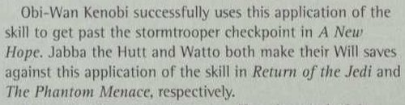
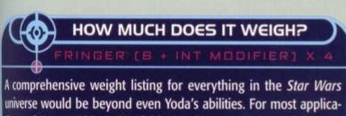
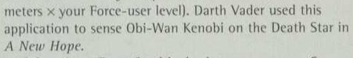

# Owner Material 037 — Star Wars D20 Drive folder (Core, Revised Core and Saga Edition): Sourcebooks/Revised Core Rulebook.pdf [Star Wars Roleplaying Game Revised Core (d20, 2002)] (scan pages 61–120)

- **Source:** Wizards of the Coast Star Wars Roleplaying Game books, web enhancements, Living Force campaign modules and articles (2000–2010), from the owner's "Star Wars D20" Drive folder (only the three edition subfolders; "General" was not read, as instructed). Secondary source (licensed Legends reference). Scan OCR'd on the box; the scan stays box-only and is **not** published.
- **Method:** every scanned page was OCR'd and machine-screened sentence by sentence for power-relevant statements (fights, kills, defeats, Force feats, rankings, superweapons) that name a character on our roster; each kept sentence is quoted verbatim from the OCR text and has a crop of the printed passage directly under it. Pages with nothing power-relevant are still listed with what is on them.
- **Citation:** "*Revised Core Rulebook* (SWRPG d20 Revised Core), p.X" by printed page ("scan p.X" where no printed number applies). **Weight:** Licensed RPG material: a secondary source. Narrative text sums up Legends lore; game statistics are rules for players, not canon power levels, and rank lowest.

## scan p.61 (scan page 61)

Page contents: 486 words, 19 paragraphs | headings/entries: SEN UDO-MAL, CEREAN JEDI CONSULAR; Deflect (Extend Defense and Attack); Healing; Skill Emphasis; Block; Credits; C] @ > vf) Y) mM A

## scan p.62 (scan page 62)

Page contents: 456 words, 21 paragraphs | headings/entries: Exploits; Characteristics; Background; Examples of Jedi Guardians; Abilities; Vitality; BIA*LAN WEZZ, HUMAN JEDI GUARDIAN; S3asSsvV10

## scan p.63 (scan page 63)

Page contents: 883 words, 39 paragraphs | headings/entries: Class Skills; Starting Feats; Deflect (Defense); Gi) DARK AND FALLEN JEDI; Bonus Feats; Deflect (Attack)

## scan p.64 (scan page 64)

Page contents: 800 words, 22 paragraphs | headings/entries: Deflect (Extend Defense and Attack); Table 3-9: The Jedi Guardian; Gy ERA NOTES: JEDI GUARDIAN; Block; Credits

## scan p.65 (scan page 65)

Page contents: 343 words, 26 paragraphs | headings/entries: DORN TAVERS, HUMAN JEDI GUARDIAN; Multiclass Characters; Level; Vitality Points; Base Attack Bonus; Ssassv lg

## scan p.66 (scan page 66)

Page contents: 421 words, 18 paragraphs | headings/entries: C] 1 D> Y) /) mM vA); Saving Throws; Defense Bonus; Reputation Bonus; Skills; Feats; Ability Increases

## scan p.67 (scan page 67)

Page contents: 1054 words, 21 paragraphs | headings/entries: Adding a Second Class; Advancing a Level; How Multiclassing Works; C] = > i) i) m i]

## scan p.68 (scan page 68)

Page contents: 3 words, 2 paragraphs | headings/entries: CHAPTER FOUR; SKILLS|f

## scan p.69 (scan page 69)

Page contents: 486 words, 14 paragraphs | headings/entries: P Skills Summary; Getting Skills; What's New?

## scan p.70 (scan page 70)

Page contents: 1033 words, 18 paragraphs | headings/entries: How Do Skills Work?; Skill Check; Opposed Check; Skills at 2nd Level; V A = a v1

## scan p.71 (scan page 71)

Page contents: 990 words, 33 paragraphs | headings/entries: Untrained Checks; Acquiring Skill Ranks; Class Skill Points * Skill Points"; Of, > CHARACTER SKILLS; Ss AS

## scan p.72 (scan page 72)

Page contents: 759 words, 28 paragraphs | headings/entries: Using Skills; Skill Checks; Difficulty Class; Q5))GM NOTES: DEGREES OF SUCCESS ] UG;; Examples; In general, this means:; Result; Degree of Success Success; Greater success Perfect success

## scan p.73 (scan page 73)

Page contents: 755 words, 24 paragraphs | headings/entries: Table 4-2: Difficulty Class Examples; Opposed Checks; Trying Again

## scan p.74 (scan page 74)

Page contents: 1042 words, 24 paragraphs | headings/entries: Time and Skill Checks; Checks without Rolls; Taking 10

## scan p.75 (scan page 75)

Page contents: 574 words, 12 paragraphs | headings/entries: Cooperation; Skill Synergy; Y) a = e "1

## scan p.76 (scan page 76)

Page contents: 746 words, 7 paragraphs | headings/entries: STWAS

## scan p.77 (scan page 77)

Page contents: 975 words, 36 paragraphs | headings/entries: Force Skills; Skill Descriptions; Skill Name (Key Ability); Trained Only; Armor Check Penalty; Table 4-5: Force Skills; La |

## scan p.78 (scan page 78)

Page contents: 979 words, 30 paragraphs | headings/entries: Astrogate (Int); Trained Only

- **Obi-Wan Kenobi** — entry/section: Affect Mind examples (Revised Core Rulebook, Ch4 Force skills): "Obi-Wan Kenobi successfully uses this application of the skill to get past the stormtrooper checkpoint in A New Hope. Jabba the Hutt and Watto both make their Will saves against this application of the skill in Return of the Jedi and The Phantom Menace, respectively." Source: *Revised Core Rulebook* (SWRPG d20 Revised Core), scan p.78
  

## scan p.79 (scan page 79)

Page contents: 647 words, 32 paragraphs | headings/entries: Battlemind (Con); Force Skill; Trained Only; Requires the Force-Sensitive; Bluff (Cha); OO; WHO'S RUNNING THE BLUFF HERE?

## scan p.80 (scan page 80)

Page contents: 1014 words, 37 paragraphs | headings/entries: Example Circumstances Sense Motive Modifier; Example Circumstances Sense Motive Modifie;; Reactions; Free Action; Attack Action; Move Action; Full-Round Action; Longer than a Round

## scan p.81 (scan page 81)

Page contents: 955 words, 45 paragraphs | headings/entries: Climb (Str); Amor Check Penalty; DC Example Wall or Surface; Computer Use (Int); Type of Information DC

## scan p.82 (scan page 82)

Page contents: 857 words, 47 paragraphs | headings/entries: PEE FO ci a; SUAS; Saatertt; DC CiTime 10 1 minute; Wipe droid's memory? 10 = Special; Change passcodes 20 ~=—1 minute; Hide evidence of alteration +10 1 minute; Undo previous changes +5 1 hour; Type of Operation DC Time; Reset parameters 25 '1 minute per remote; Change passcodes 20 ~=—1: minute; Hide evidence of alteration +10 1 minute; Craft (Int)

## scan p.83 (scan page 83)

Page contents: 996 words, 27 paragraphs | headings/entries: Examples; Medium 50 10; High 150 15; Extreme 1,000 20; Astronomical 3,000 30+

## scan p.84 (scan page 84)

Page contents: 954 words, 26 paragraphs | headings/entries: SUAS; Demolitions (Int); Trained Only; Type (and Damage) of; Diplomacy (Cha)

## scan p.85 (scan page 85)

Page contents: 905 words, 39 paragraphs | headings/entries: Disable Device (Int); Chat, advise, offer limited help, advocate; Tricky 1d4 rounds 15 Sabotage an electronic; Disarm or reset a; Difficult 2d4 rounds 20; Disguise (Cha)

## scan p.86 (scan page 86)

Page contents: 828 words, 36 paragraphs | headings/entries: STAs; Drain Energy (Con); Power Source Example VP Cost; Simple device Datapad, comlink 2; Power pack Blaster, ion gun 4; Energy cell Lightsaber, vibro 8 weapons; Portable generator E-Web repeating 12; Empathy (Wis)

## scan p.87 (scan page 87)

Page contents: 362 words, 23 paragraphs | headings/entries: Force Bonus +2 +4; Enhance Senses (Wis)

## scan p.88 (scan page 88)

Page contents: 941 words, 43 paragraphs | headings/entries: Entertain (Cha); DC —— Performance; Escape Artist (Dex); Armor Check Penalty; Restraint pc; Ropes Opponent's Dex check +10 Net 20; Binders 30; Manacles 35; Tight space 30; Grappler Grappler's grapple check; Farseeing (Wis)

## scan p.89 (scan page 89)

Page contents: 744 words, 47 paragraphs | headings/entries: Force Grip (Int); Time: Force Grip is an attack action,; Force Lightning (Int); STuUAS

## scan p.90 (scan page 90)

Page contents: 799 words, 35 paragraphs | headings/entries: Force Strike (Int)

## scan p.91 (scan page 91)

Page contents: 653 words, 29 paragraphs | headings/entries: Gamble (Wis); Result Wins or Losses

## scan p.92 (scan page 92)

Page contents: 964 words, 32 paragraphs | headings/entries: SUAS; Difference Change in Winnings; Type of Information pc Cost

## scan p.93 (scan page 93)

Page contents: 662 words, 29 paragraphs | headings/entries: Heal Another (Wis)

## scan p.94 (scan page 94)

Page contents: 789 words, 34 paragraphs | headings/entries: Vitality; Hide (Dex); Armor Check Penalty; IIlusion (Cha); Distance Vitality Point Cost/Round

## scan p.95 (scan page 95)

Page contents: 916 words, 48 paragraphs | headings/entries: Using Musion to perform a deadly; Standing high jump Jump back; Amor Check Penalty; Running high jump *; Knowledge (Int); Trained Only

## scan p.96 (scan page 96)

Page contents: 906 words, 38 paragraphs | headings/entries: Listen (Wis)

## scan p.97 (scan page 97)

Page contents: Move Object weight classes (sidebar "How Much Does It Weigh?"): each order of magnitude (5 kg, 50 kg, 500 kg...) adds +5 DC and doubles vitality cost; top classes listed are "Colossal droids, small capital ships (for example, the Rebel Blockade Runner Tantive IV)" and "Massive capital ships (Trade Federation Battleship, Mon Calamari Star Cruiser, or Super Star Destroyer, for example)". Hurling with Move Object only up to 50 kg "but not with any speed or power". (hand-read)

- **Yoda** — entry/section: SIDEBAR How Much Does It Weigh? (Move Object): "A comprehensive weight listing for everything in the Star Wars universe would be beyond even Yoda's abilities." Source: *Revised Core Rulebook* (SWRPG d20 Revised Core), scan p.97
  

## scan p.98 (scan page 98)

Page contents: 823 words, 40 paragraphs | headings/entries: Y) A rc a i"; AN | THOUGHT."; Read/Write Language (None); Trained Only; Repair (Int); Trained Only

## scan p.99 (scan page 99)

Page contents: 943 words, 36 paragraphs | headings/entries: Task DC Cost; Very complex (starship component) 25 1/10 price; DC iTask

## scan p.100 (scan page 100)

Page contents: 1016 words, 35 paragraphs | headings/entries: See Force (Wis); Sense Motive (Wis); Sleight of Hand (Dex); Trained Only; Armor Check Penalty

- **Darth Vader (Anakin Skywalker); Obi-Wan Kenobi** — entry/section: See Force (Revised Core Rulebook, Ch4 Force skills): "Darth Vader used this application to sense Obi-Wan Kenobi on the Death Star in A New Hope." Source: *Revised Core Rulebook* (SWRPG d20 Revised Core), scan p.100
  

## scan p.101 (scan page 101)

Page contents: 929 words, 38 paragraphs | headings/entries: Spot (Wis); Survival (Wis); DC Task; SUAS

## scan p.102 (scan page 102)

Page contents: 659 words, 24 paragraphs | headings/entries: SUAS

## scan p.103 (scan page 103)

Page contents: 783 words, 30 paragraphs | headings/entries: Tumble (Dex); Trained Only; Armor Check Penalty; DC Task; S

## scan p.104 (scan page 104)

Page contents: 2 words, 1 paragraphs | headings/entries: CHAPTER FIVE

## scan p.105 (scan page 105)

Page contents: 454 words, 14 paragraphs | headings/entries: Acquiring Feats; Prerequisites; Types of Feats; What's New?

## scan p.106 (scan page 106)

Page contents: 524 words, 95 paragraphs | headings/entries: Table 5-1: Feats; Feat; Acrobatic; Alertness; Ambidexterity; Animal Affinity; Armor Proficiency (light) Armor Proficiency (medium); Armor Proficiency (heavy); Armor Proficiency (powered); Athletic; Blind-Fight; Cautious; Combat Reflexes Dodge Mobility Spring Attack; Endurance; Exotic Weapon Proficiency * Fame; Force-Sensitive; Frightful Presence Gearhead; Great Fortitude; Headstrong; Heroic Surge; Improved Critical *; Improved Initiative; Infamy; Influence; Iron Will; Lightning Reflexes; Low Profile; Advanced Martial Arts; Prerequisite; Dex 15; Armor Proficiency (light); Armor Proficiency (light), Armor Proficiency (medium); Armor Proficiency (light), Armor Proficiency (medium); Int 13; Int 13, Combat Expertise; Int 13, Combat Expertise; Dex 13; Dex 13, Dodge; Base attack bonus +1; Cha 15, Intimidate 9 ranks; Proficient with weapon, base attack bonus +8; Martial Arts; Martial Arts, base 

## scan p.107 (scan page 107)

Page contents: 731 words, 41 paragraphs | headings/entries: Table 5-2: Force Feats; Feat Prerequisite; Force level 7th; Control, Force level 4th; Dissipate Energy Lightsaber Defense; Knight Defense; Master Defense; SLyas

## scan p.108 (scan page 108)

Page contents: 549 words, 29 paragraphs | headings/entries: Armor Proficiency (medium)

## scan p.109 (scan page 109)

Page contents: 978 words, 33 paragraphs | headings/entries: 

## scan p.110 (scan page 110)

Page contents: 599 words, 26 paragraphs | headings/entries: Exotic Weapon Proficiency

## scan p.111 (scan page 111)

Page contents: 542 words, 17 paragraphs | headings/entries: Force-Sensitive

## scan p.112 (scan page 112)

Page contents: 817 words, 41 paragraphs | headings/entries: Great Fortitude; Heroic Surge; Level Ist—4th 5th-8th; Times per Day; Improved Critical

## scan p.113 (scan page 113)

Page contents: 573 words, 28 paragraphs | headings/entries: Improved Initiative; Infamy; Knight Defense (Force Feat)

## scan p.114 (scan page 114)

Page contents: 607 words, 26 paragraphs | headings/entries: Martial Arts; Master Defense (Force Feat)

## scan p.115 (scan page 115)

Page contents: 590 words, 33 paragraphs | headings/entries: Nimble

## scan p.116 (scan page 116)

Page contents: 402 words, 20 paragraphs | headings/entries: Rage (Force Feat)

## scan p.117 (scan page 117)

Page contents: 872 words, 35 paragraphs | headings/entries: Rapid Shot; Rugged; Sense (Force Feat)

## scan p.118 (scan page 118)

Page contents: 529 words, 37 paragraphs | headings/entries: Starship Operation; Prerequisite: Pilot 2 ranks,; Result Wounds Restored 5-9 ]; Nu S&S WW WN; Track

## scan p.119 (scan page 119)

Page contents: 717 words, 31 paragraphs | headings/entries: Trick; Weapon Finesse; Weapon Group Proficiency

## scan p.120 (scan page 120)

Page contents: 8 words, 3 paragraphs | headings/entries: CHAPTER SIX; SARA

