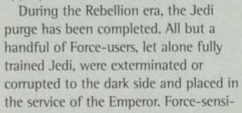
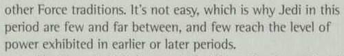
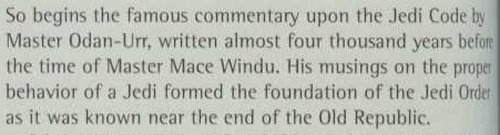
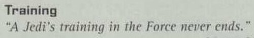

# Owner Material 037 — Star Wars D20 Drive folder (Core, Revised Core and Saga Edition): Sourcebooks/Revised Core Rulebook.pdf [Star Wars Roleplaying Game Revised Core (d20, 2002)] (scan pages 121–180)

- **Source:** Wizards of the Coast Star Wars Roleplaying Game books, web enhancements, Living Force campaign modules and articles (2000–2010), from the owner's "Star Wars D20" Drive folder (only the three edition subfolders; "General" was not read, as instructed). Secondary source (licensed Legends reference). Scan OCR'd on the box; the scan stays box-only and is **not** published.
- **Method:** every scanned page was OCR'd and machine-screened sentence by sentence for power-relevant statements (fights, kills, defeats, Force feats, rankings, superweapons) that name a character on our roster; each kept sentence is quoted verbatim from the OCR text and has a crop of the printed passage directly under it. Pages with nothing power-relevant are still listed with what is on them.
- **Citation:** "*Revised Core Rulebook* (SWRPG d20 Revised Core), p.X" by printed page ("scan p.X" where no printed number applies). **Weight:** Licensed RPG material: a secondary source. Narrative text sums up Legends lore; game statistics are rules for players, not canon power levels, and rank lowest.

## scan p.121 (scan page 121)

Page contents: 491 words, 14 paragraphs | headings/entries: What's New?; Details; Name; Age

## scan p.122 (scan page 122)

Page contents: 786 words, 16 paragraphs | headings/entries: Table 6-2: Ages by Species; Table 6-1!: Aging Effects; Adult no modifier

## scan p.123 (scan page 123)

Page contents: 793 words, 26 paragraphs | headings/entries: Height and Weight; S; SULSISSLOVAVHO DIOeSH

## scan p.124 (scan page 124)

Page contents: 1024 words, 28 paragraphs | headings/entries: Personality; Goals; Fame and Infamy; Using the Reputation Bonus

## scan p.125 (scan page 125)

Page contents: 546 words, 16 paragraphs | headings/entries: Followers; SS ); WSUILSMSLOVAVHO JIONAH

## scan p.126 (scan page 126)

Page contents: 1101 words, 21 paragraphs | headings/entries: SHUILSIASSLOVAVHO DIOASH; Missions; When the team has learned enougt; Saving Throws

## scan p.127 (scan page 127)

Page contents: 823 words, 42 paragraphs | headings/entries: Gy VICE: SAVE OR CHECK?; One Minute (Local); One Hour (Overland); One Day (Overland); Hampered Movement

## scan p.128 (scan page 128)

Page contents: 902 words, 26 paragraphs | headings/entries: Table 6-8: Hampered Movement; Tactical Movement; Overland Movement; Table 6-9: Terrain and Overland Movement

## scan p.129 (scan page 129)

Page contents: 657 words, 47 paragraphs | headings/entries: Bigger and Smaller Creatures; Tremendous Strength; Table 6-10: Carrying Capacity; Strength Light Medium Heavy; Score Load' Load' Load*; Table 6-l!: Carrying Loads; Heavy +1 -6 6m 4m x3

## scan p.130 (scan page 130)

Page contents: 2 words, 1 paragraphs | headings/entries: CHAPTER SEVEN

## scan p.131 (scan page 131)

Page contents: 467 words, 8 paragraphs | headings/entries: What's New?; Money

## scan p.132 (scan page 132)

Page contents: 831 words, 25 paragraphs | headings/entries: Wealth Beyond Credits; Table 7-1|: Trade Goods; Weapons; Weapon Categories; Simple Weapons; Blaster Pistols; Blaster Rifles; Heavy Weapons

## scan p.133 (scan page 133)

Page contents: 738 words, 35 paragraphs | headings/entries: AP) WEAPON CHARACTERISTICS; Vibro Weapons; Exotic Weapons; Primitive Weapons; Slugthrowers; Atlatl; Cesta; Club

## scan p.134 (scan page 134)

Page contents: 782 words, 13 paragraphs | headings/entries: Table 7-2: Weapons; Melee Weapons Range Stun

## scan p.135 (scan page 135)

Page contents: 833 words, 40 paragraphs | headings/entries: AP) SETTING WEAPONS ON STUN; Tethal."; Gaderffii (gaffi stick); They crafl gaderffii from scrap metal; Knife; Lightsaber

## scan p.136 (scan page 136)

Page contents: 768 words, 26 paragraphs | headings/entries: DO |; Longsword; Spear; Stun Baton; Ranged Weapons

## scan p.137 (scan page 137)

Page contents: 704 words, 33 paragraphs | headings/entries: Blaster Cannon Portable blaster cannons (about the; Blaster, Heavy Repeating; PO os autofire mode. w=; A light repeating blaster; Da cn; LNAWdAINOS

## scan p.138 (scan page 138)

Page contents: 881 words, 34 paragraphs | headings/entries: Blaster Rifle, Sporting; Bowcaster

## scan p.139 (scan page 139)

Page contents: 768 words, 41 paragraphs | headings/entries: Timer 250; N; Net and Electro-Net; Slugthrower; Thermal Detonator

## scan p.140 (scan page 140)

Page contents: 733 words, 18 paragraphs | headings/entries: Armor Qualities; Table 7-3: Armor

## scan p.141 (scan page 141)

Page contents: 509 words, 16 paragraphs | headings/entries: Battleframe; Blast Helmet and Vest

## scan p.142 (scan page 142)

Page contents: 643 words, 23 paragraphs | headings/entries: Equipment; Aquata Breather; Breath Mask

## scan p.143 (scan page 143)

Page contents: 676 words, 44 paragraphs | headings/entries: The range for a typical comlink is; Credit Chip; Few galactic citizens ever see; The chip can hold a specified; Datapad; Energy Cell; Field Kit

## scan p.144 (scan page 144)

Page contents: 613 words, 25 paragraphs | headings/entries: Flight Suit; Fusion Lantern; Holoprojector; Holorecorder; Power Pack

## scan p.145 (scan page 145)

Page contents: 634 words, 24 paragraphs | headings/entries: Recording Rod; Table 7-4: Equipment; Datacards, blank (10) 10 0.2 kg; Services; Bacta tank treatment (per 12 hours) 3,000

## scan p.146 (scan page 146)

Page contents: 3 words, 2 paragraphs | headings/entries: CHAPTER EIGHT

## scan p.147 (scan page 147)

Page contents: 492 words, 10 paragraphs | headings/entries: What's New?; How Combat Works; Setup

## scan p.148 (scan page 148)

Page contents: 1145 words, 25 paragraphs | headings/entries: Surprise Round; First Regular Round

## scan p.149 (scan page 149)

Page contents: 855 words, 31 paragraphs | headings/entries: Second Regular Round; What's Next?; Combat Sequence; Combat Statistics; Attack Rall; Size Modifier; Range Penalty

## scan p.150 (scan page 150)

Page contents: 1009 words, 34 paragraphs | headings/entries: Initiative; Damage; Vitality Points and Wound Points

## scan p.151 (scan page 151)

Page contents: 900 words, 43 paragraphs | headings/entries: Lost Wound Points; Healing; Miniatures and Action Figures; Damage; Defense; Class Bonus; Dexterity Modifier; C] O < 00 > a

## scan p.152 (scan page 152)

Page contents: 946 words, 30 paragraphs | headings/entries: C] O < 00 > =); Size Modifier; Touch Attacks; Vitality Points and Wound Paints; Speed; Initiative; Joining a Battle; Opponent Initiative

## scan p.153 (scan page 153)

Page contents: 502 words, 15 paragraphs | headings/entries: Surprise; Awareness and Surprise; Determining Awareness: The GM determines who is; F); C7 O < ne > iad

## scan p.154 (scan page 154)

Page contents: 904 words, 21 paragraphs | headings/entries: Actions in Combat; The Combat Round; Action Types; Attack Action; Move Action; Table 8-2: Actians in Combat

## scan p.155 (scan page 155)

Page contents: 593 words, 27 paragraphs | headings/entries: If Vor'en makes; Vor'en can; Total Defense; Melee and Ranged Attack Situations

## scan p.156 (scan page 156)

Page contents: 653 words, 25 paragraphs | headings/entries: C) O < 00 > et; Attack Rolls; Automatic Misses and Hits; Damage Rolls; Critical Hits; Ranged Weapon Attacks; Rorworr suffers a}; Multiple Attacks; Shooting or Throwing into a Melee

## scan p.157 (scan page 157)

Page contents: 530 words, 36 paragraphs | headings/entries: Unarmed Attacks; Critical H; Attack Roll Result 1-19 (number on d20); Attack Roll Result 20 (number on d20); SS; Critical Roll Result = Miss!; Deal; Move Actions; Critical Roll Result = Hit!

## scan p.158 (scan page 158)

Page contents: 959 words, 41 paragraphs | headings/entries: Full-Round Actions; Charge; Full Attack; Table 8-3: Two-Weapon Fighting Penalties; Circumstances Primary Hand = Off Hand; Normal penalties ~6 10; Off-hand weapon is light -4 -8; Ambidexterity feat —6 -6; Two-Weapon Fighting feat -4 -8; Off-hand weapon is light and -2 -2; Ambidexterity feat and Two-Weapon Fighting feat; Fighting Defensively; Disengage

## scan p.159 (scan page 159)

Page contents: 969 words, 30 paragraphs | headings/entries: Miscellaneous Actions

## scan p.160 (scan page 160)

Page contents: 392 words, 12 paragraphs | headings/entries: Attacks of Opportunity; Example B; Example C

## scan p.161 (scan page 161)

Page contents: 900 words, 49 paragraphs | headings/entries: What Vitality Points Represent; Effects of Damage; OVitality Points; Shocked Dut; Disabled (0 Wound Paints); Damage Reduction; Damaging Helpless Defenders; Stable; IVAWOO

## scan p.162 (scan page 162)

Page contents: 685 words, 21 paragraphs | headings/entries: Healing; Assisted Healing; Force Healing; Healing Limits; Movement and Position

## scan p.163 (scan page 163)

Page contents: 917 words, 27 paragraphs | headings/entries: Tactical Movement; Combined Fire

## scan p.164 (scan page 164)

Page contents: 858 words, 32 paragraphs | headings/entries: Table 8-6: Creature Size and Scale; Combat Modifiers; Cover; Table 8-7: Attack Roll Modifiers; Attacker on higher ground +1; Attacker prone —4; Degree of Cover; Cover Defense Bonus

## scan p.165 (scan page 165)

Page contents: 798 words, 41 paragraphs | headings/entries: Myee-quarters Peering around +7 +3; Wnetenths Standing at +10 +44; Concealment Miss Chance; Helpless Defenders; Regular Attack; C] O < 0 > =

## scan p.166 (scan page 166)

Page contents: 768 words, 21 paragraphs | headings/entries: IVEWOO; Delaying Limits; Multiple Characters Delaying; Ready; How Readying Works; Readying an Action

## scan p.167 (scan page 167)

Page contents: 735 words, 26 paragraphs | headings/entries: Neadying a Weapon Against a Charge; Special Attacks and Damage; Aid Another; Direction of Throw; Grenade-Like Weapons; C] O < a > a

## scan p.168 (scan page 168)

Page contents: 416 words, 82 paragraphs | headings/entries: IVAEWOO; Table 8-10: Multiple Ranged Attacks; Base Attack Bonus; Base Attack Bonus; Multifire; Weapon; Autofire; Weapon; Multifire Weapon w/Rapid Shot -6/-6/-6; Multifire Weapon w/Multishot; Autofire Weapon w/Multishot ~4/-4/-4; Multifire Weapon w/Both Feats -~4/-4/-4

## scan p.169 (scan page 169)

Page contents: 0 words, 0 paragraphs | headings/entries: 

## scan p.170 (scan page 170)

Page contents: 710 words, 26 paragraphs | headings/entries: Table 8-11: Size and Defense of Objects; Object Defense; Size (Example) Held*® Carried* Inanimat Colossal

## scan p.171 (scan page 171)

Page contents: 668 words, 21 paragraphs | headings/entries: Disarm; IVAEWOO; Grapple

## scan p.172 (scan page 172)

Page contents: 489 words, 20 paragraphs | headings/entries: Grapple Checks; Starting a Grapple; Joining a Grapple; If You're Grappling

## scan p.173 (scan page 173)

Page contents: 706 words, 33 paragraphs | headings/entries: You're Pinned; Ither Grappling Options; Irip; Waking a Trip Attack; Being Tripped; Overrun; C] O < at > a

## scan p.174 (scan page 174)

Page contents: 6 words, 3 paragraphs | headings/entries: CHAPTER NINE; THe FoRce|g

## scan p.175 (scan page 175)

Page contents: 547 words, 9 paragraphs | headings/entries: What's New?; The Force through the Ages

## scan p.176 (scan page 176)

Page contents: Disturbances in the Force: frequent Force use creates "quakes" felt at great distances that attract more powerful Force-users; "It is believed that through such methods the Empire was able to hunt down stray Force-users". (hand-read)

## scan p.177 (scan page 177)

Page contents: Rise of the Empire era: "ten thousand Jedi served the Republic"; infants identified within six months; older children refused. Crafting one's own lightsaber (sidebar) requires Control, Sense and Alter and must occur before 7th level; Luke built his near Ben Kenobi's home with only R2-D2. (hand-read)

- **Obi-Wan Kenobi; Yoda** — entry/section: The Jedi — Rebellion era (Revised Core Rulebook, Ch9): "During the Rebellion era, the Jedi purge has been completed. All but a handful of Force-users, let alone fully trained Jedi, were exterminated or corrupted to the dark side and placed in the service of the Emperor." Source: *Revised Core Rulebook* (SWRPG d20 Revised Core), scan p.177
  

## scan p.178 (scan page 178)

Page contents: 1009 words, 28 paragraphs | headings/entries: The Jedi Code; The Teachings of Master Odan-Urr; The Path within the Code; Interpreting the Code

- **Obi-Wan Kenobi; Yoda** — entry/section: The Jedi — Rebellion era (Revised Core Rulebook, Ch9): "It’s not easy, which is why Jedi in this period are few and far between, and few reach the level of power exhibited in earlier or later periods." Source: *Revised Core Rulebook* (SWRPG d20 Revised Core), scan p.178
  
- **Luke Skywalker; Mara Jade Skywalker; Corran Horn; Ganner Rhysode; Jaina Solo; Jacen Solo (Darth Caedus); Anakin Solo** — entry/section: The Jedi — New Jedi Order era (Revised Core Rulebook, Ch9): "In The New Jedi Order era, Luke Skywalker has trained about one hundred Jedi and identified perhaps a dozen others to start training. Prominent Force-users such as Mara Jade Skywalker and Corran Horn help Skywalker train and coordinate the efforts of these Jedi, while promising students such as the Solo children and Ganner Rhysode show great promise for the future," Source: *Revised Core Rulebook* (SWRPG d20 Revised Core), scan p.178
  
- **Odan-Urr; Mace Windu** — entry/section: The Teachings of Master Odan-Urr (Revised Core Rulebook, Ch9): "So begins the famous commentary upon the Jedi Code by Master Odan-Urr, written almost four thousand years befor the time of Master Mace Windu. His musings on the proper behavior of a Jedi formed the foundation of the Jedi Ordu as it was known near the end of the Old Republic." Source: *Revised Core Rulebook* (SWRPG d20 Revised Core), scan p.178
  

## scan p.179 (scan page 179)

Page contents: 501 words, 15 paragraphs | headings/entries: Loyalty

- **Vodo-Siosk Baas** — entry/section: The Teachings of Master Odan-Urr — Training (Revised Core Rulebook, Ch9): "“A Jedi's training in the Force never ends.” —Master Vodo Siask-Baas" Source: *Revised Core Rulebook* (SWRPG d20 Revised Core), scan p.179
  

## scan p.180 (scan page 180)

Page contents: 979 words, 31 paragraphs | headings/entries: FORCE AND YOUR CHARACTER; Morality; Master Odan-lit; Bravery

