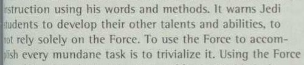
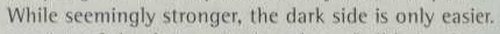
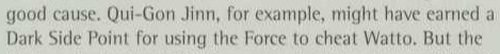
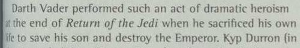
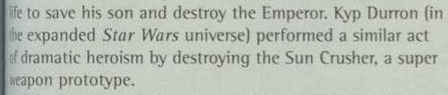
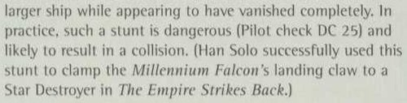
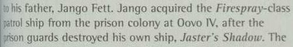

# Owner Material 037 — Star Wars D20 Drive folder (Core, Revised Core and Saga Edition): Sourcebooks/Revised Core Rulebook.pdf [Star Wars Roleplaying Game Revised Core (d20, 2002)] (scan pages 181–240)

- **Source:** Wizards of the Coast Star Wars Roleplaying Game books, web enhancements, Living Force campaign modules and articles (2000–2010), from the owner's "Star Wars D20" Drive folder (only the three edition subfolders; "General" was not read, as instructed). Secondary source (licensed Legends reference). Scan OCR'd on the box; the scan stays box-only and is **not** published.
- **Method:** every scanned page was OCR'd and machine-screened sentence by sentence for power-relevant statements (fights, kills, defeats, Force feats, rankings, superweapons) that name a character on our roster; each kept sentence is quoted verbatim from the OCR text and has a crop of the printed passage directly under it. Pages with nothing power-relevant are still listed with what is on them.
- **Citation:** "*Revised Core Rulebook* (SWRPG d20 Revised Core), p.X" by printed page ("scan p.X" where no printed number applies). **Weight:** Licensed RPG material: a secondary source. Narrative text sums up Legends lore; game statistics are rules for players, not canon power levels, and rank lowest.

## scan p.181 (scan page 181)

Page contents: 720 words, 27 paragraphs | headings/entries: Jependence; Saining Force Points

- **Odan-Urr** — entry/section: The Teachings of Master Odan-Urr — Dependence (Revised Core Rulebook, Ch9): "It warns Jedi iudents to develop their other talents and abilities, to not rely solely on the Force." Source: *Revised Core Rulebook* (SWRPG d20 Revised Core), scan p.181
  

## scan p.182 (scan page 182)

Page contents: 484 words, 13 paragraphs | headings/entries: Calling upon the Force; Character Bonus Dice Bonus Dice Bonus Dice; The Dark Side

- **Palpatine (Darth Sidious)** — entry/section: The Dark Side (Revised Core Rulebook, Ch9): "While seemingly stronger, the dark side is only easier." Source: *Revised Core Rulebook* (SWRPG d20 Revised Core), scan p.182
  

## scan p.183 (scan page 183)

Page contents: 1022 words, 38 paragraphs | headings/entries: Gaining Dark Side Points; All three of the above conditions are; Dark Side Transgressions

## scan p.184 (scan page 184)

Page contents: 996 words, 32 paragraphs | headings/entries: Dark Side Characters; BARK Sipe #®; BARK SIDE; WOOKIEES AND THE DARK SIDE; Atoning; Dramatic Heroism; MASTER YODA dramatic heroism does not gain

- **Qui-Gon Jinn** — entry/section: Minor Transgression — Using the Force to Cause Inconvenience (Revised Core Rulebook, Ch9): "Qui-Gon Jinn, for example, might have earned a Dark Side Point for using the Force to cheat Watto." Source: *Revised Core Rulebook* (SWRPG d20 Revised Core), scan p.184
  

## scan p.185 (scan page 185)

Page contents: 519 words, 21 paragraphs | headings/entries: Side Points remaining, the character must strive; Long-Term Dark Side Effects; AFinal Option; SET HARTH, DARK JEDI

- **Darth Vader (Anakin Skywalker)**: "Darth Vader performed such an act of dramatic heroism athe end of Return of the Jedi when he sacrificed his own life to save his son and destroy the Emperor." Source: *Revised Core Rulebook* (SWRPG d20 Revised Core), scan p.185
  
- **Kyp Durron; Sun Crusher (superweapon)**: "Kyp Durron {in he expanded Star Wars universe) performed a similar act if dramatic heroism by destroying the Sun Crusher, a super Hweapon prototype." Source: *Revised Core Rulebook* (SWRPG d20 Revised Core), scan p.185
  

## scan p.186 (scan page 186)

Page contents: 2 words, 1 paragraphs | headings/entries: CHAPTER TEN

## scan p.187 (scan page 187)

Page contents: 483 words, 11 paragraphs | headings/entries: What's New?

## scan p.188 (scan page 188)

Page contents: 558 words, 21 paragraphs | headings/entries: Vehicle Costs; Table 10-1:; Vehicle Systems; Drive Systems; Sensors

## scan p.189 (scan page 189)

Page contents: 793 words, 31 paragraphs | headings/entries: Table 10-2: Vehicle Sensor Detection; Vehicle Combat; Free Actions

## scan p.190 (scan page 190)

Page contents: 871 words, 29 paragraphs | headings/entries: Table 10-3: Vehicle Speeds and Modifiers; Vehicle Combat Actions; Driving Defensively; Full Attack Actions; Multiple Attacks; UR) PLODING VEHICLES

## scan p.191 (scan page 191)

Page contents: 315 words, 29 paragraphs | headings/entries: WU; Wt; MUI; HN; AUTH

## scan p.192 (scan page 192)

Page contents: 875 words, 29 paragraphs | headings/entries: Using Cover; Table 10-4: Vehicle Cover; Huge +4; Large +2 Small/Medium-size +1 Fine/Diminutive/Tiny +0; Striking the Cover; Table 10-5: lon Damage; Vehicle Movement; Vehicles That Occupy Multiple Squares

## scan p.193 (scan page 193)

Page contents: 498 words, 21 paragraphs | headings/entries: Maneuvers; Simple Maneuvers

## scan p.194 (scan page 194)

Page contents: 697 words, 21 paragraphs | headings/entries: Forward and Reverse; Simple Slip; Side Slip; Quick Turn

## scan p.195 (scan page 195)

Page contents: 737 words, 21 paragraphs | headings/entries: 

## scan p.196 (scan page 196)

Page contents: 469 words, 14 paragraphs | headings/entries: Sideswipe

## scan p.197 (scan page 197)

Page contents: 1023 words, 24 paragraphs | headings/entries: Failed Stunts

## scan p.198 (scan page 198)

Page contents: 899 words, 34 paragraphs | headings/entries: Walkers

## scan p.199 (scan page 199)

Page contents: 720 words, 31 paragraphs | headings/entries: Cost: Not available for sale; AT-ST WALKER; Kuat Drive Yards All-Terrain Armored Transport (AT-AT)

## scan p.200 (scan page 200)

Page contents: 686 words, 39 paragraphs | headings/entries: Range Increment: The weapon's range increme; Range Increment: 100 m; LANDSPEEDE; SoroSuub X-34 Landspeeder

## scan p.201 (scan page 201)

Page contents: 418 words, 27 paragraphs | headings/entries: Naboo Security Forces Flash Speeder; Wovides one-half cover to crew and passengers; Chariot Command Speeder; UR) CREW QUALITY; Table 10-15: Vehicle Crew Quality; Ace

## scan p.202 (scan page 202)

Page contents: 455 words, 30 paragraphs | headings/entries: Hull Points: 40 (DR 10); Cargo Capacity: 20 kg; Speed: 40 m; Max Velocity: 100 km/h; Cost: Not available for sale; Speeder Bikes; SPEEDER Bie; Modified Ikas-Adno 22-B Nightfalcon; Class: Speeder [Ground] Crew: 1 (Normal +2); Hull Points: 16 (DR 5); Cargo Capacity: 4 kg; Speed: 100 m; Max Velocity: 300 km/h; Cost: 6,000 (new), 2,000 (used); Sail Barges and Skiffs

## scan p.203 (scan page 203)

Page contents: 845 words, 46 paragraphs | headings/entries: Table 10-16: Used Vehicle Flaws; Nodified Ubrikkian Luxury Sail Barge; Ubrikkian SuperHaul Model || Cargo Skiff; Class: Speeder [Ground Crew: 1 (Untrained -4); Cost: 8,000 (new .000 (used; Cost: Not available for sale; Multi Troop Transports (MTTs); Baktoid Armor Workshop MTT

## scan p.204 (scan page 204)

Page contents: 3 words, 2 paragraphs | headings/entries: CHAPTER ELEVEN

## scan p.205 (scan page 205)

Page contents: 489 words, 10 paragraphs | headings/entries: What's New?

## scan p.206 (scan page 206)

Page contents: 1013 words, 24 paragraphs | headings/entries: SdliHSavls; Starship Costs; Expenses; Booking Passage; Hyperspace Travel

## scan p.207 (scan page 207)

Page contents: 723 words, 14 paragraphs | headings/entries: Table 1-2: Astrogation DCs and Modifiers; SdIHSAvls

## scan p.208 (scan page 208)

Page contents: 787 words, 25 paragraphs | headings/entries: Table 11-3: Hyperspace Travel Time; Table 11-4: Hyperspace Mishaps; Travel Time

## scan p.209 (scan page 209)

Page contents: 935 words, 36 paragraphs | headings/entries: Starship Systems; SdIHSAaVvls

## scan p.210 (scan page 210)

Page contents: 231 words, 53 paragraphs | headings/entries: SdqIHSaAVLs; The Galaxy; Deep Core; Core Worlds Colonies; Inner Rim Expansion Region Mid Rim; Outer Rim; Ssi-ruuk Star/Cluster; Lwhekk; S11! Seswenna. )Eriadu 7; Sector \ @ vaboo; Da Dorvalla Clak'dor VII; Sluis Van Xagobah '; Sector @ vasoban om; Kathol Sector Asteroids; Fe ~~ ' Umgul mt}; Unknown Regions; Ansion; Reecee; Nezoth; Eclipse; VOUVOEUVO yO; Aleen; Tktote; Aridus; Falleen; Rodi; Ando; G Tatooi @ ceon:; Wild Space

## scan p.211 (scan page 211)

Page contents: 234 words, 57 paragraphs | headings/entries: Adumar; Word Mantell; Bilbringi; CaPratoss_; Bornleias,; Empress Teta,; D Sdxtion Zonama Sekot; Muumi Linst » Belkadan; Imperial Remnant é )Helska; MLCL EL Ait ds D) Dantooine Sernpidal; OP Bandomeer; Ploo Pe ae ) Korriban; MHisvrentaal } Nicaamas; Alderaan; VA ' Balmorra' Commenor a; A Ondeéron; Rhommamool; Mimban Osarian; Bothan Space; Bothawui; Kothvis; Wild Space; Hutt Space; Myhke Wayland Quermia; Meridian Sectar_ Delldlt; Telti; Y; Cron Drift; MD) thotatin Montu Cordu; Nar Shaddaa; Worlds from the Corellian Run; Perlemian Trade Route; Expanded Universe; SdliHSAvls

## scan p.212 (scan page 212)

Page contents: 815 words, 22 paragraphs | headings/entries: Deflector Shields; Sensors; Table 1-5: Starship Sensor Detection

## scan p.213 (scan page 213)

Page contents: 727 words, 36 paragraphs | headings/entries: Starship Combat; Initiative; Starship Size; Table 1-6: Starship Sizes; Character and; Ag SHIP COMBAT ACTIONS; Move Actions; Starship Combat Tactics; SdiHSAaVvls

## scan p.214 (scan page 214)

Page contents: 584 words, 22 paragraphs | headings/entries: Flying Defensively; Powering Weapons; Ship Size Huge/Gargantuan/Colossal Small/Medium-size/Large Fine/Diminutive/Tiny; Time to Power Up Weapons Full round; Move action; Free action; Raising Shields; Full Attack Actions; Multiple Attacks

## scan p.215 (scan page 215)

Page contents: 651 words, 17 paragraphs | headings/entries: Using Cover; Table 11-7: Starship Cover; Striking the Cover; NS re)

## scan p.216 (scan page 216)

Page contents: 992 words, 26 paragraphs | headings/entries: Range; Table 11-8: Starship Range Modifiers; Firing into a Dogfight; Point-Defense Weapons; Weapon Batteries; Missile Weapons; Firing a Missile Weapon

## scan p.217 (scan page 217)

Page contents: 977 words, 25 paragraphs | headings/entries: NS mn; SdiHsSeAllvlsS; Shield Facing; Angling Shields

## scan p.218 (scan page 218)

Page contents: 746 words, 34 paragraphs | headings/entries: Repair Check DC; Developing Flaws; Repairing Damage

## scan p.219 (scan page 219)

Page contents: 662 words, 45 paragraphs | headings/entries: Table 11-11: lon Damage; Table 11-12: Tractor Beam Power; Huge 6 Diminutive 1; Starship Movement; Not Just Starships!; Using a Square Grid; SdIHSAvls; Atmospheric Movement; Relative Altitude; Opening the Fight; M vement Example

## scan p.220 (scan page 220)

Page contents: 756 words, 23 paragraphs | headings/entries: Getting Started; Medium-size 4 rounds; Speed Categories; Table Il-13: Starship Speeds; Move batkward 1 square,

## scan p.221 (scan page 221)

Page contents: 652 words, 26 paragraphs | headings/entries: Simple Maneuvers; Simple Slip; Attack Run; N Ts]

## scan p.222 (scan page 222)

Page contents: 669 words, 23 paragraphs | headings/entries: Climbs and Dives; Stunts; Quick Turn; Landing

## scan p.223 (scan page 223)

Page contents: 895 words, 39 paragraphs | headings/entries: Strafing Runs; Resolving Collisions; Docking d4; Cruising ds; Attack di0; Ramming di2; Table 11-15: Collision Damage by Size; Table 11-16: Collision Vector Multipliers; Na NS

## scan p.224 (scan page 224)

Page contents: 624 words, 24 paragraphs | headings/entries: SdIHSAVLS; Tight Loop; Tight Half-Loop; Pursuit

- **Han Solo**: "In practice, such a stunt is dangerous (Pilot check DC 25) and likely to result ina collision, (Han Solo successfully used this stunt to clamp the Millennium Falcon's landing claw to a Star Destroyer in The Empire Strikes Back.)" Source: *Revised Core Rulebook* (SWRPG d20 Revised Core), scan p.224
  

## scan p.225 (scan page 225)

Page contents: 1102 words, 25 paragraphs | headings/entries: SdIHSAvls; Starfighter Wing

## scan p.226 (scan page 226)

Page contents: 975 words, 31 paragraphs | headings/entries: SdIHSAvls; Commander; Countermanding Orders; Pilot; Gunner A gunner can:; Engineer

## scan p.227 (scan page 227)

Page contents: 855 words, 38 paragraphs | headings/entries: Making Jury-rig Repairs; Computer Use Shield Points Restored

## scan p.228 (scan page 228)

Page contents: 831 words, 17 paragraphs | headings/entries: Table 1-18: Loss of Starship Control

## scan p.229 (scan page 229)

Page contents: 861 words, 46 paragraphs | headings/entries: Starship Descriptions; Starfighters; Cost: 150,000 (new), 65,000 (used); Consumables: | week; Maximum Speed in Space: Ramming (10 squares/action); Ba | —l

## scan p.230 (scan page 230)

Page contents: 650 words, 43 paragraphs | headings/entries: Koensayr BTL-S3 Y-wing; Class: Starfighte Crew; Cargo Capacity Shield Points ); TIE Fighter; Sienar Fleet Systems TIE/In; Class: Starfighter Crew 5k; Maximum Speed in Space: Ramming (10 squ; Atmospheric Speed: 1,200 km/t squares/actior; Z-935 Headhunter; Incom/Subpro Z-95 Headhunter; Hull Points: 120 (DR 10); Damage: 7d10x2; Missile Quality: Ordinary (+10),; TIE FIGHTER

## scan p.231 (scan page 231)

Page contents: 721 words, 45 paragraphs | headings/entries: Size: Fine (3.5 m long) iyperdrive: None; Crew: n/a (Normal +2); Hull Points: 120 (DR 10); Naboo N-! Starfighter; Aimospheric Speed: 1,100 km/h (18 squares/action); Crew: 1 (Skilled +4); Initiative: +6 (+2 size, +4 crew); Hull Points: 60 (DR 10); Jedi Starfighter; JEO!t STARFIGHTER; Kuat Systems Engineering; Cost: 180,000 (new), 145,000 (used); Passengers: None Cargo Capacity: 60 kg; Maximum Speed in Space: Ramming (10 squares/action); Atmospheric Speed: 1,150 km/h (19 squares/action)

## scan p.232 (scan page 232)

Page contents: 954 words, 40 paragraphs | headings/entries: Space Transports; Corellian YT-1300 Transport; Corellian Engineering Corporation YT-1300 Transport; Crew: | to 2 (Normal +2); Initiative: +3 (+1 size, +2 crew); Cost: 100,000 (new), 25,000 (used); Maximum Speed in Space: Attack (8 squares/action); Passengers: 6 Cargo Capacity: 100 tons; Atmospheric Speed: 800 km/h (13 squares/action); Crew: 2 or 4 (Unique +15); Initiative: +3 (+1 size, +2 crew); Passengers: None; Cargo Capacity: 100 tons; Consumables: 2 months; Cost: Not available for sale; Maximum Speed in Space: Ramming (12 squares/action); Atmospheric Speed: 1,050 km/h (18 squares/action); Firespray-3l; Maximum Speed in Space: Ramming (10 squares/action); Passengers: 6 Cargo Capacity: 70 tons; Atmospheric Speed: 1,050 km/h (18 squares/action)

## scan p.233 (scan page 233)

Page contents: 648 words, 41 paragraphs | headings/entries: Table 11-19: Starship Crew Quality; Ace; Shield Points: 90; Hull Points: 150 (DR 20); Maximum Speed in Space: Ramming (12 squares/action); Weapon: Concussion missile; SLAVE 1

- **Jango Fett; Jaster Mereel**: "Jango acquired the Firespray-class patrol ship from the prison colony at Oovo IV, after the son guards destroyed his own ship, Jaster's Shadow." Source: *Revised Core Rulebook* (SWRPG d20 Revised Core), scan p.233
  

## scan p.234 (scan page 234)

Page contents: 713 words, 26 paragraphs | headings/entries: Hull Points: 150 (DR 20); Cargo Capacity: 200 tons Consumables: 3 months; Cost: Not avail:; Capital Ships; Hull Points: 700 (DR 60); STAR DESTROYER; Damage: Special; Range Modifiers: See Table 11-8

## scan p.235 (scan page 235)

Page contents: 714 words, 19 paragraphs | headings/entries: Corellian Corvette; Corellian Engineering Corporation Corvette; Class: Capital ship Crew: 30-165 (Normal +2); Cost: 3,500,000 (new), 1,500,000 (used); Maximum Speed in Space: Attack {5 squares/action); Atmospheric Speed: 950 km/h (16 squares/action); ESCORT FRIGATE

## scan p.236 (scan page 236)

Page contents: 919 words, 40 paragraphs | headings/entries: Corellian Space Cruiser; Initiative: +1 (-1 size, +2 crew); Class: Capital ship; Cost: 850,000 (new), 550,000 (used); Passengers: 16 Cargo Capacity: 110 tons; Maximum Speed in Space: Attack (6 squares/action); Atmospheric Speed: 900 km/h (15 squares/action); Trade Federation Battleship; Maximum Speed in Space: Cruising (2 squares/action); Republic Assault Ship; Rothana Heavy Engineering; Acclamator-class Assault Ship; Crew: 700 (Skilled +4); Class: Capital ship; Cost: 29,000,000 (new), 19,000,000 (used); Maximum Speed in Space: Attack (8 squares/action); Atmospheric Speed: 1,200 km/h (20 squares/action)

## scan p.237 (scan page 237)

Page contents: 598 words, 51 paragraphs | headings/entries: Escape Pod; Hull Points: 40 (DR 5); Weapon: None; Hull Points: 20 (DR 5); Yaximum Altitude: 25 km; Yvides three-quarters cover to crew and passengers; Rebel Alliance Combat Snowspeeder; Class: Airspecder Crew: 2 (Skilled +4); Cargo Capacity: 50 kg Shield Points: 0; Cost: 25,000 (used; black market only); Maximum Speed in Space: Not applicable; Atmospheric Speed: 1,000 km/h (17 squares/action); Initiative: +2 (-2 size, +4 crew); Class: Airspeeder; Cost: 50,000 (new), 25,000 (used); Passengers: |; Maximum Speed in Space: Not applicable; Atmospheric Speed: 800 km/h (13 squares/action); AIRSPEEDER

## scan p.238 (scan page 238)

Page contents: 478 words, 24 paragraphs | headings/entries: Desler Gizh Outworld Mobility Corp Koro-2 Airspeeder; Class: Airspeeder; Size: Huge (6.61 m long) Hyperdrive: None; Crew: | (Normal +2); Cost: 24,800 (new), 16,400 (used); Maximum Speed in Space: Not applicable; Passengers: |; ATTACK GUNSHIF; Cost: 65,000 (new), 40,000 (used); Maximum Speed in Space: Not applicable; Atmospheric Speed: 620 km/h (10 squares/action)

## scan p.239 (scan page 239)

Page contents: 812 words, 57 paragraphs | headings/entries: Baktoid Armor Workshop; Single Trooper Aerial Platform (STAP); Hull Points: 10 (DR 10); Waximum Altitude: 20 m; Maximum Speed in Space: Not applicable; Cloud Cars; Cost: 20,000 (new), 10,000 (used); Yaximum Speed in Space: Not applicable; Mmospheric Speed: 1,000 km/h (17 squares/actior; Fire-control computer damaged:; Minor hyperdrive damage:; System disabled: Player running the ship chooses; Sensors damaged: All Computer Use checks to; Minor weapon damage: Randomly determine

## scan p.240 (scan page 240)

Page contents: 7 words, 3 paragraphs | headings/entries: CHAPTER TWELVE; BT | =p; GAMEMASTERING| 17

