# Owner Material 037 — Star Wars D20 Drive folder (Core, Revised Core and Saga Edition): Sourcebooks/Revised Core Rulebook.pdf [Star Wars Roleplaying Game Revised Core (d20, 2002)] (scan pages 241–300)

- **Source:** Wizards of the Coast Star Wars Roleplaying Game books, web enhancements, Living Force campaign modules and articles (2000–2010), from the owner's "Star Wars D20" Drive folder (only the three edition subfolders; "General" was not read, as instructed). Secondary source (licensed Legends reference). Scan OCR'd on the box; the scan stays box-only and is **not** published.
- **Method:** every scanned page was OCR'd and machine-screened sentence by sentence for power-relevant statements (fights, kills, defeats, Force feats, rankings, superweapons) that name a character on our roster; each kept sentence is quoted verbatim from the OCR text and has a crop of the printed passage directly under it. Pages with nothing power-relevant are still listed with what is on them.
- **Citation:** "*Revised Core Rulebook* (SWRPG d20 Revised Core), p.X" by printed page ("scan p.X" where no printed number applies). **Weight:** Licensed RPG material: a secondary source. Narrative text sums up Legends lore; game statistics are rules for players, not canon power levels, and rank lowest.

## scan p.241 (scan page 241)

Page contents: 447 words, 11 paragraphs | headings/entries: What's New; Providing Adventures; Teaching the Game

## scan p.242 (scan page 242)

Page contents: 952 words, 19 paragraphs | headings/entries: ONISSALSVWAWNVS; CT METRIC CONVERSIONS; Blast 'Em All; Deep-Immersion Storytelling

## scan p.243 (scan page 243)

Page contents: 697 words, 23 paragraphs | headings/entries: Something in Between

## scan p.244 (scan page 244)

Page contents: 502 words, 18 paragraphs | headings/entries: Adjudicating

## scan p.245 (scan page 245)

Page contents: 1075 words, 23 paragraphs | headings/entries: ONISSLSVWAWVS

## scan p.246 (scan page 246)

Page contents: 516 words, 10 paragraphs | headings/entries: Player/GM Trust; Handling Unbalanced Heroes

## scan p.247 (scan page 247)

Page contents: 786 words, 29 paragraphs | headings/entries: Jeal with the Problem In-Game; Deal with the Problem Out-of-Game; Changing the Rules; Altering the Way Things Wark; Additions to the Game

## scan p.248 (scan page 248)

Page contents: 1088 words, 27 paragraphs | headings/entries: Making Mistakes; Running a Game Session; Knowing the Players; Table Rules; No-Show Players; Integrating New Players

## scan p.249 (scan page 249)

Page contents: 590 words, 29 paragraphs | headings/entries: Jokes and Off-Topic Discussions

## scan p.250 (scan page 250)

Page contents: 1119 words, 20 paragraphs | headings/entries: Metagame Thinking; The Heroes' Basic Statistics; The Players' Likes and Dislikes; What's Going on in the Campaign?

## scan p.251 (scan page 251)

Page contents: 500 words, 18 paragraphs | headings/entries: 

## scan p.252 (scan page 252)

Page contents: 956 words, 39 paragraphs | headings/entries: Knowing the Rules; Setting the Stage; Recapping; Plenty of Action; Cool Villains; Epic Plots; Clear-Cut Motives

## scan p.253 (scan page 253)

Page contents: 583 words, 25 paragraphs | headings/entries: Setting the Pace; Ba aL; ONISSLSVWAWVS

## scan p.254 (scan page 254)

Page contents: 966 words, 35 paragraphs | headings/entries: Referencing Rules; Asking Questions; Taking Breaks; Providing the Action; Handling Hero Actions; Handling GM Characters; Rolling Dice; Bluff; Demolitions (particularly in setting explosives) Diplomacy; Disable Device; Disguise; Hide; Listen; Move Silently; Search; Spot

## scan p.255 (scan page 255)

Page contents: 803 words, 16 paragraphs | headings/entries: When Bad Things Happen to Good Heroes; Ending Things

## scan p.256 (scan page 256)

Page contents: 1040 words, 24 paragraphs | headings/entries: Game Session Checklist; How to Build an Adventure

## scan p.257 (scan page 257)

Page contents: 831 words, 35 paragraphs | headings/entries: Obstacles appropriate for simple encounter goals include; Challenging Encounter Goals; Obstacles suitable for challenging encounter goals include; Extreme Encounter Goals; So

## scan p.258 (scan page 258)

Page contents: 704 words, 46 paragraphs | headings/entries: Challenge Codes; Challenge Desired Encounter Goal Difficulty; Sample Creatures, Droids, and Hazards; B 3rd—5th Ist-2nd n/a; C 6th-8th 3rd—5th Ist-2nd; D 9th—11th 6th-8th 3th—Sth; E 12th-14th 9th-11th 6th-8th; F 15th-17th 12th-14th 9th-11th; G 18th—20th 15th-17th 12th—14th; H n/a 18th—20th 15th-17th

## scan p.259 (scan page 259)

Page contents: 514 words, 16 paragraphs | headings/entries: QD; Hazards

## scan p.260 (scan page 260)

Page contents: 957 words, 20 paragraphs | headings/entries: ONISSLSVWAWVS; Table 12-3: Miscellaneous Encounters; What Isn't an Encounter?; Building an Adventure

## scan p.261 (scan page 261)

Page contents: 760 words, 33 paragraphs | headings/entries: Worthy Adversaries; Pits, chasms, catwalks, and ledges: Heroes can; Fog: Fog provides one-half concealment (see; Captivating Descriptions

## scan p.262 (scan page 262)

Page contents: 973 words, 33 paragraphs | headings/entries: UU jL___JE; Action; Charging; Full defense; Covering with ranged weapon Using the Force; Description; G BONUSES, PENA; Awarding Experience

## scan p.263 (scan page 263)

Page contents: 939 words, 33 paragraphs | headings/entries: Money; Create a Context; Incorporate Interesting GM Characters

## scan p.264 (scan page 264)

Page contents: 1049 words, 27 paragraphs | headings/entries: ONISSLSVWAWNVS; Villains and Opponents; Villains; Allies; Animals

## scan p.265 (scan page 265)

Page contents: 1090 words, 22 paragraphs | headings/entries: Build on Campaign Events; Prestige Classes; Creating Prestige Classes

## scan p.266 (scan page 266)

Page contents: 796 words, 38 paragraphs | headings/entries: ONIVSLSVWAWNVS; Examples of good requirements include:; S A minimum Reputation score; Table 12-4: The Bounty Hunter; Base Fort Ref will; Bounty Hunter; Class Skills; Demolitions (Int), Disguise (Cha), Forgery (Int), Gather; Defense Reputation

## scan p.267 (scan page 267)

Page contents: 509 words, 16 paragraphs | headings/entries: No oa an; ANISSALSVWAWVS); Starting Feats; Sneak Attack

## scan p.268 (scan page 268)

Page contents: 817 words, 25 paragraphs | headings/entries: ONISSLSVNWAWVS; Crime Lord; Table 12-5: The Crime Lord; Base Fort Ref will; Resource Access; Inspire Fear

## scan p.269 (scan page 269)

Page contents: 591 words, 20 paragraphs | headings/entries: Minions; Exceptional Minions; CRIME LORD; Dark Side Devotee

## scan p.270 (scan page 270)

Page contents: 458 words, 20 paragraphs | headings/entries: Class Skills; Dark Side Skill Emphasis; DARK SIDE DEVOTEE; Table 12-6: The Dark Side Devotee

## scan p.271 (scan page 271)

Page contents: 511 words, 21 paragraphs | headings/entries: Dark Side Marauder; Table 12-7: The Dark Side Marauder; Base Fort Ref will; Bonus feat; Bonus feat; DARK SIDE MARAUDER

## scan p.272 (scan page 272)

Page contents: 845 words, 29 paragraphs | headings/entries: Class Skills; Starting Feats; Elite Trooper

## scan p.273 (scan page 273)

Page contents: 420 words, 29 paragraphs | headings/entries: ELITE; TROOPER; Class Skills; Weapon Focus; Uncanny Dodge; Defense Reputation

## scan p.274 (scan page 274)

Page contents: 504 words, 15 paragraphs | headings/entries: Weapon Specialization; Jedi Ace; JEDI ACE; Table 12-9: The Jedi Ace

## scan p.275 (scan page 275)

Page contents: 926 words, 37 paragraphs | headings/entries: Requirements; Class Skills; Starfighter Defense; Starship Focus; Starfighter Evasion; Trust the Force; Jedi Investigator; No — cw

## scan p.276 (scan page 276)

Page contents: 438 words, 20 paragraphs | headings/entries: Class Skills; Class Features; G] Table 12-11: The Jedi Investigator; Zz; G)

## scan p.277 (scan page 277)

Page contents: 1007 words, 24 paragraphs | headings/entries: Bonus Feat; Alertness, Low Profile, Sharp-Eyed, Stealthy, Trustworthy; Profile; Contact; Increase Lightsaber Damage; Favor

## scan p.278 (scan page 278)

Page contents: Jedi Master prestige class: "Jedi Masters represent the pinnacle of the Jedi Order"; Padawan to Master "usually takes decades"; requires a Padawan or 13+ Jedi class levels. Jedi ace (p.274): can "overcome entire squadrons of enemy craft as easily as she breathes". Bounty hunter guilds "dwindled in both power and organization during the rise of Emperor Palpatine" (p.266). (hand-read)

- **Yoda; Luke Skywalker** — entry/section: Jedi Master prestige class (Revised Core Rulebook, Ch12): "In the darkest days of the Empire, nearly all the Jedi Masters were hunted down and wiped out. However, on thie backwater planet of Dagobah, a 900-year-old Jedi Master named Yoda managed to survive to train the first of a new generation of Jedi, Luke Skywalker." Source: *Revised Core Rulebook* (SWRPG d20 Revised Core), scan p.278
  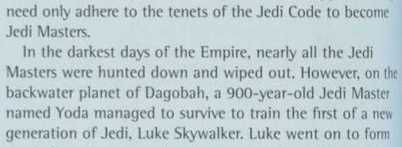

## scan p.279 (scan page 279)

Page contents: 523 words, 21 paragraphs | headings/entries: Increase Lightsaber Damage; Sonus Feat; Deflect (Defense); JED! MASTER; ONIHSALSVWAWVS

## scan p.280 (scan page 280)

Page contents: 537 words, 18 paragraphs | headings/entries: Officer; OFFICER; Table 12-12: The Officer; Base Fort Ref will; Defense Reputation

## scan p.281 (scan page 281)

Page contents: 976 words, 29 paragraphs | headings/entries: Starting Feats; Leadership; Requisition Supplies; Uncanny Survival; Improved Tactics; Starship Ace

## scan p.282 (scan page 282)

Page contents: 511 words, 25 paragraphs | headings/entries: Requirements Starship Defense; Game Rule Information; Class Skills; Astrogate (Int), Computer Use (Int), Knowledge® (Int),; A Tesserererere; Improved Starship Evasion

## scan p.283 (scan page 283)

Page contents: 502 words, 27 paragraphs | headings/entries: Commoners; For sample commoners of various species (including; Professionals

## scan p.284 (scan page 284)

Page contents: 809 words, 9 paragraphs | headings/entries: 

## scan p.285 (scan page 285)

Page contents: 767 words, 42 paragraphs | headings/entries: Expert; Thug; Generating Communities

## scan p.286 (scan page 286)

Page contents: 890 words, 25 paragraphs | headings/entries: Table 12-17: Random Community Generator; Power Center; Table 12-18: Power Centers; Hamlet 0; Village +1; Small town +2; Large town +3; Conflicting Power Centers

## scan p.287 (scan page 287)

Page contents: 604 words, 22 paragraphs | headings/entries: Characters in the Community; Table 12-19: Highest-Level Locals; Class Character Level

## scan p.288 (scan page 288)

Page contents: 948 words, 31 paragraphs | headings/entries: ONISSLSVWAWVS; Favors; Information Contacts; Generating Ready-to-Play Contacts

## scan p.289 (scan page 289)

Page contents: 971 words, 34 paragraphs | headings/entries: The Environment; Darkness and Light; Table 12-21: Light Sources; Starvation and Thirst; Suffocation and Drowning

## scan p.290 (scan page 290)

Page contents: 1040 words, 31 paragraphs | headings/entries: Altitude Sickness: Long-term oxygen deprivation due opportunity

## scan p.291 (scan page 291)

Page contents: 926 words, 29 paragraphs | headings/entries: Table 12-22: Damage from Falling Objects; Initial Reflex Strength; Table 12-23: Poisons; Contact (spit) DC 20 —_ Blindness Special**; La] ca co

## scan p.292 (scan page 292)

Page contents: 686 words, 31 paragraphs | headings/entries: Radiation Poisoning; Table 12-24: Radiation Levels; Disease; Damage ona; Failed Fortitude Save

## scan p.293 (scan page 293)

Page contents: 841 words, 32 paragraphs | headings/entries: Table 12-25: Diseases; Acid; Table 12-26: Acid Damage; Na t |

## scan p.294 (scan page 294)

Page contents: 9 words, 3 paragraphs | headings/entries: CHAPTER THIRTEEN; Cinit] [Spd] (VP/WP I CA

## scan p.295 (scan page 295)

Page contents: 500 words, 7 paragraphs | headings/entries: What's New?; Life in the Galaxy

## scan p.296 (scan page 296)

Page contents: 1045 words, 22 paragraphs | headings/entries: The Three Eras; The Rise of the Empire

## scan p.297 (scan page 297)

Page contents: 1069 words, 20 paragraphs | headings/entries: The Rebellion Era

- **Darth Bane; Palpatine (Darth Sidious); Darth Maul; Count Dooku** — entry/section: Rise of the Empire era (Revised Core Rulebook, Ch13): "Although the Sith started as an empire controlled by corrupt Jedi, eventually Darth Bane altered the nature of the Sith forever. He dictated the rule of the new Sith order: There could be only two Sith at any time, a master and an apprentice." Source: *Revised Core Rulebook* (SWRPG d20 Revised Core), scan p.297
  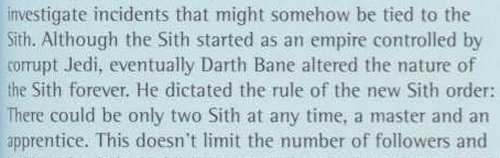
- **Palpatine (Darth Sidious); Darth Maul; Count Dooku** — entry/section: Rise of the Empire era (Revised Core Rulebook, Ch13): "The current Sith master, Lord Darth Sidious, lost one apprentice, Darth Maul, battling the Jedi. However, he has since found another apprentice in Darth Tyranus. Their plans for galactic domination and the destruction of the Jedi are in place, and it seems that nothing can stand in the way of their eventual victory." Source: *Revised Core Rulebook* (SWRPG d20 Revised Core), scan p.297
  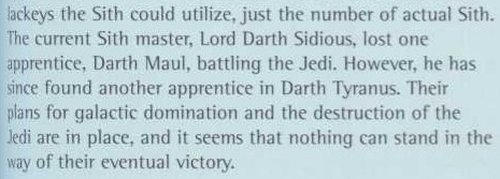
- **Tsavong Lah; Luke Skywalker** — entry/section: The New Jedi Order era (Revised Core Rulebook, Ch13): "The Jedi learn, to their horror, that this intractable new enemy cannot be sensed through the Force. The Jedi, former guardians of peace, become the hunted prey of the Yuuzhan Vong." Source: *Revised Core Rulebook* (SWRPG d20 Revised Core), scan p.297
  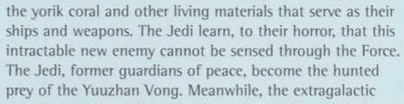
- **Nom Anor** — entry/section: The New Jedi Order era (Revised Core Rulebook, Ch13): "Nom Anor, an advance agent for the Yuuzhan Vong, sows additional seeds of discord throughout the galaxy." Source: *Revised Core Rulebook* (SWRPG d20 Revised Core), scan p.297
  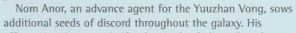

## scan p.298 (scan page 298)

Page contents: 1018 words, 20 paragraphs | headings/entries: Obi-Wan Kenobi

- **Obi-Wan Kenobi; Qui-Gon Jinn** — entry/section: Obi-Wan Kenobi (Revised Core Rulebook, Ch13): "Still, Obi-Wan has proven himself time and again, and Qui-Gon Jinn could not be more proud of his apprentice." Source: *Revised Core Rulebook* (SWRPG d20 Revised Core), scan p.298
  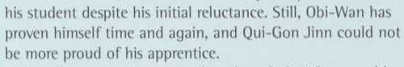
- **Obi-Wan Kenobi; Qui-Gon Jinn** — entry/section: Obi-Wan Kenobi (Revised Core Rulebook, Ch13): "By the time of the blockade of the planet Naboo, Obi-Wan has Jearned nearly everything that his Master can teach him, though he is perhaps less aware of the living Force than Qui-Gon would prefer, lacking the kind of intuition and compassion that make the older Jedi a Master." Source: *Revised Core Rulebook* (SWRPG d20 Revised Core), scan p.298
  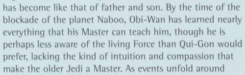
- **Darth Vader (Anakin Skywalker); Obi-Wan Kenobi** — entry/section: Obi-Wan Kenobi (Revised Core Rulebook, Ch13): "Even if Obi-Wan were ready to train a Padawan, surely he was not ready to train a boy who showed all the signs of being a vergence in the Force—a focus of vast power, but without the forbearance to use il wisely." Source: *Revised Core Rulebook* (SWRPG d20 Revised Core), scan p.298
  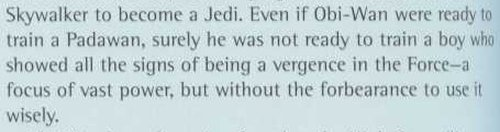
- **Obi-Wan Kenobi; Qui-Gon Jinn** — entry/section: Obi-Wan Kenobi: "For a long time it appeared as though Qui-Gon would not take Obi-Wan as his Padawan, Marked for the Agricultural Corps to tend to sick crops after being passed over by a number of potential Jedi Masters, Obi-Wan was even tually given a chance to prove himself by dueling with other hopefuls." Source: *Revised Core Rulebook* (SWRPG d20 Revised Core), scan p.298
  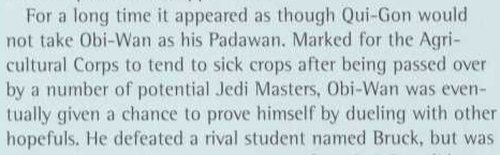
- **Obi-Wan Kenobi; Darth Maul; Qui-Gon Jinn** — entry/section: Obi-Wan Kenobi: "After Obi-Wan Kenobi defeated Darth Maul, the Sith who had slain Qui-Gon Jinn, the Jedi High Council decided that Obi-Wan had proven himself worthy of becoming a Jedi Knight." Source: *Revised Core Rulebook* (SWRPG d20 Revised Core), scan p.298
  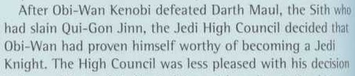

## scan p.299 (scan page 299)

Page contents: 730 words, 27 paragraphs | headings/entries: OBI-WAN KENOGI

- **Obi-Wan Kenobi; Darth Vader (Anakin Skywalker)** — entry/section: Obi-Wan Kenobi (Revised Core Rulebook, Ch13): "With that, Ben performs the ultimate act of heroism by facing his former student one last time," Source: *Revised Core Rulebook* (SWRPG d20 Revised Core), scan p.299
  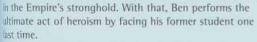
- **Luke Skywalker**: "Although Ben has enough time to teach young Luke some rudimentary lessons about the Force on the journey to Alderaan, the planet is destroyed by the Death Star." Source: *Revised Core Rulebook* (SWRPG d20 Revised Core), scan p.299
  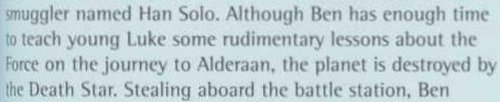

### Stat block notes (game mechanics, not feats)

- Obi-Wan Kenobi: Revised Core stat blocks: beginning of Episode II — Jedi Guardian 7/Jedi Master 2/Jedi Investigator 1, VP/WP 82/14, Atk +14/+9 lightsaber 4d8+2, Affect Mind +7, Move Object +5, See Force +7; beginning of Episode IV — Jedi Guardian 7/Jedi Master 5/Jedi Investigator 3, VP/WP 110/13, Atk +18/+13/+8 lightsaber 5d8+2/17-20, Affect Mind +12, Move Object +10, Force Strike +9, Master Defense; Challenge Code F (Source: *Revised Core Rulebook* (SWRPG d20 Revised Core), scan p.299)

## scan p.300 (scan page 300)

Page contents: 797 words, 16 paragraphs | headings/entries: PADME AMIDALA

### Stat block notes (game mechanics, not feats)

- Padmé Amidala: beginning of Episode II — Noble 9, VP/WP 43/12, Diplomacy +18, Challenge Code D (Source: *Revised Core Rulebook* (SWRPG d20 Revised Core), scan p.300)
