# Owner Material 037 — Star Wars D20 Drive folder (Core, Revised Core and Saga Edition): Sourcebooks/Revised Core Rulebook.pdf [Star Wars Roleplaying Game Revised Core (d20, 2002)] (scan pages 301–360)

- **Source:** Wizards of the Coast Star Wars Roleplaying Game books, web enhancements, Living Force campaign modules and articles (2000–2010), from the owner's "Star Wars D20" Drive folder (only the three edition subfolders; "General" was not read, as instructed). Secondary source (licensed Legends reference). Scan OCR'd on the box; the scan stays box-only and is **not** published.
- **Method:** every scanned page was OCR'd and machine-screened sentence by sentence for power-relevant statements (fights, kills, defeats, Force feats, rankings, superweapons) that name a character on our roster; each kept sentence is quoted verbatim from the OCR text and has a crop of the printed passage directly under it. Pages with nothing power-relevant are still listed with what is on them.
- **Citation:** "*Revised Core Rulebook* (SWRPG d20 Revised Core), p.X" by printed page ("scan p.X" where no printed number applies). **Weight:** Licensed RPG material: a secondary source. Narrative text sums up Legends lore; game statistics are rules for players, not canon power levels, and rank lowest.

## scan p.301 (scan page 301)

Page contents: 841 words, 18 paragraphs | headings/entries: Anakin Skywalker (Lord Darth Vader); ANAKIN SKYWALKER

- **Darth Vader (Anakin Skywalker)** — entry/section: Anakin Skywalker (Lord Darth Vader) (Revised Core Rulebook, Ch13): "What he does not realize that within him the Force is stronger than in any other iving being, and that his dreams might actually be premonitions of things that will one day come to pass." Source: *Revised Core Rulebook* (SWRPG d20 Revised Core), scan p.301
  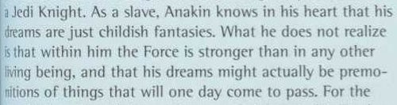
- **Darth Vader (Anakin Skywalker)** — entry/section: Anakin Skywalker (Lord Darth Vader) (Revised Core Rulebook, Ch13): "Anakin again demonstrates his piloting skills in a climacfic space battle against the capricious Trade Federation, ingle-handedly taking out the droid control ship." Source: *Revised Core Rulebook* (SWRPG d20 Revised Core), scan p.301
  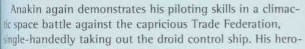
- **Darth Vader (Anakin Skywalker)** — entry/section: Anakin Skywalker (Lord Darth Vader) (Revised Core Rulebook, Ch13): "While his skills are impressive, his dedication at times seems in doubt." Source: *Revised Core Rulebook* (SWRPG d20 Revised Core), scan p.301
  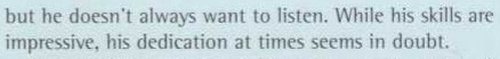
- **Darth Vader (Anakin Skywalker)** — entry/section: Anakin Skywalker (Lord Darth Vader): "He studies the ways of the ledi but allows feelings of anger, fear, and hate to enslave him." Source: *Revised Core Rulebook* (SWRPG d20 Revised Core), scan p.301
  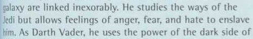
- **Darth Vader (Anakin Skywalker); Obi-Wan Kenobi; Padmé Amidala** — entry/section: Anakin Skywalker (Lord Darth Vader): "When the Jedi Council assigns Obi-Wan and Anakin to guard Padmé following an assassination attempt on the senator's life, the young Padawan allows his love for Padmé to overwhelm him—even though his Jedi vows forbid him from getting too close." Source: *Revised Core Rulebook* (SWRPG d20 Revised Core), scan p.301
  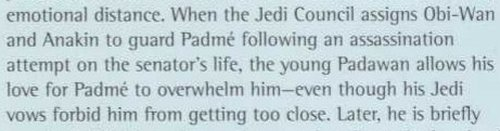

## scan p.302 (scan page 302)

Page contents: 801 words, 23 paragraphs | headings/entries: UB 4; DARTH VADER

- **Darth Vader (Anakin Skywalker)** — entry/section: Anakin Skywalker (Lord Darth Vader) (Revised Core Rulebook, Ch13): "By the time the Emperor assigns him to assist Grand Moff Tarkin in the construction of the Death Star battle station, Vader is the deadliest warrior of his generation, shielded by imposing armor, steeled by countless combats, and empowered by the dark side of the Force." Source: *Revised Core Rulebook* (SWRPG d20 Revised Core), scan p.302
  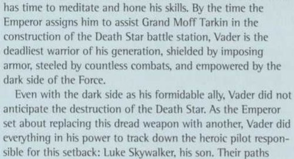
- **Darth Vader (Anakin Skywalker)**: "Sustained now by machinery and unable to live without his custom-made body armor, Vader sets about establishing himself as the heir to all the secrets of the Sith order, using what he learns to destroy the Jedi." Source: *Revised Core Rulebook* (SWRPG d20 Revised Core), scan p.302
  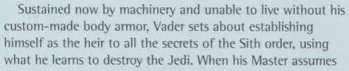
- **Darth Vader (Anakin Skywalker)**: "When his Master assumes the mantle of Emperor, Darth Vader becomes the second most powerful being in the known galaxy." Source: *Revised Core Rulebook* (SWRPG d20 Revised Core), scan p.302
  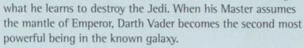
- **Darth Vader (Anakin Skywalker)**: "Even with the dark side as his formidable ally, Vader did not anticipate the destruction of the Death Star." Source: *Revised Core Rulebook* (SWRPG d20 Revised Core), scan p.302
  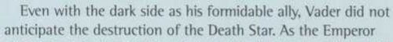
- **Darth Vader (Anakin Skywalker)**: "Overwhelmed with compassion for his son, Vader turns on the Emperor, hurling him into the depths of th Death Star." Source: *Revised Core Rulebook* (SWRPG d20 Revised Core), scan p.302
  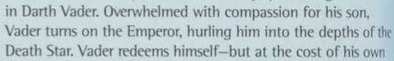

### Stat block notes (game mechanics, not feats)

- Darth Vader: Anakin (beginning of Episode II) — Fringer 1/Jedi Guardian 5, VP/WP 52/13, Atk +8 lightsaber 3d8+1, DSP 3, Challenge Code D; Darth Vader (beginning of Episode IV) — Fringer 1/Jedi Guardian 11/Sith Lord 6, Defense 26, DR 6, VP/WP 122/17, Atk +22/+17/+12/+7 lightsaber 5d8+3, Force Grip +13, Force Defense +12, Telepathy +12, Enhance Ability +11, Fear +11, feats incl. Force Whirlwind, Rage, Malevolent (Source: *Revised Core Rulebook* (SWRPG d20 Revised Core), scan p.302)

## scan p.303 (scan page 303)

Page contents: 1044 words, 24 paragraphs | headings/entries: 

- **Darth Vader (Anakin Skywalker)** — entry/section: SIDEBAR Darth Vader's Armor (Revised Core Rulebook, Ch13): "Without his helmet and visor, Vader's life support begins to fail, and he loses 1 point of Constitution each round. Without his armor, his Strength and Constitution scores are immediately reduced by 4 points." Source: *Revised Core Rulebook* (SWRPG d20 Revised Core), scan p.303
  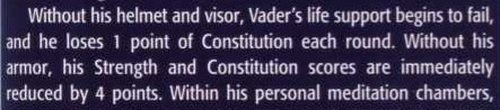
- **Luke Skywalker; Yoda** — entry/section: Luke Skywalker (Revised Core Rulebook, Ch13): "Yoda manages to teach Luke in a few weeks what the Jedi of the past learned over the course of many years." Source: *Revised Core Rulebook* (SWRPG d20 Revised Core), scan p.303
  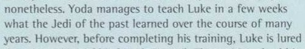
- **Luke Skywalker** — entry/section: Luke Skywalker (Revised Core Rulebook, Ch13): "In the years following the Battle of Yavin, Luke continues to practice what Obi-Wan Kenobi taught him and even learns a few things on his own through trial, error, and an almost intuitive understanding of the Force." Source: *Revised Core Rulebook* (SWRPG d20 Revised Core), scan p.303
  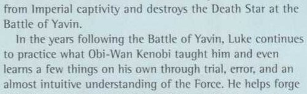
- **Luke Skywalker**: "Luke experiences doubt, disappointment, and a gnawing fear triggered by the loss of his hand, the truth about his father, and the recent defeats suffered by the Alliance." Source: *Revised Core Rulebook* (SWRPG d20 Revised Core), scan p.303
  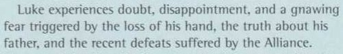

## scan p.304 (scan page 304)

Page contents: 805 words, 18 paragraphs | headings/entries: 

- **Luke Skywalker; Exar Kun** — entry/section: Luke Skywalker (Revised Core Rulebook, Ch13): "Although the Jedi academy faces many challenges—chief among them an ancient Sith named Exar Kun—it survives, and Luke is well on the way to reestablishing the Jedi Order." Source: *Revised Core Rulebook* (SWRPG d20 Revised Core), scan p.304
  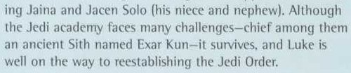
- **Darth Vader (Anakin Skywalker)**: "Minutes before the Rebels destroy the new Death Star, Anakin Skywalker hurls the Emperor to his death and sacrifices himself to save the life of his son." Source: *Revised Core Rulebook* (SWRPG d20 Revised Core), scan p.304
  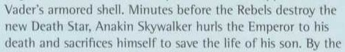

### Stat block notes (game mechanics, not feats)

- Luke Skywalker: beginning of Episode IV — Fringer 2, VP/WP 13/13, Challenge Code B; end of Episode VI — Fringer 2/Jedi Guardian 7, VP/WP 74/13, Atk +12/+7 lightsaber 3d8+2, Move Object +5, DSP 3, Challenge Code E; beginning of NJO — Fringer 2/Jedi Guardian 13/Jedi Master 3, VP/WP 116/12, Atk +21/+16/+11/+6 lightsaber 5d8+2, Affect Mind +11, Move Object +10, Empathy +10, Force Mastery, Challenge Code H (Source: *Revised Core Rulebook* (SWRPG d20 Revised Core), scan p.304)

## scan p.305 (scan page 305)

Page contents: 1053 words, 24 paragraphs | headings/entries: 

- **Leia Organa Solo**: "Still, born of a family strong in the Force and trained by the most powerful Jedi in the New Republic, Leia occasionally calls upon the Force in her duties as a diplomat and ambassador—as well as when her family or friends are threatened." Source: *Revised Core Rulebook* (SWRPG d20 Revised Core), scan p.305
  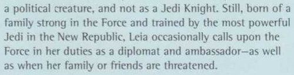

## scan p.306 (scan page 306)

Page contents: 1022 words, 22 paragraphs | headings/entries: 

### Stat block notes (game mechanics, not feats)

- Leia Organa Solo: beginning of Episode IV — Noble 4 (Challenge Code B); end of Episode VI — Noble 6/Soldier 2 (Code D); beginning of NJO — Noble 10/Soldier 2/Jedi Consular 3, VP/WP 80/12, lightsaber 2d8, Move Object +6, See Force +8, Challenge Code G (Source: *Revised Core Rulebook* (SWRPG d20 Revised Core), scan p.306)

## scan p.307 (scan page 307)

Page contents: 890 words, 13 paragraphs | headings/entries: LEIA ORGANA AND HAN SOLO

- **Han Solo; Boba Fett** — entry/section: Han Solo (Revised Core Rulebook, Ch13): "Han’s philosophy is to never doubt his own abilities, but io also respect the abilities of his opponents. Fortunately, he farely encounters an enemy whose abilities exceed his own. (ne such foe is Boba Fett, a crafty bounty hunter who racks the Millennium Falcon to the Bespin system and jlerts the Empire." Source: *Revised Core Rulebook* (SWRPG d20 Revised Core), scan p.307
  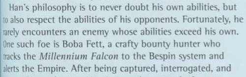
- **Han Solo** — entry/section: Han Solo (Revised Core Rulebook, Ch13): "Though it resembles a flying junkyard, the stock light freighter develops into the fastest, bestequipped cargo ship outside of the Imperial Navy." Source: *Revised Core Rulebook* (SWRPG d20 Revised Core), scan p.307
  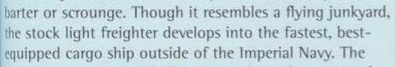
- **Darth Vader (Anakin Skywalker); Luke Skywalker**: "Something sparks the hero inside him, and Han's timely reappearance at the Battle of Yavin damages Darth Vader's TIE fighter and enables Luke Skywalker to fire the shot that destroys the Death Star." Source: *Revised Core Rulebook* (SWRPG d20 Revised Core), scan p.307
  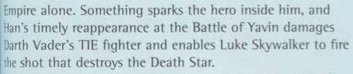

## scan p.308 (scan page 308)

Page contents: 728 words, 19 paragraphs | headings/entries: Chewbacca; CHEWBACECA

### Stat block notes (game mechanics, not feats)

- Han Solo: beginning of Episode IV — Scoundrel 6/Soldier 2, Pilot +18 (Code D); end of Episode VI — Scoundrel 7/Soldier 2/Starship Ace 1, Pilot +20 (Code E); beginning of NJO — Scoundrel 10/Soldier 2/Starship Ace 5, VP/WP 85/12, Pilot +25 (Code G) (Source: *Revised Core Rulebook* (SWRPG d20 Revised Core), scan p.308)

## scan p.309 (scan page 309)

Page contents: 712 words, 26 paragraphs | headings/entries: AV1d 430 SV; Lando Calrissian; LANDG CALRISSIAN

- **Chewbacca** — entry/section: Chewbacca (Revised Core Rulebook, Ch13): "At Han Solo’s side, Chewbacca has acquired a reputation as one of the most dangerous smugglers in the galaxy, based on tales of his great strength and even greater temper. But those who know Chewie well realize that much of his reputation is simply fanciful hype." Source: *Revised Core Rulebook* (SWRPG d20 Revised Core), scan p.309
  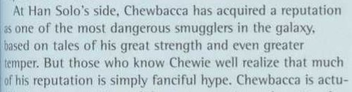

### Stat block notes (game mechanics, not feats)

- Chewbacca: beginning of Episode IV — Scout 4/Tech Specialist 2, VP/WP 68/19; end of Episode VI — Scout ?/Tech Specialist 2 (level digit unreadable in OCR), VP/WP 84/20, Str 19, Con 20, Repair +18, Challenge Code E (Source: *Revised Core Rulebook* (SWRPG d20 Revised Core), scan p.309)

## scan p.310 (scan page 310)

Page contents: R2-D2 (Expert 4/Scout 3, Challenge Code C) and C-3PO (Diplomat 3, Code A) stat blocks: R2-D2 has the unique "courage" personality quirk; C-3PO built by Anakin from spare parts. (hand-read)

### Stat block notes (game mechanics, not feats)

- Lando Calrissian: beginning of Episode V — Scoundrel 8, VP/WP 40/12, Bluff +17, Gamble +15 (Source: *Revised Core Rulebook* (SWRPG d20 Revised Core), scan p.310)

## scan p.311 (scan page 311)

Page contents: 741 words, 22 paragraphs | headings/entries: C-3PO0; Mara Jade Skywalker

- **Mara Jade Skywalker; Palpatine (Darth Sidious)** — entry/section: Mara Jade (Revised Core Rulebook, Ch13): "Through some means known only to the Emperor, Mara Jade's control of the Force is assisted by the Emperor himself. When he dies, much of her ability swiftly fades away." Source: *Revised Core Rulebook* (SWRPG d20 Revised Core), scan p.311
  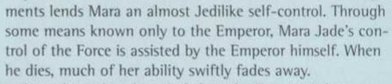
- **Mara Jade Skywalker; Joruus C'baoth; Luke Skywalker** — entry/section: Mara Jade (Revised Core Rulebook, Ch13): "Only after the mad Jedi clone Joruus C'baoth attempts to turn them both to the dark side, and Mara slays a clone of Luke Skywalker, does she feel as though she has fulfilled her last duty to the Emperor." Source: *Revised Core Rulebook* (SWRPG d20 Revised Core), scan p.311
  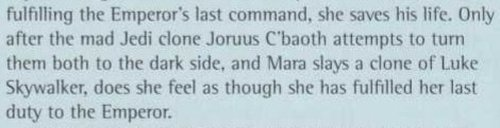
- **Mara Jade Skywalker; Luke Skywalker** — entry/section: Mara Jade (Revised Core Rulebook, Ch13): "Although Mara might have joined Skywalker’s new Jedi academy on Yavin 4 and instantly become his best student, she opts instead to explore the galaxy on her own for a while." Source: *Revised Core Rulebook* (SWRPG d20 Revised Core), scan p.311
  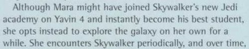
- **Mara Jade Skywalker; Nom Anor** — entry/section: Mara Jade (Revised Core Rulebook, Ch13): "Although she keeps its worst effects at bay using the Force, a pregnant Mara fears for her life and the future of their son." Source: *Revised Core Rulebook* (SWRPG d20 Revised Core), scan p.311
  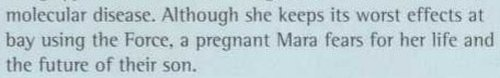
- **Mara Jade Skywalker; Darth Vader (Anakin Skywalker); Luke Skywalker** — entry/section: Mara Jade Skywalker: "She is given the assignment when Darth Vader fails to destroy Luke at Bespin." Source: *Revised Core Rulebook* (SWRPG d20 Revised Core), scan p.311
  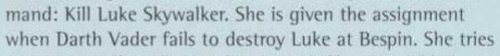

## scan p.312 (scan page 312)

Page contents: 776 words, 20 paragraphs | headings/entries: AV 1d AO SVeala; Equipment: Lightsaber', blaster pistol, space yacht Jade; Yoda; YODA

- **Yoda** — entry/section: Yoda (Revised Core Rulebook, Ch13): "He has lived longer than any other Jedi and has seen literally thousands of his friends, colleagues, and students—through violent battle and old age—become one with the Force." Source: *Revised Core Rulebook* (SWRPG d20 Revised Core), scan p.312
  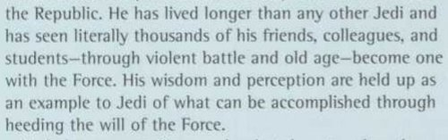
- **Yoda** — entry/section: Yoda (Revised Core Rulebook, Ch13): "Yoda is the primary instructor for those Temple students who have not yet been accepted as Padawans, teaching them basic Force techniques and self-defense, including lightsaber combat." Source: *Revised Core Rulebook* (SWRPG d20 Revised Core), scan p.312
  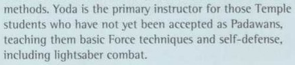
- **Yoda**: "When the Jedi Order is destroyed, Yoda retreats into hiding on Dagobah to await the day he will be needed to help restore balance to the Force." Source: *Revised Core Rulebook* (SWRPG d20 Revised Core), scan p.312
  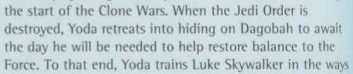

### Stat block notes (game mechanics, not feats)

- Mara Jade: Mara Jade Skywalker (beginning of NJO) — Scoundrel 6/Jedi Guardian 9, VP/WP 102/15 (57/8 while diseased), lightsaber 3d8+2, Enhance Ability +10, Heal Self +9, Challenge Code F (Source: *Revised Core Rulebook* (SWRPG d20 Revised Core), scan p.312)

## scan p.313 (scan page 313)

Page contents: 740 words, 24 paragraphs | headings/entries: Mace Windu; MACE WINDU; Jdorus C'baoth

- **Mace Windu; Yoda** — entry/section: Mace Windu (Revised Core Rulebook, Ch13): "though Yoda's junior by eight centuries, Mace Windu is een as Yoda's equal in the Jedi Order, and he is a senior ember of the Jedi Council." Source: *Revised Core Rulebook* (SWRPG d20 Revised Core), scan p.313
  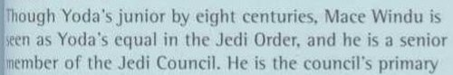
- **Mace Windu** — entry/section: Mace Windu (Revised Core Rulebook, Ch13): "A jopular story among the Padawans is that Mace Windu ince found himself surrounded by formidable warriors nown as Gank killers—all with blasters drawn. Resting one jand on his lightsaber, Windu met each Gank’s eyes and jittered three words: “It’s your decision.” One by one, the Jyarriors set down their weapons and surrendered," Source: *Revised Core Rulebook* (SWRPG d20 Revised Core), scan p.313
  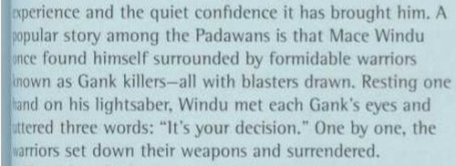
- **Mace Windu; Yoda** — entry/section: Mace Windu (Revised Core Rulebook, Ch13): "He has traveled the galaxy nearly as much as Master Hoda, battled a variety of foes, and perfected his own fightnq Style—a relentless lightsaber assault that is at once inpredictable and perfectly balanced. Other Jedi might be ironger or faster than Master Windu, but he is the recogtized master of the Order's fighting techniques." Source: *Revised Core Rulebook* (SWRPG d20 Revised Core), scan p.313
  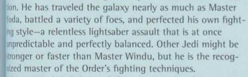
- **Mace Windu; Jango Fett** — entry/section: Mace Windu (Revised Core Rulebook, Ch13): "Mace Windu’s fighting skills are put to the ultimate test ton Geonosis, where he not only leads a Jedi assault against he Separatists’ battle droid army but also confronts the Hounty hunter Jango Fett." Source: *Revised Core Rulebook* (SWRPG d20 Revised Core), scan p.313
  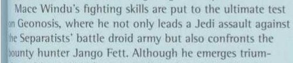
- **Joruus C'baoth** — entry/section: Jorus C'baoth (Revised Core Rulebook, Ch13): "Jorus C’baoth achieves the title of Jedi Master not through training an apprentice, but purely on the weight of his accomplishments." Source: *Revised Core Rulebook* (SWRPG d20 Revised Core), scan p.313
  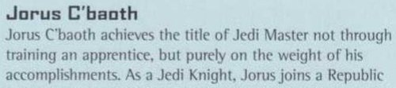

### Stat block notes (game mechanics, not feats)

- Yoda: beginning of Episode II — Jedi Consular 10/Jedi Master 10, Defense 28, VP/WP 134/14, Atk +20/+15/+10/+5 lightsaber 6d8-1, FP 15, Wis 19, Affect Mind +25, Empathy +26, Farseeing +25, See Force +25, Move Object +20, Heal Self +20, High Force Mastery, Improved Force Mind (Source: *Revised Core Rulebook* (SWRPG d20 Revised Core), scan p.313)
- Mace Windu: beginning of Episode II — Jedi Guardian 9/Jedi Master 9, VP/WP 120/15, Atk +22/+17/+12/+7 lightsaber 6d8+2, Battlemind +16, Move Object +19, Intimidate +16, Tumble +19, Whirlwind Attack, Master Defense (Source: *Revised Core Rulebook* (SWRPG d20 Revised Core), scan p.313)

## scan p.314 (scan page 314)

Page contents: 798 words, 19 paragraphs | headings/entries: The Emperor; THE EMPEROR

- **Joruus C'baoth** — entry/section: Jorus C'baoth (Revised Core Rulebook, Ch13): "His search leads him to a group of darksiders menacing the Elrood Sector. Jorus and a small strike team of Jedi Knights track down and vanquish the dark Jedi." Source: *Revised Core Rulebook* (SWRPG d20 Revised Core), scan p.314
  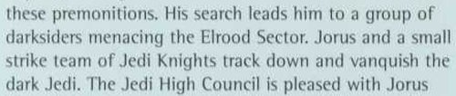
- **Palpatine (Darth Sidious)** — entry/section: The Emperor (Revised Core Rulebook, Ch13): "Possessed of the boundless power of the Force and adept in the ways of the dark side, the Emperor is one of the most dangerous and evil humans in galactic history, As his corruption grows stronger, the Emperor becomes physically" Source: *Revised Core Rulebook* (SWRPG d20 Revised Core), scan p.314
  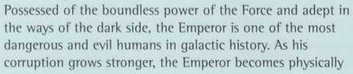
- **Palpatine (Darth Sidious)**: "Jorus's relationship with Senator Palpatine comes to an end a few years before the Battle of Naboo, after the Jedi receives visions of the dark side growing more powerful." Source: *Revised Core Rulebook* (SWRPG d20 Revised Core), scan p.314
  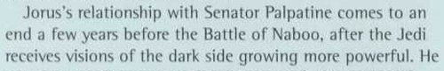

### Stat block notes (game mechanics, not feats)

- Joruus C'baoth: Jorus C'baoth (beginning of Episode I) — Noble 1/Jedi Consular 13/Jedi Master 1, VP/WP 132/14, lightsaber 4d8+1, Telepathy +14, Empathy +13, Challenge Code E (Source: *Revised Core Rulebook* (SWRPG d20 Revised Core), scan p.314)

## scan p.315 (scan page 315)

Page contents: 1082 words, 24 paragraphs | headings/entries: Force Feats: Alter, Control, Dissipate Energy, Force

- **Palpatine (Darth Sidious); Luke Skywalker; Darth Vader (Anakin Skywalker)** — entry/section: The Emperor (Revised Core Rulebook, Ch13): "Although the Emperor foresees the return of the Jedi Knights in the form of Luke Skywalker, he can't foresee (or won't accept) the impact that young Skywalker will have on his father, Darth Vader, or the betrayal that would lead to the Emperor’s ultimate doom." Source: *Revised Core Rulebook* (SWRPG d20 Revised Core), scan p.315
  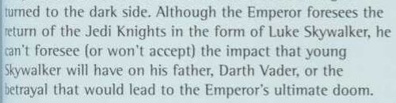
- **Palpatine (Darth Sidious)** — entry/section: The Emperor — Sith Master class feature (Revised Core Rulebook, Ch13): "Sith Master—The Emperor can bolster the Force abilities of his minions with his own. He may grant temporary ranks in any skill he possesses to a Force-sensitive being." Source: *Revised Core Rulebook* (SWRPG d20 Revised Core), scan p.315
  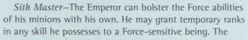
- **Count Dooku** — entry/section: Count Dooku (Revised Core Rulebook, Ch13): "Powerful, skilled, and charismatic, Dooku gathers the secessionists into a Confederacy of Independent Systems—a political body separate from the corrupt and decaying Republic." Source: *Revised Core Rulebook* (SWRPG d20 Revised Core), scan p.315
  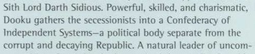

### Stat block notes (game mechanics, not feats)

- Darth Sidious: The Emperor (beginning of Episode VI) — Noble 4/Dark Side Devotee 6/Sith Lord 10, VP/WP 124/13, lightsaber 5d8-1, Farseeing +23, Telepathy +20, Fear +18, See Force +18, Force Grip +16, Force Lightning +15, Sith Master ability, Challenge Code I (highest in chapter) (Source: *Revised Core Rulebook* (SWRPG d20 Revised Core), scan p.315)

## scan p.316 (scan page 316)

Page contents: 775 words, 20 paragraphs | headings/entries: COUNT DOOKU; Jango Fett

- **Count Dooku** — entry/section: Count Dooku (Revised Core Rulebook, Ch13): "So long as he is not tempted to one side or the other, he can stay the course and harness the kind of terrific power needed to change the galaxy." Source: *Revised Core Rulebook* (SWRPG d20 Revised Core), scan p.316
  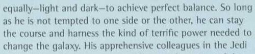
- **Count Dooku; Qui-Gon Jinn** — entry/section: Count Dooku (Revised Core Rulebook, Ch13): "Dooku’s departure shocks many of his counterparts; despite his radical views, he is a much-liked and respected Jedi Master who has personally trained some of the best Jedi Knights in the order, including Qui-Gon Jinn." Source: *Revised Core Rulebook* (SWRPG d20 Revised Core), scan p.316
  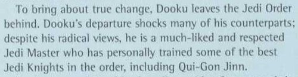
- **Count Dooku; Palpatine (Darth Sidious)**: "Dooku finds Sidious's words compelling; he, too, believes that the Republic is rapidly being crushed under its own weight, and that a new order is needed." Source: *Revised Core Rulebook* (SWRPG d20 Revised Core), scan p.316
  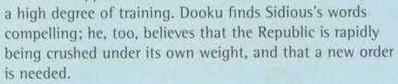

### Stat block notes (game mechanics, not feats)

- Count Dooku: beginning of Episode II — Jedi Guardian 15/Sith Lord 3, VP/WP 142/13, Atk +21/+16/+11/+6 lightsaber 5d8+1, Force Defense +15, Battlemind +14, Force Strike +14, Force Lightning +9, Master Defense, Force Whirlwind (Source: *Revised Core Rulebook* (SWRPG d20 Revised Core), scan p.316)

## scan p.317 (scan page 317)

Page contents: 535 words, 12 paragraphs | headings/entries: YOUNG BOBA FETT

- **Jango Fett; Count Dooku** — entry/section: Jango Fett (Revised Core Rulebook, Ch13): "He is charged with a mission to locate and terminate the leader of a group of Force-using raiders, the Bando Gora." Source: *Revised Core Rulebook* (SWRPG d20 Revised Core), scan p.317
  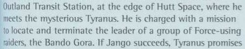
- **Boba Fett** — entry/section: Boba Fett (Revised Core Rulebook, Ch13): "The most feared bounty hunter of his time, Boba Fett racks up an unheard-of number of successful bounties that earns him a reputation as a force to be reckoned with." Source: *Revised Core Rulebook* (SWRPG d20 Revised Core), scan p.317
  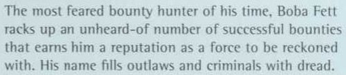

### Stat block notes (game mechanics, not feats)

- Jango Fett: beginning of Episode II — Scout ?/Soldier 6/Bounty Hunter 5, DR 5, VP/WP 126/15, sneak attack +2d6, Challenge Code F (Source: *Revised Core Rulebook* (SWRPG d20 Revised Core), scan p.317)

## scan p.318 (scan page 318)

Page contents: Sidebar "Equipment of Jango and Boba Fett": full gadget list (jet pack 500 m flight, missile launcher 5d6+2, flamethrower 2d6, whipcord, rocket darts, Boba's laser gauntlet, sonic beam, spiked boots, Jango's wrist rocket launcher, sabredarts with kouhun venom, wrist blades). (hand-read)

## scan p.319 (scan page 319)

Page contents: 728 words, 18 paragraphs | headings/entries: BOBA FETT; Tsavong Lah

- **Boba Fett; Mace Windu; Jango Fett** — entry/section: Boba Fett (Revised Core Rulebook, Ch13): "At the Battle of Geonosis, 10-year-old Boba is orphaned When Jedi Master Mace Windu kills his father." Source: *Revised Core Rulebook* (SWRPG d20 Revised Core), scan p.319
  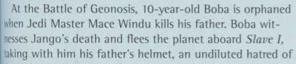
- **Tsavong Lah** — entry/section: Tsavong Lah (Revised Core Rulebook, Ch13): "His devastating combat skills and devious military tactics have brought him one victory after another. He can anticipate his enemy’s moves and plans accordingly." Source: *Revised Core Rulebook* (SWRPG d20 Revised Core), scan p.319
  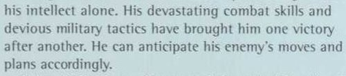

### Stat block notes (game mechanics, not feats)

- Boba Fett: beginning of Episode V — Soldier ?/Scoundrel 1/Bounty Hunter 6, DR 4, VP/WP 100/15, sneak attack +3d6, Rep +9, Challenge Code F (Source: *Revised Core Rulebook* (SWRPG d20 Revised Core), scan p.319)
- Tsavong Lah: beginning of NJO — Soldier 8/Noble 4/Officer 6, DR 7, VP/WP 185/19, immune to Force Sense and Alter, Knowledge (tactics) +21, Challenge Code H (Source: *Revised Core Rulebook* (SWRPG d20 Revised Core), scan p.319)

## scan p.320 (scan page 320)

Page contents: 5 words, 2 paragraphs | headings/entries: CHAPTER FOURTEEN; ALLIES | OPPONENTS

## scan p.321 (scan page 321)

Page contents: 444 words, 14 paragraphs | headings/entries: Aliens of the Galaxy; What's New?; Commoners; Bothans

## scan p.322 (scan page 322)

Page contents: 962 words, 37 paragraphs | headings/entries: Cereans; Duros; Ewoks

## scan p.323 (scan page 323)

Page contents: 723 words, 25 paragraphs | headings/entries: Gamorreans; Samoarrean Commoner: Init —! (Dex); Defense 9; Geonosians; GEONOSIAN

## scan p.324 (scan page 324)

Page contents: 951 words, 29 paragraphs | headings/entries: SLNANOddAD ONV SSI 1 1V; Feats: None,; Humans

## scan p.325 (scan page 325)

Page contents: Hutts: species traits include "+6 species bonus on Will saves against mind-affecting Force powers; can't be knocked prone." Yuuzhan Vong (p.330) and Tsavong Lah: "immune to Force, Sense, and Alter." Male gundarks +4 on saves vs Fear (p.339). Clone troopers and stormtroopers "can't be bribed, blackmailed, or seduced" (pp.344, 356). (hand-read)

## scan p.326 (scan page 326)

Page contents: 774 words, 19 paragraphs | headings/entries: KAMINOAN; Kel Dor

## scan p.327 (scan page 327)

Page contents: 1002 words, 31 paragraphs | headings/entries: Mon Calamari; Neimoidians; Noghri

- **Darth Vader (Anakin Skywalker); Leia Organa Solo** — entry/section: Noghri (Revised Core Rulebook, Ch14): "The Noghri served Vader as his secret assassins for decades. Five years after Vader's death, one of their number recognized Leia Organa as Darth Vader's daughter." Source: *Revised Core Rulebook* (SWRPG d20 Revised Core), scan p.327
  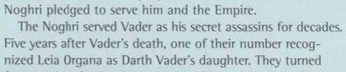

## scan p.328 (scan page 328)

Page contents: 827 words, 37 paragraphs | headings/entries: Quarren

## scan p.329 (scan page 329)

Page contents: 932 words, 39 paragraphs | headings/entries: Feats: Track (bonus feat),; Sullustans; Trandoshan Commoner: Init -1 (Dex); Defense 10; Tusken Raiders; Twi leks

## scan p.330 (scan page 330)

Page contents: 985 words, 29 paragraphs | headings/entries: Yuuzhan Vong

- **Chewbacca** — entry/section: Wookiees (Revised Core Rulebook, Ch14): "Although Wookiees are widely recognized as one of the strongest and fiercest intelligent species in the galaxy, other creatures on Kashyyyk are so powerful that the Wookiees are relegated to living in the tops of the world’s giant trees." Source: *Revised Core Rulebook* (SWRPG d20 Revised Core), scan p.330
  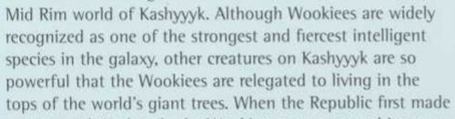
- **Tsavong Lah** — entry/section: Yuuzhan Vong (Revised Core Rulebook, Ch14): "The gravitic energy of a dovin basal can also shut down the shields of a spacecraft, or—as the Yuuzhan Vong have recently demonstrated—pull moons out of their orbit onto their parent planet." Source: *Revised Core Rulebook* (SWRPG d20 Revised Core), scan p.330
  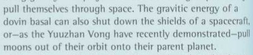

## scan p.331 (scan page 331)

Page contents: 864 words, 36 paragraphs | headings/entries: Zabrak; Creatures; Type and Level; Initiative (Init); Defense

## scan p.332 (scan page 332)

Page contents: 982 words, 34 paragraphs | headings/entries: Vitality and Wound Points (VP/WP); Damage; Special Qualities (SQ)

## scan p.333 (scan page 333)

Page contents: 1141 words, 20 paragraphs | headings/entries: Saving Throws (SV)

## scan p.334 (scan page 334)

Page contents: 856 words, 37 paragraphs | headings/entries: Size (SZ); Table 14-1: Creature Size Modifiers; Skills; The creature's skills are; Challenge Code; Scavengers: Like predators, scavengers are known to; Feats

## scan p.335 (scan page 335)

Page contents: 741 words, 53 paragraphs | headings/entries: Attack Bonus Creature's Saves Attack Bonus (Scavengers,; Level (Low/High) (Predators) Vermin); Ist +0/+2 +1 +0; Huge 2d4+20 (25) 2d6+5 (12); Small 2d4+2 (7) 2d6+10 (17); Fine 1 (1) 2d8+14 (23); Table 14-2: Creature Saving Throws and Attacks; Herd Animal; Parasite; Table 14-3: Herd Animal Physical Characteristics; Constitution (Average) Slam Bite Claw Gore

## scan p.336 (scan page 336)

Page contents: 625 words, 53 paragraphs | headings/entries: SLNANOddAD ONV S3!111V; Table 14-4: Parasite Physical Characteristics; Huge 1d8+17 (22) 1d4+7 (10); Small 1d4+3 (6) 1d4+15 (18); Fine 1 (1) 1d6+26 (30); Predator; Constitution (Average) Slam Bite Claw _ Gore; Table 14-5: Predator Physical Characteristics; Huge 2d6+23 (30) 1d4+7 (10); Small 1d6+6 (10) 2d4+412 (17); Fine 1d3 (2) 2d4+25 (30); Constitution (Average) Slam Bite Claw Gore; Table 14-6: Scavenger Physical Characteristics; Gargantuan 2d6+25 (32) 1d6+2 (6); Huge 2d6+17 (24) 1d6+4 (8); Small 2d4+1 (6) 1d6+12 (16); Fine 1d2 (1) 1d8+25 (30); Constitution (Average) Slam Bite Claw Gore

## scan p.337 (scan page 337)

Page contents: 780 words, 45 paragraphs | headings/entries: Vermin; Table 14-7: Vermin Physical Characteristics; Huge 2d6+7 (14) 1d4+7 (10); Small 2d4+1 (6) 1d4+13 (16); Fine 1d2 (1) 1d6+19 (23); Creature Descriptions; Acklay; Bantha; Constitution (Average) Slam Bite Claw Gore

## scan p.338 (scan page 338)

Page contents: 1042 words, 29 paragraphs | headings/entries: Dewback; Dianoga

## scan p.339 (scan page 339)

Page contents: Massiff: "When hungry enough, and in large enough numbers, a pack of massiffs could hunt down and kill a krayt dragon" (creature scale, no character). (hand-read)

- **Luke Skywalker** — entry/section: Massiff (Revised Core Rulebook, Ch14): "When hungry enough, and in large enough numbers, a pack of massiffs could hunt down and kill a krayt dragon—and one or two of them might even survive to enjoy the meal." Source: *Revised Core Rulebook* (SWRPG d20 Revised Core), scan p.339
  

## scan p.340 (scan page 340)

Page contents: 769 words, 23 paragraphs | headings/entries: Mynock; Nexu; Rancor; NEXU; Reek

## scan p.341 (scan page 341)

Page contents: 1016 words, 25 paragraphs | headings/entries: Administrator

## scan p.342 (scan page 342)

Page contents: 916 words, 31 paragraphs | headings/entries: Assassin; Equipment: Blaster pistol (or signature weapon),; Battle Droid

## scan p.343 (scan page 343)

Page contents: 751 words, 26 paragraphs | headings/entries: BOUNTY HUNTER

## scan p.344 (scan page 344)

Page contents: 437 words, 15 paragraphs | headings/entries: 

## scan p.345 (scan page 345)

Page contents: 1007 words, 27 paragraphs | headings/entries: Crime Lord; Dark Jedi Guardian

- **Luke Skywalker** — entry/section: Dark Jedi archetype (Revised Core Rulebook, Ch14): "During the Rebellion Era, the Jedi themselves are so scarce that dark Jedi are almost nonexistent, though it is possible that a few linger still. These few have escaped the Empire's purge of the Jedi Order, and some even serve the Emperor." Source: *Revised Core Rulebook* (SWRPG d20 Revised Core), scan p.345
  

## scan p.346 (scan page 346)

Page contents: 429 words, 26 paragraphs | headings/entries: Equipment: Lightsaber*, sinister clothes,; DARK JEDI GUARDIAN

## scan p.347 (scan page 347)

Page contents: 986 words, 37 paragraphs | headings/entries: Dark Side Adept; Doctor

- **Palpatine (Darth Sidious); Luke Skywalker** — entry/section: Dark side adept archetype (Revised Core Rulebook, Ch14): "During the Rebellion era, the Emperor left other dark Force-users alone while he focused on more important goals: quelling the Rebellion and turning young Skywalker." Source: *Revised Core Rulebook* (SWRPG d20 Revised Core), scan p.347
  

## scan p.348 (scan page 348)

Page contents: 989 words, 30 paragraphs | headings/entries: Equipment: Uniform, medpac, surgery kit, blaster pistol,; Elite Trooper; Fallen Jedi

## scan p.349 (scan page 349)

Page contents: 901 words, 29 paragraphs | headings/entries: Gambler; Independent Droid; SLNSNOdcd0 GNV SaInNv &

## scan p.350 (scan page 350)

Page contents: 874 words, 33 paragraphs | headings/entries: Feats: Combat Expertise, Exotic Weapon Proficiency; Medic

## scan p.351 (scan page 351)

Page contents: 940 words, 29 paragraphs | headings/entries: Mercenary

## scan p.352 (scan page 352)

Page contents: 930 words, 29 paragraphs | headings/entries: Outlaw

## scan p.353 (scan page 353)

Page contents: 985 words, 44 paragraphs | headings/entries: Pirate; Republic Peace Officer; Slicer

## scan p.354 (scan page 354)

Page contents: 931 words, 25 paragraphs | headings/entries: Smuggler

## scan p.355 (scan page 355)

Page contents: 953 words, 31 paragraphs | headings/entries: High-Level Smuggler: Scoundrel 6/Scout 6; Init +6; Starfighter Pilot

- **Wedge Antilles; Soontir Fel** — entry/section: Starfighter pilot archetype (Revised Core Rulebook, Ch14): "The high-level pilot is truly a rare breed: the survivor of many battles who has honed his skill. The type of fighter this ace prefers to fly functions like an extension of his or her being. Wedge Antilles and Baron Soontir Fel are pilots of this caliber." Source: *Revised Core Rulebook* (SWRPG d20 Revised Core), scan p.355
  

## scan p.356 (scan page 356)

Page contents: 398 words, 15 paragraphs | headings/entries: 

## scan p.357 (scan page 357)

Page contents: 883 words, 37 paragraphs | headings/entries: Thug; Trader

## scan p.358 (scan page 358)

Page contents: Yuuzhan Vong Equipment sidebar (pp.358-359): amphistaff (quarterstaff/spear/whip/venom spitter 20 m, DC 22 poison), blorash jelly, gnullith, ooglith masquer (+10 Disguise), razorbug (a lightsaber deflect user can destroy it in flight), thud bug, tizowyrm, tsaisi, villip, vonduun crabshell (DR 3). (hand-read)

## scan p.359 (scan page 359)

Page contents: 971 words, 32 paragraphs | headings/entries: Tsaisi Range; Configuration Damage Critical Increment Size Weight Type; Baton 1d4/1d4 20 - Small 1kg Bludgeoning

## scan p.360 (scan page 360)

Page contents: 3 words, 2 paragraphs | headings/entries: CHAPTER FIFTEEN

