# Owner Material 037 — Star Wars D20 Drive folder (Core, Revised Core and Saga Edition): Sourcebooks/Ultimate Adversaries.pdf [Star Wars Roleplaying Game Revised Core (d20, 2002)] (scan pages 1–60)

- **Source:** Wizards of the Coast Star Wars Roleplaying Game books, web enhancements, Living Force campaign modules and articles (2000–2010), from the owner's "Star Wars D20" Drive folder (only the three edition subfolders; "General" was not read, as instructed). Secondary source (licensed Legends reference). Scan OCR'd on the box; the scan stays box-only and is **not** published.
- **Method:** every scanned page was OCR'd and machine-screened sentence by sentence for power-relevant statements (fights, kills, defeats, Force feats, rankings, superweapons) that name a character on our roster; each kept sentence is quoted verbatim from the OCR text and has a crop of the printed passage directly under it. Pages with nothing power-relevant are still listed with what is on them.
- **Citation:** "*Ultimate Adversaries* (SWRPG d20 Revised Core), p.X" by printed page ("scan p.X" where no printed number applies). **Weight:** Licensed RPG material: a secondary source. Narrative text sums up Legends lore; game statistics are rules for players, not canon power levels, and rank lowest.

## scan p.1 (scan page 1)

Page contents: Cover: Ultimate Adversaries (Cagle, Lyons, Mikaelian, Miller, Stephens, Upchurch). (hand-read)

## scan p.2 (scan page 2)

Page contents: Title page. (hand-read)

## scan p.3 (scan page 3)

Page contents: Credits and legal (June 2004). (hand-read)

## scan p.4 (scan page 4)

Page contents: Table of contents (villains, creatures, droids, appendix). (hand-read)

## scan p.5 (scan page 5)

Page contents: Art page. (hand-read)

## scan p.6 (scan page 6)

Page contents: Introduction (Obi-Wan's Mos Eisley line; chapter overview). (hand-read)

- **Obi-Wan Kenobi; Luke Skywalker; Boba Fett; Darth Vader (Anakin Skywalker)** — entry/section: Introduction: "You will never find a more wretched hive of scum and villainy. —Obi-Wan Kenobi This is how Ben Kenobi described Mos Eisley Spaceport to Luke Skywalker at the beginning of their epic journey. This book contains many of the dangerous foes that Luke and Ben may have encountered during their time there, as well as a host of other challenges for heroes across the galaxy. You will not find many familiar faces within this book—such luminary villains as Boba Fett and Darth Vader have already been covered in the Star Wars Roleplaying Game and other sourcebooks." Source: *Ultimate Adversaries* (SWRPG d20 Revised Core), scan p.6
  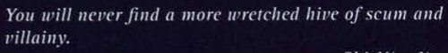

## scan p.7 (scan page 7)

Page contents: Chapter art. (hand-read)

## scan p.8 (scan page 8)

Page contents: Chapter One: Villains intro; Aach Een begins. (hand-read)

- **Darth Vader (Anakin Skywalker); Boba Fett; Jabba the Hutt; Luke Skywalker; Palpatine (Darth Sidious); Darth Maul; Count Dooku** — entry/section: Chapter One: Villains: "Darth Vader, Boba Fett, and Jabba the Hutt all opposed Luke Skywalker in his quest to reestablish the Jedi Order. Darth Sidious, Darth Maul, and Count Dooku worked to eliminate the Jedi and establish dominion over all the worlds of the Old Republic." Source: *Ultimate Adversaries* (SWRPG d20 Revised Core), scan p.8
  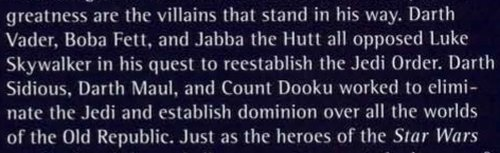

## scan p.9 (scan page 9)

Page contents: Aach Een (Zabrak explorer, Oolak Goyl ally) history, goals, tactics, era notes, stats; customized equipment sidebar. (hand-read)

## scan p.10 (scan page 10)

Page contents: Aach Een equipment/skills; Captain Aran Cho entry and stats. (hand-read)

## scan p.11 (scan page 11)

Page contents: Aran Cho skills/feats; Beel Acton (dark side Force adept) history, goals. (hand-read)

## scan p.12 (scan page 12)

Page contents: Beel Acton era notes (Darth Maul, the Emperor, Luke's Jedi) and stats; Bossk history. (hand-read)

- **Darth Maul; Palpatine (Darth Sidious); Luke Skywalker** — entry/section: Beel Acton: Era Notes: "During the Rise of the Empire era, Beel can sense that the Sith have become active and yearns to become the new Sith apprentice. With word of Darth Maul’s demise, Beel may try anything to come to the attention of the as yet unnamed Sith master. During the Rebellion Era, he works primarily to enhance the anti-Jedi propaganda of the Empire, although he never works directly for the Emperor, nor does he know that the Emperor is indeed the lord of the Sith. His activities are similar during the New Jedi Order, where he attempts to keep the old prejudices of the Empire alive and well in the face of Luke Skywalker’s new Jedi initiatives." Source: *Ultimate Adversaries* (SWRPG d20 Revised Core), scan p.12
  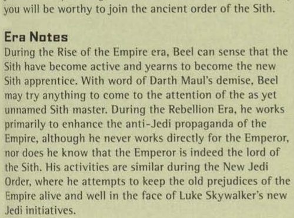
- **Bossk; Darth Vader (Anakin Skywalker); Luke Skywalker** — entry/section: Bossk: "Although his career as a bounty hunter began long before the Empire, the rise of the Empire provided Bossk with the opportunity he had been waiting for. The Empire needed bounty hunters to bring in “criminals” such as Rebel holdouts and those who did not believe in the sovereignty of the Emperor. Their methods were also appealing to the Trandoshan, who preferred violent methods to peaceful ones and was known to be a cruel keeper to those he brought in alive. Bossk quickly became one of the Empire's most reliable bounty hunters, and he was personally selected by Darth Vader to hunt down Luke Skywalker and his allies after the Battle of Hoth." Source: *Ultimate Adversaries* (SWRPG d20 Revised Core), scan p.12
  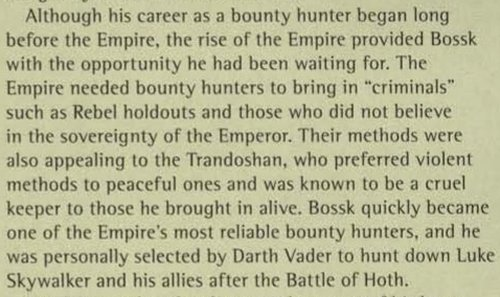
- **Bossk; Chewbacca; Boba Fett; Jabba the Hutt** — entry/section: Bossk and Chewbacca: "Bossk jumped at the chance to hunt one of his longtime nemeses, the Wookiee Chewbacca. He had started his career as a bounty hunter by hunting down escaped Wookiee slaves; during one of his expeditions, he ran afoul of Chewbacca. The Wookiee defeated the bounty hunter, tearing off one of his arms at the elbow during the intense battle that followed their meeting. His constant defeats only made Bossk obsessed with catching the Wookiee, and he has been known to turn down lucrative jobs in order to pursue the one prey he has not been able to capture. His best chance came when Chewbacca and his allies were captured by Boba Fett on Cloud City, but the bounty hunter refused to release Chewbacca to Bossk since his intention was to deliver the Wookiee to Jabba the Hutt on Tatooine. This infuriated Bossk, who harbored resentment toward Boba Fett until the bounty hunter's fall into the Sarlacc Pit." Source: *Ultimate Adversaries* (SWRPG d20 Revised Core), scan p.12
  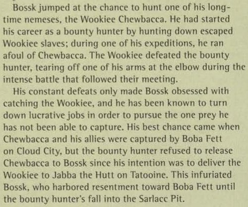

## scan p.13 (scan page 13)

Page contents: Bossk description, goals, tactics, affiliations, era notes, stats; Hound's Tooth. (hand-read)

- **Bossk; Chewbacca** — entry/section: Ultimate Adversaries (Revised Core): "He is at his prime during the Rebellion Era, when his running feud with Chewbacca is at its strongest." Source: *Ultimate Adversaries* (SWRPG d20 Revised Core), scan p.13
  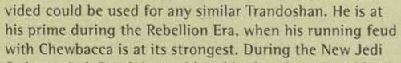
- **Bossk; Chewbacca** — entry/section: Bossk: Goals: "Bossk loves being a bounty hunter and can think of nothing he would rather do. He scrounges any piece of information he can get on Chewbacca, and has followed the Wookiee all over the galaxy only to come up empty handed each time they have fought. Bossk no longer wishes to collect the bounty on the Wookiee, instead just wishing to see him dead. Even when he takes jobs in other parts of the galaxy, his arch-nemesis is never far from his mind." Source: *Ultimate Adversaries* (SWRPG d20 Revised Core), scan p.13
  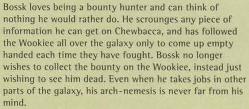
- **Bossk; Boba Fett; Chewbacca; Han Solo** — entry/section: Bossk: Affiliations: "Bossk is well known among bounty hunters, and his experience has helped him garner several large and ongoing contracts. Lesser bounty hunters often pay Bossk to complete a particularly challenging bounty that they have failed to accomplish, a task he does in return for later favors. In this way, Bossk has managed to accumulate a vast network of resources at his disposal. He is also known to feud with those who displease him, such as when Boba Fett refused to turn over Chewbacca after capturing he and Han Solo in Cloud City." Source: *Ultimate Adversaries* (SWRPG d20 Revised Core), scan p.13
  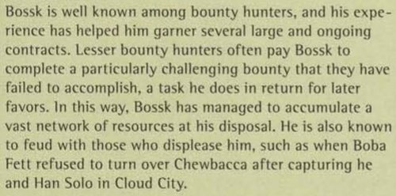
- **Bossk; Chewbacca** — entry/section: Bossk: Era Notes: "Bossk is still a young Trandoshan during the Rise of the Empire era and has not grown into the fearsome bounty hunter that he will become. Still, his attitudes and abilities are not uncommon among his species and the stats provided could be used for any similar Trandoshan. He is at his prime during the Rebellion Era, when his running feud with Chewbacca is at its strongest. During the New Jedi Order period, Bossk is an old and broken figure. He blindly pursues Chewbacca well past the point that his body could handle another encounter with the Wookiee, as they years of injuries have finally caught up to him." Source: *Ultimate Adversaries* (SWRPG d20 Revised Core), scan p.13
  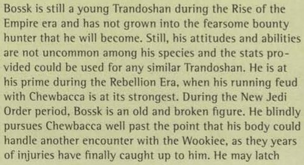

### Stat block notes (game mechanics, not feats)

- Bossk: Male Trandoshan Scout 4/Soldier 3/Bounty Hunter 4; Init +3 (+3 Dex); Defense 21 (+7 class bonus, +3 Dex, +1 natural); DR 2; Spd 10 m; VP/WP 96/16; Atk +13/+8 melee (1d3+3, unarmed) or +13/+8 ranged (3d8/19-20, blaster rifle) or +13/+8 ranged (3d4—-1, Quick- 6 sporting blaster pistol”) +13/+8 ranged (DC 15/12 stun, stun grenade launcher**) or +13/+8 ranged (2d6, Reflex DC 15, fl (Source: *Ultimate Adversaries* (SWRPG d20 Revised Core), scan p.13)

## scan p.14 (scan page 14)

Page contents: Bossk feats; C-3PX (Darth Maul's modified droid, Olag Greck) history, description, goals, tactics. (hand-read)

- **C-3PX; Darth Maul; Olag Greck** — entry/section: C-3PX: "The turning point in the droid’s early career came when it was placed in the service of Darth Maul in the years leading up to the Trade Federation’s blockade of Naboo. Maul had little use for a protocol droid, however, and he modified C-3PX to become a security droid for his Sith infiltrator. He built improved sensors, increased strength, and 83 different weapons into the droid’s chassis, and he altered its programming to help the droid use these new tools. Some time after these modifications were made, Darth Maul brought C-3PX along with him on a mission, which was successful for Maul, but not before he lost the droid somewhere within a demolished Bartokk fortress. Maul searched for the droid but was unable to locate it before he was forced to leave the Bartokks behind and complete his mission alone." Source: *Ultimate Adversaries* (SWRPG d20 Revised Core), scan p.14
  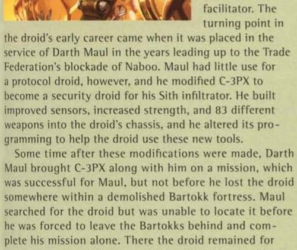

## scan p.15 (scan page 15)

Page contents: C-3PX roleplaying, era notes, stats; Deel De (Twi'lek dark sider) entry. (hand-read)

## scan p.16 (scan page 16)

Page contents: Deel De affiliations, stats; Doln Tok (Kel Dor, Rose Nebula). (hand-read)

## scan p.17 (scan page 17)

Page contents: Doln Tok stats; Ereen Agar (Zabrak enforcer, Vurrha's Blood). (hand-read)

## scan p.18 (scan page 18)

Page contents: Ereen Agar gear; Eshin Worr (Yuuzhan Vong Intendant); Granakk (exiled Wookiee bounty hunter). (hand-read)

## scan p.19 (scan page 19)

Page contents: Granakk cont. and stats; Iris Snow (Corellian Slavers Guild). (hand-read)

## scan p.20 (scan page 20)

Page contents: Iris Snow cont./stats; Judge Keedo (Rodian magistrate). (hand-read)

## scan p.21 (scan page 21)

Page contents: Judge Keedo roleplaying/stats; Kant (Mon Calamari anarchist smuggler). (hand-read)

## scan p.22 (scan page 22)

Page contents: Kant stats; Keeth Anak (Zabrak Force adept bounty hunter). (hand-read)

## scan p.23 (scan page 23)

Page contents: Keeth Anak gear; Kelna Toodo (Duros gambler, Beeda the Hutt's stooge); Kurgan Dala begins. (hand-read)

## scan p.24 (scan page 24)

Page contents: Kurgan Dala (Naboo pilot possessed by a space wraith). (hand-read)

## scan p.25 (scan page 25)

Page contents: Kurgan Dala stats; Larith De (Twi'lek noble, Deel's puppet). (hand-read)

## scan p.26 (scan page 26)

Page contents: Larith De feats; Malia (Rose Nebula spy); Menugg (Gamorrean) begins. (hand-read)

## scan p.27 (scan page 27)

Page contents: Menugg (Vurrha's bodyguard) and stats; Nib Maroon (Twi'lek singer/bouncer). (hand-read)

## scan p.28 (scan page 28)

Page contents: Nib Maroon cont./stats; Odon Anak. (hand-read)

## scan p.29 (scan page 29)

Page contents: Odon Anak stats; Oolak Goyl (Twi'lek collector). (hand-read)

## scan p.30 (scan page 30)

Page contents: Oolak Goyl tactics, affiliations, roleplaying. (hand-read)

## scan p.31 (scan page 31)

Page contents: Oolak Goyl era notes/stats; Ra Katana (Kayala Ravein, Alderaanian senator's daughter vigilante) history; Ra Katana cont.: vigilante double life, description, goals, tactics, era notes (Death Star), stats. (hand-read)

## scan p.32 (scan page 32)

Page contents: Ra Katana feats; Rava Teb'lya (Bothan owner of the Rose Nebula). (hand-read)

## scan p.33 (scan page 33)

Page contents: Rose Nebula sidebar (Rose Starlight front, Ter-Idi); Riggs Ashar (militia bully). (hand-read)

## scan p.34 (scan page 34)

Page contents: Riggs Ashar stats; Set Harth (Dark Jedi, Lord Hoth's Army of Light, Lord Kaan, Ruusan, clones). (hand-read)

- **Set Harth; Lord Hoth; Lord Kaan** — entry/section: Set Harth: "Set Harth began his training at the Jedi Academy on Coruscant more than 1,000 years before the Battle of Yavin. He was impetuous and hot-headed, preferring fighting to talking and scoffing at the non-violent teachings of the Jedi Academy. His Jedi Master, Aru-Wen, worked with the boy to soften these tendencies before his student was lost to the dark side. Before he could accomplish this, however, Aru-Wen left Coruscant to join Jedi Master Hoth’s Army of Light as they did battle with the dark forces of the Sith Lord Kaan. Set Harth was left behind to pursue his own twisted version of the Force. He did so without a Jedi Master at his side." Source: *Ultimate Adversaries* (SWRPG d20 Revised Core), scan p.34
  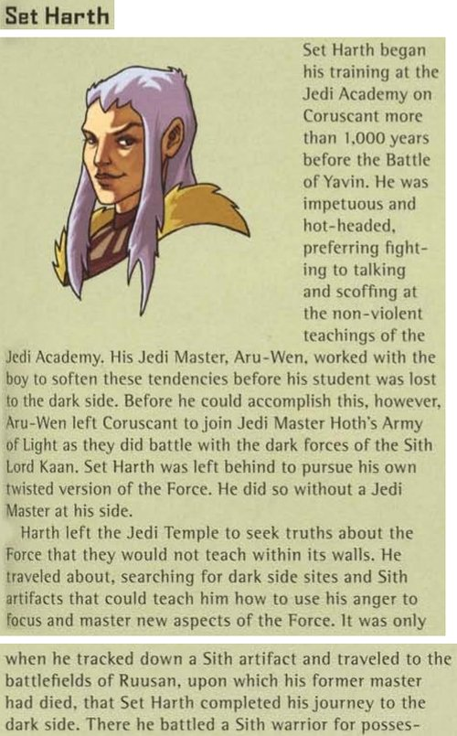
- **Set Harth** — entry/section: Set Harth: Ruusan and Survival: "It was only when he tracked down a Sith artifact and traveled to the battlefields of Ruusan, upon which his former master had died, that Set Harth completed his journey to the dark side. There he battled a Sith warrior for possession of the artifact, and gave in to the anger that would finally complete his journey. ... In truth, the Set Harth that now inhabits the galaxy is a little of both. Before he died, Harth learned to transfer his consciousness into other bodies—but the dark energy required to possess the other body consumed and destroyed his original form. Over the centuries, he eventually made contact with cloning specialists to reproduce his original form, thus ensuring that he could live on forever." Source: *Ultimate Adversaries* (SWRPG d20 Revised Core), scan p.34
  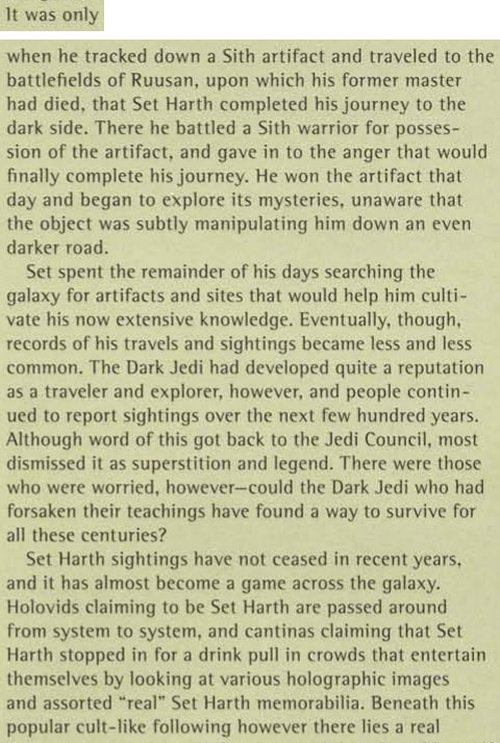

## scan p.35 (scan page 35)

Page contents: Set Harth tactics, affiliations, roleplaying, era notes, Old Republic and later-era stats; Sevv Sunb begins. (hand-read)

- **Set Harth**: "If the Yuuzhan Vong threaten to destroy the cloning technology that keeps him in the physical realm, Set Harth may join forces with others in order to prevent this from happening, even if those others do not know he is there." Source: *Ultimate Adversaries* (SWRPG d20 Revised Core), scan p.35
  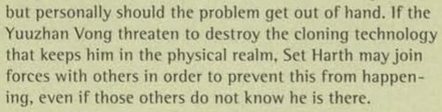

### Stat block notes (game mechanics, not feats)

- Set Harth (Old Republic Era): (Old Republic Era): Male Human Jedi Guardian 8; Init +2 (Dex +2); Defense 18 (+6 class bonus, +2 Dex); Spd 10 m; VP/WP 70/15; Atk +10/+5 melee" (3d8+1/19-20, lightsaber) or +10/+5 ranged (3d6, blaster pistol); SQ deflect (attack —4), deflect (defense +1), deflect {extend defense and attack) ; SV Fort +8, Ref +8, Will +4; SZ M; FP 3; DSP 4; Rep +2; Str 13, Dex 14, Con 15, Int (Source: *Ultimate Adversaries* (SWRPG d20 Revised Core), scan p.35)
- Set Harth (Rise of the Empire, Rebellion, or New Jedi Order era): Male Human Jedi Guardian 8/Dark Side Devotee 8; Defense 23; VP/WP 126/14; Atk +16/+11/+6 melee (3d8+1/19-20, lightsaber); FP 7; DSP 15; Rep +6; Challenge Code: G. Force Skills: Battlemind +16, Drain Energy +12, Fear +13, Force Grip +16, Transfer Essence +18; Force Feats include Sith Sorcery. (Source: *Ultimate Adversaries* (SWRPG d20 Revised Core), scan p.35)

## scan p.36 (scan page 36)

Page contents: Sevv Sunb (Sullustan accountant, Vurrha's Blood) and stats; Tar Monevv (Yuuzhan Vong commander). (hand-read)

## scan p.37 (scan page 37)

Page contents: Tar Monevv cont./stats; Teezyk (Rodian assassin). (hand-read)

## scan p.38 (scan page 38)

Page contents: Teezyk stats; Ter-Idi (Cerean ex-Jedi information broker). (hand-read)

## scan p.39 (scan page 39)

Page contents: Ter-Idi era notes (Palpatine, Skywalker's academy) and stats; Tsserk (Trandoshan Rose Nebula security). (hand-read)

- **Palpatine (Darth Sidious); Luke Skywalker** — entry/section: Ter-Idi: Era Notes: "In the Rise of the Empire era, Ter-Idi can study with the Jedi as normal, leaving well before Palpatine’s rise to power. In the Rebellion era, he should have left the Jedi just before the Clone Wars began, giving him time to disappear and thus escape the fate of his former companions among the Jedi. Under the New Jedi Order era, he can be older, having left the order prior to the collapse of the Jedi, or he could be only a few years out of Skywalker’s academy." Source: *Ultimate Adversaries* (SWRPG d20 Revised Core), scan p.39
  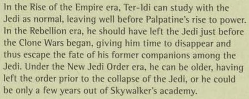

## scan p.40 (scan page 40)

Page contents: Tsserk gear; Victor Jun (mad Force-user) begins; Victor Jun goals, tactics, affiliations, era notes (Leia Organa, Luke Skywalker as targets), stats. (hand-read)

- **Leia Organa Solo; Luke Skywalker** — entry/section: Victor Jun: Era Notes: "In the Rise of the Empire era, Victor could set his sights on members of the Jedi Council or the Republic Senate. During the Rebellion era, any of the founders of the Rebellion would make good targets, as would Leia Organa. In the New Jedi Order era, Luke Skywalker or Leia Organa Solo would make excellent targets for Victor's madness, as would any hero in any era with a Reputation bonus of +5 or higher." Source: *Ultimate Adversaries* (SWRPG d20 Revised Core), scan p.40
  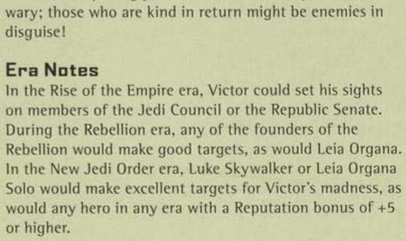

## scan p.41 (scan page 41)

Page contents: Victor Jun skills/feats; Vurrha Chur (Quarren crime boss, Mos Eisley) and stats. (hand-read)

## scan p.42 (scan page 42)

Page contents: Vurrha's Blood sidebar; Womwa (Ithorian owner of The Haven bar). (hand-read)

## scan p.43 (scan page 43)

Page contents: Womwa stats; Yith Ganar Tey (Kel Dor tech specialist, homebuilt Y-wing). (hand-read)

## scan p.44 (scan page 44)

Page contents: Yith Ganar stats; Z2-1B "The Doctor" (independent medical droid) and stats. (hand-read)

## scan p.45 (scan page 45)

Page contents: Z2-1B skills; Zarandro Vykas (spice-addicted martial artist). (hand-read)

## scan p.46 (scan page 46)

Page contents: Spice Addiction sidebar; Zarandro roleplaying/era notes/stats; Zardra Vykas begins. (hand-read)

## scan p.47 (scan page 47)

Page contents: Zardra Vykas (pilot, Rogue Moon) and stats; Zethe Raskin begins. (hand-read)

## scan p.48 (scan page 48)

Page contents: Zethe Raskin (corrupt noblewoman) goals, era notes (Leia Organa Solo's circle), stats; Generic Organizations intro. (hand-read)

- **Leia Organa Solo; Palpatine (Darth Sidious)** — entry/section: Zethe Raskin: Era Notes: "For any era, Zethe can function as a local or regional political figure. In the Rise of the Empire, Zethe can be a Senator in the Republic. For the Rebellion Era, Zethe could be an adherent to the Emperor or possibly function as a mole in the Alliance, reporting valuable information to the Imperial Fleet in exchange for personal power. During the New Jedi Order, Zethe could be found working her way up within the New Republic, possibly as one of Leia Organa Solo’s circle of supporters." Source: *Ultimate Adversaries* (SWRPG d20 Revised Core), scan p.48
  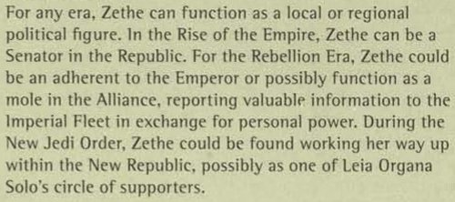

## scan p.49 (scan page 49)

Page contents: Using generic organizations; Mercenary Company (leadership, behavior, encounters). (hand-read)

## scan p.50 (scan page 50)

Page contents: Mercenary sample encounters and example companies; Mercenary Sniper stats. (hand-read)

## scan p.51 (scan page 51)

Page contents: Sharpshooter errata sidebar; High-Level Mercenary Sniper; Mercenary Scout; Mercenary Demolitions Expert. (hand-read)

## scan p.52 (scan page 52)

Page contents: Mercenary Demolitions Expert (high-level); Mercenary Pilot; Mercenary Medic (low). (hand-read)

## scan p.53 (scan page 53)

Page contents: Mercenary Medic (high); Organized Crime Syndicate (Black Sun, Hutts, Lady Valarian's); Lackey. (hand-read)

## scan p.54 (scan page 54)

Page contents: Lackey (high); Lieutenant stats; Planetary Security Force begins. (hand-read)

## scan p.55 (scan page 55)

Page contents: Planetary Security Force leadership/behavior/encounters (CorSec, Sector Rangers, Espo); Enforcement Officer. (hand-read)

## scan p.56 (scan page 56)

Page contents: Enforcement Officer (high); Detective; Special Tactics Officers (low). (hand-read)

## scan p.57 (scan page 57)

Page contents: Special Tactics Officers (mid/high); Primitive Culture intro. (hand-read)

## scan p.58 (scan page 58)

Page contents: Primitive Culture leadership/behavior (Ewoks, Tusken Raiders, Gamorreans); Primitive Hunter. (hand-read)

## scan p.59 (scan page 59)

Page contents: Primitive Warrior; Primitive Shaman. (hand-read)

## scan p.60 (scan page 60)

Page contents: Primitive Elder; Private Security Force begins. (hand-read)

