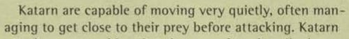

# Owner Material 037 — Star Wars D20 Drive folder (Core, Revised Core and Saga Edition): Sourcebooks/Ultimate Adversaries.pdf [Star Wars Roleplaying Game Revised Core (d20, 2002)] (scan pages 61–120)

- **Source:** Wizards of the Coast Star Wars Roleplaying Game books, web enhancements, Living Force campaign modules and articles (2000–2010), from the owner's "Star Wars D20" Drive folder (only the three edition subfolders; "General" was not read, as instructed). Secondary source (licensed Legends reference). Scan OCR'd on the box; the scan stays box-only and is **not** published.
- **Method:** every scanned page was OCR'd and machine-screened sentence by sentence for power-relevant statements (fights, kills, defeats, Force feats, rankings, superweapons) that name a character on our roster; each kept sentence is quoted verbatim from the OCR text and has a crop of the printed passage directly under it. Pages with nothing power-relevant are still listed with what is on them.
- **Citation:** "*Ultimate Adversaries* (SWRPG d20 Revised Core), p.X" by printed page ("scan p.X" where no printed number applies). **Weight:** Licensed RPG material: a secondary source. Narrative text sums up Legends lore; game statistics are rules for players, not canon power levels, and rank lowest.

## scan p.61 (scan page 61)

Page contents: Private Security Force encounters; Security Guard; Security Specialist. (hand-read)

## scan p.62 (scan page 62)

Page contents: Security Specialist (high); Resistance Movement (cells, leadership, behavior). (hand-read)

## scan p.63 (scan page 63)

Page contents: Resistance encounters (Rebel Alliance, Atrivis, Lok Revenants, Friends of Paran); Resistance Fighter; Resistance Saboteur. (hand-read)

## scan p.64 (scan page 64)

Page contents: Resistance Saboteur (high); Resistance Leader; Swoop Gang intro/leadership. (hand-read)

## scan p.65 (scan page 65)

Page contents: Swoop gang encounters (Skulls, Nova Demons, Jabba's swoop gang); Swoop Punk; Swoop Veteran. (hand-read)

## scan p.66 (scan page 66)

Page contents: Swoop Veteran (mid/high); Swoop Gang Leader. (hand-read)

## scan p.67 (scan page 67)

Page contents: Blank/art page (no text). (hand-read)

## scan p.68 (scan page 68)

Page contents: Chapter Two: Creatures intro; Ash Angel (Sullust). (hand-read)

## scan p.69 (scan page 69)

Page contents: Ash Angel traits/stats; Asyyyriak (Kashyyyk arboreal predator). (hand-read)

## scan p.70 (scan page 70)

Page contents: Asyyyriak stats; Beldon (Bespin gasbag) traits. (hand-read)

## scan p.71 (scan page 71)

Page contents: Beldon explosive/ionized spark, stats; Blastail (Kashyyyk); Bloodsniffer (Kamar) begins. (hand-read)

## scan p.72 (scan page 72)

Page contents: Bloodsniffer stats; Bonegnawer (Tatooine bird of prey). (hand-read)

## scan p.73 (scan page 73)

Page contents: Bonegnawer young, traits, stats; Boneworm (Necropolis). (hand-read)

## scan p.74 (scan page 74)

Page contents: Boneworm traits/stats; Capture Beast (Yuuzhan Vong). (hand-read)

## scan p.75 (scan page 75)

Page contents: Capture Beast grab/stats; Claw Vine; Cliffborer Worm (Tatooine). (hand-read)

## scan p.76 (scan page 76)

Page contents: Cliffborer Worm traits/stats; Corellian Sand Panther. (hand-read)

## scan p.77 (scan page 77)

Page contents: Sand Panther traits/stats; Coruscani Ogre (Coruscant Undercity). (hand-read)

## scan p.78 (scan page 78)

Page contents: Coruscani Ogre traits/stats; Crown of Silk (Cerea parasite). (hand-read)

## scan p.79 (scan page 79)

Page contents: Crown of Silk traits/stats; Dinko. (hand-read)

## scan p.80 (scan page 80)

Page contents: Dinko stats; Divto (Endor three-headed snake), era notes. (hand-read)

## scan p.81 (scan page 81)

Page contents: Divto scent/swallow whole/stats; Doashim (Ryloth Dark Ridges). (hand-read)

## scan p.82 (scan page 82)

Page contents: Doashim traits; Dragonsnake (Dagobah). (hand-read)

## scan p.83 (scan page 83)

Page contents: Dragonsnake traits; Dread Weapon (Yuuzhan Vong, Helska 4). (hand-read)

## scan p.84 (scan page 84)

Page contents: Dread Weapon stats; Eopie (Tatooine); Fear Moss. (hand-read)

## scan p.85 (scan page 85)

Page contents: Fear Moss traits/stats; Fire Breather (Yuuzhan Vong). (hand-read)

## scan p.86 (scan page 86)

Page contents: Fire Breather traits/stats; Fwit (Maridun). (hand-read)

## scan p.87 (scan page 87)

Page contents: Geonosian Hydra; Gharzr (Dxun/Onderon). (hand-read)

## scan p.88 (scan page 88)

Page contents: Gharzr stats; Gorax (Endor) traits. (hand-read)

## scan p.89 (scan page 89)

Page contents: Gorax stats; Gorgodon (Ilum); Hanadak (Endor) begins. (hand-read)

## scan p.90 (scan page 90)

Page contents: Hanadak traits/stats; Hawk-Bat (Coruscant). (hand-read)

## scan p.91 (scan page 91)

Page contents: Hawk-Bat traits/stats; Heliosts (Bespin, Tibanna gas). (hand-read)

## scan p.92 (scan page 92)

Page contents: Heliosts traits/stats; Implanter (Yuuzhan Vong surge-coral). (hand-read)

## scan p.93 (scan page 93)

Page contents: Implanter implant/stats; Ithorian Dragon. (hand-read)

## scan p.94 (scan page 94)

Page contents: Ithorian Dragon scent/stats; Katarn (Kashyyyk). (hand-read)

- **Kyle Katarn** — entry/section: Katarn: "Katarn are capable of moving very quietly, often managing to get close to their prey before attacking." Source: *Ultimate Adversaries* (SWRPG d20 Revised Core), scan p.94
  

## scan p.95 (scan page 95)

Page contents: Katarn traits/stats; Kilassin; Kkekkrrg Rro (shadow keepers, Kashyyyk). (hand-read)

## scan p.96 (scan page 96)

Page contents: Kkekkrrg Rro stats; K'lor'slug. (hand-read)

## scan p.97 (scan page 97)

Page contents: K'lor'slug traits/stats; Krayt Dragon, Canyon (dragon pearls, Jabba); Krayt Dragon, Greater begins. (hand-read)

## scan p.98 (scan page 98)

Page contents: Greater Krayt Dragon traits/stats. (hand-read)

## scan p.99 (scan page 99)

Page contents: Kowakian Monkey-Lizard; Krakana (Mon Calamari). (hand-read)

## scan p.100 (scan page 100)

Page contents: Krakana scent/swallow whole/stats; Kudana (Rutan). (hand-read)

## scan p.101 (scan page 101)

Page contents: Kudana trample/stats; Lylek (Ryloth); Mantellian Savrip begins. (hand-read)

## scan p.102 (scan page 102)

Page contents: Mantellian Savrip sentience, sidebar "Aliens or Creatures?". (hand-read)

## scan p.103 (scan page 103)

Page contents: Savrip species traits, commoner stats; Mantessan Panthac begins. (hand-read)

## scan p.104 (scan page 104)

Page contents: Mantessan Panthac scent/stats; Mucous Salamander (Yavin 4). (hand-read)

## scan p.105 (scan page 105)

Page contents: Mucous Salamander stats; Narglatch (Naboo); Nashtah (Dra III) begins. (hand-read)

## scan p.106 (scan page 106)

Page contents: Nashtah parenting, traits, stats; Nerf (Alderaan). (hand-read)

## scan p.107 (scan page 107)

Page contents: Nerf herding, traits, stats; Quosit (Rhommamool). (hand-read)

## scan p.108 (scan page 108)

Page contents: Quosit parasitic egg-laying, traits, stats. (hand-read)

## scan p.109 (scan page 109)

Page contents: Radark (Bothawui); Riding Lizard (Yuuzhan Vong). (hand-read)

## scan p.110 (scan page 110)

Page contents: Riding Lizard traits/stats; Rolk-Mangir (Yinchorr). (hand-read)

## scan p.111 (scan page 111)

Page contents: Rolk-Mangir traits/stats; Ronto (Tatooine). (hand-read)

## scan p.112 (scan page 112)

Page contents: Ronto traits/stats; Sand Tick. (hand-read)

## scan p.113 (scan page 113)

Page contents: Sand Tick stats; Scree (Vergesso Asteroids, Truth's Light). (hand-read)

## scan p.114 (scan page 114)

Page contents: Scree traits/stats; Sith Familiar; Sith Warbird. (hand-read)

## scan p.115 (scan page 115)

Page contents: Sith Warbird stats; Skreev (Dxun); Slashrat (Bimmiel). (hand-read)

## scan p.116 (scan page 116)

Page contents: Slashrat killscent, traits, stats. (hand-read)

## scan p.117 (scan page 117)

Page contents: Space Slug (pirate Clabburn rumor) traits/stats; Giant Space Slug begins. (hand-read)

## scan p.118 (scan page 118)

Page contents: Giant Space Slug era notes (Hoth system) and traits. (hand-read)

## scan p.119 (scan page 119)

Page contents: Space Wraith (possession) and Wraithbound template sidebar. (hand-read)

## scan p.120 (scan page 120)

Page contents: Space Wraith possession/stats; Knobby White Spider (Dagobah). (hand-read)

