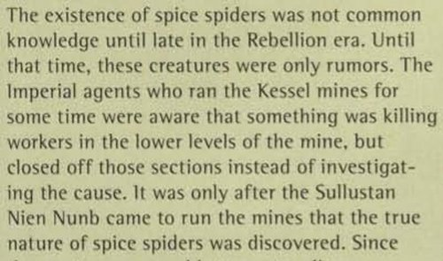
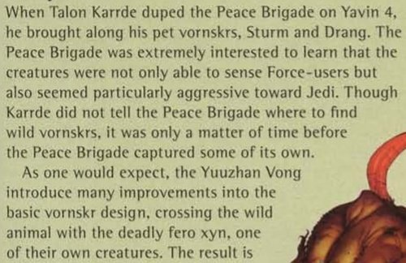
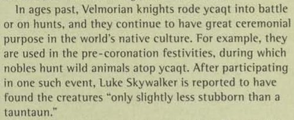
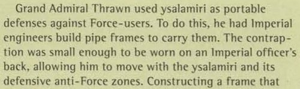
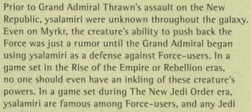
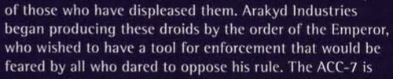
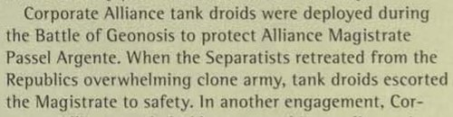
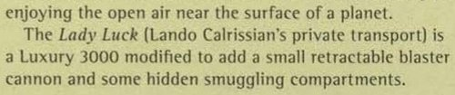
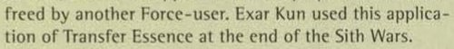

# Owner Material 037 — Star Wars D20 Drive folder (Core, Revised Core and Saga Edition): Sourcebooks/Ultimate Adversaries.pdf [Star Wars Roleplaying Game Revised Core (d20, 2002)] (scan pages 121–162)

- **Source:** Wizards of the Coast Star Wars Roleplaying Game books, web enhancements, Living Force campaign modules and articles (2000–2010), from the owner's "Star Wars D20" Drive folder (only the three edition subfolders; "General" was not read, as instructed). Secondary source (licensed Legends reference). Scan OCR'd on the box; the scan stays box-only and is **not** published.
- **Method:** every scanned page was OCR'd and machine-screened sentence by sentence for power-relevant statements (fights, kills, defeats, Force feats, rankings, superweapons) that name a character on our roster; each kept sentence is quoted verbatim from the OCR text and has a crop of the printed passage directly under it. Pages with nothing power-relevant are still listed with what is on them.
- **Citation:** "*Ultimate Adversaries* (SWRPG d20 Revised Core), p.X" by printed page ("scan p.X" where no printed number applies). **Weight:** Licensed RPG material: a secondary source. Narrative text sums up Legends lore; game statistics are rules for players, not canon power levels, and rank lowest.

## scan p.121 (scan page 121)

Page contents: Knobby White Spider stats; Rearing Spider; Spice Spider (Kessel) begins. (hand-read)

## scan p.122 (scan page 122)

Page contents: Spice Spider era notes (Nien Nunb, Kessel mines), traits, stats; Starweird begins. (hand-read)

- **Nien Nunb** — entry/section: Spice Spider: Era Notes: "The existence of spice spiders was not common knowledge until late in the Rebellion era. Until that time, these creatures were only rumors. The Imperial agents who ran the Kessel mines for some time were aware that something was killing workers in the lower levels of the mine, but closed off those sections instead of investigating the cause. It was only after the Sullustan Nien Nunb came to run the mines that the true nature of spice spiders was discovered." Source: *Ultimate Adversaries* (SWRPG d20 Revised Core), scan p.122
  

## scan p.123 (scan page 123)

Page contents: Starweird traits/stats; Sureggi (Kashyyyk); Thranta (Bespin/Alderaan) begins. (hand-read)

## scan p.124 (scan page 124)

Page contents: Thranta, Giant Thranta; Voorpak (Naboo) begins. (hand-read)

## scan p.125 (scan page 125)

Page contents: Voorpak stats; Vornskr (Myrkr). (hand-read)

## scan p.126 (scan page 126)

Page contents: Vornskr stats; Voxyn (Talon Karrde's vornskrs Sturm and Drang, Peace Brigade, Yuuzhan Vong). (hand-read)

- **Talon Karrde** — entry/section: Voxyn: Origins: "When Talon Karrde duped the Peace Brigade on Yavin 4, he brought along his pet vornskrs, Sturm and Drang. The Peace Brigade was extremely interested to learn that the creatures were not only able to sense Force-users but also seemed particularly aggressive toward Jedi. Though Karrde did not tell the Peace Brigade where to find wild vornskrs, it was only a matter of time before the Peace Brigade captured some of its own." Source: *Ultimate Adversaries* (SWRPG d20 Revised Core), scan p.126
  

## scan p.127 (scan page 127)

Page contents: Voxyn stats; Vrblther (Nar Shaddaa); Watch-Beast (Gamorrean) begins. (hand-read)

## scan p.128 (scan page 128)

Page contents: Watch-Beast traits; Webweaver (wyyyschokk, Kashyyyk). (hand-read)

## scan p.129 (scan page 129)

Page contents: Webweaver webs; Woolly Veermok (Naboo). (hand-read)

## scan p.130 (scan page 130)

Page contents: Woolly Veermok traits/stats; Womp Rat (Tatooine, Beggar's Canyon). (hand-read)

## scan p.131 (scan page 131)

Page contents: Womp Rat and Worrt stats. (hand-read)

## scan p.132 (scan page 132)

Page contents: Ycaqt (Velmor riding animal; Luke Skywalker quip); Ycaqt traits/stats; Ysalamiri (Myrkr) begins. (hand-read)

- **Luke Skywalker** — entry/section: Ycaqt: "In ages past, Velmorian knights rode ycaqt into battle or on hunts, and they continue to have great ceremonial purpose in the world’s native culture. For example, they are used in the pre-coronation festivities, during which nobles hunt wild animals atop ycaqt. After participating in one such event, Luke Skywalker is reported to have found the creatures “only slightly less stubborn than a tauntaun.”" Source: *Ultimate Adversaries* (SWRPG d20 Revised Core), scan p.132
  

## scan p.133 (scan page 133)

Page contents: Ysalamiri: Thrawn's frames, era notes, Nullify Force, stats; Zarymok begins. (hand-read)

- **Grand Admiral Thrawn** — entry/section: Ysalamiri: Thrawn's Frames: "Grand Admiral Thrawn used ysalamiri as portable defenses against Force-users. To do this, he had Imperial engineers build pipe frames to carry them. The contraption was small enough to be worn on an Imperial officer’s back, allowing him to move with the ysalamiri and its defensive anti-Force zones." Source: *Ultimate Adversaries* (SWRPG d20 Revised Core), scan p.133
  
- **Grand Admiral Thrawn** — entry/section: Ysalamiri: Era Notes: "Prior to Grand Admiral Thrawn’s assault on the New Republic, ysalamiri were unknown throughout the galaxy. Even on Myrkr, the creature's ability to push back the Force was just a rumor until the Grand Admiral began using ysalamiri as a defense against Force-users." Source: *Ultimate Adversaries* (SWRPG d20 Revised Core), scan p.133
  

## scan p.134 (scan page 134)

Page contents: Zarymok traits/stats; Table 2-1 Creature Sizes; Climate Templates; Armored template begins. (hand-read)

## scan p.135 (scan page 135)

Page contents: Table 2-2 Climate Templates; Armored template; Armored Nek Battle Dog. (hand-read)

## scan p.136 (scan page 136)

Page contents: Nek scent; Carnivorous template (Carnivorous Bantha); Domesticated template begins. (hand-read)

## scan p.137 (scan page 137)

Page contents: Domesticated Bonegnawer; Enlarged template, Table 2-5. (hand-read)

## scan p.138 (scan page 138)

Page contents: Enlarged Kouhun; Force Using template; Force-Using Woolly Veermok begins. (hand-read)

## scan p.139 (scan page 139)

Page contents: Force-Using Woolly Veermok; Highly Evolved template; Highly-Evolved Worrt begins. (hand-read)

## scan p.140 (scan page 140)

Page contents: Highly-Evolved Worrt; Shaped template (Yuuzhan Vong), Table 2-6. (hand-read)

## scan p.141 (scan page 141)

Page contents: Shaped Nashtah; Sithspawned template; Sithspawned Canyon Krayt Dragon begins. (hand-read)

## scan p.142 (scan page 142)

Page contents: Table 2-7 Sithspawned qualities; Sithspawned krayt traits; Table 2-8 Creature Minimum DR. (hand-read)

## scan p.143 (scan page 143)

Page contents: Chapter Three opener art (super battle droid, "Droids"); no body text (image checked). (hand-read)

## scan p.144 (scan page 144)

Page contents: Chapter Three: Droids intro; Individual Droids; Arakyd ACC-7 assassin droid begins. (hand-read)

- **Palpatine (Darth Sidious)** — entry/section: Arakyd ACC-7: Emperor's order: "Arakyd Industries began producing these droids by the order of the Emperor, who wished to have a tool for enforcement that would be feared by all who dared to oppose his rule." Source: *Ultimate Adversaries* (SWRPG d20 Revised Core), scan p.144
  

## scan p.145 (scan page 145)

Page contents: ACC-7 (Hutts used to punish debtors), stats; ASN-Series Courier Droid. (hand-read)

## scan p.146 (scan page 146)

Page contents: ASN stats end; DSK-1 Deathstrike Seeker Droid; Balmorran Arms SD-6 Hulk begins. (hand-read)

## scan p.147 (scan page 147)

Page contents: SD-6 Hulk stats; Colicoid Infiltrator Assassin Droid begins. (hand-read)

## scan p.148 (scan page 148)

Page contents: Colicoid Infiltrator stats; Commerce Guild Dwarf Spider Droid (Battle of Geonosis). (hand-read)

## scan p.149 (scan page 149)

Page contents: Dwarf Spider Droid stats; Cybot HXZ-1 Immobilizer; Sienar Mark III Sleeper begins. (hand-read)

## scan p.150 (scan page 150)

Page contents: Mark III Sleeper; Droid Vehicles; Commerce Guild Homing Spider Droid begins. (hand-read)

## scan p.151 (scan page 151)

Page contents: Homing Spider Droid; Corporate Alliance Tank-Series Droid begins. (hand-read)

## scan p.152 (scan page 152)

Page contents: Tank droid (Passel Argente at Geonosis); InterGalactic Banking Clan Hailfire droid. (hand-read)

- **Passel Argente** — entry/section: Corporate Alliance Tank Droid: "Corporate Alliance tank droids were deployed during the Battle of Geonosis to protect Alliance Magistrate Passel Argente. When the Separatists retreated from the Republics overwhelming clone army, tank droids escorted the Magistrate to safety." Source: *Ultimate Adversaries* (SWRPG d20 Revised Core), scan p.152
  

## scan p.153 (scan page 153)

Page contents: Table 3-1 Droid Manufacturers; Hailfire wheels. (hand-read)

## scan p.154 (scan page 154)

Page contents: Appendix: New Rules — Aiming, Area Fire, Breaching the Hull; anti-vehicle ion cannon; Merr-Sonn Quick-6. (hand-read)

## scan p.155 (scan page 155)

Page contents: PRP-502 shooter, knock-out darts, SoroSuub X-45, thogk, Targeter scope, camouflage poncho. (hand-read)

## scan p.156 (scan page 156)

Page contents: Riot shield, primitive armor/shield, silence bubble generator, holographic image disguiser, disguise kit. (hand-read)

## scan p.157 (scan page 157)

Page contents: Forcefield generator, utility belt, snooper goggles; droid equipment (automatic grip, digging claws, extra limb, stun field, synchronized weapons). (hand-read)

## scan p.158 (scan page 158)

Page contents: Weapon mounts; Nebulon-Q swoop; Lone Scout-A (Death Star scouts to Dantooine); Luxury 3000 (Lady Luck). (hand-read)

- **Lando Calrissian** — entry/section: Luxury 3000 Space Yacht: "The Lady Luck (Lando Calrissian’s private transport) is a Luxury 3000 modified to add a small retractable blaster cannon and some hidden smuggling compartments." Source: *Ultimate Adversaries* (SWRPG d20 Revised Core), scan p.158
  

## scan p.159 (scan page 159)

Page contents: Luxury 3000 stats; Transfer Essence skill (Exar Kun); Multidexterity feat. (hand-read)

- **Exar Kun** — entry/section: Transfer Essence: "Exar Kun used this application of Transfer Essence at the end of the Sith Wars." Source: *Ultimate Adversaries* (SWRPG d20 Revised Core), scan p.159
  

## scan p.160 (scan page 160)

Page contents: Multiweapon Fighting, Sith Sorcery feats; Adversaries by Challenge Code (A–C). (hand-read)

## scan p.161 (scan page 161)

Page contents: Adversaries by Challenge Code (C–I). (hand-read)

## scan p.162 (scan page 162)

Page contents: Back cover blurb. (hand-read)

