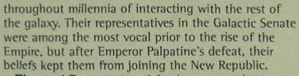
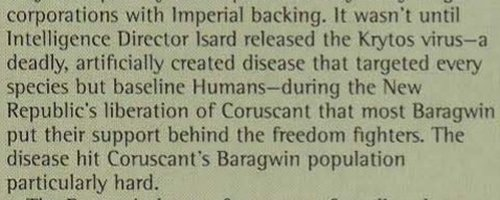
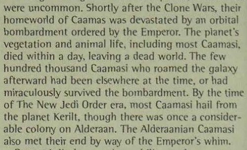
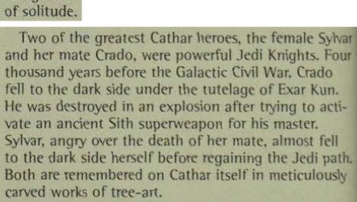
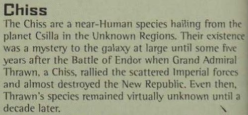
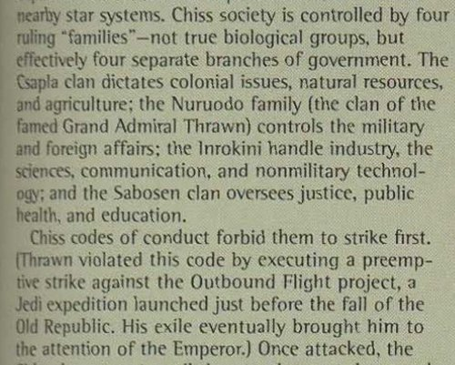
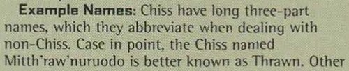
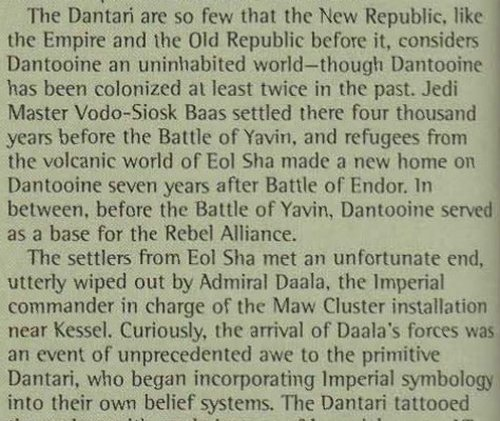
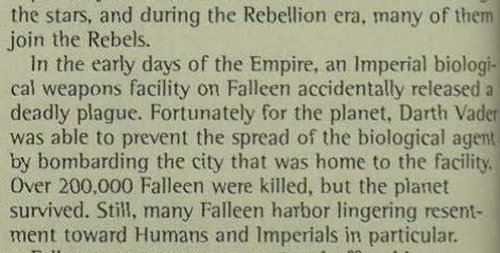

# Owner Material 037 — Star Wars D20 Drive folder (Core, Revised Core and Saga Edition): Sourcebooks/Ultimate Alien Anthology.pdf [Star Wars Roleplaying Game Revised Core (d20, 2002)] (scan pages 1–60)

- **Source:** Wizards of the Coast Star Wars Roleplaying Game books, web enhancements, Living Force campaign modules and articles (2000–2010), from the owner's "Star Wars D20" Drive folder (only the three edition subfolders; "General" was not read, as instructed). Secondary source (licensed Legends reference). Scan OCR'd on the box; the scan stays box-only and is **not** published.
- **Method:** every scanned page was OCR'd and machine-screened sentence by sentence for power-relevant statements (fights, kills, defeats, Force feats, rankings, superweapons) that name a character on our roster; each kept sentence is quoted verbatim from the OCR text and has a crop of the printed passage directly under it. Pages with nothing power-relevant are still listed with what is on them.
- **Citation:** "*Ultimate Alien Anthology* (SWRPG d20 Revised Core), p.X" by printed page ("scan p.X" where no printed number applies). **Weight:** Licensed RPG material: a secondary source. Narrative text sums up Legends lore; game statistics are rules for players, not canon power levels, and rank lowest.

## scan p.1 (scan page 1)

Page contents: Cover: Ultimate Alien Anthology; designers. (hand-read)

## scan p.2 (scan page 2)

Page contents: Title page. (hand-read)

## scan p.3 (scan page 3)

Page contents: Credits, references, legal. (hand-read)

## scan p.4 (scan page 4)

Page contents: Contents (species A–U). (hand-read)

## scan p.5 (scan page 5)

Page contents: Contents cont. (species V–Z, prestige classes, feats, Yuuzhan Vong appendix, equipment, tables). (hand-read)

## scan p.6 (scan page 6)

Page contents: Introduction: alien heroes, customized aliens, core rules updates. (hand-read)

## scan p.7 (scan page 7)

Page contents: Chapter One: reading the entries, species traits, commoners, new equipment, adding archetypes. (hand-read)

## scan p.8 (scan page 8)

Page contents: Abyssin (Byss, the Blooding). (hand-read)

## scan p.9 (scan page 9)

Page contents: Abyssin traits/commoner; Adarian. (hand-read)

## scan p.10 (scan page 10)

Page contents: Adarian commoner; Advozse; Amanin begins (Maridun). (hand-read)

## scan p.11 (scan page 11)

Page contents: Amanin traits; Anomid. (hand-read)

## scan p.12 (scan page 12)

Page contents: Anomid traits, vocalizer mask; Anx. (hand-read)

## scan p.13 (scan page 13)

Page contents: Anx traits/commoner. (hand-read)

## scan p.14 (scan page 14)

Page contents: Anzat (soup, example names incl. Dannik Jerriko). (hand-read)

## scan p.15 (scan page 15)

Page contents: Anzat feats/commoner; Aqualish (example names incl. Ponda Baba); Arcona begins. (hand-read)

## scan p.16 (scan page 16)

Page contents: Arcona (salt addiction); Arkanian begins (Sith Empire repository). (hand-read)

## scan p.17 (scan page 17)

Page contents: Arkanian (Palpatine's defeat; Jedi academy); Ayrou begins. (hand-read)

- **Palpatine (Darth Sidious)** — entry/section: Arkanian: "Their representatives in the Galactic Senate were among the most vocal prior to the rise of the Empire, but after Emperor Palpatine's defeat, their beliefs kept them from joining the New Republic." Source: *Ultimate Alien Anthology* (SWRPG d20 Revised Core), scan p.17
  

## scan p.18 (scan page 18)

Page contents: Ayrou traits; Balosar begins. (hand-read)

## scan p.19 (scan page 19)

Page contents: Balosar (example names incl. Elan Sleazebaggano); Barabel begins. (hand-read)

## scan p.20 (scan page 20)

Page contents: Barabel traits; Baragwin (Isard's Krytos virus). (hand-read)

- **Ysanne Isard** — entry/section: Baragwin: "It wasn’t until Intelligence Director Isard released the Krytos virus—a deadly, artificially created disease that targeted every species but baseline Humans—during the New Republic's liberation of Coruscant that most Baragwin put their support behind the freedom fighters. The disease hit Coruscant’s Baragwin population particularly hard." Source: *Ultimate Alien Anthology* (SWRPG d20 Revised Core), scan p.20
  

## scan p.21 (scan page 21)

Page contents: Baragwin traits; Bartokk begins. (hand-read)

## scan p.22 (scan page 22)

Page contents: Bartokk traits/commoner. (hand-read)

## scan p.23 (scan page 23)

Page contents: Besalisk (example names incl. Dexter Jettster); Bimm begins. (hand-read)

## scan p.24 (scan page 24)

Page contents: Bimm; Bith begins. (hand-read)

## scan p.25 (scan page 25)

Page contents: Bith (example names incl. Figrin D'an); Blood Carver illustration. (hand-read)

## scan p.26 (scan page 26)

Page contents: Bith commoner; Kloo horn; Blood Carver; Bothan begins. (hand-read)

## scan p.27 (scan page 27)

Page contents: Bothan (spynet; example names incl. Borsk Fey'lya); Caamasi begins. (hand-read)

- **Palpatine (Darth Sidious)** — entry/section: Caamasi: "Shortly after the Clone Wars, their homeworld of Caamas was devastated by an orbital bombardment ordered by the Emperor. The planet's vegetation and animal life, including most Caamasi, died within a day, leaving a dead world. The few hundred thousand Caamasi who roamed the galaxy afterward had been elsewhere at the time, or had miraculously survived the bombardment. By the time of The New Jedi Order era, most Caamasi hail from the planet Kerilt, though there was once a considerable colony on Alderaan. The Alderaanian Caamasi also met their end by way of the Emperor’s whim." Source: *Ultimate Alien Anthology* (SWRPG d20 Revised Core), scan p.27
  

## scan p.28 (scan page 28)

Page contents: Caamasi traits (memnii; example names incl. Elegos A'kla); Caarite. (hand-read)

## scan p.29 (scan page 29)

Page contents: Caarite commoner; Cathar (Sylvar and Crado). (hand-read)

- **Sylvar; Crado; Exar Kun** — entry/section: Cathar heroes: "Two of the greatest Cathar heroes, the female Sylvar and her mate Crado, were powerful Jedi Knights. Four thousand years before the Galactic Civil War, Crado fell to the dark side under the tutelage of Exar Kun. He was destroyed in an explosion after trying to activate an ancient Sith superweapon for his master. Sylvar, angry over the death of her mate, almost fell to the dark side herself before regaining the Jedi path. Both are remembered on Cathar itself in meticulously carved works of tree-art." Source: *Ultimate Alien Anthology* (SWRPG d20 Revised Core), scan p.29
  

## scan p.30 (scan page 30)

Page contents: Cathar traits; Celegian. (hand-read)

## scan p.31 (scan page 31)

Page contents: Celegian life-support chamber; Cerean begins. (hand-read)

## scan p.32 (scan page 32)

Page contents: Kasha meditation crystal (Bi-Dar Tyunda); shyarn; Chadra-Fan. (hand-read)

## scan p.33 (scan page 33)

Page contents: Chadra-Fan traits; Chagrian begins; illustrations (Cerean, Chadra-Fan, Chagrian, Charon). (hand-read)

## scan p.34 (scan page 34)

Page contents: Chagrian (example names incl. Mas Amedda); Charon begins (otherspace, Prophet of the Void). (hand-read)

## scan p.35 (scan page 35)

Page contents: Charon (Cult of Light) traits/commoner. (hand-read)

## scan p.36 (scan page 36)

Page contents: Chev. (hand-read)

## scan p.37 (scan page 37)

Page contents: Chev commoner; Chevin (example names incl. Ephant Mon); Chiss begins (Thrawn). (hand-read)

- **Grand Admiral Thrawn** — entry/section: Chiss: "The Chiss are a near-Human species hailing from the planet Csilla in the Unknown Regions. Their existence was a mystery to the galaxy at large until some five years after the Battle of Endor when Grand Admiral Thrawn, a Chiss, rallied the scattered Imperial forces and almost destroyed the New Republic. Even then, Thrawn's species remained virtually unknown until a decade later." Source: *Ultimate Alien Anthology* (SWRPG d20 Revised Core), scan p.37
  

## scan p.38 (scan page 38)

Page contents: Chiss society (four ruling families; Thrawn's Nuruodo family; Outbound Flight), personality, physical description. (hand-read)

- **Grand Admiral Thrawn; Palpatine (Darth Sidious)** — entry/section: Chiss: Ruling Families and Outbound Flight: "Chiss society is controlled by four ruling “families”—not true biological groups, but effectively four separate branches of government. The Csapla clan dictates colonial issues, natural resources, and agriculture; the Nuruodo family (the clan of the famed Grand Admiral Thrawn) controls the military and foreign affairs; the Inrokini handle industry, the sciences, communication, and nonmilitary technology; and the Sabosen clan oversees justice, public health, and education. Chiss codes of conduct forbid them to strike first. (Thrawn violated this code by executing a preemptive strike against the Outbound Flight project, a Jedi expedition launched just before the fall of the Old Republic. His exile eventually brought him to the attention of the Emperor.)" Source: *Ultimate Alien Anthology* (SWRPG d20 Revised Core), scan p.38
  

## scan p.39 (scan page 39)

Page contents: Chiss language (Mitth'raw'nuruodo), traits, charric; Clawdite (example names incl. Zam Wesell). (hand-read)

- **Grand Admiral Thrawn** — entry/section: Chiss: Example Names: "Chiss have long three-part names, which they abbreviate when dealing with non-Chiss. Case in point, the Chiss named Mitth’raw’nuruodo is better known as Thrawn." Source: *Ultimate Alien Anthology* (SWRPG d20 Revised Core), scan p.39
  

## scan p.40 (scan page 40)

Page contents: Clawdite traits; Codru-Ji begins. (hand-read)

## scan p.41 (scan page 41)

Page contents: Codru-Ji/Wyrwulf traits; Colicoid begins (droidekas). (hand-read)

## scan p.42 (scan page 42)

Page contents: Colicoid traits; Cragmoloid begins. (hand-read)

## scan p.43 (scan page 43)

Page contents: Cragmoloid traits; Dantari (Vodo-Siosk Baas, Daala and Eol Sha). (hand-read)

- **Vodo-Siosk Baas; Admiral Daala** — entry/section: Dantari: Dantooine's Colonists: "The Dantari are so few that the New Republic, like the Empire and the Old Republic before it, considers Dantooine an uninhabited world—though Dantooine has been colonized at least twice in the past. Jedi Master Vodo-Siosk Baas settled there four thousand years before the Battle of Yavin, and refugees from the volcanic world of Eol Sha made a new home on Dantooine seven years after Battle of Endor. In between, before the Battle of Yavin, Dantooine served as a base for the Rebel Alliance. The settlers from Eol Sha met an unfortunate end, utterly wiped out by Admiral Daala, the Imperial commander in charge of the Maw Cluster installation near Kessel. Curiously, the arrival of Daala’s forces was an event of unprecedented awe to the primitive Dantari, who began incorporating Imperial symbology into their own belief systems." Source: *Ultimate Alien Anthology* (SWRPG d20 Revised Core), scan p.43
  

## scan p.44 (scan page 44)

Page contents: Dantari traits; Dashade (Shadow Killers, Cron Cluster). (hand-read)

## scan p.45 (scan page 45)

Page contents: Dashade traits; sonic blaster; Defel begins. (hand-read)

## scan p.46 (scan page 46)

Page contents: Defel traits; Devaronian begins. (hand-read)

## scan p.47 (scan page 47)

Page contents: Devaronian traits/commoners; Draethos begins. (hand-read)

## scan p.48 (scan page 48)

Page contents: Draethos traits; Drall begins (Duchesses). (hand-read)

## scan p.49 (scan page 49)

Page contents: Drall traits; Dressellian (Empire, Bothans; example names incl. Orrimaarko). (hand-read)

## scan p.50 (scan page 50)

Page contents: Dressellian traits; Dressellian projectile rifle. (hand-read)

## scan p.51 (scan page 51)

Page contents: Dug (example names incl. Sebulba); b'hedda swingblade. (hand-read)

## scan p.52 (scan page 52)

Page contents: Duros (Neimoidians); Ebranite begins. (hand-read)

## scan p.53 (scan page 53)

Page contents: Ebranite traits; Elom begins. (hand-read)

## scan p.54 (scan page 54)

Page contents: Elom traits. (hand-read)

## scan p.55 (scan page 55)

Page contents: Elom commoner; Elomin. (hand-read)

## scan p.56 (scan page 56)

Page contents: Em'liy; Ewok begins. (hand-read)

## scan p.57 (scan page 57)

Page contents: Ewok (example names incl. Wicket, Teebo, Logray, Chirpa); Falleen begins (Vader bombards plague city). (hand-read)

- **Darth Vader (Anakin Skywalker)** — entry/section: Falleen: The Plague: "In the early days of the Empire, an Imperial biological weapons facility on Falleen accidentally released a deadly plague. Fortunately for the planet, Darth Vader was able to prevent the spread of the biological agent by bombarding the city that was home to the facility. Over 200,000 Falleen were killed, but the planet survived. Still, many Falleen harbor lingering resentment toward Humans and Imperials in particular." Source: *Ultimate Alien Anthology* (SWRPG d20 Revised Core), scan p.57
  

## scan p.58 (scan page 58)

Page contents: Falleen (example names incl. Xizor) traits. (hand-read)

## scan p.59 (scan page 59)

Page contents: Falleen commoner; Farghul (Jedi Council purge of pirate bases); Feeorin begins. (hand-read)

## scan p.60 (scan page 60)

Page contents: Feeorin traits; double vibroblade; Filordus begins. (hand-read)

