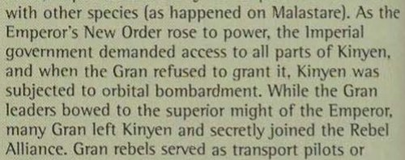
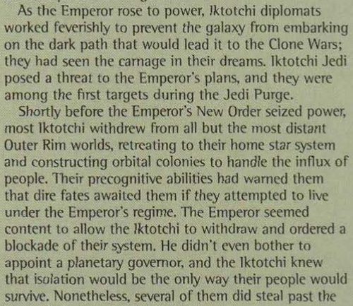
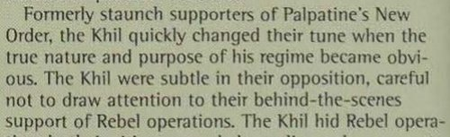
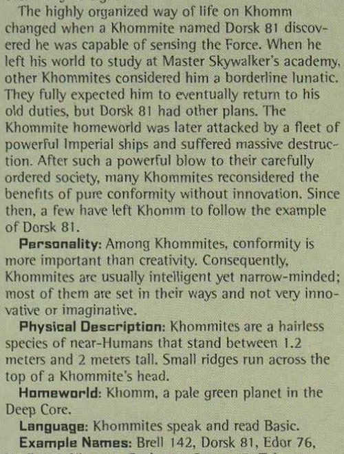
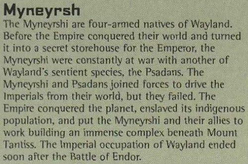
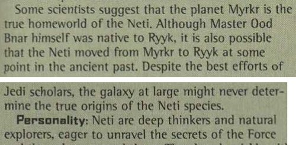
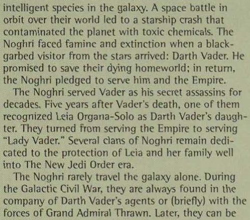

# Owner Material 037 — Star Wars D20 Drive folder (Core, Revised Core and Saga Edition): Sourcebooks/Ultimate Alien Anthology.pdf [Star Wars Roleplaying Game Revised Core (d20, 2002)] (scan pages 61–120)

- **Source:** Wizards of the Coast Star Wars Roleplaying Game books, web enhancements, Living Force campaign modules and articles (2000–2010), from the owner's "Star Wars D20" Drive folder (only the three edition subfolders; "General" was not read, as instructed). Secondary source (licensed Legends reference). Scan OCR'd on the box; the scan stays box-only and is **not** published.
- **Method:** every scanned page was OCR'd and machine-screened sentence by sentence for power-relevant statements (fights, kills, defeats, Force feats, rankings, superweapons) that name a character on our roster; each kept sentence is quoted verbatim from the OCR text and has a crop of the printed passage directly under it. Pages with nothing power-relevant are still listed with what is on them.
- **Citation:** "*Ultimate Alien Anthology* (SWRPG d20 Revised Core), p.X" by printed page ("scan p.X" where no printed number applies). **Weight:** Licensed RPG material: a secondary source. Narrative text sums up Legends lore; game statistics are rules for players, not canon power levels, and rank lowest.

## scan p.61 (scan page 61)

Page contents: Filordus traits; Frozian (Moff's bombardment of Froz). (hand-read)

## scan p.62 (scan page 62)

Page contents: Frozian traits; Gamorrean begins. (hand-read)

## scan p.63 (scan page 63)

Page contents: Gamorrean commoner; arg'garok, m'uhk'gfa, thogk; Gand begins. (hand-read)

## scan p.64 (scan page 64)

Page contents: Gand (example names incl. Zuckuss), traits; Gand shockprod staff. (hand-read)

## scan p.65 (scan page 65)

Page contents: Shockprod staff; Geonosian (example names incl. Poggle). (hand-read)

## scan p.66 (scan page 66)

Page contents: Geonosian commoners; electro-staff, sonic staff; Givin begins. (hand-read)

## scan p.67 (scan page 67)

Page contents: Givin traits; Gossam begins. (hand-read)

## scan p.68 (scan page 68)

Page contents: Gossam (Shu Mai); Gotal begins. (hand-read)

## scan p.69 (scan page 69)

Page contents: Gotal traits; Gran (Kinyen bombarded under the Emperor). (hand-read)

- **Palpatine (Darth Sidious)** — entry/section: Gran: "As the Emperor's New Order rose to power, the Imperial government demanded access to all parts of Kinyen, and when the Gran refused to grant it, Kinyen was subjected to orbital bombardment. While the Gran leaders bowed to the superior might of the Emperor, many Gran left Kinyen and secretly joined the Rebel Alliance." Source: *Ultimate Alien Anthology* (SWRPG d20 Revised Core), scan p.69
  

## scan p.70 (scan page 70)

Page contents: Gran traits; Gungan (example names incl. Jar Jar, Rugor, Tarpals). (hand-read)

## scan p.71 (scan page 71)

Page contents: Gungan commoner; Herglic begins. (hand-read)

## scan p.72 (scan page 72)

Page contents: Herglic traits; H'nemthe. (hand-read)

## scan p.73 (scan page 73)

Page contents: H'nemthe traits; Ho'Din. (hand-read)

## scan p.74 (scan page 74)

Page contents: Houk; Hutt begins. (hand-read)

## scan p.75 (scan page 75)

Page contents: Hutt (example names incl. Jabba, Gardulla) traits. (hand-read)

## scan p.76 (scan page 76)

Page contents: Hutt commoner; Hutt battle armor; Iktotchi (Emperor, Jedi Purge, blockade). (hand-read)

- **Palpatine (Darth Sidious)** — entry/section: Iktotchi: "As the Emperor rose to power, Iktotchi diplomats worked feverishly to prevent the galaxy from embarking on the dark path that would lead it to the Clone Wars; they had seen the carnage in their dreams. Iktotchi Jedi posed a threat to the Emperor's plans, and they were among the first targets during the Jedi Purge. Shortly before the Emperor’s New Order seized power, most Iktotchi withdrew from all but the most distant Outer Rim worlds, retreating to their home star system and constructing orbital colonies to handle the influx of people. Their precognitive abilities had warned them that dire fates awaited them if they attempted to live under the Emperor's regime. The Emperor seemed content to allow the Iktotchi to withdraw and ordered a blockade of their system. He didn’t even bother to appoint a planetary governor, and the Iktotchi knew that isolation would be the only way their people would survive." Source: *Ultimate Alien Anthology* (SWRPG d20 Revised Core), scan p.76
  

## scan p.77 (scan page 77)

Page contents: Iktotchi (example names incl. Saesee Tiin) traits; Iotran begins. (hand-read)

## scan p.78 (scan page 78)

Page contents: Iotran traits; Iotran braceman armor, tangler gun, mini flechette gun; Ishi Tib begins. (hand-read)

## scan p.79 (scan page 79)

Page contents: Ishi Tib (Endor briefing) traits; Tibrin kish'nol coral scepter. (hand-read)

## scan p.80 (scan page 80)

Page contents: Coral scepter (end); Ithorian begins (herd ships, Mother Jungle); illustrations (Iotran, Ishi Tib, Ithorian, Jawa). OCR blank; read from page image. (hand-read)

## scan p.81 (scan page 81)

Page contents: Ithorian (example names incl. Momaw Nadon) traits; Jawa. (hand-read)

## scan p.82 (scan page 82)

Page contents: Jawa traits; ion grenade; Jenet. (hand-read)

## scan p.83 (scan page 83)

Page contents: Jenet traits; Kaminoan (example names incl. Lama Su, Taun We); Kel Dor begins. (hand-read)

## scan p.84 (scan page 84)

Page contents: Kel Dor (example names incl. Plo Koon) traits; antiox breath mask (Yem Nemnin); Kerestian begins. (hand-read)

## scan p.85 (scan page 85)

Page contents: Kerestian traits; darkstick; Khil (Palpatine's New Order). (hand-read)

- **Palpatine (Darth Sidious)** — entry/section: Khil: "Formerly staunch supporters of Palpatine’s New Order, the Khil quickly changed their tune when the true nature and purpose of his regime became obvious. The Khil were subtle in their opposition, careful not to draw attention to their behind-the-scenes support of Rebel operations." Source: *Ultimate Alien Anthology* (SWRPG d20 Revised Core), scan p.85
  

## scan p.86 (scan page 86)

Page contents: Khil traits. (hand-read)

## scan p.87 (scan page 87)

Page contents: Khil commoner; Khommite (Dorsk 81); Kian'thar begins. (hand-read)

- **Dorsk 81; Luke Skywalker** — entry/section: Khommite: "The highly organized way of life on Khomm changed when a Khommite named Dorsk 81 discovered he was capable of sensing the Force. When he left his world to study at Master Skywalker’s academy, other Khommites considered him a borderline lunatic. They fully expected him to eventually return to his old duties, but Dorsk 81 had other plans. The Khommite homeworld was later attacked by a fleet of powerful Imperial ships and suffered massive destruction. After such a powerful blow to their carefully ordered society, many Khommites reconsidered the benefits of pure conformity without innovation. Since then, a few have left Khomm to follow the example of Dorsk 81." Source: *Ultimate Alien Anthology* (SWRPG d20 Revised Core), scan p.87
  

## scan p.88 (scan page 88)

Page contents: Kian'thar traits. (hand-read)

## scan p.89 (scan page 89)

Page contents: Kian'thar commoner; Kitonak. (hand-read)

## scan p.90 (scan page 90)

Page contents: Kitonak traits; chidinkalu; Klatooinian; Koorivar begins. (hand-read)

## scan p.91 (scan page 91)

Page contents: Koorivar history; illustrations. (hand-read)

## scan p.92 (scan page 92)

Page contents: Koorivar (example names incl. Passel Argente) traits; Krevaaki (example names incl. Vodo-Siosk Baas). (hand-read)

## scan p.93 (scan page 93)

Page contents: Krevaaki traits; Krish. (hand-read)

## scan p.94 (scan page 94)

Page contents: Krish commoner; Kubaz (example names incl. Garindan); Kushiban begins. (hand-read)

## scan p.95 (scan page 95)

Page contents: Kushiban (example names incl. Ikrit) traits; Lannik. (hand-read)

## scan p.96 (scan page 96)

Page contents: Lannik (example names incl. Even Piell) traits; Lepi begins. (hand-read)

## scan p.97 (scan page 97)

Page contents: Lepi (example names incl. Jaxxon) traits; Menahuun. (hand-read)

## scan p.98 (scan page 98)

Page contents: Menahuun traits; Miraluka (Jedi Purge). (hand-read)

## scan p.99 (scan page 99)

Page contents: Miraluka commoner; Mon Calamari (example names incl. Ackbar, Cilghal). (hand-read)

## scan p.100 (scan page 100)

Page contents: Mon Calamari traits; Subaqua blaster; Morseerian. (hand-read)

## scan p.101 (scan page 101)

Page contents: Morseerian (Emperor's operatives) traits; environmental suit; Mrlssi. (hand-read)

## scan p.102 (scan page 102)

Page contents: Mrlssi traits; Muun (example names incl. San Hill; Emperor's New Order). (hand-read)

## scan p.103 (scan page 103)

Page contents: Muun commoner; Myneyrsh (Wayland, Mount Tantiss). (hand-read)

- **Palpatine (Darth Sidious)** — entry/section: Myneyrsh: "The Myneyrshi are four-armed natives of Wayland. Before the Empire conquered their world and turned it into a secret storehouse for the Emperor, the Myneyrshi were constantly at war with another of Wayland’s sentient species, the Psadans. The Myneyrshi and Psadans joined forces to drive the Imperials from their world, but they failed. The Empire conquered the planet, enslaved its indigenous population, and put the Myneyrshi and their allies to work building an immense complex beneath Mount Tantiss. The Imperial occupation of Wayland ended soon after the Battle of Endor." Source: *Ultimate Alien Anthology* (SWRPG d20 Revised Core), scan p.103
  

## scan p.104 (scan page 104)

Page contents: Nagai (Tofs). (hand-read)

## scan p.105 (scan page 105)

Page contents: Nagai traits; electromesh armor; Tehk'la blade; Nautolan (example names incl. Kit Fisto). (hand-read)

## scan p.106 (scan page 106)

Page contents: Nautolan traits; Nazzar (Emperor). (hand-read)

## scan p.107 (scan page 107)

Page contents: Nazzar commoner; Neimoidian (example names incl. Nute Gunray, Rune Haako). (hand-read)

## scan p.108 (scan page 108)

Page contents: Neimoidian traits; Neti (Ood Bnar). (hand-read)

- **Ood Bnar** — entry/section: Neti: "Some scientists suggest that the planet Myrkr is the true homeworld of the Neti. Although Master Ood Bnar himself was native to Ryyk, it is also possible that the Neti moved from Myrkr to Ryyk at some point in the ancient past. Despite the best efforts of Jedi scholars, the galaxy at large might never determine the true origins of the Neti species." Source: *Ultimate Alien Anthology* (SWRPG d20 Revised Core), scan p.108
  

## scan p.109 (scan page 109)

Page contents: Neti traits (Metamorph, Photosynthesis); Neti commoners; Nikto begins; Esral'sa'Nikto. (hand-read)

## scan p.110 (scan page 110)

Page contents: Esral'sa'Nikto traits; Gluss'sa'Nikto. (hand-read)

## scan p.111 (scan page 111)

Page contents: Gluss'sa'Nikto commoner; Kadas'sa'Nikto; das'skar hunting mask; Kajain'sa'Nikto begins. (hand-read)

## scan p.112 (scan page 112)

Page contents: Kajain'sa'Nikto traits; M'shento'su'Nikto; Nimbanel. (hand-read)

## scan p.113 (scan page 113)

Page contents: Nimbanel traits; Noehon begins; illustrations. (hand-read)

## scan p.114 (scan page 114)

Page contents: Noehon traits; Noghri (Darth Vader, Leia Organa-Solo, Thrawn). (hand-read)

- **Darth Vader (Anakin Skywalker); Leia Organa Solo; Grand Admiral Thrawn** — entry/section: Noghri: "A space battle in orbit over their world led to a starship crash that contaminated the planet with toxic chemicals. The Noghri faced famine and extinction when a black-garbed visitor from the stars arrived: Darth Vader. He promised to save their dying homeworld; in return, the Noghri pledged to serve him and the Empire. The Noghri served Vader as his secret assassins for decades. Five years after Vader's death, one of them recognized Leia Organa-Solo as Darth Vader’s daughter. They turned from serving the Empire to serving “Lady Vader.” Several clans of Noghri remain dedicated to the protection of Leia and her family well into The New Jedi Order era. The Noghri rarely travel the galaxy alone. During the Galactic Civil War, they are always found in the company of Darth Vader's agents or (briefly) with the forces of Grand Admiral Thrawn." Source: *Ultimate Alien Anthology* (SWRPG d20 Revised Core), scan p.114
  

## scan p.115 (scan page 115)

Page contents: Noghri (example names incl. Cakhmaim, Khabarakh; bodyguards of Vader, Thrawn, Leia) traits; Nosaurian. (hand-read)

## scan p.116 (scan page 116)

Page contents: Nosaurian traits; Nuknog. (hand-read)

## scan p.117 (scan page 117)

Page contents: Nuknog traits; Omwati (Tarkin, Emperor). (hand-read)

## scan p.118 (scan page 118)

Page contents: Omwati history continued (Tarkin killed at Death Star; example names incl. Qwi Xux); illustrations (Nuknog, Omwati, Ortolan, Pacithhip). OCR blank; read from page image. (hand-read)

## scan p.119 (scan page 119)

Page contents: Omwati traits; Ortolan. (hand-read)

## scan p.120 (scan page 120)

Page contents: Ortolan commoner; Pacithhip; Pa'lowick begins. (hand-read)

