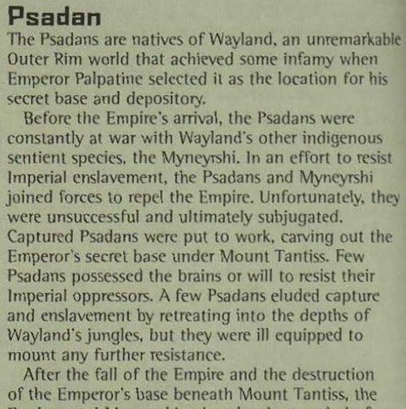
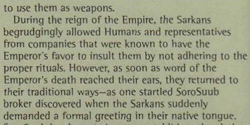
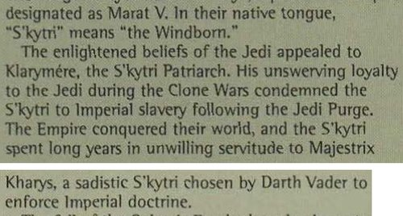
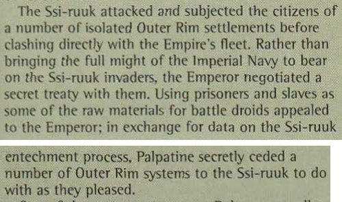
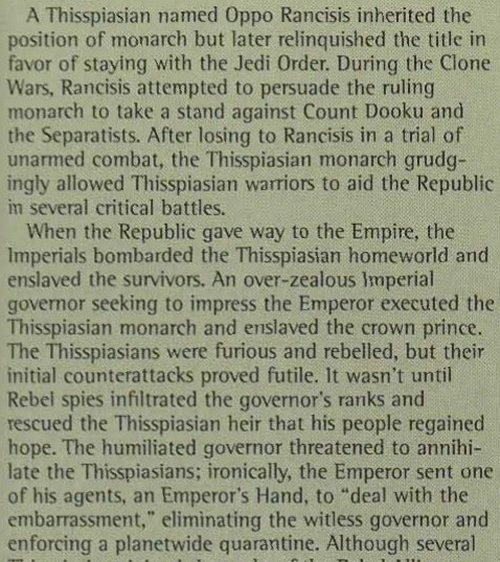
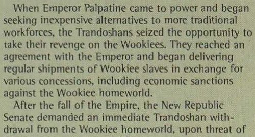
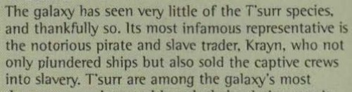
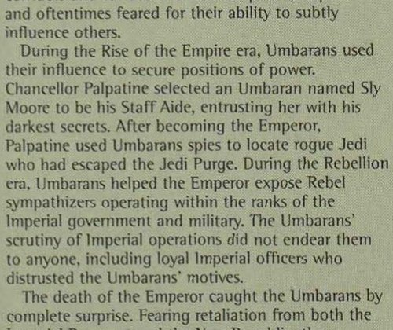
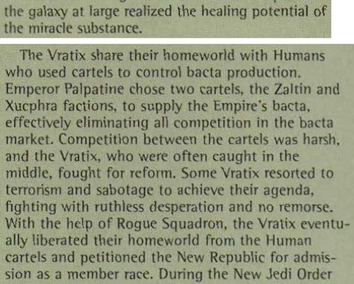

# Owner Material 037 — Star Wars D20 Drive folder (Core, Revised Core and Saga Edition): Sourcebooks/Ultimate Alien Anthology.pdf [Star Wars Roleplaying Game Revised Core (d20, 2002)] (scan pages 121–180)

- **Source:** Wizards of the Coast Star Wars Roleplaying Game books, web enhancements, Living Force campaign modules and articles (2000–2010), from the owner's "Star Wars D20" Drive folder (only the three edition subfolders; "General" was not read, as instructed). Secondary source (licensed Legends reference). Scan OCR'd on the box; the scan stays box-only and is **not** published.
- **Method:** every scanned page was OCR'd and machine-screened sentence by sentence for power-relevant statements (fights, kills, defeats, Force feats, rankings, superweapons) that name a character on our roster; each kept sentence is quoted verbatim from the OCR text and has a crop of the printed passage directly under it. Pages with nothing power-relevant are still listed with what is on them.
- **Citation:** "*Ultimate Alien Anthology* (SWRPG d20 Revised Core), p.X" by printed page ("scan p.X" where no printed number applies). **Weight:** Licensed RPG material: a secondary source. Narrative text sums up Legends lore; game statistics are rules for players, not canon power levels, and rank lowest.

## scan p.121 (scan page 121)

Page contents: Pa'lowick (example names incl. Sy Snootles) traits; Phindian (Emperor's New Order). (hand-read)

## scan p.122 (scan page 122)

Page contents: Phindian traits; Pho Ph'eahian begins; illustrations. (hand-read)

## scan p.123 (scan page 123)

Page contents: Pho Ph'eahian traits; Psadan (Palpatine, Mount Tantiss). (hand-read)

- **Palpatine (Darth Sidious)** — entry/section: Psadan: "The Psadans are natives of Wayland, an unremarkable Outer Rim world that achieved some infamy when Emperor Palpatine selected it as the location for his secret base and depository. Before the Empire’s arrival, the Psadans were constantly at war with Wayland’s other indigenous sentient species, the Myneyrshi. In an effort to resist Imperial enslavement, the Psadans and Myneyrshi joined forces to repel the Empire. Unfortunately, they were unsuccessful and ultimately subjugated. Captured Psadans were put to work, carving out the Emperor's secret base under Mount Tantiss." Source: *Ultimate Alien Anthology* (SWRPG d20 Revised Core), scan p.123
  

## scan p.124 (scan page 124)

Page contents: Psadan traits; Quarren begins. (hand-read)

## scan p.125 (scan page 125)

Page contents: Quarren traits; Quermian (Arkanian origin) begins. (hand-read)

## scan p.126 (scan page 126)

Page contents: Quermian (Emperor's New Order, Jedi Purge; example names incl. Yarael Poof) traits; Qwohog begins. (hand-read)

## scan p.127 (scan page 127)

Page contents: Qwohog traits; vocalizer mask. (hand-read)

## scan p.128 (scan page 128)

Page contents: Vocalizer mask; Ranat. (hand-read)

## scan p.129 (scan page 129)

Page contents: Ranat commoner; Ranth (Imperial occupation of Caaraz). (hand-read)

## scan p.130 (scan page 130)

Page contents: Ranth traits; Rodian (example names incl. Greedo, Beedo, Greeata). (hand-read)

## scan p.131 (scan page 131)

Page contents: Rodian cryogen whip; Rodian longrifle; Ruurian (example names incl. Skynx). (hand-read)

## scan p.132 (scan page 132)

Page contents: Ruurian traits; illustrations. (hand-read)

## scan p.133 (scan page 133)

Page contents: Ruurian commoners; Rybet. (hand-read)

## scan p.134 (scan page 134)

Page contents: Rybet (example names incl. Moruth Doole) traits; Ryn. (hand-read)

## scan p.135 (scan page 135)

Page contents: Ryn (example names incl. Droma) traits; Sakiyan begins. (hand-read)

## scan p.136 (scan page 136)

Page contents: Sakiyan traits; illustrations. (hand-read)

## scan p.137 (scan page 137)

Page contents: Sakiyan commoner; Sanyassan (Endor); Sarkan (Emperor's death). (hand-read)

- **Palpatine (Darth Sidious)** — entry/section: Sarkan: "During the reign of the Empire, the Sarkans begrudgingly allowed Humans and representatives from companies that were known to have the Emperor's favor to insult them by not adhering to the proper rituals. However, as soon as word of the Emperor's death reached their ears, they returned to their traditional ways—as one startled SoroSuub broker discovered when the Sarkans suddenly demanded a formal greeting in their native tongue." Source: *Ultimate Alien Anthology* (SWRPG d20 Revised Core), scan p.137
  

## scan p.138 (scan page 138)

Page contents: Sarkan nova rubies, traits; Sauvax. (hand-read)

## scan p.139 (scan page 139)

Page contents: Sauvax traits; gruush; Selonian. (hand-read)

## scan p.140 (scan page 140)

Page contents: Selonian traits; Shi'ido begins. (hand-read)

## scan p.141 (scan page 141)

Page contents: Shi'ido (example names incl. Borborygmus Gog, Mammon Hoole). (hand-read)

## scan p.142 (scan page 142)

Page contents: Shi'ido traits/commoner; Shistavanen (Emperor's New Order); Skakoan begins. (hand-read)

## scan p.143 (scan page 143)

Page contents: Skakoan (Wat Tambor, Count Dooku, Techno Union, Emperor's New Order; example names incl. Wat Tambor) traits. (hand-read)

## scan p.144 (scan page 144)

Page contents: Skakoan commoner; pressure suits; Skrilling. (hand-read)

## scan p.145 (scan page 145)

Page contents: Skrilling traits; S'kytri (Klarymére, Majestrix Kharys, Darth Vader). (hand-read)

- **Darth Vader (Anakin Skywalker)** — entry/section: S'kytri: "The enlightened beliefs of the Jedi appealed to Klarymére, the S'kytri Patriarch. His unswerving loyalty to the Jedi during the Clone Wars condemned the S'kytri to Imperial slavery following the Jedi Purge. The Empire conquered their world, and the S'kytri spent long years in unwilling servitude to Majestrix Kharys, a sadistic S’kytri chosen by Darth Vader to enforce Imperial doctrine." Source: *Ultimate Alien Anthology* (SWRPG d20 Revised Core), scan p.145
  

## scan p.146 (scan page 146)

Page contents: S'kytri traits; Sludir begins; illustrations. (hand-read)

## scan p.147 (scan page 147)

Page contents: Sludir traits; Sluissi (Sluis Van). (hand-read)

## scan p.148 (scan page 148)

Page contents: Sluissi traits; Snivvian (example names incl. Snaggletooth). (hand-read)

## scan p.149 (scan page 149)

Page contents: Snivvian continued; illustrations. (hand-read)

## scan p.150 (scan page 150)

Page contents: Snivvian traits; Spiner. (hand-read)

## scan p.151 (scan page 151)

Page contents: Squib (example names incl. Eebaree, Galan, Meela, Wilpher, Spilfer). (hand-read)

## scan p.152 (scan page 152)

Page contents: Squib traits; battering ram; Ssi-ruuk (Emperor/Palpatine treaty, Bakura, Chiss). (hand-read)

- **Palpatine (Darth Sidious)** — entry/section: Ssi-ruuk: "The Ssi-ruuk attacked and subjected the citizens of a number of isolated Outer Rim settlements before clashing directly with the Empire's fleet. Rather than bringing the full might of the Imperial Navy to bear on the Ssi-ruuk invaders, the Emperor negotiated a secret treaty with them. Using prisoners and slaves as some of the raw materials for battle droids appealed to the Emperor; in exchange for data on the Ssi-ruuk entechment process, Palpatine secretly ceded a number of Outer Rim systems to the Ssi-ruuk to do with as they pleased." Source: *Ultimate Alien Anthology* (SWRPG d20 Revised Core), scan p.152
  

## scan p.153 (scan page 153)

Page contents: Ssi-ruuk traits; illustrations. (hand-read)

## scan p.154 (scan page 154)

Page contents: Sullustan (example names incl. Nien Nunb, Aril Nunb); SoroSuub duo blaster carbine; Talz (Emperor's New Order) begins. (hand-read)

## scan p.155 (scan page 155)

Page contents: Talz traits (example names incl. Muftak); Tarasin begins. (hand-read)

## scan p.156 (scan page 156)

Page contents: Tarasin (Cularin Compact, Jedi Purge) traits. (hand-read)

## scan p.157 (scan page 157)

Page contents: Tarro; illustrations. (hand-read)

## scan p.158 (scan page 158)

Page contents: Tarro traits; Temolak (Temolak Salvage Consortium). (hand-read)

## scan p.159 (scan page 159)

Page contents: Temolak traits; Thakwaash. (hand-read)

## scan p.160 (scan page 160)

Page contents: Thakwaash traits; Thisspiasian (Oppo Rancisis, Count Dooku, Emperor's Hand). (hand-read)

- **Oppo Rancisis; Count Dooku; Palpatine (Darth Sidious)** — entry/section: Thisspiasian: "A Thisspiasian named Oppo Rancisis inherited the position of monarch but later relinquished the title in favor of staying with the Jedi Order. During the Clone Wars, Rancisis attempted to persuade the ruling monarch to take a stand against Count Dooku and the Separatists. After losing to Rancisis in a trial of unarmed combat, the Thisspiasian monarch grudgingly allowed Thisspiasian warriors to aid the Republic in several critical battles. When the Republic gave way to the Empire, the Imperials bombarded the Thisspiasian homeworld and enslaved the survivors. An over-zealous Imperial governor seeking to impress the Emperor executed the Thisspiasian monarch and enslaved the crown prince. The Thisspiasians were furious and rebelled, but their initial counterattacks proved futile. It wasn’t until Rebel spies infiltrated the governor's ranks and rescued the Thisspiasian heir that his people regained hope. The humiliated governor threatened to annihilate the Thisspiasians; ironically, the Emperor sent one of his agents, an Emperor's Hand, to “deal with the embarrassment,” eliminating the witless governor and enforcing a planetwide quarantine." Source: *Ultimate Alien Anthology* (SWRPG d20 Revised Core), scan p.160
  

## scan p.161 (scan page 161)

Page contents: Thisspiasian traits (example names incl. Oppo Rancisis); Tiss'shar. (hand-read)

## scan p.162 (scan page 162)

Page contents: Tiss'shar commoners by subspecies; Togorian. (hand-read)

## scan p.163 (scan page 163)

Page contents: Togorian traits; scimitar, vibro-scimitar; Togruta (example names incl. Shaak Ti). (hand-read)

## scan p.164 (scan page 164)

Page contents: Togruta traits; Toong begins; illustrations. (hand-read)

## scan p.165 (scan page 165)

Page contents: Toong (example names incl. Ben Quadinaros) traits; Toydarian begins. (hand-read)

## scan p.166 (scan page 166)

Page contents: Toydarian (example names incl. Watto) traits; Trandoshan begins. (hand-read)

## scan p.167 (scan page 167)

Page contents: Trandoshan (Emperor Palpatine, Wookiee slaves); illustrations. (hand-read)

- **Palpatine (Darth Sidious)** — entry/section: Trandoshan: "When Emperor Palpatine came to power and began seeking inexpensive alternatives to more traditional workforces, the Trandoshans seized the opportunity to take their revenge on the Wookiees. They reached an agreement with the Emperor and began delivering regular shipments of Wookiee slaves in exchange for various concessions, including economic sanctions against the Wookiee homeworld." Source: *Ultimate Alien Anthology* (SWRPG d20 Revised Core), scan p.167
  

## scan p.168 (scan page 168)

Page contents: Trandoshan (example names incl. Bossk, Cradossk) traits; Slavemaster stun carbine; Trianii. (hand-read)

## scan p.169 (scan page 169)

Page contents: Trianii traits; T'surr (Krayn). (hand-read)

- **Krayn** — entry/section: T'surr: "The galaxy has seen very little of the T’surr species, and thankfully so. Its most infamous representative is the notorious pirate and slave trader, Krayn, who not only plundered ships but also sold the captive crews into slavery." Source: *Ultimate Alien Anthology* (SWRPG d20 Revised Core), scan p.169
  

## scan p.170 (scan page 170)

Page contents: T'surr traits; Tunroth (Reslian Purge, Emperor's New Order). (hand-read)

## scan p.171 (scan page 171)

Page contents: Tunroth traits; illustrations. (hand-read)

## scan p.172 (scan page 172)

Page contents: Klirun bow; Tusken Raider. (hand-read)

## scan p.173 (scan page 173)

Page contents: Twi'lek (example names incl. Bib Fortuna, Aalya Secura, Orn Free Taa, Nolaa Tarkona) traits. (hand-read)

## scan p.174 (scan page 174)

Page contents: Twi'lek commoner; antistun suit; Ubese (Jedi Purge death squads; example names incl. Boushh). (hand-read)

## scan p.175 (scan page 175)

Page contents: Ubese traits; environmental suit; Ugnaught (Cloud City). (hand-read)

## scan p.176 (scan page 176)

Page contents: Ugnaught traits; Umbaran (Chancellor Palpatine, Sly Moore, Jedi Purge). (hand-read)

- **Palpatine (Darth Sidious); Sly Moore** — entry/section: Umbaran: "During the Rise of the Empire era, Umbarans used their influence to secure positions of power. Chancellor Palpatine selected an Umbaran named Sly Moore to be his Staff Aide, entrusting her with his darkest secrets. After becoming the Emperor, Palpatine used Umbarans spies to locate rogue Jedi who had escaped the Jedi Purge. During the Rebellion era, Umbarans helped the Emperor expose Rebel sympathizers operating within the ranks of the Imperial government and military. The Umbarans’ scrutiny of Imperial operations did not endear them to anyone, including loyal Imperial officers who distrusted the Umbarans’ motives. The death of the Emperor caught the Umbarans by complete surprise." Source: *Ultimate Alien Anthology* (SWRPG d20 Revised Core), scan p.176
  

## scan p.177 (scan page 177)

Page contents: Umbaran traits; shadowcloak; Verpine (B-wing; Emperor's military-industrial complex). (hand-read)

## scan p.178 (scan page 178)

Page contents: Verpine traits; Vodran begins; illustrations. (hand-read)

## scan p.179 (scan page 179)

Page contents: Vodran (Hutts, Xim the Despot) traits; Vor. (hand-read)

## scan p.180 (scan page 180)

Page contents: Vor traits; Vratix (Emperor Palpatine, bacta cartels, Rogue Squadron). (hand-read)

- **Palpatine (Darth Sidious)** — entry/section: Vratix: "The Vratix share their homeworld with Humans who used cartels to control bacta production. Emperor Palpatine chose two cartels, the Zaltin and Xucphra factions, to supply the Empire's bacta, effectively eliminating all competition in the bacta market. Competition between the cartels was harsh, and the Vratix, who were often caught in the middle, fought for reform. Some Vratix resorted to terrorism and sabotage to achieve their agenda, fighting with ruthless desperation and no remorse. With the help of Rogue Squadron, the Vratix eventually liberated their homeworld from the Human cartels and petitioned the New Republic for admission as a member race." Source: *Ultimate Alien Anthology* (SWRPG d20 Revised Core), scan p.180
  
