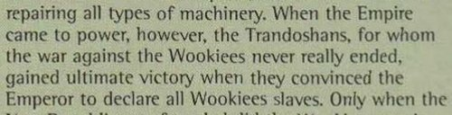
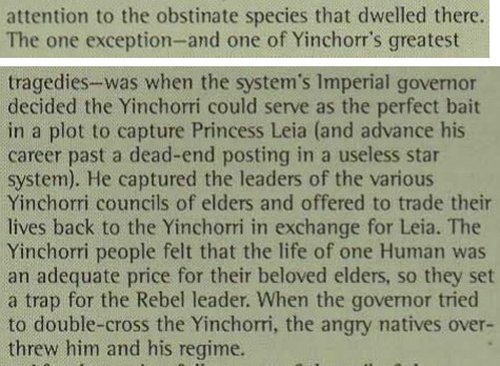
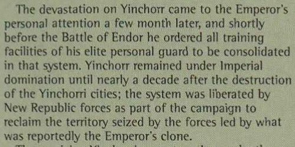
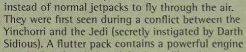

# Owner Material 037 — Star Wars D20 Drive folder (Core, Revised Core and Saga Edition): Sourcebooks/Ultimate Alien Anthology.pdf [Star Wars Roleplaying Game Revised Core (d20, 2002)] (scan pages 181–225)

- **Source:** Wizards of the Coast Star Wars Roleplaying Game books, web enhancements, Living Force campaign modules and articles (2000–2010), from the owner's "Star Wars D20" Drive folder (only the three edition subfolders; "General" was not read, as instructed). Secondary source (licensed Legends reference). Scan OCR'd on the box; the scan stays box-only and is **not** published.
- **Method:** every scanned page was OCR'd and machine-screened sentence by sentence for power-relevant statements (fights, kills, defeats, Force feats, rankings, superweapons) that name a character on our roster; each kept sentence is quoted verbatim from the OCR text and has a crop of the printed passage directly under it. Pages with nothing power-relevant are still listed with what is on them.
- **Citation:** "*Ultimate Alien Anthology* (SWRPG d20 Revised Core), p.X" by printed page ("scan p.X" where no printed number applies). **Weight:** Licensed RPG material: a secondary source. Narrative text sums up Legends lore; game statistics are rules for players, not canon power levels, and rank lowest.

## scan p.181 (scan page 181)

Page contents: Vratix traits; Vuvrian begins; illustrations. (hand-read)

## scan p.182 (scan page 182)

Page contents: Vuvrian traits; Weequay begins. (hand-read)

## scan p.183 (scan page 183)

Page contents: Weequay traits; Whiphid. (hand-read)

## scan p.184 (scan page 184)

Page contents: Whiphid (example names incl. K'Kruhk, J'Quille) traits; Wookiee (Emperor, Trandoshans; example names incl. Chewbacca). (hand-read)

- **Palpatine (Darth Sidious)** — entry/section: Wookiee: "When the Empire came to power, however, the Trandoshans, for whom the war against the Wookiees never really ended, gained ultimate victory when they convinced the Emperor to declare all Wookiees slaves." Source: *Ultimate Alien Anthology* (SWRPG d20 Revised Core), scan p.184
  

## scan p.185 (scan page 185)

Page contents: Wookiee (example names incl. Lowbacca, Attichitcuk, Mallatobuk) traits; illustrations. (hand-read)

## scan p.186 (scan page 186)

Page contents: Wookiee commoner; Woostoid (Grand Admiral Thrawn, Emperor's New Order). (hand-read)

## scan p.187 (scan page 187)

Page contents: Woostoid skills; Xexto (example names incl. Gasgano). (hand-read)

## scan p.188 (scan page 188)

Page contents: Xexto commoner; Yarkora; Yevetha begins. (hand-read)

## scan p.189 (scan page 189)

Page contents: Yevetha (example names incl. Nil Spaar) traits; Yinchorri begins. (hand-read)

## scan p.190 (scan page 190)

Page contents: Yinchorri (Princess Leia plot, Tol-Kachorn, Echo Base); illustrations. (hand-read)

- **Leia Organa Solo** — entry/section: Yinchorri: "The one exception—and one of Yinchorr’s greatest tragedies—was when the system's Imperial governor decided the Yinchorri could serve as the perfect bait in a plot to capture Princess Leia (and advance his career past a dead-end posting in a useless star system). He captured the leaders of the various Yinchorri councils of elders and offered to trade their lives back to the Yinchorri in exchange for Leia. The Yinchorri people felt that the life of one Human was an adequate price for their beloved elders, so they set a trap for the Rebel leader. When the governor tried to double-cross the Yinchorri, the angry natives overthrew him and his regime." Source: *Ultimate Alien Anthology* (SWRPG d20 Revised Core), scan p.190
  

## scan p.191 (scan page 191)

Page contents: Yinchorri (Emperor's Imperial Guard, Emperor's clone) traits; flutter pack (Darth Sidious). (hand-read)

- **Palpatine (Darth Sidious)** — entry/section: Yinchorri: "The devastation on Yinchorr came to the Emperor's personal attention a few month later, and shortly before the Battle of Endor he ordered all training facilities of his elite personal guard to be consolidated in that system. Yinchorr remained under Imperial domination until nearly a decade after the destruction of the Yinchorri cities; the system was liberated by New Republic forces as part of the campaign to reclaim the territory seized by the forces led by what was reportedly the Emperor's clone." Source: *Ultimate Alien Anthology* (SWRPG d20 Revised Core), scan p.191
  
- **Palpatine (Darth Sidious)** — entry/section: Yinchorri flutter pack: "They were first seen during a conflict between the Yinchorri and the Jedi (secretly instigated by Darth Sidious)." Source: *Ultimate Alien Anthology* (SWRPG d20 Revised Core), scan p.191
  

## scan p.192 (scan page 192)

Page contents: Yuuzhan Vong. (hand-read)

## scan p.193 (scan page 193)

Page contents: Yuuzhan Vong gods (example names incl. Nom Anor, Tsavong Lah, Shedao Shai, Nen Yim) traits; glistaweb. (hand-read)

## scan p.194 (scan page 194)

Page contents: Thud bug; vonduun crab-shell armor; Yuzzem. (hand-read)

## scan p.195 (scan page 195)

Page contents: Yuzzem traits; Zabrak begins. (hand-read)

## scan p.196 (scan page 196)

Page contents: Zabrak (Emperor's will; example names incl. Agen Kolar, Eeth Koth) traits; zhaboka. (hand-read)

## scan p.197 (scan page 197)

Page contents: Zehethbra; Zeltron begins. (hand-read)

## scan p.198 (scan page 198)

Page contents: Zeltron traits; elixir of infatuation. (hand-read)

## scan p.199 (scan page 199)

Page contents: Chapter Two prestige classes intro; aerobat. (hand-read)

## scan p.200 (scan page 200)

Page contents: Aerobat features; illustration. (hand-read)

## scan p.201 (scan page 201)

Page contents: Beastwarden. (hand-read)

## scan p.202 (scan page 202)

Page contents: Beastwarden familiar features; illustration. (hand-read)

## scan p.203 (scan page 203)

Page contents: Sample beastwarden familiars; beastwarden features. (hand-read)

## scan p.204 (scan page 204)

Page contents: Beastwarden features; big-game hunter. (hand-read)

## scan p.205 (scan page 205)

Page contents: Big-game hunter requirements/features; illustration. (hand-read)

## scan p.206 (scan page 206)

Page contents: Big-game hunter features; bodyguard. (hand-read)

## scan p.207 (scan page 207)

Page contents: Bodyguard features; illustration (Noghri bodyguard). (hand-read)

## scan p.208 (scan page 208)

Page contents: Bodyguard features; changeling. (hand-read)

## scan p.209 (scan page 209)

Page contents: Changeling features; illustration (Shi'ido changeling). (hand-read)

## scan p.210 (scan page 210)

Page contents: Changeling features; findsman. (hand-read)

## scan p.211 (scan page 211)

Page contents: Findsman features; illustration (Gand findsman). (hand-read)

## scan p.212 (scan page 212)

Page contents: Findsman features; mystic agent (Jedi Temple, Rebellion era). (hand-read)

## scan p.213 (scan page 213)

Page contents: Mystic agent requirements/features. (hand-read)

## scan p.214 (scan page 214)

Page contents: Mystic agent features; illustration (Chiss mystic agent). (hand-read)

## scan p.215 (scan page 215)

Page contents: Mystic agent features; telepath. (hand-read)

## scan p.216 (scan page 216)

Page contents: Telepath features; illustration (Nagai). (hand-read)

## scan p.217 (scan page 217)

Page contents: Telepath features. (hand-read)

## scan p.218 (scan page 218)

Page contents: Telepath psychic avatar. (hand-read)

## scan p.219 (scan page 219)

Page contents: Appendix new feats: Beast Language through Multidexterity. (hand-read)

## scan p.220 (scan page 220)

Page contents: New feats: Multiweapon Fighting through Trample. (hand-read)

## scan p.221 (scan page 221)

Page contents: Appendix Yuuzhan Vong heroes: classes, fringer, noble. (hand-read)

## scan p.222 (scan page 222)

Page contents: Yuuzhan Vong noble, scoundrel, scout; Yuuzhan Vong gear sidebar, requisitioning. (hand-read)

## scan p.223 (scan page 223)

Page contents: Yuuzhan Vong soldier, tech specialist, diplomat, expert, thug; prestige classes; skill/feat restrictions. (hand-read)

## scan p.224 (scan page 224)

Page contents: Index: alien homeworlds. (hand-read)

## scan p.225 (scan page 225)

Page contents: Back cover blurb. (hand-read)

