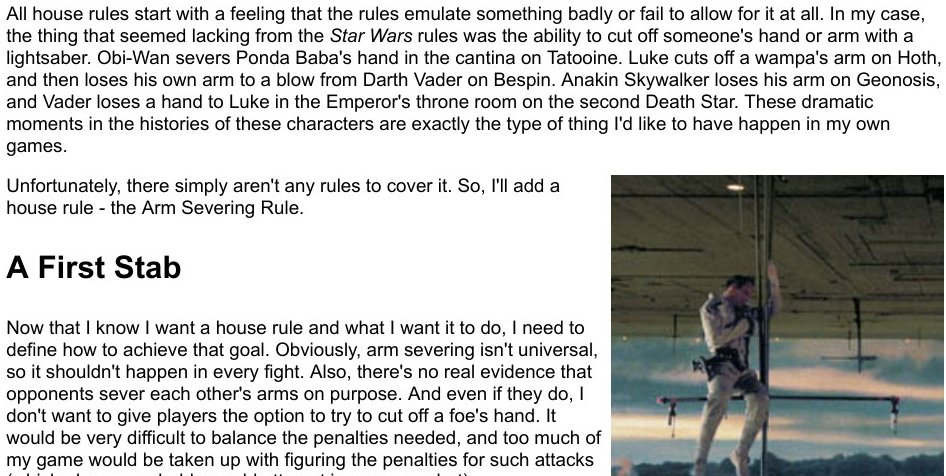

# Owner Material 037 — Star Wars D20 Drive folder (Core, Revised Core and Saga Edition): Tips and Tactics/House Rules.pdf [Star Wars Roleplaying Game Revised Core (d20, 2002)]

- **Source:** Wizards of the Coast Star Wars Roleplaying Game books, web enhancements, Living Force campaign modules and articles (2000–2010), from the owner's "Star Wars D20" Drive folder (only the three edition subfolders; "General" was not read, as instructed). Secondary source (licensed Legends reference). Scan OCR'd on the box; the scan stays box-only and is **not** published.
- **Method:** every scanned page was OCR'd and machine-screened sentence by sentence for power-relevant statements (fights, kills, defeats, Force feats, rankings, superweapons) that name a character on our roster; each kept sentence is quoted verbatim from the OCR text and has a crop of the printed passage directly under it. Pages with nothing power-relevant are still listed with what is on them.
- **Citation:** "*House Rules* (SWRPG d20 Revised Core), p.X" by printed page ("scan p.X" where no printed number applies). **Weight:** Licensed RPG material: a secondary source. Narrative text sums up Legends lore; game statistics are rules for players, not canon power levels, and rank lowest.

## scan p.1 (scan page 1)

Page contents: Why house rules; the Arm Severing Rule motivated by film severings (Ponda Baba, wampa, Luke, Anakin, Vader); first draft goals (the fight ends when a hand comes off). (hand-read)

- **Obi-Wan Kenobi; Ponda Baba; Luke Skywalker; Darth Vader (Anakin Skywalker)** — entry/section: Lightsaber severings in the films: "In my case, the thing that seemed lacking from the Star Wars rules was the ability to cut off someone's hand or arm with a lightsaber. Obi-Wan severs Ponda Baba's hand in the cantina on Tatooine. Luke cuts off a wampa's arm on Hoth, and then loses his own arm to a blow from Darth Vader on Bespin. Anakin Skywalker loses his arm on Geonosis, and Vader loses a hand to Luke in the Emperor's throne room on the second Death Star. These dramatic moments in the histories of these characters are exactly the type of thing I'd like to have happen in my own games." Source: *House Rules* (SWRPG d20 Revised Core), scan p.1
  

## scan p.2 (scan page 2)

Page contents: Draft rule (max-damage crits) and its loopholes (gaderffii vs 6d8 lightsaber); revised rule (crit dropping foe to exactly 0 wounds severs an arm); check with players; cybernetic replacements. (hand-read)

