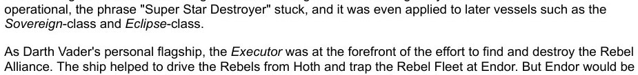
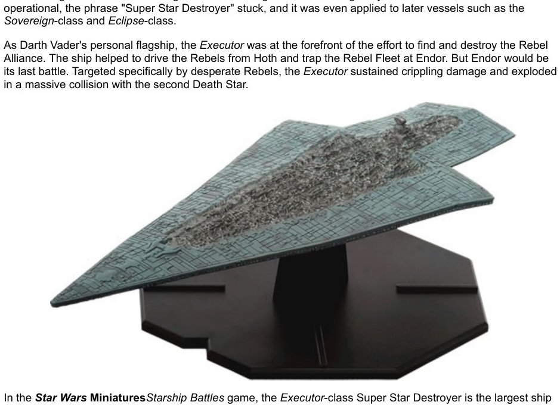

# Owner Material 037 — Star Wars D20 Drive folder (Core, Revised Core and Saga Edition): Vehicles/Miniatures/Starship Battles Preview 1.pdf [Star Wars Roleplaying Game Revised Core (d20, 2002)]

- **Source:** Wizards of the Coast Star Wars Roleplaying Game books, web enhancements, Living Force campaign modules and articles (2000–2010), from the owner's "Star Wars D20" Drive folder (only the three edition subfolders; "General" was not read, as instructed). Secondary source (licensed Legends reference). Scan OCR'd on the box; the scan stays box-only and is **not** published.
- **Method:** every scanned page was OCR'd and machine-screened sentence by sentence for power-relevant statements (fights, kills, defeats, Force feats, rankings, superweapons) that name a character on our roster; each kept sentence is quoted verbatim from the OCR text and has a crop of the printed passage directly under it. Pages with nothing power-relevant are still listed with what is on them.
- **Citation:** "*Starship Battles Preview 1* (SWRPG d20 Revised Core), p.X" by printed page ("scan p.X" where no printed number applies). **Weight:** Licensed RPG material: a secondary source. Narrative text sums up Legends lore; game statistics are rules for players, not canon power levels, and rank lowest.

## scan p.1 (scan page 1)

Page contents: Intro; Mon Calamari Viscount-class star defender history and miniatures tactics. (hand-read)

## scan p.2 (scan page 2)

Page contents: Viscount miniatures and RPG stats. (hand-read)

## scan p.3 (scan page 3)

Page contents: Executor-class Super Star Destroyer history (Vader's flagship) and miniatures tactics. (hand-read)

- **Darth Vader (Anakin Skywalker)** — entry/section: Starship Battles Preview 1: "As Darth Vader's personal flagship, the Executor was at the forefront of the effort to find and destroy the Rebel Alliance." Source: *Starship Battles Preview 1* (SWRPG d20 Revised Core), scan p.3
  
- **Darth Vader (Anakin Skywalker)** — entry/section: Super Star Destroyer Executor: "As Darth Vader's personal flagship, the Executor was at the forefront of the effort to find and destroy the Rebel Alliance. The ship helped to drive the Rebels from Hoth and trap the Rebel Fleet at Endor. But Endor would be its last battle. Targeted specifically by desperate Rebels, the Executor sustained crippling damage and exploded in a massive collision with the second Death Star." Source: *Starship Battles Preview 1* (SWRPG d20 Revised Core), scan p.3
  

## scan p.4 (scan page 4)

Page contents: Executor miniatures and RPG stats; author bios. (hand-read)

## scan p.5 (scan page 5)

Page contents: Author bio end; copyright. (hand-read)

