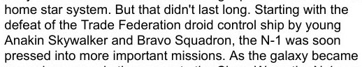
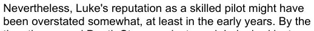
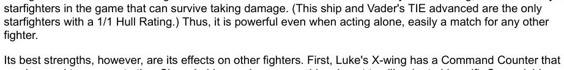
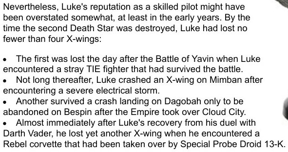
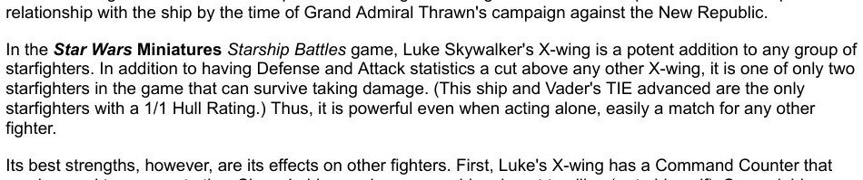

# Owner Material 037 — Star Wars D20 Drive folder (Core, Revised Core and Saga Edition): Vehicles/Miniatures/Starship Battles Preview 2.pdf [Star Wars Roleplaying Game Revised Core (d20, 2002)]

- **Source:** Wizards of the Coast Star Wars Roleplaying Game books, web enhancements, Living Force campaign modules and articles (2000–2010), from the owner's "Star Wars D20" Drive folder (only the three edition subfolders; "General" was not read, as instructed). Secondary source (licensed Legends reference). Scan OCR'd on the box; the scan stays box-only and is **not** published.
- **Method:** every scanned page was OCR'd and machine-screened sentence by sentence for power-relevant statements (fights, kills, defeats, Force feats, rankings, superweapons) that name a character on our roster; each kept sentence is quoted verbatim from the OCR text and has a crop of the printed passage directly under it. Pages with nothing power-relevant are still listed with what is on them.
- **Citation:** "*Starship Battles Preview 2* (SWRPG d20 Revised Core), p.X" by printed page ("scan p.X" where no printed number applies). **Weight:** Licensed RPG material: a secondary source. Narrative text sums up Legends lore; game statistics are rules for players, not canon power levels, and rank lowest.

## scan p.1 (scan page 1)

Page contents: Intro; Naboo N-1 starfighter history and miniatures stats. (hand-read)

- **Darth Vader (Anakin Skywalker)**: "Starting with the defeat of the Trade Federation droid control ship by young Anakin Skywalker and Bravo Squadron, the N-1 was soon pressed into more important missions." Source: *Starship Battles Preview 2* (SWRPG d20 Revised Core), scan p.1
  

## scan p.2 (scan page 2)

Page contents: N-1 RPG stats; Luke Skywalker's X-wing history (four X-wings lost) and miniatures tactics. (hand-read)

- **Luke Skywalker** — entry/section: Starship Battles Preview 2: "Nevertheless, Luke's reputation as a skilled pilot might have been overstated somewhat, at least in the early years." Source: *Starship Battles Preview 2* (SWRPG d20 Revised Core), scan p.2
  
- **Darth Vader (Anakin Skywalker)** — entry/section: Starship Battles Preview 2: "(This ship and Vader's TIE advanced are the only starfighters with a 1/1 Hull Rating.) Thus, it is powerful even when acting alone, easily a match for any other fighter." Source: *Starship Battles Preview 2* (SWRPG d20 Revised Core), scan p.2
  
- **Luke Skywalker; Biggs Darklighter; Darth Vader (Anakin Skywalker); R2-D2** — entry/section: Luke Skywalker's X-wing: "Nevertheless, Luke's reputation as a skilled pilot might have been overstated somewhat, at least in the early years. By the time the second Death Star was destroyed, Luke had lost no fewer than four X-wings: The first was lost the day after the Battle of Yavin when Luke encountered a stray TIE fighter that had survived the battle. Not long thereafter, Luke crashed an X-wing on Mimban after encountering a severe electrical storm. Another survived a crash landing on Dagobah only to be abandoned on Bespin after the Empire took over Cloud City. Almost immediately after Luke's recovery from his duel with Darth Vader, he lost yet another X-wing when he encountered a Rebel corvette that had been taken over by Special Probe Droid 13-K." Source: *Starship Battles Preview 2* (SWRPG d20 Revised Core), scan p.2
  
- **Luke Skywalker** — entry/section: Luke Skywalker's X-wing: "In the Star Wars Miniatures Starship Battles game, Luke Skywalker's X-wing is a potent addition to any group of starfighters. In addition to having Defense and Attack statistics a cut above any other X-wing, it is one of only two starfighters in the game that can survive taking damage. (This ship and Vader's TIE advanced are the only starfighters with a 1/1 Hull Rating.) Thus, it is powerful even when acting alone, easily a match for any other fighter." Source: *Starship Battles Preview 2* (SWRPG d20 Revised Core), scan p.2
  

## scan p.3 (scan page 3)

Page contents: Luke's X-wing miniatures and RPG stats (+13 Pilot); author bios. (hand-read)

### Stat block notes (game mechanics, not feats)

- Luke Skywalker (pilot): Luke Skywalker's X-wing (Incom T-65B) +13 Pilot, +3 Init; Laser cannons Attack Bonus: +19 (+2 size, +11 crew, +6 fire control). Miniatures: Defense 18, Hull 1/1, Force Sense (adjacent enemy ships get -1 Defense). (Source: *Starship Battles Preview 2* (SWRPG d20 Revised Core), scan p.3)
