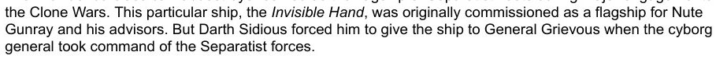
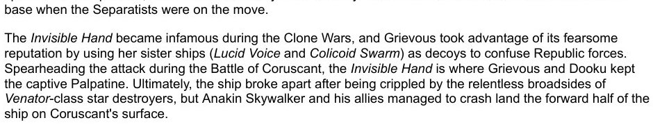

# Owner Material 037 — Star Wars D20 Drive folder (Core, Revised Core and Saga Edition): Vehicles/Miniatures/Starship Battles Preview 5.pdf [Star Wars Roleplaying Game Revised Core (d20, 2002)]

- **Source:** Wizards of the Coast Star Wars Roleplaying Game books, web enhancements, Living Force campaign modules and articles (2000–2010), from the owner's "Star Wars D20" Drive folder (only the three edition subfolders; "General" was not read, as instructed). Secondary source (licensed Legends reference). Scan OCR'd on the box; the scan stays box-only and is **not** published.
- **Method:** every scanned page was OCR'd and machine-screened sentence by sentence for power-relevant statements (fights, kills, defeats, Force feats, rankings, superweapons) that name a character on our roster; each kept sentence is quoted verbatim from the OCR text and has a crop of the printed passage directly under it. Pages with nothing power-relevant are still listed with what is on them.
- **Citation:** "*Starship Battles Preview 5* (SWRPG d20 Revised Core), p.X" by printed page ("scan p.X" where no printed number applies). **Weight:** Licensed RPG material: a secondary source. Narrative text sums up Legends lore; game statistics are rules for players, not canon power levels, and rank lowest.

## scan p.1 (scan page 1)

Page contents: Lambda-class shuttle history and miniatures tactics. (hand-read)

## scan p.2 (scan page 2)

Page contents: Shuttle stats; Invisible Hand intro (Gunray, Sidious, Grievous). (hand-read)

- **Nute Gunray; Palpatine (Darth Sidious); General Grievous** — entry/section: The Invisible Hand: "This particular ship, the Invisible Hand, was originally commissioned as a flagship for Nute Gunray and his advisors. But Darth Sidious forced him to give the ship to General Grievous when the cyborg general took command of the Separatist forces." Source: *Starship Battles Preview 5* (SWRPG d20 Revised Core), scan p.2
  

## scan p.3 (scan page 3)

Page contents: Invisible Hand modifications by Grievous, Battle of Coruscant, tactics, stats. (hand-read)

- **General Grievous; Count Dooku; Palpatine (Darth Sidious); Darth Vader (Anakin Skywalker)** — entry/section: The Invisible Hand: "The Invisible Hand became infamous during the Clone Wars, and Grievous took advantage of its fearsome reputation by using her sister ships (Lucid Voice and Colicoid Swarm) as decoys to confuse Republic forces. Spearheading the attack during the Battle of Coruscant, the Invisible Hand is where Grievous and Dooku kept the captive Palpatine. Ultimately, the ship broke apart after being crippled by the relentless broadsides of Venator-class star destroyers, but Anakin Skywalker and his allies managed to crash land the forward half of the ship on Coruscant's surface." Source: *Starship Battles Preview 5* (SWRPG d20 Revised Core), scan p.3
  

## scan p.4 (scan page 4)

Page contents: Invisible Hand weapons; author bio. (hand-read)

