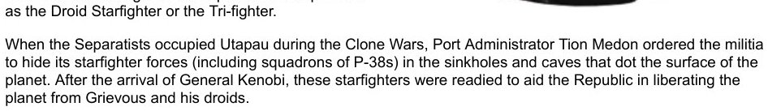

# Owner Material 037 — Star Wars D20 Drive folder (Core, Revised Core and Saga Edition): Vehicles/Miniatures/Starship Battles Preview 6.pdf [Star Wars Roleplaying Game Revised Core (d20, 2002)]

- **Source:** Wizards of the Coast Star Wars Roleplaying Game books, web enhancements, Living Force campaign modules and articles (2000–2010), from the owner's "Star Wars D20" Drive folder (only the three edition subfolders; "General" was not read, as instructed). Secondary source (licensed Legends reference). Scan OCR'd on the box; the scan stays box-only and is **not** published.
- **Method:** every scanned page was OCR'd and machine-screened sentence by sentence for power-relevant statements (fights, kills, defeats, Force feats, rankings, superweapons) that name a character on our roster; each kept sentence is quoted verbatim from the OCR text and has a crop of the printed passage directly under it. Pages with nothing power-relevant are still listed with what is on them.
- **Citation:** "*Starship Battles Preview 6* (SWRPG d20 Revised Core), p.X" by printed page ("scan p.X" where no printed number applies). **Weight:** Licensed RPG material: a secondary source. Narrative text sums up Legends lore; game statistics are rules for players, not canon power levels, and rank lowest.

## scan p.1 (scan page 1)

Page contents: Techno Union starfighter background and miniatures stats. (hand-read)

## scan p.2 (scan page 2)

Page contents: Techno Union RPG stats; Utapaun P-38 history (Tion Medon, Kenobi liberating Utapau) and tactics. (hand-read)

- **Obi-Wan Kenobi; General Grievous** — entry/section: Utapaun P-38 Starfighter: "When the Separatists occupied Utapau during the Clone Wars, Port Administrator Tion Medon ordered the militia to hide its starfighter forces (including squadrons of P-38s) in the sinkholes and caves that dot the surface of the planet. After the arrival of General Kenobi, these starfighters were readied to aid the Republic in liberating the planet from Grievous and his droids." Source: *Starship Battles Preview 6* (SWRPG d20 Revised Core), scan p.2
  

## scan p.3 (scan page 3)

Page contents: P-38 RPG stats; author bios. (hand-read)

