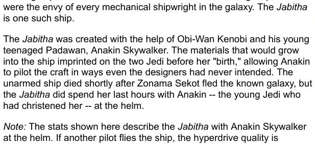

# Owner Material 037 — Star Wars D20 Drive folder (Core, Revised Core and Saga Edition): Vehicles/Anakin's Living Ship.pdf [Star Wars Roleplaying Game Revised Core (d20, 2002)]

- **Source:** Wizards of the Coast Star Wars Roleplaying Game books, web enhancements, Living Force campaign modules and articles (2000–2010), from the owner's "Star Wars D20" Drive folder (only the three edition subfolders; "General" was not read, as instructed). Secondary source (licensed Legends reference). Scan OCR'd on the box; the scan stays box-only and is **not** published.
- **Method:** every scanned page was OCR'd and machine-screened sentence by sentence for power-relevant statements (fights, kills, defeats, Force feats, rankings, superweapons) that name a character on our roster; each kept sentence is quoted verbatim from the OCR text and has a crop of the printed passage directly under it. Pages with nothing power-relevant are still listed with what is on them.
- **Citation:** "*Anakin's Living Ship* (SWRPG d20 Revised Core), p.X" by printed page ("scan p.X" where no printed number applies). **Weight:** Licensed RPG material: a secondary source. Narrative text sums up Legends lore; game statistics are rules for players, not canon power levels, and rank lowest.

## scan p.1 (scan page 1)

Page contents: Jabitha, Sekotan living ship imprinted on Obi-Wan and Anakin; stats with Anakin at the helm (crew +10). (hand-read)

- **Darth Vader (Anakin Skywalker); Obi-Wan Kenobi** — entry/section: Anakin's Living Ship: "The Jabitha was created with the help of Obi-Wan Kenobi and his young teenaged Padawan, Anakin Skywalker. The materials that would grow into the ship imprinted on the two Jedi before her "birth," allowing Anakin to pilot the craft in ways even the designers had never intended. The unarmed ship died shortly after Zonama Sekot fled the known galaxy, but the Jabitha did spend her last hours with Anakin -- the young Jedi who had christened her -- at the helm." Source: *Anakin's Living Ship* (SWRPG d20 Revised Core), scan p.1
  

### Stat block notes (game mechanics, not feats)

- Anakin Skywalker (pilot): Jabitha stats: Crew: 1 (Anakin Skywalker, +10); Hyperdrive x0.4 with Anakin at the helm (reduced to x1.0 if another pilot flies the ship). (Source: *Anakin's Living Ship* (SWRPG d20 Revised Core), scan p.1)
