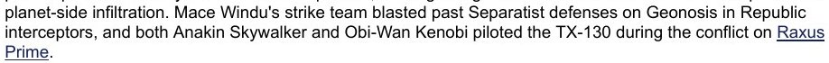

# Owner Material 037 — Star Wars D20 Drive folder (Core, Revised Core and Saga Edition): Vehicles/Republic Fighter Tank.pdf [Star Wars Roleplaying Game Revised Core (d20, 2002)]

- **Source:** Wizards of the Coast Star Wars Roleplaying Game books, web enhancements, Living Force campaign modules and articles (2000–2010), from the owner's "Star Wars D20" Drive folder (only the three edition subfolders; "General" was not read, as instructed). Secondary source (licensed Legends reference). Scan OCR'd on the box; the scan stays box-only and is **not** published.
- **Method:** every scanned page was OCR'd and machine-screened sentence by sentence for power-relevant statements (fights, kills, defeats, Force feats, rankings, superweapons) that name a character on our roster; each kept sentence is quoted verbatim from the OCR text and has a crop of the printed passage directly under it. Pages with nothing power-relevant are still listed with what is on them.
- **Citation:** "*Republic Fighter Tank* (SWRPG d20 Revised Core), p.X" by printed page ("scan p.X" where no printed number applies). **Weight:** Licensed RPG material: a secondary source. Narrative text sums up Legends lore; game statistics are rules for players, not canon power levels, and rank lowest.

## scan p.1 (scan page 1)

Page contents: TX-130 Saber-class fighter tank; Mace Windu at Geonosis, Anakin and Obi-Wan on Raxus Prime; stats. (hand-read)

- **Mace Windu; Darth Vader (Anakin Skywalker); Obi-Wan Kenobi** — entry/section: Republic Fighter Tank: "Mace Windu's strike team blasted past Separatist defenses on Geonosis in Republic interceptors, and both Anakin Skywalker and Obi-Wan Kenobi piloted the TX-130 during the conflict on Raxus Prime." Source: *Republic Fighter Tank* (SWRPG d20 Revised Core), scan p.1
  

## scan p.2 (scan page 2)

Page contents: Weapons; tank image; copyright. (hand-read)

