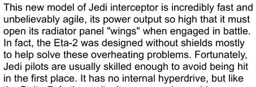
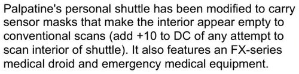

# Owner Material 037 — Star Wars D20 Drive folder (Core, Revised Core and Saga Edition): Vehicles/Starships and Vehicles of Revenge of the Sith.pdf [Star Wars Roleplaying Game Revised Core (d20, 2002)]

- **Source:** Wizards of the Coast Star Wars Roleplaying Game books, web enhancements, Living Force campaign modules and articles (2000–2010), from the owner's "Star Wars D20" Drive folder (only the three edition subfolders; "General" was not read, as instructed). Secondary source (licensed Legends reference). Scan OCR'd on the box; the scan stays box-only and is **not** published.
- **Method:** every scanned page was OCR'd and machine-screened sentence by sentence for power-relevant statements (fights, kills, defeats, Force feats, rankings, superweapons) that name a character on our roster; each kept sentence is quoted verbatim from the OCR text and has a crop of the printed passage directly under it. Pages with nothing power-relevant are still listed with what is on them.
- **Citation:** "*Starships and Vehicles of Revenge of the Sith* (SWRPG d20 Revised Core), p.X" by printed page ("scan p.X" where no printed number applies). **Weight:** Licensed RPG material: a secondary source. Narrative text sums up Legends lore; game statistics are rules for players, not canon power levels, and rank lowest.

## scan p.1 (scan page 1)

Page contents: Venator-class Star Destroyer stats; Invisible Hand intro (Grievous, Dooku, captive Palpatine). (hand-read)

## scan p.2 (scan page 2)

Page contents: Providence-class stats; Recusant-class light destroyer. (hand-read)

## scan p.3 (scan page 3)

Page contents: Munificent-class star frigate (hyperwave jammer); ARC-170 intro. (hand-read)

## scan p.4 (scan page 4)

Page contents: ARC-170, Eta-2 Jedi interceptor stats; V-wing intro. (hand-read)

- **No single roster character (rules/setting/general)** — entry/section: Jedi Interceptor: "This new model of Jedi interceptor is incredibly fast and unbelievably agile, its power output so high that it must open its radiator panel "wings" when engaged in battle. In fact, the Eta-2 was designed without shields mostly to help solve these overheating problems. Fortunately, Jedi pilots are usually skilled enough to avoid being hit in the first place." Source: *Starships and Vehicles of Revenge of the Sith* (SWRPG d20 Revised Core), scan p.4
  

## scan p.5 (scan page 5)

Page contents: V-wing, Tri-fighter, buzz-droid missile. (hand-read)

## scan p.6 (scan page 6)

Page contents: Buzz droid stats and sabotage rule; Palpatine's Theta-class shuttle. (hand-read)

- **Palpatine (Darth Sidious)** — entry/section: Palpatine's Shuttle: "Palpatine's personal shuttle has been modified to carry sensor masks that make the interior appear empty to conventional scans (add +10 to DC of any attempt to scan interior of shuttle). It also features an FX-series medical droid and emergency medical equipment." Source: *Starships and Vehicles of Revenge of the Sith* (SWRPG d20 Revised Core), scan p.6
  

## scan p.7 (scan page 7)

Page contents: Shuttle weapons; HMP droid gunship; Wookiee catamaran (siege of Kachirho). (hand-read)

## scan p.8 (scan page 8)

Page contents: Catamaran stats; Wookiee ornithopter; A6 Juggernaut. (hand-read)

## scan p.9 (scan page 9)

Page contents: Juggernaut weapons; AT-AP. (hand-read)

## scan p.10 (scan page 10)

Page contents: AT-RT; swamp speeder; Grievous's wheel bike. (hand-read)

- **General Grievous** — entry/section: Grievous's Wheel Bike: "Grievous's wheel bike was modified to mount a double laser cannon instead of a passenger seat, and he also typically an electrostaff on board." Source: *Starships and Vehicles of Revenge of the Sith* (SWRPG d20 Revised Core), scan p.10
  

## scan p.11 (scan page 11)

Page contents: Wheel bike stats; author bio. (hand-read)

