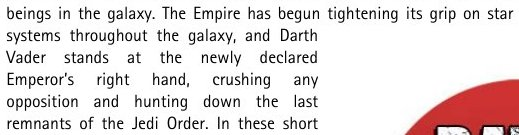
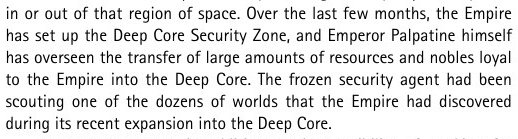
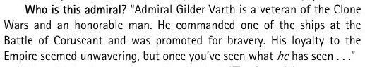
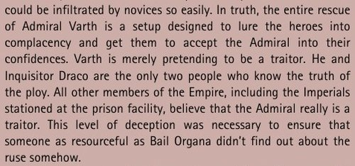

# Owner Material 037 — Star Wars D20 Drive folder (Core, Revised Core and Saga Edition): Adventures/Dawn of Defiance/01 - Traitor's Gambit.pdf [Star Wars Roleplaying Game Saga Edition (2007)]

- **Source:** Wizards of the Coast Star Wars Roleplaying Game books, web enhancements, Living Force campaign modules and articles (2000–2010), from the owner's "Star Wars D20" Drive folder (only the three edition subfolders; "General" was not read, as instructed). Secondary source (licensed Legends reference). Scan OCR'd on the box; the scan stays box-only and is **not** published.
- **Method:** every scanned page was OCR'd and machine-screened sentence by sentence for power-relevant statements (fights, kills, defeats, Force feats, rankings, superweapons) that name a character on our roster; each kept sentence is quoted verbatim from the OCR text and has a crop of the printed passage directly under it. Pages with nothing power-relevant are still listed with what is on them.
- **Citation:** "*01 - Traitor's Gambit* (SWRPG Saga Edition), p.X" by printed page ("scan p.X" where no printed number applies). **Weight:** Licensed RPG material: a secondary source. Narrative text sums up Legends lore; game statistics are rules for players, not canon power levels, and rank lowest.

## scan p.1 (scan page 1)

Page contents: Cover. (hand-read)

## scan p.2 (scan page 2)

Page contents: Credits; adventure intro; what is Dawn of Defiance. (hand-read)

## scan p.3 (scan page 3)

Page contents: Starting the campaign; adventure summary. (hand-read)

- **Darth Vader (Anakin Skywalker); Palpatine (Darth Sidious)** — entry/section: Starting the Campaign: "The Empire has begun tightening its grip on star systems throughout the galaxy, and Darth Vader stands at the newly declared Emperor's right hand, crushing any opposition and hunting down the last remnants of the Jedi Order." Source: *01 - Traitor's Gambit* (SWRPG Saga Edition), scan p.3
  

## scan p.4 (scan page 4)

Page contents: Summary cont.; opening crawl. (hand-read)

## scan p.5 (scan page 5)

Page contents: Part 1: Sel Zonn Station above Brentaal; station shops. (hand-read)

## scan p.6 (scan page 6)

Page contents: Law enforcement; Promenade; first contact with Maya; V14 clue. (hand-read)

## scan p.7 (scan page 7)

Page contents: Deep storage bay V14; meeting Switch. (hand-read)

## scan p.8 (scan page 8)

Page contents: Switch challenges and stats; arrival of Ganga Lor. (hand-read)

- **Palpatine (Darth Sidious)** — entry/section: Switch: the Deep Core: "Over the last few months, the Empire has set up the Deep Core Security Zone, and Emperor Palpatine himself has overseen the transfer of large amounts of resources and nobles loyal to the Empire into the Deep Core." Source: *01 - Traitor's Gambit* (SWRPG Saga Edition), scan p.8
  

### Stat block notes (game mechanics, not feats)

- Switch CL2: Medium droid (3rd-degree) nonheroic 1/noble 2; Ref 12, Fort 11, Will 15; hp 10; Talents Presence; Feats Linguist, Skill Focus (Deception, Persuasion), Skill Training (Deception, Knowledge [bureaucracy], Knowledge [galactic lore]), Weapon Proficiency (pistols); Deception +13, Persuasion +13 (Source: *01 - Traitor's Gambit* (SWRPG Saga Edition), scan p.8)

## scan p.9 (scan page 9)

Page contents: Blue Deck; Skig Banos; main docking bay; Banshee pickup; Discovery destiny. (hand-read)

## scan p.10 (scan page 10)

Page contents: Rendezvous on Alderaan; Bail Organa's request; Sirona Okeefe and the Banshee. (hand-read)

- **Bail Organa; Gilder Varth** — entry/section: Bail Organa on Varth: ""Admiral Gilder Varth is a veteran of the Clone Wars and an honorable man. He commanded one of the ships at the Battle of Coruscant and was promoted for bravery. His loyalty to the Empire seemed unwavering, but once you've seen what he has seen..."" Source: *01 - Traitor's Gambit* (SWRPG Saga Edition), scan p.10
  

## scan p.11 (scan page 11)

Page contents: Okeefe, RX-13 "Crash", Banshee stats. (hand-read)

### Stat block notes (game mechanics, not feats)

- Captain Sirona Okeefe CL6: Medium Human scoundrel 6; Force 5; Init +11; Ref 22, Fort 17, Will 20; hp 36; heavy blaster pistol +7 (3d8+3); Talents Fortune's Favor, Hyperdriven, Spacehound; Feats Careful Shot, Improved Defenses, Point Blank Shot, Precise Shot, Running Attack, Skill Focus (Pilot), Skill Training (Perception), Vehicular Combat, Weapon Proficiency (pistols, simple weapons); Pilot +16 (Source: *01 - Traitor's Gambit* (SWRPG Saga Edition), scan p.11)

## scan p.12 (scan page 12)

Page contents: Part 2: arrival at Felucia; evasive maneuvers; jungle hazards. (hand-read)

## scan p.13 (scan page 13)

Page contents: Hazards; Felucian scouts; Felucian sanctuary. (hand-read)

## scan p.14 (scan page 14)

Page contents: Vazus Mandrake; the Felucian chief. (hand-read)

## scan p.15 (scan page 15)

Page contents: Chief challenges and stats; sick children; Imperial scout. (hand-read)

## scan p.16 (scan page 16)

Page contents: Kybuck stats; chase zones 1-2. (hand-read)

## scan p.17 (scan page 17)

Page contents: Chase zones 3A/3B/4 (dying rancor)/5. (hand-read)

## scan p.18 (scan page 18)

Page contents: Chase end; Jungle Watch Outpost lead-in. (hand-read)

## scan p.19 (scan page 19)

Page contents: Part 3: prison facility; "That Was Too Easy" (Varth ruse); medical bay; Vischera's experiments. (hand-read)

- **Gilder Varth; Valin Draco; Bail Organa** — entry/section: That Was Too Easy: "In truth, the entire rescue of Admiral Varth is a setup designed to lure the heroes into complacency and get them to accept the Admiral into their confidences. Varth is merely pretending to be a traitor. He and Inquisitor Draco are the only two people who know the truth of the ploy. All other members of the Empire, including the Imperials stationed at the prison facility, believe that the Admiral really is a traitor. This level of deception was necessary to ensure that someone as resourceful as Bail Organa didn't find out about the ruse somehow." Source: *01 - Traitor's Gambit* (SWRPG Saga Edition), scan p.19
  

## scan p.20 (scan page 20)

Page contents: Defense turret; communications center; Draco message; Destruction destiny; prison block; Varth stats. (hand-read)

### Stat block notes (game mechanics, not feats)

- Admiral Gilder Varth (as of Felucian rescue) CL9: Medium Human nonheroic 4/noble 3/officer 5; Dark Side 5; Ref 20, Fort 19, Will 24; hp 10 (max 51); Threshold 24; Talents Assault Tactics, Born Leader, Coordinate, Shift Defense I, Trust; Feats Armor Proficiency (light), Improved Damage Threshold, Improved Defenses, Skill Focus (Persuasion), Skill Training (Deception, Pilot), Toughness, Vehicular Combat, Weapon Proficiency (pistols, simple weapons); Persuasion +18 (Source: *01 - Traitor's Gambit* (SWRPG Saga Edition), scan p.20)

## scan p.21 (scan page 21)

Page contents: Varth stats cont.; escape; command center; conclusion; Resurgence and Captain Verana. (hand-read)

## scan p.22 (scan page 22)

Page contents: Conclusion cont.; next adventure; prison map. (hand-read)

## scan p.23 (scan page 23)

Page contents: Encounter: Promenade Shootout (stormtrooper recruits, informants). (hand-read)

## scan p.24 (scan page 24)

Page contents: Maya stats; encounter map. (hand-read)

## scan p.25 (scan page 25)

Page contents: Encounter: Ganga Lor's Grudge. (hand-read)

## scan p.26 (scan page 26)

Page contents: Features sidebar (fresh OCR): Switch's hideout in deep storage bay V14 runs along an exhaust conduit; a chasm at the back drops into the station's central reactor core (maximum falling damage plus lethal radiation). (hand-read)

## scan p.27 (scan page 27)

Page contents: Encounter: Frozen Goods (recruits, officer, repulsor sled). (hand-read)

## scan p.28 (scan page 28)

Page contents: Features sidebar (fresh OCR): open hangar bay with cover; an Alderaanian agent frozen in carbonite in a repulsor-borne block (moved as a free action alongside an adjacent mover; DR 10, 20 hp, threshold 20, Strength DC 10, break DC 15; at 0 hp the agent dies). (hand-read)

## scan p.29 (scan page 29)

Page contents: Encounter: Felucian Hospitality (Felucian scouts). (hand-read)

## scan p.30 (scan page 30)

Page contents: Encounter: Jungle Watch Outpost (recruits, scout troopers). (hand-read)

## scan p.31 (scan page 31)

Page contents: Encounter map; features. (hand-read)

## scan p.32 (scan page 32)

Page contents: Encounter: Imperial Research Lab (researcher, modified Felucians). (hand-read)

## scan p.33 (scan page 33)

Page contents: 2-1B medical droid; map. (hand-read)

## scan p.34 (scan page 34)

Page contents: Encounter: Defense Turret Controls (gunner, stormtroopers). (hand-read)

## scan p.35 (scan page 35)

Page contents: Conclusion; map. (hand-read)

## scan p.36 (scan page 36)

Page contents: Encounter: Communications Center (Lt. Aden, comm operators). (hand-read)

## scan p.37 (scan page 37)

Page contents: Conclusion; map. (hand-read)

## scan p.38 (scan page 38)

Page contents: Encounter: Detention Block F-1A (guards, prisoners, warden droids). (hand-read)

## scan p.39 (scan page 39)

Page contents: Warden droid stats; map. (hand-read)

## scan p.40 (scan page 40)

Page contents: Encounter: Command Center (Captain Vischera, Kargrek and Hagark). (hand-read)

### Stat block notes (game mechanics, not feats)

- Captain Vischera CL2: Medium Human nonheroic 4/noble 1; Ref 17, Fort 11, Will 13; hp 12; Talents Bolster Ally; Feats Armor Proficiency (light), Linguist, Skill Focus (Treat Injury), Skill Training (Treat Injury), Surgical Expertise, Weapon Proficiency (pistols, simple weapons); Treat Injury +12 (Source: *01 - Traitor's Gambit* (SWRPG Saga Edition), scan p.40)

## scan p.41 (scan page 41)

Page contents: Kargrek/Hagark, stormtroopers; conclusion. (hand-read)

## scan p.42 (scan page 42)

Page contents: RPGA session tracking sheet. (hand-read)

