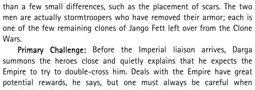
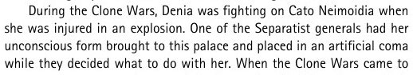
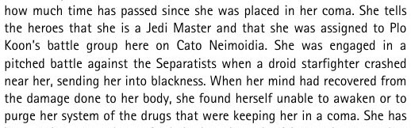
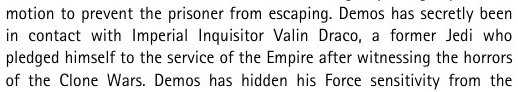
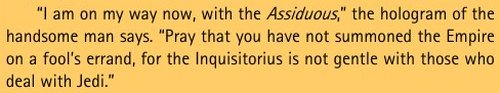

# Owner Material 037 — Star Wars D20 Drive folder (Core, Revised Core and Saga Edition): Adventures/Dawn of Defiance/02 - A Wretched Hive.pdf [Star Wars Roleplaying Game Saga Edition (2007)]

- **Source:** Wizards of the Coast Star Wars Roleplaying Game books, web enhancements, Living Force campaign modules and articles (2000–2010), from the owner's "Star Wars D20" Drive folder (only the three edition subfolders; "General" was not read, as instructed). Secondary source (licensed Legends reference). Scan OCR'd on the box; the scan stays box-only and is **not** published.
- **Method:** every scanned page was OCR'd and machine-screened sentence by sentence for power-relevant statements (fights, kills, defeats, Force feats, rankings, superweapons) that name a character on our roster; each kept sentence is quoted verbatim from the OCR text and has a crop of the printed passage directly under it. Pages with nothing power-relevant are still listed with what is on them.
- **Citation:** "*02 - A Wretched Hive* (SWRPG Saga Edition), p.X" by printed page ("scan p.X" where no printed number applies). **Weight:** Licensed RPG material: a secondary source. Narrative text sums up Legends lore; game statistics are rules for players, not canon power levels, and rank lowest.

## scan p.1 (scan page 1)

Page contents: Cover. (hand-read)

## scan p.2 (scan page 2)

Page contents: Credits; adventure intro; what is Dawn of Defiance. (hand-read)

## scan p.3 (scan page 3)

Page contents: Adventure background and summary; opening crawl. (hand-read)

## scan p.4 (scan page 4)

Page contents: Part 1: Cato Neimoidia; Varth's briefing on the Sarlacc Project. (hand-read)

## scan p.5 (scan page 5)

Page contents: Briefing Q&A; arrival at Zarra; sample citizens; Vipers swoop gang. (hand-read)

## scan p.6 (scan page 6)

Page contents: Vipers extortion; locating Darga's palace; finding Raden; Discovery destiny. (hand-read)

## scan p.7 (scan page 7)

Page contents: Part 2: Darga's palace and court. (hand-read)

## scan p.8 (scan page 8)

Page contents: Darga's audience; court members; Darga the Hutt stats. (hand-read)

### Stat block notes (game mechanics, not feats)

- Darga the Hutt CL8: Large Hutt noble 5/scoundrel 2/crime lord 1; Force 3; Dark Side 16; Ref 17, Fort 20, Will 26 (31 vs. Use the Force); hp 50; Threshold 30; Talents Fool's Luck, Impel Ally I, Inspire Confidence, Presence, Weaken Resolve; Feats Improved Defenses, Improved Damage Threshold, Linguist, Point Blank Shot, Skill Focus (Deception, Knowledge [galactic lore], Perception, Persuasion), Weapon Proficiency (pistols, simple weapons); Deception +18, Persuasion +18 (Source: *02 - A Wretched Hive* (SWRPG Saga Edition), scan p.8)

## scan p.9 (scan page 9)

Page contents: Currying Darga's favor; joining Darga; Event 1: execution of Warrick Raden. (hand-read)

## scan p.10 (scan page 10)

Page contents: Event 2: gladiators; Event 3: the Iron Ring slavers. (hand-read)

## scan p.11 (scan page 11)

Page contents: Slavers cont. (poison); Event 4: droid racing. (hand-read)

## scan p.12 (scan page 12)

Page contents: Droid racing cont.; Final Event: Imperial visitors (Tibanna gas; Victra Sinde). (hand-read)

- **Jango Fett** — entry/section: Imperial Visitors: "The two men are actually stormtroopers who have removed their armor; each is one of the few remaining clones of Jango Fett left over from the Clone Wars." Source: *02 - A Wretched Hive* (SWRPG Saga Edition), scan p.12
  

## scan p.13 (scan page 13)

Page contents: Counseling Darga; exploring the palace; the aviary; Gome the moneychanger. (hand-read)

## scan p.14 (scan page 14)

Page contents: Gome cont.; hidden enemies; Six Six (TC-663) and Switch; discovering Denia. (hand-read)

- **Denia (Jedi); Plo Koon** — entry/section: Discovering Denia: "During the Clone Wars, Denia was fighting on Cato Neimoidia when she was injured in an explosion. One of the Separatist generals had her unconscious form brought to this palace and placed in an artificial coma while they decided what to do with her." Source: *02 - A Wretched Hive* (SWRPG Saga Edition), scan p.14
  

## scan p.15 (scan page 15)

Page contents: Denia freed; Q&A; Master Denia stats. (hand-read)

- **Denia (Jedi); Plo Koon** — entry/section: Denia's Story: "She tells the heroes that she is a Jedi Master and that she was assigned to Plo Koon's battle group here on Cato Neimoidia. She was engaged in a pitched battle against the Separatists when a droid starfighter crashed near her, sending her into blackness. When her mind had recovered from the damage done to her body, she found herself unable to awaken or to purge her system of the drugs that were keeping her in a coma." Source: *02 - A Wretched Hive* (SWRPG Saga Edition), scan p.15
  

### Stat block notes (game mechanics, not feats)

- Jedi Sage Master Denia CL15: Medium middle-aged Human Jedi 7/Jedi Knight 5/Jedi Master 3; Force 6; Strong in the Force; Init +14; Ref 31, Fort 29, Will 34; hp 108; Threshold 29; Force Powers battle strike (2), farseeing, Force disarm, Force slam (2), Force stun, Force thrust, mind trick (2), move object (2), negate energy, rebuke (3), surge, vital transfer; Force Secrets Distant Power, Shaped Power; Force Techniques Improved Sense Force, Improved Telepathy; Talents Adept Negotiator, Deflect, Disciplined Strike, Force Perception, Force Persuasion, Gauge Force Potential, Redirect Shot, Skilled Advisor, Visions; Feats Force Sensitivity, Force Training (3), Improved Defenses, Improved Disarm, Melee Defense, Skill Focus (Use the Force), Strong in the Force, Weapon Finesse, Weapon Focus (lightsabers), Weapon Proficiency (lightsabers, simple weapons); Use the Force +20 (Source: *02 - A Wretched Hive* (SWRPG Saga Edition), scan p.15)

## scan p.16 (scan page 16)

Page contents: Rescue destiny; through the dungeons; the majordomo and Inquisitor Draco hologram; conclusion. (hand-read)

- **Valin Draco; Igren Demos** — entry/section: The Majordomo: "Demos has secretly been in contact with Imperial Inquisitor Valin Draco, a former Jedi who pledged himself to the service of the Empire after witnessing the horrors of the Clone Wars." Source: *02 - A Wretched Hive* (SWRPG Saga Edition), scan p.16
  
- **Valin Draco** — entry/section: Draco's Hologram: ""I am on my way now, with the Assiduous," the hologram of the handsome man says. "Pray that you have not summoned the Empire on a fool's errand, for the Inquisitorius is not gentle with those who deal with Jedi."" Source: *02 - A Wretched Hive* (SWRPG Saga Edition), scan p.16
  

## scan p.17 (scan page 17)

Page contents: Encounter: Swoop Marauders (Vipers). (hand-read)

## scan p.18 (scan page 18)

Page contents: Kessra stats; conclusion; features. (hand-read)

## scan p.19 (scan page 19)

Page contents: Encounter map. (hand-read)

## scan p.20 (scan page 20)

Page contents: Encounter: Darga's Cronies (Warrick Raden). (hand-read)

## scan p.21 (scan page 21)

Page contents: Thugs; excavation droids; conclusion. (hand-read)

## scan p.22 (scan page 22)

Page contents: Encounter map; features. (hand-read)

## scan p.23 (scan page 23)

Page contents: Encounter: Gladiator Match (Karg brothers, Zayda). (hand-read)

## scan p.24 (scan page 24)

Page contents: RX-7246; tactics; conclusion. (hand-read)

## scan p.25 (scan page 25)

Page contents: Encounter map. (hand-read)

## scan p.26 (scan page 26)

Page contents: Encounter: Aviary Attack (Kessra, kreehawks). (hand-read)

## scan p.27 (scan page 27)

Page contents: Kreehawk tactics; conclusion; map. (hand-read)

## scan p.28 (scan page 28)

Page contents: Encounter: A Knife in the Dark (Quarren assassins). (hand-read)

## scan p.29 (scan page 29)

Page contents: Twi'lek poisoner; Wookiee slaver; conclusion. (hand-read)

## scan p.30 (scan page 30)

Page contents: Features sidebar (fresh OCR, fragmentary column): cramped guest rooms make the fight with the assassins about movement and positioning; furniture (tables) as low cover; a sealed door to stairs going down; a turbolift outside the guest quarters to the audience chamber usable only with the right datacard (given if the heroes curry his favor); access to the palace's back entrance. (hand-read)

## scan p.31 (scan page 31)

Page contents: Encounter: Into the Dungeons (Gamorrean guards, bashers). (hand-read)

## scan p.32 (scan page 32)

Page contents: Gamorrean warlord; conclusion. (hand-read)

## scan p.33 (scan page 33)

Page contents: Encounter map. (hand-read)

## scan p.34 (scan page 34)

Page contents: Encounter: Out of Captivity (guards, jailers). (hand-read)

## scan p.35 (scan page 35)

Page contents: Jailer feats; conclusion. (hand-read)

## scan p.36 (scan page 36)

Page contents: Encounter map. (hand-read)

## scan p.37 (scan page 37)

Page contents: Encounter: Confrontation with Demos; Igren Demos stats. (hand-read)

### Stat block notes (game mechanics, not feats)

- Igren Demos CL5: Medium Neimoidian noble 5; Force 4; Dark Side 9; Ref 17, Fort 15, Will 20; hp 32; Force Powers Force slam, mind trick, move object, rebuke (Use the Force +15); Talents Disciplined Strike, Inspire Confidence, Telekinetic Savant; Feats Force Sensitivity, Force Training, Linguist, Skill Focus (Deception), Skill Focus (Persuasion), Skill Focus (Use the Force), Weapon Proficiency (pistols, simple weapons) (Source: *02 - A Wretched Hive* (SWRPG Saga Edition), scan p.37)

## scan p.38 (scan page 38)

Page contents: Gamorrean guards; Trandoshan bodyguard; conclusion. (hand-read)

## scan p.39 (scan page 39)

Page contents: Encounter map. (hand-read)

## scan p.40 (scan page 40)

Page contents: RPGA session tracking sheet. (hand-read)

