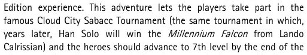
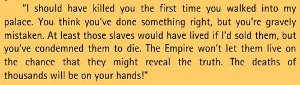
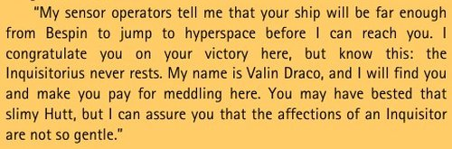
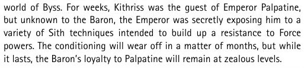
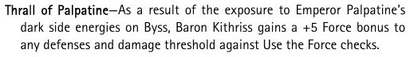

# Owner Material 037 — Star Wars D20 Drive folder (Core, Revised Core and Saga Edition): Adventures/Dawn of Defiance/03 - Queen of Air and Darkness.pdf [Star Wars Roleplaying Game Saga Edition (2007)]

- **Source:** Wizards of the Coast Star Wars Roleplaying Game books, web enhancements, Living Force campaign modules and articles (2000–2010), from the owner's "Star Wars D20" Drive folder (only the three edition subfolders; "General" was not read, as instructed). Secondary source (licensed Legends reference). Scan OCR'd on the box; the scan stays box-only and is **not** published.
- **Method:** every scanned page was OCR'd and machine-screened sentence by sentence for power-relevant statements (fights, kills, defeats, Force feats, rankings, superweapons) that name a character on our roster; each kept sentence is quoted verbatim from the OCR text and has a crop of the printed passage directly under it. Pages with nothing power-relevant are still listed with what is on them.
- **Citation:** "*03 - Queen of Air and Darkness* (SWRPG Saga Edition), p.X" by printed page ("scan p.X" where no printed number applies). **Weight:** Licensed RPG material: a secondary source. Narrative text sums up Legends lore; game statistics are rules for players, not canon power levels, and rank lowest.

## scan p.1 (scan page 1)

Page contents: Cover. (hand-read)

## scan p.2 (scan page 2)

Page contents: Credits; adventure intro (Cloud City Sabacc Tournament). (hand-read)

- **Han Solo; Lando Calrissian** — entry/section: The Cloud City Sabacc Tournament: "This adventure lets the players take part in the famous Cloud City Sabacc Tournament (the same tournament in which, years later, Han Solo will win the Millennium Falcon from Lando Calrissian)" Source: *03 - Queen of Air and Darkness* (SWRPG Saga Edition), scan p.2
  

## scan p.3 (scan page 3)

Page contents: Adventure background and summary; opening crawl. (hand-read)

## scan p.4 (scan page 4)

Page contents: Part 1: arrival on Bespin; pursuing the Hutt; customs shakedown. (hand-read)

## scan p.5 (scan page 5)

Page contents: Weapons restriction; Cloud City; a few wrong questions; Parliament of Guilds (Krygg, Fyren). (hand-read)

## scan p.6 (scan page 6)

Page contents: Ugnaughts' problem; discovering the bought Ugnaughts. (hand-read)

## scan p.7 (scan page 7)

Page contents: Ugnaughts' information; Imperial dealings; Baron Kithriss at the Yerith Bespin. (hand-read)

## scan p.8 (scan page 8)

Page contents: Part 2: the tournament; Imperial missive; Message from the Banshee I; entering the tournament. (hand-read)

## scan p.9 (scan page 9)

Page contents: Buying back in; security; the crowd; dirty money (Switch, Koroma Moro). (hand-read)

## scan p.10 (scan page 10)

Page contents: Rogues' gallery (Creeska, Silas Draver, Lady Mirana Fioro, Koroma Moro, Vorn Zaday); days 1-2. (hand-read)

## scan p.11 (scan page 11)

Page contents: Lt. Armen Arandis Q&A and stats; casino security; working for Switch; Vorn Zaday Q&A. (hand-read)

### Stat block notes (game mechanics, not feats)

- Lt. Armen Arandis CL6: Medium Human nonheroic 4/noble 3/scoundrel 1/officer 1; Ref 16, Fort 15, Will 23; hp 37; Talents Born Leader, Coordinate, Gambler, Trust; Feats Armor Proficiency (light), Linguist, Point Blank Shot, Skill Focus (Deception, Persuasion), Skill Training (Deception, Pilot), Toughness, Vehicular Combat, Weapon Proficiency (pistols, simple weapons) (Source: *03 - Queen of Air and Darkness* (SWRPG Saga Edition), scan p.11)

## scan p.12 (scan page 12)

Page contents: Zaday cont.; Message II; interlude; Day 3 (Szygar); bystanders. (hand-read)

## scan p.13 (scan page 13)

Page contents: Lady Fioro Q&A; Switch software; Message III; Day 4. (hand-read)

## scan p.14 (scan page 14)

Page contents: Creeska caught; Draver's thugs; the card sequence 137.12. (hand-read)

## scan p.15 (scan page 15)

Page contents: Arandis reveals the slave-circuit frequency; final gamble; Draver's move. (hand-read)

## scan p.16 (scan page 16)

Page contents: Part 3: Discovery destiny; questioning Lady Fioro; uncovering the worm; Darga's last words. (hand-read)

## scan p.17 (scan page 17)

Page contents: Darga's coda; arrival of the Assiduous; stopping the Tibanna gas hauler. (hand-read)

- **Darga the Hutt** — entry/section: Darga's Last Words: ""I should have killed you the first time you walked into my palace. You think you've done something right, but you're gravely mistaken. At least those slaves would have lived if I'd sold them, but you've condemned them to die. The Empire won't let them live on the chance that they might reveal the truth. The deaths of thousands will be on your hands!"" Source: *03 - Queen of Air and Darkness* (SWRPG Saga Edition), scan p.17
  

## scan p.18 (scan page 18)

Page contents: Clan Mionne Z-95; Glorious Chariot stats; conclusion. (hand-read)

### Stat block notes (game mechanics, not feats)

- Clan Mionne Z-95 Headhunter / Glorious Chariot: Z-95 CL7 Gargantuan starfighter (Ref 14, Fort 26, hp 120, DR 10, SR 15, threshold 46, triple blasters, hyperdrive x1); Glorious Chariot CL5 Colossal space transport (Ref 14, Fort 26, hp 120, DR 15, SR 15, threshold 76, medium laser cannon (pilot) and double medium laser cannon (gunner), crew 1, passengers 10, hyperdrive x2, backup x14). (Source: *03 - Queen of Air and Darkness* (SWRPG Saga Edition), scan p.18)

## scan p.19 (scan page 19)

Page contents: Valin Draco's message; end of the first story arc; advancing the timeline. (hand-read)

- **Valin Draco** — entry/section: Draco's Message: ""My sensor operators tell me that your ship will be far enough from Bespin to jump to hyperspace before I can reach you. I congratulate you on your victory here, but know this: the Inquisitorius never rests. My name is Valin Draco, and I will find you and make you pay for meddling here. You may have bested that slimy Hutt, but I can assure you that the affections of an Inquisitor are not so gentle."" Source: *03 - Queen of Air and Darkness* (SWRPG Saga Edition), scan p.19
  

## scan p.20 (scan page 20)

Page contents: Encounter: Tibanna Gas Refinery (Ugnaught riggers). (hand-read)

## scan p.21 (scan page 21)

Page contents: Ugnaught boss; Tibanna mynocks; conclusion. (hand-read)

## scan p.22 (scan page 22)

Page contents: Encounter map. (hand-read)

## scan p.23 (scan page 23)

Page contents: Encounter: Imperial Threats (undercover clone troopers, Baron Kithriss). (hand-read)

- **Palpatine (Darth Sidious)** — entry/section: Baron Kithriss: "For weeks, Kithriss was the guest of Emperor Palpatine, but unknown to the Baron, the Emperor was secretly exposing him to a variety of Sith techniques intended to build up a resistance to Force powers. The conditioning will wear off in a matter of months, but while it lasts, the Baron's loyalty to Palpatine will remain at zealous levels." Source: *03 - Queen of Air and Darkness* (SWRPG Saga Edition), scan p.23
  

## scan p.24 (scan page 24)

Page contents: Thrall of Palpatine; Theelin bodyguards; conclusion. (hand-read)

- **Palpatine (Darth Sidious)** — entry/section: Thrall of Palpatine: "Thrall of Palpatine—As a result of the exposure to Emperor Palpatine's dark side energies on Byss, Baron Kithriss gains a +5 Force bonus to any defenses and damage threshold against Use the Force checks." Source: *03 - Queen of Air and Darkness* (SWRPG Saga Edition), scan p.24
  

## scan p.25 (scan page 25)

Page contents: Encounter map. (hand-read)

## scan p.26 (scan page 26)

Page contents: Encounter: On the Heights (Bespin security guards, chief). (hand-read)

## scan p.27 (scan page 27)

Page contents: Cloud City patrol droids; conclusion. (hand-read)

## scan p.28 (scan page 28)

Page contents: Features sidebar (fresh OCR): three overlapping landing platforms 6 squares apart vertically (jet packs, syntherope, reckless leaps); the turbolift computer has Will 17 and is hostile to tampering once locked by the security chief. (hand-read)

## scan p.29 (scan page 29)

Page contents: Encounter: Sabacc Table Showdown (Silas Draver). (hand-read)

### Stat block notes (game mechanics, not feats)

- Silas Draver, Gambler CL6: Medium Human scoundrel 6; Ref 22, Fort 18, Will 22; hp 42; Talents Disruptive, Gambler, Walk the Line; Feats Improved Defenses, Point Blank Shot, Precise Shot, Quick Draw, Running Attack, Skill Focus (Deception), Weapon Focus (pistols), Weapon Proficiency (pistols, simple weapons) (Source: *03 - Queen of Air and Darkness* (SWRPG Saga Edition), scan p.29)

## scan p.30 (scan page 30)

Page contents: Sabacc dealer droids; goons; conclusion. (hand-read)

## scan p.31 (scan page 31)

Page contents: Encounter map. (hand-read)

## scan p.32 (scan page 32)

Page contents: Encounter: Streets of Cloud City (elite guards, stormtroopers, officer). (hand-read)

## scan p.33 (scan page 33)

Page contents: Features sidebar (fresh OCR): two major walkways with low railings (low cover); the upper walkway sits a few flights lower, so characters on the lower-map walkway have total cover from it except those at the railing. (hand-read)

## scan p.34 (scan page 34)

Page contents: Encounter: Hutt's Hangar (Darga, escort pilots). (hand-read)

## scan p.35 (scan page 35)

Page contents: Security battle droid; stormtroopers; conclusion. (hand-read)

## scan p.36 (scan page 36)

Page contents: Encounter map. (hand-read)

## scan p.37 (scan page 37)

Page contents: Encounter: Flight from Cloud City (twin-pod cloud cars, combat cloud cars). (hand-read)

## scan p.38 (scan page 38)

Page contents: Talon I; Tibanna gas refinery platform. (hand-read)

## scan p.39 (scan page 39)

Page contents: Encounter map; features. (hand-read)

## scan p.40 (scan page 40)

Page contents: Encounter: Skirmish over Bespin (12th Squadron TIEs, Tibanna gas hauler). (hand-read)

## scan p.41 (scan page 41)

Page contents: Gas hauler and Shackles of Nizon stats; conclusion. (hand-read)

## scan p.42 (scan page 42)

Page contents: Encounter map. (hand-read)

## scan p.43 (scan page 43)

Page contents: RPGA session tracking sheet. (hand-read)

