# Owner Material 037 — Star Wars D20 Drive folder (Core, Revised Core and Saga Edition): Adventures/Dawn of Defiance/04 - Echoes of the Jedi.pdf [Star Wars Roleplaying Game Saga Edition (2007)]

- **Source:** Wizards of the Coast Star Wars Roleplaying Game books, web enhancements, Living Force campaign modules and articles (2000–2010), from the owner's "Star Wars D20" Drive folder (only the three edition subfolders; "General" was not read, as instructed). Secondary source (licensed Legends reference). Scan OCR'd on the box; the scan stays box-only and is **not** published.
- **Method:** every scanned page was OCR'd and machine-screened sentence by sentence for power-relevant statements (fights, kills, defeats, Force feats, rankings, superweapons) that name a character on our roster; each kept sentence is quoted verbatim from the OCR text and has a crop of the printed passage directly under it. Pages with nothing power-relevant are still listed with what is on them.
- **Citation:** "*04 - Echoes of the Jedi* (SWRPG Saga Edition), p.X" by printed page ("scan p.X" where no printed number applies). **Weight:** Licensed RPG material: a secondary source. Narrative text sums up Legends lore; game statistics are rules for players, not canon power levels, and rank lowest.

## scan p.1 (scan page 1)

Page contents: Cover. (hand-read)

## scan p.2 (scan page 2)

Page contents: Credits; dedication; adventure intro (Almas, Jedi holocron). (hand-read)

## scan p.3 (scan page 3)

Page contents: Campaign update; adventure background (Darth Rivan, Draco, Vhiin'Thorla). (hand-read)

- **Valin Draco; Denia (Jedi)** — entry/section: Campaign Update: "Unknown to the heroes, Inquisitor Valin Draco felt a strong tremor in the Force while they were all in close proximity over Bespin—a tremor the Inquisitor hasn't felt since in the presence of his old master." Source: *04 - Echoes of the Jedi* (SWRPG Saga Edition), scan p.3
  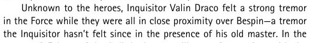
- **Darth Rivan** — entry/section: Adventure Background: "Deep within the academy was the Sith holocron he sought, which once belonged to the Sith Lord Darth Rivan. Moreover, the growing dark side energy on Almas had suffused the Rivan holocron with a powerful evil. As a result, the holocron's gatekeeper took on a life of its own, believing itself to be the actual spirit of Darth Rivan, and it gained the power to activate itself and act of its own free will." Source: *04 - Echoes of the Jedi* (SWRPG Saga Edition), scan p.3
  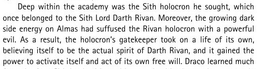
- **Vhiin'Thorla; Raik Muun; Valin Draco** — entry/section: Adventure Background: "When Draco encountered them, a fierce lightsaber duel ensued, and Draco's protégé Raik Muun used trickery to induce Thorla's Padawan into a murderous rage directed at his own master. Thorla was forced to kill his own Padawan in self-defense, and, wracked with grief, was easily captured." Source: *04 - Echoes of the Jedi* (SWRPG Saga Edition), scan p.3
  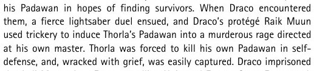

## scan p.4 (scan page 4)

Page contents: Adventure summary; opening crawl. (hand-read)

## scan p.5 (scan page 5)

Page contents: Part 1: Denia's briefing; mission to Almas; Red Fury Brotherhood. (hand-read)

- **Denia (Jedi); Ashka Boda; Halagad Ventor; Lanius Qel-Bertuk** — entry/section: Denia's Briefing: ""Some time before I traveled to Cato Neimoidia, Master Ashka Boda contacted me with news that he had joined the former Almas Academy student Halagad Ventor in trying to form a network between the scattered Jedi survivors of the destruction of the academy."" Source: *04 - Echoes of the Jedi* (SWRPG Saga Edition), scan p.5
  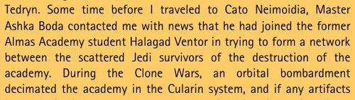

## scan p.6 (scan page 6)

Page contents: Landing; Forard; city map. (hand-read)

## scan p.7 (scan page 7)

Page contents: Almas planet box (from image): Expansion Region; desolate wasteland and temperate kaluthin grasslands; 1 moon (Dorumaa); 38-hour day, 5,547-day year; 66% Human, 14% Tarasin; capital Forard (abandoned). Knowledge (Social Sciences): the dead zone, an ancient Sith fortress abandoned ~1,000 years ago, sabotage by the Believers cult ~13 years ago, the wasteland now 5,000 km radius; the Sith Lord who built the fortress 1,150–1,400 years ago may have created the kaluthin. Knowledge (Galactic Lore): fourth planet of the Cularin system; kaluthin made the atmosphere breathable; glowing nights; Jedi academy founded 150 years ago; attacked at the end of the Clone Wars by three ships (a Cularin Allied Force ship, a mercenary vessel, a black starfighter that fled). (hand-read)

## scan p.8 (scan page 8)

Page contents: Squibs and Ugors; SevenAy; challenges; 7-A39 stats. (hand-read)

## scan p.9 (scan page 9)

Page contents: Squib scavenger; Ugor forager; Dark Lizards. (hand-read)

## scan p.10 (scan page 10)

Page contents: Entering the ruins; fountain chamber t'salak; cave-in. (hand-read)

## scan p.11 (scan page 11)

Page contents: Map: Almas Academy area and ground floor. (hand-read)

## scan p.12 (scan page 12)

Page contents: Part 2: Domain of Evil; control room; generator room; library. (hand-read)

## scan p.13 (scan page 13)

Page contents: Library; Qornah bust; secret archive room; Rivan scrap. (hand-read)

## scan p.14 (scan page 14)

Page contents: The creed of ruin; Army of Darkness; storage rooms; sublevel 2; weapons room. (hand-read)

- **Darth Rivan** — entry/section: The Creed of Ruin: "'There is no passion . . . there is solely obsession. There is no knowledge. There is solely conviction. There is no purpose. There is solely will. There is nothing ... Only me.'" Source: *04 - Echoes of the Jedi* (SWRPG Saga Edition), scan p.14
  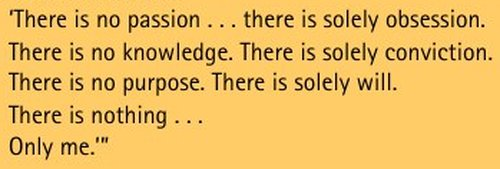

## scan p.15 (scan page 15)

Page contents: Armory; refresher; Crazed Believers; underground park illusion. (hand-read)

## scan p.16 (scan page 16)

Page contents: Illusion example (Count Dooku illusion); dreambeast déjà vu. (hand-read)

- **Count Dooku** — entry/section: Encounter Example: "Sia-Lan is up first, and she's face to face with Count Dooku. But Sia-Lan makes her Perception check and knows that Dooku is dead, so she realizes that the encounter must be a trick." Source: *04 - Echoes of the Jedi* (SWRPG Saga Edition), scan p.16
  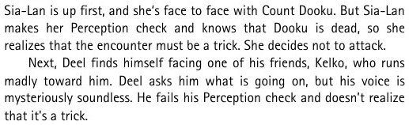
- **Count Dooku**: "Count Dooku just attacked and nearly killed her." Source: *04 - Echoes of the Jedi* (SWRPG Saga Edition), scan p.16
  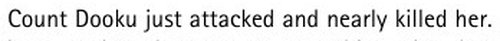

## scan p.17 (scan page 17)

Page contents: Dreamscape; Jedi prisoner Vhiin'Thorla; Universal Energy Cage; Discovery destiny. (hand-read)

## scan p.18 (scan page 18)

Page contents: Vhiin'Thorla background sidebar (fresh OCR): green-skinned Twi'lek, studied at the Coruscant Temple with Devan For'deschel; lost Padawan Kritz Drassarb fighting Mid Rim pirates a year before the Clone Wars and exiled himself to Ryloth, founding the Enclave of freed slaves; declined Devan's offer to be Almas's Master of Lightsabers; took Lethan Twi'lek Padawan Dorv Tilsta. Two years after Order 66 he came to Almas; Draco's Dark Jedi Raik Muun used her t'salak to drive the 10-year-old Dorv into a murderous rage; Thorla killed Dorv, fell to the dark side, and has been held in a Universal Energy Cage since. (hand-read)

### Stat block notes (game mechanics, not feats)

- Vhiin'Thorla CL13: Medium Twi'lek Jedi 7/Jedi Knight 5/Jedi Master 1; Force 5; Destiny 1; Ref 31, Fort 30, Will 26; hp 147; Force Powers battle strike, sever Force; Talents Acrobatic Recovery, Block, Deflect, Force Perception, Juyo, Lightsaber Defense, Redirect Shot, Soresu; Feats Double Attack (lightsaber), Force Sensitivity, Force Training (2), Martial Arts I, Melee Defense, Strong in the Force, Weapon Finesse, Weapon Focus (lightsaber), Weapon Proficiency (lightsabers, simple weapons) (Source: *04 - Echoes of the Jedi* (SWRPG Saga Edition), scan p.18)

## scan p.19 (scan page 19)

Page contents: Maps: sublevels 1 and 2. (hand-read)

## scan p.20 (scan page 20)

Page contents: Part 3: Draco's Lair; archives room (Noghri); nearing the nexus; Enter the Dragon. (hand-read)

- **Valin Draco** — entry/section: Enter the Dragon: ""Crant—my companion. Have you come to tell me that my nighthunter is dead?"" Source: *04 - Echoes of the Jedi* (SWRPG Saga Edition), scan p.20
  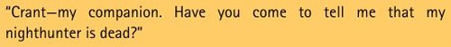

## scan p.21 (scan page 21)

Page contents: Draco's entreaty and Q&A; Thorla's intervention; Behemoth from Below. (hand-read)

- **Valin Draco** — entry/section: Draco's Entreaty: ""I am Valin Draco, and, like you, I once thought myself a hero. During the Clone Wars, the brave men and women I commanded called me the 'Valiant Dragon' as we fought in epic conflicts for the corrupt Republic. But after I was left for dead on the battlefield of Parein II 4, flattering titles lost their meaning for me."" Source: *04 - Echoes of the Jedi* (SWRPG Saga Edition), scan p.21
  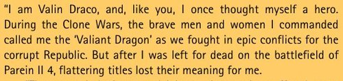
- **Valin Draco** — entry/section: Draco's Entreaty: ""These are dark times, and I know that you've suffered great losses, that you wrestle with the same concerns of virtue and compromise that I did as a Jedi, the same concerns that have plagued the conscientious since time immemorial. Surrender yourselves to the Empire. I promise your treatment will be gentler, and you might even be given the chance to serve me. Surrender yourselves—or face your destiny."" Source: *04 - Echoes of the Jedi* (SWRPG Saga Edition), scan p.21
  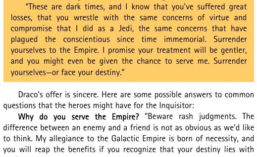
- **Valin Draco** — entry/section: Why do you serve the Empire?: ""Beware rash judgments. The difference between an enemy and a friend is not as obvious as we'd like to think. My allegiance to the Galactic Empire is born of necessity, and you will reap the benefits if you recognize that your destiny lies with me."" Source: *04 - Echoes of the Jedi* (SWRPG Saga Edition), scan p.21
  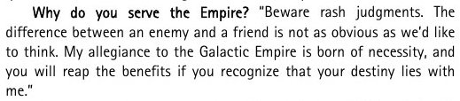
- **Valin Draco** — entry/section: Dark side view: ""The dark side exists. Only the naive and demented believe otherwise. It's found in each of us without exception—Sith, Jedi, soldier, smuggler, noble, rogue, and romantic. I will show you how to control it so that you needn't fear or deny it."" Source: *04 - Echoes of the Jedi* (SWRPG Saga Edition), scan p.21
  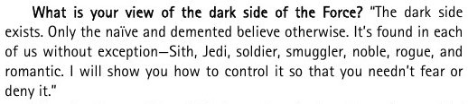
- **Valin Draco** — entry/section: Why don't you join us?: ""I have already found my true self. I embraced my destiny when I took this Inquisitor's garb. Now, quit this cowardly stalling, and reflect on my invitation, for this is the last time I extend it. Decide swiftly and without regret, for your choice and its effects were predetermined before these words ever obligated you to speak."" Source: *04 - Echoes of the Jedi* (SWRPG Saga Edition), scan p.21
  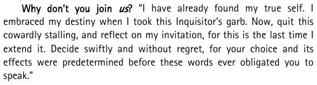
- **Darth Rivan**: "When that occurs, on his next turn, Master Thorla recovers a use of sever Force with a Force Point, then uses it against Darth Rivan's holocron gatekeeper, spending a Destiny Point to peel the gatekeeper from the holocron." Source: *04 - Echoes of the Jedi* (SWRPG Saga Edition), scan p.21
  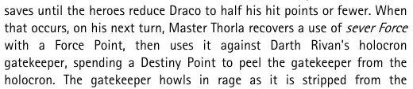

## scan p.22 (scan page 22)

Page contents: Leaving the echoes; escape; concluding the adventure; Denia's response; destinies. (hand-read)

- **Denia (Jedi); Valin Draco** — entry/section: Concluding the Adventure: ""This sounds like quite an ordeal you experienced, and whether you follow the Jedi ways or not, you have contributed greatly to the enlightenment of the Force. With this item, I will seek answers about the slaves that you rescued at Bespin, and hopefully some clues about the Empire's Sarlacc Project. I am also curious about the creatures and evil forces that you encountered in the academy, and if I find information about them, I will advise you. But now if you'll excuse me, I must meditate."" Source: *04 - Echoes of the Jedi* (SWRPG Saga Edition), scan p.22
  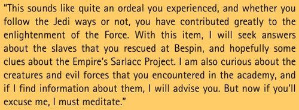

## scan p.23 (scan page 23)

Page contents: Encounter: Seeing Red (Reddjak, Blood Brother). (hand-read)

## scan p.24 (scan page 24)

Page contents: Red Fury pirates; Reddjak stats; conclusion. (hand-read)

### Stat block notes (game mechanics, not feats)

- Reddjak, Pirate Leader CL7: Medium Human soldier 4/scoundrel 3; Talents Devastating Attack, Spacehound, Starship Raider, Weapon Specialization (advanced melee weapons); Feats Armor Proficiency (light, medium), Dodge, Point Blank Shot, Precise Shot, Power Attack, Weapon Focus (advanced melee weapons), Weapon Focus (pistols), Weapon Proficiency (advanced melee weapons, pistols, rifles, simple weapons) (Source: *04 - Echoes of the Jedi* (SWRPG Saga Edition), scan p.24)

## scan p.25 (scan page 25)

Page contents: Encounter: The Believers' Pets (Dark Lizards). (hand-read)

## scan p.26 (scan page 26)

Page contents: Dark Lizard alpha; tactics; conclusion. (hand-read)

## scan p.27 (scan page 27)

Page contents: Encounter: Jacen and the Stalfonauts (guardian spirits). (hand-read)

- **Darth Rivan**: "Darth Rivan's holocron gatekeeper convinced Draco to release a two Force-sensitive parasites in the library archive room, where their telekinetic powers seemingly bring the corpses to undead life." Source: *04 - Echoes of the Jedi* (SWRPG Saga Edition), scan p.27
  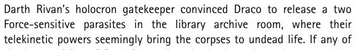

## scan p.28 (scan page 28)

Page contents: Animated corpses; conclusion. (hand-read)

## scan p.29 (scan page 29)

Page contents: Encounter: Crazed Believers. (hand-read)

## scan p.30 (scan page 30)

Page contents: Believers tactics; conclusion. (hand-read)

## scan p.31 (scan page 31)

Page contents: Encounter: Oozing Madness (t'salak). (hand-read)

## scan p.32 (scan page 32)

Page contents: T'salak tactics; conclusion. (hand-read)

## scan p.33 (scan page 33)

Page contents: Encounter: The Dreams Beasts Are Made Of (k'kayeh dreambeast). (hand-read)

- **Darth Rivan** — entry/section: 04 - Echoes of the Jedi: "K'KAYEH DREAMBEAST The k'kayeh dragon is the greatest product of Darth Rivan's dark arts." Source: *04 - Echoes of the Jedi* (SWRPG Saga Edition), scan p.33
  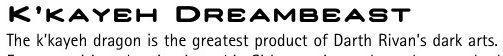

## scan p.34 (scan page 34)

Page contents: Living nightmares; conclusion. (hand-read)

## scan p.35 (scan page 35)

Page contents: Encounter: Draco's Best Friend (nighthunter Crant). (hand-read)

## scan p.36 (scan page 36)

Page contents: Encounter: Death Commandos (Noghri). (hand-read)

- **Darth Vader (Anakin Skywalker); Valin Draco; Halagad Ventor** — entry/section: Noghri Warriors: "Though an acute xenophobia has begun to manifest within the Galactic Empire, Darth Vader readily recognized the value of the species during a visit to their homeworld Honoghr. When the meter-tall warriors proved a match for his 501st Legion stormtrooper escort, the Dark Lord immediately found a way to enslave the species. … Vader bestowed Draco with this squad of Noghri assassins in gratitude for the Inquisitor's assistance in torturing the captured Jedi Knight Halagad Ventor." Source: *04 - Echoes of the Jedi* (SWRPG Saga Edition), scan p.36
  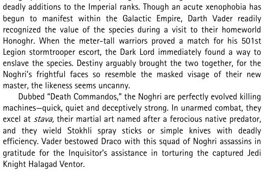

## scan p.37 (scan page 37)

Page contents: Noghri strike team leader; tactics. (hand-read)

## scan p.38 (scan page 38)

Page contents: Encounter: Shadows of the Empire; Inquisitor Valin Draco stats; Darth Rivan's holocron gatekeeper. (hand-read)

- **Darth Rivan** — entry/section: 04 - Echoes of the Jedi: "At first, Rivan desired to possess the Darkstaff, but when he learned that it was a malevolent vacuum of power, he became bent on destroying it." Source: *04 - Echoes of the Jedi* (SWRPG Saga Edition), scan p.38
  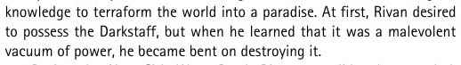
- **Valin Draco** — entry/section: Shadows of the Empire: ""As you die, rest assured that I reflected on you as on all enemies: despising that you must be wrong and I right, but reveling in the triumph of my convictions while whatever species of maggot indigenous to this world expedites the transition of your carcasses from this existence to the next."" Source: *04 - Echoes of the Jedi* (SWRPG Saga Edition), scan p.38
  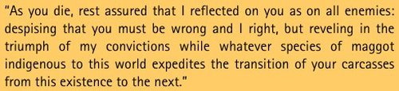
- **Valin Draco; Denia (Jedi)** — entry/section: Inquisitor Valin Draco: "The former Padawan of Master Denia, Jedi Draco, the "Valiant Dragon," embraced his role as a Republic commander in the Clone Wars wholeheartedly. However, at some point during the conflict, his heady determination to defeat the Separatist threat evolved into something pernicious, and he turned to the dark side." Source: *04 - Echoes of the Jedi* (SWRPG Saga Edition), scan p.38
  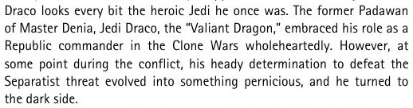
- **Valin Draco** — entry/section: Inquisitor Valin Draco: "Left for dead and stranded on Parein II's fourth moon, a weakened Draco was stalked by a nighthunter. Ultimately, Draco subdued the beast in a vicious confrontation, but not before the creature bit off his left thumb and clamped its massive fangs down around his throat. Draco has since replaced the missing thumb with a cybernetic substitute, while masking the glaring scars around his neck with the high collar of his Inquisitor's tunic." Source: *04 - Echoes of the Jedi* (SWRPG Saga Edition), scan p.38
  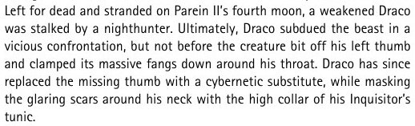
- **Darth Rivan; Revan** — entry/section: Darth Rivan's Holocron Gatekeeper: "Darth Rivan is an enigma of the New Sith Wars. A Zelosian, he defied nearly every stereotype of his gregarious people except for his knowledge of plant biology, and his Sith moniker is believed to have been culled from a corrupted Sith text, possibly written by Darth Revan." Source: *04 - Echoes of the Jedi* (SWRPG Saga Edition), scan p.38
  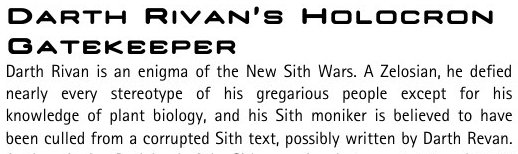

### Stat block notes (game mechanics, not feats)

- Inquisitor Valin Draco (Saga CL 10): CL 10 Human Jedi 7/noble 1/Force adept 2 Force 5; Destiny 2; Dark Side 16; Power of the Dark Side, Strong in the Force Init +12; Senses Perception +8 Languages Basic, Bocce, Dosh, High Galactic, Honoghran, Huttese Defenses Ref 24 (flat-footed 22), Fort 22 (vs. Force powers 24), Will 27 (vs. Force powers 29) hp 71 Threshold 22 (vs. Fo (Source: *04 - Echoes of the Jedi* (SWRPG Saga Edition), scan p.38)
- Inquisitor Valin Draco CL10 (Echoes of the Jedi): Medium Human Jedi 7/noble 1/Force adept 2; Force 5; Destiny 2; Dark Side 16; Ref 24, Fort 22, Will 27; hp 71; Force Powers dark rage, Force grip, Force lightning, Force slam, move object, rebuke (2), surge; Force Techniques Force power mastery (force grip); Talents Damage Reduction 10, Deflect, Inquisition, Power of the Dark Side, Redirect Shot, Telekinetic Savant; Feats Acrobatic Strike, Force Sensitivity, Force Training (2), Linguist, Skill Focus (Persuasion), Skill Focus (Use the Force), Skill Training (Persuasion), Strong in the Force, Weapon Finesse, Weapon Focus (lightsabers), Weapon Proficiency (lightsabers, simple weapons); Use the Force +18 (Source: *04 - Echoes of the Jedi* (SWRPG Saga Edition), scan p.38)

## scan p.39 (scan page 39)

Page contents: Rivan backstory; gatekeeper stats; shadow troopers. (hand-read)

- **Darth Rivan** — entry/section: 04 - Echoes of the Jedi: "Legend relates that Rivan at last obtained possession of the Darkstaff that he both craved and feared, and that it created a hyperspace wormhole, known as a Force Storm, that annihilated Rivan's Battlelord army." Source: *04 - Echoes of the Jedi* (SWRPG Saga Edition), scan p.39
  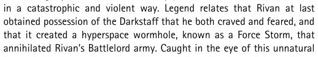
- **Darth Rivan; Lord Hoth; Lord Kaan** — entry/section: Darth Rivan's Fate: "Caught in the eye of this unnatural tempest, Rivan was flung to a time and place far removed from Almas. He found himself on the planet Ruusan, caught in the War of Light and Dark between Lord Hoth's Army of Light and Lord Kaan's Brotherhood of Darkness. The Darkstaff left Rivan bereft of the Force, and when he encountered a Force-user of inconsequential power, the Dark Lord was easily dispatched." Source: *04 - Echoes of the Jedi* (SWRPG Saga Edition), scan p.39
  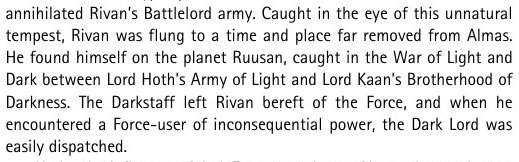
- **Valin Draco** — entry/section: Gatekeeper's Bond: "Draco's eyes acquire a sickening gold hue, and his voice plummets in pitch as he gives a command to the woman and soldiers at his side. "My brave companions—kill them."" Source: *04 - Echoes of the Jedi* (SWRPG Saga Edition), scan p.39
  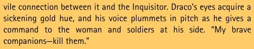

### Stat block notes (game mechanics, not feats)

- Darth Rivan's Holocron Gatekeeper (Saga CL 10): CL 10 Sith holocron gatekeeper Jedi 7/Sith apprentice 5/Sith lord 3 Force 5; Dark Side 16; Strong in the Force Init +12; Senses darkvision, Perception +10 Languages Basic, Sith, Zelosian Defenses Ref — (flat-footed —), Fort —, Will 31 hp —; Threshold — Immune fear, physical effects Speed 8 squares (fly) Base Atk —; Grp — Abilities St (Source: *04 - Echoes of the Jedi* (SWRPG Saga Edition), scan p.39)
- Darth Rivan's Holocron Gatekeeper CL10: Medium Sith holocron gatekeeper Jedi 7/Sith apprentice 5/Sith lord 3; Will 31; Talents Power of the Dark Side, Dark Presence; Feats Force Sensitivity, Skill Focus (Use the Force), Strong in the Force; Use the Force +22; Special Qualities aura of malevolence, dark side bond, temptation, vulnerability to sever Force (Source: *04 - Echoes of the Jedi* (SWRPG Saga Edition), scan p.39)

## scan p.40 (scan page 40)

Page contents: DC-19 Stealth carbine; Raik Muun; Imperial tactics. (hand-read)

- **Raik Muun; Valin Draco** — entry/section: Raik Muun, Dark Jedi: ""Come at me one at a time or all at once. All shall pass from this world."" Source: *04 - Echoes of the Jedi* (SWRPG Saga Edition), scan p.40
  

### Stat block notes (game mechanics, not feats)

- Raik Muun CL6: Medium near-Human Jedi 6; Dark Side 14; Ref 19, Fort 20, Will 19; hp 76; Force Powers dark rage, rebuke, surge; Talents Elusive Target, Deflect, Weapon Specialization (lightsabers); Feats Acrobatic Strike, Force Sensitivity, Force Training, Power Attack, Running Attack, Skill Focus (Acrobatics), Weapon Finesse, Weapon Focus (lightsabers), Weapon Proficiency (lightsabers, simple weapons) (Source: *04 - Echoes of the Jedi* (SWRPG Saga Edition), scan p.40)

## scan p.41 (scan page 41)

Page contents: Conclusion; cave map. (hand-read)

## scan p.42 (scan page 42)

Page contents: Encounter: Draco's Last Stand. (hand-read)

## scan p.43 (scan page 43)

Page contents: Conclusion; bridge map. (hand-read)

## scan p.44 (scan page 44)

Page contents: RPGA session tracking sheet. (hand-read)

