# Owner Material 037 — Star Wars D20 Drive folder (Core, Revised Core and Saga Edition): Adventures/Dawn of Defiance/05 - The First to Strike.pdf [Star Wars Roleplaying Game Saga Edition (2007)]

- **Source:** Wizards of the Coast Star Wars Roleplaying Game books, web enhancements, Living Force campaign modules and articles (2000–2010), from the owner's "Star Wars D20" Drive folder (only the three edition subfolders; "General" was not read, as instructed). Secondary source (licensed Legends reference). Scan OCR'd on the box; the scan stays box-only and is **not** published.
- **Method:** every scanned page was OCR'd and machine-screened sentence by sentence for power-relevant statements (fights, kills, defeats, Force feats, rankings, superweapons) that name a character on our roster; each kept sentence is quoted verbatim from the OCR text and has a crop of the printed passage directly under it. Pages with nothing power-relevant are still listed with what is on them.
- **Citation:** "*05 - The First to Strike* (SWRPG Saga Edition), p.X" by printed page ("scan p.X" where no printed number applies). **Weight:** Licensed RPG material: a secondary source. Narrative text sums up Legends lore; game statistics are rules for players, not canon power levels, and rank lowest.

## scan p.1 (scan page 1)

Page contents: Cover. (hand-read)

## scan p.2 (scan page 2)

Page contents: Credits; adventure intro. (hand-read)

## scan p.3 (scan page 3)

Page contents: Adventure summary (Nizon, Nazren, Sartok, Vril Vrakth); what you need. (hand-read)

- **Vril Vrakth; Valin Draco** — entry/section: Resistance: "Inquisitor Valin Draco posted a bounty on the heroes after their last encounter, and a Zabrak named Vril Vrakth has been on their trail for a few weeks." Source: *05 - The First to Strike* (SWRPG Saga Edition), scan p.3
  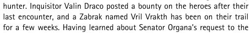

## scan p.4 (scan page 4)

Page contents: Opening crawl. (hand-read)

## scan p.5 (scan page 5)

Page contents: Part 1: Denia's briefing; Q&A. (hand-read)

- **Denia (Jedi)** — entry/section: Denia's Briefing: ""As I had hoped, my training with the holocron has proven very useful, and I thank you again for your assistance in recovering it. With its aid, I have deepened and lengthened my meditations and have begun to understand the glimpses I receive with greater accuracy. Unfortunately, the galaxy is filled with great suffering, and the cries of whole worlds oppressed come through the Force most clearly."" Source: *05 - The First to Strike* (SWRPG Saga Edition), scan p.5
  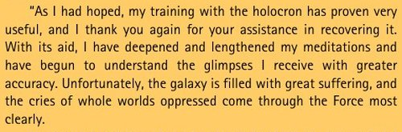
- **Denia (Jedi)** — entry/section: Why don't you go yourself?: ""Though this is one of the strongest visions I have had in my meditations, it is far from the only tremor I have sensed in the Force. I need to remain here for some weeks yet to meditate on these feelings and try to clarify them. Unfortunately, I feel that the threat—and the opportunity—on Nizon cannot wait for me to be ready. That's why I ask you, my trusted friends."" Source: *05 - The First to Strike* (SWRPG Saga Edition), scan p.5
  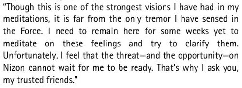
- **Denia (Jedi); Bail Organa** — entry/section: What's in it for us?: ""Senator Organa is willing to pay each of you 4,000 credits just for making the trip. If you find the information that I sense waits there, he will reward you for recovering that as well."" Source: *05 - The First to Strike* (SWRPG Saga Edition), scan p.5
  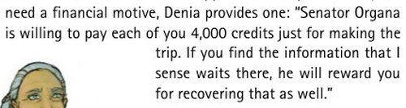

## scan p.6 (scan page 6)

Page contents: Part 2: Centares system; Into the Jaws; Arkanian Dragon. (hand-read)

## scan p.7 (scan page 7)

Page contents: Victory II Star Destroyer and V-wing stats. (hand-read)

## scan p.8 (scan page 8)

Page contents: Total victory/defeat; Nizon space; landing site. (hand-read)

## scan p.9 (scan page 9)

Page contents: Blade scorpion; the city; gathering information; Nazren description. (hand-read)

## scan p.10 (scan page 10)

Page contents: Part 3: Insurrection; Sartok's speech. (hand-read)

- **Sartok** — entry/section: Nurturing a Revolt: ""My world is enslaved, and we have come to realize that no negotiation or appeal to reason can free us. The only way we shall regain control of Nizon is to take it back by force, which requires us to face the weapons and training of the Empire. That battle must begin here—all other settlements look to us for inspiration and leadership. For the sake of our world, we must take up arms against our oppressors."" Source: *05 - The First to Strike* (SWRPG Saga Edition), scan p.10
  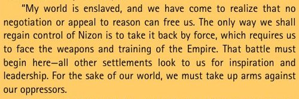
- **Sartok** — entry/section: Nurturing a Revolt: ""The cost shall be high for my people, but they are eager to pay it. The cost for remaining slaves would be higher, and it would be paid by our children and our children's children. If you will help us, we are ready to throw off the yoke of tyranny, even if we lose our lives. Liberty is too precious to sell for the chance of quieter, safer lives under the dark shadow of oppression."" Source: *05 - The First to Strike* (SWRPG Saga Edition), scan p.10
  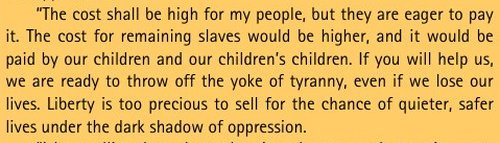
- **Sartok** — entry/section: Nurturing a Revolt: ""I know this world is not yours, that our people are not your people. But if you will aid us, you will always have a place of honor among the Nazren."" Source: *05 - The First to Strike* (SWRPG Saga Edition), scan p.10
  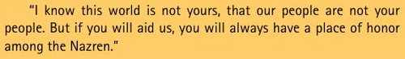

## scan p.11 (scan page 11)

Page contents: Sartok Q&A; Sartok stats; the riots. (hand-read)

- **Sartok** — entry/section: How did the Empire seize control?: ""They came as friends, claiming that we were in danger of being attacked by Separatists who wished to use our world as a secret base. The Empire landed troops and built barracks. Then, after they had more weapons than we did, they took over the city and the mountain and begin shipping our people off like cattle."" Source: *05 - The First to Strike* (SWRPG Saga Edition), scan p.11
  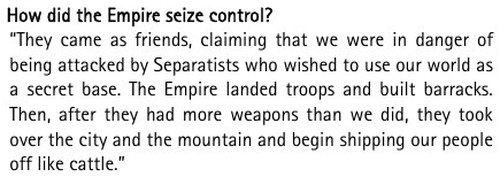
- **Sartok** — entry/section: What are you planning?: ""I have every intention of fighting by your side. I can guide you around the city and ensure that your help goes where it is needed the most. I would not ask you to take any risk that I am unwilling to take myself."" Source: *05 - The First to Strike* (SWRPG Saga Edition), scan p.11
  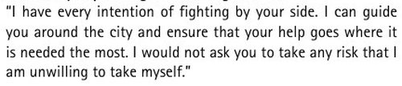

### Stat block notes (game mechanics, not feats)

- Sartok CL7: Medium Nazren scoundrel 3/scout 4; Force 4; Ref 19, Fort 19, Will 21; hp 57; Talents Fool's Luck, Hidden Movement, Improved Stealth, Sneak Attack; Feats Improved Damage Threshold, Point Blank Shot, Precise Shot, Quick Draw, Skill Focus (Perception, Stealth), Toughness, Weapon Proficiency (advanced melee weapons, pistols, rifles, simple weapons); Special Qualities Nazren resilience (Source: *05 - The First to Strike* (SWRPG Saga Edition), scan p.11)

## scan p.12 (scan page 12)

Page contents: Skill encounters; Checkpoint Gamma; Collateral Damage; Rest Stop; The Black Ship. (hand-read)

## scan p.13 (scan page 13)

Page contents: Martyr's Plaza; Point Gold; Koorst; concluding the adventure. (hand-read)

- **Koorst; Vril Vrakth** — entry/section: Point Gold: "If the heroes pick up the comlink and Koorst sees any of their faces, he swears his eternal hatred of those who felled his mentor, then flies off into hyperspace. He will return in The Gem of Alderaan, later in the Dawn of Defiance campaign." Source: *05 - The First to Strike* (SWRPG Saga Edition), scan p.13
  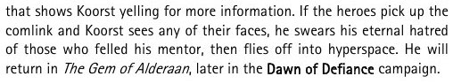

## scan p.14 (scan page 14)

Page contents: Encounter: The Breakout. (hand-read)

## scan p.15 (scan page 15)

Page contents: Breakout map. (hand-read)

## scan p.16 (scan page 16)

Page contents: Encounter: Checkpoint Gamma (AT-RTs). (hand-read)

## scan p.17 (scan page 17)

Page contents: Checkpoint Gamma map. (hand-read)

## scan p.18 (scan page 18)

Page contents: Encounter: Collateral Damage. (hand-read)

## scan p.19 (scan page 19)

Page contents: Collateral Damage map. (hand-read)

## scan p.20 (scan page 20)

Page contents: Encounter: Rest Stop (Yurka Aggel, crab droids). (hand-read)

### Stat block notes (game mechanics, not feats)

- Yurka Aggel: 3rd-level nonheroic; 24 hp; vital transfer, Use the Force +5. (Source: *05 - The First to Strike* (SWRPG Saga Edition), scan p.20)

## scan p.21 (scan page 21)

Page contents: Encounter: The Black Ship (Trandoshan slavers, Bloody Credit). (hand-read)

## scan p.22 (scan page 22)

Page contents: Black Ship conclusion; features. (hand-read)

## scan p.23 (scan page 23)

Page contents: Encounter: Battle for Martyr's Plaza. (hand-read)

## scan p.24 (scan page 24)

Page contents: Features sidebar (fresh OCR): the three martyr statues sit loose on their bases—one charge of explosives with DC 35 Mechanics (or four charges at DC 25), or a hit vs Reflex 20 dealing 50+ damage, topples one over a 3×10-square area (15d6 on a hit, 5d6 on a miss vs Defense 10; pinned victims escape with Strength vs damage dealt). The dome hatch to the underground control center has DR 20, 150 hp. (hand-read)

## scan p.25 (scan page 25)

Page contents: Encounter: Point Gold (Vril Vrakth). (hand-read)

- **Vril Vrakth; Valin Draco** — entry/section: Point Gold: ""Is this what you've caused all this difficulty over? Is this why a request was made to Aldera University about this dustball? Well, then, come and get it from me. Inquisitor Draco will pay me well for bringing him your battered bodies in manacles!"" Source: *05 - The First to Strike* (SWRPG Saga Edition), scan p.25
  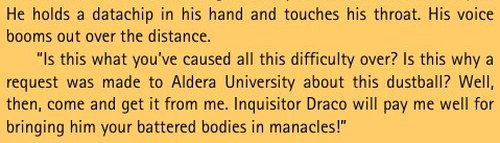
- **Vril Vrakth; Jeyrs Hundar** — entry/section: Vril Vrakth: "When a bounty hunter named Jeyrs Hundar followed a criminal to Vrakth's homeland, the young Zabrak was one of only a handful of colonists still alive. Impressed with Vrakth's tenacity and self-reliance, Hundar took him on as an apprentice bounty hunter." Source: *05 - The First to Strike* (SWRPG Saga Edition), scan p.25
  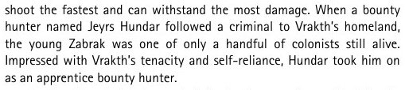

### Stat block notes (game mechanics, not feats)

- Vril Vrakth: Medium Zabrak soldier 3/scout 4/gunslinger 3; Force 8; Ref 32, Fort 27, Will 24; hp 92; Talents Armored Defense, Evasion, Improved Armored Defense, Improved Quick Draw, Surefooted, Trigger Work; Feats Armor Proficiency (light, medium), Extra Second Wind, Point Blank Shot, Precise Shot, Quick Draw, Rapid Shot, Shake It Off, Weapon Focus (pistols), Weapon Proficiency (advanced melee weapons, pistols, rifles, simple weapons) (Source: *05 - The First to Strike* (SWRPG Saga Edition), scan p.25)

## scan p.26 (scan page 26)

Page contents: Point Gold map; features. (hand-read)

## scan p.27 (scan page 27)

Page contents: RPGA session tracking sheet. (hand-read)

