# Owner Material 037 — Star Wars D20 Drive folder (Core, Revised Core and Saga Edition): Adventures/Dawn of Defiance/06 - The Core of Corruption.pdf [Star Wars Roleplaying Game Saga Edition (2007)]

- **Source:** Wizards of the Coast Star Wars Roleplaying Game books, web enhancements, Living Force campaign modules and articles (2000–2010), from the owner's "Star Wars D20" Drive folder (only the three edition subfolders; "General" was not read, as instructed). Secondary source (licensed Legends reference). Scan OCR'd on the box; the scan stays box-only and is **not** published.
- **Method:** every scanned page was OCR'd and machine-screened sentence by sentence for power-relevant statements (fights, kills, defeats, Force feats, rankings, superweapons) that name a character on our roster; each kept sentence is quoted verbatim from the OCR text and has a crop of the printed passage directly under it. Pages with nothing power-relevant are still listed with what is on them.
- **Citation:** "*06 - The Core of Corruption* (SWRPG Saga Edition), p.X" by printed page ("scan p.X" where no printed number applies). **Weight:** Licensed RPG material: a secondary source. Narrative text sums up Legends lore; game statistics are rules for players, not canon power levels, and rank lowest.

## scan p.1 (scan page 1)

Page contents: Cover. (hand-read)

## scan p.2 (scan page 2)

Page contents: Credits; adventure intro (Coruscant, Sarlacc Project). (hand-read)

## scan p.3 (scan page 3)

Page contents: Background; summary; opening crawl. (hand-read)

## scan p.4 (scan page 4)

Page contents: Part 1: Into the Core; Varth's briefing; Q&A. (hand-read)

- **Gilder Varth** — entry/section: The Briefing: ""Congratulations. The data you obtained on Nizon is very revealing, so much so that I fear that once the Empire realizes it has been compromised, they will take steps to invalidate it. I'm afraid that time is not on our side."" Source: *06 - The Core of Corruption* (SWRPG Saga Edition), scan p.4
  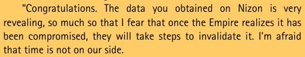
- **Gilder Varth** — entry/section: The Briefing: ""I suppose we should not be surprised that the project's origin and design team resides on Imper—I mean, Coruscant. I do not believe that the entire project is housed there, given the casualty figures I have seen in my former Imperial life. However, it is apparent from the new data that the project is controlled from somewhere in this area."" Source: *06 - The Core of Corruption* (SWRPG Saga Edition), scan p.4
  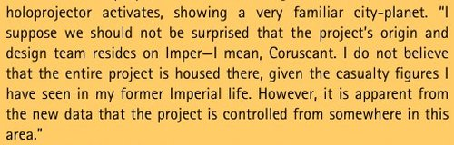

## scan p.5 (scan page 5)

Page contents: Briefing Q&A continued (Tero Reskan, Dos, CZ-3T6, Resh); Imperial Center arrival. (hand-read)

- **Gilder Varth** — entry/section: What were you going to say instead of 'Coruscant'?: ""Sorry, but some habits die hard. I was about to refer to Coruscant as Imperial Center, which of course is its formal Imperial name." (This is a minor hint as to Varth's ultimate loyalty.)" Source: *06 - The Core of Corruption* (SWRPG Saga Edition), scan p.5
  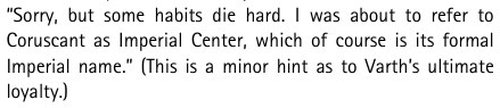
- **Gilder Varth** — entry/section: What should we expect when approaching Coruscant?: ""You should expect tight security when approaching the planet. You must enter the system near a designated hyperspace buoy and contact Imperial Center control immediately. Remember to call it Imperial Center. … I highly recommend that you do nothing to draw attention to yourselves. There are literally thousands of Imperial military vessels in the system, so any combat is likely to end swiftly and extremely badly for you."" Source: *06 - The Core of Corruption* (SWRPG Saga Edition), scan p.5
  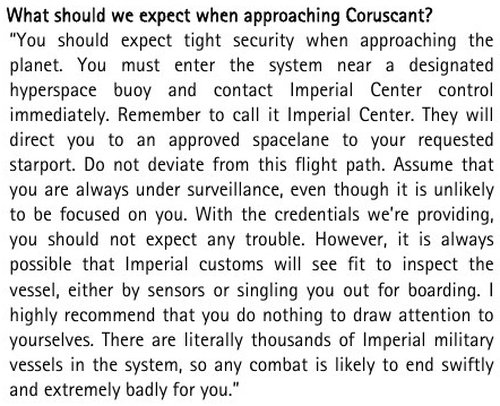
- **Gilder Varth; Darga the Hutt; Lesan Dos; Resh (warehouse)** — entry/section: How do we find the source?: ""One is ISB Agent Lesan Dos, whose exact connection to the project is unknown. It was also discovered that routing codes pertaining to a protocol droid called CZ-3T6 have been discovered on many outgoing messages. The final possibility is a Sullustan called Resh, who was a former associate of Darga the Hutt and tied into the Hutt's material delivery services."" Source: *06 - The Core of Corruption* (SWRPG Saga Edition), scan p.5
  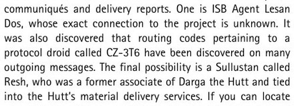

## scan p.6 (scan page 6)

Page contents: Approach; Assiduous passes; Cloudscape Platforms. (hand-read)

## scan p.7 (scan page 7)

Page contents: Customs agent Talee inspection. (hand-read)

## scan p.8 (scan page 8)

Page contents: Part 2: In the Heart of the Empire; accommodations; transportation; Tero Reskan; following leads. (hand-read)

- **Tero Reskan** — entry/section: Contacting Tero Reskan: "He despises the Empire, blaming them for nationalizing his interstellar shipping business that used to run to the Deep Core and forcing him out." Source: *06 - The Core of Corruption* (SWRPG Saga Edition), scan p.8
  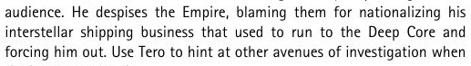

## scan p.9 (scan page 9)

Page contents: Alert triggers; computer table; ISB Agent Lesan Dos; CZ-3T6. (hand-read)

## scan p.10 (scan page 10)

Page contents: CZ-3T6 continued; Resh; Droid Services sidebar. (hand-read)

- **Resh (warehouse); Darga the Hutt; Valin Draco** — entry/section: Resh: "He also knows that Darga once told him that the entire operation was to move into a new building called Imeici Spire, now under construction in CoCo Town. … If the heroes ask about Inquisitors, he says the only one he ever knew about was Valin Draco, but he fears that others may find him." Source: *06 - The Core of Corruption* (SWRPG Saga Edition), scan p.10
  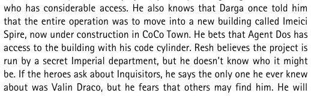

## scan p.11 (scan page 11)

Page contents: Eetoa Ro sidebar (from image): late-teen, fast-talking Works street kid met at the abandoned Galaxy IV Coolant Refinery platform on a banged-up speeder bike (Aratech 74-Z stats), red and blue flight suit; cashing in on both sides—Resh pays him to arrange passage off-planet while he charges the heroes 5,000 credits (plus 500 to reveal the bounty hunters) for Resh's Works Labyrinth hideout. (hand-read)

### Stat block notes (game mechanics, not feats)

- Eetoa Ro CL4: Medium male Human scoundrel 4; Force 3, Dark Side 2; Init +3; Perception +13; Ref 17 (ff 14), Fort 13, Will 16; hp 25, threshold 13; knife +2 (1d4+1), blaster pistol +4 (3d6+2); Talents Fool's Luck, Knack; Feats Point Blank Shot, Skill Focus (Deception, Gather Information, Perception, Persuasion), Vehicular Combat, Weapon Proficiency (pistols, simple weapons); Skills Deception +14, Gather Information +14, Perception +13, Persuasion +14, Pilot +8; uses Fool's Luck at the start and saves Knack for negotiating payment. (Source: *06 - The Core of Corruption* (SWRPG Saga Edition), scan p.11)

## scan p.12 (scan page 12)

Page contents: Spire investigation; accessing the spire; ad-hoc XP. (hand-read)

## scan p.13 (scan page 13)

Page contents: Part 3: Spire of Darkness; level list; approach; control room. (hand-read)

## scan p.14 (scan page 14)

Page contents: Inside the spire; Level 188; Gelnar Tol; truth of the Sarlacc Project; prisoner stats. (hand-read)

- **Gelnar Tol** — entry/section: Level 188: ""Please, you must get me out of here. They are monsters without pity or compassion. I surely won't last another week here. We must escape before they return to deal with you ... and us."" Source: *06 - The Core of Corruption* (SWRPG Saga Edition), scan p.14
  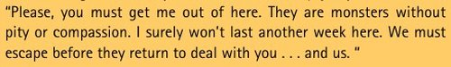
- **Gelnar Tol** — entry/section: Sarlacc Project: "This is the heart of the design team for a massive new starship some 12 kilometers long that will dwarf even an Imperial-class Star Destroyer (and is a forerunner of the eventual Super Star Destroyer)." Source: *06 - The Core of Corruption* (SWRPG Saga Edition), scan p.14
  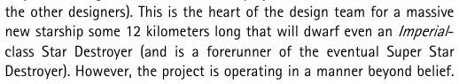

## scan p.15 (scan page 15)

Page contents: Inquisitor arrival; collapse and descent; escape; conclusion; Destruction destiny. (hand-read)

## scan p.16 (scan page 16)

Page contents: Encounter: Rapid Response Force (Coruscant Guards). (hand-read)

## scan p.17 (scan page 17)

Page contents: Guard veteran; RaDAir airspeeder. (hand-read)

## scan p.18 (scan page 18)

Page contents: Rapid Response Force map. (hand-read)

## scan p.19 (scan page 19)

Page contents: Encounter: No Aliens (COMPNOR supporters). (hand-read)

## scan p.20 (scan page 20)

Page contents: No Aliens map. (hand-read)

## scan p.21 (scan page 21)

Page contents: Encounter: Rodian Fuming (Chokoo Thool). (hand-read)

### Stat block notes (game mechanics, not feats)

- Chokoo Thool CL7: Medium male Rodian nonheroic 6/noble 5; Talents Bolster Ally, Ignite Fervor, Inspire Confidence; Feats Improved Defenses, Point Blank Shot, Precise Shot, Skill Focus (Perception, Persuasion), Skill Training (Initiative, Persuasion), Weapon Focus (pistols), Weapon Proficiency (pistols, simple weapons) (Source: *06 - The Core of Corruption* (SWRPG Saga Edition), scan p.21)

## scan p.22 (scan page 22)

Page contents: Rodian conclusion; map/features. (hand-read)

## scan p.23 (scan page 23)

Page contents: Encounter: Outlanders (Nonul Weran). (hand-read)

### Stat block notes (game mechanics, not feats)

- Nonul Weran CL8: Medium male Human scoundrel 4/scout 4; Talents Acute Senses, Dastardly Strike, Improved Initiative, Knack; Feats Improved Damage Threshold, Improved Defenses, Martial Arts I, Point Blank Shot, Quick Draw, Running Attack, Skill Focus (Deception), Skill Training (Stealth), Weapon Proficiency (advanced melee weapons, pistols, rifles, simple weapons) (Source: *06 - The Core of Corruption* (SWRPG Saga Edition), scan p.23)

## scan p.24 (scan page 24)

Page contents: ISB informants; Lt. Lesan Dos stats. (hand-read)

### Stat block notes (game mechanics, not feats)

- Lt. Lesan Dos CL11: Medium male Human noble 5/scout 6; Force 5; Ref 24, Fort 22, Will 26; hp 59; Talents Acute Senses, Bolster Ally, Born Leader, Improved Stealth, Inspire Confidence, Long Stride; Feats Deadeye, Linguist, Point Blank Shot, Precise Shot, Running Attack, Skill Focus (Deception), Skill Focus (Gather Information), Skill Focus (Perception), Skill Focus (Persuasion), Skill Focus (Use Computer), Sniper, Weapon Proficiency (pistols, rifles, simple weapons) (Source: *06 - The Core of Corruption* (SWRPG Saga Edition), scan p.24)

## scan p.25 (scan page 25)

Page contents: Dos capture; conclusion. (hand-read)

## scan p.26 (scan page 26)

Page contents: Outlanders map. (hand-read)

## scan p.27 (scan page 27)

Page contents: Encounter: Imperial Pursuit Part 1 (FSD-6D droid). (hand-read)

## scan p.28 (scan page 28)

Page contents: ISB special agents; stormtroopers; RaDAir. (hand-read)

## scan p.29 (scan page 29)

Page contents: Imperial Pursuit Part 1 map. (hand-read)

## scan p.30 (scan page 30)

Page contents: Encounter: Imperial Pursuit Part 2 (HSP-10 speeders). (hand-read)

## scan p.31 (scan page 31)

Page contents: Coruscant airspace hazards sidebar (fresh OCR): building shields (halve collision damage), crowded skylanes (mobile hazards), exhaust vents, floating holograms, high-speed dives (+5 hazard attack), light beams (blind 1d20+5 vs pilot), skybridges (DC 20 Pilot), skytunnels, speeder truck convoys, surface power couplings (as Zam did in Episode II; Reflex 25, 15+ damage, 4d10 ion area). (hand-read)

## scan p.32 (scan page 32)

Page contents: Works Labyrinth hazards (fresh OCR): toxic atmosphere (1d20+7, 1d8 and persistent condition step), dense smoke (1d20+10, concealment within 12 squares), factory power coupling (1d20+10, 5d10 ion), obstructions (DC 25 Pilot; 15 at half speed, 30 at double). (hand-read)

## scan p.33 (scan page 33)

Page contents: Encounter: Resh's Warehouse (Sisla). (hand-read)

- **Sisla; Resh (warehouse)** — entry/section: Resh's Warehouse: ""Come on, Resh, enough games! You've already cost me one speeder and made us fly into this stinking hole. I'm about to forget that the bounty is higher to take you alive. Seems like it will cost me less in the long run to shoot you now."" Source: *06 - The Core of Corruption* (SWRPG Saga Edition), scan p.33
  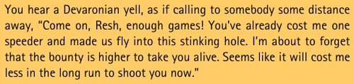

## scan p.34 (scan page 34)

Page contents: Sisla's hunters; Sisla stats. (hand-read)

### Stat block notes (game mechanics, not feats)

- Sisla CL10: Medium male Devaronian scout 3/soldier 4/bounty hunter 3; Ref 30, Fort 25, Will 23; hp 86; Talents Armored Defense, Acute Senses, Hunter's Mark, Improved Armored Defense, Keen Shot, Notorious; Feats Armor Proficiency (light, medium), Double Attack (rifles), Improved Defenses, Point Blank Shot, Precise Shot, Shake It Off, Sniper, Skill Training (Survival), Weapon Focus (rifles), Weapon Proficiency (pistols, rifles, simple weapons) (Source: *06 - The Core of Corruption* (SWRPG Saga Edition), scan p.34)

## scan p.35 (scan page 35)

Page contents: Resh stats; conclusion. (hand-read)

### Stat block notes (game mechanics, not feats)

- Resh CL10: Medium male Sullustan scoundrel 10; Ref 23, Fort 23, Will 23; hp 80; Talents Disruptive, Fool's Luck, Knack, Lucky Shot, Walk the Line; Feats Dodge, Improved Defenses, Mighty Swing, Mobility, Point Blank Shot, Quick Draw, Toughness, Weapon Focus (pistols), Weapon Proficiency (advanced melee weapons, pistols, simple weapons) (Source: *06 - The Core of Corruption* (SWRPG Saga Edition), scan p.35)

## scan p.36 (scan page 36)

Page contents: Resh's Warehouse map. (hand-read)

## scan p.37 (scan page 37)

Page contents: Encounter: Acquisitions (Core Craft). (hand-read)

## scan p.38 (scan page 38)

Page contents: Core Craft chief administrator; sentries. (hand-read)

## scan p.39 (scan page 39)

Page contents: Warehouse features (fresh OCR): office desks and counter; crates and plastic-wrapped pallets (breaking in without alerting sentries or cargo droids); cargo areas as difficult/impassable terrain; two cargo lifts. (hand-read)

## scan p.40 (scan page 40)

Page contents: Encounter: Control Room (Celor Teon). (hand-read)

- **Celor Teon** — entry/section: Control Room: ""Well, what was so important that you had to land this instant? We run the show here, not you. You're just lucky my assistant allowed you to land. I would've let you buzz around this building till your wings fell off!"" Source: *06 - The Core of Corruption* (SWRPG Saga Edition), scan p.40
  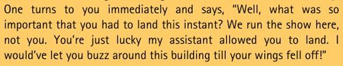

## scan p.41 (scan page 41)

Page contents: Senior tech possessions; conclusion; map. (hand-read)

## scan p.42 (scan page 42)

Page contents: Encounter: Level 188 Entry (gas trap). (hand-read)

## scan p.43 (scan page 43)

Page contents: Guard veterans; conclusion. (hand-read)

## scan p.44 (scan page 44)

Page contents: Level 188 map. (hand-read)

## scan p.45 (scan page 45)

Page contents: Encounter: Level 188 Detention Block. (hand-read)

## scan p.46 (scan page 46)

Page contents: Encounter: Inquisitor Attack. (hand-read)

## scan p.47 (scan page 47)

Page contents: Inquisitor apprentices; Inquisitor Nolor. (hand-read)

- **Nolor** — entry/section: Inquisitor Nolor: "Inquisitor Nolor was a young Jedi who fell to the dark side while fighting Separatists at the end of the Clone Wars. He narrowly avoided Order 66 and was hunted down by the earliest Inquisitors. They recognized his potential and molded him into an adept interrogator." Source: *06 - The Core of Corruption* (SWRPG Saga Edition), scan p.47
  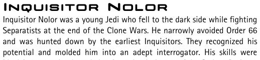

### Stat block notes (game mechanics, not feats)

- Inquisitor Nolor CL13: Medium Human Jedi 3/scout 4/noble 2/Force adept 4; Force 6; Dark Side 14; Ref 28, Fort 26, Will 30; hp 84; Force Powers dark rage, Force grip, mind trick, move object, rebuke (2); Force Techniques Improved Move Light Object, Improved Sense Surroundings; Talents Block, Equilibrium, Evasion, Force Interrogation, Inquisition, Power of the Dark Side, Swift Power; Feats Dodge, Force Sensitivity, Force Training (2), Improved Defenses, Improved Damage Threshold, Linguist, Mobility, Rapid Strike, Skill Training (Persuasion), Skill Training (Use the Force), Weapon Focus (lightsabers), Weapon Proficiencies (lightsabers, pistols, simple weapons) (Source: *06 - The Core of Corruption* (SWRPG Saga Edition), scan p.47)

## scan p.48 (scan page 48)

Page contents: Nolor tactics; conclusion. (hand-read)

## scan p.49 (scan page 49)

Page contents: Encounter: Collapse and Descent. (hand-read)

## scan p.50 (scan page 50)

Page contents: Collapse map. (hand-read)

## scan p.51 (scan page 51)

Page contents: RPGA session tracking sheet. (hand-read)

