# Owner Material 037 — Star Wars D20 Drive folder (Core, Revised Core and Saga Edition): Adventures/Dawn of Defiance/07 - A Reckoning of Wraiths.pdf [Star Wars Roleplaying Game Saga Edition (2007)]

- **Source:** Wizards of the Coast Star Wars Roleplaying Game books, web enhancements, Living Force campaign modules and articles (2000–2010), from the owner's "Star Wars D20" Drive folder (only the three edition subfolders; "General" was not read, as instructed). Secondary source (licensed Legends reference). Scan OCR'd on the box; the scan stays box-only and is **not** published.
- **Method:** every scanned page was OCR'd and machine-screened sentence by sentence for power-relevant statements (fights, kills, defeats, Force feats, rankings, superweapons) that name a character on our roster; each kept sentence is quoted verbatim from the OCR text and has a crop of the printed passage directly under it. Pages with nothing power-relevant are still listed with what is on them.
- **Citation:** "*07 - A Reckoning of Wraiths* (SWRPG Saga Edition), p.X" by printed page ("scan p.X" where no printed number applies). **Weight:** Licensed RPG material: a secondary source. Narrative text sums up Legends lore; game statistics are rules for players, not canon power levels, and rank lowest.

## scan p.1 (scan page 1)

Page contents: Cover: A Reckoning of Wraiths, Episode VII of Star Wars: Dawn of Defiance, by Gary Astleford. (hand-read)

## scan p.2 (scan page 2)

Page contents: Credits (design Gary Astleford, editing Ray Vallese); adventure blurb: heroes hiding on Coruscant after The Core of Corruption, sent to find a Sarlacc Project designer who survived the destruction of the Imeici Spire; heroes should reach 15th level. "What is Dawn of Defiance?" boilerplate. (hand-read)

## scan p.3 (scan page 3)

Page contents: Campaign Update (days after The Core of Corruption; Sarlacc Project details now with Captain Verana aboard the Resurgence; loyalist safehouse roleplaying); Summary (Varth sends heroes after Incom technician Pavel Trenol; ambush; safehouse massacre; AT-AT at the starport; Resurgence under attack; Valin Draco captures Master Denia; Varth revealed in Imperial regalia, faked his defection); Encounters note; Opening Crawl. (hand-read)

- **Gilder Varth; Denia (Jedi); Valin Draco** — entry/section: Summary – Varth unmasked: "Once off the Resurgence, the heroes are contacted by Admiral Varth, who is again in full Imperial regalia. He only pretended to defect in an attempt to root out insurgents and now demands that the heroes surrender." Source: *07 - A Reckoning of Wraiths* (SWRPG Saga Edition), scan p.3
  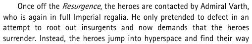

## scan p.4 (scan page 4)

Page contents: Part 1: Depths of the City – the middle-class safehouse (three linked apartments, concealed doors DC 15), full armory/infirmary/workshop/gear inventory; Varth's holo message begins. (hand-read)

- **Gilder Varth** — entry/section: Varth's message to the heroes: ""Excellent work. You've done quite a job exposing the Sarlacc Project, and you've exceeded my expectations. By now, the Inquisitorius is running around like a swarm of angry Dantari fire ants. You've made quite an impression on them, and I doubt they'll underestimate you again. I know that I won't. "As much as we'd like to see you off-planet and out of danger, there is still a need for you to remain on Coruscant for a short while longer. Pavel Trenol, who had been forced to work as a designer for the Sarlacc Project, has contacted us seeking asylum. Prior to being pressed into duty by the Empire, Trenol was a weapons technician for Incom. In exchange for help, he's promised to tell us everything he knows about the offensive capability of the Sarlacc Project." Source: *07 - A Reckoning of Wraiths* (SWRPG Saga Edition), scan p.4
  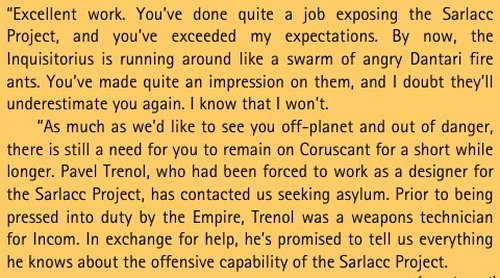

## scan p.5 (scan page 5)

Page contents: Gnawer's Roost descent; taxi/checkpoint auxiliary challenge (pilot attitudes); Trenol's flophouse, seven gang youths; OT-3PO chained behind the counter; bribe 50 cr / DC 11 Persuasion; room 5212. (hand-read)

- **Gilder Varth** — entry/section: Varth's message (continued): ""It's only a matter of time before the Empire realizes that Trenol's body is not among the dead, and they'll go looking for him. You should leave immediately and rendezvous with him. I'm providing a current holographic representation of Trenol with this transmission. He's currently staying in a flophouse in one of Coruscant's sublevels—an area known as the Gnawer's Roost. It's a bad part of town, so stay on your toes. On the plus side, Imperial security tends to avoid the place, as they're none too popular in that region. "Good luck. I will await your signal when you return, and then we'll see about getting you back to the Resurgence for some much-deserved downtime."" Source: *07 - A Reckoning of Wraiths* (SWRPG Saga Edition), scan p.5
  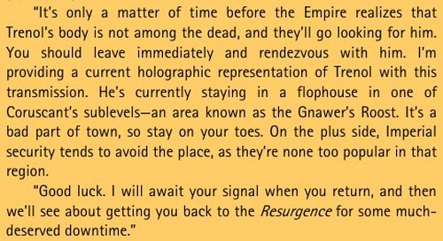

## scan p.6 (scan page 6)

Page contents: Empty room 5212, "Invisible Hand" note (Grievous's flagship); OT-3PO says Trenol left with Quarren; Ogre Ambush lead-in; OT-3PO sidebar with stats; development: killing the ogres makes Gnawer's Roost residents friendly. (hand-read)

- **OT-3PO** — entry/section: OT-3PO on the Invisible Hand: ""I believe the Invisible Hand is a cantina. For a small fee, I can provide you with directions."" Source: *07 - A Reckoning of Wraiths* (SWRPG Saga Edition), scan p.6
  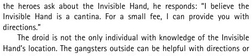
- **OT-3PO** — entry/section: OT-3PO sidebar: "Though he rarely wishes for freedom— the outside world is a frightening place—he is somewhat annoyed by the fact that he is chained to the floor. "It's not as if I would wander off. Doesn't anyone trust me?" he often asks himself. The answer, of course, is "No." OT-3PO is incredibly untrustworthy and would sell out anyone for a few paltry credits. It isn't precisely his fault; he can't help himself. He is merely a product of his environment." Source: *07 - A Reckoning of Wraiths* (SWRPG Saga Edition), scan p.6
  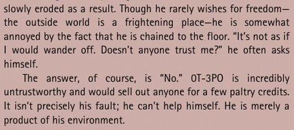
- **General Grievous**: "Any hero who succeeds on a DC 15 Knowledge (galactic lore) check learns that the /nvisible Hand was the name of General Grievous's flagship during the Clone Wars, and that the vessel was destroyed during the Battle of Coruscant." Source: *07 - A Reckoning of Wraiths* (SWRPG Saga Edition), scan p.6
  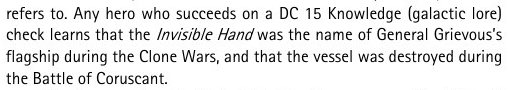

### Stat block notes (game mechanics, not feats)

- OT-3PO CL3: Medium droid (3rd-degree) nonheroic 1/scoundrel 2; Ref 13, Fort 11, Will 14; hp 9; Languages Basic, Binary, Bocce, Huttese, Ryl; Talents Disruptive; Feats Linguist, Skill Focus (Persuasion), Skill Training (Deception, Gather Information, Knowledge [bureaucracy], Knowledge [galactic lore]); Persuasion +14; Possessions audio recorder. (Source: *07 - A Reckoning of Wraiths* (SWRPG Saga Edition), scan p.6)

## scan p.7 (scan page 7)

Page contents: The Invisible Hand cantina (ex-Separatist hangout, hull fragments of the original ship); Quarren bouncer Tekkur, Gran bartender Klef, two Trandoshans; "Pavel Trenol" is really ISB deep-cover operative Tavik Moern (DC 24 Perception); if asked about Varth, Moern spits and calls him a traitor to the Empire. (hand-read)

## scan p.8 (scan page 8)

Page contents: Part 2: Bait and Chase – calls to the safehouse go unanswered; Safehouse of the Dead (loyalists executed; ISB tactical team waiting upstairs; holonet transceiver auxiliary challenge for Bail Organa); Where Giants Tread (starport guarded by four stormtroopers, four heavy stormtroopers with E-Webs, and an AT-AT). (hand-read)

## scan p.9 (scan page 9)

Page contents: Sabotage on the heroes' ship: detonite charge linked to hyperdrive (DC 20 Perception/Mechanics), GM hints; three tracking devices (DC 10, 10, 20). (hand-read)

## scan p.10 (scan page 10)

Page contents: Part 3: Resurgence of Evil – battle at rendezvous (two Star Destroyers; Corellian Gunship and a Corvette destroyed; Gallofree transport explodes); Verana's call; To the Rescue (docking tunnel like the Falcon/Redemption, ship hazards, turbolaser rocking rule); Verana's news about Denia. (hand-read)

- **Adrian Verana** — entry/section: Verana's distress call: ""You're too late," he says. "They've got us right where they want us. It'd be suicide for you to stay, but we're running out of options. All of our escape pods have been jettisoned, and our shields are about to buckle. Mind if we hitch a ride with you?" The voice of a nervous crewman in the background cuts in. "Sir! We've got reports of Imperial troops on board!" Verana curses. "On second thought, you guys might be better off—"" Source: *07 - A Reckoning of Wraiths* (SWRPG Saga Edition), scan p.10
  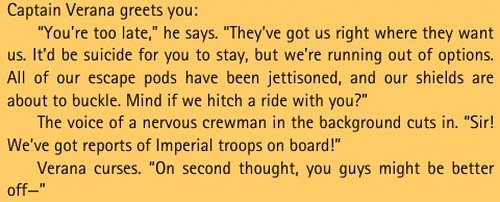
- **Adrian Verana** — entry/section: Verana rescued: ""I was wondering if you were going to show up," Verana teases, his smile belying the pain he is suffering from his wounds. Heroes with medical experience can provide first aid, but Verana waves off any more, saying, "We haven't time for that."" Source: *07 - A Reckoning of Wraiths* (SWRPG Saga Edition), scan p.10
  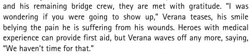
- **Adrian Verana; Denia (Jedi)** — entry/section: Verana: Denia taken: ""I've got some bad news," Verana says. "We've had a report that Master Denia has been taken prisoner by the Inquisitorius." The Captain lets the news sink in for a moment. "If you think you can make it, get to the landing bay at once. You might be able to stop the Inquisitors before they can get her off the Resurgence. My crew and I can find our way to your ship, and we'll meet you there. Now go!"" Source: *07 - A Reckoning of Wraiths* (SWRPG Saga Edition), scan p.10
  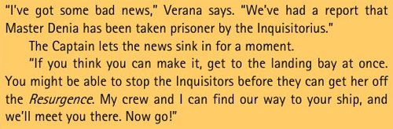

## scan p.11 (scan page 11)

Page contents: A Line of Prisoners (10 prisoners, Inquisitors and stormtroopers); Victory and Loss (Denia led aboard a shuttle; Draco with black metallic faceplate and single red optic; eight naval troopers); Rescue destiny; Leaving the Resurgence Behind; Varth hails from a Star Destroyer. (hand-read)

- **Denia (Jedi); Valin Draco** — entry/section: Denia taken aboard the shuttle: "You notice a familiar figure—Master Denia—among the prisoners. She spares a fleeting glance over her shoulder in your direction before disappearing into the shuttle's interior with the rest of the captives. Before you can react, a second figure, also familiar, turns to face you. Inquisitor Valin Draco, his features marred by a black metallic faceplate with a single red optic, meets your gaze. He makes a dismissive gesture, then hurriedly boards the shuttle as the boarding ramp begins to close." Source: *07 - A Reckoning of Wraiths* (SWRPG Saga Edition), scan p.11
  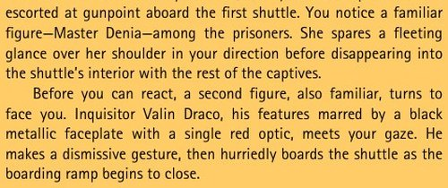
- **Gilder Varth** — entry/section: Varth reveals his loyalty: ""It seems as if I didn't give you enough credit for being resourceful," Varth says, his eyes betraying a hint of respect. "But now the time for deception has ended. Despite your persistence, as well as your luck, you must admit that you are outmatched. Shut down your engines and prepare to be boarded."" Source: *07 - A Reckoning of Wraiths* (SWRPG Saga Edition), scan p.11
  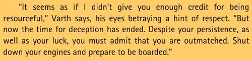
- **Gilder Varth** — entry/section: Varth's parting lines: "If engaged in conversation, Varth reveals little of his involvement in the plot other than saying, "Had you not proven so talented, none of this would have been necessary." … He signs off by saying, "I'm sure we will meet again."" Source: *07 - A Reckoning of Wraiths* (SWRPG Saga Edition), scan p.11
  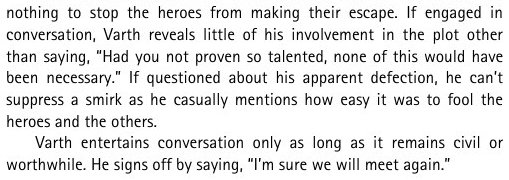

## scan p.12 (scan page 12)

Page contents: Discovery destiny (Varth's treachery); Concluding the Adventure: Bail Organa's speech to the heroes. (hand-read)

- **Bail Organa; Denia (Jedi)** — entry/section: Organa's speech: ""We've paid a heavy price for the information you've managed to gather. We've also learned, unfortunately, that we have been tricked—betrayed. Some of you might be asking yourselves: Is it worth the cost? "I can't answer that question. Not yet, in any case. What I do know is that I am still determined to see Palpatine's regime toppled, and any knowledge we have of his plots and plans will ultimately be of some use to us. "As to those friends and allies we've lost, they will not be forgotten. Denia will be found, I promise, and when she is . . . when she is, you'll be there to bring her back from the brink. Until then, we will all of us stay the course."" Source: *07 - A Reckoning of Wraiths* (SWRPG Saga Edition), scan p.12
  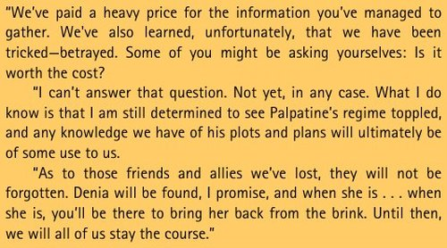

## scan p.13 (scan page 13)

Page contents: Encounter: Imperial Checkpoint (CL 13) – six veteran stormtroopers CL4, two veteran heavy stormtroopers CL4 with light repeating blasters, shield generator; stats and tactics. (hand-read)

## scan p.14 (scan page 14)

Page contents: Features of the Area sidebar (missed by first OCR, read from fresh OCR): permacrete barriers are low objects (+5 cover to Reflex, DR 10, 50 hp); the energy barrier is a low-strength deflector shield spanning the road (SR 20, semitransparent, partial cover, deactivatable by the stormtroopers on duty). (hand-read)

## scan p.15 (scan page 15)

Page contents: Encounter: Ogre Ambush (CL 13) – eight Coruscani ogres CL5 (Large beast 5, Str 24, Pin, Power Attack), description, tactics (retreat after five fall); salvage from a protocol droid head (DC 15 Mechanics). (hand-read)

## scan p.16 (scan page 16)

Page contents: Ogre Ambush encounter map. (hand-read)

## scan p.17 (scan page 17)

Page contents: Encounter: The Invisible Hand (CL 13) – setup, read-aloud; Tavik Moern profile, stats, tactics. (hand-read)

- **Tavik Moern** — entry/section: Moern if captured: ""It doesn't matter what you do to me," he sneers if caught. "It's already too late for your seditionist friends."" Source: *07 - A Reckoning of Wraiths* (SWRPG Saga Edition), scan p.17
  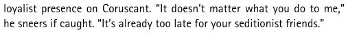

### Stat block notes (game mechanics, not feats)

- Tavik Moern CL13: Medium Human scoundrel 7/soldier 6; Force 1; Dark Side 4; Ref 30, Fort 26, Will 26; hp 72; Talents Dastardly Strike, Devastating Attack (pistols), Lucky Shot, Sneak Attack +2d6, Tough as Nails, Weapon Specialization (pistols); Feats Careful Shot, Dodge, Improved Charge, Improved Defenses, Martial Arts I, Mobility, Point Blank Shot, Precise Shot, Quick Draw, Running Attack, Skill Focus (Gather Information), Skill Training (Use Computer), Weapon Focus (pistols), Weapon Proficiency (pistols, rifles, simple weapons); heavy blaster pistol. (Source: *07 - A Reckoning of Wraiths* (SWRPG Saga Edition), scan p.17)

## scan p.18 (scan page 18)

Page contents: Quarren Goons (4) CL7 stats/tactics; Tekkur, Quarren bouncer CL1 (profile, stats, stun tactics); Klef, Gran bartender profile. (hand-read)

### Stat block notes (game mechanics, not feats)

- Tekkur CL1: Medium Quarren nonheroic 5; Ref 10, Fort 12, Will 10; hp 12; Feats Pin, Power Attack, Skill Focus (Persuasion), Skill Training (Perception), Weapon Proficiency (pistols, simple weapons); blaster pistol. Worked as bouncer at the Invisible Hand almost a year. (Source: *07 - A Reckoning of Wraiths* (SWRPG Saga Edition), scan p.18)

## scan p.19 (scan page 19)

Page contents: Klef CL1 stats (Medium Gran nonheroic 3; triple vision; Feats Improved Defenses, Linguist…); Ziss't and Q'elliss, Trandoshan workers CL1; conclusion (goons know Moern only as "Pavel Trenol"); features. (hand-read)

### Stat block notes (game mechanics, not feats)

- Klef CL1: Medium Gran nonheroic 3; Ref 11, Fort 10, Will 12; hp 7; Languages Basic, Gran, Huttese, Quarrenese, Skakoverbal; Feats Improved Defenses, Linguist, Skill Training (Gather Information, Knowledge [galactic lore]), Weapon Proficiency (simple weapons). Ducks behind the bar. (Source: *07 - A Reckoning of Wraiths* (SWRPG Saga Edition), scan p.19)

## scan p.20 (scan page 20)

Page contents: The Invisible Hand encounter map. (hand-read)

## scan p.21 (scan page 21)

Page contents: Encounter: Safehouse of the Dead (CL 14) – ISB Tactical Agents (4) CL8 (soldier 7/elite trooper 1) stats/tactics; Lieutenant Kar'eme profile (Corellian, shaved head, ISB tactical team leader). (hand-read)

## scan p.22 (scan page 22)

Page contents: Lieutenant Kar'eme stats and tactics; conclusion (reinforcements: a dozen stormtroopers and an officer). (hand-read)

### Stat block notes (game mechanics, not feats)

- Lieutenant Kar'eme CL10: Medium Human soldier 7/elite trooper 2/officer 1; Force 2; Dark Side 7; Ref 29, Fort 25, Will 24; hp 90; DR 1; Talents Armored Defense, Battle Analysis, Cover Fire, Deployment Tactics, Draw Fire, Improved Armored Defense; Feats Armor Proficiency (light, medium), Burst Fire, Charging Fire, Martial Arts I, Martial Arts II, Point Blank Shot, Precise Shot, Skill Training (Use Computer), Weapon Focus (rifles), Weapon Proficiency (heavy weapons, rifles, simple weapons); blaster carbine. (Source: *07 - A Reckoning of Wraiths* (SWRPG Saga Edition), scan p.22)

## scan p.23 (scan page 23)

Page contents: Safehouse of the Dead encounter map. (hand-read)

## scan p.24 (scan page 24)

Page contents: Encounter: Where Giants Tread (CL 15) – setup, read-aloud; AT-AT stats and tactics; AT-AT Pilot/Crew (5) CL2. (hand-read)

## scan p.25 (scan page 25)

Page contents: AT-AT crew stats/tactics; veteran stormtroopers (4) and veteran heavy stormtroopers (4) with E-Webs; conclusion ("Stand down! You do not have authorization to depart!"). (hand-read)

## scan p.26 (scan page 26)

Page contents: Where Giants Tread map; features (cargo containers DR 10; fuel tanks explode 5d6). (hand-read)

## scan p.27 (scan page 27)

Page contents: Encounter: To the Rescue (CL 15) – setup, read-aloud (officer demands Verana's surrender); Veteran Imperial Officer; Elite Stormtroopers (6) CL6. (hand-read)

- **Adrian Verana** — entry/section: Verana refuses to surrender: ""All right, Verana," the officer calls over a sustained burst of fire. "This is your last chance! Surrender!" Verana's voice, somewhat pained, answers, "Go to hell!" "Have it your way!" the Imperial officer answers before turning to the trooper next to him. "Go on in, sergeant. Take no prisoners."" Source: *07 - A Reckoning of Wraiths* (SWRPG Saga Edition), scan p.27
  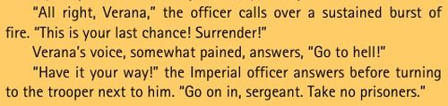

## scan p.28 (scan page 28)

Page contents: Captain Adrian Verana profile and stats; Resurgence Bridge Crew (5) CL1; features (turbolaser rocking). (hand-read)

### Stat block notes (game mechanics, not feats)

- Captain Adrian Verana CL12: Medium Human noble 8/officer 4; Force 2; Ref 25, Fort 25, Will 28; hp 58 (maximum 84); Languages Basic, Bocce, High Galactic, Huttese, Mon Calamarian, Shyriiwook; Talents Born Leader, Demand Surrender, Deployment Tactics, Distant Command, Presence, Rally; Feats Armor Proficiency (light, medium), Improved Defenses, Linguist, Skill Focus (Knowledge [tactics], Pilot, Use Computer), Vehicular Combat, Weapon Focus (pistols), Weapon Proficiency (advanced melee weapons, pistols, rifles, simple weapons); signature sporting blaster pistol. (Source: *07 - A Reckoning of Wraiths* (SWRPG Saga Edition), scan p.28)

## scan p.29 (scan page 29)

Page contents: To the Rescue encounter map. (hand-read)

## scan p.30 (scan page 30)

Page contents: Encounter: A Line of Prisoners (CL 14) – setup, read-aloud; Inquisitors (3) CL8 (Jedi 4/scout 3/Force adept 1; farseeing, Force lightning, mind trick); veteran stormtroopers (5). (hand-read)

- **No single roster character (rules/setting/general)** — entry/section: Inquisitor threatens the prisoners: ""Hurry up, slugs! Get moving, or I'll have the lot of you shot!" one of the Inquisitors growls at the prisoners." Source: *07 - A Reckoning of Wraiths* (SWRPG Saga Edition), scan p.30
  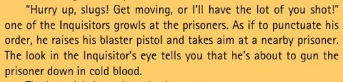

## scan p.31 (scan page 31)

Page contents: Resurgence Crew Prisoners (10) CL1; tactics; conclusion. (hand-read)

## scan p.32 (scan page 32)

Page contents: A Line of Prisoners encounter map. (hand-read)

## scan p.33 (scan page 33)

Page contents: Encounter: Victory and Loss (CL 15) – Lieutenant Misha Vekkian (former Jedi Padawan turned by the Inquisitorius, now Imperial Navy officer; blames the Jedi) profile, stats, tactics; Imperial Naval Troopers (7) CL5. (hand-read)

### Stat block notes (game mechanics, not feats)

- Lieutenant Misha Vekkian CL10: Medium Human Jedi 6/soldier 2/officer 2; Force 4; Dark Side 9; Ref 23, Fort 22, Will 27; hp 77; Force Powers battle strike (2), dark rage, Force grip, Force slam, move object, surge (2); Talents Assault Tactics, Battle Meditation, Deflect, Force Intuition, Indomitable; Feats Force Sensitivity, Force Training (2), Power Attack, Powerful Charge, Rapid Strike, Skill Focus (Knowledge [tactics]), Skill Training (Knowledge [tactics]), Trip, Weapon Focus (lightsabers), Weapon Proficiency (lightsabers, pistols, simple weapons); lightsaber, blaster pistol. (Source: *07 - A Reckoning of Wraiths* (SWRPG Saga Edition), scan p.33)

## scan p.34 (scan page 34)

Page contents: Imperial Naval Trooper stats continued and tactics; conclusion. (hand-read)

## scan p.35 (scan page 35)

Page contents: Victory and Loss encounter map. (hand-read)

## scan p.36 (scan page 36)

Page contents: RPGA session tracking forms (no names). (hand-read)

