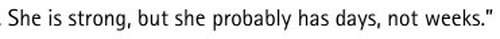
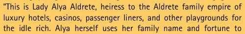
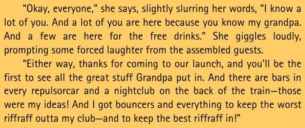
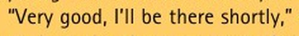
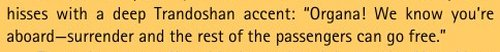

# Owner Material 037 — Star Wars D20 Drive folder (Core, Revised Core and Saga Edition): Adventures/Dawn of Defiance/08 - The Gem of Alderaan.pdf [Star Wars Roleplaying Game Saga Edition (2007)]

- **Source:** Wizards of the Coast Star Wars Roleplaying Game books, web enhancements, Living Force campaign modules and articles (2000–2010), from the owner's "Star Wars D20" Drive folder (only the three edition subfolders; "General" was not read, as instructed). Secondary source (licensed Legends reference). Scan OCR'd on the box; the scan stays box-only and is **not** published.
- **Method:** every scanned page was OCR'd and machine-screened sentence by sentence for power-relevant statements (fights, kills, defeats, Force feats, rankings, superweapons) that name a character on our roster; each kept sentence is quoted verbatim from the OCR text and has a crop of the printed passage directly under it. Pages with nothing power-relevant are still listed with what is on them.
- **Citation:** "*08 - The Gem of Alderaan* (SWRPG Saga Edition), p.X" by printed page ("scan p.X" where no printed number applies). **Weight:** Licensed RPG material: a secondary source. Narrative text sums up Legends lore; game statistics are rules for players, not canon power levels, and rank lowest.

## scan p.1 (scan page 1)

Page contents: Cover: Episode VIII of Star Wars: Dawn of Defiance – The Gem of Alderaan. (hand-read)

## scan p.2 (scan page 2)

Page contents: Credits (design Gary M. Sarli; Lucas Licensing editors Leland Chee, Frank Parisi) and blurb: first adventure of the third act (The Gem of Alderaan, Sword of the Empire, ...); heroes level 15 to 17. (hand-read)

## scan p.3 (scan page 3)

Page contents: Campaign update: six months after A Reckoning of Wraiths; Draco and Master Denia vanished with the Resurgence's destruction; Varth now runs the Sarlacc Project and cannot move openly against Organa without exposing it. Adventure summary: Denia held on Prakith in the Deep Core; heroes infiltrate the maiden voyage of the Gem of Alderaan, luxury repulsortrain of Lady Alya Aldrete, to win Deep Core clearance; her Twi'lek aide Notru'denn; Trandoshan mercenaries hijack the train; Sirona Okeefe's Banshee. Opening crawl. (hand-read)

## scan p.4 (scan page 4)

Page contents: Organa's briefing with Q&A: Prakith, the Deep Core security cordon, and Lady Aldrete as the only route to clearance. (hand-read)

- **Bail Organa; Denia (Jedi)** — entry/section: Organa on Denia's time left: ""She is strong, but she probably has days, not weeks."" Source: *08 - The Gem of Alderaan* (SWRPG Saga Edition), scan p.4
  
- **Bail Organa; Alya Aldrete** — entry/section: Organa introduces Lady Alya Aldrete: ""heiress to the Aldrete family empire of luxury hotels, casinos, passenger liners, and other playgrounds for the idle rich…"" Source: *08 - The Gem of Alderaan* (SWRPG Saga Edition), scan p.4
  

## scan p.5 (scan page 5)

Page contents: Organa provides IDs, invitations and 10,000 credits. The Guest List skill challenge begins (Gather Information/Use Computer/Deception/Persuasion; 107 attendees). (hand-read)

## scan p.6 (scan page 6)

Page contents: Guest List results (1–3 successes); Auxiliary Challenge to research major guests (Basic Search, Greed and Lies, Surveillance; mind trick/farseeing and Use Computer alternatives; Aldrete corporate system Will 20). Time Management sidebar (fresh OCR): Montage (suggests "Cantina Band", "Jedi Rocks", "Lapti Nek"), Humor (Chewbacca in a bowtie, Darth Maul in a monocle, Yoda in shades), Props (day-planner sheet from 6:00 P.M. to 6:00 P.M.), Hints (Organa or Sirona Okeefe calls to check in). Making a Name for Yourself begins. (hand-read)

## scan p.7 (scan page 7)

Page contents: Making a Name for Yourself: public records (Gather Information, Knowledge (technology)), Identity Theft / Identity Fabrication, disguises (DC 20 Deception, 1,000 credits); Ad Hoc XP CL17. Other Preparations. Who's Who sidebar (missed by first OCR, read from image): major guests Morrax Nabin (Imperial governor, plays simultaneous holochess incl. with the Emperor, elite stormtrooper bodyguard), Lynaa (Twi'lek fashion designer with voorpak Taezii), Dien Suub (Sullustan SoroSuub executive), Zalar Rishek (scion of House Rishek, racer), Cednah Faenel (Alderaanian noblewoman, Grand Theater in Belleau-a-Lir, Faenel Vineyard), Ardia Terrsyn (actress, sabacc); minor guests Khyyynett, Prof. Wachs Tauph, Dyni Endarsin, Dr. Hakaen Bousch, Dr. Stae-Fahnti Koelbayr, Tavid Ahkoeri, Capt. Z'paul Diin, Brial Sullor, Anjeru Valett, Ruf-Asti-Viarffli, Mahg-Raet Duumont, Fia Nazhena. (hand-read)

## scan p.8 (scan page 8)

Page contents: Sleep, Shopping (Use the Force substitute), Contraband rules. (hand-read)

## scan p.9 (scan page 9)

Page contents: Part 2: Getting to Know You. Read-aloud (from image): the launch gala in what looks like a banquet hall—Naboo chandeliers, Chandrilan sun marble, a Mon Calamari water sculpture—but it is a repulsortrain station. Reception and Security Screening (supervisor Will 18/Perception +10, four screeners; DC 18/21/22/25/28 checks; intensive screening). Life of the Party sidebar (from image): Group Attitude modifiers (Hostile –10, Unfriendly –5, Indifferent –2, Friendly +0, Helpful +2); Major Guests rules; Specific Details +2. (hand-read)

## scan p.10 (scan page 10)

Page contents: First Impressions and boarding. GM sidebar on social encounters (fresh OCR): Assigning Skill Checks, Alternative Skills (improvised checks, +2 per previous attempt), Adjudicating (+2/–2 for good/poor approaches; narration or in-character both fine). (hand-read)

## scan p.11 (scan page 11)

Page contents: The repulsortrain's cars from front to back, ending with the club Decadence. (hand-read)

- **Alya Aldrete** — entry/section: Lady Aldrete's launch speech: ""Okay, everyone," she says, slightly slurring her words, "I know a lot of you. And a lot of you are here because you know my grandpa. And a few are here for the free drinks." / "Either way, thanks for coming to our launch, and you'll be the first to see all the great stuff Grandpa put in. And there are bars in every repulsorcar and a nightclub on the back of the train—those were my ideas! And I got bouncers and everything to keep the worst riffraff outta my club—and to keep the best riffraff in!"" Source: *08 - The Gem of Alderaan* (SWRPG Saga Edition), scan p.11
  

## scan p.12 (scan page 12)

Page contents: Sabacc in the casino with Ardia Terrsyn, Dien Suub, Zalar Rishek and minor guests (Tavid Ahkoeri, Anjeru Valett, Dyni Endarsin); Gambler talent, Steady Hands and other options. (hand-read)

## scan p.13 (scan page 13)

Page contents: Sabacc continued (Spoiler option); Armchairs and Holochess with Gov. Morrax Nabin and Cednah Faenel; Fine Tastes dinner menu. (hand-read)

## scan p.14 (scan page 14)

Page contents: Entanglements, including Lynaa and Khyyynett; Break It Up! (a scuffle with Zalar Rishek). (hand-read)

## scan p.15 (scan page 15)

Page contents: Lumguzzling contest; Private Invitation scene with Notru'denn. (hand-read)

- **Alya Aldrete** — entry/section: Aldrete drops the act: ""Very good, I'll be there shortly."" Source: *08 - The Gem of Alderaan* (SWRPG Saga Edition), scan p.15
  

## scan p.16 (scan page 16)

Page contents: Part 3: The Uninvited – Trandoshan mercenaries hijack the train. (hand-read)

- **Bail Organa** — entry/section: Trandoshan hijackers on the intercom: ""Organa! We know you're aboard—surrender and the rest of the passengers can go free."" Source: *08 - The Gem of Alderaan* (SWRPG Saga Edition), scan p.16
  

## scan p.17 (scan page 17)

Page contents: All In (convincing Gov. Nabin; Deception/Persuasion), Breakout, Dr. Hakaen Bousch; Old Wounds sidebar adds a Treat Injury use, Critical Care. (hand-read)

## scan p.18 (scan page 18)

Page contents: Death From Above (CloakShape fighters), Desperate Rescue. Conclusion: Aldrete grants the Deep Core clearance; Varth has taken over the Sarlacc Project; Draco's ship (a modified Sienar armored star courier like Maul's Sith Infiltrator) is at the Citadel Inquisitorius on Prakith. (hand-read)

## scan p.19 (scan page 19)

Page contents: Encounter: Alone in the Dark (CL16) setup. (hand-read)

## scan p.20 (scan page 20)

Page contents: 343 words, 32 paragraphs | headings/entries: VfL; JQ SI; AE; D; TRANDOSHAN BERSERKER; Force 2; Dark Side 10; Init +13; Senses darkvision; Perception +11; Languages Basic, Dosh; Speed 6 squares; Melee vibroblade +17" (2d6+17, devastating 5) or; Ranged by weapon +13; Base Atk +10; Grp +14; Atk Options Flurry, Power Attack Stunning Strike; Special Actions delay damage; Special Qualities limb regeneration; Skills Initiative +13, Perception +11; Possessions 2 vibroblades, utility belt; Trandoshan Berserker Tactics; CONCLUSION

### Stat block notes (game mechanics, not feats)

- Trandoshan Mercenary: CL12 stat block. (Source: *08 - The Gem of Alderaan* (SWRPG Saga Edition), scan p.20)

## scan p.21 (scan page 21)

Page contents: 18 words, 6 paragraphs | headings/entries: IN THE DARK ENCOUNTER MAP; ALONE; Ssyuvnos it; Nivalt JO LNOYS OL

### Stat block notes (game mechanics, not feats)

- Trandoshan Berserker: CL12 stat block; Flurry feat. (Source: *08 - The Gem of Alderaan* (SWRPG Saga Edition), scan p.21)

## scan p.22 (scan page 22)

Page contents: Encounter: Unlikely Allies (CL17) setup. (hand-read)

## scan p.23 (scan page 23)

Page contents: 798 words, 49 paragraphs | headings/entries: TRANDOSHAN CAPTAIN; Force 3; Dark Side 4; Init +11; Senses darkvision; Perception +12; Languages Basic, Binary, Dosh, Neimoidian, Shyriiwook; Speed 6 squares; Melee vibrobayonet +12 (2d6+8) or; Base Atk +11; Grp +12; Special Qualities limb regeneration; Trandoshan Officer Tactics; WAR DROID; Force 2; Init +11; Senses Perception +7; Languages Basic (understand only), Binary; Speed 8 squares (walking); Base Atk +14; Grp +27; Special Actions delay damage; Skills Initiative +11

### Stat block notes (game mechanics, not feats)

- Trandoshan Raider / Trandoshan Officer: CL13 stat blocks (ion rifle, Burst Fire, Martial Arts I, Triple Crit). (Source: *08 - The Gem of Alderaan* (SWRPG Saga Edition), scan p.23)

## scan p.24 (scan page 24)

Page contents: 783 words, 52 paragraphs | headings/entries: TRANDOSHAN BOARDING PARTY; Dark Side 4; Languages Basic, Dosh; Vulnerable area attacks (+2 damage dice); Speed 6 squares; Running Attack; Base Atk +12; Grp +19; Special Qualities limb regeneration; Skills Initiative +14; SQUADS; Boarding Party Tactics; Evite STORMTROOPER DETAIL; Dark Side 2; Init +12; Senses low-light vision; Perception +13; Languages Basic; Speed 6 squares; Base Atk +9; Grp +16; Special Actions delay damage, harm's way; Talents Controlled Burst, Harm's Way; Skills Endurance +11, Initiative +12, Perception +13

### Stat block notes (game mechanics, not feats)

- SD-6 "Hulk" Infantry Droid / Trandoshan Boarding Party / Elite Stormtrooper Detail: CL15 droid; CL12 squad; CL8 stormtrooper detail; Squads sidebar. (Source: *08 - The Gem of Alderaan* (SWRPG Saga Edition), scan p.24)

## scan p.25 (scan page 25)

Page contents: Casino features of the area (fresh OCR): cashier area (DR 10, ultrahigh security lock), stage holoprojector (12d6 area collapse), tables and chairs, credit game machines (2d10×100 credits each), bar (three makeshift firebombs), duraplex windows (wind cone 1d20+15, 4d6), stairs. (hand-read)

## scan p.26 (scan page 26)

Page contents: Unlikely Allies map/tactics. (hand-read)

## scan p.27 (scan page 27)

Page contents: Encounter: In the Line of Fire (CL17); Trandoshan Sergeant CL12 (heavy blaster rifle, Double Attack). (hand-read)

## scan p.28 (scan page 28)

Page contents: 653 words, 39 paragraphs | headings/entries: TRANDOSHAN ELITE MERCENARY; Force 1; Dark Side 8; Init +14; Senses darkvision; Perception +7; Languages Basic, Dosh; Speed 4 squares; Running Attack; Melee unarmed +15 (1d6+7); Base Atk +13; Grp +15; Special Actions delay damage; Special Qualities limb regeneration; Skills Initiative +14; Trandoshan Elite Mercenary Tactics; TRANDOSHAN MARAUDER; Force 3; Dark Side 12; Init +14; Senses darkvision; Perception +12; Languages Basic, Dosh; Special Qualities limb regeneration; Skills Initiative +14, Use the Force +11; Trandoshan Marauder Tactics

### Stat block notes (game mechanics, not feats)

- Trandoshan Elite Mercenary: CL12; Flurry, Martial Arts I, Power Attack, Powerful Charge, Toughness. (Source: *08 - The Gem of Alderaan* (SWRPG Saga Edition), scan p.28)

## scan p.29 (scan page 29)

Page contents: Dining car features (fresh OCR): lower dining area, hostages (Reflex 10, 2 hp, threshold 10), automated kitchen fire suppression, tables, fountain, bar firebombs, windows and winds, stairs. (hand-read)

## scan p.30 (scan page 30)

Page contents: 25 words, 5 paragraphs | headings/entries: IN THE LINE OF FIRE ENCOUNTER MAP; SHYSL1aw sl = BSyvnos |; S ENIVLNNOS |

### Stat block notes (game mechanics, not feats)

- Trandoshan Marauder: CL12; dark rage, negate energy; carries a lightsaber. (Source: *08 - The Gem of Alderaan* (SWRPG Saga Edition), scan p.30)

## scan p.31 (scan page 31)

Page contents: Encounter: Gemcutting (CL18) – couplers hazard; Elite Mercenary Team CL14. (hand-read)

## scan p.32 (scan page 32)

Page contents: Gemcutting continued; CloakShape fighters. (hand-read)

## scan p.33 (scan page 33)

Page contents: Damaged repulsorcar features (fresh OCR): fire, smoke, broken floor, debris, raised walkway, stairs, strong winds, charged unirail (ionic discharge 1d10×2 in a 4-square burst). (hand-read)

## scan p.34 (scan page 34)

Page contents: Capturing a CloakShape fighter. (hand-read)

## scan p.35 (scan page 35)

Page contents: Encounter: End of the Line (CL18) setup; fuel lines. (hand-read)

## scan p.36 (scan page 36)

Page contents: 848 words, 40 paragraphs | headings/entries: FUEL LINES; CITADEL CRUISER; Init +3; Senses Perception +12; Crew 3 (ace); Passengers 24; Payload 12 medium concussion missiles; Hyperdrive x2, navicomputer; Availability Licensed; Cost 346,000; THE BANSHEE; The Banshee CL6

### Stat block notes (game mechanics, not feats)

- Trandoshan Mercenary Commander: CL16 (scout 7/bounty hunter 8); hostage rule. (Source: *08 - The Gem of Alderaan* (SWRPG Saga Edition), scan p.36)

## scan p.37 (scan page 37)

Page contents: Read-aloud (fresh OCR): "Lady Aldrete is helpless as she falls onto the roof of the control car. The fierce winds immediately begin dragging her toward the edge. You can tell that you probably have only one chance to catch her." Control car features: catwalk, ladders, lower engine compartment, unirail pylons, extraction area (tow cables; boarding-ramp crewman Reflex 20, 30 hp), strong winds. (hand-read)

## scan p.38 (scan page 38)

Page contents: 19 words, 4 paragraphs | headings/entries: END OF THE LINE ENCOUNTER MAP 1; REPULSOR TRAIN CONTROL CAR

### Stat block notes (game mechanics, not feats)

- Lady Alya Aldrete; Citadel Cruiser; the Banshee: Aldrete nonheroic 9/noble 5, hp 40; Citadel Cruiser stats; Banshee CL6 with droid RX-13 "Crash". (Source: *08 - The Gem of Alderaan* (SWRPG Saga Edition), scan p.38)

## scan p.39 (scan page 39)

Page contents: Maps. (hand-read)

## scan p.40 (scan page 40)

Page contents: RPGA forms. (hand-read)

