# Owner Material 037 — Star Wars D20 Drive folder (Core, Revised Core and Saga Edition): Adventures/Dawn of Defiance/09 - Sword of the Empire.pdf [Star Wars Roleplaying Game Saga Edition (2007)]

- **Source:** Wizards of the Coast Star Wars Roleplaying Game books, web enhancements, Living Force campaign modules and articles (2000–2010), from the owner's "Star Wars D20" Drive folder (only the three edition subfolders; "General" was not read, as instructed). Secondary source (licensed Legends reference). Scan OCR'd on the box; the scan stays box-only and is **not** published.
- **Method:** every scanned page was OCR'd and machine-screened sentence by sentence for power-relevant statements (fights, kills, defeats, Force feats, rankings, superweapons) that name a character on our roster; each kept sentence is quoted verbatim from the OCR text and has a crop of the printed passage directly under it. Pages with nothing power-relevant are still listed with what is on them.
- **Citation:** "*09 - Sword of the Empire* (SWRPG Saga Edition), p.X" by printed page ("scan p.X" where no printed number applies). **Weight:** Licensed RPG material: a secondary source. Narrative text sums up Legends lore; game statistics are rules for players, not canon power levels, and rank lowest.

## scan p.1 (scan page 1)

Page contents: Cover: Episode IX of Star Wars: Dawn of Defiance – Sword of the Empire, by John Jackson Miller. (hand-read)

## scan p.2 (scan page 2)

Page contents: Credits (design John Jackson Miller; development Rodney Thompson; thanks to Meredith Miller and James Mishler). Blurb: ninth adventure; the hunt for Master Denia goes to Prakith, Imperial stronghold and home of the Emperor's Jedi hunters; rediscover an ancient race; penultimate chapter; heroes reach 19th level. What Is Dawn of Defiance? box. (hand-read)

## scan p.3 (scan page 3)

Page contents: Campaign update: days to weeks after The Gem of Alderaan; Lady Alya Aldrete gives access, not gifts. Summary: Jekk Seejo and mynocks; Prakith touched by the dark side as site of Darth Andeddu's tomb (undiscovered until the Legacy era); the native Stereb stoneworkers; Mining Guild; Prak City and the Citadel Inquisitorius 100+ km west in the Magraddor Range; Herdr'tui leads heroes to the Drains and the devourer; the Stereb see themselves as the planet's antibodies; speeder-bike flight over an underground ocean under fear moss; night raid on the Citadel; cybernetically improved Inquisitor Draco; Master Denia's self-sacrifice forces Draco to abandon the Citadel. (hand-read)

## scan p.4 (scan page 4)

Page contents: Opening crawl: Episode IX Sword of the Empire—Denia in the hands of Valin Draco and the Inquisitorius; Lady Alya Aldrete provides transit permits to Prakith; "But those might not be Prakith's only residents..." (hand-read)

- **Valin Draco** — entry/section: 09 - Sword of the Empire: "Jedi Master Denia, one of the few survivors of Order 66, has fallen into the hands of Valin Draco and the Inquisitorius, a secret division of Imperial Jedi hunters." Source: *09 - Sword of the Empire* (SWRPG Saga Edition), scan p.4
  

## scan p.5 (scan page 5)

Page contents: Part 1: arrival at the five-planet Prak system; Good Feelings and Bad—the kit-bashed Good Feeling with four Incom/Subpro engineers from the Imperial Testing Grounds on the Outer Moon; DC 25 Mechanics; a secret Deep Scout design (a Z-95 crossed with an ARC-170); Ad Hoc XP CL14 (+CL14 for befriending Seejo). (hand-read)

- **No single roster character (rules/setting/general)** — entry/section: Prakith hyperspace buoy: ""Attention! Attention! All work vessels immediately set course for Prakith orbit. Do not, repeat, do not deviate from a direct course to Prakith. Straying vessels will be intercepted and boarded by the Imperial Navy. / "From orbit, utilize your own judgment as to approach vector to Prak City Control, but be advised of no-fly-zone 100 kilometers in radius from the Magraddor mountain range. Confer with orbital buoy on arrival for specific details."" Source: *09 - Sword of the Empire* (SWRPG Saga Edition), scan p.5
  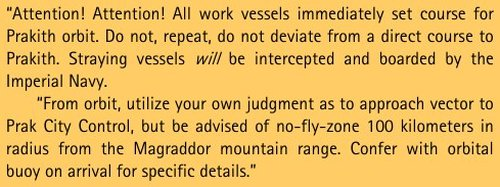
- **Jekk Seejo** — entry/section: Jekk Seejo's distress call: ""Um... hello? Hello? Um, looking for some help here? Anyone? / "This is Jekk Seejo of the Good Feeling, just out of Prakith. We're ... well, we're stuck. On the Inner Moon . . . Can anyone hear me? Systems are failing—power, life support . . . and then some of the more important stuff. Anyone out there? / "Blast. I think we're really in trouble this time . . ."" Source: *09 - Sword of the Empire* (SWRPG Saga Edition), scan p.5
  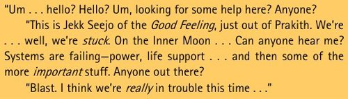

## scan p.6 (scan page 6)

Page contents: Jekk Seejo sidebar: Incom enthusiast and would-be explorer/test pilot whose Clone Wars clunker served as a guinea pig; reduced to subcontractor as COMPNOR purged aliens. No Good Deed Goes Unpunished: mynock swarms stowed away (condition track damage, Perception/Mechanics/Use Computer DCs, landing penalties). (hand-read)

### Stat block notes (game mechanics, not feats)

- Jekk Seejo CL5: Medium middle-aged Duros nonheroic 6/noble 3; Force 3; Init +2, Perception +5; Basic, Binary, Durese, Mon Calamarian, Sullustese; Ref 15, Fort 12, Will 16; hp 17, threshold 12; sporting blaster pistol +7 (3d4+1); Str 9, Dex 13, Con 9, Int 17, Wis 12, Cha 16; Talents Coordinate, Educated; Feats Skill Focus (Use Computer, Knowledge [physical sciences, technology]), Skill Training (Persuasion, Pilot), Starship Designer, Tech Specialist, Weapon Proficiency (heavy weapons, pistols); Knowledge (physical sciences) +17, Knowledge (technology) +17, Mechanics +12, Persuasion +12, Pilot +10, Use Computer +17; owns the Good Feeling. (Source: *09 - Sword of the Empire* (SWRPG Saga Edition), scan p.6)
- Mynock Swarm (15) CL3: Medium space-dwelling beast 2; Ref 15, Fort 15, Will 12; hp 42, threshold 25; fly 10 (space only); 2 wing buffets +0 (1d4); Running Attack; survive in vacuum, fly through space, pack traits; retreat at two swarms or fewer. (Source: *09 - Sword of the Empire* (SWRPG Saga Edition), scan p.6)

## scan p.7 (scan page 7)

Page contents: Prak City read-aloud: Prakith of tortured ridges and canyons rivals Utapau and Tatooine for bleakness; the obsidian spire of the Citadel Inquisitorius in the Magraddor Range; Prak City is half frontier town, half military base. The Station Master demands a Port Licensed Contractor inspection. Gather Information Q&A with Imperial personnel. Fear the Inquisitor sidebar: Force power use within 100 km triggers an opposed Use the Force (1d20+19); exceptions for Stereb caves and the gray fear moss. The Mother Lode cantina (run by a female Bothan); construction-worker rumors DC 15–25. (hand-read)

## scan p.8 (scan page 8)

Page contents: Rumor tables: construction workers DC 30 (a perfectly flat clearing for the Citadel's foundation, cleared by unknown hands); miners (Asonel, Geddis, Herkeath, Rilkean mines; gems; cave-ins; Geddis hiring muscle; no interconnection with the Magraddor Range); aliens (COMPNOR pressure, disappearances, a possible native population). Old Man Geddis (Myrum Geddis, 70). Seejo Again: COMPNOR agents roll Seejo in a barrel toward the Drains; encounter "Saving Seejo"; the Drains lead to the Devourer in the Dark. (hand-read)

- **Jekk Seejo** — entry/section: COMPNOR agents and Seejo: ""You drunks stand aside," the first one yells. "This isn't your affair!" / Seejo, panicking, seems to think that it is. "Don't let them have me!" ... "They're going to throw me down the Drains," he says. "Help me!" / "Get in our way, will you? Well, you can share what's coming to the skinbag here!"" Source: *09 - Sword of the Empire* (SWRPG Saga Edition), scan p.8
  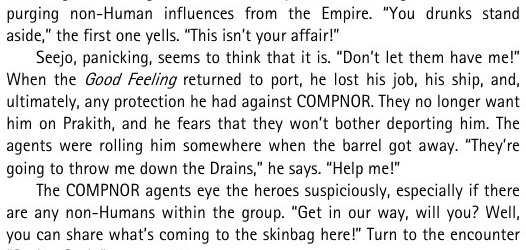

## scan p.9 (scan page 9)

Page contents: Seejo, jobless, offers to inspect the heroes' ship (a later escape route and Destiny reward). Variant: Entering the Underworld via the Geddis mine (Thaarke Corporation uses enslaved Stereb). A Shadowy Figure: Herdr'tui, a Wookiee-tall, ruddy-skinned Stereb, lost in Prak City. (hand-read)

- **Jekk Seejo** — entry/section: Seejo begs for work: ""Trust me! I'll have a tool kit this time! I'll deliver your ship to you, wherever you are!"" Source: *09 - Sword of the Empire* (SWRPG Saga Edition), scan p.9
  

### Stat block notes (game mechanics, not feats)

- Herdr'tui CL8: Medium Stereb nonheroic 6/scout 4/noble 2; Force 3; Init +7, darkvision, Perception +16; Stereb, Basic; Ref 20, Fort 23, Will 19; hp 76, threshold 28; club +11 (1d6+6), sling +9 (1d4+3); Str 16, Dex 13, Con 16, Int 12, Wis 10, Cha 10; Talents Coordinate, Hidden Movement, Improved Stealth; Feats Bantha Rush, Dodge, Improved Damage Threshold, Improved Defenses, Mobility, Running Attack, Shake It Off, Skill Focus (Perception), Skill Training (Endurance, Perception, Stealth), Weapon Proficiency (simple); Endurance +14, Mechanics +17 (stoneworks only), Stealth +12, Survival +11 (+16 underground). (Source: *09 - Sword of the Empire* (SWRPG Saga Edition), scan p.9)

## scan p.10 (scan page 10)

Page contents: Down the Drains: Inquisitors on a Work Zone sweep ("Curious Inquisitor" encounter); Herdr'tui slides down one of the Drains (80-degree bore-holes) to the Devourer in the Dark; variant: Response Team tosses characters into the Drains as execution. (hand-read)

- **No single roster character (rules/setting/general)** — entry/section: Inquisitorius patrol: ""Halt!" comes the call. "You there! Halt on command of the Inquisitorius!"" Source: *09 - Sword of the Empire* (SWRPG Saga Edition), scan p.10
  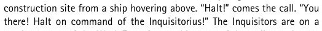

## scan p.11 (scan page 11)

Page contents: Surface map (Citadel Inquisitorius, spaceport, Rilkean, Geddis and Stereb sites, Underground Sea). (hand-read)

## scan p.12 (scan page 12)

Page contents: Part 2: Underworld—the drop down the tubes (1d20+20 vs Fortitude, 1d6); the trash cavern and the greethka, a living garbage disposal; retrieving the greethka's nucleus (DC 25 Knowledge (life sciences)) lets Herdr'tui raise a new one; Herdr'tui is a herder. Stereb species sidebar (fresh OCR): "hairless Wookiees", ~2.2 m, pale red to brown, found on Serroco, Prakith and elsewhere, possibly ancient slave labor; names with function prefixes (herdr herder, eldr elder, helr healer); +4 Str, +2 Con, –2 Dex, –2 Int, –2 Cha; darkvision but colorblind; Primitive; Subterranean; Tough (+5 damage threshold, +2 Fortitude); conditional Skill Focus (Mechanics) with stone. (hand-read)

## scan p.13 (scan page 13)

Page contents: Variant: Mission for the Stereb. The Nerve Center: grotto of eight tunnels and eight rubble piles; the eight elders; leader Eldr'har speaks in plural pronouns. Knowledge checks reveal the Stereb believe they are the planet's antibodies (Herders, Hewers, Feeders, eight sectors); Ad Hoc XP CL18 and +5 Persuasion with Stereb. (hand-read)

- **Eldr'har** — entry/section: Eldr'har addresses the heroes: ""You are not a part of us. Yet you have brought a part of us back to us. You are not harmful to Prakith—you have helped Prakith. There is so much illness to Prakith—we are beset with it. We hope you have come to this place to help Prakith further."" Source: *09 - Sword of the Empire* (SWRPG Saga Edition), scan p.13
  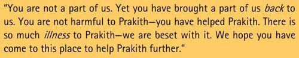

## scan p.14 (scan page 14)

Page contents: Excising a Tumor: Eldr'nol, youngest male elder, shows the petrigram, "the Worldflesh set in stone"; a second cave system near the Geddis mine and old veins toward the Magraddor Range; the Stereb collapsed the connecting passage after miners enslaved their cousins; DC 30 Persuasion (+5 for the biological analogy, +5 for the nucleus); 20 Stereb clear the cave-in (or a five-day solo dig). The Exclave read-aloud (foul air of the slave quarters); DC 20 Stealth; teenage nurse Helr'ven. (hand-read)

- **Eldr'nol** — entry/section: Eldr'nol on the amputation: ""Sister Eldr'har spoke true. A cancer has come to our Prakith. On the flesh, as with those who took our herder son, and in the flesh, as well. What you see inscribed in stone is the record of a desperate act, but an act of love, to save Prakith. / "When the parasites first arrived, we did not know what they were. We hoped they were like us—the Stereb, the greethka, all of us who are part of the whole. But when they took to burrowing, we found they were of another. Foreign bodies, with no respect for Prakith and a danger to the system. / "None alive forgets when their sound-makers and light-makers entered our world. Hundreds of Stereb were at work in what you call the Geddis caves, tending Prakith as is our purpose. The parasites took our cousins and turned them against that purpose, forcing them to join in ravaging our planet's hide. They became part of the cancer, and we had no choice but to amputate."" Source: *09 - Sword of the Empire* (SWRPG Saga Edition), scan p.14
  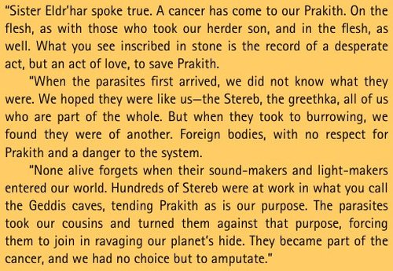

## scan p.15 (scan page 15)

Page contents: Helr'ven starts unfriendly (DC 25 Persuasion); moving eight patients (DC 25 Stealth each; Ad Hoc XP CL11–18). A Path to the Past: reunion of the two colonies. Variant: Coming in From Above sidebar (fresh OCR): entering via the Geddis claim; Thaarke Corporation secretly using Stereb; –5 Persuasion if seen posing as miners; cutting the elevator; Rescue destiny bonus at the start of Part 3. (hand-read)

## scan p.16 (scan page 16)

Page contents: Secret passage west (DC 25 Perception); 100+ km to the Magraddor Range; five speeder bikes. Departure read-aloud ("It is not for the Stereb to have adventures. Others might think of the stars, but the Stereb serve the world."). The Underground Sea: DC 25 Perception every 25 km with speed penalties (2d6+4 collision), DC 25 Survival navigation; read-aloud of the collapsed, flooded chambers. (hand-read)

- **Eldr'nol** — entry/section: Eldr'nol reveals the ancient tunnel: ""You are not of Prakith, but your actions show that you are truly born anew of Prakith. Know, then, the secret kept here. The Stereb have been here longer than memory and have tended far more of the Worldflesh than outsiders know. This tunnel leads to a large system where, in ancient times, our forefolk worked far and wide, and even to the mountains you ask of. / "The way is far—many, many days' walk—and you will find, as they did, that the waters have overtaken much of the way. Death for Stereb lies that way. I cannot know if this affects such as you, but if the peaks are your destination, you will find that we have already worked the roots."" Source: *09 - Sword of the Empire* (SWRPG Saga Edition), scan p.16
  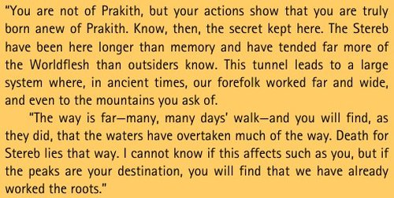

## scan p.17 (scan page 17)

Page contents: Three kilometer-long staircases to a Stereb "pore" near the Citadel's foundation; the fear moss fed on dark side energy and cloaked the approach; Use the Force DC 15/20/25 to avoid detection (else early "Citadel Security Team"). (hand-read)

## scan p.18 (scan page 18)

Page contents: Part 3: read-aloud of the Citadel Inquisitorius at night—a black-on-black spire amid an ancient plaza of eight 100-meter Stereb columns ("pores"), like a sundial; Imperial architects built on the Stereb clearing; possibly Darth Andeddu brought the Stereb to Prakith as slaves. Approaches: fast dash (DC 30 Stealth, DC 25 Use Computer; Route 1) or reconnoiter (two DC 25 Stealth) for the Prisoners' Entrance (Route 2, DC 25) or Service Entrance (Route 3, DC 30); "nobody's ever been crazy enough to assault the Citadel before." Other approaches sidebar (fresh OCR): stolen Inquisitor robes (paired speeders, holographic check-ins, code cylinders), supply transports (weights managed), letting themselves be captured (if identified as Force-users, foes of Valin Draco, or Bail Organa supporters; whole-party capture ends the adventure; Jekk Seejo can help an escape). (hand-read)

- **Darth Andeddu**: "(Indeed, there is a remote chance that Darth Andeddu brought the Stereb to Prakith as enslaved builders in the first place, centuries ago, although this is only a possibility.)" Source: *09 - Sword of the Empire* (SWRPG Saga Edition), scan p.18
  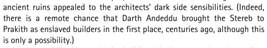

## scan p.19 (scan page 19)

Page contents: Reaching the Top: elevator chokepoints—security levels (A), training center (B), prison level (C); Routes 1 A-A-B-A-C-A, 2 A-A-C-A, 3 A-B-A-C-A; database Will 40; Draco has moved Denia to the torture level; Seejo offers a pickup. Torture Chamber: Denia's cries; an octagonal 30-meter atrium with a suspended platform where Draco and his droids torture her. Another Distress Call: Seejo's fake crash call; DC 15 Jump to the ship; Ad Hoc XP CL18. Embracing Your Destiny: Discovery (deliver Seejo to Bail Organa for debriefing; bonus at the start of Jaws of the Sarlacc). (hand-read)

## scan p.20 (scan page 20)

Page contents: Concluding the Adventure: Bail Organa reassures the heroes by hologram and asks them to return to Lady Alya Aldrete; next comes Jaws of the Sarlacc, the final adventure. (hand-read)

## scan p.21 (scan page 21)

Page contents: Encounter: Saving Seejo (CL18). COMPNOR Supporter (6) CL9 (Human scoundrel 9; Dastardly Strike, Disruptive, Skirmisher, Sneak Attack, Walk the Line; stun batons first). Imperial Sovereign Protectors—"the elite of the elite Royal Guards," on Prakith to receive Force training from the Inquisitors—arrive six rounds later. (hand-read)

- **Jekk Seejo** — entry/section: COMPNOR thug snarls: "The COMPNOR thugs—two, four—no, six!—aren't happy at all to have outsiders meddling with their fun. "If you like Greenie here," snarls one, "maybe you can have what he's having!" This situation has just boiled over." Source: *09 - Sword of the Empire* (SWRPG Saga Edition), scan p.21
  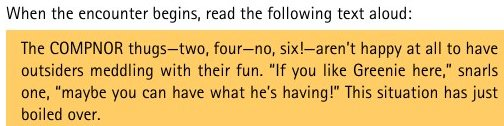

### Stat block notes (game mechanics, not feats)

- Imperial Sovereign Protector (4) CL14: Medium Human nonheroic 6/soldier 6/elite trooper 6; Force 5, Dark Side 13; Init +21; Ref 31, Fort 27, Will 24; hp 105, DR 3, threshold 27; double vibroblade +18 (2d10+9) or two attacks +16; heavy blaster pistol +18 (3d8+6); Talents Armored Defense, Exotic Weapon Mastery, Flurry Attack (double vibroblade), Harm's Way, Improved Armored Defense, Weapon Specialization (advanced melee); Feats Dual Weapon Mastery I–II, Martial Arts I–II, Power Attack, Quick Draw, Skill Focus (Initiative), etc.; Royal Guard armor painted black. (Source: *09 - Sword of the Empire* (SWRPG Saga Edition), scan p.21)

## scan p.22 (scan page 22)

Page contents: Sovereign protector tactics; conclusion (COMPNOR flee at 1/4 hp; slow Imperial response); features and map (worker living quarters, cantina). (hand-read)

## scan p.23 (scan page 23)

Page contents: Encounter: Prak City Security Force (CL17) read-aloud ("Sirens! ..."). Prak City Guard Squad CL14 (Large squad, hp 294, blaster rifle +27 3d8+9 devastating 5). Prak City Squad Commander CL11 (Clone Wars veteran; nonheroic 4/soldier 5/officer 5; Basic, Bocce, High Galactic; Born Leader, Assault Tactics, Deployment Tactics). (hand-read)

## scan p.24 (scan page 24)

Page contents: Squad Commander feats and tactics (demands surrender). Swift Assault 5 Hovercraft CL10 (Gargantuan; hp 150, DR 15, SR 20; double blaster cannon, double laser cannon, concussion missiles; crew 4, passengers 6; 75,000 credits). Conclusion: reinforcements in 5 turns; FSD-6D surveillance droids; captured heroes go to the Citadel prison level; escape down a Drain. (hand-read)

## scan p.25 (scan page 25)

Page contents: Prak City Security Force encounter map. (hand-read)

## scan p.26 (scan page 26)

Page contents: Inquisitor Jorad sidebar: once a Jedi Guardian, spared after Order 66 when found and turned by the Inquisitorius—"Always too prideful for the Jedi Order, his conversion was not difficult"; hopes for a big arrest to get off patrol duty. (hand-read)

- **Jorad** — entry/section: Inquisitor Jorad introduces himself: "A vision in red and black steps from the shuttle, flanked on all four sides by guards. They all stop at once as the Inquisitor looks at you. "I am Inquisitor Jorad," he says, his nasal voice dripping with disdain. "And I am most interested in who you might be. My time away from the Citadel is seldom rewarding, but something tells me that you will make this a very interesting trip! Very interesting indeed."" Source: *09 - Sword of the Empire* (SWRPG Saga Edition), scan p.26
  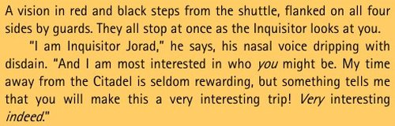

### Stat block notes (game mechanics, not feats)

- Inquisitor Jorad CL12: Medium Human Jedi 7/scoundrel 2/Force adept 3; Force 7, Dark Side 5; Init +19 (Force Intuition), Perception +14; Basic, Bocce; Ref 27, Fort 24, Will 29; hp 59, threshold 24; lightsaber +15 (2d8+6) or lightsaber +13 and blaster pistol +11 (3d6+6); Force Powers (Use the Force +19) Force slam, mind trick, negate energy, rebuke; Force Power Mastery (negate energy); Talents Dastardly Strike, Disciplined Strike, Elusive Target, Empower Weapon, Force Intuition, Lightsaber Defense +2; Feats Acrobatic Strike, Dual Weapon Mastery I–II, Force Training (2), Force Sensitivity, Point Blank Shot, Precise Shot, Skill Focus (Use the Force), Weapon Finesse, Weapon Focus; self-built lightsaber, Inquisitorius uniform, tracking device, code cylinder. (Source: *09 - Sword of the Empire* (SWRPG Saga Edition), scan p.26)

## scan p.27 (scan page 27)

Page contents: Jorad's tactics (capture Force-users alive; feint with mind trick, Dastardly Strike, Force slam; empowers his lightsaber before combat; takes hostages). Theta-class Shuttle CL12 (Starships of the Galaxy p141; expert crew; quad laser cannon 6d10x2). Conclusion: Jorad's code cylinder aids entry to the Citadel; shuttle has a tracking device. (hand-read)

## scan p.28 (scan page 28)

Page contents: Curious Inquisitor encounter map. (hand-read)

## scan p.29 (scan page 29)

Page contents: Encounter: Devourer in the Dark (CL18): three 80-degree tubes to Locations 1–3; read-aloud of the stomach-like cavern with bioluminescent slime. Dinko Horde (8) CL5 (Diminutive pack; poison 1d20+8, stench 1d20+5, motion-sensitive vision, scent; 40 dinkos run as eight hordes). (hand-read)

## scan p.30 (scan page 30)

Page contents: Greethka sidebar: gelatinous masses that eat everything; normally 2 m wide; this one grew uncontrollably on Imperial trash. Read-aloud ("Wait—that's not water..."). Greethka, Giant CL16 (Huge; hp 216; 3 pseudopod slams +23; envelop 2d8+30; heat sense, tremorsense, double damage from sonic weapons). Conclusion: retrieve the glowing nucleus; features (low light –2/–5; only exit is underwater south). (hand-read)

## scan p.31 (scan page 31)

Page contents: Devourer in the Dark encounter map. (hand-read)

## scan p.32 (scan page 32)

Page contents: Encounter: Stereb Exclave (CL19) read-aloud (mine guards and a laser-borer exoskeleton in the anteroom; "you know hired muscle when you see it"); four tunnels (elevator, 14 chained Stereb slaves, laser borers, droids). Mine Guard (8) CL2 (Thaarke Corporation foremen, "would sell their mothers if the price was right"). Laser Borer (3) CL14 (3-meter two-legged walking laser platform). (hand-read)

## scan p.33 (scan page 33)

Page contents: Laser borer stats (fragmentation burst, claws 1d6+11x2, borer 5d10x2). PK-2M Mining Droid (6) CL2 ("comic relief" pushing ore carts). Aratech 74-M Speeder Bike (5) CL1. Conclusion and features (250 m to the elevator; only Stereb elders can open the secret door). (hand-read)

## scan p.34 (scan page 34)

Page contents: Stereb Exclave encounter map. (hand-read)

## scan p.35 (scan page 35)

Page contents: Encounter: Underground Sea (CL19) read-aloud ("this is no place to come for a vacation"); gray fear moss masks Force use (DC 32 Use the Force to sense, DC 27 Perception to spot). Gray Fear Moss sidebar (Force trance like Morichro; feeds on adrenaline; enlarged by the Citadel's dark forces) and read-aloud. (hand-read)

### Stat block notes (game mechanics, not feats)

- Gray Fear Moss CL18: Colossal Force-using beast 18; Force 8, Dark Side 8; Init +17, Force sight; Ref 3, Fort 25, Will 13; hp 351, threshold 75; 5 tentacle slams +23 (3d6+19), reach 4–5; Force stun, mind trick (3), Use the Force +22; camouflage, tentacle grab (2d6 per round), fear toxin (1d20+10 vs Will, paralyzing fear); can't detect Yuuzhan Vong or ysalamiri. (Source: *09 - Sword of the Empire* (SWRPG Saga Edition), scan p.35)

## scan p.36 (scan page 36)

Page contents: Fear moss tactics (waits until heroes are beneath it; mind trick lure; Force stun on critical hitters). Features: only 3 squares between ceiling and water; depth knee-deep/1 m/3 m. (hand-read)

## scan p.37 (scan page 37)

Page contents: Encounter: Citadel Security Team (CL19) read-aloud ("Who'd be crazy enough to try to break in here—except you?"); ground sweeps to 5 km, air sweeps on 74-M bikes to 25 km. Citadel Watchman (2) CL9 (Imperial Intelligence-trained, red and black stormtrooper armor matching Inquisitor robes). 501-Z Security Droid Squad (4) CL13 (Threats of the Galaxy p155). (hand-read)

## scan p.38 (scan page 38)

Page contents: 501-Z squad systems and tactics (record the battle); conclusion: droids upload the holorecording, alerting the Citadel to the heroes' abilities. (hand-read)

## scan p.39 (scan page 39)

Page contents: Encounter: Storming the Tower (CL20): (A) office level—Citadel Guardsman ×4, Inquisitor; (B) training level—Inquisitor Recruits ×4, Inquisitor; (C) prison level—Guardsman ×3, Recruit, Inquisitor; DC 31 Use the Force at each section; read-alouds ("Who's their decorator here—Darth Vader? ... blood-red and night-black"; the training level's huge holographic map of Prakith lit up with dots—"First Prakith, then the galaxy."); prisoners say Denia was taken upstairs. Citadel Guardsman CL10 (soldier 10). (hand-read)

## scan p.40 (scan page 40)

Page contents: Guardsman tactics. Inquisitor Recruits CL10 (soldier 7/Jedi 3; Dark Side 14; dark rage, Force grip, surge; Damage Reduction 10, Indomitable, Tough as Nails). Inquisitor CL17 sidebar ("the cream of the crop"; fight to the death, not above killing their own recruits). (hand-read)

### Stat block notes (game mechanics, not feats)

- Inquisitor CL17 (Citadel): Medium Human Jedi 7/Jedi Knight 5/Force adept 5; Force 7, Dark Side 14; Perception +21, Force Perception; Ref 32, Fort 30, Will 33; hp 130; lightsaber +20 (2d8+8) and short lightsaber +18 (2d6+8), +1 die vs Force Sensitivity; Force Powers dark rage, Force grip, Force lightning, Force slam, negate energy, rebuke; Force Power Mastery (Force grip, negate energy), Improved Sense Force, Improved Sense Surroundings; Talents Block, Clear Mind, Dark Presence, Deflect, Force Haze, Force Perception, Gauge Force Potential, Inquisition, Power of the Dark Side, Shii-Cho; Feats Dual Weapon Mastery I–II, Whirlwind Attack, etc. (Source: *09 - Sword of the Empire* (SWRPG Saga Edition), scan p.40)

## scan p.41 (scan page 41)

Page contents: Storming the Tower Maps A and B; slate-black unbreakable windows overlooking the Magraddor Range. (hand-read)

## scan p.42 (scan page 42)

Page contents: Storming the Tower Map C. (hand-read)

## scan p.43 (scan page 43)

Page contents: Encounter: Torture Chamber (CL20): octagonal two-level room, a disc 5 m above on the central pillar with the examination table; catwalks, retractable accessways, control panels (opposed Use Computer); DC 26 Stealth. Read-aloud: "How is it possible to feel hot and cold at the same time? Yet that's how it feels here in the dragon's maw, Draco's torture chamber. You can hear Denia's screams from above. She doesn't have much time." (hand-read)

- **Denia (Jedi); Valin Draco** — entry/section: Denia and the cybernetic Draco: "Denia looks up, beaten and broken, and recognizes you. "I knew... you ... would come." / Draco stands and looks down. He's changed—cybernetically. "I knew you would come, too. I don't know how you made it here, but I'm better than I was before. This time, things will end differently!"" Source: *09 - Sword of the Empire* (SWRPG Saga Edition), scan p.43
  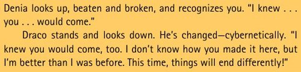

### Stat block notes (game mechanics, not feats)

- Inquisitor Valin Draco (Saga CL 20): CL 20 Human Jedi 7/noble 5/Force adept 7/Force disciple 1 Force 8; Destiny 3, Dark Side 18; Strong in the Force Init +23; Senses low-light vision, Perception +16 Languages Basic, Bocce, Dosh, High Galactic, Honoghran, Huttese Defenses Ref 36 (flat-footed 33), Fort 34 (vs. Force powers 36), Will 40 (vs. Force powers 42) hp 137; Thresh (Source: *09 - Sword of the Empire* (SWRPG Saga Edition), scan p.43)
- Inquisitor Valin Draco CL20: Medium Human Jedi 7/noble 5/Force adept 7/Force disciple 1; Force 8, Destiny 3, Dark Side 18; Strong in the Force; Init +23, low-light vision, Perception +16; Basic, Bocce, Dosh, High Galactic, Honoghran, Huttese; Ref 36, Fort 34 (36 vs Force), Will 40 (42 vs Force); hp 137, threshold 34; immune mind-affecting; lightsaber +20 (2d8+10), Rapid Strike +18 (3d8+10), +1 die vs Force Sensitivity; Force Powers (Use the Force +22) dark rage, farseeing, Force disarm, Force grip, Force lightning (2), Force slam, Force thrust, move object (2), negate energy (2), rebuke (2), surge; Force Power Mastery (Force grip, move object), Improved Move Light Object; Str 10, Dex 16, Con 12, Int 13, Wis 18, Cha 18; Special Qualities Cybernetic Prosthesis (left thumb, right eye: low-light vision, +2 Perception, full ion damage, –2 Use the Force), Indomitable, Master of the Dark Side (three turns per round, at initiative, –10 and –20), Prophet; Talents Attune Weapon, Channel Aggression, Damage Reduction 10, Dark Presence, Deflect, Demand Surrender, Inquisition, Power of the Dark Side, Presence, Redirect Shot, Telekinetic Savant (2); Feats Acrobatic Strike, Force Sensitivity, Force Training (3), Linguist, Melee Defense, Rapid Strike, Skill Focus (Initiative, Persuasion, Use the Force), Strong in the Force, Weapon Finesse, Weapon Focus (lightsaber), Whirlwind Attack; Persuasion +24. (Source: *09 - Sword of the Empire* (SWRPG Saga Edition), scan p.43)

## scan p.44 (scan page 44)

Page contents: Draco tactics (taunts; Force thrust/move object off the catwalks; negate energy; keeps one catwalk extended). TO-D Interrogation Droid (2) CL4 (Threats of the Galaxy p146). Conclusion: at 1/4 hp Draco lightnings Denia, who reflects it back and collapses; or if a hero is about to die, Denia attacks Draco with Force grip; both are badly wounded and Draco escapes with surge. (hand-read)

- **Valin Draco; Denia (Jedi)** — entry/section: Draco's parting threat: ""You may have defeated me today, but you'll not win your prize!"" Source: *09 - Sword of the Empire* (SWRPG Saga Edition), scan p.44
  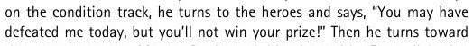

## scan p.45 (scan page 45)

Page contents: Torture Chamber encounter map (Draco, interrogation droids, Master Denia). (hand-read)

## scan p.46 (scan page 46)

Page contents: RPGA session tracking forms. (hand-read)

