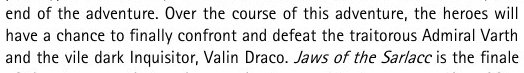
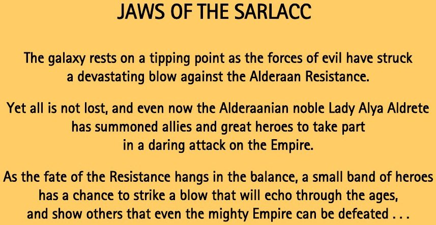
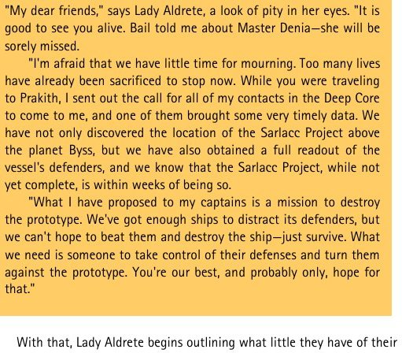
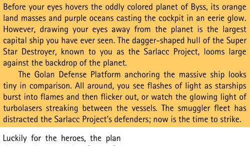
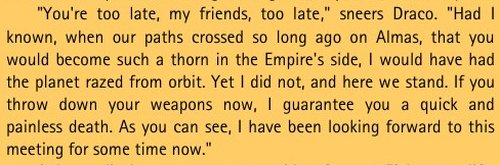
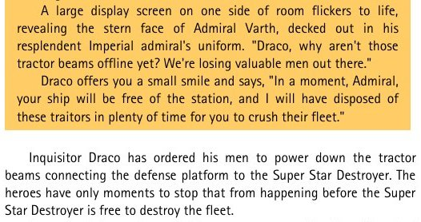
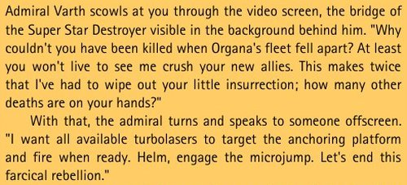
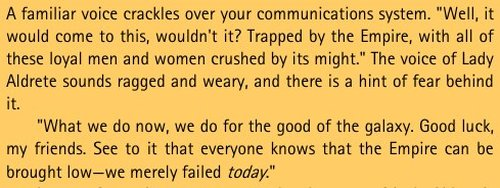

# Owner Material 037 — Star Wars D20 Drive folder (Core, Revised Core and Saga Edition): Adventures/Dawn of Defiance/10 - Jaws of the Sarlacc.pdf [Star Wars Roleplaying Game Saga Edition (2007)]

- **Source:** Wizards of the Coast Star Wars Roleplaying Game books, web enhancements, Living Force campaign modules and articles (2000–2010), from the owner's "Star Wars D20" Drive folder (only the three edition subfolders; "General" was not read, as instructed). Secondary source (licensed Legends reference). Scan OCR'd on the box; the scan stays box-only and is **not** published.
- **Method:** every scanned page was OCR'd and machine-screened sentence by sentence for power-relevant statements (fights, kills, defeats, Force feats, rankings, superweapons) that name a character on our roster; each kept sentence is quoted verbatim from the OCR text and has a crop of the printed passage directly under it. Pages with nothing power-relevant are still listed with what is on them.
- **Citation:** "*10 - Jaws of the Sarlacc* (SWRPG Saga Edition), p.X" by printed page ("scan p.X" where no printed number applies). **Weight:** Licensed RPG material: a secondary source. Narrative text sums up Legends lore; game statistics are rules for players, not canon power levels, and rank lowest.

## scan p.1 (scan page 1)

Page contents: Cover: Star Wars Roleplaying Game, Episode X of Star Wars: Dawn of Defiance, Rodney Thompson. (hand-read)

## scan p.2 (scan page 2)

Page contents: Credits (design Rodney Thompson; editing Ray Vallese; Lucas Licensing editors Leland Chee, Frank Parisi). Intro: Jaws of the Sarlacc is the tenth and final adventure; heroes go to the Deep Core world of Byss where the Sarlacc Project—a massive Super Star Destroyer prototype—is underway; heroes reach 20th level; confront the traitorous Admiral Varth and Inquisitor Valin Draco. What Is Dawn of Defiance? (ten linked adventures after Revenge of the Sith). (hand-read)

- **Valin Draco**: "Over the course of this adventure, the heroes will have a chance to finally confront and defeat the traitorous Admiral Varth and the vile dark Inquisitor, Valin Draco." Source: *10 - Jaws of the Sarlacc* (SWRPG Saga Edition), scan p.2
  

## scan p.3 (scan page 3)

Page contents: Adventure Background: Denia was lost on Prakith; the heroes are now "truly their own masters"; Lady Alya Aldrete summons them. Summary: smuggler fleet plus Resurgence remnants; infiltrate a Golan Defense Platform; final confrontation with Draco; Varth microjumps the Super Star Destroyer; with Blue Squadron, fly in and blow the main reactor. Opening crawl (Episode X, Jaws of the Sarlacc). (hand-read)

- **Alya Aldrete** — entry/section: Opening crawl: "The galaxy rests on a tipping point as the forces of evil have struck a devastating blow against the Alderaan Resistance. Yet all is not lost, and even now the Alderaanian noble Lady Alya Aldrete has summoned allies and great heroes to take part in a daring attack on the Empire. As the fate of the Resistance hangs in the balance, a small band of heroes has a chance to strike a blow that will echo through the ages, and show others that even the mighty Empire can be defeated . . ." Source: *10 - Jaws of the Sarlacc* (SWRPG Saga Edition), scan p.3
  

## scan p.4 (scan page 4)

Page contents: Part 1: A Bold Plan: rendezvous outside a gas cloud in the Deep Core Security Zone; a rag-tag armada; Lady Alya's flagship is a heavily modified Corellian gunship; Captains Adrian Verana and Sirona Okeefe present. Briefing: smuggler fleet jumps into the Beshqek system, feigns retreat; strike team seizes the Golan's weapons. The Calm Before the Storm: GM facts—SSD's engines, life support and weapons are online; the Golan's tractor beams anchor the SSD; fleet survives ~20+20 minutes (+10 with starfighters); slicers can spoof IFF; Admiral Varth commands a skeleton crew and orders tractor shutdown (upward of 30 minutes). (hand-read)

- **Alya Aldrete; Denia (Jedi); Bail Organa** — entry/section: Lady Aldrete's briefing: ""My dear friends," says Lady Aldrete, a look of pity in her eyes. "It is good to see you alive. Bail told me about Master Denia—she will be sorely missed. / "I'm afraid that we have little time for mourning. Too many lives have already been sacrificed to stop now. While you were traveling to Prakith, I sent out the call for all of my contacts in the Deep Core to come to me, and one of them brought some very timely data. We have not only discovered the location of the Sarlacc Project above the planet Byss, but we have also obtained a full readout of the vessel's defenders, and we know that the Sarlacc Project, while not yet complete, is within weeks of being so. / "What I have proposed to my captains is a mission to destroy the prototype. We've got enough ships to distract its defenders, but we can't hope to beat them and destroy the ship—just survive. What we need is someone to take control of their defenses and turn them against the prototype. You're our best, and probably only, hope for that."" Source: *10 - Jaws of the Sarlacc* (SWRPG Saga Edition), scan p.4
  

## scan p.5 (scan page 5)

Page contents: More GM facts: Draco retreated to Byss, his dark meditation revealing his final conflict with the heroes; he commands the defense platform, plans to upstage Varth as a rival for the Emperor's greatest fleet, and has not warned Varth of his visions; the Golan is manned mostly by droids plus the Emperor's hand-picked agents; Varth believes the incomplete SSD can obliterate the smugglers alone. Getting to the Golan: Verana commands Blue Squadron, Okeefe is his wingman and executive officer; Byss read-aloud; patrol of a Skipray blastboat and elite TIE fighters ("Run on the Golan," p10). (hand-read)

- **No single roster character (rules/setting/general)** — entry/section: Arrival at Byss: "Before your eyes hovers the oddly colored planet of Byss, its orange land masses and purple oceans casting the cockpit in an eerie glow. However, drawing your eyes away from the planet is the largest capital ship you have ever seen. The dagger-shaped hull of the Super Star Destroyer, known to you as the Sarlacc Project, looms large against the backdrop of the planet." Source: *10 - Jaws of the Sarlacc* (SWRPG Saga Edition), scan p.5
  

## scan p.6 (scan page 6)

Page contents: Part 2: Aboard the Golan. The Station Interior: battlestation CL20 (Galaxy at War); primary bridge abandoned for an auxiliary bridge near the reactor; main computer Will 31, auxiliary 26; three docking bays (two with 12 TIE fighters each; Bay 616 for shuttles); patrols of two elite Byss stormtrooper squads plus an Imperial officer; security control rooms; sensors (DC 31 Use Computer to slice); Skill DCs 26/31/36/41. Docking Bay 616 holds Draco's Republic Sienar Systems Star Courier. Getting to the Reactor: turbolift shafts. (hand-read)

## scan p.7 (scan page 7)

Page contents: Turbolift shafts encounter (p16); Security Corridor (p18) unavoidable. The Final Showdown read-aloud: auxiliary bridge in red reactor light; cybernetic Draco with red lightsaber, stormtroopers, technicians, two black-robed Imperial Shadow Guards with lightsaber pikes. Keeping the Tractor Beams Active: about 10 rounds; DC 31 Use Computer at five consoles. Get to the Hangar! (hand-read)

- **Valin Draco** — entry/section: Draco on the auxiliary bridge: ""You're too late, my friends, too late," sneers Draco. "Had I known, when our paths crossed so long ago on Almas, that you would become such a thorn in the Empire's side, I would have had the planet razed from orbit. Yet I did not, and here we stand. If you throw down your weapons now, I guarantee you a quick and painless death. As you can see, I have been looking forward to this meeting for some time now."" Source: *10 - Jaws of the Sarlacc* (SWRPG Saga Edition), scan p.7
  
- **Gilder Varth; Valin Draco** — entry/section: Varth and Draco over the display: "A large display screen on one side of room flickers to life, revealing the stern face of Admiral Varth, decked out in his resplendent Imperial admiral's uniform. "Draco, why aren't those tractor beams offline yet? We're losing valuable men out there." / Draco offers you a small smile and says, "In a moment, Admiral, your ship will be free of the station, and I will have disposed of these traitors in plenty of time for you to crush their fleet."" Source: *10 - Jaws of the Sarlacc* (SWRPG Saga Edition), scan p.7
  
- **Gilder Varth; Bail Organa** — entry/section: Varth fires on the platform: "Admiral Varth scowls at you through the video screen, the bridge of the Super Star Destroyer visible in the background behind him. "Why couldn't you have been killed when Organa's fleet fell apart? At least you won't live to see me crush your new allies. This makes twice that I've had to wipe out your little insurrection; how many other deaths are on your hands?" / With that, the admiral turns and speaks to someone offscreen. "I want all available turbolasers to target the anchoring platform and fire when ready. Helm, engage the microjump. Let's end this farcical rebellion."" Source: *10 - Jaws of the Sarlacc* (SWRPG Saga Edition), scan p.7
  

## scan p.8 (scan page 8)

Page contents: Part 3: Into the Sarlacc: an interdiction vessel traps the smuggler fleet; if the tractor beams held, a chunk of the superstructure was ripped free; otherwise Lady Aldrete rams her command ship into the SSD, opening a hole (Captain Verana then proposes the plan). Blue Squadron: 11 starfighters incl. Verana and Okeefe; GM may endanger either captain (dramatic rescues like Han saving Luke in A New Hope). Flying Through the Superstructure: Into the Ship (p24), The Fastest Path (p27), The Main Reactor (p29). (hand-read)

- **Alya Aldrete** — entry/section: Lady Aldrete's last transmission: "A familiar voice crackles over your communications system. "Well, it would come to this, wouldn't it? Trapped by the Empire, with all of these loyal men and women crushed by its might." The voice of Lady Aldrete sounds ragged and weary, and there is a hint of fear behind it. / "What we do now, we do for the good of the galaxy. Good luck, my friends. See to it that everyone knows that the Empire can be brought low—we merely failed today."" Source: *10 - Jaws of the Sarlacc* (SWRPG Saga Edition), scan p.8
  

### Stat block notes (game mechanics, not feats)

- Lady Aldrete's sacrifice (variant): If the heroes failed to keep the tractor beams up, Lady Aldrete's command ship rams the Sarlacc Project: "At the moment of impact, when Lady Aldrete's ship slams into the side of the Sarlacc Project, there is a bright flash of light and a short burst of static over the comm. In seconds, the light from the explosion fades, and her ship is no more." (Source: *10 - Jaws of the Sarlacc* (SWRPG Saga Edition), scan p.8)

## scan p.9 (scan page 9)

Page contents: Main reactor: deflector shield, proton torpedoes or sacrifice (collision). Getting Back Out: Pilot DC 26 then DC 31 or die; the Sarlacc Project explodes, taking Admiral Varth with it. Concluding the Campaign (began with rescuing a supposed Imperial traitor on Felucia). Long-Term Repercussions: the Empire later builds the Executor; other rebellions see resistance can succeed; the Empire delays rebuilding, giving time to build fleets that feed the Rebel Alliance Navy; dead heroes remembered as martyrs; Jedi heroes might leave for the Unknown Regions or the Deep Core; Bail Organa becomes an icon, and the Empire's memory of his role is one more mark leading to the destruction of Alderaan. What If They Fail? sidebar: a secret prototype SSD terrorizing the galaxy as seed for a new campaign. (hand-read)

### Stat block notes (game mechanics, not feats)

- Bail Organa after Dawn of Defiance: "As for Bail Organa, after his involvement in the heroes' rise, he becomes an icon around which many rebellious elements rally. However, the Empire does not forget his role in these events, and his involvement is just one more mark against him that results in the eventual destruction of Alderaan." (Source: *10 - Jaws of the Sarlacc* (SWRPG Saga Edition), scan p.9)
- Admiral Varth's fate: "As they make the calculations for the jump, the Sarlacc Project explodes in the background behind them, taking Admiral Varth with it—along with any other ships still inside." (Source: *10 - Jaws of the Sarlacc* (SWRPG Saga Edition), scan p.9)

## scan p.10 (scan page 10)

Page contents: Encounter: Run on the Golan (CL20) read-aloud (three TIE fighters and a Skipray blastboat). Byss Defense Fleet TIE Fighter (3) CL16 sidebar: pilots of Dark Squadron, culled from the best starfighter pilots, ships kept by Sienar Fleet Systems engineers; Assured Attack, Dirty Fighting, Repairs on the Fly, Vehicular Surge; maneuvers devastating hit, engine hit, I have you now, overwhelming assault; laser cannons 4d10+12 x2. (hand-read)

## scan p.11 (scan page 11)

Page contents: Skipray Blastboat CL15 (GAT-12h; hp 230, DR 15, SR 100; heavy ion cannons, heavy proton torpedoes 10d10x2, heavy concussion missiles). Conclusion: fighting too close to the station prevents sneaking aboard. (hand-read)

## scan p.12 (scan page 12)

Page contents: Run on the Golan encounter map. (hand-read)

## scan p.13 (scan page 13)

Page contents: Encounter: Docking Bay 616 (CL20) read-aloud (robed giants with vibro-axes and stormtroopers). First-Generation Imperial Sentinel (3) sidebar: early experiment of the Emperor's inner circle using hidden Byss cloning facilities to corrupt clones physically and through the dark side; reportedly cloned from Force-sensitive individuals; too dangerous to keep long. Elite Byss Stormtrooper Squad (2) sidebar: greatest stormtroopers and a few remaining clone troopers guarding the Emperor's secret sanctum. (hand-read)

### Stat block notes (game mechanics, not feats)

- First-Generation Imperial Sentinel CL18: Large modified Human soldier 7/elite trooper 6/Force adept 5; Force 3, Dark Side 6; Ref 33, Fort 36, Will 30; hp 192, DR 3, threshold 41; vibro-ax +26 (3d10+27), with Powerful Charge and Rapid Strike +26 (4d10+35); battle strike (Force Power Mastery), Improved Sense Surroundings; Int 6, Wis 6, Cha 6; Talents Attune Weapon, Channel Aggression (+5d6), Dark Preservation, Empower Weapon, Greater Weapon Focus/Specialization (advanced melee), Power of the Dark Side, Retaliation Jab, Telekinetic Stability; Feats Bantha Rush, Battering Attack, Deft Charge, Force Sensitivity, Force Training, Power Attack, Powerful Charge, Rapid Strike, Trip, etc. (Source: *10 - Jaws of the Sarlacc* (SWRPG Saga Edition), scan p.13)

## scan p.14 (scan page 14)

Page contents: Elite Byss Stormtrooper Squad CL13 (Large squad soldier 7/elite trooper 3; hp 200; Comrades in Arms, Focused Targeting, Double Attack, Triple Crit). Conclusion. (hand-read)

## scan p.15 (scan page 15)

Page contents: Docking Bay 616 encounter map. (hand-read)

## scan p.16 (scan page 16)

Page contents: Encounter: Turbolift Shafts (CL20) read-aloud (black spheres bisected by a disc, heavy repeating blasters). Shadow Security Droid (4) sidebar: first experiments leading to the shadow droid; the consciousness of a living being transplanted through dark side Force techniques into the droid brain. (hand-read)

### Stat block notes (game mechanics, not feats)

- Shadow Security Droid CL17: Small droid (4th-degree) soldier 7/elite trooper 10; Force 2, Dark Side 18; darkvision; Ref 35, Fort 34, Will 32; hp 128, DR 5; fly 8; heavy repeating blaster +21 (3d10+12, crit 19–20/x3, devastating 5), Burst Fire 5d10+12, up to triple attack; Dark Entechment (self-destruct 5d10 Force damage, –5 Use the Force), Improved Suppression Fire, Relentless Attack, Indomitable; Feats Burst Fire, Double/Triple Attack, Triple Crit, Unstoppable Force, etc. (Source: *10 - Jaws of the Sarlacc* (SWRPG Saga Edition), scan p.16)

## scan p.17 (scan page 17)

Page contents: Turbolift Shafts map; features (two landings, four service outcroppings every 4 squares, ladder). (hand-read)

## scan p.18 (scan page 18)

Page contents: Encounter: Reactor Access Corridor (CL20) read-aloud (bulkheads, blast doors, E-Web). Elite Byss Stormtrooper Gunner CL13 (E-Web +19, 3d12+9; Heavy Weapon Emplacement +5). Elite Byss Stormtrooper (3) CL10. (hand-read)

## scan p.19 (scan page 19)

Page contents: Advanced Purge Trooper abilities (Improved Bantha Rush 5 squares, Devastating Melee Smash, Cortosis Plating—lightsabers don't ignore its DR, Master of Movement, Staggering Attack); tactics target Jedi. Conclusion: blast doors (lightsaber, DC 31 Use Computer, or DC 31 Mechanics + DC 26 Strength). Features. (hand-read)

## scan p.20 (scan page 20)

Page contents: Reactor Access Corridor encounter map. (hand-read)

## scan p.21 (scan page 21)

Page contents: Encounter: Last Stand of Inquisitor Draco (CL26) read-aloud ("The Imperial officers look frightened for their lives, but they look even more frightened of failing the Inquisitor."). Inquisitor Valin Draco CL20 (same block as Sword of the Empire, without Master of the Dark Side). Tactics: "He sees himself as the future of the Empire, and he believes that to fulfill that role, he must exterminate the Jedi by hand, just as the Emperor did." Elite Shadow Guard sidebar: new force based on the Royal Guard, dispatched on missions by the Emperor himself; lightsaber pike (The Force Unleashed Campaign Guide p199); assigned to Draco supposedly to train as the Emperor's personal bodyguards. (hand-read)

### Stat block notes (game mechanics, not feats)

- Inquisitor Valin Draco CL20 (final): As in Sword of the Empire minus Master of the Dark Side: Jedi 7/noble 5/Force adept 7/Force disciple 1; Force 8, Destiny 3, Dark Side 18; hp 137; Cybernetic Prosthesis (left thumb, right eye), Indomitable, Prophet; seeks to duel Jedi to the death, trusting his Shadow Guards. (Source: *10 - Jaws of the Sarlacc* (SWRPG Saga Edition), scan p.21)
- Elite Shadow Guard CL17: Medium Human Jedi 7/melee duelist 5/Force adept 5; Force 2, Dark Side 11; Ref 36, Fort 31, Will 36; hp 142; lightsaber pike +25 (3d8+14), reach 2; battle strike, dark rage, surge (Force Power Mastery battle strike, dark rage); Talents Attune Weapon, Damage Reduction 10, Empower Weapon, Equilibrium, Force Harmony, Master of Elegance, Psychic Citadel, Single Weapon Flourish I–II, Weapon Specialization (lightsabers); Feats Double Attack, Flurry, Force Sensitivity, Force Training, Melee Defense, Rapid Strike, Savage Attack, Triple Attack, Weapon Finesse, Weapon Focus, Withdrawal Strike. (Source: *10 - Jaws of the Sarlacc* (SWRPG Saga Edition), scan p.21)

## scan p.22 (scan page 22)

Page contents: Shadow Guard abilities and tactics; Elite Byss Stormtrooper Squad (2) CL12. Conclusion: after Draco falls, the station is fired upon; radiation hazards. (hand-read)

## scan p.23 (scan page 23)

Page contents: Last Stand of Inquisitor Draco encounter map (screens). (hand-read)

## scan p.24 (scan page 24)

Page contents: Encounter: Into the Sarlacc's Maw (CL26) read-aloud (spacetrooper clusters repairing the wound). Byss Defense Fleet TIE Fighter (3) CL16. Advanced Construction Spacetroopers (2) sidebar and read-aloud. (hand-read)

## scan p.25 (scan page 25)

Page contents: Spacetrooper Squad CL15 (Huge starfighter; blaster cannon 3d12+5 x2, proton torpedoes 6d10+5 x2; Space Squad). Conclusion. (hand-read)

## scan p.26 (scan page 26)

Page contents: Into the Sarlacc's Maw encounter map. (hand-read)

## scan p.27 (scan page 27)

Page contents: Encounter: Sarlacc Superstructure (CL22) read-aloud; Byss Defense Fleet TIE Fighter (4). (hand-read)

## scan p.28 (scan page 28)

Page contents: Superstructure map; features: hull collisions; interior laser emplacements +28, 4d10x2, point-blank only. (hand-read)

## scan p.29 (scan page 29)

Page contents: Encounter: Main Reactor (CL26) read-aloud ("it is now only a matter of who takes down their target first"); Byss Defense Fleet TIE Fighter (5). Conclusion and features: reactor Ref 16, only torpedoes, missiles or a sacrificing starship can destroy it; –5 Pilot if caught in a dogfight. (hand-read)

## scan p.30 (scan page 30)

Page contents: Main Reactor encounter map. (hand-read)

## scan p.31 (scan page 31)

Page contents: RPGA session tracking forms. (hand-read)

