# Owner Material 037 — Star Wars D20 Drive folder (Core, Revised Core and Saga Edition): Sourcebooks/Galaxy at War.pdf [Star Wars Roleplaying Game Saga Edition (2007)] (scan pages 61–120)

- **Source:** Wizards of the Coast Star Wars Roleplaying Game books, web enhancements, Living Force campaign modules and articles (2000–2010), from the owner's "Star Wars D20" Drive folder (only the three edition subfolders; "General" was not read, as instructed). Secondary source (licensed Legends reference). Scan OCR'd on the box; the scan stays box-only and is **not** published.
- **Method:** every scanned page was OCR'd and machine-screened sentence by sentence for power-relevant statements (fights, kills, defeats, Force feats, rankings, superweapons) that name a character on our roster; each kept sentence is quoted verbatim from the OCR text and has a crop of the printed passage directly under it. Pages with nothing power-relevant are still listed with what is on them.
- **Citation:** "*Galaxy at War* (SWRPG Saga Edition), p.X" by printed page ("scan p.X" where no printed number applies). **Weight:** Licensed RPG material: a secondary source. Narrative text sums up Legends lore; game statistics are rules for players, not canon power levels, and rank lowest.

## scan p.61 (scan page 61)

Page contents: Gutkurr CL8 (savage maul, uncanny tracker). Mastif phalone (Maridun; Amanin starve and release them; "can be more dangerous than a rancor") CL6. Nek (Cyborrea; packs can take the kudana of Rutan; cybernetic armor). (hand-read)

## scan p.62 (scan page 62)

Page contents: Nek CL5. Roggwart (Vendaxa, natural enemy of the acklay): "General Grievous obtains a roggwart and keeps it in his private sanctum on Vassek." Roggwart CL12. Watch-beast (Gamorr, Sirpar). (hand-read)

### Stat block notes (game mechanics, not feats)

- Grievous's roggwart: "General Grievous obtains a roggwart and keeps it in his private sanctum on Vassek." (Source: *Galaxy at War* (SWRPG Saga Edition), scan p.62)

## scan p.63 (scan page 63)

Page contents: Watch-Beast CL5 (defensive awareness, scent). Vehicles and Starships; ground vehicles; Bespin Motors CK-6 Freeco speeder (Orto Plutonia) CL6. (hand-read)

## scan p.64 (scan page 64)

Page contents: Freeco (cont.); SoroSuub S-130 Shelter medical speeder CL4; Ubrikkian WLO-5 speeder tank (Hondo Ohnaka's Weequay pirates add antipersonnel lasers) CL6. Space transports; drop pods. (hand-read)

### Stat block notes (game mechanics, not feats)

- Hondo's speeder tanks: "The Weequay pirates under the command of Hondo Ohnaka use WLO-5 speeder tanks, modifying them to include a pair of antipersonnel laser cannons in addition to their normal armament." (Source: *Galaxy at War* (SWRPG Saga Edition), scan p.64)

## scan p.65 (scan page 65)

Page contents: Drop Pod CL2. Sienar IF-120 Imperial Landing Craft (mobile base) CL13. (hand-read)

## scan p.66 (scan page 66)

Page contents: Haor Chall Penumbra-class attack shuttle (Hondo Ohnaka's gang uses several) CL9; Corellian YU-410 light freighter CL7. (hand-read)

## scan p.67 (scan page 67)

Page contents: Wayfarer-class medium transport (82 m, cargo pods) CL5. Capital ships: Corona-class armed frigate (Hondo Ohnaka uses at least one). (hand-read)

## scan p.68 (scan page 68)

Page contents: Corona-class Armed Transport CL17. Vehicle and starship weapons: Arakyd Caltrop-5 chaff gun; glowing defoliator (Separatist, first tested on Maridun). Vehicle fire effects intro. (hand-read)

## scan p.69 (scan page 69)

Page contents: Battlefield effects: Anti-Personnel, Defender, Droid Hunter, Ground Churner, Heavy Assault, Medevac, Minesweeper, Platoon Leader, Rapid Escape, Recon. (hand-read)

## scan p.70 (scan page 70)

Page contents: Shock and Awe, Shield Breaker, Siege Breaker, Smoker, Sniper Fire, Spotter, Squad Leader, Tank Killer, Terrorizer, Troop Carrier. Gear Requisitioning System intro. (hand-read)

## scan p.71 (scan page 71)

Page contents: Requisitioning rules (levels x 2,000 credits; starships levels x 10,000; half credit rewards); rank and requisitioning. (hand-read)

## scan p.72 (scan page 72)

Page contents: Sample requisitioned gear packages CL1–CL4. (hand-read)

## scan p.73 (scan page 73)

Page contents: Gear packages CL8, CL10 (TX-130T fighter tank). (hand-read)

## scan p.74 (scan page 74)

Page contents: Rank and Privilege; Combining with the Organization System sidebar (The Force Unleashed Campaign Guide); example minor, major and command special orders (mortar strike, air strike, orbital bombardment, etc.). (hand-read)

## scan p.75 (scan page 75)

Page contents: Table 2-8 organization score positive and negative criteria. (hand-read)

## scan p.76 (scan page 76)

Page contents: Multiple heroes with rank: highest organization score commands; rotate by specialty (e.g., the Jedi leads a mission to locate Count Dooku's secret lair; scout for the wilds of Daluuj); heroes choose. (hand-read)

## scan p.77 (scan page 77)

Page contents: Noncommissioned Officers sidebar: Rebel officers are effectively NCOs; "Heroes like Han Solo and Lando Calrissian reach the rank of General quickly, out of necessity."; NCO rank cap 11; academy at Carida; Ensign, Sub-Lieutenant, Second Lieutenant. Art: Hapan noncommissioned officer. (hand-read)

### Stat block notes (game mechanics, not feats)

- Rapid promotion to General: "In the Rebel Alliance (and similar organizations), advancement is so fast that there can be no practical difference between commissioned and noncommissioned officer. Heroes like Han Solo and Lando Calrissian reach the rank of General quickly, out of necessity." (Source: *Galaxy at War* (SWRPG Saga Edition), scan p.77)

## scan p.78 (scan page 78)

Page contents: Table 2-9 Rank and Privilege: titles Recruit through General/Marshal with requisition/command bonus and special orders. (hand-read)

## scan p.79 (scan page 79)

Page contents: Chapter III: Military Campaigns title. (hand-read)

## scan p.80 (scan page 80)

Page contents: Military campaign intro (structured, objectives defined); You're in the Army Now. (hand-read)

## scan p.81 (scan page 81)

Page contents: Military Jargon glossary (10 Percent … Plan B), e.g., Bad Karma (Legacy: Imperial slang for a Sith), Blaster Magnet, Clankers, Esdee Vic, Impstar Deuce, Mandroid, MRU. (hand-read)

## scan p.82 (scan page 82)

Page contents: Leadership; commissioned officers; Generationals; political appointees corrupted the Imperial military under Palpatine's New Order; staff vs line officers. (hand-read)

## scan p.83 (scan page 83)

Page contents: Creating officer NPCs (Leadership/Commando trees, officer prestige class); enlisted troops; NCOs. (hand-read)

## scan p.84 (scan page 84)

Page contents: Creating enlisted NPCs; Military Recruitment (pre-Clone Wars neutral; Palpatine forms the Grand Army; Republic Navy needs nonclone recruits; conscription drives as mass kidnappings); Basic Training and Indoctrination. (hand-read)

## scan p.85 (scan page 85)

Page contents: Basic training (TK designation codes, drill, weapon care, conditioning, combat training). Art: training exercise. (hand-read)

## scan p.86 (scan page 86)

Page contents: Washing Out of Basic (physical, psychological, disciplinary); Tempered by Fire; Starting Out Basic sidebar; The Senses of Combat. (hand-read)

## scan p.87 (scan page 87)

Page contents: Senses of combat (cont.); Surrounded by Death; deadliness math; Living with War. (hand-read)

- **No single roster character (rules/setting/general)** — entry/section: Pull quote: Imperial Manual of the Soldier: ""You are never more than ten minutes from a fully staffed medical facility." —Imperial Manual of the Soldier" Source: *Galaxy at War* (SWRPG Saga Edition), scan p.87
  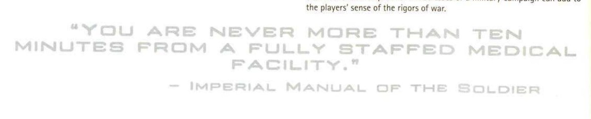

## scan p.88 (scan page 88)

Page contents: After the Fire (ex-soldiers, trauma; ex-Imperial staff sergeant bartender example); Military Adventures (Yavin, Hoth, Coruscant, Geonosis). (hand-read)

- **No single roster character (rules/setting/general)** — entry/section: Pull quote: unnamed Imperial trooper: ""When all that's left are your boots and a pile of ash, being ten minutes from the nearest 2-1B isn't much comfort." —Unnamed Imperial Trooper" Source: *Galaxy at War* (SWRPG Saga Edition), scan p.88
  

## scan p.89 (scan page 89)

Page contents: Designing Military Adventures: scale, composition; objective; sequence of events; cast; briefings. (hand-read)

## scan p.90 (scan page 90)

Page contents: Briefings (misinformation; "The area is patrolled by Kraken's Maulers, an elite cadre of SpecOps troops"); Zero Hour; Extraction and Debriefing. (hand-read)

## scan p.91 (scan page 91)

Page contents: Adventure Example: Planetary Assault (AA guns, fuel depot, tanks, shield generators, capture the president). Mercenary Groups. Art: mercenary captain receives orders from a Separatist commander. (hand-read)

## scan p.92 (scan page 92)

Page contents: Mercenary contracting; Battles in Adventures; Victory Points (Kashyyyk example; Chapter 7 uses it). The Imperial Campaign intro: "How can they lose?" (hand-read)

## scan p.93 (scan page 93)

Page contents: The Imperial Viewpoint sidebar (Palpatine nearly three decades in power by Yavin; propaganda view of rebels as terrorists). Imperial Characters. (hand-read)

- **Palpatine (Darth Sidious)** — entry/section: Galaxy at War (Saga): "The past shows that Emperor Palpatine has single-handedly saved billions of loyal citizens from the enemies of his people, bringing the Republic back from the brink of anarchy, At a time when a strong hand is required control the Senate and the corruption that riddles it, the Emperor is unafraid of doing what is necessary." Source: *Galaxy at War* (SWRPG Saga Edition), scan p.93
  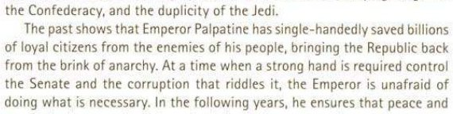

## scan p.94 (scan page 94)

Page contents: Types of Imperial campaigns; Imperials Against Non-Humans ("particularly notable non-Humans make an impact on the war machine—Grand Admiral Thrawn, for example—but these are rare"; Mon Calamari, Kashyyyk slave labor). (hand-read)

### Stat block notes (game mechanics, not feats)

- Notable non-Human Imperial: "On occasion, particularly notable non-Humans make an impact on the war machine—Grand Admiral Thrawn, for example—but these are rare." (Source: *Galaxy at War* (SWRPG Saga Edition), scan p.94)

## scan p.95 (scan page 95)

Page contents: Imperials Against the Rebel Alliance: SpecForce units train indigenous guerrillas. (hand-read)

- **Palpatine (Darth Sidious)**: "Although Emperor Palpatine is never supplanted by a rival during the years of his rule, a number of attempts are made, not all of which have been made public." Source: *Galaxy at War* (SWRPG Saga Edition), scan p.95
  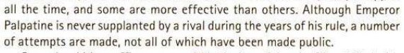

### Stat block notes (game mechanics, not feats)

- Zaarin's treachery: "As the treachery of such Imperial luminaries as Admiral Demetrius Zaarin shows, the Imperial war machine can turn on itself." (Source: *Galaxy at War* (SWRPG Saga Edition), scan p.95)

## scan p.96 (scan page 96)

Page contents: Probe droids; Rebel base hook (Werta system moon, Interdictor, possible trap). Types of Imperial heroes: Stormtroopers (by Yavin at least two-thirds natural-born Humans, one-third clones); Stormtrooper ability requirements sidebar. (hand-read)

## scan p.97 (scan page 97)

Page contents: The Imperial Army (backbone; ability requirements); The Imperial Navy (TIE pilots, Imperial Academy less picky late in the war; requirements); Conscripts, Draftees, and other Undesirables (political officers). (hand-read)

## scan p.98 (scan page 98)

Page contents: Conscript requirements (must be Human). The Upper Echelons (O-3/O-4 officers; requirements). Battlefield Encounter Tool Kit; active and static defenses. (hand-read)

## scan p.99 (scan page 99)

Page contents: Automated sentry guns (IFF); fragmentation and razor wire. Automated Sentry Gun CL2. Art: ARC troopers take cover from an automated sentry gun. (hand-read)

## scan p.100 (scan page 100)

Page contents: Defense device table; fragmentation wire; mines (static, bounding, vehicular; DC 25 Perception); repulsorlift inhibitors; smart mines. (hand-read)

## scan p.101 (scan page 101)

Page contents: Table 3-2 indirect fire ranges; ground-based artillery (Republic artillery gun at Christophsis); mortars. Art: ARC trooper avoids an artillery strike. (hand-read)

## scan p.102 (scan page 102)

Page contents: Artillery weapon table; orbital turbolasers (always long range); Artillery Strikes (forward observer Knowledge (tactics) DC 15). (hand-read)

## scan p.103 (scan page 103)

Page contents: Random Mission Generator Table 3-4; Ambush, Assault, Capture, Cover, Defense, Delay/Hold, Demolition/Denial. (hand-read)

## scan p.104 (scan page 104)

Page contents: Escort, Forward Observation, Interdiction, Pacification/Peacekeeping, Reconnaissance, Reinforcement, Rescue, Retreat/Withdrawal, Search and Destroy. (hand-read)

## scan p.105 (scan page 105)

Page contents: Chapter IV: Military Units title. (hand-read)

## scan p.106 (scan page 106)

Page contents: Military Units intro: fifteen units from the Great Sith War to the Yuuzhan Vong; Katarn Commandos and Wraith Squadron answer to New Republic/Galactic Alliance superiors but choose their own missions; the Mistryl Shadow Guard is beholden to the Eleven Elders of the People. (hand-read)

## scan p.107 (scan page 107)

Page contents: Ailon Nova Guard history (read from page image; OCR garbled): Ailon joined the Republic nearly 13,000 years ago; served the Supreme Chancellor; filled the gap after the Ruusan Reformation (1000 BBY); "Having fought under too-lenient Jedi commanders in Clone Wars debacles such as the Battles of Bassadro and Ord Canfre, the Nova Guard gravitated toward Emperor Palpatine. Under his orders, they slaughtered the Mandalorian Protectors at Norval II"; Empire sent them on suicide missions; they kept winning; Ailon Military Celebrations; near a billion soldiers; after Endor joined the New Republic; helped the Yuuzhan Vong conquer the Inner Rim; crippling postwar sanctions. Art: Ailon Nova Guard soldiers. (hand-read)

### Stat block notes (game mechanics, not feats)

- Nova Guard at Norval II: "Having fought under too-lenient Jedi commanders in Clone Wars debacles such as the Battles of Bassadro and Ord Canfre, the Nova Guard gravitated toward Emperor Palpatine. Under his orders, they slaughtered the Mandalorian Protectors at Norval II, and the Ailon High Marshal welcomed the chance to further serve the galaxy's iron-fisted ruler." (Source: *Galaxy at War* (SWRPG Saga Edition), scan p.107)

## scan p.108 (scan page 108)

Page contents: Nova Guard methods (eklot neurotoxin short sword; divisions), missions (Hutt incursions; Imperial cannon fodder; toppling of King Satyr Azzlectico and the Sundering of Slession; led Yuuzhan Vong vanguards against Cona, Manaan, Zeltros; war games of Ethromite, Oridium, Feldspar armies), rank structure (five-year tour; Ailon Marshalate; High Marshal; First Honors Platoon, 13,000-year history, 7,200+ battle honors). (hand-read)

### Stat block notes (game mechanics, not feats)

- Nova Guard victories: "After millions of honorable deaths, the Nova Guard began adopting scouting and ambush tactics. This development turned what appeared to be certain routs into unlikely victories, including the toppling of King Satyr Azzlectico and the Sundering of Slession." (Source: *Galaxy at War* (SWRPG Saga Edition), scan p.108)

## scan p.109 (scan page 109)

Page contents: Churhee's Riflemen history: formed in the decade after the Clone Wars by Vlaydm Churhee (Army of the First Line, Ulda Frav); Sarin and Parmel Sectors; Y'Trella debacle killed Vlaydm while working for the Empire; widow Maydla Churhee rebuilt it anti-Imperial on Turcan III; Moff Tallis flattened Turcan III; Alliance airlift; returned to Turcan III after Coruscant. Methods: SoroSuub Kylan-15 rifle; droids; Turcan III, Vohai, Parein II. (hand-read)

### Stat block notes (game mechanics, not feats)

- Churhee's Riflemen: "Almost all the Riflemen perished, and their founder, Vlaydm Churhee, was among the dead. The survivors regrouped on Turcan III under the leadership of Vlaydm's widow, Maydla Churhee." … "The Riflemen became such an irritant to the Empire that Moff Tallis eventually flattened Turcan III with a full-scale military assault." (Source: *Galaxy at War* (SWRPG Saga Edition), scan p.109)

## scan p.110 (scan page 110)

Page contents: Riflemen missions (early Imperial jobs incl. Revkinn V; anti-Imperial after Y'Trella; post-Endor Ryoone campaign vs the Empire's Lightning Squadron); rank structure (~240, eight platoons, lances, Frontiersman; Lafrarians, Ri'Dars; Forvish ale). (hand-read)

- **Zgorth'sth** — entry/section: Pull quote: Captain Zgorth'sth on Churhee's Riflemen: ""The Riflemen are worth their high fee, and they should be kept on retainer for future needs." —Captain Zgorth'sth, New Republic Department of Threat Assessment" Source: *Galaxy at War* (SWRPG Saga Edition), scan p.110
  

## scan p.111 (scan page 111)

Page contents: Hapan Royal Guard (Chume'doro) history: ~4050 BBY Jedi annihilated the Lorell Raiders; captives formed Hapes; borders sealed 3100 BBY; Royal Guard ~3000 BBY; Investigative Branch; 8 ABY borders reopened, Ta'a Chume fell in favor of daughter-in-law Teneniel Djo and plotted her death using personal guards; secret war; after the Vong war guards protect Queen Mother Tenel Ka and daughter Allana. Methods (Star Home; unlimited authority; Fountain Snipers, Fountain Gunners, Royal Fliers in Miy'til variants). Missions. (hand-read)

### Stat block notes (game mechanics, not feats)

- Hapan Royal Guard history: "In 8 ABY, the Hapes Consortium reopened its borders. The reigning monarch, Ta'a Chume, fell out of power in favor of her daughter-in-law, the outsider Teneniel Djo. The Royal Guard shifted its allegiance to the new ruler, but Ta'a Chume, still under palace protection, played on her personal guards' loyalty to her and used them to help plot Teneniel's death." … "The end of the Yuuzhan Vong war united the Royal Guard once more, with its members protecting Queen Mother Tenel Ka and her daughter Allana from assassination during the Second Galactic Civil War." (Source: *Galaxy at War* (SWRPG Saga Edition), scan p.111)

## scan p.112 (scan page 112)

Page contents: Royal Guard full mobilization (pirates sometimes led by Hapan noble males; Nova-class battle cruisers); night blindness; rank structure (Royal and Investigative branches; five divisions; Grades 3–1; duels for officer; the Favored, 100 percent female). Art: Hapan Royal Guard. (hand-read)

## scan p.113 (scan page 113)

Page contents: Kaleesh Kolkpravis history: "The only native that most beings have heard of is General Grievous"; ~65 BBY Republic trained the kolkpravis covertly vs the Bitthævrians of Gu'iteica, aided by Jedi incl. Count Dooku and Qui-Gon Jinn; Yam'rii (Huk) invasion; Qymaen jai Sheelal and soulmate Ronderu lij Kummar; the Izvoshra; massacre of Yam'rii; Jedi intervention ended the Huk War; Sheelal renamed himself Grievous in tribute to Ronderu; IBC sabotaged his ship into the Jenuwaa Sea; reborn as a cyborg for Dooku; Bentilais san Sk'ar sole Izvoshra survivor, settled Oben; Captain Thrawn razed Oben; Sk'ar served the Empire; female warrior believed the second incarnation of Ronderu. Art: warriors of the Kaleesh kolkpravis. (hand-read)

### Stat block notes (game mechanics, not feats)

- Bitthævrian war: "Rather than allow their meddling to come to light, the Republic trained the kolkpravis as an insurgent force. Armed with Czerka Outland rifles and covertly aided by Jedi, including Count Dooku and Qui-Gon Jinn, the kolkpravis pitted themselves against the soldiers of Guiteica's m'Yalfor'ac Order." (Source: *Galaxy at War* (SWRPG Saga Edition), scan p.113)
- Origin of the name Grievous: "Sheelal—now calling himself Grievous as a tribute to his companion Ronderu following her death in combat with the Yam'rii—took jobs with the InterGalactic Banking Clan to alleviate his homeworld's misery." (Source: *Galaxy at War* (SWRPG Saga Edition), scan p.113)
- Sk'ar and Oben: "Grievous lived on, reborn as a cyborg to serve Count Dooku in the Clone Wars. Bentilais san Sk'ar, a former revolutionary turned tyrant of the western hemisphere and the only member of the Izvoshra to survive the crash, rallied the kolkpravis." … "After Captain Thrawn was forced to raze Oben as part of his pacification of the fringe territories, Sk'ar left Kalee space to serve the Empire." (Source: *Galaxy at War* (SWRPG Saga Edition), scan p.113)

## scan p.114 (scan page 114)

Page contents: Kolkpravis methods (crash landings; Czerka Outland rifles; Lig swords; shoni spears), missions (suicide attacks; hopscotch tactics), the Izvoshra as Grievous's bodyguards ("After Grievous was apparently killed in the crash of his ship, the institution of the Izvoshra lived on"), rank structure (kamen/blackarm, horde/tarkhan, brigade/baatar, khanate, khagan "held by Grievous"). (hand-read)

- **General Grievous** — entry/section: Pull quote: Kaleesh holy man blessing Grievous: ""General, you are our last hope against the Huk in this war. May the spirits of our ancestors watch over you and your troops." —Kaleesh holy man, blessing Grievous and the Izvoshra prior to a planned attack on Oben" Source: *Galaxy at War* (SWRPG Saga Edition), scan p.114
  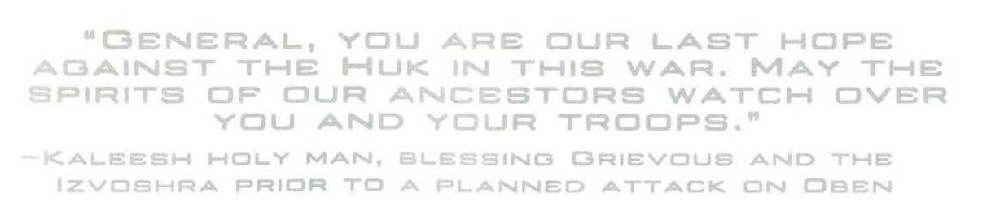
- **General Grievous**: "After Grievous was apparently killed in the crash of his ship, the institution of the Izvoshra lived on." Source: *Galaxy at War* (SWRPG Saga Edition), scan p.114
  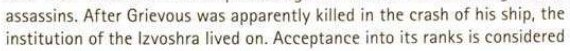

## scan p.115 (scan page 115)

Page contents: Katarn Commandos history: SpecForce 32nd under Bren Derlin; held at Hoth; General Crix Madine recommended them to protect High Command under Mon Mothma; part of General Han Solo's Endor strike team; Lt. Judder Page took over, refused promotion; "Page's Commandos"; Basilisk (Governor Nistola surrendered; General Garret took the capital); Kyle Katarn joined; name tribute to Katarn (or per Wookiee Frorral the predator); Page in the capture of Coruscant and the war against Thrawn; later captain. Methods; General Rieekan quote. (hand-read)

- **Kyle Katarn** — entry/section: Galaxy at War (Saga): "KATARN COMMANDOS HisToORY The Katarn Commandos are the most celebrated black ops unit of the New Republic—the ones who get the call when impregnable strongholds need breaching or invincible superweapons need destroying." Source: *Galaxy at War* (SWRPG Saga Edition), scan p.115
  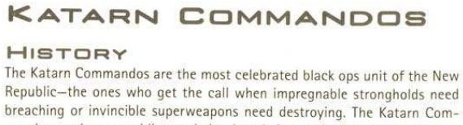
- **Carlist Rieekan** — entry/section: Rieekan on the Katarn Commandos: ""tossing a nest of fire wasps into a bursa's lair and seeing what happens next."" Source: *Galaxy at War* (SWRPG Saga Edition), scan p.115
  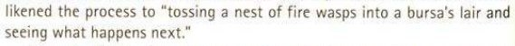

### Stat block notes (game mechanics, not feats)

- Katarn Commandos origin: "The group was founded as the SpecForce 32nd commando unit during the Galactic Civil War under the command of Bren Derlin. They fought tenaciously during the Battle of Hoth, holding off advancing snowtroopers long enough to enable the evacuation of the Rebellion's command staff. In recognition of the efforts of the 32nd, General Crix Madine recommended that the unit be assigned to protect Alliance High Command, directly answerable to commander-in-chief Mon Mothma. The unit fought as part of General Han Solo's strike team during the Battle of Endor, after which Derlin turned the reins of the unit over to Lieutenant Judder Page." (Source: *Galaxy at War* (SWRPG Saga Edition), scan p.115)
- Katarn joins: "Kyle Katarn, one of the New Republic's top operatives, joined Page's Commandos in the New Republic's early years, aiding the team in top-secret missions against Imperial warlords on worlds including Kashyyyk, Boudolayz, and Garos IV. Around this time, the team changed its name to the Katarn Commandos—some say as a tribute to Commander Katarn, although Wookiee member Frorral insisted that the name referred to her homeworld's jungle predator." (Source: *Galaxy at War* (SWRPG Saga Edition), scan p.115)

## scan p.116 (scan page 116)

Page contents: Katarn Commandos missions; rank structure (12 members: specialists listed; "Kyle Katarn sometimes led the team, but more often, he served as its heavy-weapons specialist under Page's direction"; leaping katarn emblem). (hand-read)

- **Kyle Katarn; Judder Page** — entry/section: Sidebar memo: Klavisor to Moff Heedra on the Katarn Commandos: "To: Moff Heedra From: Commander Klavisor, Elliirad Platform Subject: Summary of losses sustained in Rebel attack (attributed to "Katarn Commandos") Body of Message: 2,400 metric tons cargo; 5 exterior fuel modules (S-type); 1 Class-H hypermatter reactor core; 2 Strike-class medium cruisers . . . <MORE>" Source: *Galaxy at War* (SWRPG Saga Edition), scan p.116
  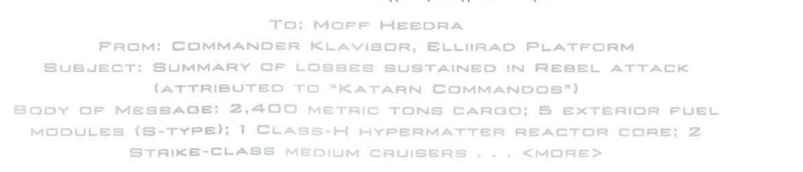
- **Kyle Katarn**: "A perfect mission relies solely on stealth, with enemy forces realizing that the Katarn Commandos has paid a visit only when their ion cannon explodes." Source: *Galaxy at War* (SWRPG Saga Edition), scan p.116
  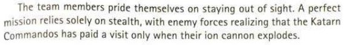

### Stat block notes (game mechanics, not feats)

- Katarn's role: "The commander, a position held by Lieutenant Page but filled by other members when Page was unavailable. Kyle Katarn sometimes led the team, but more often, he served as its heavy-weapons specialist under Page's direction." (Source: *Galaxy at War* (SWRPG Saga Edition), scan p.116)

## scan p.117 (scan page 117)

Page contents: Lightning Squadron history: 91st Reconnaissance Corps, 10 clones with AT-RTs; Herdessa six days after Geonosis; Muunilinst; Daalang (Star Destroyer Eliminator); missions for Mace Windu; siege of Saleucami; Kashyyyk at Order 66; Imperial Army 91st Recon hunting Rebel bases. Art: AT-RT pilots of Lightning Squadron. (hand-read)

### Stat block notes (game mechanics, not feats)

- Lightning Squadron and the Jedi: "Lightning Squadron sometimes undertakes missions directly for Mace Windu and other Jedi generals." (Source: *Galaxy at War* (SWRPG Saga Edition), scan p.117)

## scan p.118 (scan page 118)

Page contents: Lightning Squadron continued: vehicles (armored AT-PT, Aratech 74-Z speeder bike; AT-RT remains the mainstay through the Galactic Civil War; up to 70 km/h; repeating blaster cannon and mortar launcher; AT-RT inertia used as a weapon); missions (gray-zone recon; probing enemy lines; reserve asset for quick strikes—e.g. scout a tunnel to a field HQ, kill the field commander, withdraw; mounted cavalry vs infantry; holomedia image of a soldier charging droids with blaster pistols in each hand); rank structure (10 soldiers under a lieutenant, two sergeants each leading a five-person lance, brevet corporal second; subordinate up to corps commander—Marshall Commander Neyo during the Clone Wars; after the Empire, scout troopers of the Stormtrooper Corps serve with it on floating status). Pull quote from Sergeant Frumm (recorded verbatim from page image; OCR missed the gray display type). (hand-read)

- **Sergeant Frumm** — entry/section: Pull quote: Sergeant Frumm on Lightning Squadron: ""Lightning Squadron! Reckless, snobbish glory-hounds and special-forces wannabes. Yeah, they rejected my application. But I didn't want to join them, anyway." —Sergeant Frumm, hero of the Battle of Vulcusion" Source: *Galaxy at War* (SWRPG Saga Edition), scan p.118
  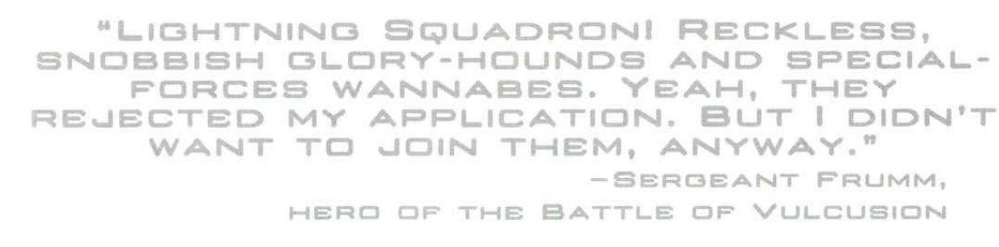

### Stat block notes (game mechanics, not feats)

- Lightning Squadron chain of command: "Within the army's hierarchy, Lightning Squadron is subordinate to its company's captain, its battalion's lieutenant colonel, its regiment's colonel, its legion's senior commander, and its corps' commanding officer (Marshall Commander Neyo, during the Clone Wars)." (Source: *Galaxy at War* (SWRPG Saga Edition), scan p.118)

## scan p.119 (scan page 119)

Page contents: Mandalorian Protectors history: Jaster Mereel's Supercommandos (Mando Ori'ramikade); Death Watch vs. the True Mandalorians of Mereel and Jango Fett; Galidraan; Alpha-02 "Spar" as Mandalore the Resurrector leads 212 Protectors for the Separatists (New Bornalex, New Holstice, Null, Zaadja, Second Kamino); Fenn Shysa designed the BL droids; the Norval II ambush while trying to capture Senator Amidala—only Spar, Shysa and Tobbi Dala survived; post-war Shysa fights the Imperial slaving operation led by the Suprema. Pull quote from Fenn Shysa (verbatim from page image). (hand-read)

- **Fenn Shysa** — entry/section: Pull quote: Fenn Shysa recalling Norval II: ""The war was finally won, but at a terrible cost. Of two hundred and twelve Mandalorian Protectors that went into battle, only three survived." —Fenn Shysa, recalling the Battle of Norval II" Source: *Galaxy at War* (SWRPG Saga Edition), scan p.119
  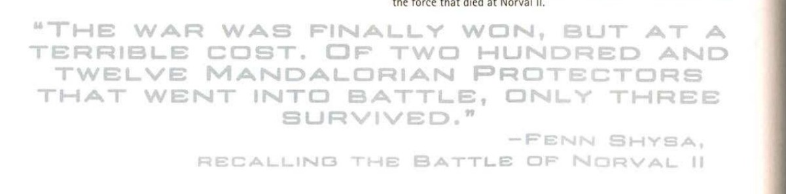
- **Jango Fett**: "The Protectors believed Spar to be the son of Jango Fett, and as inspiration, Spar took the title Mandalore the Resurrector." Source: *Galaxy at War* (SWRPG Saga Edition), scan p.119
  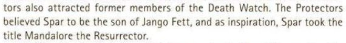

### Stat block notes (game mechanics, not feats)

- Norval II: "The Mandalorian Protectors, 212 strong, enter the Clone Wars on the side of the Separatists, motivated by a hunger for order and by Spar's hatred of the Jedi who had orchestrated the Galidraan massacre. The Protectors hit the Republic hard at the Battles of New Bornalex, New Holstice, Null, and Zaadja, as well as the Second Battle of Kamino." … "Late in the war, the Mandalorian Protectors walk into an ambush on Norval II while pursuing a commission to capture Senator Amidala. All of them perish but three: Spar, Fenn Shysa, and Tobbi Dala." (Source: *Galaxy at War* (SWRPG Saga Edition), scan p.119)
- True Mandalorians: "The roots of the Protectors stretch back to Jaster Mereel's formation of the Mandalorian Supercommandos (Mando Ori'ramikade). During the Mandalorian Civil War of 60-34 BBY, the Protectors' ranks were split into two factions: the rebellious Death Watch and the reformist True Mandalorians of Mereel and Jango Fett. The True Mandalorians met their end at the Battle of Galidraan" (Source: *Galaxy at War* (SWRPG Saga Edition), scan p.119)

## scan p.120 (scan page 120)

Page contents: Mandalorian Protectors continued: Tobbi Dala sacrificed himself to destroy the City of Bone; Shysa aids Princess Leia Organa against the Nagai and Tofs, ousts Grand Admiral Takel, and in 5 ABY aids General Luke Skywalker against Lord Shadowspawn; Shysa dies on Shogun in 21 ABY and Boba Fett succeeds him as Mandalore. Methods: jet packs drop into the heart of an enemy camp; Spar's knowledge of clone trooper operations; post-war insurgents with no BL droids. Missions; rank structure (verd'ika private, alor'uus corporal, ruus'alor sergeant, ver'alor lieutenant, alor'ad captain, al'verde commander; all officers alor); membership requires the Six Actions (resol'nare) and the Supercommando Codex; all take orders from Mandalore (Spar during the Clone Wars, Fenn Shysa until 21 ABY). (hand-read)

### Stat block notes (game mechanics, not feats)

- Shysa's Protectors: "Tobbi Dala sacrifices himself in order to destroy the City of Bone and to kill the Suprema." … "Shysa accepts a commission from the Rebellion and assembles a force to aid Princess Leia Organa in the Rebels' post-Endor fight against the Nagai and the Tofs." … "After ousting Grand Admiral Takel from Mandalorian space, the Protectors restore their ranks to full strength. In 5 ABY, they aid General Luke Skywalker during the Inner Rim campaign against Lord Shadowspawn. Many believe that the era of the Mandalorian Protectors ended with Shysa's death on Shogun in 21 ABY. Although Boba Fett succeeds Shysa as Mandalore, he does not continue the Protector tradition and leads the group as a purely mercenary force." (Source: *Galaxy at War* (SWRPG Saga Edition), scan p.120)
- Spar's blitzkrieg: "Spar's inside knowledge of clone trooper operations prompts him to deploy the Protectors as a blitzkrieg force. They order their BL droids to chew at the main battle line while the Protectors use jet packs to drop into the heart of an enemy camp and deliver the killing blow." (Source: *Galaxy at War* (SWRPG Saga Edition), scan p.120)
