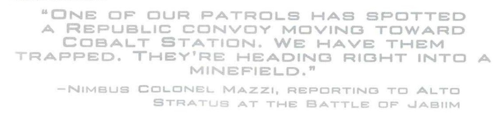
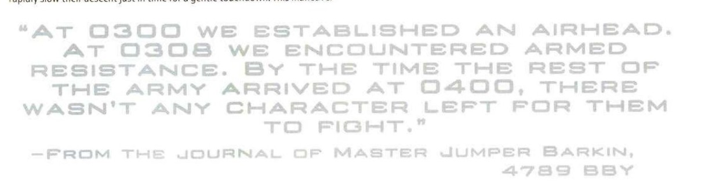
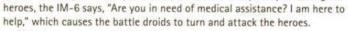
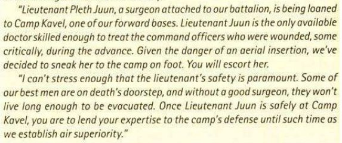
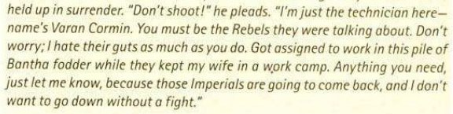

# Owner Material 037 — Star Wars D20 Drive folder (Core, Revised Core and Saga Edition): Sourcebooks/Galaxy at War.pdf [Star Wars Roleplaying Game Saga Edition (2007)] (scan pages 121–180)

- **Source:** Wizards of the Coast Star Wars Roleplaying Game books, web enhancements, Living Force campaign modules and articles (2000–2010), from the owner's "Star Wars D20" Drive folder (only the three edition subfolders; "General" was not read, as instructed). Secondary source (licensed Legends reference). Scan OCR'd on the box; the scan stays box-only and is **not** published.
- **Method:** every scanned page was OCR'd and machine-screened sentence by sentence for power-relevant statements (fights, kills, defeats, Force feats, rankings, superweapons) that name a character on our roster; each kept sentence is quoted verbatim from the OCR text and has a crop of the printed passage directly under it. Pages with nothing power-relevant are still listed with what is on them.
- **Citation:** "*Galaxy at War* (SWRPG Saga Edition), p.X" by printed page ("scan p.X" where no printed number applies). **Weight:** Licensed RPG material: a secondary source. Narrative text sums up Legends lore; game statistics are rules for players, not canon power levels, and rank lowest.

## scan p.121 (scan page 121)

Page contents: Mistryl Shadow Guard history: Emberlene and the Eleven Elders; Silent Hand; Clone Wars aggression and counterattack by the Sun Guards of Thyrsus; the Elders blame Emperor Palpatine; Operation Hammertong; Loruna Scathe and the Azure Cabal. Image caption: Mistryl Shadow Guard. (hand-read)

### Stat block notes (game mechanics, not feats)

- Azure Cabal: "A few members of the Mistryl Shadow Guard who learn the truth of Emberlene's aggression break from the order. The most prominent of these, Loruna Scathe, founds the Azure Cabal and competes for Mistryl's mercenary jobs." (Source: *Galaxy at War* (SWRPG Saga Edition), scan p.121)

## scan p.122 (scan page 122)

Page contents: Mistryl methods (zenji needles, stealth; Team Prime), missions (bodyguard, espionage, assassination, extraction, theft; jobs funnel credits to Emberlene), rank structure (Eleven Elders; Master-Padawan-like apprenticeship; risk of the Elders' corruption being discovered). Pull quote from the Imperial Remnant's Grand Admiral Thrawn stand-in (verbatim from page image). (hand-read)

- **Flim (Thrawn impostor)** — entry/section: Pull quote: the Thrawn stand-in on the Mistryl: ""You can put the weapon away, Major. The Mistryl Shadow Guard does not kill casually or without cause." —The Imperial Remnant's Grand Admiral Thrawn stand-in" Source: *Galaxy at War* (SWRPG Saga Edition), scan p.122
  

## scan p.123 (scan page 123)

Page contents: Nimbus Commandos history (Jabiim): Black Gauntlets, D.E.E.P., Stone Torrent; Alto Stratus coup and alliance with Count Dooku's Separatists; Nationalist Army vs. Loyalists; Shelter Base ambush of Jedi; Stratus died at Cobalt Station; Colonel Mazzi. Image caption: Nimbus Commandos. (hand-read)

### Stat block notes (game mechanics, not feats)

- Stratus allies with the Separatists: "His Nimbus Commandos assassinate key members of the ruling Jabiim Council. Stratus then uses his influence to ally Jabiim with the Separatists." … "The Nimbus Commandos prove especially lethal, destroying AT-ATs with minefields and limpet charges, and slaughtering Jedi forces in an ambush at the Republic's Shelter Base. Stratus loses his life in the final push against Cobalt Station, but his war has been won—a shamed Republic withdraws from Jabiim in defeat." (Source: *Galaxy at War* (SWRPG Saga Edition), scan p.123)

## scan p.124 (scan page 124)

Page contents: Nimbus equipment (repulsorlift skates; Separatist commando blaster rifle; A-Series assassin droid), missions (bodyguards for Stratus; kidnapping, data theft; Hutt clan Gejalli retainer on Nal Hutta), rank structure (Stratus commander-in-chief; Colonel Mazzi after the Battle of Jabiim; Nimbus Trooper, Lieutenant, Master Trooper, Task Unit Commander). Pull quote from Colonel Mazzi (verbatim from page image). (hand-read)

- **Colonel Mazzi; Alto Stratus** — entry/section: Pull quote: Colonel Mazzi to Alto Stratus: ""One of our patrols has spotted a Republic convoy moving toward Cobalt Station. We have them trapped. They're heading right into a minefield." —Nimbus Colonel Mazzi, reporting to Alto Stratus at the Battle of Jabiim" Source: *Galaxy at War* (SWRPG Saga Edition), scan p.124
  

## scan p.125 (scan page 125)

Page contents: Onderon Beast Riders history: drexls, Iziz, Beast Lord Kinch Sunka; c. 4000 BBY Oron Kira and Princess Galia, Jedi help overthrow King Ommin and Queen Amanoa; Mandalorian Wars; Onderon Civil War 3951 BBY (General Vaklu vs. Queen Talia); Skelda clan. Image caption: the Beast Riders of Onderon. (hand-read)

### Stat block notes (game mechanics, not feats)

- Fall of Ommin and Amanoa: "Circa 4000 BBY, Beast Lord Oron Kira begins a secret romance with Galia, the princess of the Iziz ruling family. Helped by the Jedi Knights, the Beast Riders overthrows the Sith-influenced monarchs King Ommin and Queen Amanoa, and Oron Kira becomes the official consort of the new queen." (Source: *Galaxy at War* (SWRPG Saga Edition), scan p.125)
- Onderon Civil War: "Its ranks were later divided during the Onderon Civil War of 3951 BBY. After Onderonian General Vaklu fails in his bid to overthrow Queen Talia, the Beast Riders—except for mercenary holdouts such as the Skelda clan—is united and reorganized under the banner of the Republic." (Source: *Galaxy at War* (SWRPG Saga Edition), scan p.125)

## scan p.126 (scan page 126)

Page contents: Beast Riders methods (armored drexls; Carvers carried on drexl backs for close combat), missions (annihilation of Iziz's monarchy; kidnap raids; elite advance force vs Mandalorian Basilisk riders after the Great Sith War), rank structure (initiates, Warriors, Berserkers; Conquerors and Warlords; Beast Lord holds the title only by fending off challengers in sky combat). Pull quote from Jedi Master Arca Jeth (verbatim from page image). (hand-read)

- **Arca Jeth** — entry/section: Pull quote: Arca Jeth on Onderon: ""What followed now seems almost inevitable—the Onderonian outcasts learned to survive in the wilds, and even to subdue the beasts and conquer them. Onderon became a divided world, one that rapidly degenerated to a state of permanent war." —Jedi Master Arca Jeth" Source: *Galaxy at War* (SWRPG Saga Edition), scan p.126
  

## scan p.127 (scan page 127)

Page contents: Republic Rocket-Jumpers history: c. 11,000 BBY; Second Herglic Feud, Waymancy Storm, Gank Massacres, Quesaya Border Conflict; R-EAU Linemaster; Juggernauts in the Great Droid Revolution (4015 BBY); Minister of Defense Netus and Supreme Chancellor Vocatara; Zim jet pack; motto "from the sands of Socorro to the seas of Seffi." Image caption: rocket-jumper. (hand-read)

## scan p.128 (scan page 128)

Page contents: Rocket-jumper methods (solid fuel slugs; freefall drops to under 100 m), missions, rank structure (Master Jumpers; short life expectancy, free drinks). Pull quote from Master Jumper Barkin's journal, 4789 BBY (verbatim from page image). (hand-read)

- **Barkin** — entry/section: Pull quote: journal of Master Jumper Barkin: ""At 0300 we established an airhead. At 0308 we encountered armed resistance. By the time the rest of the army arrived at 0400, there wasn't any character left for them to fight." —From the journal of Master Jumper Barkin, 4789 BBY" Source: *Galaxy at War* (SWRPG Saga Edition), scan p.128
  

## scan p.129 (scan page 129)

Page contents: Senate Guard / Senate Commandos history: Blue Guard; Senate Commandos become Senator Palpatine's bodyguards after his election in 32 BBY; Palpatine creates the Red Guard; later Imperial Royal Guard, Coruscant Guard, Imperial Senate Guard and Sentinels. Methods (Hijkata martial art), missions. (hand-read)

### Stat block notes (game mechanics, not feats)

- Palpatine and the Senate Guard: "The Senate Commandos become Senator Palpatine's personal bodyguards following his election in 32 BBY. After the outbreak of the Clone Wars, Palpatine hand-selects the most loyal members of the Senate Commando force to create a new bodyguard detail known as the Red Guard." (Source: *Galaxy at War* (SWRPG Saga Edition), scan p.129)

## scan p.130 (scan page 130)

Page contents: Senate Guard rank structure (lieutenants, commanders; Sergeant at Arms seated next to the Supreme Chancellor; Captain of the Guard; Senate Commandos led by a captain, four weeks of extra training). Image caption: a Senate Guard (left) and a Senate Commando (right). (hand-read)

## scan p.131 (scan page 131)

Page contents: Sun Guards of Thyrsus history: Echani, Six Sisters, Bengali Uprising, "son of suns" prophecy; Darth Sidious employs them; Asajj Ventress tasked with eliminating them; survivors join the Royal Guard and Imperial Shadow Guard; Kenix Jir; bounty hunter Moxin Tark; Battle of Sintheti. Image caption: a Sun Guard of Thyrsus. (hand-read)

### Stat block notes (game mechanics, not feats)

- Sun Guards purged: "Near the end of the Clone Wars, Sidious tasks Asajj Ventress with eliminating the order. Of the members of the Sun Guards she spares, some join Emperor Palpatine's Royal Guard. Force-sensitive Sun Guards become candidates for the Imperial Shadow Guard. Others, such as Kenix Jir, are used as cloning templates" (Source: *Galaxy at War* (SWRPG Saga Edition), scan p.131)

## scan p.132 (scan page 132)

Page contents: Sun Guard methods (melee antiair vs Mandalorian jet packs; pikes), missions (crusades vs Echani cousins; high-priced mercenaries), rank structure (Stellar Tribune, Twisuns Legate, Twisuns Praetor, Thychani Commander, Thychani Dictator, Supreme Sun Guardian; Kaminoans considered Thychani Commander rank and above as clone templates when Darth Sidious set his plans in motion). (hand-read)

- **Darth Maul** — entry/section: Galaxy at War (Saga): "The Sith Lord's apprentice, Darth Maul, regularly engaged members of the Sun Guards in impromptu practice duels." Source: *Galaxy at War* (SWRPG Saga Edition), scan p.132
  

### Stat block notes (game mechanics, not feats)

- Maul and the Sun Guards: "Sidious also used members of the Sun Guards to protect his hidden Coruscant lair, where they summarily executed any underdweller who got too close. The Sith Lord's apprentice, Darth Maul, regularly engaged members of the Sun Guards in impromptu practice duels." (Source: *Galaxy at War* (SWRPG Saga Edition), scan p.132)

## scan p.133 (scan page 133)

Page contents: Trianii Rangers history: CSA annexes Fibuli; Espo severed hands; Stars' End prison on Mytus VII; colonies; Kunik goddess. Image caption: a Trianii Ranger. (hand-read)

## scan p.134 (scan page 134)

Page contents: Trianii Ranger culture, missions ("Shoot first, ask questions later"), rank structure (punctino, trisector, pyorn, sinth; RX4 patrol boats; Kiree starfighter). Pull quote: daily prayer of the Trianii Rangers (verbatim from page image). (hand-read)

- **No single roster character (rules/setting/general)** — entry/section: Pull quote: daily prayer of the Trianii Rangers: ""Her claws kill our foes and end our own lives in turn. Blessings to Kunik, who settles all scores." —Daily prayer of the Trianii Rangers" Source: *Galaxy at War* (SWRPG Saga Edition), scan p.134
  

## scan p.135 (scan page 135)

Page contents: Wraith Squadron history: wager between Wedge Antilles and Admiral Ackbar; Wes Janson second in command; members Garik "Face" Loran, Myn Donos, Voort "Piggy" saBinring, Jesmin Ackbar, Eurrsk "Grinder" Thri'ag, Hohass "Runt" Ekwesh, Kell Tainer (whose father Janson killed—Tierfon Yellow Aces); Folor base; campaign against Warlord Zsinj; Admiral Trigit and the Implacable; Night Caller; the Lunatic; Razor's Kiss; Selaggis; under Loran: Daala, Black Fleet Crisis, Caamas Document; Yuuzhan Vong war (Jaina Solo as Yun-Harla; Luke Skywalker on Coruscant). (hand-read)

### Stat block notes (game mechanics, not feats)

- Founding of Wraith Squadron: "the squadron actually came to life as the result of a wager between Commander Wedge Antilles and Admiral Ackbar. Antilles, a starfighter ace who saw a military niche halfway between pilot and commando that he could fill, bet Ackbar that he could whip 10 washout flyers into fighting shape and build a hybrid unit." … "and Kell Tainer, the son of a man that Wes Janson had been forced to kill during his time with the Tierfon Yellow Aces." (Source: *Galaxy at War* (SWRPG Saga Edition), scan p.135)
- Wraiths vs Zsinj: "After the members of Wraith Squadron captured the enemy corvette Night Caller and posed as the vessel's crew, they wormed their way into Zsinj's operation and set a trap for Admiral Trigit at Ession. Their efforts culminated in the destruction of the Implacable." … "Zsinj stole the Super Star Destroyer Razor's Kiss, and Wraith Squadron's effort to undo his triumph ended in the Battle of Selaggis. A massive New Republic naval taskforce seemingly ended Zsinj's threat forever." (Source: *Galaxy at War* (SWRPG Saga Edition), scan p.135)
- Wraiths in the Vong war: "During the Yuuzhan Vong invasion, Wraith Squadron helped the Jedi kill yammosk war coordinators. Their diverse specialties allowed squadron members to fool the Yuuzhan Vong into thinking that Jaina Solo was the incarnation of the trickster goddess Yun-Harla and to create undercover disguises for accompanying Luke Skywalker on a mission to enemy-held Coruscant." (Source: *Galaxy at War* (SWRPG Saga Edition), scan p.135)

## scan p.136 (scan page 136)

Page contents: Wraith Squadron methods, rank structure (Loran brevet captain; Antilles commander), specialist roster (demolitions, slicer, mimicry expert, etc.). Image caption: Wraith Squadron. (hand-read)

## scan p.137 (scan page 137)

Page contents: Chapter V: Bases and Battlestations title page. (hand-read)

## scan p.138 (scan page 138)

Page contents: Battlestations intro; The Battlestation Tool Kit. (hand-read)

## scan p.139 (scan page 139)

Page contents: Introduction to Battlestation Design: why use battlestations (Death Stars; Theed Palace reactor chambers, Geonosian droid factory, Endor bunker as film examples; mystery, traps, roles for every class); Determining Purpose; single-adventure and multiple-adventure locations. (hand-read)

## scan p.140 (scan page 140)

Page contents: Background locations; campaign objective (example: a first-Death-Star campaign—steal the plans and funnel them through Toprawa, rescue Princess Leia aboard the station, climax in the station's destruction); example (Clone Wars multiple-adventure station); Determining Function (combat mechanism, haven, superweapon, utility). Left column read from page image (OCR garbled). (hand-read)

## scan p.141 (scan page 141)

Page contents: Combat mechanism (Golan platforms; quarantine stations), haven, superweapon ("Centerpoint Station ... Capable of devastating entire star systems with its powerful interstellar blast"; Death Star as combat mechanism plus superweapon), utility (example: Republic search-and-destroy vs a Confederacy droid factory); Determining Form; mobile space stations. (hand-read)

## scan p.142 (scan page 142)

Page contents: Immobile space stations; starships (Super Star Destroyers and the Eclipse as battlestations); terrestrial battlestations; Considering Adventures; adventure types. (hand-read)

## scan p.143 (scan page 143)

Page contents: Adventure difficulty (the Death Star—heroes survive because they engage only a small portion); Battlestation Challenge Level (1–20; roughly the party's average level). Sidebar: Adapting Existing Environments (asteroid base, crashed spacecraft, volcano base). (hand-read)

## scan p.144 (scan page 144)

Page contents: Table 5-1: Difficulty Classes for Battlestations by CL; using the CL; skill difficulties; battlestation encounters (CL×3); battlestation hazards (damage 10 + ½ CL; attack bonus 2 + CL). (hand-read)

## scan p.145 (scan page 145)

Page contents: Hazards vs defenses; Table 5-2 average damage per die; scaling the rating ("In the same manner that Luke, Leia, Han, and Chewbacca ventured only through certain sections of the Death Star, you can reduce a larger and more dangerous station to a simpler path"); example CL 7; Battlestation Interior Locations; airlock. (hand-read)

## scan p.146 (scan page 146)

Page contents: Airlock breaches and magcon; barracks. Sidebar: Surface Cities (the first Death Star's surface city sprawls; Imperial surface cities like Imperial Center). Map: typical military barracks. (hand-read)

## scan p.147 (scan page 147)

Page contents: Barracks doors and alarms; command bridge (terminals, shutdown buttons, exploding displays, reinforced door, escape pods); backup bridges. Map: typical command bridge. (hand-read)

## scan p.148 (scan page 148)

Page contents: Control rooms (engine/hyperdrive, hangar, security, shields, weapons); corridor (bulkhead cover, luma panels). Map: small control room. (hand-read)

## scan p.149 (scan page 149)

Page contents: Corridor lockers and access hatches; gunnery tower; hangar bay (magcon, crates, slippery and flammable puddles, refueling stations). (hand-read)

## scan p.150 (scan page 150)

Page contents: Hangar fuel tanks, cranes, tractor beams, racks; starship explosions. Sidebar: What Ships Are in the Hangar? Table 5-3: Common Ships in Hangars by faction. Map: personal shuttle hangar. (hand-read)

## scan p.151 (scan page 151)

Page contents: Laboratory (top-secret cloning laboratories of Emperor Palpatine guarded by dozens of soldiers and Sovereign Protectors); medical bay; office. Sidebar: Mundane Locations. (hand-read)

### Stat block notes (game mechanics, not feats)

- Palpatine's cloning labs: "a lab processing a new type of fuel that makes starships 10 percent more efficient probably has a pair of guards at the door and one to three guards inside, whereas the top-secret cloning laboratories of Emperor Palpatine are guarded by dozens of soldiers, towering Sovereign Protectors, and any manner of other nasty (and powerful) troops." (Source: *Galaxy at War* (SWRPG Saga Edition), scan p.151)

## scan p.152 (scan page 152)

Page contents: Office doors and panic buttons; reactor core (stable vs volatile—"Volatile reactor cores allowed the Rebel Alliance to destroy both Death Stars with small amounts of munitions"; shielding; Table 5-4 radiation severity by CL). Maps: typical medical bay, typical reactor core. (hand-read)

## scan p.153 (scan page 153)

Page contents: Coupling stations (read from page image; OCR garbled); tactical command center (war room, +2 Knowledge (tactics)). Map: typical power coupling. (hand-read)

### Stat block notes (game mechanics, not feats)

- Obi-Wan and the tractor beam: "Saboteurs can use these coupling stations to tamper with the power flow to almost any section of the station. For example, Obi-Wan Kenobi deactivated the Death Star's tractor beam by tampering with a coupling station linked to the weapon." (Source: *Galaxy at War* (SWRPG Saga Edition), scan p.153)

## scan p.154 (scan page 154)

Page contents: Internal Defenses: security systems, security control rooms, security cameras, sensors; Table 5-5 sensor precision. (hand-read)

## scan p.155 (scan page 155)

Page contents: Droid detectors (Human replica droids may carry masking devices), heat sensors, motion detectors, sonic sensors, tripwire lasers. (hand-read)

## scan p.156 (scan page 156)

Page contents: Automated defense systems (autoblasters); alarms and responses (levels 1–3, alert and high alert status); Table 5-6 alarm response time. (hand-read)

## scan p.157 (scan page 157)

Page contents: Restricted Access: standard doors; sidebar Doors and the Condition Track; blast doors. (hand-read)

## scan p.158 (scan page 158)

Page contents: Magnetically sealed doors and rooms; blast deviation chart; cutting through doors (plasma portal cutter); shooting control panels; extendable bridges. Sidebar: Plasma Cutters and Battering Rams (cutter Large, 10,000 credits, 110 kg; Squib battering ram from Scum and Villainy). "Tantive IV" confirmed from page image (OCR "Jontive"). (hand-read)

### Stat block notes (game mechanics, not feats)

- Vader's plasma cutter: "In A New Hope, Lord Vader and his stormtroopers used a plasma cutter to break through the door when they invaded the Tantive IV." (Source: *Galaxy at War* (SWRPG Saga Edition), scan p.158)
- Luke shoots the control panel: "For example, when Luke Skywalker and Princess Leia fled a squad of stormtroopers aboard the Death Star, Luke shut the door using a control panel and then shot the panel, sealing the door closed. The downside of this tactic, illustrated so well in the same scene, is that the control panel—which potentially can operate other doors and bridges—will not function until replaced or repaired." (Source: *Galaxy at War* (SWRPG Saga Edition), scan p.158)

## scan p.159 (scan page 159)

Page contents: Force fields; turbolifts; traveling through turbolift shafts; secret rooms and corridors. (hand-read)

## scan p.160 (scan page 160)

Page contents: Sidebar on control panels and access levels; secondary conduits; Computer Systems; main computers (base attitude hostile; Will Defense = medium DC). Sidebar: Single Checks or Gaining Access. (hand-read)

## scan p.161 (scan page 161)

Page contents: Control room computers; access control; alarm system controls; communications controls (HoloNet pirate signal: hard Use Computer). (hand-read)

## scan p.162 (scan page 162)

Page contents: Directing personnel and troop movements; information systems (R2-D2 in the hangar control room finding the tractor beam fast vs Princess Leia's termination orders); life support controls; sensor controls. (hand-read)

### Stat block notes (game mechanics, not feats)

- R2-D2 searches the Death Star computer: "For example, in A New Hope, R2-D2 used a computer in the hangar control room to search for information about the Death Star's tractor beam. The droid found what it needed within a few moments because the tractor beam was part of the hangar bay. On the other hand, finding Princess Leia's termination orders took a bit longer because the detention block computers were not directly connected to the hangar control room." (Source: *Galaxy at War* (SWRPG Saga Edition), scan p.162)

## scan p.163 (scan page 163)

Page contents: Weapons controls; Station Hazards; carbonite freezing chambers (persistent condition, -4 steps; slab 70 hp DR 10); chasms and pits; conveyor belts; crushing damage (the first Death Star's trash compactor). (hand-read)

## scan p.164 (scan page 164)

Page contents: Electrified floors; gas; Table 5-7 poisonous gases (dioxis, korfaise, null gas, obah, trauger); gravity traps. (hand-read)

## scan p.165 (scan page 165)

Page contents: Incinerators; liquid cable traps; power diffusion tunnels; shock locks; trap doors; wind tunnels and exhaust vents. (hand-read)

## scan p.166 (scan page 166)

Page contents: Prisons and cell blocks: standard cells; detention blocks (map: a typical detention block); Jedi imprisonment devices (hovering energy-ribbon binder, -10 to Use the Force). (hand-read)

## scan p.167 (scan page 167)

Page contents: Chapter VI: Military Encounters title page. (hand-read)

## scan p.168 (scan page 168)

Page contents: Chapter VI intro: using mini-adventures ("Bridge 242," "Choke Point," "No Man Left Behind," "Piracy in Deep Space," "A Little R&R," "Remember the Akkalo"); can be strung together as a sub-campaign. (hand-read)

## scan p.169 (scan page 169)

Page contents: Mini-Adventure #1: Bridge 242 (2nd-level; New Plympto, Nosaurians allied with Separatists; Rhigar settlement; 6-hour deadline or orbital bombardment; LAAT/i drop; four explosive charges). (hand-read)

## scan p.170 (scan page 170)

Page contents: Bridge 242 continued: droid patrol and minefield (CL 2); the medical facility (CL 2): battle droids holding an IM-6 medical droid over a dead clone trooper. (hand-read)

- **No single roster character (rules/setting/general)** — entry/section: IM-6 medical droid greets the heroes: ""Are you in need of medical assistance? I am here to help."" Source: *Galaxy at War* (SWRPG Saga Edition), scan p.170
  

## scan p.171 (scan page 171)

Page contents: Encounter: The Big Boom (CL 3): shield generator beneath the southern guard station, shield softener portal, three battle droids and two B2 super battle droids; read-aloud text; conclusion (explosion 10d6 within 4 squares; Republic convoy or orbital bombardment). (hand-read)

## scan p.172 (scan page 172)

Page contents: Features of the Area (illumination, shield softener SR 50, upper level, main guard room, generator room 100 hp DR 5); map of Bridge 242. (hand-read)

## scan p.173 (scan page 173)

Page contents: Mini-Adventure #2: Fields of Fire (4th-level; Pleida in the Tovosh System; escort surgeon Lieutenant Pleth Juun to Camp Kavel); read-aloud briefing by Captain Roff Volane; pay 3,000 credits each (1,000 if Juun dies). (hand-read)

- **Roff Volane; Pleth Juun** — entry/section: Captain Volane's briefing: ""Lieutenant Pleth Juun, a surgeon attached to our battalion, is being loaned to Camp Kavel, one of our forward bases. Lieutenant Juun is the only available doctor skilled enough to treat the command officers who were wounded, some critically, during the advance. Given the danger of an aerial insertion, we've decided to sneak her to the camp on foot. You will escort her. "I can't stress enough that the lieutenant's safety is paramount. Some of our best men are on death's doorstep, and without a good surgeon, they won't live long enough to be evacuated. Once Lieutenant Juun is safely at Camp Kavel, you are to lend your expertise to the camp's defense until such time as we establish air superiority."" Source: *Galaxy at War* (SWRPG Saga Edition), scan p.173
  

## scan p.174 (scan page 174)

Page contents: Fields of Fire continued: Pleth Juun (wealthy Coruscant family; rank insignia make her a sniper target; Persuasion vs Will 19); hitting the trail; difficult passage (CL 4) through the former DMZ; Camp Kavel (one wounded officer dies per day of delay). (hand-read)

### Stat block notes (game mechanics, not feats)

- Pleth Juun's character: "Juun comes from a wealthy Human family on Coruscant and is used to getting her way. She isn't openly confrontational, but she never forgets a slight and does her best to make miserable any character who fails to show her sufficient respect." (Source: *Galaxy at War* (SWRPG Saga Edition), scan p.174)

## scan p.175 (scan page 175)

Page contents: Encounter: Watch Your Step (CL 4): mined incline, two automated sentry guns; Pleth Juun description and stat block; read-aloud text; mines and booby traps. (hand-read)

### Stat block notes (game mechanics, not feats)

- Pleth Juun stat block: "Pleth Juun CL 4 Medium Human noble 4 Force 7; Dark Side 1 Init +8; Senses Perception +9 Languages Basic, Bocce, Cerean, Durese, High Galactic, Huttese, Kel Dor, Ryl Defenses Ref 17 (flat-footed 16), Fort 15, Will 19 hp 28; Threshold 15 ... Talents Presence, Weaken Resolve Feats Cybernetic Surgery, Improved Defenses, Linguist, Skill Focus (Treat Injury), Surgical Expertise, Weapon Proficiency (pistols, rifles, simple weapons) Skills ... Treat Injury +14" — "Despite her arrogance, vindictive nature and battlefield naiveté, she is a gifted surgeon and a loyal soldier." (Source: *Galaxy at War* (SWRPG Saga Edition), scan p.175)

## scan p.176 (scan page 176)

Page contents: Sentry guns (2): Automated Sentry Gun CL 2 stat block (light repeating blaster, braced autofire; 2,500 credits); conclusion; Features of the Area (rough terrain; three mine types—2d6, 4d6, bounding 6d6; DC 15 Mechanics to disarm). (hand-read)

## scan p.177 (scan page 177)

Page contents: Mini-Adventure #3: Remember the Akkalo (6th-level; post-Endor Imperial counterassault on Sulon, moon of Sullust; Rebels seize Akkalo Station and hold it two hours until a stolen Lambda-class shuttle arrives; stolen Imperial code; SoroSuub X-34 landspeeder); read-aloud text; skeleton crew of eight stormtroopers, two heavy stormtroopers, two Imperial officers and technician Varan Cormin. (hand-read)

## scan p.178 (scan page 178)

Page contents: Remember the Akkalo continued: getting inside (Blast 'em!, Sneaking Inside, Using the Code—DC 20 Persuasion with the stolen code); dealing with the holdouts (CL 3; distress call summons troops and an AT-ST in 1 hour); read-aloud: Varan Cormin surrenders. Image caption: the Rebel shuttle on the landing pad. (hand-read)

- **Varan Cormin** — entry/section: Varan Cormin surrenders: ""Don't shoot!" he pleads. "I'm just the technician here—name's Varan Cormin. You must be the Rebels they were talking about. Don't worry; I hate their guts as much as you do. Got assigned to work in this pile of Bantha fodder while they kept my wife in a work camp. Anything you need, just let me know, because those Imperials are going to come back, and I don't want to go down without a fight."" Source: *Galaxy at War* (SWRPG Saga Edition), scan p.178
  

### Stat block notes (game mechanics, not feats)

- Cormin the coward: "Everything that Cormin says is technically correct, although he's a coward who will eventually betray the heroes when the reinforcements arrive. At any point, he does whatever seems necessary to keep his skin." (Source: *Galaxy at War* (SWRPG Saga Edition), scan p.178)

## scan p.179 (scan page 179)

Page contents: Encounter: The Last Stand (CL 6): preparing for the worst (fuel barrels, chain, kits, T8 loading vehicle); the stolen shuttle arrives; Here Comes the Cavalry (CL 6: AT-ST, ten stormtroopers, four heavy stormtroopers); The Traitor (CL 8: Cormin opens the gate and smashes the remote; hold 6 more rounds); Technician Varan Cormin stat block begins. (hand-read)

### Stat block notes (game mechanics, not feats)

- Varan Cormin stat block: "A talented mechanic, Varan Cormin was conscripted by the Empire to provide service at Akkalo Station. Although he dislikes the Imperials, he's a coward at heart, more concerned with his own well-being than with supporting the Rebellion." — "Varan Cormin CL 1 Medium Human nonheroic 4 Dark Side 2 ... Feats Armor Proficiency (light), Point Blank Shot, Skill Focus (Deception, Mechanics), Weapon Proficiency (pistols, simple weapons) Skills Deception +14, Mechanics +14, Perception +3, Use Computer +9" (Source: *Galaxy at War* (SWRPG Saga Edition), scan p.179)

## scan p.180 (scan page 180)

Page contents: Cormin stat block concluded and tactics; T8 Loading Vehicle stat block (5,000 credits); conclusion (CL 8 experience); map of Akkalo Station; Features of the Area (walls 8 m ferrocrete, watchtowers, durasteel gate). (hand-read)

