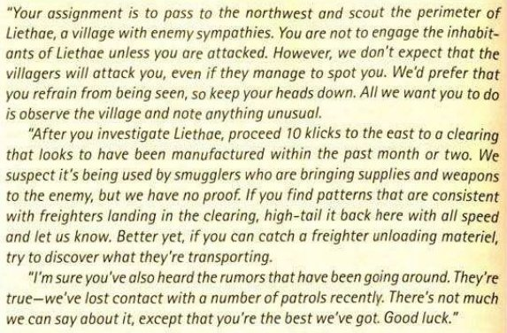
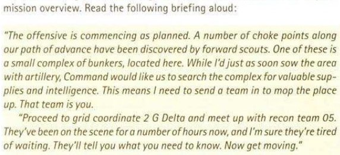
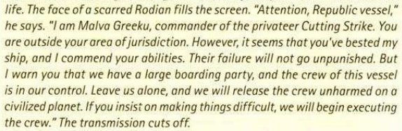

# Owner Material 037 — Star Wars D20 Drive folder (Core, Revised Core and Saga Edition): Sourcebooks/Galaxy at War.pdf [Star Wars Roleplaying Game Saga Edition (2007)] (scan pages 181–198)

- **Source:** Wizards of the Coast Star Wars Roleplaying Game books, web enhancements, Living Force campaign modules and articles (2000–2010), from the owner's "Star Wars D20" Drive folder (only the three edition subfolders; "General" was not read, as instructed). Secondary source (licensed Legends reference). Scan OCR'd on the box; the scan stays box-only and is **not** published.
- **Method:** every scanned page was OCR'd and machine-screened sentence by sentence for power-relevant statements (fights, kills, defeats, Force feats, rankings, superweapons) that name a character on our roster; each kept sentence is quoted verbatim from the OCR text and has a crop of the printed passage directly under it. Pages with nothing power-relevant are still listed with what is on them.
- **Citation:** "*Galaxy at War* (SWRPG Saga Edition), p.X" by printed page ("scan p.X" where no printed number applies). **Weight:** Licensed RPG material: a secondary source. Narrative text sums up Legends lore; game statistics are rules for players, not canon power levels, and rank lowest.

## scan p.181 (scan page 181)

Page contents: Mini-Adventure #4: That Which Does Not Kill Me... (6th-level; scout the village of Liethae and a clearing 10 km east; ambush; Arakyd AZ-Series battle droid); mission briefing read-aloud; the village (sixteen enemy plus four patrolling; Rebel Trooper stats); the ambush (CL 5). (hand-read)

- **No single roster character (rules/setting/general)** — entry/section: Commanding officer's briefing (That Which Does Not Kill Me...): ""Your assignment is to pass to the northwest and scout the perimeter of Liethae, a village with enemy sympathies. You are not to engage the inhabitants of Liethae unless you are attacked. However, we don't expect that the villagers will attack you, even if they manage to spot you. We'd prefer that you refrain from being seen, so keep your heads down. All we want you to do is observe the village and note anything unusual. ... "I'm sure you've also heard the rumors that have been going around. They're true—we've lost contact with a number of patrols recently. There's not much we can say about it, except that you're the best we've got. Good luck."" Source: *Galaxy at War* (SWRPG Saga Edition), scan p.181
  

## scan p.182 (scan page 182)

Page contents: The clearing (landing strut marks; Dilnlexan cigar butts; droid tracks); Arakyd AZ-Series battle droid (cat-and-mouse "sadistic streak," memory-wiped every two or three months); read-aloud; AZ stat block (CL 6; 15,630 credits) and tactics; return to base. (hand-read)

## scan p.183 (scan page 183)

Page contents: Encounter: Unexpected Company (CL 6): DC 26 Perception to spot ambushers; read-aloud texts; Ambusher (6) description and stat block (CL 2); ambusher tactics. (hand-read)

## scan p.184 (scan page 184)

Page contents: Ambusher Officer description, stat block (CL 5; Born Leader, Coordinate, Trust) and tactics (artillery strike, page 101); conclusion (encrypted datapad map); Features of the Area. (hand-read)

## scan p.185 (scan page 185)

Page contents: Mini-Adventure #5: No Man Left Behind (8th-level): Darth Vader's hunt for Moff Kalast on Jabiim; rescue a wounded Rebel intelligence officer from an overrun base; Jabiim's rain blocks repulsorlifts and comms; reaching the base (CL 6: three DC 20 Stealth checks or a patrol); read-aloud: the bunker on the hill. (hand-read)

### Stat block notes (game mechanics, not feats)

- Vader hunts Moff Kalast: "During the Galactic Civil War, Darth Vader ordered a massive hunt to locate Moff Kalast, an Imperial traitor who supplied the Rebellion with vital codes that showed the design of the original Death Star. Eventually, intelligence revealed that Kalast might be in hiding on Jabiim, a muddy, rain-soaked planet in the Outer Rim where the Rebellion had established bases." (Source: *Galaxy at War* (SWRPG Saga Edition), scan p.185)

## scan p.186 (scan page 186)

Page contents: Up the Hill (CL 3: three Vigilant 2X-Series Picket Droids left by retreating Rebels); the intelligence officer (blast door DC 20 or 30 hp; light repeating blaster, grenades, medpacs). Image caption: firing on the strafing TIE fighter. (hand-read)

- **No single roster character (rules/setting/general)** — entry/section: Wounded Rebel intelligence officer: ""It's about time. Get me out of this place. We don't have long,"" Source: *Galaxy at War* (SWRPG Saga Edition), scan p.186
  

## scan p.187 (scan page 187)

Page contents: Encounter: The Extraction (CL 7): TIE fighter recon, seven stormtroopers and four heavy stormtroopers; read-aloud (bunker computer: "Enemy detected ... Charging antiaircraft emplacement. Personnel required on roof to operate."); Imperial tactics; conclusion (Swim across the river; Jabiimite sympathizers ask "Who goes there?"; DC 20 Persuasion if the officer died). (hand-read)

## scan p.188 (scan page 188)

Page contents: Features of the Area (rain concealment beyond 6 squares, mud, impassible slopes, switchback cover, bunker 500 hp, river, quad-laser antiaircraft emplacement, electromagnetic interference); map: No Man Left Behind. (hand-read)

## scan p.189 (scan page 189)

Page contents: Mini-Adventure #6: Choke Point (8th-level): bunker complex with two blaster emplacements; mission briefing read-aloud; recon team 05—sniper Lev Palik and spotter Wren Cristol (Elite Rebel Trooper stats); Down and In (CL 8). Image caption: raiding the bunker. (hand-read)

- **No single roster character (rules/setting/general)** — entry/section: Commanding officer's briefing (Choke Point): ""The offensive is commencing as planned. A number of choke points along our path of advance have been discovered by forward scouts. One of these is a small complex of bunkers, located here. While I'd just as soon sow the area with artillery, Command would like us to search the complex for valuable supplies and intelligence. This means I need to send a team in to mop the place up. That team is you. "Proceed to grid coordinate 2 G Delta and meet up with recon team 05. They've been on the scene for a number of hours now, and I'm sure they're tired of waiting. They'll tell you what you need to know. Now get moving."" Source: *Galaxy at War* (SWRPG Saga Edition), scan p.189
  

### Stat block notes (game mechanics, not feats)

- Recon team 05: "The recon team consists of a Human sniper, Lev Palik, and his spotter, Wren Cristol; for both, use the Elite Rebel Trooper statistics on page 281 of the Saga Edition core rulebook. Their orders are to hold their position and observe, and that's precisely what they intend to continue doing. If the heroes ask for support, the scouts offer to snipe available targets from a distance, but not much else." (Source: *Galaxy at War* (SWRPG Saga Edition), scan p.189)

## scan p.190 (scan page 190)

Page contents: Encounter: On Hands and Knees (CL 8): concealed emplacements (DC 20) and entrances (DC 25); read-aloud texts for emplacement, armory, barracks, living area, infirmary (deactivated 2-1B); Army Soldiers (8) description. (hand-read)

## scan p.191 (scan page 191)

Page contents: Army Soldier stat block (CL 3; Gun Club) and tactics; Field Medic description, stat block (CL 2; Surgical Expertise) and tactics; conclusion. (hand-read)

## scan p.192 (scan page 192)

Page contents: Features of the Area (dark interior; emplacements +10 Reflex; 1 m tunnels; collapsing ceilings 25 damage; explosives ×1.5); map; Equipment and Supplies sidebar (armory, barracks, emplacements, infirmary, living area). (hand-read)

## scan p.193 (scan page 193)

Page contents: Mini-Adventure #7: Piracy in Deep Space (10th-level; Old Republic era): Black Sun pirates seize the Action VI transport Azure Queen (bacta worth 500,000 credits, bound for Rutan) after a fake ambassador distress call; heroes command a Koensayr ILH-KK Citadel-class cruiser vs the YU-410 Cutting Strike; Citadel-class cruiser stat block (CL 7). (hand-read)

## scan p.194 (scan page 194)

Page contents: Locating the Azure Queen (DC 20 Use Computer); Ambush (asteroid zones, Pilot DCs 15/25; Cutting Strike flees at 20 hp); Boarding the Azure Queen (CL 6): read-aloud transmission from Captain Malva Greeku; hyperdrive repairs take 1 hour; docking. (hand-read)

- **Malva Greeku** — entry/section: Malva Greeku hails the Republic vessel: ""Attention, Republic vessel," he says. "I am Malva Greeku, commander of the privateer Cutting Strike. You are outside your area of jurisdiction. However, it seems that you've bested my ship, and I commend your abilities. Their failure will not go unpunished. But I warn you that we have a large boarding party, and the crew of this vessel is in our control. Leave us alone, and we will release the crew unharmed on a civilized planet. If you insist on making things difficult, we will begin executing the crew."" Source: *Galaxy at War* (SWRPG Saga Edition), scan p.194
  

## scan p.195 (scan page 195)

Page contents: Encounter: Retaking the Azure Queen (CL 11): pirates hold the bridge with hostages while a KDY-4 tech droid repairs the hyperdrive; Black Sun Pirate (3) stat block (CL 6); Captain Malva Greeku description and stat block (Rodian scoundrel 6/noble 3/gunslinger 1, CL 10); Greeku's tactics. (hand-read)

### Stat block notes (game mechanics, not feats)

- Malva Greeku: "Captain Malva Greeku is an operative in the ranks of the Black Sun who was given his own ship to conduct raids and piracy on behalf of the organization. Choosing his turf near the Hydian Way, he has earned quite a reputation as a capable captain, a deadly shot with a pistol, and a slippery combatant. Having received information from an inside source, Greeku spent weeks planning the hijacking of the Azure Queen in hopes that its bounty would propel him to the rank of enforcer, giving him even more clout and wealth." — "Malva Greeku CL 10 Medium Rodian scoundrel 6/noble 3/gunslinger 1 Force 6; Dark Side 9 Init +18 ... Defenses Ref 28 (flat-footed 25), Fort 20, Will 22 hp 56 ... Talents Born Leader, Dastardly Strike, Deceptive Shot, Disruptive, Lucky Shot, Rally Feats Acrobatic Strike, Armor Proficiency (light), Double Attack (pistols), Point Blank Shot, Precise Shot, Quick Draw, Skill Focus (Acrobatics, Deception, Initiative), Weapon Focus (pistols), Weapon Proficiency (pistols, simple weapons)" (Source: *Galaxy at War* (SWRPG Saga Edition), scan p.195)

## scan p.196 (scan page 196)

Page contents: Greeku orders executions at 10 hp; Features of the Area (bridge, turbolift, cameras, doors 80 hp DR 15, hyperdrive station—KDY-4 finishes in 10 rounds, captain's quarters with five surviving crew); map; conclusion (failure: jump to Nar Shaddaa and three stolen Corellian Corvettes; success: CL 10 XP and 1,000 credits per surviving crew member). (hand-read)

## scan p.197 (scan page 197)

Page contents: Not book content: a scanner's "Support the system / Purchase the books!" page appended to the scan. (hand-read)

## scan p.198 (scan page 198)

Page contents: Back cover: tagline "PREPARE FOR GROUND ASSAULT." Blurb: "Get ready to dig into the trenches of Hoth or charge across the open plains of Geonosis, standing shoulder to shoulder with your fellow warriors. War has come to the galaxy, and the deeds of soldiers and generals will determine the fates of billions of lives. Remember your training, and don't stop fighting until the enemy is down." Feature list (new talents, feats, weapons and equipment; exclusive The Clone Wars material; military campaign guidelines; bases and battlestations rules; full-length adventure). ©2009 Lucasfilm; ISBN 978-0-7869-5221-2; US $39.95. (hand-read)

