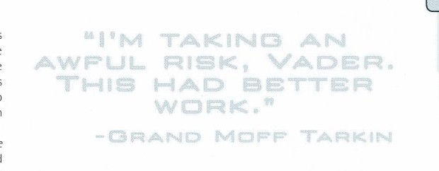
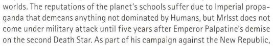

# Owner Material 037 — Star Wars D20 Drive folder (Core, Revised Core and Saga Edition): Sourcebooks/Galaxy of Intrigue.pdf [Star Wars Roleplaying Game Saga Edition (2007)] (scan pages 1–60)

- **Source:** Wizards of the Coast Star Wars Roleplaying Game books, web enhancements, Living Force campaign modules and articles (2000–2010), from the owner's "Star Wars D20" Drive folder (only the three edition subfolders; "General" was not read, as instructed). Secondary source (licensed Legends reference). Scan OCR'd on the box; the scan stays box-only and is **not** published.
- **Method:** every scanned page was OCR'd and machine-screened sentence by sentence for power-relevant statements (fights, kills, defeats, Force feats, rankings, superweapons) that name a character on our roster; each kept sentence is quoted verbatim from the OCR text and has a crop of the printed passage directly under it. Pages with nothing power-relevant are still listed with what is on them.
- **Citation:** "*Galaxy of Intrigue* (SWRPG Saga Edition), p.X" by printed page ("scan p.X" where no printed number applies). **Weight:** Licensed RPG material: a secondary source. Narrative text sums up Legends lore; game statistics are rules for players, not canon power levels, and rank lowest.

## scan p.1 (scan page 1)

Page contents: Front cover: Star Wars Roleplaying Game — Galaxy of Intrigue (Rodney Thompson, Gary Astleford, Eric Cagle). (hand-read)

## scan p.2 (scan page 2)

Page contents: Title page (Rodney Thompson, Gary Astleford, Eric Cagle). (hand-read)

## scan p.3 (scan page 3)

Page contents: Credits (design Rodney Thompson, Gary Astleford, Eric Cagle; additional design T. Rob Brown, Steve Miller; editors; art); legal; ISBN 978-0-7869-5400-1; First Printing January 2010; ©2010 Lucasfilm. (hand-read)

## scan p.4 (scan page 4)

Page contents: Contents (Introduction; Ch. I Heroes of Intrigue; II Skill Challenges; III Equipment; IV Campaigns; V Factions and Organizations; VI Nyriaan, World of Intrigue; VII Intrigue Encounters; VIII The Perfect Storm; Index). (hand-read)

## scan p.5 (scan page 5)

Page contents: Blank/art page (no OCR text). (hand-read)

## scan p.6 (scan page 6)

Page contents: Introduction: the web of intrigue; for any era; noble class benefits most. (hand-read)

## scan p.7 (scan page 7)

Page contents: Using This Book (chapter overview); What Is a Galaxy of Intrigue Campaign?; Nothing Is What It Seems. (hand-read)

## scan p.8 (scan page 8)

Page contents: Politics Is Personal (The Phantom Menace trade dispute through the rise of Senator Palpatine and the Clone Wars); Tension Between Light and Dark. Image caption: "LEIA HIDES THE DEATH STAR PLANS INSIDE OF R2-D2". (hand-read)

- **Grand Moff Tarkin; Darth Vader (Anakin Skywalker)** — entry/section: Pull quote (Tarkin): ""I'M TAKING AN AWFUL RISK, VADER. THIS HAD BETTER WORK." -GRAND MOFF TARKIN" Source: *Galaxy of Intrigue* (SWRPG Saga Edition), scan p.8
  

### Stat block notes (game mechanics, not feats)

- Rise of Palpatine as intrigue: "As a case in point, the conflict in Star Wars: Episode I The Phantom Menace begins innocuously enough as a trade dispute. Over the course of that and the subsequent movies, however, the galaxy is rocked as the dispute quickly progresses through a blockade, an armed conflict, the removal of the Supreme Chancellor, the rise of Senator Palpatine, and eventually the full-scale war of the Clone Wars in Star Wars: Episode III Revenge of the Sith." (Source: *Galaxy of Intrigue* (SWRPG Saga Edition), scan p.8)

## scan p.9 (scan page 9)

Page contents: Chapter I: Heroes of Intrigue title page. (hand-read)

## scan p.10 (scan page 10)

Page contents: Chapter I intro: every class has a place in an intrigue campaign. (hand-read)

## scan p.11 (scan page 11)

Page contents: Species: Table 1-1 ability adjustments, 1-2 age, 1-3 height/weight (Bith, Defel, Fosh, Givin, Gotal, Herglic, Mrlssi, Neimoidian, Umbaran); Bith history (Clak'dor VII bioweapon, pacifism, music). (hand-read)

## scan p.12 (scan page 12)

Page contents: Bith description and species traits (Meditative Trance, Scent, Evolved Intellect; example names Doikk, Figrin...); Defel (Af'El, ultraviolet vision, "wraiths"). (hand-read)

## scan p.13 (scan page 13)

Page contents: Defel personality and traits (Partial Invisibility, ultraviolet visor 2,000 credits); Fosh (manipulative, feathers change colour, healing tear glands; example names include Vergere). (hand-read)

## scan p.14 (scan page 14)

Page contents: Fosh traits (Deceptive, Healing Glands); Givin (Yag'Duhl, mathematics, vacuum-proof exoskeleton; calculate hyperspace jumps in their heads). (hand-read)

## scan p.15 (scan page 15)

Page contents: Givin traits (Exoskeleton DR 2, Deductive Reasoning, Unique Physiology); Gotal (Antar 4, sensor cones, Energy Reading, Low-Light Vision, Sensor Cones). (hand-read)

## scan p.16 (scan page 16)

Page contents: Herglic (Giju; honesty, gambling; considered cowards for staying out of the Empire's wars). (hand-read)

## scan p.17 (scan page 17)

Page contents: Herglic traits (Sturdy, conditional Skill Focus (Gather Information)); Mrlssi (Mrlsst Trade and Science Academy; Thrawn bombards Mrlsst). (hand-read)

- **Palpatine (Darth Sidious)**: "The reputations of the planet's schools suffer due to Imperial propaganda that demeans anything not dominated by Humans, but Mrlsst does not come under military attack until five years after Emperor Palpatine's demise on the second Death Star." Source: *Galaxy of Intrigue* (SWRPG Saga Edition), scan p.17
  

### Stat block notes (game mechanics, not feats)

- Thrawn besieges Mrlsst: "As part of his campaign against the New Republic, Imperial Grand Admiral Thrawn besieges and bombards Mrlsst, laying waste to many of the world's ancient and beautiful campuses." (Source: *Galaxy of Intrigue* (SWRPG Saga Edition), scan p.17)

## scan p.18 (scan page 18)

Page contents: Mrlssi traits (speed 4, Scholarly Inclination); Neimoidian history (Trade Federation; alliance with Count Dooku's Separatists; isolation). (hand-read)

### Stat block notes (game mechanics, not feats)

- Neimoidians ally with Dooku: "Neimoidian leaders then make the decision to ally with the Separatist movement led by renegade Jedi Count Dooku, which results in the complete dismantling of everything they had built beyond their home systems." (Source: *Galaxy of Intrigue* (SWRPG Saga Edition), scan p.18)

## scan p.19 (scan page 19)

Page contents: Neimoidian traits (example names Rune Haako, Hath Monchar, Daultay Dofine, Tey How); Umbaran history (Sly Moore as Palpatine's chief aide; Umbarans in Imperial intelligence; flight from Ysanne Isard). (hand-read)

### Stat block notes (game mechanics, not feats)

- Sly Moore and the Umbarans: "An Umbaran named Sly Moore serves as Palpatine's chief aide during his later years as Chancellor of the Republic and the earliest period of his reign as Emperor. Moore's prominence in galactic politics causes her to be so admired on her homeworld that she inspires other Umbarans to venture out into the rest of the galaxy." — "From deep within the intelligence apparatus, she and other Umbarans lead efforts to root out anyone who is not unquestionably loyal to Emperor Palpatine, and they answer only to the Emperor. They are so effective that even Emperor Palpatine's most dedicated followers grow to fear them" (Source: *Galaxy of Intrigue* (SWRPG Saga Edition), scan p.19)
- Isard and the Umbarans: "When former head of Imperial Intelligence Ysanne Isard forges a powerful coalition on Coruscant dedicated to reestablishing a strong Galactic Empire, the remaining Umbarans flee the planet, knowing that Isard will seek brutal revenge for the embarrassments they caused her organization when she was rising through the ranks of Imperial Intelligence." (Source: *Galaxy of Intrigue* (SWRPG Saga Edition), scan p.19)

## scan p.20 (scan page 20)

Page contents: Noble: nobles live and breathe intrigue; some (such as Senator Palpatine) pose as selfless public servants. (hand-read)

### Stat block notes (game mechanics, not feats)

- Palpatine as a noble of intrigue: "Others (such as Senator Palpatine) pose as apparently selfless public servants who quietly use their positions to further sinister plots." (Source: *Galaxy of Intrigue* (SWRPG Saga Edition), scan p.20)

## scan p.21 (scan page 21)

Page contents: Master of Intrigue talent tree (Advanced Planning, Blend In, Done It All, Get into Position, Master Manipulator—Demand Recovery, Exceptional Control, Word of Warning—Retaliation); Skill Challenge talent tree (Guaranteed Boon, Leading Skill, Learn from Mistakes, Try Your Luck). Caption: "MASTERS OF INTRIGUE KNOW HOW TO BLEND IN WITH A CROWD." (hand-read)

## scan p.22 (scan page 22)

Page contents: Superior Skills talent tree (Assured Skill, Critical Skill Success, Exceptional Skill, Reliable Boon, Skill Boon, Skill Confidence, Skillful Recovery); Scoundrel; Revolutionary talent tree (Bomb Thrower, For the Cause). (hand-read)

## scan p.23 (scan page 23)

Page contents: Revolutionary talents (Make an Example, Revolutionary Rhetoric); Scout; Espionage talent tree (Fade Out, Keep Together, Prudent Escape, Reactive Stealth). Caption: Kel Dor revolutionary leading troops. (hand-read)

## scan p.24 (scan page 24)

Page contents: Sizing Up; Soldier; new Brawler talents (Crowd Control, Disarm and Engage, Entangler, Reverse Strength); new Commando talents (Coordinated Effort). Caption: a scout and his Nelvaanian ally prepare for a first encounter. (hand-read)

## scan p.25 (scan page 25)

Page contents: Dedicated Guardian (Blast Shield, Take the Pain, Team Effort), Dedicated Protector; New Talents for Prestige Classes: Expert Pilot (Clip, Master Defender, Shunt Damage); Bounty Hunter (Detective, Electronic Trail). Caption: a Herglic bodyguard. (hand-read)

## scan p.26 (scan page 26)

Page contents: Revealing Secrets; Mastermind talents (Attract Superior Minion, Contingency Plan); Gunslinger talents (Damaging Disarm, Pistol Duelist—End Game, Snap Aiming, Stand Steady); Feats: Adaptable Talent, Bone Crusher, Brilliant Defense, Channel Rage. (hand-read)

## scan p.27 (scan page 27)

Page contents: Table 1-4: Feats (names, prerequisites, benefits). (hand-read)

## scan p.28 (scan page 28)

Page contents: Feats: Cut the Red Tape, Demoralizing Strike, Disturbing Presence, Expert Briber, Flèche, Forceful Recovery, Grazing Shot. Caption: "SOMETIMES, A GRAZING SHOT IS EXACTLY WHAT YOU NEED." (hand-read)

## scan p.29 (scan page 29)

Page contents: Skill challenge feats sidebar; Hobbling Strike, Improved Opportunistic Trickery, Indomitable Personality, Master of Disguise, Meat Shield, Opportunistic Trickery, Recurring Success, Resolute Stance, Sadistic Strike. (hand-read)

## scan p.30 (scan page 30)

Page contents: Bonus Feats by class; Silver Tongue; Skill Challenge: Catastrophic Avoidance, Last Resort, Recovery; Stand Tall; Wookiee Grip. (hand-read)

## scan p.31 (scan page 31)

Page contents: Chapter II: Skill Challenges title page. (hand-read)

## scan p.32 (scan page 32)

Page contents: Chapter II intro: film scenes as skill challenges (asteroid chase, Luke's negotiation with Jabba, the Podrace, Obi-Wan's Jango Fett investigation). (hand-read)

## scan p.33 (scan page 33)

Page contents: Running Skill Challenges; sidebar Note to Players: Playing Skill Challenges (Think Cinematically, Use Your Strengths, Embrace Versatility). (hand-read)

## scan p.34 (scan page 34)

Page contents: Basic mechanics; Endor speeder bike chase running example (Han Solo, Chewbacca, Luke Skywalker, Princess Leia); Determining Participants; sidebar No Substitute for Roleplaying; Setting the Scene; Starting the Challenge. (hand-read)

## scan p.35 (scan page 35)

Page contents: Using Skills; Endor example continues; Aid Another rules (trained only, +10 cap). Caption: "HAN SOLO SNEAKING INTO THE BUNKER ON ENDOR". (hand-read)

### Stat block notes (game mechanics, not feats)

- Endor chase as a skill challenge: "Returning to the Endor example, Han Solo decides to sneak up on one of the scout troopers. Han's player describes the action as creeping up behind the scout trooper in an attempt to subdue him quietly. However, when Han rolls his skill check, he rolls too low, accruing a failure. The Gamemaster describes the results of the action (Han steps on a twig and alerts the scout troopers), and the challenge continues. Throughout the chase sequence, we see Leia using the Pilot skill to maneuver a speeder, Luke using Jump to leap to an adjacent speeder bike, and Leia using Deception to trick a scout trooper into believing that she crashed." (Source: *Galaxy of Intrigue* (SWRPG Saga Edition), scan p.35)

## scan p.36 (scan page 36)

Page contents: Sidebar Noncontributing Skill Checks (Luke's Intelligence check on the speeder bike); Using Ability Checks; Using Talents, Feats, or Equipment (Vor'en's Harm's Way example); Using Combat Actions. Caption: "CHEWBACCA READIES A SHOT." (hand-read)

## scan p.37 (scan page 37)

Page contents: Chewbacca's bowcaster shot and Luke's lightsaber crash as challenge successes; Using Force Powers; Concluding the Challenge; Example of Play setup (characters Sia-Lan, Rorworr, Vor'en, Deel Surool; player names omitted per exclusions); Skill Challenge: Escape from Kessel (Colicoid-run spice mines). Caption: "R2-D2 ACCRUES A FAILURE IN A SKILL CHALLENGE AT THE BUNKER." (hand-read)

### Stat block notes (game mechanics, not feats)

- Chewbacca and Luke in the Endor chase: "For example, at the beginning of the Endor chase sequence, Chewbacca sees that scout troopers on speeder bikes are about to get away. Knowing that he cannot reach the speeder bikes in time, he takes a shot with his bowcaster, hoping to destroy one of the speeders before it can escape. He makes an attack roll and succeeds, which not only contributes a success in the skill challenge but also affects the shape of the challenge as the chase begins. Later, Luke uses his lightsaber to cause a speeder to crash into a tree, earning the final success necessary to end the challenge." (Source: *Galaxy of Intrigue* (SWRPG Saga Edition), scan p.37)

## scan p.38 (scan page 38)

Page contents: Escape from Kessel stat block (CL 8, complexity 2; Perception, Persuasion, Stealth, Survival; Close Call, Degrees of Failure); GM's opening narration; sidebar Skill Challenge Transparency (Total Disclosure, Partial Disclosure, Secret Challenge). (hand-read)

## scan p.39 (scan page 39)

Page contents: Example of play: Sia-Lan's Use the Force (DC 28) fails—half the prisoners recaptured; Rorworr's Stealth past the Colicoid checkpoint; scene shifts into the administrative facility. (hand-read)

## scan p.40 (scan page 40)

Page contents: Example of play continues: Vor'en slices the schematic (Force Point, DC 32); Sia-Lan pulls down cameras with the Force; Rorworr's Knowledge (life sciences) noncontributing check and Mechanics to kill the lights; reach the Lantillian short hauler; Deel's Use Computer translation. (hand-read)

## scan p.41 (scan page 41)

Page contents: Example concludes (Deel's Pilot check, eight successes; Colicoid starfighters scramble); Designing Skill Challenges: Choose the Concept (Battle of Endor bunker example). Caption: "A GAME OF SABACC CAN BE A CHALLENGE." (hand-read)

### Stat block notes (game mechanics, not feats)

- Breaking into the Endor bunker: "For example, breaking into the bunker during the Battle of Endor meets these criteria. Although combat is taking place around them, the heroes (specifically Princess Leia, Han Solo, R2-D2, and Chewbacca) don't try to blast their way into the bunker, but instead use their skills to get inside. They take risks, such as attempting to hot-wire the controls, earning both successes and failures (such as when R2 is blasted away from the control panel). The scene is filled with tension because the heroes know that if they do not disable the deflector shield, the Rebel fleet attacking the second Death Star will be crushed." (Source: *Galaxy of Intrigue* (SWRPG Saga Edition), scan p.41)

## scan p.42 (scan page 42)

Page contents: Sidebar Not a Skill Challenge; Consider the Duration; Determine CL and Complexity (5/8/11 successes before 3 failures; XP). (hand-read)

## scan p.43 (scan page 43)

Page contents: Set Skill DCs (easy, medium, moderate, hard); sidebar Harder Checks at Higher Levels. Caption: "SEARCHING FOR LUKE ON HOTH IS A SKILL CHALLENGE WITH HIGH SKILL DCs." (hand-read)

## scan p.44 (scan page 44)

Page contents: Table 2-1: Skill Challenge DCs by CL; heroic DCs; Choose Primary Skills; Create Options; Add Challenge Effects; Challenge Effects intro. (hand-read)

## scan p.45 (scan page 45)

Page contents: Challenge effects: Antagonist, Catastrophic Failure, Changing Objectives, Close Call. Caption: "LUKE SKYWALKER REACTS AFTER A CATASTROPHIC FAILURE IN A NEGOTIATION SKILL CHALLENGE." (hand-read)

## scan p.46 (scan page 46)

Page contents: Containment, Degenerating, Degrees of Failure, Degrees of Success. Caption: "ANAKIN LOSES ALLIES DURING A SPACE TRAVEL SKILL CHALLENGE IN AN EXAMPLE OF DEGREES OF FAILURE." (hand-read)

## scan p.47 (scan page 47)

Page contents: Extreme Success, Individual Effort, Initiative, Opposed DC, Recovery. (hand-read)

## scan p.48 (scan page 48)

Page contents: Restricted Skills, Second Effort, Timed Challenge. Caption: "REBEL PILOTS FACE A TIMED CHALLENGE WHILE MAKING A TRENCH RUN." (hand-read)

## scan p.49 (scan page 49)

Page contents: Success and Failure; failure conditions: combat encounter, loss of allies, loss of equipment, loss of Force Point, loss of second wind. Caption: being captured by enemies is one possible result of failing a skill challenge. (hand-read)

## scan p.50 (scan page 50)

Page contents: Skill Challenge Tips: Encourage Cinematic Play, Offer Suggestions, Create Evolving Situations (Hapan noble example). Caption: "OBI-WAN HANGS ONTO A DROID IN A DANGEROUS, BUT CINEMATIC, CHALLENGE." (hand-read)

## scan p.51 (scan page 51)

Page contents: Impose Consequences (Luke's Jump check at Endor); Add Skill Challenges to Combat (Han Solo and R2-D2 at the bunker); Break Up the Challenge; Improvise (Hutt trap door example). (hand-read)

### Stat block notes (game mechanics, not feats)

- Luke takes a speeder bike: "For example, in the Endor chase sequence, Luke makes a Jump check to knock a scout trooper off a speeder bike, and he succeeds. As a consequence of his action, Luke gains control of a speeder bike and can act independently from Leia (whereas before, his options were more limited)." (Source: *Galaxy of Intrigue* (SWRPG Saga Edition), scan p.51)

## scan p.52 (scan page 52)

Page contents: Reactive improvisation (bounty example); Sample Skill Challenges; Simple Skill Challenge: Breaching the Bunker (CL 2, complexity 1, timed 10 rounds). Caption: "HAN HOTWIRES THE ENDOR BUNKER." (hand-read)

## scan p.53 (scan page 53)

Page contents: Complex Skill Challenge: The Podrace (Ando Overland event, 12 racers; CL 6, complexity 3); Podrace Phase 1; Phase 2 (rival pit crew). Caption: "THE PODRACE ON TATOOINE". (hand-read)

## scan p.54 (scan page 54)

Page contents: Podrace Phase 3 (ion bomb droids; Second Effort); Skill Challenge: Asteroid Field Escape intro. Caption: escaping through an asteroid field. (hand-read)

## scan p.55 (scan page 55)

Page contents: Asteroid Field Escape (CL 9); Covert Infiltration (CL 12). Caption: breaking into an Imperial detention facility. (hand-read)

## scan p.56 (scan page 56)

Page contents: Interrogation (CL 3, Containment); Investigation (CL 5). Caption: "OBI-WAN PARTICIPATES IN AN INVESTIGATION SKILL CHALLENGE ON KAMINO." (hand-read)

## scan p.57 (scan page 57)

Page contents: Skill Challenge: Negotiation (CL 12; persuading an Imperial Senator to spy for the Rebel Alliance; Imperial adjutant as Antagonist). Caption: "A NEGOTIATION SKILL CHALLENGE" (art credit Gonzalo Flores). (hand-read)

## scan p.58 (scan page 58)

Page contents: Overland Travel (CL 4; Tatooine, Felucia, Dorin, Mustafar; Degenerating, Individual Effort); Searching the Debris Field (CL 8). Caption: "AN OVERLAND TRAVEL SKILL CHALLENGE ON FELUCIA". (hand-read)

## scan p.59 (scan page 59)

Page contents: Debris field effects; Slicing the HoloNet (CL 11, antislicer droid opposed DC); Smuggling Contraband (CL 4). (hand-read)

## scan p.60 (scan page 60)

Page contents: Speeder Bike Chase (CL 8); Tactical Leadership intro. Captions: "SPEEDER BIKE CHASES MAKE EXCITING SKILL CHALLENGES."; "ACKBAR AND OTHER REBEL COMMANDERS ENGAGE IN A TACTICAL LEADERSHIP CHALLENGE." (hand-read)

