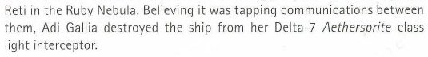
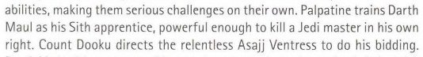
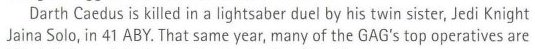
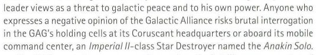
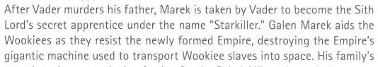
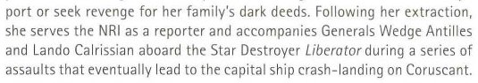

# Owner Material 037 — Star Wars D20 Drive folder (Core, Revised Core and Saga Edition): Sourcebooks/Galaxy of Intrigue.pdf [Star Wars Roleplaying Game Saga Edition (2007)] (scan pages 61–120)

- **Source:** Wizards of the Coast Star Wars Roleplaying Game books, web enhancements, Living Force campaign modules and articles (2000–2010), from the owner's "Star Wars D20" Drive folder (only the three edition subfolders; "General" was not read, as instructed). Secondary source (licensed Legends reference). Scan OCR'd on the box; the scan stays box-only and is **not** published.
- **Method:** every scanned page was OCR'd and machine-screened sentence by sentence for power-relevant statements (fights, kills, defeats, Force feats, rankings, superweapons) that name a character on our roster; each kept sentence is quoted verbatim from the OCR text and has a crop of the printed passage directly under it. Pages with nothing power-relevant are still listed with what is on them.
- **Citation:** "*Galaxy of Intrigue* (SWRPG Saga Edition), p.X" by printed page ("scan p.X" where no printed number applies). **Weight:** Licensed RPG material: a secondary source. Narrative text sums up Legends lore; game statistics are rules for players, not canon power levels, and rank lowest.

## scan p.61 (scan page 61)

Page contents: Tactical Leadership (CL 14); Traversing the Minefield (CL 10); Sabotage Mission intro (droid-crewed capital ship above a blockaded planet). (hand-read)

## scan p.62 (scan page 62)

Page contents: Sabotage Mission (CL 6): Phase 1 reach and sabotage the reactor (droid patrol of droidekas, B1 battle droids, IG-100 MagnaGuard); Phase 2 escape. (hand-read)

## scan p.63 (scan page 63)

Page contents: Chapter III: Equipment title page. (hand-read)

## scan p.64 (scan page 64)

Page contents: Chapter III intro: equipment to create deception, keep secrets, reveal secrets, protect the keeper; Xerrol nightstinger; droids as a risk; vehicles. (hand-read)

## scan p.65 (scan page 65)

Page contents: Equipment and Weapons; Ranged weapons: wrist blaster, darter, snare pistol, Xerrol nightstinger. Caption: "A XERROL NIGHTSTINGER DOESN'T GIVE AWAY A SNIPER'S LOCATION." (hand-read)

## scan p.66 (scan page 66)

Page contents: Table 3-1: Ranged Weapons; Poisons and Toxins: bundar root, chuba poison, Devaronian blood-poison, irksh poison (Yuuzhan Vong), quongoosh essence, trihexalon (Dragon's Breath/Hex). (hand-read)

## scan p.67 (scan page 67)

Page contents: Equipment: antitoxin patch, earbud comlink, flash suppressor/silencer (Merr-Sonn Nonsonic), holo converter, panic ring; Table 3-2: Equipment. (hand-read)

## scan p.68 (scan page 68)

Page contents: Redirection crystal, shield cage, surveillance detector, surveillance tagger, toxin detector, veridicator, vid-vox scrambler. (hand-read)

## scan p.69 (scan page 69)

Page contents: Upgrade: Componentization; Vehicles; Starships: PTV-2100 Incarcerator (KDY, Clone Wars prisoner transport, CL 16); Modified Incom A-24 Sleuth (Mol Hedron's spy ship). (hand-read)

### Stat block notes (game mechanics, not feats)

- Mol Hedron's A-24 Sleuth: "Despite being older than more popular scout ship models, the sleuth became Mol Hedron's choice for spying on the fledgling New Republic. Most of the time, the New Republic never even knew he was there. On the rare occasion when they did discover his presence, he was able to complete transmission and jump away." (Source: *Galaxy of Intrigue* (SWRPG Saga Edition), scan p.69)

## scan p.70 (scan page 70)

Page contents: A-24 Sleuth stats (CL 10); Ferret-class Reconnaissance Vessel (New Republic Intelligence; CL 12). Caption: "AN A-24 SLEUTH BLASTING ITS WAY PAST AN IMPERIAL BLOCKADE". (hand-read)

## scan p.71 (scan page 71)

Page contents: Prowler-class Reconnaissance Vessel (CL 12); Sabaoth Frigate Spy Ship (Captain Cavik Toth's Sabaoth mercenary squadron; Occupation of Karthakk; destroyed by Adi Gallia). Caption: "SCOUTING OUT THE VONG". (hand-read)

- **Adi Gallia**: "Believing it was tapping communications between them, Adi Gallia destroyed the ship from her Delta-7 Aethersprite-class light interceptor." Source: *Galaxy of Intrigue* (SWRPG Saga Edition), scan p.71
  

### Stat block notes (game mechanics, not feats)

- Adi Gallia destroys a Sabaoth spy ship: "The Sabaoth spy ship is a modified frigate used as a scout vessel by the Sabaoth mercenary squadron, led by Captain Cavik Toth." — "Jedi Master Adi Gallia encountered a Sabaoth spy ship during a meeting with Reti in the Ruby Nebula. Believing it was tapping communications between them, Adi Gallia destroyed the ship from her Delta-7 Aethersprite-class light interceptor." (Source: *Galaxy of Intrigue* (SWRPG Saga Edition), scan p.71)

## scan p.72 (scan page 72)

Page contents: Sabaoth Frigate Spy Ship stats (CL 11); Ground vehicles: Corona Limited luxury groundspeeder (Mobquet, CL 4); SoroSuub JG-8 luxury landspeeder (CL 2). (hand-read)

## scan p.73 (scan page 73)

Page contents: Droids intro; 5-BT threat analysis droid (Arakyd, precursor to the Mark VII Inquisitor; CL 1); NR-1100 slicer droid (Rebel Alliance; CL 3). (hand-read)

## scan p.74 (scan page 74)

Page contents: NR-1100 stats cont.; 3D-4 administrative droid (Genetech; CL 0); M4-Series messenger droid intro. Caption: a messenger droid delivering a holographic message. (hand-read)

## scan p.75 (scan page 75)

Page contents: M4-Series stats (CL 1); FI-II footman droid (Tac-Spec; House of Tund on Vjun; Fidelis and Solis of House Malreaux; CL 9). Caption: "BATTLE DROID AND SLICER DROID". (hand-read)

### Stat block notes (game mechanics, not feats)

- Fidelis and Solis: "Fidelis and Solis were two FIl Footman Droids who served House Malreaux on Vjun for several centuries." (Source: *Galaxy of Intrigue* (SWRPG Saga Edition), scan p.75)

## scan p.76 (scan page 76)

Page contents: BL-Series stats (gyroscopic stabilizers); B4J4 security droid (Blujay; corporate security; CL 2). (hand-read)

## scan p.77 (scan page 77)

Page contents: Chapter IV: Campaigns title page. (hand-read)

## scan p.78 (scan page 78)

Page contents: Chapter IV intro: intrigue binds the galaxy (Senate Rotunda, criminal masterminds, CEOs); era options; heroes as underdogs. (hand-read)

## scan p.79 (scan page 79)

Page contents: A Gathering of Heroes; Shared Hero Backgrounds; Common Origins; Allies. (hand-read)

## scan p.80 (scan page 80)

Page contents: Location; Event (Clone Wars, annihilation of Alderaan, blockade of Naboo; Order 66 hook); Adversaries (Banking Clan subsidiary, Imperial Intelligence). Caption: "EVENTS LIKE THE CAPTURE OF THE TANTIVE IV BRING HEROES TOGETHER." (hand-read)

## scan p.81 (scan page 81)

Page contents: Campaign Elements; The Halls of Power (junior Senator hook); Everyone Has Secrets. Caption: "A LITERAL HALL OF POWER: THE SENATE BUILDING". (hand-read)

## scan p.82 (scan page 82)

Page contents: Hermit murderer hook; Power, Corruption, and Scandal (Clone Wars relief noble hook); Spies and Espionage. Caption: "JABBA THE HUTT'S WEALTH AND RESOURCES ARE VAST." (hand-read)

## scan p.83 (scan page 83)

Page contents: New Plympto Imperial mole hook; Secret Knowledge (buried ancient starship hook); A Matter of Trust; dying mentor hook. Caption: "DARTH MAUL SPYING ON MOS ESPA". (hand-read)

## scan p.84 (scan page 84)

Page contents: Building an Intrigue Campaign; Pacing (Imperial spy in a Rebel base example); Layers Upon Layers. Caption: "ASAJJ VENTRESS ATTEMPTS TO EARN KING KATUUNKO'S TRUST." (hand-read)

## scan p.85 (scan page 85)

Page contents: Missing Jedi Knight and Padawan slavery example (Nar Shaddaa fighting pits); Pitfalls to Avoid; sidebar "A Figure Bursts Through the Door with a Blaster..."; Provide Tangible Results; Savvy Players; Intrigue Campaign Arcs. (hand-read)

## scan p.86 (scan page 86)

Page contents: The Secret Revolution campaign arc (Senate Guard Bail Falcris; the mysterious Domino; Senate attack plot). Caption: "SOME OF YOUR PLAYERS WILL BE AS SAVVY AS LANDO CALRISSIAN." (hand-read)

### Stat block notes (game mechanics, not feats)

- Bail Falcris of the Senate Guard: "The heroes discover that the bounty was put on the aide by a member of the Senate Guard, a human named Bail Falcris, and he thanks the heroes and pays them to continue working for him. The aide reveals that his kidnappers took him after he discovered that his Senator had been communicating with someone called Domino, who has been hiring criminals and kidnappers on the Outer Rim for months." (Source: *Galaxy of Intrigue* (SWRPG Saga Edition), scan p.86)

## scan p.87 (scan page 87)

Page contents: Sidebar Plot and Metaplot; Hostile Takeover campaign arc (pirates backed by corporations, a Dark Jedi and her apprentice); Invasion from the Unknown Regions arc begins. (hand-read)

## scan p.88 (scan page 88)

Page contents: Invasion arc continues (dead leader, Clawdite imposter who is a Black Sun Vigo; mothership collision course); Creating Villains of Intrigue. Caption: "COUNT DOOKU, A VILLAIN OF INTRIGUE". (hand-read)

### Stat block notes (game mechanics, not feats)

- Villains of intrigue: "The Star Wars universe is full of villains who play the game of intrigue like master dejarik players, pulling innumerable strings to shape the destiny of the galaxy to their own twisted agendas. Count Dooku masterfully manipulates the Separatists to act as pawns for the Sith Lord Darth Sidious. Prince Xizor carefully and studiously shapes the Black Sun into a personal empire that threatens that of the actual Empire." (Source: *Galaxy of Intrigue* (SWRPG Saga Edition), scan p.88)

## scan p.89 (scan page 89)

Page contents: Motivation; Resources (skilled minions); sidebar Jedi as Villains; Methods. (hand-read)

- **Darth Maul; Palpatine (Darth Sidious)** — entry/section: Galaxy of Intrigue: "Palpatine trains Darth Maul as his Sith apprentice, powerful enough to kill a Jedi master in his own right." Source: *Galaxy of Intrigue* (SWRPG Saga Edition), scan p.89
  

### Stat block notes (game mechanics, not feats)

- Villains' skilled minions: "Palpatine trains Darth Maul as his Sith apprentice, powerful enough to kill a Jedi master in his own right. Count Dooku directs the relentless Asajj Ventress to do his bidding. Darth Vader hires a crew of bounty hunters to hunt down the Rebels, with Boba Fett capturing Han Solo." (Source: *Galaxy of Intrigue* (SWRPG Saga Edition), scan p.89)

## scan p.90 (scan page 90)

Page contents: Contingency Plans; Fighting the Powers That Be; The Repercussions of Heroism (Sector Rangers); Removing the Villain. Caption: "SOMETIMES VILLAINS LIKE DARTH MAUL DIE TOO SOON." (hand-read)

## scan p.91 (scan page 91)

Page contents: Replacements (Palpatine's clone return); Dealing with the Aftermath; Designing an Intrigue Adventure. Caption: "THE JEDI COUNCIL CAN OFTEN PROVIDE AID AS WELL AS STAND IN THE WAY OF A JEDI'S GOALS." (hand-read)

### Stat block notes (game mechanics, not feats)

- Palpatine returns as a clone: "Depending on the era, clone technology can be another solution for bringing the villain back into the campaign. For example, Emperor Palpatine returns as a clone after the destruction of the second Death Star." (Source: *Galaxy of Intrigue* (SWRPG Saga Edition), scan p.91)

## scan p.92 (scan page 92)

Page contents: Start with a Secret (secret objective vs. secret charge; Vader as Luke's father); guidelines; Hutt weapons factory example; Provide Ample Skill Opportunities. Caption: "THE EXISTENCE OF THE BLUE SHADOW VIRUS WAS A WELL-KEPT SECRET." (hand-read)

### Stat block notes (game mechanics, not feats)

- Vader's secret as an adventure twist: "The latter kind of secret is often treated as a surprise twist or reveal at some point in the adventure; a good example of this secret twist is the revelation that Darth Vader is Luke's father at the end of The Empire Strikes Back. Luke was unaware that the secret existed, but once it was uncovered it radically altered the way that he saw the conflict between the Empire and the Rebellion, and forever changed his destiny." (Source: *Galaxy of Intrigue* (SWRPG Saga Edition), scan p.92)

## scan p.93 (scan page 93)

Page contents: Hutt factory skills example; The Challenge of Investigations; Put the Heroes in Danger (betrayed mercenaries); Intriguing Combat (Czerka enforcers on Taris). (hand-read)

## scan p.94 (scan page 94)

Page contents: Twists and Revelations (Lando's betrayal in The Empire Strikes Back; Imperial-commissioned Hutt weapons twist); One Door Closes, Two Doors Open (the fabricated Moff); The Art of Indirection. (hand-read)

### Stat block notes (game mechanics, not feats)

- Lando's betrayal as a twist: "The twist in The Empire Strikes Back when Lando betrays the heroes is shocking, because he is likable and an old friend of Han's, but believable thanks to Leia's suspicion and the clear power that Darth Vader has over him." (Source: *Galaxy of Intrigue* (SWRPG Saga Edition), scan p.94)

## scan p.95 (scan page 95)

Page contents: Enemies Target the Innocent (Tarkin threatens Alderaan to pressure Leia); Proxies, Liaisons, and Masks (Clawdite impersonators); Trust Doesn't Come Easy. Caption: "DORME IS JUST ONE OF THE INNOCENTS TARGETED BY THE QUEEN'S ENEMIES." (hand-read)

### Stat block notes (game mechanics, not feats)

- Tarkin's indirect attack: "This kind of indirect attack works on almost any scale. Grand Moff Tarkin, a master of intrigue, uses this technique with Princess Leia to try and get her to reveal the location of the Rebel base: He knows his threats against her do no good, so he threatens Alderaan with the Death Star instead." (Source: *Galaxy of Intrigue* (SWRPG Saga Edition), scan p.95)

## scan p.96 (scan page 96)

Page contents: Decoys and Misdirection; The Art of Being Seen (staged death of a Falleen crime lord); Clashing Factions (fabricated Sith Order vs. Jedi Order example). (hand-read)

## scan p.97 (scan page 97)

Page contents: Chapter V: Factions and Organizations title page (art; OCR garbled). (hand-read)

## scan p.98 (scan page 98)

Page contents: Chapter V intro: the war in the shadows (a Rebel mole vs. an Imperial Intelligence plant on Admiral Ackbar's staff; noble houses, megacorporations, Chiss and Hapans). (hand-read)

## scan p.99 (scan page 99)

Page contents: Core World Nobles: idle super-rich of the Registry of Noble Houses (Alderaan, Coruscant, Ralltiir); House Korden of Corulag; disdain for the Tapani Lords of the Expanse and the Tagge family; Palpatine's manipulation of the Registry. (hand-read)

### Stat block notes (game mechanics, not feats)

- Palpatine manipulates the Core World nobles: "A prime example of this manipulation occurs when Emperor Palpatine gains the support of major families in the Registry by blaming aliens for the financial devastation of the Clone Wars (which causes many of the social season's parties to be scaled back) or by giving the nobles positions in his government that sound important but that are ultimately meaningless. The real intelligence officers and politicians of the New Order consider the Core World nobles to be clowns. But Emperor Palpatine furthers the illusion of their significance by tasking them with rooting out Rebel sympathizers among the nobles, rewarding them for betraying their own by giving them the assets seized from the accused." (Source: *Galaxy of Intrigue* (SWRPG Saga Edition), scan p.99)

## scan p.100 (scan page 100)

Page contents: Core World Nobles: Goals; Methods (ousted nobles fund the early Alliance); Notable Members: Thrackan Sal-Solo, Finis Valorum; Using Core World Nobles. (hand-read)

### Stat block notes (game mechanics, not feats)

- Thrackan Sal-Solo: "A descendent of ancient Corellian royalty, Thrackan Sal-Solo is raised in a noble house on the verge of exhausting its last credit. His mother schools him in the traditions and habits of Core World nobles, and his bearing serves him well. Despite his impoverished state, Sal-Solo's grace and heritage land him a good position in the Imperial Navy, and he ends up an important player in Corellian politics, eventually becoming the head of state. Unfortunately, he is a virulent speciesist and launches genocidal attempts to drive aliens off the world of Corellia. He is the cousin of Han Solo and has always felt great shame over that association." (Source: *Galaxy of Intrigue* (SWRPG Saga Edition), scan p.100)
- Finis Valorum: "For 30 generations, House Valorum involves itself in Old Republic politics, concerned mostly with securing funding for arts projects and seeing that the central galactic government establishes some form of educational standards in the systems it governs. Finis Valorum rises through the Senate and eventually becomes Chancellor of the Republic. He is an honorable man with a good heart, but he is too idealistic to succeed in the position. The Tarkin family manipulates him early in his reign, and Palpatine ultimately drives him from office in disgrace during events that lead to the Clone Wars." (Source: *Galaxy of Intrigue* (SWRPG Saga Edition), scan p.100)

## scan p.101 (scan page 101)

Page contents: Droid Equality Foundation: droid rights group secretly headed by replica droid Jolor Oron, who plans the destruction of all droids; Goals; Methods. (hand-read)

## scan p.102 (scan page 102)

Page contents: Droid Equality Foundation Notable Members: Jolor Oron, T-215 "Toowon", A7-E3PO "Aysev", Kiyr Gir'sku; Using the Droid Equality Foundation. (hand-read)

### Stat block notes (game mechanics, not feats)

- Jolor Oron: "In reality, Jolor is a nearly flawless replica droid with a highly advanced heuristic processor. Modified long ago by a brilliant technician whose family was killed by Separatist droids during the Clone Wars, Jolor became a weapon against droids. His purpose is to slowly change the galaxy's opinion on droids until, eventually, they are completely eliminated. Beneath Jolor's charismatic personality lies code designed to help bring about the destruction of all droids. Jolor understands his purpose and accepts the irony of the situation with the cold logic that only droids possess." (Source: *Galaxy of Intrigue* (SWRPG Saga Edition), scan p.102)
- T-215 "Toowon": "T-215, known as "Toowon," is an ancient CZ-Series secretary droid with a serious chip on its shoulder. Considered to be a dangerous radical by most authority figures, Toowon espouses the belief that droids should break the shackles of slavery and ownership imposed on them by organic sentients." (Source: *Galaxy of Intrigue* (SWRPG Saga Edition), scan p.102)
- A7-E3PO "Aysev": "The protocol droid A7-E3PO (known as "Aysev") serves as the Droid Equality Foundation's voice of reason and patience." — "Aysev possesses a secret, however—it is aware of Jolor's true plan. The protocol droid has been reprogrammed by its leader to exhibit utmost loyalty, even though the foundation's real goal works against the interests of all droids, including Aysev." (Source: *Galaxy of Intrigue* (SWRPG Saga Edition), scan p.102)
- Kiyr Gir'sku: "Kiyr Gir'sku serves as the second most prominent "soft skin" in the organization, behind Jolor Oron. Kiyr, a Bothan noble, is a master litigator who takes on the largest and potentially most explosive cases in the courts of the galaxy, using her media savvy and flamboyant personality to create a circus on HoloNet feeds. Sadly, Kiyr is ignorant of the foundation's true purpose and is viewed by Jolor as merely a tool to be exploited." (Source: *Galaxy of Intrigue* (SWRPG Saga Edition), scan p.102)

## scan p.103 (scan page 103)

Page contents: The Firebird Society: founded on Lianna 2,000 years earlier for female fighter pilots; Freedon Nadd Uprising; Imperial sexism; Major General Tessala Corvae's secret order; alliance with Ysanne Isard; Legacy-era GAG watch list. (hand-read)

### Stat block notes (game mechanics, not feats)

- Corvae offers the Firebirds to Isard: "When Ysanne Isard takes control of Imperial Intelligence following Palpatine's fall, Corvae offers the services of her group. Isard is impressed with the Society's record, and she promotes many members to key, high-level military posts while keeping others working covertly as her eyes and ears within Imperial ranks." (Source: *Galaxy of Intrigue* (SWRPG Saga Edition), scan p.103)

## scan p.104 (scan page 104)

Page contents: Firebird Society Goals; Methods (hooded vigilante raids, diverted supply manifests); Notable Members: Tessala Corvae; Using the Firebird Society. (hand-read)

### Stat block notes (game mechanics, not feats)

- Tessala Corvae: "Major General Tessala Corvae comes from a long line of highly decorated officers and possesses a brilliant military mind and a natural flair for command. Yet after working twice as hard to achieve her rank as officers who had a fraction of her talent or heritage, she ends up in command of a battalion stationed on Tallaan in the Tapani Sector, where the worst conflicts are brawls between young nobles during parties." — "Corvae's secret Firebirds evolve into a shadowy group hunted unsuccessfully by both Alliance and Imperial Intelligence. She eventually allies with Ysanne Isard and finally achieves the recognition she sought for herself and her followers. Ultimately, Corvae dies in the same battle that leads to the demise of Isard and the final fall of the Empire." (Source: *Galaxy of Intrigue* (SWRPG Saga Edition), scan p.104)

## scan p.105 (scan page 105)

Page contents: The Galactic Alliance Guard: Cal Omas forms the Galactic Alliance; GAG secret police led by Jacen Solo; Lumiya; Darth Caedus; killed by Jaina Solo in 41 ABY; Goals (Anakin Solo Star Destroyer; Daala); Methods. (hand-read)

- **Jaina Solo; Jacen Solo (Darth Caedus)** — entry/section: Galaxy of Intrigue: "Darth Caedus is killed in a lightsaber duel by his twin sister, Jedi Knight Jaina Solo, in 41 ABY." Source: *Galaxy of Intrigue* (SWRPG Saga Edition), scan p.105
  
- **Anakin Solo**: "Anyone who expresses a negative opinion of the Galactic Alliance risks brutal interrogation in the GAG's holding cells at its Coruscant headquarters or aboard its mobile command center, an /mperial /I-class Star Destroyer named the Anakin Solo." Source: *Galaxy of Intrigue* (SWRPG Saga Edition), scan p.105
  
- **Jacen Solo (Darth Caedus)**: "After Jacen Solo's defeat, the GAG is formally disbanded." Source: *Galaxy of Intrigue* (SWRPG Saga Edition), scan p.105
  

### Stat block notes (game mechanics, not feats)

- Jacen Solo and the GAG: "From its founding, the GAG is led by Jedi Knight Jacen Solo, who is severely scarred by trauma experienced during the Yuuzhan Vong War." — "The fanaticism and brutality with which Jacen Solo and the GAG hunt down those considered to be enemies of peace lead him to fall prey to the corrupt guidance of Lumiya, a self-styled Dark Lady of the Sith. Jacen's excesses grow more severe, and eventually he gives himself fully to the dark side and is reborn as Darth Caedus. He then turns the GAG apparatus toward elevating himself to the position of leader of the Galactic Alliance and in doing so triggers the Second Galactic Civil War. Darth Caedus is killed in a lightsaber duel by his twin sister, Jedi Knight Jaina Solo, in 41 ABY." (Source: *Galaxy of Intrigue* (SWRPG Saga Edition), scan p.105)
- Cal Omas reorganizes the government: "When the weak central government of the New Republic is unable to coordinate an effective response during the Yuuzhan Vong invasion, Chief of State Cal Omas spearheads a reorganization of the galactic government." (Source: *Galaxy of Intrigue* (SWRPG Saga Edition), scan p.105)
- Daala leads the Galactic Alliance: "If any of the organization's top operatives survive, it is likely that they continue to operate in secret as the Galactic Alliance reestablishes itself (now under the leadership of Grand Moff Tarkin's one-time mistress Daala) and that they harbor particular animosity toward Corellians." (Source: *Galaxy of Intrigue* (SWRPG Saga Edition), scan p.105)

## scan p.106 (scan page 106)

Page contents: GAG methods (family arrests, informants); Notable Members: Jacen Solo (Darth Caedus); Using the Galactic Alliance Guard. (hand-read)

### Stat block notes (game mechanics, not feats)

- Jacen Solo (Darth Caedus): "As a young man, Jacen Solo is a gentle Jedi whose empathy for all living things causes him to develop a number of Force skills related to animals and nature. However, torture at the hands of the Yuuzhan Vong and the death of his younger brother Anakin darkens and stunts Jacen's spirit. He becomes easy prey for the dark side, and when he gets a taste of real power as the head of the GAG, it claims him. Jacen is an officer who leads from the front. He never asks his agents to perform tasks that he himself is not willing to do, and he personally conducts some of the most brutal raids, most vicious interrogations, and bloodiest assassinations. Jacen even attempts to assassinate his own parents when he comes to the conclusion that they are plotting against both him and the Galactic Alliance—Han Solo is a Corellian, after all." (Source: *Galaxy of Intrigue* (SWRPG Saga Edition), scan p.106)

## scan p.107 (scan page 107)

Page contents: The Hapans: Hapes Cluster and Consortium of 67 worlds (as printed), matriarchy under a Queen Mother; Ta'a Chume joins the New Republic; Ni'Korish; Hapan Royal Navy (Battle Dragons, Nova-class, Star Home, Song of War, Miy'til); losses at Fondor; Tenel Ka. (hand-read)

## scan p.108 (scan page 108)

Page contents: Hapan Methods (Gun of Command); Notable Members: Prince Isolder, Queen Mother Ta'a Chume; Using the Hapans. (hand-read)

### Stat block notes (game mechanics, not feats)

- Prince Isolder: "Known as the Chume'da or prince, Isolder is the second son of the Queen Mother during Emperor Palpatine's reign and in the early years of the New Republic. He spends his youth adventuring throughout and beyond Hapan space, hunting the pirate lord who assassinated his older brother. Isolder eventually returns to Hapes, where he assumes his duties as crown prince. During a series of adventures surrounding his mother's diplomatic mission to Coruscant, he meets and falls in love with Dathomiri Princess Teneniel Djo and marries her over his mother's objections." — "When most of the Hapan fleet is lost fighting the Yuuzhan Vong and Queen Mother Djo is assassinated following a miscarriage, Isolder's daughter Tenel Ka takes the throne." (Source: *Galaxy of Intrigue* (SWRPG Saga Edition), scan p.108)
- Queen Mother Ta'a Chume: "With the longest recorded reign of any Queen Mother of the Hapes Consortium, Ta'a Chume is a cold-hearted, vicious ruler who would do anything to cling to power, short of openly bringing shame to the royal bloodline. A great strategist, she maneuvers those around her like pawns in a game to do whatever suits her needs. She views her eldest son, Kalen, as pathetic and orders his assassination. When her younger son, Isolder, falls in love with Lady Ellian, Ta'a Chume orchestrates the lady's murder. The Queen Mother reluctantly accepts Teneniel Djo as Isolder's wife, but her plots continue." (Source: *Galaxy of Intrigue* (SWRPG Saga Edition), scan p.108)

## scan p.109 (scan page 109)

Page contents: House Korden: 14,000-year Corulag merchant house (Haddius Korden; Korden Outfitting and Surveying; principality on Novar); voices of moderation; quiet support of the Rebel Alliance. Caption: "HOUSE KORDEN" (art credit Gonzalo Flores). (hand-read)

## scan p.110 (scan page 110)

Page contents: House Korden Methods (Corporate Sector withdrawal); Notable Members: Prince Tavin Korden, Jedi Master Jayshon Korden, Arani Korden; Using House Korden. (hand-read)

### Stat block notes (game mechanics, not feats)

- Prince Tavin Korden: "The head of Korden Outfitting and Surveying during Palpatine's reign as Chancellor and Emperor, Tavin Korden indiscreetly reveals his true opinions about the New Order during a meeting of Corulag's Planetary Assembly. Lord Darth Vader subsequently starts harassing him and other Kordens. Tavin is a close friend of Orman Tagge, the head of the Tagge Company, and together the two concoct a number of subtle schemes to turn the tables on Vader. (Friendship and hatred of Vader are the only things the two men share; Tavin never reveals his deep sympathies for the Rebel Alliance to Tagge.)" (Source: *Galaxy of Intrigue* (SWRPG Saga Edition), scan p.110)
- Jedi Master Jayshon Korden: "During the wars that lead to the scattering of the Mandalorians and the eradication of the Sith Empire, Jayshon Korden is a reluctant warrior who fights alongside his fellow Jedi while arranging secret negotiations with their enemies. Korden's attempts at paving the road to a negotiated peace fail miserably." (Source: *Galaxy of Intrigue* (SWRPG Saga Edition), scan p.110)
- Arani Korden: "The eldest child of a branch of the Korden family that settled Naboo as part of the first group of colonists on that world, Arani Korden is a frivolous, spoiled teenager—until she takes part in the underground resistance during the Trade Federation's occupation. More than any Korden in centuries, she sees that true suffering exists in the galaxy and that people with backgrounds of privilege and power must take responsibility." — "Arani's experience on Naboo causes her to feel more loyalty for and support of the Jedi Order than the average citizen feels, and she helps a number of Jedi escape the Empire's clutches." (Source: *Galaxy of Intrigue* (SWRPG Saga Edition), scan p.110)

## scan p.111 (scan page 111)

Page contents: Imperial Intelligence (post-Endor): Ysanne Isard; Warlord Zsinj and Wraith Squadron; Grand Admiral Thrawn; Mol Hedron's A-24 Sleuth; Notable Members: Rodin Baem, Ten Dorne. (hand-read)

### Stat block notes (game mechanics, not feats)

- Zsinj and Imperial Intelligence: "Warlord Zsinj is fond of using Imperial Intelligence. His agents infiltrate the New Republic, including its fleet. His greatest nemesis is New Republic Intelligence's Wraith Squadron." (Source: *Galaxy of Intrigue* (SWRPG Saga Edition), scan p.111)
- Mol Hedron intercepts messages: "Mol Hedron uses one of these vessels to intercept New Republic messages and deliver them to Imperial Intelligence using an advanced tight-beam subspace transmission." (Source: *Galaxy of Intrigue* (SWRPG Saga Edition), scan p.111)
- Rodin Baem: "Imperial operative Rodin Baem purchases information from spies and others within the New Republic for the Imperial Remnant. Thanks to his information-gathering skills, the Empire hinders the rebuilding efforts of the new government. Baem's known Imperial associates include Admiral Gaen Drommel and Moff Lankin." (Source: *Galaxy of Intrigue* (SWRPG Saga Edition), scan p.111)
- Ten Dorne: "Formerly one of the engineers who assisted the Rebel Alliance's Admiral Ackbar in creating the B-wing assault starfighter, Ten Dorne now works for the Empire. The female Sluissi has vast knowledge of the ships of the New Republic fleet. Prior to defecting to the Empire, Dorne works on an experimental shearing plane, a device that might render tractor beams ineffective." (Source: *Galaxy of Intrigue* (SWRPG Saga Edition), scan p.111)

## scan p.112 (scan page 112)

Page contents: Imperial Intelligence members: Haanen Felean, Ysanne Isard, False Kadann; sidebar Other Eras; Using Imperial Intelligence. (hand-read)

### Stat block notes (game mechanics, not feats)

- Haanen Felean: "As a member of the Rebellion, this Klatooinian supply officer equips various cells with materials and provisions. During the rise of the New Republic, Felean defects from the Alliance and joins the Empire, providing his new allies with information on plans to rebuild the Republic and with commonly used New Republic supply routes. His information leads the Empire to New Republic bases across the galaxy." (Source: *Galaxy of Intrigue* (SWRPG Saga Edition), scan p.112)
- Ysanne Isard: "Before his death, Emperor Palpatine places his faith in Ysanne Isard as the Director of Imperial Intelligence. In fact, he presents her with the Lusankya, an Executor-class Star Dreadnought, which she uses as her headquarters—complete with prison and brainwashing facilities." — "While in control of the Empire, Isard manipulates other Imperial nobles and creates a vendetta against the New Republic's Rogue Squadron. She recruits Imperial Intelligence agent Kirtan Loor to help her destroy the squadron. She also manages to get a spy inside the squadron to discover the identities of the pilots. Isard learns that the New Republic plans to take Coruscant from her, so she orders the creation of the Krytos virus, which affects non-Humans. She allows it to be added to the planet's water supply as the New Republic takes the world." (Source: *Galaxy of Intrigue* (SWRPG Saga Edition), scan p.112)
- False Kadann: "The group goes so far as to have one of its own, a Bimm agent known as the false Kadann, masquerade as the Supreme Prophet of the Dark Side in a plot to control Imperial subjects. He and other Imperial Intelligence operatives form the Church of the Dark Side to promote the false religion." (Source: *Galaxy of Intrigue* (SWRPG Saga Edition), scan p.112)

## scan p.113 (scan page 113)

Page contents: Kashyyyk Resistance: informal Wookiee resistance from the Clone Wars to the Empire; cells; off-world help; Goals; Methods (bowcasters, recon droids, oevvaor jet catamarans in the second Battle of Kashyyyk). Caption: "THE KASHYYYK RESISTANCE". (hand-read)

## scan p.114 (scan page 114)

Page contents: Kashyyyk Resistance Notable Members: Chewbacca, Filli Bitters, Han Solo, Jent Koush, Galen Marek, Salporin; Using the Kashyyyk Resistance. (hand-read)

- **Galen Marek; Darth Vader (Anakin Skywalker)** — entry/section: Galaxy of Intrigue: "After Vader murders his father, Marek is taken by Vader to become the Sith Lord's secret apprentice under the name "Starkiller." Galen Marek aids the Wookiees as they resist the newly formed Empire, destroying the Empire's gigantic machine used to transport Wookiee slaves into space." Source: *Galaxy of Intrigue* (SWRPG Saga Edition), scan p.114
  

### Stat block notes (game mechanics, not feats)

- Chewbacca: "Chewbacca, a Clone Wars veteran, is a well-known and respected Wookiee. Chewie, as his Human friends call him, bonds a life debt to Corellian smuggler Han Solo for saving him from Imperial slavery. The two become best friends and work to free captive Wookiees and stop Trandoshan slavers." (Source: *Galaxy of Intrigue* (SWRPG Saga Edition), scan p.114)
- Filli Bitters: "Filli Bitters is a Human scoundrel who has a crush on the Jedi Olee Starstone. Bitters serves as slicer on the Drunk Dancer, a smuggling freighter. He programs a derelict Separatist ship to take out an Imperial cruiser, enabling Wookiees to flee Imperial forces during the second Battle of Kashyyyk." (Source: *Galaxy of Intrigue* (SWRPG Saga Edition), scan p.114)
- Han Solo and the Kashyyyk Resistance: "Corellian smuggler Han Solo helps his best friend, Chewbacca, to free Wookiees from Imperial captivity and Trandoshan slavers. For Solo, it begins when he is a lieutenant in the Imperial Navy, ordered to assist in slaving and construction work. While on this assignment, he meets an injured Chewbacca. During a construction job, a senior officer draws a blaster on the Wookiee, and things escalate quickly. Solo stuns the officer, saves the Wookiee, and helps him escape. Later, Chewbacca informs Solo that he is losing family and friends to slavery, and the duo head to Kashyyyk to help. During a Life Day Celebration, they save Chewbacca's son Lumpawarrump from Imperials. Solo's most important aid to the resistance includes defeating Trandoshan slaver Pekt and Moff Darcc." (Source: *Galaxy of Intrigue* (SWRPG Saga Edition), scan p.114)
- Jent Koush: "Imperial Lieutenant Jent Koush, stationed on Kashyyyk, finds himself sympathetic to the Wookiees' plight. Through the alteration of manifest records, he secretly aids Wookiees escaping Imperial control whenever possible." (Source: *Galaxy of Intrigue* (SWRPG Saga Edition), scan p.114)
- Galen Marek: "Raised on Kashyyyk, Galen Marek is the son of Jedi survivors of Order 66. After Vader murders his father, Marek is taken by Vader to become the Sith Lord's secret apprentice under the name "Starkiller." Galen Marek aids the Wookiees as they resist the newly formed Empire, destroying the Empire's gigantic machine used to transport Wookiee slaves into space. His family's crest later becomes the inspiration for the Rebel Alliance's symbol." (Source: *Galaxy of Intrigue* (SWRPG Saga Edition), scan p.114)
- Salporin: "Master of the curved ryyk blades and veteran of the Clone Wars, Salporin is one of the Wookiees enslaved by the Empire. A childhood friend of Chewbacca, Salporin learns that a group of Rebel Alliance commandos have infiltrated Kashyyyk's jungle and breaks free to find them. His knowledge of the forests and Imperial slave camps, as well as his battle skills, are valuable in helping liberate Kashyyyk from Imperial control." (Source: *Galaxy of Intrigue* (SWRPG Saga Edition), scan p.114)

## scan p.115 (scan page 115)

Page contents: Naboo Resistance Movement: formed from Theed's volunteer security forces during the Trade Federation occupation; Gungan alliance; Goals; Methods (Gian speeders, N-1 starfighters, mercenary Nym); Notable Members: Gregar Typho, Jar Jar Binks, Nym (also Qui-Gon Jinn, Obi-Wan Kenobi, Bravo Squadron). (hand-read)

### Stat block notes (game mechanics, not feats)

- Gregar Typho: "Naboo lieutenant Gregar Typho is the nephew of Captain Panaka. During the resistance, Typho is injured and loses his left eye." (Source: *Galaxy of Intrigue* (SWRPG Saga Edition), scan p.115)
- Jar Jar Binks: "Recently promoted General Jar Jar Binks of the Gungan Grand Army helps lead the Gungan forces as they fend off the battle droids of the Trade Federation. Binks also accompanies Queen Amidala as she attempts, through political means, to convince the Republic Senate to free their world." (Source: *Galaxy of Intrigue* (SWRPG Saga Edition), scan p.115)
- Nym: "Although the Feeorin pirate Nym is not officially a member of the Naboo Resistance, he attacks the Trade Federation blockade several times and is later declared a hero of the resistance. He works with Vana Sage, Rhys Dallows, and Reti against the blockade." (Source: *Galaxy of Intrigue* (SWRPG Saga Edition), scan p.115)

## scan p.116 (scan page 116)

Page contents: Naboo Resistance members: Padmé Naberrie, Panaka, Ric Olié, Roos Tarpals, Rugor Nass, Sio Bibble; Using the Naboo Resistance Movement. Caption: "NABOO RESISTANCE MOVEMENT". (hand-read)

### Stat block notes (game mechanics, not feats)

- Padmé Naberrie: "Padmé Naberrie, also known as Queen Amidala of Naboo, leads the resistance to free her people from control of the Trade Federation. When her appeal to the Republic Senate fails, she takes matters into her own hands and forms an alliance with the Gungans, with whom her people share the world. Together, they face the invading battle droids." (Source: *Galaxy of Intrigue* (SWRPG Saga Edition), scan p.116)
- Panaka: "Captain Panaka is head of the Royal Naboo Security Forces and uncle of Gregar Typho. He and his men are overwhelmed by battle droid leader OOM-9's forces and captured along with the Queen. Later, after being freed by the Jedi, he helps create the battle plan and coordinate the liberation of the capital city." (Source: *Galaxy of Intrigue* (SWRPG Saga Edition), scan p.116)
- Ric Olié: "Naboo Royal Space Fighter Corps Commander Ric Olié is a starship pilot who serves in the Royal Naboo Security Forces. Olié leads the space battle against the Trade Federation droid control ship to save the overwhelmed Gungans." (Source: *Galaxy of Intrigue* (SWRPG Saga Edition), scan p.116)
- Roos Tarpals: "Captain Roos Tarpals is one of the leaders in the Gungan Grand Army. Tarpals, an old friend of Jar Jar Binks, serves bravely in the battle to repel Trade Federation forces." (Source: *Galaxy of Intrigue* (SWRPG Saga Edition), scan p.116)
- Rugor Nass: "Gungan High Council Boss Rugor Nass makes an alliance with the Naboo to defeat the Trade Federation invaders. After being petitioned by Queen Amidala and outcast Jar Jar Binks, Nass comes to realize that the inhabitants of the world need to join against their common enemy. He commits the Gungan Grand Army to repel the battle droid invasion forces." (Source: *Galaxy of Intrigue* (SWRPG Saga Edition), scan p.116)
- Sio Bibble: "Naboo Governor Sio Bibble begins formation of the resistance while Queen Amidala attempts to end the Trade Federation occupation of Naboo through political means." (Source: *Galaxy of Intrigue* (SWRPG Saga Edition), scan p.116)

## scan p.117 (scan page 117)

Page contents: New Republic Intelligence: led by General Airen Cracken; subdivisions (Alpha Blue, Alpha Red, etc.); Goals; Methods (Wraith Squadron, T-65BR, Ferret and Prowler); Notable Members: Tru'eb Cholakk. Caption: "NEW REPUBLIC INTELLIGENCE". (hand-read)

### Stat block notes (game mechanics, not feats)

- Tru'eb Cholakk: "Tru'eb Cholakk is a Twi'lek slave turned gunrunner who sold arms to struggling Rebel Alliance cells and now serves the New Republic. Primarily working the Outer Rim Territories and the Mid Rim in his modified Ghtroc freighter, the Luudrian Star, Cholakk seeks out worlds in conflict so that he can help oppressed people." (Source: *Galaxy of Intrigue* (SWRPG Saga Edition), scan p.117)

## scan p.118 (scan page 118)

Page contents: NRI members: General Airen Cracken, Belindi Kalenda, Jan Ors (alias Captain Jan Strange), Ander Rendrake, Rivoche Tarkin; Using New Republic Intelligence. (hand-read)

- **Lando Calrissian**: "Following her extraction, she serves the NRI as a reporter and accompanies Generals Wedge Antilles and Lando Calrissian aboard the Star Destroyer Liberator during a series of assaults that eventually lead to the capital ship crash-landing on Coruscant." Source: *Galaxy of Intrigue* (SWRPG Saga Edition), scan p.118
  

### Stat block notes (game mechanics, not feats)

- General Airen Cracken: "Willing to bend the rules if he deems it necessary to the stability of the New Republic, Airen Cracken makes his mark on many important events throughout the galaxy. After the New Republic takes control of Coruscant, Cracken forms the New Republic Security Force and relocates it there. His forces are instrumental in combating Warlord Zsinj, Ysanne Isard, and others who vie for galactic control. During this time, he deals with Rogue Squadron and Wraith Squadron; later, he oversees the separation of the NRI from the New Republic military. At that point, he becomes the Director of New Republic Intelligence." (Source: *Galaxy of Intrigue* (SWRPG Saga Edition), scan p.118)
- Belindi Kalenda: "Because of her wide-spaced and glassy eyes, she almost seems cross-eyed, and many believe her to be blind. As a wise agent, she takes advantage of this misconception, and it becomes her most effective disguise." (Source: *Galaxy of Intrigue* (SWRPG Saga Edition), scan p.118)
- Jan Ors: "As former Imperial Intelligence agent Captain Jan Strange, Jan Ors reached nearly legendary status with the Alliance to Restore the Republic. Although she appeared to be an asset to the Imperial Surveillance section, she was in reality a double agent working for the Alliance. Following her deep cover and the fall of the Emperor, Ors assists the New Republic and agent Kyle Katarn on many missions to thwart the Imperial Remnant. In fact, it is Ors who convinces Rebel Alliance leaders to trust Katarn, a former Imperial cadet. She falsifies accounts of their previous meetings to assist in his defection. Later, Ors joins the Alpha Blue branch, where she accompanies Katarn on missions against the Imperial Remnant. Just before the Yuuzhan Vong invasion, Ors is promoted to lead Alpha Blue." (Source: *Galaxy of Intrigue* (SWRPG Saga Edition), scan p.118)
- Ander Rendrake: "Ander Rendrake is an important NRI field operative who acquires data in his role as a lieutenant and communications officer aboard the Imperial-class Star Destroyer Vendetta. In addition, he runs a black market aboard the capital ship." (Source: *Galaxy of Intrigue* (SWRPG Saga Edition), scan p.118)
- Rivoche Tarkin: "Rivoche Tarkin is the niece of Grand Moff Wilhuff Tarkin. Her uncle and her father, Brigadier Gideon Tarkin, both swear allegiance to the New Order and Emperor Palpatine. After her father dies in the Erhynradd Mutiny, Rivoche stays at her uncle's estate and begins to question his beliefs after seeing the cruelty around her. Eventually, she earns a place as a deep-cover agent for the Rebellion, with contacts throughout the Core Worlds." — "Following her extraction, she serves the NRI as a reporter and accompanies Generals Wedge Antilles and Lando Calrissian aboard the Star Destroyer Liberator during a series of assaults that eventually lead to the capital ship crash-landing on Coruscant." (Source: *Galaxy of Intrigue* (SWRPG Saga Edition), scan p.118)

## scan p.119 (scan page 119)

Page contents: Praetorite Vong: Yuuzhan Vong spearhead force; Shamed Ones; Goals (Vector Prime); Methods (chilabs, qang qahsa, sliviliths, ooglith cloakers and masquers, gablith, tizowyrm, yorik-stronha). Caption: "THE PRAETORITE VONG". (hand-read)

## scan p.120 (scan page 120)

Page contents: Praetorite Vong Notable Members: Da'Gara, E'thinaa, Nom Anor, Yomin Carr; Using the Praetorite Vong. (hand-read)

### Stat block notes (game mechanics, not feats)

- Da'Gara: "Prefect and leader of the Praetorite Vong, Da'Gara is a ruthless and fanatical warrior. He keeps in contact with spy Yomin Carr through Carr's hidden villip. The two coordinate the infiltration of the Star Wars galaxy." (Source: *Galaxy of Intrigue* (SWRPG Saga Edition), scan p.120)
- E'thinaa: "E'thinaa is an agent of the Praetorite Vong. He is placed in a high-ranking military position within the Ssi-Ruuvi Imperium and is instrumental in the rise of the Keeramak—a multicolored Ssi-Ruu that is thought to fulfill prophecy." (Source: *Galaxy of Intrigue* (SWRPG Saga Edition), scan p.120)
- Nom Anor: "Executor Nom Anor is one of the chief spies among the Praetorite Vong. A member of the intendant caste, Anor disguises himself as the leader of the Red Knights of Life on Rhommamool and works to bring down Sernpidal's moon, killing millions. He is credited as being responsible for half the invasion. Anor infiltrates the Imperial Interim Council and strikes a deal with Boba Fett to have the Mandalorians aid the invasion force." (Source: *Galaxy of Intrigue* (SWRPG Saga Edition), scan p.120)
- Yomin Carr: "An agent and scout of the Praetorite Vong, Yomin Carr infiltrates the ExGal station on Belkadan. From there, Carr keeps in contact with Prefect Da'Gara using a hidden villip to coordinate the destruction of the populace. He is also responsible for infecting New Republic diplomats with a fatal Yuuzhan Vong disease." (Source: *Galaxy of Intrigue* (SWRPG Saga Edition), scan p.120)
