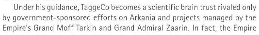
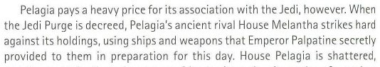
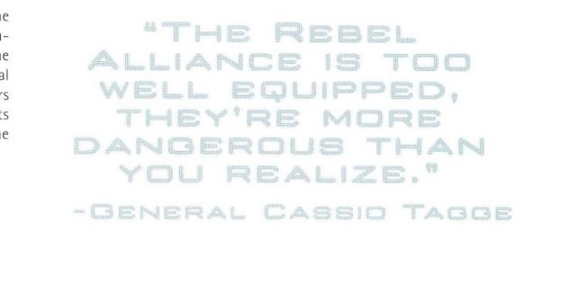
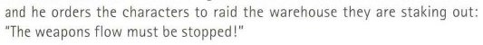
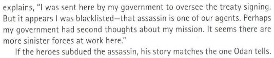
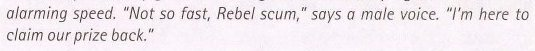
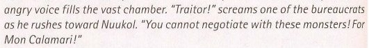
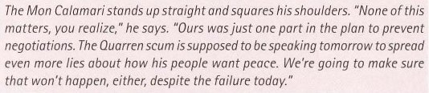
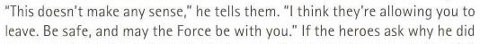

# Owner Material 037 — Star Wars D20 Drive folder (Core, Revised Core and Saga Edition): Sourcebooks/Galaxy of Intrigue.pdf [Star Wars Roleplaying Game Saga Edition (2007)] (scan pages 121–180)

- **Source:** Wizards of the Coast Star Wars Roleplaying Game books, web enhancements, Living Force campaign modules and articles (2000–2010), from the owner's "Star Wars D20" Drive folder (only the three edition subfolders; "General" was not read, as instructed). Secondary source (licensed Legends reference). Scan OCR'd on the box; the scan stays box-only and is **not** published.
- **Method:** every scanned page was OCR'd and machine-screened sentence by sentence for power-relevant statements (fights, kills, defeats, Force feats, rankings, superweapons) that name a character on our roster; each kept sentence is quoted verbatim from the OCR text and has a crop of the printed passage directly under it. Pages with nothing power-relevant are still listed with what is on them.
- **Citation:** "*Galaxy of Intrigue* (SWRPG Saga Edition), p.X" by printed page ("scan p.X" where no printed number applies). **Weight:** Licensed RPG material: a secondary source. Narrative text sums up Legends lore; game statistics are rules for players, not canon power levels, and rank lowest.

## scan p.121 (scan page 121)

Page contents: The Tagge Company (TaggeCo): founded by crime boss Tarzen Tagge on Tepasi 200 years before Yavin; brother Halven; House of Tagge Mining Explorer; collapse after the New Order; Goals; Methods; Notable Members: Domina Tagge. (hand-read)

### Stat block notes (game mechanics, not feats)

- Domina Tagge: "The fifth child of the core Tagge family, Domina is born two years before the death of her parents, and, from the age of 7, she is raised in an isolated monastery by a religious order founded around Jedi traditions of peace and harmony (but not the Force)." — "Orman's dreams for his little sister are shattered when Darth Vader draws her into their feud. Vader uses Domina and the Sacred Circle Monastery as part of a scheme to capture Luke Skywalker, but she double-crosses Vader because she sees his plan as an opportunity to gain revenge on those responsible for the deaths of her brothers, Orman and Silas. Domina is as ruthless and calculating as any Tagge since her great-grandfather Tarzen." (Source: *Galaxy of Intrigue* (SWRPG Saga Edition), scan p.121)

## scan p.122 (scan page 122)

Page contents: TaggeCo: Domina Tagge cont., Silas Tagge (Omega Frost), Tarzen Tagge; Using TaggeCo. Caption: "TAGGECO". (hand-read)

- **Grand Moff Tarkin**: "Under his guidance, TaggeCo becomes a scientific brain trust rivaled only by government-sponsored efforts on Arkania and projects managed by the Empire's Grand Moff Tarkin and Grand Admiral Zaarin." Source: *Galaxy of Intrigue* (SWRPG Saga Edition), scan p.122
  

### Stat block notes (game mechanics, not feats)

- Domina Tagge leads TaggeCo: "Following her conflict with Vader and Skywalker, Domina is forced to leave the Sacred Circle, and she assumes leadership of TaggeCo and the title of baroness. She turns the company's security forces and laboratories toward destroying the Rebels, and for several years, TaggeCo poses as much of a threat to the Alliance as the Imperial military and intelligence agencies do. However, Domina remains obsessed with vengeance against Darth Vader, and her fixation undermines the effectiveness with which TaggeCo coordinates its efforts with the Empire. Domina Tagge vanishes under mysterious circumstances while inspecting a laboratory that develops biological weapons." (Source: *Galaxy of Intrigue* (SWRPG Saga Edition), scan p.122)
- Silas Tagge: "The second oldest Tagge sibling during the reign of Emperor Palpatine, Silas Tagge is a brilliant engineer and physicist who leads TaggeCo's network of research facilities, which include pharmaceutical labs and secret weapons design shops." — "Tagge and his design teams are almost as prolific as Tarkin and Zaarin when it comes to devising weapons of mass destruction. His crowning achievement is the Omega Frost, a weapon that uses electromagnetics and other force fields to drop temperatures below what had been considered absolute zero in an area that could theoretically span an entire solar system." (Source: *Galaxy of Intrigue* (SWRPG Saga Edition), scan p.122)
- Tarzen Tagge: "Although descended from a long line of criminals, Tarzen Tagge loves his homeworld of Tepasi and is willing to sacrifice selflessly for it. He lays the foundation for TaggeCo when he takes on the task of rebuilding a groundquake-ravaged region after the planetary government fails to take action. He also sets the stage for TaggeCo's future methods by using his new wealth and prestige to destroy the politicians who did not help the locals. Tarzen is a brutal thug, and he delights in shocking members of the corporate elite." (Source: *Galaxy of Intrigue* (SWRPG Saga Edition), scan p.122)

## scan p.123 (scan page 123)

Page contents: Tapani Nobles: Shey Tapani's empire 7,300 years before Yavin; seven major houses (Barnaba, Cadriaan, Calipsa, Mecetti, Melantha, Pelagia, Reena); Jedi training center on Pelagon; Melantha shatters Pelagia during the Jedi Purge with Palpatine's ships; Goals; Methods (duels). (hand-read)

- **Palpatine (Darth Sidious)**: "When the Jedi Purge is decreed, Pelagia's ancient rival House Melantha strikes hard against its holdings, using ships and weapons that Emperor Palpatine secretly provided to them in preparation for this day." Source: *Galaxy of Intrigue* (SWRPG Saga Edition), scan p.123
  

## scan p.124 (scan page 124)

Page contents: Tapani Nobles Notable Members: Grand Admiral Octavian Grant; Using the Tapani Nobles. Caption: "TAPANI NOBLES". (hand-read)

### Stat block notes (game mechanics, not feats)

- Grand Admiral Octavian Grant: "Grand Admiral Grant is a Tapani Lord of House Mecetti who, after serving with distinction in the Tapani Home Defense Fleet, joins the Imperial Navy and proves himself a brilliant tactician during the late stages of the Clone Wars. He is one of the 12 officers to be elevated to grand admiral when Emperor Palpatine creates that rank." — "(Secretly, Grant wonders if perhaps even Emperor Palpatine is inferior to him, being neither a true noble nor Tapani.) After the Battle of Endor, Grant alone among the surviving grand admirals does not continue the fight against the Rebels or try to carve out a personal kingdom. Instead, he offers to defect to the Rebel Alliance, an offer that is turned down. However, the Alliance allows Grant to retire to a private estate on the Inner Rim resort world of Rathalay." (Source: *Galaxy of Intrigue* (SWRPG Saga Edition), scan p.124)

## scan p.125 (scan page 125)

Page contents: Chapter VI: Nyriaan, World of Intrigue title page. (hand-read)

## scan p.126 (scan page 126)

Page contents: Nyriaan intro: madilon-rich world walled off by its atmosphere, coveted by competing powers. (hand-read)

## scan p.127 (scan page 127)

Page contents: Ten Aspects of Nyriaan (madilon; cloud layer; governing council of CSA, Mining Guild and galactic government; shifting alliances; mistreated miners incl. Elomin and Pa'lowicks; sabotage; visitors assumed to be agents; neutral ground; secrets incl. a Sith Lord in stasis and Mandalorian weapons). Caption: "NYRIAAN'S GOVERNING COUNCIL". (hand-read)

## scan p.128 (scan page 128)

Page contents: Shrouded in Secrecy (Luire system; Caillte); Madilon sidebar; Nyriaan planet stats (capital Locus). Caption: "ELOMIN MINERS ESCAPE RETRIBUTION FOLLOWING A RIOT." (hand-read)

## scan p.129 (scan page 129)

Page contents: Knowledge (Galactic Lore) table; Atmosphere and Weather (tempests; Tempest Observation Bureau); Geography (Lake Viron, Yellow Sea); Surface Conditions (bioluminescent fungi "lanterns"). (hand-read)

## scan p.130 (scan page 130)

Page contents: Equipment interference; Skill Challenge: Overland Survival (CL 6); Settlements; Arumed (AruMed biotech facility). (hand-read)

## scan p.131 (scan page 131)

Page contents: Arumed plot hook (Starveil natives); Locus, Capital of Nyriaan (Corporate City Sector, Republic Sector, Neutral Zone; Nyriaan Concord from 30 BBY); New Lowick (Pa'lowick defectors, 29 BBY; Force-sensitive fugitive hook). (hand-read)

## scan p.132 (scan page 132)

Page contents: Prosperity (CSA frontier outpost, Prosperity Mine; mining tech hook); sidebar New Species: Pa'lowick (traits); Silence (independent mining town, Nyriaan spice; claim jumpers hook). (hand-read)

## scan p.133 (scan page 133)

Page contents: Starveil (Melan clan, crashed Old Republic vessel among Meadlin's trees; Tapani noble's son hook); Temperance (traders' town, Temperance Arena; sabotaged carbines hook); Tonnage (Mining Guild smelting colony; whistleblower hook); Tor'Oront (Elomin colony). (hand-read)

## scan p.134 (scan page 134)

Page contents: Sidebar New Species: Elomin (Impose Order, Logical Mind); Vineyard (House Melantha's Imperial retreat, 16 BBY; officer assassination hook); Madilon Mines; sidebar Nyriaan and the Galaxy. (hand-read)

## scan p.135 (scan page 135)

Page contents: Madilon prices and galactic agents; Nyriaan Timeline 10,000 BBY to 3,956 BBY (Starveil lost 4,067 BBY; Mandalorian outpost Unity on Caillte 3,964 BBY; Darth Glovoc's vision and the Dying Sun 3,957–3,956 BBY); sidebar Nyriaan of the Distant Past. Caption: "ON NYRIAAN, MANY DARK DEALS TAKE PLACE BEHIND CLOSED DOORS." (hand-read)

## scan p.136 (scan page 136)

Page contents: Timeline 3950 BBY to 47 BBY (CSA on Caillte 405 BBY; Commerce lost; Locus and Ardent Virtue 90–85 BBY; legal battle; laser transport arrays; Navigator's Guild; native uprising). Caption: "LANDING ON NYRIAAN IS DANGEROUS FOR ALL SHIPS." (hand-read)

## scan p.137 (scan page 137)

Page contents: Timeline 43 BBY to 10 ABY (Jedi Knight Amar Cros stays; Mining Guild fronts the Trade Federation; Luire Accord 30 BBY; Pa'lowick immigration; First and Second Battles of Nyriaan; Order 66; ion shielding station; Operation Cloudfall). Caption: "MINING GUILD SABOTEURS". (hand-read)

### Stat block notes (game mechanics, not feats)

- Amar Cros refuses to return: "43 BBY: The Nyriaanan clans negotiate a planetwide nonaggression pact with the Republic and various mining interests. Although the CSA attempts to stall the proceedings, a grudging peace descends upon the planet. Amar Cros, a Jedi Knight sent to negotiate the nonaggression pact with the natives, refuses to return to the Jedi Temple on Coruscant." (Source: *Galaxy of Intrigue* (SWRPG Saga Edition), scan p.137)

## scan p.138 (scan page 138)

Page contents: Timeline 26 ABY to 41 ABY (Yuuzhan Vong conquest; Vong refugees accepted); Landing on Nyriaan; Gondolas; Laser Transport Arrays. Caption: "A REPUBLIC ATTACK SHUTTLE RECEIVES SHIELDING BEFORE LANDING ON NYRIAAN." (hand-read)

## scan p.139 (scan page 139)

Page contents: Laser transport array use, leak and regulation, landing checks; Shielding Stations (technology later developed by Lando Calrissian; 50,000-credit shield license fee); Skill Challenge: Blind Descent intro. (hand-read)

## scan p.140 (scan page 140)

Page contents: Blind Descent (CL 12); sidebar Nyriaan and the Force (Force null atmosphere, first noticed by Darth Glovoc; tempest DC modifiers; The Reasons Why). (hand-read)

## scan p.141 (scan page 141)

Page contents: Ecology; Common Animal Species: Lluma (CL 7 stats, tactics); Pherin intro. (hand-read)

## scan p.142 (scan page 142)

Page contents: Pherin (stats, tactics); Chlovi Cat (CL 5 stats). Caption: "CHLOVI CAT". (hand-read)

## scan p.143 (scan page 143)

Page contents: Chlovi Cat tactics; Common Plant Species: Chlovi, Falsin's Rot (CL 7 disease), Meadlin's Tree (named for an Ithorian botanist), Nyriaan Spice (mire nettle). (hand-read)

## scan p.144 (scan page 144)

Page contents: Tempest's Blessing; Government Authority (four-seat Council); Law Enforcement (Empire's special decree); The Factions of Nyriaan; The Natives of Nyriaan (Starveil descendants). (hand-read)

## scan p.145 (scan page 145)

Page contents: Sidebar New Species: Near-Human (Nyriaanan) traits; sidebar The Sith on Nyriaan (Darth Glovoc in suspended animation, worshiped as the Dying Sun); The Old Republic Era; The Galactic Republic. (hand-read)

### Stat block notes (game mechanics, not feats)

- Darth Glovoc sleeps: "Darth Glovoc goes into suspended animation within an oubliette, initially awakening every hundred years or so to take stock of his people and their progress. His episodes of consciousness grow less and less frequent as the millennia slowly pass until he is worshiped as a sleeping god, the Dying Sun, by the depraved descendants of his crew. After the colonization of Nyriaan, his sleep becomes fitful and restless. The creatures that serve Darth Glovoc's sleeping form try to awaken him, but to no avail. If he finally regains consciousness, he doubtless brings his servants together to venture out in search of conquest beyond the murky prison of Nyriaan." (Source: *Galaxy of Intrigue* (SWRPG Saga Edition), scan p.145)

## scan p.146 (scan page 146)

Page contents: Starveil Project (Captain Bethanie Melan searches for a lost experimental Republic vessel); The Mandalorians (Unity on Caillte; Feruun Lern; Malachor V; Canderous Ordo). Caption: "DARTH GLOVOC". (hand-read)

### Stat block notes (game mechanics, not feats)

- Bethanie Melan: "The captain of the Starveil, Bethanie Melan, holds the rank of commander in the Republic Navy prior to her resignation and subsequent attachment to the Starveil Project. No official explanation is ever given for her departure from the Navy, nor is her commission ever officially listed as being terminated." — "Although the Starveil does crash on Nyriaan, most of the crew, including Bethanie Melan, survives the crash. The Starveil survivors become the first of Nyriaan's colonists and form the basis for the planet's native population, which plays an important role in Nyriaanan politics in the centuries to come." (Source: *Galaxy of Intrigue* (SWRPG Saga Edition), scan p.146)
- Feruun Lern: "Feruun Lern, a Mandalorian crusader who is highly regarded by his fellow clansmen, establishes his dominance on Unity shortly after the outpost is founded." — "As the Jedi Civil War rages, Lern and his followers, viewed as staunch traditionalists, leave Unity and join with Canderous Ordo. Together they seek glory in death during the Dark Wars against the Sith. Although some survive, Lern and most of his clan lose their lives." (Source: *Galaxy of Intrigue* (SWRPG Saga Edition), scan p.146)

## scan p.147 (scan page 147)

Page contents: The Sith Empire (Darth Glovoc, Lord of the Mind's Eye; vision on the eve of Malak's death; the Dying Sun's fall); The Rise of the Empire Era; The Confederacy of Independent Systems (First and Second Battles of Nyriaan; Mining Guild comes out ahead). (hand-read)

### Stat block notes (game mechanics, not feats)

- Darth Glovoc's vision: "Darth Glovoc, self-proclaimed Lord of the Mind's Eye, wages a series of successful campaigns during the waning years of the Jedi Civil War. Considered brilliant but mad—even by the standards of the Sith—Darth Glovoc is often left to his own devices. When not engaging the Republic, he spends his time in deep meditation, searching for the key to his people's ultimate victory. On the eve of Darth Malak's death at the hands of Revan, Darth Glovoc experiences an epiphany in the form of a dream. In his vision, he sees a dark world covered in perpetual cloud, violet lightning piercing the dimness of the planet's surface like bolts of dark-side energy." (Source: *Galaxy of Intrigue* (SWRPG Saga Edition), scan p.147)
- The CIS on Nyriaan: "In fact, Count Dooku's only concern for Nyriaan is that all Republic holdings on the planet be neutralized in order to deny his enemies the alloy they require to fuel the war effort." — "When the Second Battle of Nyriaan takes place in 19 BBY, the Confederacy's forces are swept aside in a single night. With the combined blow of losing both Count Dooku and General Grievous only a few days earlier, the CIS's will to fight is completely broken, and the Republic's clone units spend much of the battle mopping up and taking prisoners." (Source: *Galaxy of Intrigue* (SWRPG Saga Edition), scan p.147)

## scan p.148 (scan page 148)

Page contents: The Corporate Sector Authority on Nyriaan (Caillte outpost, Mandalorian artifacts, LTA development); The Galactic Republic (Luire Accord and Nyriaan Concord, Native Delegation; CIS control for seventeen months). (hand-read)

## scan p.149 (scan page 149)

Page contents: Sidebar Ghia Preyssola (Twi'lek Republic agent, CL 6 stats, tactics); The Jedi Council (Amar Cros goes rogue). Caption: "THE NOBLES OF THE TAPANI SECTOR KNOW HOW TO OFFER A PROPER BRIBE." (hand-read)

### Stat block notes (game mechanics, not feats)

- Ghia Preyssola: "One of the Republic's staunchest agents on Nyriaan is Ghia Preyssola. Ghia, a Twi'lek, has been a willing tool of the Republic for most of her life. She is responsible for forming and coordinating Republic intelligence cells in and around the Luire system, and she does so with a significant amount of aplomb. When the hammer falls and the Confederacy invades, Ghia seeks refuge with independent miners and prospectors in the village of Silence. She reemerges when the Republic returns, and continues to perform her job for the Rebellion after the establishment of Emperor Palpatine's New Order." — "Having lived for years in the tough mining town of Silence, Ghia Preyssola is renowned for her skill at hand-to-hand combat. Few knowingly enter into a boxing match with her, and those who do usually end up unconscious or dead." (Source: *Galaxy of Intrigue* (SWRPG Saga Edition), scan p.149)
- Amar Cros goes rogue: "During his time on Nyriaan, Cros becomes enamored with the mysterious planet and its native population. Despite the Council's request that he return to the Jedi Temple on Coruscant, Cros decides to remain on Nyriaan. The Jedi tolerate his insubordination, feeling that it is better that they have an envoy on the planet in the event of further violence erupting. Another uprising occurs seven years later, this time with Amar Cros at the forefront of the native insurgents. Although the Council declares that Cros has become a rogue Jedi, they refrain from sending a Jedi Master to deal with him directly. By the time the violence subsides in 30 BBY, Cros surfaces once again as the leader of the native delegation to the Nyriaan Concord. Finding the Concord to be just as ill-prepared and corrupt as the Galactic Senate, Cros leaves in disgust, taking a large contingent of natives into Nyriaan's unexplored regions." (Source: *Galaxy of Intrigue* (SWRPG Saga Edition), scan p.149)

## scan p.150 (scan page 150)

Page contents: Sidebar Amar Cros (CL 10 Jedi 7/Jedi Knight 3 stats, tactics); Tapani Nobility on Nyriaan (Houses Reena, Mecetti, Melantha). (hand-read)

### Stat block notes (game mechanics, not feats)

- Amar Cros: "Amar Cros has given up his Jedi robes in exchange for the clothes of a native Nyriaanan. Although he still clings to some of his Jedi philosophy, he sees the current struggle between the natives and the offworlders as a different type of war with a different kind of morality. In his fight against Nyriaan's oppressors, Amar Cros does anything to win. He is willing to call upon the dark side of the Force if it means serving the greater good. That he has not fallen to the dark side is a wonder to most Jedi, but Amar is never too proud to seek solace in mediation and atonement when the opportunity presents itself." — "Amar Cros uses the Force as his primary weapon, using his lightsaber when necessary to lay his enemies low. He rarely fights alone, preferring to keep a small cadre of Force-sensitive natives with him." (Source: *Galaxy of Intrigue* (SWRPG Saga Edition), scan p.150)

## scan p.151 (scan page 151)

Page contents: The Rebellion Era on Nyriaan (black market, Hutts and Black Sun); The Galactic Empire (ion shielding stations from 8 BBY; Operation Cloudfall); Other Corporate Interests (KDY designs the station that sets the standard for Endor's; Sienar staffs it); The Rebel Alliance. (hand-read)

## scan p.152 (scan page 152)

Page contents: Sidebar Zerik (Bothan Rebel agent, CL 8 stats, tactics); Alliance sleeper agents on Nyriaan. (hand-read)

- **Cassio Tagge** — entry/section: Pull quote (Cassio Tagge): ""THE REBEL ALLIANCE IS TOO WELL EQUIPPED, THEY'RE MORE DANGEROUS THAN YOU REALIZE." -GENERAL CASSIO TAGGE" Source: *Galaxy of Intrigue* (SWRPG Saga Edition), scan p.152
  

### Stat block notes (game mechanics, not feats)

- Zerik: "Among the Rebel agents operating on Nyriaan, the most enigmatic is Zerik, a Bothan who began his stint with the Alliance prior to the destruction of Alderaan. Pragmatic by Bothan standards, he quickly recognizes the evils of the Galactic Empire and Emperor Palpatine's New Order. Rather than seek wealth for his services, Zerik performs much of his pro-Alliance work for free. The death of his sister—one of the Bothans who die in the effort to retrieve information pertaining to the second Death Star—eclipses any value Zerik has for his own life with a seething, uncontained hatred. Although he still works for the Rebellion, Zerik is more interested in making the Empire pay for his sister's death than he is in overthrowing its tyranny." — "In the event that he is unable to rely on surprise, Zerik fights like a cornered animal. He has no honor, especially when dealing with Imperial agents, and does anything to win. Short of victory, he accepts only death. To Zerik, surrender is never an option." (Source: *Galaxy of Intrigue* (SWRPG Saga Edition), scan p.152)

## scan p.153 (scan page 153)

Page contents: The New Jedi Order Era on Nyriaan (Vong see Nyriaan as holy); The New Republic (8 ABY offer to the natives); The Yuuzhan Vong (experiments on natives; expatriates remain). (hand-read)

## scan p.154 (scan page 154)

Page contents: The Legacy Era (natives and Vong meld by Cade Skywalker's time; CSA de facto control); The Galactic Alliance; The Galactic Empire (Roan Fel; Darth Krayt sends Darth Vurik in 132 ABY to find the Dying Sun). (hand-read)

- **Darth Krayt** — entry/section: Pull quote (Darth Krayt): ""MY VISION OF GALACTIC ORDER IS NOT YET A REALITY BUT IT WILL BE...IT WILL BE..." -DARTH KRAYT" Source: *Galaxy of Intrigue* (SWRPG Saga Edition), scan p.154
  

### Stat block notes (game mechanics, not feats)

- Cade Skywalker reference: "By the time Cade Skywalker witnesses the death of his father on Ossus, the two cultures have melded seamlessly." (Source: *Galaxy of Intrigue* (SWRPG Saga Edition), scan p.154)
- Roan Fel and Nyriaan: "Under the rule of Roan Fel and his predecessors, Imperial interest in Nyriaan is cursory at best." — "Although Emperor Fel garrisons troops in and around Locus, ostensibly to keep the peace, little is done to curb the excesses of the Corporate Sector Authority." (Source: *Galaxy of Intrigue* (SWRPG Saga Edition), scan p.154)
- Darth Vurik hunts the Dying Sun: "When Darth Krayt usurps the throne, his interest in Nyriaan is piqued when Sith agents uncover rumors of the Dying Sun." — "In 132 ABY, Darth Krayt dispatches Darth Vurik to Nyriaan to investigate rumors of the Dying Sun. As he investigates the scant clues provided by his master, Darth Vurik discovers the descendants of the Sith who survived the crash of the Dying Sun. The descendants of the Sith, twisted in both body and spirit by their fanatical worship of the sleeping Darth Glovoc, resist Darth Vurik's advances, and many lose their lives in defense of their comatose master." — "Before Darth Vurik can discover the location of Darth Glovoc, the sleeping captain of the Dying Sun, he is set upon by several fugitive Jedi. Although he is defeated, Darth Vurik leaves many of the Jedi wounded and kills at least one before retreating to Locus. While the Jedi and Darth Vurik distract one another, the Sith natives move Darth Glovoc to another hidden location. Haunted by his failure, Darth Vurik does not immediately report back to Darth Krayt. Instead, he hires bounty hunters to locate and kill the Jedi on Nyriaan while he continues his hunt for Darth Glovoc's body." (Source: *Galaxy of Intrigue* (SWRPG Saga Edition), scan p.154)

## scan p.155 (scan page 155)

Page contents: Chapter VII: Encounters title page. (hand-read)

## scan p.156 (scan page 156)

Page contents: Chapter VII intro; Using Mini-Adventures (Shooting Trouble, Arms Dealers Beware, Betrayal at Cloud City, Double Down, Opportunity Knocks, My Enemy's Enemy). (hand-read)

## scan p.157 (scan page 157)

Page contents: Adventure #1: Shooting Trouble (2nd level): Joruba Consortium; "Sector Rangers" Malbo and Tyri; By Hook or By Crook; sidebar Isn't This Illegal?; Just the Hired Help (freighter Windswept, code cylinders). (hand-read)

## scan p.158 (scan page 158)

Page contents: Windswept and Last Call; I'm Taking This (CL 2); Combat. Caption: "SLICING INTO THE MAINFRAME". (hand-read)

## scan p.159 (scan page 159)

Page contents: Encounter: The Troubleshooting (CL 3); Skill Challenge: The Slice (CL 3); Joruba Consortium Troubleshooter Team Member stats. (hand-read)

## scan p.160 (scan page 160)

Page contents: Joruba Consortium Technicians (2) stats; Features of the Area; Conclusion (data implicates Malbo and Tyri); map key. (hand-read)

## scan p.161 (scan page 161)

Page contents: Adventure #2: Arms Dealers Beware (2nd level): Hutt cartel warehouse on Naboo; Lieutenant Trayl Caltos; Kal Jorek and Defel Frizz; Bargaining with Caltos; The Stakeout. Caption: "BREAKING INTO THE WAREHOUSE". (hand-read)

## scan p.162 (scan page 162)

Page contents: The Switch (CL 4); Warning Caltos; Skill Challenge: Rumble in the Warehouse Entry (CL 2). (hand-read)

- **Trayl Caltos** — entry/section: Caltos orders the raid: ""The weapons flow must be stopped!"" Source: *Galaxy of Intrigue* (SWRPG Saga Edition), scan p.162
  

## scan p.163 (scan page 163)

Page contents: Encounter: Raiding the Warehouse (CL 2); Kal Jorek (CL 3 stats, tactics); Frizz (CL 2 stats). (hand-read)

### Stat block notes (game mechanics, not feats)

- Kal Jorek: "A low-grade weapons smuggler, Kal Jorek has been upsetting peaceful systems for years by importing illegal weapons. Jorek creates a demand for his wares by promoting chaos and fear, after which the local populace comes to him for weapons to protect themselves. Jorek, who ultimately answers to the Hutt crime cartel in Nar Shaddaa, leads a small band of thugs, which includes his right-hand "man," a Defel he calls Frizz." (Source: *Galaxy of Intrigue* (SWRPG Saga Edition), scan p.163)
- Frizz: "This Defel befriended Kal Jorek soon after leaving his homeworld of Af'El. Because Jorek could not properly pronounce the Defel's name, the smuggler decided to call him "Frizz," and the new name stuck. Frizz has grown accustomed to the moniker." (Source: *Galaxy of Intrigue* (SWRPG Saga Edition), scan p.163)

## scan p.164 (scan page 164)

Page contents: Frizz stats cont. (partial invisibility, ultraviolet visor), tactics; Conclusion; map key; Features of the Area. (hand-read)

## scan p.165 (scan page 165)

Page contents: Mini-Adventure #3: Betrayal at Cloud City (4th level): Iridonia–Duros trade dispute; Belai Kaleeg; Koon Odan; Assassination Attempt (CL 4) at the Twin Star restaurant. Caption: "ESCAPING THROUGH THE STREETS OF CLOUD CITY". (hand-read)

## scan p.166 (scan page 166)

Page contents: The Signing (datapad wiped, credit chip emptied); Skill Challenge: The Chase (CL 4; assassin joins). (hand-read)

- **Belai Kaleeg; Koon Odan** — entry/section: Kaleeg orders the chase: ""bring that Zabrak back!"" Source: *Galaxy of Intrigue* (SWRPG Saga Edition), scan p.166
  

## scan p.167 (scan page 167)

Page contents: Encounter: Chase Through the Clouds (CL 2); Koon Odan (CL 4 stats, tactics); Assassin (unnamed Zabrak, CL 4 stats). (hand-read)

### Stat block notes (game mechanics, not feats)

- Koon Odan: "A female Zabrak, Koon Odan arranged to meet with Duros corporate representative Belai Kaleeg to negotiate a trade agreement to benefit their worlds. She is unaware that her government sent a second agent (the assassin) on a mission opposing her own." (Source: *Galaxy of Intrigue* (SWRPG Saga Edition), scan p.167)

## scan p.168 (scan page 168)

Page contents: Assassin's Tactics; Features of the Area (Twin Star restaurant, synthtone cantina, dance hall, docking pad); map key; Conclusion (treaty proceeds or Iridonia–Duro war). (hand-read)

- **Koon Odan** — entry/section: Odan surrenders: ""I was sent here by my government to oversee the treaty signing. But it appears I was blacklisted—that assassin is one of our agents. Perhaps my government had second thoughts about my mission. It seems there are more sinister forces at work here."" Source: *Galaxy of Intrigue* (SWRPG Saga Edition), scan p.168
  

## scan p.169 (scan page 169)

Page contents: Mini-Adventure #4: Eye on the Prize (6th level): Alliance Intelligence to abduct Givin neurobiologist Saludor Narubo on Taris; Plotting the Assault; The Kidnapping. (hand-read)

### Stat block notes (game mechanics, not feats)

- Saludor Narubo: "Alliance Intelligence has recently intercepted communications about the reassignment of Saludor Narubo, a brilliant Givin neurobiologist noted for developing vaccines for some of the galaxy's most devastating diseases. The Alliance realizes that if anyone could create even more dangerous strains of biological agents, it's Saludor, and has decided to abduct the scientist before he is shipped off to some hidden base, never to be seen again." (Source: *Galaxy of Intrigue* (SWRPG Saga Edition), scan p.169)

## scan p.170 (scan page 170)

Page contents: The Escape; Skill Challenge: Fleeing the Imperials (CL 6). Caption: "HOLDING AN IMPERIAL OFFICER HOSTAGE". (hand-read)

## scan p.171 (scan page 171)

Page contents: Encounter: Unexpected Visitor (CL 8): YT-1300 at Taris Spaceport; Karvas Toll (CL 8 stats, tactics). (hand-read)

- **Karvas Toll** — entry/section: Toll in the dark: ""Not so fast, Rebel scum," says a male voice. "I'm here to claim our prize back."" Source: *Galaxy of Intrigue* (SWRPG Saga Edition), scan p.171
  

### Stat block notes (game mechanics, not feats)

- Karvas Toll: "Karvas Toll grew up in the slums of Taris, where his future was limited to joining a gang or being a victim of one. After watching an Imperial propaganda program on the HoloNet, Toll realized that the Empire was the best way to break out of his situation and joined up. Amazingly, instead of shipping Toll off to some distant warfront, the Imperials realized that he was a natural as a spy and surveillance expert, as well as deadly with a blaster and a vibroblade. After a training stint offworld, Toll returned to Taris to assist Imperial Intelligence cells there, using his knowledge of the planet to carry out clandestine acts on behalf of the Empire. Toll considers himself a patriot and believes that the Empire has the galaxy's best interests at heart. Quiet, observant, and stealthy, Toll is often used by his handlers to clean up after missions gone awry or to step in when further assistance is needed." — "As a loyal Imperial agent, Toll knows the penalty for failure and fights to the death. If he is close to being taken down, Toll turns his blaster or vibroblade against Narubo to deny the Rebels the prize." (Source: *Galaxy of Intrigue* (SWRPG Saga Edition), scan p.171)

## scan p.172 (scan page 172)

Page contents: Conclusion (Corellian corvette rendezvous or Star Destroyer capture); Features of the Area; YT-1300 freight configuration deck plan key. (hand-read)

## scan p.173 (scan page 173)

Page contents: Mini-Adventure #5: My Enemy's Enemy (8th level): Mon Calamari ambassador Nuukol and Quarren ambassador Tsillog on Coruscant; Showtime; read-aloud. Caption: "A MON CALAMARI ATTEMPTS ASSASSINATION." (hand-read)

- **No single roster character (rules/setting/general)** — entry/section: Mon Calamari radical: ""Traitor!" screams one of the bureaucrats as he rushes toward Nuukol. "You cannot negotiate with these monsters! For Mon Calamari!"" Source: *Galaxy of Intrigue* (SWRPG Saga Edition), scan p.173
  

## scan p.174 (scan page 174)

Page contents: Assassination Attempt (faulty detonator); Mon Calamari Radicals (2) CL 5 stats; The Failed Martyr; Interrogation ("Avreet"); Desperate Diplomacy. (hand-read)

- **No single roster character (rules/setting/general)** — entry/section: Captured radical: ""None of this matters, you realize," he says. "Ours was just one part in the plan to prevent negotiations. The Quarren scum is supposed to be speaking tomorrow to spread even more lies about how his people want peace. We're going to make sure that won't happen, either, despite the failure today."" Source: *Galaxy of Intrigue* (SWRPG Saga Edition), scan p.174
  

## scan p.175 (scan page 175)

Page contents: Encounter: Hunt for the Assassin (CL 9); Skill Challenge: Spotting the Killer; Loodux (Rodian assassin, CL 9 stats). (hand-read)

### Stat block notes (game mechanics, not feats)

- Loodux: "Other members of the Mon Calamari radical group hired Loodux, a Rodian assassin, to kill the Quarren ambassador. Loodux is well known for his pistol work and his penchant for bold showmanship. The radicals want a spectacle and believe that a lone assassin killing Tsillog up close and personal would serve their cause effectively. Loodux is a perfect fit. Although his primary motivation is the payment he will receive, he has also come to share the radicals' distrust of the peace accord. In addition, the Rodian is more than a little insane." (Source: *Galaxy of Intrigue* (SWRPG Saga Edition), scan p.175)

## scan p.176 (scan page 176)

Page contents: Loodux stats cont., tactics; Conclusion (Avreet is Ambassador Nuukol); map key; Features of the Area. (hand-read)

### Stat block notes (game mechanics, not feats)

- Nuukol is Avreet: "If the heroes follow through on this information, they eventually discover that Avreet is Ambassador Nuukol. If the heroes confront Nuukol, he confesses and admits that the attempt on his own life did not go as planned. The thermal detonator was not supposed to work at all, and he expected the two radicals to be killed. Nuukol thought that an attempt on his life would sway public opinion in his favor. On the other hand, he fully intended for Tsillog to be killed, because then the Quarren would assign a new ambassador, perhaps one who truly wanted peace between the two species. Nuukol is later sent to a prison colony on one of Mon Calamari's moons." (Source: *Galaxy of Intrigue* (SWRPG Saga Edition), scan p.176)

## scan p.177 (scan page 177)

Page contents: Mini-Adventure #6: Opportunity Knocks (9th level): coded transmission of Emperor Palpatine's visit to Duro (a trap); Decoding the Transmission; Skill Challenge: Arranging the Assassination (CL 9). (hand-read)

### Stat block notes (game mechanics, not feats)

- The Duro bait: "While on a far less important mission, the heroes intercept a coded transmission. After decoding it, they discover that Emperor Palpatine is slated to visit one of the floating domed cities of Duro regarding a new line of starships to be built for himself and his enforcer, Darth Vader. If the heroes negotiate with a Duro government official who has shown sympathy for the Rebellion in the past, they might be able to place themselves in the right position to assassinate Emperor Palpatine. Secretly, however, the transmission is a trap baited for the Alliance." (Source: *Galaxy of Intrigue* (SWRPG Saga Edition), scan p.177)

## scan p.178 (scan page 178)

Page contents: Aftermath (homing beacon); Skill Challenge: Disable the Tracking Device (CL 9). Caption: "ASSAULTING THE FALSE EMPEROR". (hand-read)

- **No single roster character (rules/setting/general)** — entry/section: Duro official: ""This doesn't make any sense," he tells them. "I think they're allowing you to leave. Be safe, and may the Force be with you."" Source: *Galaxy of Intrigue* (SWRPG Saga Edition), scan p.178
  

## scan p.179 (scan page 179)

Page contents: Encounter: Assassination Ambush (CL 9); One for the Rebellion; The Trap (impostor Emperor, Royal Guards, heavy stormtroopers); Duros Officials (Corporate Security agents) CL 7 stats. (hand-read)

## scan p.180 (scan page 180)

Page contents: Duros Officials stats cont.; Conclusion (ISB scrutiny; Vader's Force grip); Features of the Area; map key. (hand-read)

### Stat block notes (game mechanics, not feats)

- Vader punishes the failure: "If the heroes find and remove the tracking device, they escape the Imperials without a hitch. The Empire loses their trail, and somewhere, two Duros security agents and some Imperial officers suffer in the Force grip of Darth Vader." (Source: *Galaxy of Intrigue* (SWRPG Saga Edition), scan p.180)
