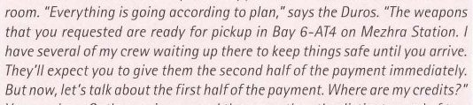
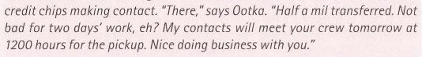
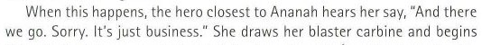
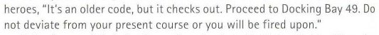
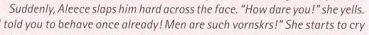
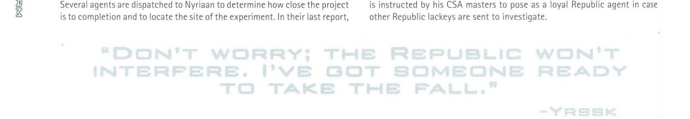
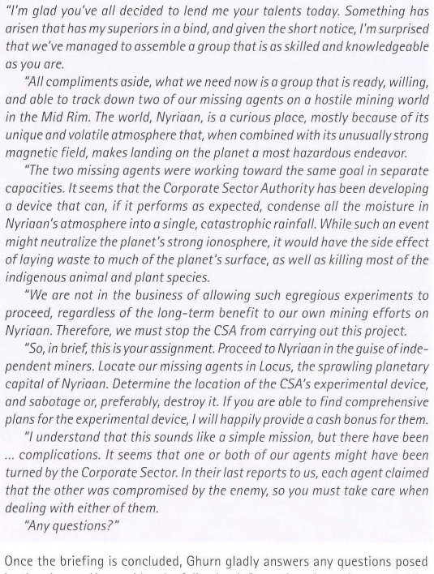
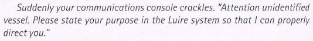
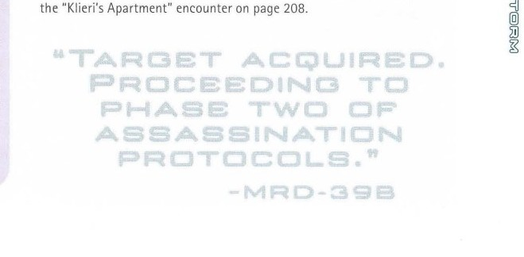
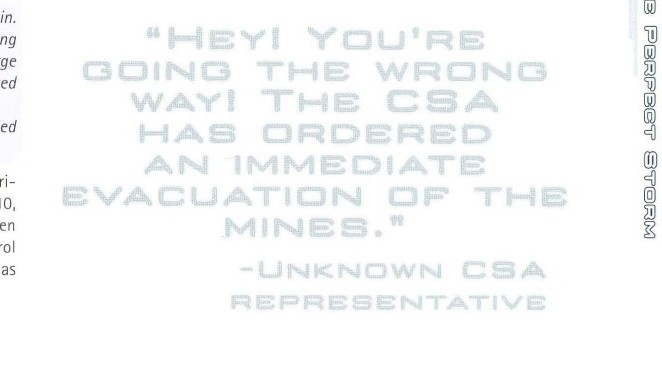

# Owner Material 037 — Star Wars D20 Drive folder (Core, Revised Core and Saga Edition): Sourcebooks/Galaxy of Intrigue.pdf [Star Wars Roleplaying Game Saga Edition (2007)] (scan pages 181–226)

- **Source:** Wizards of the Coast Star Wars Roleplaying Game books, web enhancements, Living Force campaign modules and articles (2000–2010), from the owner's "Star Wars D20" Drive folder (only the three edition subfolders; "General" was not read, as instructed). Secondary source (licensed Legends reference). Scan OCR'd on the box; the scan stays box-only and is **not** published.
- **Method:** every scanned page was OCR'd and machine-screened sentence by sentence for power-relevant statements (fights, kills, defeats, Force feats, rankings, superweapons) that name a character on our roster; each kept sentence is quoted verbatim from the OCR text and has a crop of the printed passage directly under it. Pages with nothing power-relevant are still listed with what is on them.
- **Citation:** "*Galaxy of Intrigue* (SWRPG Saga Edition), p.X" by printed page ("scan p.X" where no printed number applies). **Weight:** Licensed RPG material: a secondary source. Narrative text sums up Legends lore; game statistics are rules for players, not canon power levels, and rank lowest.

## scan p.181 (scan page 181)

Page contents: Mini-Adventure #7: Double Down (10th level): Republic Intelligence on Clak'dor VII under Special Agent Mocen Gundross; Aqualish Bandor Ootka's safe house; Surveillance; Infiltration. Caption: "SPYING ON THE ARMS DEAL". (hand-read)

## scan p.182 (scan page 182)

Page contents: Sidebar Security Measures (surveillance detector, silence bubble generator); A Knock at the Door (CL 7); The Meeting (Duros smuggler Doon Gorot; Mezhra Station Bay 6-AT4); The Real Situation (Gundross a traitor). (hand-read)

- **Doon Gorot** — entry/section: Gorot on the deal: ""Everything is going according to plan," says the Duros. "The weapons that you requested are ready for pickup in Bay 6-AT4 on Mezhra Station. I have several of my crew waiting up there to keep things safe until you arrive. They'll expect you to give them the second half of the payment immediately. But now, let's talk about the first half of the payment. Where are my credits?"" Source: *Galaxy of Intrigue* (SWRPG Saga Edition), scan p.182
  
- **Bandor Ootka** — entry/section: Ootka pays: ""There," says Ootka. "Half a mil transferred. Not bad for two days' work, eh? My contacts will meet your crew tomorrow at 1200 hours for the pickup. Nice doing business with you."" Source: *Galaxy of Intrigue* (SWRPG Saga Edition), scan p.182
  

### Stat block notes (game mechanics, not feats)

- Mocen Gundross: "In reality, the conversation that the heroes overhear between Ootka and Gorot is part of a plot by Special Agent Mocen Gundross. The intelligence officer sold his loyalties to the Separatists and promised to give them some Republic Intelligence agents who could be interrogated for secrets or used as bargaining chips. Gundross set up the heroes, hoping to lure them into a trap so they could be captured more easily." (Source: *Galaxy of Intrigue* (SWRPG Saga Edition), scan p.182)

## scan p.183 (scan page 183)

Page contents: Encounter: Deal Gone Bad (CL 10): Bith agent Ananah Kragana and the Verdant Song; Double-Cross; Ananah Kragana (CL 10 stats). (hand-read)

- **Ananah Kragana** — entry/section: Ananah's betrayal: ""And there we go. Sorry. It's just business."" Source: *Galaxy of Intrigue* (SWRPG Saga Edition), scan p.183
  

### Stat block notes (game mechanics, not feats)

- Ananah Kragana: "At one time, Ananah considered herself a loyal member of the Republic, but years of work in the field and proximity to the Separatists made her susceptible to conversion. Special Agent Gundross turned double agent as well, and the two of them have worked secretly with the Separatists for months, turning over Republic agents and other valuable commodities. Gundross and Ananah set up this elaborate ruse to lure the heroes into a position where they could be captured and sent to a Separatist world as prisoners." (Source: *Galaxy of Intrigue* (SWRPG Saga Edition), scan p.183)

## scan p.184 (scan page 184)

Page contents: Ananah's Tactics; Separatists' Tactics; Features of the Area (force field, service tunnels, service pit); Conclusion (Skako; 100,000-credit reward). (hand-read)

## scan p.185 (scan page 185)

Page contents: Mini-Adventure #8: Extracting Aleece (12th level): Rebel spy Tehlan Aleece, niece of Moff Venram Krax on Corellia; General Airen Cracken; Firespray-31; The Arrival. Caption: "AVOIDING IMPERIAL CAPTURE WHILE EXTRACTING ALEECE". (hand-read)

- **No single roster character (rules/setting/general)** — entry/section: Imperial flight officer: ""It's an older code, but it checks out. Proceed to Docking Bay 49. Do not deviate from your present course or you will be fired upon."" Source: *Galaxy of Intrigue* (SWRPG Saga Edition), scan p.185
  

### Stat block notes (game mechanics, not feats)

- Tehlan Aleece's warning: "Agent Tehlan Aleece is a well-placed Rebel spy within the Empire. She is, in fact, the niece of Moff Venram Krax, who is temporarily located on Corellia. Throughout her longstanding secret association with the Rebel Alliance, she has provided vital information on Imperial procedures and activities. Recently, through her spy network, she contacted General Airen Cracken with potentially grave news. She believes that someone has become suspicious of her and that her cover soon might be blown. Cracken seems certain that Aleece would not have contacted him unless she were in real trouble." (Source: *Galaxy of Intrigue* (SWRPG Saga Edition), scan p.185)

## scan p.186 (scan page 186)

Page contents: Making Contact (Snaeb Fronk, Aleece's escort); Almost Caught; Skill Challenge: The Pursuit of Freedom (CL 12). (hand-read)

- **Tehlan Aleece; Snaeb Fronk** — entry/section: Fronk confronts Aleece: ""Oh? And what is that?" she replies. "Don't play naive with me! I've seen you—I've been watching you," he says. "You and your little network of spies—" You hear a slap. "You're a feisty one," Fronk continues. "But no matter. It's too late for you. I've informed your uncle of your treasonous ways. You'll be in the spice mines of Kessel before this is done."" Source: *Galaxy of Intrigue* (SWRPG Saga Edition), scan p.186
  

## scan p.187 (scan page 187)

Page contents: Encounter: Dine and Dash (CL 12): Moff Krax's birthday party; Back to the Ship (bays 49 and 46); Tehlan Aleece (CL 7 noble stats); Lambda-class shuttle (modified) stats begin. (hand-read)

- **Tehlan Aleece** — entry/section: Aleece's exit: ""How dare you!" she yells. "I told you to behave once already! Men are such vornskrs!"" Source: *Galaxy of Intrigue* (SWRPG Saga Edition), scan p.187
  

### Stat block notes (game mechanics, not feats)

- Tehlan Aleece: "The niece of Moff Venram Krax from Corellia, Tehlan Aleece is also an undercover agent for the Rebel Alliance. Behind her uncle's back, she has been reporting information to General Airen Cracken through a spy network. She is also an experienced pilot." (Source: *Galaxy of Intrigue* (SWRPG Saga Edition), scan p.187)

## scan p.188 (scan page 188)

Page contents: Lambda-class shuttle stats cont. (an editor's note about the missing hyperdrive line was left in print); Conclusion; map key; Features of the Area. (hand-read)

### Stat block notes (game mechanics, not feats)

- Krax's disgrace: "If the heroes escape with Tehlan Aleece and jump to lightspeed, they earn General Airen Cracken's respect for extracting the undercover agent." — "Moff Venram Krax ends up believing that his niece was kidnapped and forced by the Rebels to steal his shuttle. He puts a bounty on the kidnappers and offers a reward for the safe return of his beloved niece." — "The only bright spot in the botched operation is that Moff Krax must explain to Grand Moff Tarkin that his niece had been a Rebel spy right under his nose. Ironically, Tarkin does not know that his own niece Rivoche Tarkin is playing the same game. Nevertheless, Tarkin demotes Krax for this disgrace." (Source: *Galaxy of Intrigue* (SWRPG Saga Edition), scan p.188)

## scan p.189 (scan page 189)

Page contents: Chapter VIII title page (The Perfect Storm). (hand-read)

## scan p.190 (scan page 190)

Page contents: The Perfect Storm intro (four heroes, any era); Opening Crawl. (hand-read)

## scan p.191 (scan page 191)

Page contents: Adventure Summary (CSA's Deluge Experiment to condense Nyriaan's atmosphere); sidebar A Note About Factions; The Truth (Trandoshan Yrssk is the traitor; Klieri killed by a CSA assassin droid). (hand-read)

- **Yrssk** — entry/section: Pull quote (Yrssk): ""DON'T WORRY; THE REPUBLIC WON'T INTERFERE. I'VE GOT SOMEONE READY TO TAKE THE FALL." -YRSSK" Source: *Galaxy of Intrigue* (SWRPG Saga Edition), scan p.191
  

### Stat block notes (game mechanics, not feats)

- The Truth: "Yrssk is a traitor to the Republic, having accepted a number of bribes from the Corporate Sector Authority to impede Republic investigation of the Deluge Experiment and to fabricate evidence against Klieri, the loyal agent, making her appear complicit in aiding the CSA's efforts. Klieri learns the specifics of the Deluge Experiment's location and scheduled completion. She becomes too great a liability and is killed by a CSA assassin droid. Meanwhile, Yrssk is instructed by his CSA masters to pose as a loyal Republic agent in case other Republic lackeys are sent to investigate." (Source: *Galaxy of Intrigue* (SWRPG Saga Edition), scan p.191)

## scan p.192 (scan page 192)

Page contents: Yrssk's plan; Part 1: Before the Storm; Missing Persons (Republic contact Ghurn's briefing; descriptions of Klieri and Yrssk). (hand-read)

- **Ghurn** — entry/section: Ghurn's briefing: ""I'm glad you've all decided to lend me your talents today. Something has arisen that has my superiors in a bind, and given the short notice, I'm surprised that we've managed to assemble a group that is as skilled and knowledgeable as you are. "All compliments aside, what we need now is a group that is ready, willing, and able to track down two of our missing agents on a hostile mining world in the Mid Rim. The world, Nyriaan, is a curious place, mostly because of its unique and volatile atmosphere that, when combined with its unusually strong magnetic field, makes landing on the planet a most hazardous endeavor. "The two missing agents were working toward the same goal in separate capacities. It seems that the Corporate Sector Authority has been developing a device that can, if it performs as expected, condense all the moisture in Nyriaan's atmosphere into a single, catastrophic rainfall. While such an event might neutralize the planet's strong ionosphere, it would have the side effect of laying waste to much of the planet's surface, as well as killing most of the indigenous animal and plant species. "We are not in the business of allowing such egregious experiments to proceed, regardless of the long-term benefit to our own mining efforts on Nyriaan. Therefore, we must stop the CSA from carrying out this project. "So, in brief, this is your assignment. Proceed to Nyriaan in the guise of independent miners. Locate our missing agents in Locus, the sprawling planetary capital of Nyriaan. Determine the location of the CSA's experimental device, and sabotage or, preferably, destroy it. If you are able to find comprehensive plans for the experimental device, I will happily provide a cash bonus for them. "I understand that this sounds like a simple mission, but there have been ... complications. It seems that one or both of our agents might have been turned by the Corporate Sector. In their last reports to us, each agent claimed that the other was compromised by the enemy, so you must take care when dealing with either of them. "Any questions?"" Source: *Galaxy of Intrigue* (SWRPG Saga Edition), scan p.192
  

## scan p.193 (scan page 193)

Page contents: Nyriaan map (Starveil, Temperance, New Lowick, Arumed, Prosperity, Yellow Sea); compensation 12,000 + 8,000 credits; Looks Like Stormy Weather; approach read-aloud. (hand-read)

- **No single roster character (rules/setting/general)** — entry/section: Navigator's Guild hail: ""Attention unidentified vessel. Please state your purpose in the Luire system so that I can properly direct you."" Source: *Galaxy of Intrigue* (SWRPG Saga Edition), scan p.193
  

## scan p.194 (scan page 194)

Page contents: Hyperspace Navigator's Guild contract (Platform Trill 92); sidebar Tevlun (Snivvian bonded navigator, CL 1 stats, tactics). (hand-read)

### Stat block notes (game mechanics, not feats)

- Tevlun: "Tevlun is a tense Snivvian who has recently been accepted into the Hyperspace Navigator's Guild as a bonded navigator. He has made only a few landings on Nyriaan, so he is still somewhat put off by the procedure. Nevertheless, it is decent money, and he has a wife and several children to support back on Cadomai Prime." (Source: *Galaxy of Intrigue* (SWRPG Saga Edition), scan p.194)

## scan p.195 (scan page 195)

Page contents: Planetfall (surface laser telemetry lost); Part 2: Down in It (Locus layout). Caption: "WE'RE GOING TO DIE!" (hand-read)

## scan p.196 (scan page 196)

Page contents: Skill Challenge: Landing on Nyriaan with Orbital Laser Telemetry Only (CL 5); getting around Locus; Locus map key. (hand-read)

## scan p.197 (scan page 197)

Page contents: A Lukewarm Reception (two CSA assassins); Klieri's Apartment (Klieri dead). Caption: "SOMEONE'S WATCHING." (hand-read)

### Stat block notes (game mechanics, not feats)

- Klieri found dead: "Klieri is dead in the apartment bedroom. She has been there for at least a couple of days, and the cause of her death appears to be a series of blaster shots to her chest and abdomen. Her placid face is bruised, and her brown hair is matted with dried blood." — "Heroes who succeed on a DC 15 Perception check can determine that Klieri was likely shot in the living room, but crawled into her bedroom to die." (Source: *Galaxy of Intrigue* (SWRPG Saga Edition), scan p.197)

## scan p.198 (scan page 198)

Page contents: Skill Challenge: Locus Street Chase (CL 4); the FLOOD file ("Lrn 2 swim. Data recd from Bavil. Tst successful. Final phase in 4 dys."); Development; The Monster Under the Bed (MRD-39B murderer droid). (hand-read)

- **MRD-398** — entry/section: Pull quote (MRD-398): ""TARGET ACQUIRED. PROCEEDING TO PHASE TWO OF ASSASSINATION PROTOCOLS." -MRD-398" Source: *Galaxy of Intrigue* (SWRPG Saga Edition), scan p.198
  

## scan p.199 (scan page 199)

Page contents: Yrssk's Apartment (forged holo of Klieri); Into the Wilderness (guide Finvarra). Caption: "THE WILDERNESS OF NYRIAAN IS NO PLACE FOR THE UNPREPARED." (hand-read)

## scan p.200 (scan page 200)

Page contents: Beasts of Prey; The Natives Are Restless (Malvina clan); sidebar Finvarra, Native Guide (CL 3 stats, tactics). (hand-read)

### Stat block notes (game mechanics, not feats)

- Finvarra: "Finvarra is a young native who has spent most of her life living in the wilderness surrounding Locus. She does not trust offworlders, but she sees them as an easy source of income and hires herself out as a guide. Most of the time she keeps her employers alive, not counting the odd occasion when the situation turns sour on the trail. Although she is only sixteen years old, Finvarra tries to act much older." — "Finvarra is young, but she not stupid or naive. Even if the heroes try to ply her with tales of the Corporate Sector Authority's greed, she likely dismisses them as stupid offworlders with delusions of grandeur. She knows that the CSA is evil, but this is not exactly news. If the heroes convince her that her planet and her clan are in danger of being destroyed, she might be willing to do more than just guide them to where they want to go." (Source: *Galaxy of Intrigue* (SWRPG Saga Edition), scan p.200)

## scan p.201 (scan page 201)

Page contents: Malvina scouts; Fear of the Dark (the Steamfields); Yrssk's Ambush (Sith descendants of the Dying Sun crew). (hand-read)

### Stat block notes (game mechanics, not feats)

- Yrssk and the Sith descendants: "In addition to his allies among Nyriaan's native clans, Yrssk also finds and maintains contact with one of Nyriaan's darkest secrets—a clan of Sith who descended from the crew of the ill-fated Dying Sun during the years of the Old Republic. Twisted and inbred, the Sith descendants are little better than cunning animals. Yrssk plies them over the years with trinkets and sacrificial victims." (Source: *Galaxy of Intrigue* (SWRPG Saga Edition), scan p.201)

## scan p.202 (scan page 202)

Page contents: Part 3: The Coming Flood (Final Rest plateau); Children of the Tempest; Riding the Storm Out. (hand-read)

## scan p.203 (scan page 203)

Page contents: Approach read-aloud (Final Rest Mine sign); Going Underground (elevator to R&D Access at 39 meters). Caption: "THE ACTIVE DELUGE DEVICE WREAKS HAVOC IN THE ATMOSPHERE." (hand-read)

## scan p.204 (scan page 204)

Page contents: Cutting the Wire (Deluge Control blast door); plans bonus; exit. Caption: "THE DELUGE DEVICE CONTROL ROOM". (hand-read)

- **No single roster character (rules/setting/general)** — entry/section: Pull quote (unknown CSA representative): ""HEY! YOU'RE GOING THE WRONG WAY! THE CSA HAS ORDERED AN IMMEDIATE EVACUATION OF THE MINES." -UNKNOWN CSA REPRESENTATIVE" Source: *Galaxy of Intrigue* (SWRPG Saga Edition), scan p.204
  

## scan p.205 (scan page 205)

Page contents: Skill Challenge: Disabling the Deluge Device (CL 6); sidebar Bad Winners, Even Poorer Losers. (hand-read)

## scan p.206 (scan page 206)

Page contents: Part 4: Aftermath (Deluge Device deactivated or not; Ghurn's payment); sidebar Further Adventures (A New Master, Power Grab, The Madilon Rush). (hand-read)

## scan p.207 (scan page 207)

Page contents: Encounter 1: Main Street Firefight (CL 3); read-aloud variants; Corporate Sector Assassins (2) description. (hand-read)

## scan p.208 (scan page 208)

Page contents: Corporate Sector Assassin (CL 5) stats, tactics; Conclusion; Features of the Area. (hand-read)

## scan p.209 (scan page 209)

Page contents: Encounter 2: Klieri's Apartment (CL 2 or 5); MRD-39B Assassin Droid (CL 6 stats, tactics). (hand-read)

## scan p.210 (scan page 210)

Page contents: Corporate Sector Assassins (2) repeated stats; Conclusion; Features of the Area; apartment map key. (hand-read)

## scan p.211 (scan page 211)

Page contents: Encounter 3: Crimson and Chlovi (CL 6); Chlovi Cats (4) stats and tactics. (hand-read)

## scan p.212 (scan page 212)

Page contents: Chlovi map; Features of the Area; Conclusion (fallen heroes dragged to the lair). (hand-read)

## scan p.213 (scan page 213)

Page contents: Encounter 4: Native Hospitality (CL 6); Malvina Clan Scout (6), CL 3 stats, tactics. (hand-read)

## scan p.214 (scan page 214)

Page contents: Features of the Area; Conclusion (scouts know Yrssk is headed to the Steamfields). (hand-read)

## scan p.215 (scan page 215)

Page contents: Encounter 5: Children of the Tempest (CL 5); Yrssk (CL 5 Trandoshan stats, tactics); Sith Descendant (6) description. (hand-read)

### Stat block notes (game mechanics, not feats)

- Yrssk: "Yrssk is a self-serving, self-centered, and unscrupulous Trandoshan who originally signs on with the Republic's intelligence services to avoid his debts. After years on Nyriaan, he is tired of the charade and now desires only to make his fortune and escape from the horrible planet." — "Yrssk hides until the heroes appear to be overcoming his Sith dupes. If the tide is turning in favor of the heroes, he pops his head up and fires with his carbine. Even though the shots reveal his position, his cover should work to his advantage. If wounded—even slightly—he surrenders and attempts to buy his freedom with the information he possesses." (Source: *Galaxy of Intrigue* (SWRPG Saga Edition), scan p.215)

## scan p.216 (scan page 216)

Page contents: Sith Descendant (CL 2) stats, tactics; Conclusion; Features of the Area (boiling water). (hand-read)

## scan p.217 (scan page 217)

Page contents: Encounter 6: Sixteen Tons (CL 5); Corporate Sector Mine Guards (8), CL 2 stats; Corporate Sector Miners (6) description. (hand-read)

## scan p.218 (scan page 218)

Page contents: Corporate Sector Miner (CL 1) stats, tactics; Conclusion; Features of the Area; map key. (hand-read)

## scan p.219 (scan page 219)

Page contents: Encounter 7: The End of the World (CL 6); Deluge Facility Guards (6), CL 3 stats; Deluge Facility Technicians (4) description. (hand-read)

## scan p.220 (scan page 220)

Page contents: Deluge Facility Technician (CL 1) stats, tactics; Conclusion; Features of the Area. (hand-read)

## scan p.221 (scan page 221)

Page contents: Encounter 8: Corporate Wrath (CL 5); Corporate Sector Commandos (4), CL 4 stats (an editor's query "[$TC: is this missing something?]" left in print), tactics; Conclusion. (hand-read)

## scan p.222 (scan page 222)

Page contents: Features of the Area (docking bay); map. (hand-read)

## scan p.223 (scan page 223)

Page contents: Index A–Stand Tall, plus character, creature, droid and starship CL tables. (hand-read)

## scan p.224 (scan page 224)

Page contents: Index cont. (Revolutionary Rhetoric–wrist blaster); CL tables. (hand-read)

## scan p.225 (scan page 225)

Page contents: Back ad: Star Wars Miniatures Jedi Academy (Yoda and Naga Sadow). (hand-read)

## scan p.226 (scan page 226)

Page contents: Back cover: Galaxy of Intrigue blurb. Pull quote: "MANY BOTHANS DIED TO BRING US THIS INFORMATION." (hand-read)

- **Mon Mothma** — entry/section: Back cover pull quote: ""MANY BOTHANS DIED TO BRING US THIS INFORMATION."" Source: *Galaxy of Intrigue* (SWRPG Saga Edition), scan p.226
  
