# Owner Material 037 — Star Wars D20 Drive folder (Core, Revised Core and Saga Edition): Sourcebooks/Knights of the Old Rebuplic Campaign Guide.pdf [Star Wars Roleplaying Game Saga Edition (2007)] (scan pages 1–60)

- **Source:** Wizards of the Coast Star Wars Roleplaying Game books, web enhancements, Living Force campaign modules and articles (2000–2010), from the owner's "Star Wars D20" Drive folder (only the three edition subfolders; "General" was not read, as instructed). Secondary source (licensed Legends reference). Scan OCR'd on the box; the scan stays box-only and is **not** published.
- **Method:** every scanned page was OCR'd and machine-screened sentence by sentence for power-relevant statements (fights, kills, defeats, Force feats, rankings, superweapons) that name a character on our roster; each kept sentence is quoted verbatim from the OCR text and has a crop of the printed passage directly under it. Pages with nothing power-relevant are still listed with what is on them.
- **Citation:** "*Knights of the Old Rebuplic Campaign Guide* (SWRPG Saga Edition), p.X" by printed page ("scan p.X" where no printed number applies). **Weight:** Licensed RPG material: a secondary source. Narrative text sums up Legends lore; game statistics are rules for players, not canon power levels, and rank lowest.

## scan p.1 (scan page 1)

Page contents: Cover: Knights of the Old Republic Campaign Guide (Star Wars Roleplaying Game Saga Edition); Rodney Thompson, Sterling Hershey, John Jackson Miller, Abel Peña. (hand-read)

## scan p.2 (scan page 2)

Page contents: Title page: KNIGHTS OF THE OLD REPUBLIC CAMPAIGN GUIDE; Rodney Thompson, Sterling Hershey, John Jackson Miller, Abel Peña. (hand-read)

## scan p.3 (scan page 3)

Page contents: Credits page (designers, developers, editors, art, playtester credit list omitted per name exclusion), legal and ©2008 Lucasfilm notice. (hand-read)

## scan p.4 (scan page 4)

Page contents: Table of contents (Species, Heroic classes, Prestige classes, The Force, Equipment and droids, Vehicles and starships, Campaign guidelines, Galactic gazetteer, The Jedi, The Sith, The Republic, The Mandalorians, Allies and opponents). (hand-read)

## scan p.5 (scan page 5)

Page contents: Introduction chapter opener. (hand-read)

## scan p.6 (scan page 6)

Page contents: Introduction: the Knights of the Old Republic campaign; constant warfare, Jedi in abundance then near extinction; The Old Republic Era. (hand-read)

## scan p.7 (scan page 7)

Page contents: The Great Sith War (4,000-3,996 BBY); The Restoration Period (3,995-3,966 BBY); The Mandalorian Wars (3,965-3,960 BBY). (hand-read)

- **Cay Qel-Droma; Ulic Qel-Droma** — entry/section: Knights of the Old Republic Campaign Guide (Saga): "The tide turns once more in favor of the Republic as the brothers Ulic and Cay Qel-Droma engage in a vicious duel on Ossus." Source: *Knights of the Old Rebuplic Campaign Guide* (SWRPG Saga Edition), scan p.7
  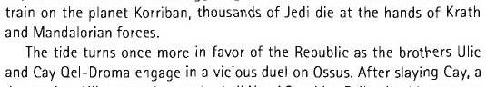
- **Revan** — entry/section: Knights of the Old Republic Campaign Guide (Saga): "However, among the Jedi are a few who cannot stand by while the Mandalorian invasion batters at the Republic's defenses, including a powerful Jedi called Revan." Source: *Knights of the Old Rebuplic Campaign Guide* (SWRPG Saga Edition), scan p.7
  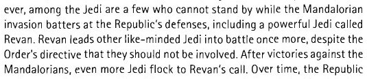

### Stat block notes (game mechanics, not feats)

- The Great Sith War: The Great Sith War begins with the fall of two Jedi students to the dark side: Exar Kun and Ulic Qel-Droma. The spirit of an ancient Sith Lord, Marka Ragnos, tempts the two Jedi and trains them in ancient teachings of the Sith. Flush with power, the two new Sith Lords lead the forces of the Krath—a dark-side cult founded on the Deep Core world of Empress Teta—in a war against the Republic. (Source: *Knights of the Old Rebuplic Campaign Guide* (SWRPG Saga Edition), scan p.7)
- Ulic defeats Mandalore: The Great Sith War takes an interesting turn with lasting repercussions when Ulic Qel-Droma vanquishes Lord Mandalore in single combat. This binds the Mandalorian clans to the Sith Lord, and he uses their prowess and numbers to redouble the Sith war effort. (Source: *Knights of the Old Rebuplic Campaign Guide* (SWRPG Saga Edition), scan p.7)
- Ulic slays Cay: The tide turns once more in favor of the Republic as the brothers Ulic and Cay Qel-Droma engage in a vicious duel on Ossus. After slaying Cay, a despondent Ulic surrenders to the Jedi Nomi Sunrider. (Source: *Knights of the Old Rebuplic Campaign Guide* (SWRPG Saga Edition), scan p.7)
- Revan leads Jedi to war: However, among the Jedi are a few who cannot stand by while the Mandalorian invasion batters at the Republic's defenses, including a powerful Jedi called Revan. Revan leads other like-minded Jedi into battle once more, despite the Order's directive that they should not be involved. After victories against the Mandalorians, even more Jedi flock to Revan's call. (Source: *Knights of the Old Rebuplic Campaign Guide* (SWRPG Saga Edition), scan p.7)
- Malachor V: Quickly, Jedi such as Revan and his apprentice, Malak, become war heroes. After years of violent conflict, the Republic finally manages to repel the Mandalorians with a devastating victory at Malachor V. There, the Mandalorian forces are nearly wiped out. (Source: *Knights of the Old Rebuplic Campaign Guide* (SWRPG Saga Edition), scan p.7)

## scan p.8 (scan page 8)

Page contents: Sidebar (from page image) "What You Need to Play": As with any Star Wars game supplement, you need the Saga Edition core rulebook (sometimes abbreviated as SE) to make full use of the information in the Knights of the Old Republic Campaign Guide. This book also uses material from other supplements, including Starships of the Galaxy (abbreviated SG) and Scum and Villainy (abbreviated SV), but those supplements are not essential. (hand-read)

- **Revan; Darth Malak** — entry/section: Knights of the Old Republic Campaign Guide (Saga): "While in the Unknown Regions, Revan and Malak steep themselves in the teachings of those Sith who had been defeated in the Great Sith War, and empowered by the Jedi victories in the Mandalorian Wars they set out to conquer the galaxy." Source: *Knights of the Old Rebuplic Campaign Guide* (SWRPG Saga Edition), scan p.8
  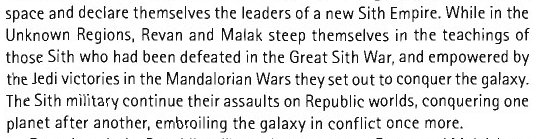
- **Revan; Darth Malak** — entry/section: Knights of the Old Republic Campaign Guide (Saga): "Rejecting his former self and embracing the way of the light, Revan retraces his steps and discovers a massive artifact known as the Star Forge, aboard which he duels and vanquishes his former apprentice, Malak, ending the Jedi Civil War." Source: *Knights of the Old Rebuplic Campaign Guide* (SWRPG Saga Edition), scan p.8
  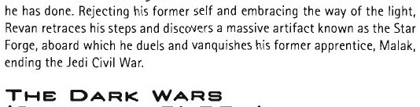
- **Jolee Bindo** — entry/section: Pull quote (Jolee Bindo): ""LOOK, EVERYBODY ALWAYS FIGURES THE TIME THEY LIVE IN IS THE MOST EPIC, MOST IMPORTANT AGE TO END ALL AGES. BUT TYRANTS AND HEROES RISE AND FALL, AND HISTORIANS SORT OUT THE PIECES." —JOLEE BINDO" Source: *Knights of the Old Rebuplic Campaign Guide* (SWRPG Saga Edition), scan p.8
  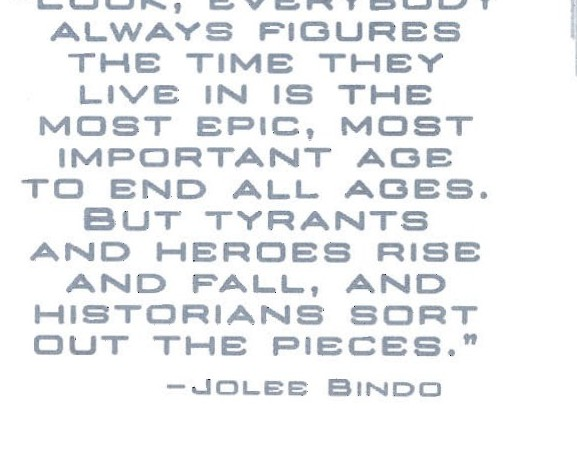
- **Darth Malak; Revan; Bastila Shan**: "Malak turns on his master, and Revan is struck down, only to be saved by a young Jedi named Bastila Shan." Source: *Knights of the Old Rebuplic Campaign Guide* (SWRPG Saga Edition), scan p.8
  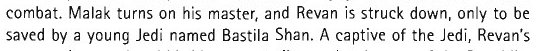
- **Darth Malak**: "BBY) After Darth Malak's defeat at the Battle of Rakata Prime, the forces of the Sith fall into chaos." Source: *Knights of the Old Rebuplic Campaign Guide* (SWRPG Saga Edition), scan p.8
  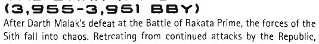

### Stat block notes (game mechanics, not feats)

- Sith Armada: Celebration of victory over the Mandalorians soon turns bitter when Revan and Malak return from the Unknown Regions at the head of a massive Sith Armada. Darth Revan and Darth Malak, now Dark Lords of the Sith, quickly reclaim the planet Korriban, seize control of a large swath of Republic space and declare themselves the leaders of a new Sith Empire. (Source: *Knights of the Old Rebuplic Campaign Guide* (SWRPG Saga Edition), scan p.8)
- Revan struck down and redeemed: A Jedi strike force alters the course of the Jedi Civil War by boarding a starship controlled by Revan and Malak, engaging the two Sith Lords in combat. Malak turns on his master, and Revan is struck down, only to be saved by a young Jedi named Bastila Shan. A captive of the Jedi, Revan's memory is erased and his identity rebuilt as a loyal agent of the Republic. This ruse does not last long, and soon Revan rediscovers who he is and what he has done. Rejecting his former self and embracing the way of the light, Revan retraces his steps and discovers a massive artifact known as the Star Forge, aboard which he duels and vanquishes his former apprentice, Malak, ending the Jedi Civil War. (Source: *Knights of the Old Rebuplic Campaign Guide* (SWRPG Saga Edition), scan p.8)
- Sith Triumvirate: Three Sith Lords, Darth Nihilus, Darth Sion, and Darth Traya, decide to restore their former power by eliminating the greatest threat facing the Sith: the Jedi Order. Over the course of several months, these Sith Lords dispatch assassins and strike forces to eliminate the few remaining members of the Jedi Order. In the middle of the Dark Wars, the Jedi order collapses and only a few survivors escape death at the hands of the Sith. (Source: *Knights of the Old Rebuplic Campaign Guide* (SWRPG Saga Edition), scan p.8)
- Jedi survivor slays Triumvirate: The Sith Triumvirate eliminates the Jedi and seizes control of the failing Sith Empire, planning to reclaim lost territory and launch a united offensive once more. However, these plans are dashed when a Jedi survivor slays all three members of the Sith Triumvirate and helps eliminate the last of the Sith threat. (Source: *Knights of the Old Rebuplic Campaign Guide* (SWRPG Saga Edition), scan p.8)

## scan p.9 (scan page 9)

Page contents: Chapter I: Species opener. (hand-read)

## scan p.10 (scan page 10)

Page contents: Species in the Old Republic era; inter-species relations (non-Humans unwelcome in Taris Upper City at times); Species Characteristics; Ability Adjustments; Known Languages (Arkanian and Snivvian common; Mandalorians bring Mando'a). (hand-read)

## scan p.11 (scan page 11)

Page contents: Tables: species ability adjustments, height/weight, age categories (Arkanian, Arkanian Offshoot, Cathar, Draethos, Feeorin, Khil, Kissai, Massassi, Miraluka, Rakata, Selkath, Snivvian); Arkanian intro. (hand-read)

## scan p.12 (scan page 12)

Page contents: Arkanian (Offshoots engineered, persecuted by Purebloods; example names incl. Arkoh Adasca; Offshoot names Edessa, Gorman Vandrayk, Jarael, Zadawi); Arkanian and Arkanian Offshoot species traits. (hand-read)

## scan p.13 (scan page 13)

Page contents: Cathar (city-trees; Crado's fall under Exar Kun; devastated in Mandalorian Wars, atrocity revealed by Revan's expedition); Cathar species traits; Draethos intro. (hand-read)

- **Revan**: "Cathar survivors find sympathy on Republic worlds after Revan's discovery, but many are too proud to use defeat to their advantage." Source: *Knights of the Old Rebuplic Campaign Guide* (SWRPG Saga Edition), scan p.13
  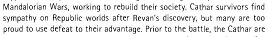

### Stat block notes (game mechanics, not feats)

- Revan reveals Cathar massacre: The extent of the massacre on this remote world remains unknown to the Republic until an expedition led by Revan brings the atrocity to the attention of the galaxy at large, winning him the support of many Jedi. (Source: *Knights of the Old Rebuplic Campaign Guide* (SWRPG Saga Edition), scan p.13)

## scan p.14 (scan page 14)

Page contents: Draethos (Thosa; example names Odan-Urr, etc.); Draethos species traits; Feeorin intro (Odryn). (hand-read)

## scan p.15 (scan page 15)

Page contents: Feeorin description and species traits; Khil (oldest species, colonizers, vindictive; Belnar; hullepi; Khilese). (hand-read)

## scan p.16 (scan page 16)

Page contents: Khil species traits; Kissai and Massassi (subspecies of original Sith of Korriban; Naga Sadow transforms the Massassi; Exar Kun consumes them on Yavin 4). (hand-read)

### Stat block notes (game mechanics, not feats)

- Sadow transforms the Massassi: The Kissai serve the Sith directly, but the Sith Lord Naga Sadow has other ideas for the Massassi caste. The Kissai are largely left on Ziost as the servants of other Sith Lords, but Sadow uses Sith alchemy to transform the Massassi into his hulking, brutish soldiers. His Massassi crews labor under his command on Yavin 4, building temples and providing the means for him to hide his ship and practice his dark arts. (Source: *Knights of the Old Rebuplic Campaign Guide* (SWRPG Saga Edition), scan p.16)
- Kun consumes the Massassi: A thousand years after Sadow and the Massassi arrive on Yavin 4, Exar Kun discovers the ancient Sith secrets in the temples. He uses the Massassi to fight the Jedi across the galaxy. Eventually, Kun consumes the life force of every Massassi on Yavin 4 in his transformation into a dark side spirit. (Source: *Knights of the Old Rebuplic Campaign Guide* (SWRPG Saga Edition), scan p.16)

## scan p.17 (scan page 17)

Page contents: Kissai and Massassi species traits; Bonus Hit Points sidebar; Miraluka intro (Darth Nihilus consumed Katarr colony). (hand-read)

### Stat block notes (game mechanics, not feats)

- Nihilus consumes Katarr: To make matters worse, the Sith Lord Darth Nihilus consumed the colony of Katarr after the Jedi Civil War. (Source: *Knights of the Old Rebuplic Campaign Guide* (SWRPG Saga Edition), scan p.17)

## scan p.18 (scan page 18)

Page contents: Miraluka species traits (Force Sight); Rakata (Infinite Empire, Star Forge, Lehon/Rakata Prime). (hand-read)

### Stat block notes (game mechanics, not feats)

- Krynda's dual sight: A rare exception is Krynda, daughter of a Miralukan father and Human mother. She was born with both Force Sight and functioning Human eyes. (Source: *Knights of the Old Rebuplic Campaign Guide* (SWRPG Saga Edition), scan p.18)
- Revan rediscovers the Rakata: Eventually, the Rakata are rediscovered by Darth Revan, who learns the secret of the Star Forge and uses it to build a massive military force to attack the Republic. He and the Republic are also responsible for the destruction of the Star Forge. (Source: *Knights of the Old Rebuplic Campaign Guide* (SWRPG Saga Edition), scan p.18)

## scan p.19 (scan page 19)

Page contents: Rakata adventurers and species traits (Ancient Knowledge, Force Blind, Rage); Selkath (Manaan, kolto, Ahto). (hand-read)

## scan p.20 (scan page 20)

Page contents: Selkath species traits (Able Healer); Snivvian (Cadomai Prime, Thalassian slavers; example names incl. Marn Hierogryph); Snivvian species traits. (hand-read)

## scan p.21 (scan page 21)

Page contents: Chapter II: Heroic Traits opener (art). (hand-read)

## scan p.22 (scan page 22)

Page contents: Heroic traits intro; Character creation in the Old Republic; background questions (view of the Republic, current events). (hand-read)

## scan p.23 (scan page 23)

Page contents: Background questions continued (Jedi Council support, species and recent wars, loyalties, tolerance of the dark side, class fit, relationships); caption "BAO-DUR. A HERO OF THE REPUBLIC"; group creation and positions of power. (hand-read)

## scan p.24 (scan page 24)

Page contents: Powerful party example; Sample Group Concepts (Corporate Investigations Team, Corporate Security Team, Gladiator Team, Jedi Covenant, Military Reconnaissance Force, Search-and-Rescue Squad, Postbattle Emergency Security Force, Rescue Crew, Revanchists, Republic Negotiating Team, Republic Special-Forces Strike Team, Scavenger Crew, Smuggling Ring). (hand-read)

## scan p.25 (scan page 25)

Page contents: The Heroic Classes: Jedi in this era (decentralized training, marriage not prohibited, Watchmen, Covenant); caption "YUHANI AND DARTH BANDON CROSS LIGHTSABERS"; new Jedi Consular talents (Collective Visions, Visionary Attack). (hand-read)

### Stat block notes (game mechanics, not feats)

- Collective Visions talent: Collective Visions: Developed by Krynda Draay, this talent is used by Jedi Covenant WatchCircles to sharpen their visions through the Force. (Source: *Knights of the Old Rebuplic Campaign Guide* (SWRPG Saga Edition), scan p.25)

## scan p.26 (scan page 26)

Page contents: Jedi Consular talents (Visionary Defense, Renew Vision, WatchCircle Initiate); Jedi Guardian (Improved Battle Meditation); Jedi Sentinel (Dark Retaliation, Sentinel Strike, Sentinel's Gambit); Lightsaber Combat (Riposte); Noble class in this era. (hand-read)

## scan p.27 (scan page 27)

Page contents: Noble concepts; new Influence talents (Fluster, Intimidating Defense); caption "LORD ARKOH ADASCA, ARKANIAN NOBLE"; Leadership (Reactionary Attack); Fencing talent tree (Demoralizing Defense, Leading Feint). (hand-read)

## scan p.28 (scan page 28)

Page contents: Fencing talents (Noble Fencing Style, Personal Affront, Transposing Strike); Scoundrel class in this era (the Exchange); Fortune (Lucky Stop); Run and Gun talent tree; caption "MIRA, HUMAN SCOUNDREL". (hand-read)

## scan p.29 (scan page 29)

Page contents: Run and Gun (Slippery Strike, Strike and Run); Scout class in this era; Awareness (Weak Point); caption "ZAALBAR, WOOKIEE SCOUT"; Hyperspace Explorer talent tree. (hand-read)

## scan p.30 (scan page 30)

Page contents: Hyperspace Explorer talents; Soldier class in this era (fleets join Revan in the Sith); caption "ATTON RAND, HUMAN SOLDIER"; Armor Specialist (Shield Expert), Brawler (Devastating Melee Smash), Weapon Specialist (Disarming Attack). (hand-read)

## scan p.31 (scan page 31)

Page contents: Rocket Jumper talent tree (Burning Assault, Improved Trajectory, Jet Pack Training, Jet Pack Withdraw); caption "CANDEROUS ORDO, MANDALORIAN SOLDIER"; Skills: Acrobatics (Long Falls), Climb (low/high gravity), Use the Force (Breath Control); pull quote from Rohlan Dyre. (hand-read)

- **Rohlan Dyre** — entry/section: Pull quote (Rohlan Dyre): ""THE MANDO'ADE USUALLY PREFER A MORE DIRECT APPROACH. WE'RE PRAGMATIC, NOT TREACHEROUS." —ROHLAN DYRE" Source: *Knights of the Old Rebuplic Campaign Guide* (SWRPG Saga Edition), scan p.31
  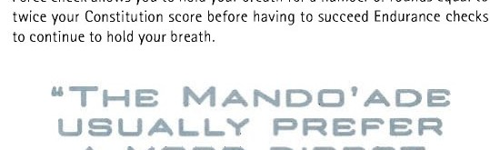

## scan p.32 (scan page 32)

Page contents: Feats: Combined Feats (Dodge + Charging Fire, Dodge + Running Attack, Dual Weapon Mastery I + Quick Draw, Force Training + Improved Disarm, Quick Draw + Weapon Proficiency (lightsabers), Weapon Focus + Weapon Finesse); caption "A SITH TROOPER IS NO MATCH FOR CALO NORD"; pull quote from Celeste Morne. (hand-read)

- **Celeste Morne** — entry/section: Pull quote (Celeste Morne): ""STAY OUT OF MY WAY – I'VE GOT A MISSION TO COMPLETE!" —CELESTE MORNE" Source: *Knights of the Old Rebuplic Campaign Guide* (SWRPG Saga Edition), scan p.32
  

## scan p.33 (scan page 33)

Page contents: New feats table; Accelerated Strike, Conditioning, Critical Strike. (hand-read)

## scan p.34 (scan page 34)

Page contents: Feats: Echani Training, Force Readiness, Flurry, Gearhead, Implant Training, Improved Rapid Strike, Increased Agility. (hand-read)

## scan p.35 (scan page 35)

Page contents: Caption "DARTH NIHILUS, SITH LORD"; feats: Logic Upgrade: Self-Defense, Logic Upgrade: Tactician, Mandalorian Training, Poison Resistance, Power Blast, Quick Skill. (hand-read)

## scan p.36 (scan page 36)

Page contents: Feats: Republic Military Training, Sith Military Training, Sniper Shot, Tumble Defense, Withdrawal Strike; Bonus Feats table by class. (hand-read)

- **Lucien Draay** — entry/section: Pull quote (Lucien Draay): ""IF THE HAND ENDANGERS THE LIMB, STRIKE IT OFF." —MASTER LUCIEN DRAAY" Source: *Knights of the Old Rebuplic Campaign Guide* (SWRPG Saga Edition), scan p.36
  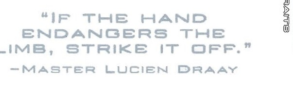

## scan p.37 (scan page 37)

Page contents: Chapter III: Prestige Classes opener. (hand-read)

## scan p.38 (scan page 38)

Page contents: Prestige classes intro; New talents for existing prestige classes (e.g., Mandalorian Warrior tree for elite trooper). (hand-read)

## scan p.39 (scan page 39)

Page contents: Elite trooper: Mandalorian Warrior talent tree (Armored Mandalorian, Mandalorian Advance, Mandalorian Ferocity, Mandalorian Glory); caption "ROHLAN DYRE, MANDALORIAN ELITE TROOPER"; Force adept Force Item talents (Primitive Block, Force Throw). (hand-read)

## scan p.40 (scan page 40)

Page contents: Gunslinger (Mobile Attack (pistols)); Jedi Knight Duelist talents (Improved Riposte, Improved Redirect); Jedi Battlemaster talent tree; Jedi Shadow talent tree (also used by Jedi Covenant Shadows). (hand-read)

## scan p.41 (scan page 41)

Page contents: Jedi Watchman talent tree (appointed by the Jedi Council); caption "MASTER ATRIS, JEDI WATCHMAN"; Sith talents (Affliction, Dark Healing Field, Drain Force). (hand-read)

## scan p.42 (scan page 42)

Page contents: Sith Alchemy talent (Create Sith Talisman, Create Sith Weapon); New prestige classes table (Corporate agent, Gladiator, Melee duelist); Corporate Agent intro; caption "A CZERKA CORPORATE ENFORCER". (hand-read)

## scan p.43 (scan page 43)

Page contents: Corporate agent class table; examples (Fiolla of Lorrd, Haydel Goravvus, Jana Lorso, Odumin); requirements; game rules; Corporate Power talent tree (Competitive Drive, Competitive Edge, Corporate Clout). (hand-read)

## scan p.44 (scan page 44)

Page contents: Corporate Power talents (Impose Confusion, Impose Hesitation, Willful Resolve, Wrong Decision); Executive Leadership; Gladiator prestige class intro (Taris cantina contests); caption "BENDAK STARKILLER, GLADIATOR". (hand-read)

## scan p.45 (scan page 45)

Page contents: Gladiator table; examples (Bendak Starkiller, Twitch); requirements; Gladiatorial Combat talent tree (Brutal Attack, Call Out, Distracting Attack, Exotic Weapons Master, Lockdown Strike). (hand-read)

## scan p.46 (scan page 46)

Page contents: Gladiatorial talents (Multiattack Proficiency (exotic weapons), Personal Vendetta, Unstoppable); sidebar Gladiatorial Combat Circuit (Ajuur the Hutt's arena at the Upper City Cantina on Taris); Unflinching; sidebar Crowd Response. (hand-read)

### Stat block notes (game mechanics, not feats)

- Ajuur's dueling arena: One of the better-known dueling arenas is run by Ajuur the Hutt through the Upper City Cantina on the planet Taris. Through much of this era, Ajuur can be found arranging battles, no matter the state of the planet, or who is in charge of it. He pays well for skilled combatants, and is willing to take a chance on newcomers. For most battles, he sticks to the laws of Taris. However, he arranges fights to the death if he believes it might bring in enough credits to be worth the risk. (Source: *Knights of the Old Rebuplic Campaign Guide* (SWRPG Saga Edition), scan p.46)

## scan p.47 (scan page 47)

Page contents: Caption "MASTER DUELIST"; Melee Duelist prestige class intro; Table 3-4; examples (Ice, Marl, Qesya Vth'naar, Tabor). (hand-read)

## scan p.48 (scan page 48)

Page contents: Melee duelist requirements and game rules; Melee Duelist talent tree (Advantageous Strike, Dirty Tricks, Dual Weapon Flourish I/II, Master of Elegance, Multiattack Proficiency (advanced melee weapons), Out of Nowhere, Single Weapon Flourish I/II); Master of Movement. (hand-read)

## scan p.49 (scan page 49)

Page contents: Chapter IV: The Force opener. (hand-read)

## scan p.50 (scan page 50)

Page contents: The Force in this era (many do not know the differences between Sith and Jedi philosophies); new powers, talents, techniques, secrets and traditions. (hand-read)

## scan p.51 (scan page 51)

Page contents: Force powers: Energy Resistance, Fear, Force Scream; caption "DARTH MALAK, SITH LORD". (hand-read)

## scan p.52 (scan page 52)

Page contents: Force powers: Force Whirlwind, Ionize, Kinetic Combat, Resist Force. (hand-read)

## scan p.53 (scan page 53)

Page contents: Force powers: Slow, Valor, Wound; Force Talents; Alter talent tree (Force Flow, Illusion). (hand-read)

## scan p.54 (scan page 54)

Page contents: Alter talents (Telepathic Influence, Telepathic Link); Control talent tree (Beast Trick, Force Suppression); caption "JOLEE BINDO USES BEAST TRICK ON A CREATURE FROM KORRIBAN"; Force Techniques (Dominate Mind, Improved Energy Resistance). (hand-read)

- **Jolee Bindo** — entry/section: Pull quote (Jolee Bindo): ""I'M ALLOWED TO BE ENIGMATIC WHEN I WANT TO BE!" —JOLEE BINDO" Source: *Knights of the Old Rebuplic Campaign Guide* (SWRPG Saga Edition), scan p.54
  

## scan p.55 (scan page 55)

Page contents: Force techniques (Improved Force Stun, Improved Force Slam, Improved Ionize, Improved Kinetic Combat, Improved Resist Force, Improved Valor, Improved Vital Transfer, Language Absorption); Jedi Organizations; caption "MASTER VANDAR TOKARE"; Jedi Academies and Enclaves; Jedi Temple on Coruscant. (hand-read)

## scan p.56 (scan page 56)

Page contents: Jedi Enclave on Dantooine; sidebar Using Academies, Enclaves and Praxeums (Solo Master, Satellite Academy — Jedi Tower on Taris, Regional Enclave); Taris Academy; The Jedi Covenant. (hand-read)

- **Darth Malak**: "The enclave is completely destroyed by Darth Malak during the Jedi Civil War." Source: *Knights of the Old Rebuplic Campaign Guide* (SWRPG Saga Edition), scan p.56
  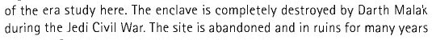

### Stat block notes (game mechanics, not feats)

- Malak destroys the Dantooine enclave: The enclave is completely destroyed by Darth Malak during the Jedi Civil War. The site is abandoned and in ruins for many years after the Sith attack, but it is eventually rebuilt. (Source: *Knights of the Old Rebuplic Campaign Guide* (SWRPG Saga Edition), scan p.56)
- Taris Padawan massacre: The Jedi order and local officials do not know that the five Masters are also the First WatchCircle of Krynda's Covenant, sent there to investigate possible Sith threats to the galaxy. When these Masters perceive such a threat from their own students, they murder them and blame the lone surviving student, Zayne Carrick. The academy is closed, and the Jedi are recalled to Coruscant. (Source: *Knights of the Old Rebuplic Campaign Guide* (SWRPG Saga Edition), scan p.56)
- Krynda founds the Covenant: Krynda Draay establishes the Jedi Covenant after her perceived failure to recognize the threat Exar Kun represented to the Jedi and the galaxy. Funded by the assets of her dead husband's fortune, she dedicates herself and her new organization to defeating the Sith. To achieve this goal, the Covenant recruits Jedi of many traits and talents. At its core, the Covenant depends on Jedi Consular vision techniques developed by Krynda. She trains other Consulars, organizing them into WatchCircles. (Source: *Knights of the Old Rebuplic Campaign Guide* (SWRPG Saga Edition), scan p.56)

## scan p.57 (scan page 57)

Page contents: The Jedi Covenant Hierarchy: Krynda Draay and Haazen; WatchCircles (Seers of the Circle; First WatchCircle of Lucien Draay; WatchCircle Vodo named for Vodo Siosk-Baas); Executors; caption "KRYNDA DRAAY'S JEDI COVENANT". (hand-read)

### Stat block notes (game mechanics, not feats)

- Covenant leadership: Krynda Draay has the power, finances, and will to build the Covenant. She works with Haazen to establish the details and organization. In the years before the Mandalorian Wars, Haazen directs the day-to-day operations of the Covenant, leaving Krynda to concentrate on visions and WatchCircle training. (Source: *Knights of the Old Rebuplic Campaign Guide* (SWRPG Saga Edition), scan p.57)

## scan p.58 (scan page 58)

Page contents: Covenant Shadows (directed by Haazen; full list kept at the Draay Estate by Haazen, Lucien Draay and a few Guardians); Other Force-Using Traditions (Sith under Darth Bane's rule of two); Jal Shey tradition; Jal Shey talent tree (Action Exchange). (hand-read)

## scan p.59 (scan page 59)

Page contents: Jal Shey talents (Force Delay, Imbue Item, Knowledge of the Force); Keetael (Draethos Force tradition of Thosa; Ube-tel training hunts; silver disc); Keetael talent tree (Conceal Force Use, Force Direction, Force Momentum, Past Visions). (hand-read)

## scan p.60 (scan page 60)

Page contents: The Krath (history, nature, survivors in the Outer Rim near Korriban); caption "A KRATH DEATH WITCH IS NOT TO BE TRIFLED WITH"; Krath talent tree (Dark Side Manipulation). (hand-read)

- **Freedon Nadd; Satal Keto; Aleema Keto**: "However, Nadd realizes that the King is on the brink of defeat by Jedi and Republic forces, so he transfers his support to Satal and Aleema, promising to guide them into a new Sith Golden Age." Source: *Knights of the Old Rebuplic Campaign Guide* (SWRPG Saga Edition), scan p.60
  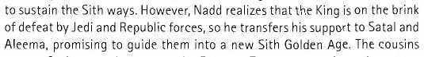
- **Ulic Qel-Droma; Mandalore the Indomitable**: "Ulic leads the military forces of the Krath, joining them with the Mandalorians after defeating Mandalore the Indomitable in single combat." Source: *Knights of the Old Rebuplic Campaign Guide* (SWRPG Saga Edition), scan p.60
  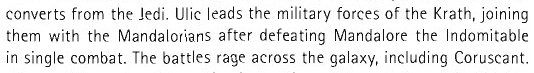

### Stat block notes (game mechanics, not feats)

- Founding of the Krath: The Krath is a Sith-inspired organization created by the cousins Satal and Aleema Keto, heirs to the Empress Teta system (formerly the Koros system of the Unification Wars). The two cousins and a number of other rich and spoiled aristocrats teach themselves a bit of Sith magic from artifacts recovered by Jedi Master Odan-Urr during the Great Hyperspace War a thousand years earlier. The group call themselves the Krath, a name based on a fearsome creature of legend. After recovering a book of Sith secrets from a museum on Coruscant, the cousins proceed to the planet Onderon, which is in the midst of a revolt by supporters of the ancient Sith Lord Freedon Nadd. (Source: *Knights of the Old Rebuplic Campaign Guide* (SWRPG Saga Edition), scan p.60)
- Nadd transfers his support: The spirit of Freedon Nadd has been working with Onderon's King Ommin to sustain the Sith ways. However, Nadd realizes that the King is on the brink of defeat by Jedi and Republic forces, so he transfers his support to Satal and Aleema, promising to guide them into a new Sith Golden Age. The cousins escape Onderon and return to the Empress Teta system, where they stage a coup to take control of the seven worlds. (Source: *Knights of the Old Rebuplic Campaign Guide* (SWRPG Saga Edition), scan p.60)
- Death of Master Arca: The Krath also skirmish with Jedi forces, using their Krath war droids in a preemptive strike that results in the death of Master Arca. (Source: *Knights of the Old Rebuplic Campaign Guide* (SWRPG Saga Edition), scan p.60)
- Ulic infiltrates and falls: The death of Master Arca has a profound impact on Jedi Ulic Qel-Droma. He pledges to bring down the Krath from the inside, by posing as a fallen Jedi. Ultimately, Ulic is seduced into joining the dark side by Aleema, killing Satal in the process and taking his place as one of the rulers of the Krath. (Source: *Knights of the Old Rebuplic Campaign Guide* (SWRPG Saga Edition), scan p.60)
- Ragnos joins Kun and Ulic: During a climactic battle, Exar Kun appears and engages Ulic in lightsaber combat. At that moment, the spirit of the Dark Lord of the Sith Marka Ragnos appears, drawn by the Sith amulets both combatants wear. The Sith spirit orders the two to join forces so that they can bring about the predicted return of the Sith. (Source: *Knights of the Old Rebuplic Campaign Guide* (SWRPG Saga Edition), scan p.60)
- Course of the Sith War: The two become allies. Exar Kun follows his own path to create Sith converts from the Jedi. Ulic leads the military forces of the Krath, joining them with the Mandalorians after defeating Mandalore the Indomitable in single combat. The battles rage across the galaxy, including Coruscant. Aleema falls as she triggers the destruction of Ossus, betrayed by Ulic for her lack of loyalty. Eventually, Ulic realizes his mistake in following the dark side, but only after he kills his brother Cay, and Nomi Sunrider blinds him to the Force. Ulic leads the Jedi to Yavin 4, in an attempt to stop Exar Kun. They are successful, though unaware that Kun's spirit survives, trapped within one of his temples. (Source: *Knights of the Old Rebuplic Campaign Guide* (SWRPG Saga Edition), scan p.60)
