# Owner Material 037 — Star Wars D20 Drive folder (Core, Revised Core and Saga Edition): Sourcebooks/Knights of the Old Rebuplic Campaign Guide.pdf [Star Wars Roleplaying Game Saga Edition (2007)] (scan pages 61–120)

- **Source:** Wizards of the Coast Star Wars Roleplaying Game books, web enhancements, Living Force campaign modules and articles (2000–2010), from the owner's "Star Wars D20" Drive folder (only the three edition subfolders; "General" was not read, as instructed). Secondary source (licensed Legends reference). Scan OCR'd on the box; the scan stays box-only and is **not** published.
- **Method:** every scanned page was OCR'd and machine-screened sentence by sentence for power-relevant statements (fights, kills, defeats, Force feats, rankings, superweapons) that name a character on our roster; each kept sentence is quoted verbatim from the OCR text and has a crop of the printed passage directly under it. Pages with nothing power-relevant are still listed with what is on them.
- **Citation:** "*Knights of the Old Rebuplic Campaign Guide* (SWRPG Saga Edition), p.X" by printed page ("scan p.X" where no printed number applies). **Weight:** Licensed RPG material: a secondary source. Narrative text sums up Legends lore; game statistics are rules for players, not canon power levels, and rank lowest.

## scan p.61 (scan page 61)

Page contents: Krath talents (Krath Illusions, Krath Intuition, Krath Surge); Luka Sene (Miraluka; Sene Seekers); Luka Sene talent tree (Field Detection, Improved Force Sight, Luka Sene Master, Quickseeing); Order of Shasa begins. (hand-read)

### Stat block notes (game mechanics, not feats)

- Shasa lured to the Sith Embassy: Toward the end of the Jedi Civil War, Shasa and a number of other young Selkath are lured to the Sith Embassy, where they receive Sith training. (Source: *Knights of the Old Rebuplic Campaign Guide* (SWRPG Saga Edition), scan p.61)

## scan p.62 (scan page 62)

Page contents: Order of Shasa (doctrine of peace and defense; Rite of Fira — cortosis from the kolto harvester wreck destroyed by Revan in the Hrakert Rift); caption "THE ORDER OF SHASA KNOWS HOW TO DEAL WITH THE SITH"; Order of Shasa talent tree (Deception Awareness, Greater Weapon Focus (Fira), Progenitor's Call, Waveform). (hand-read)

- **Revan**: "The Rite of Fira requires the initiate to swim to the wreck of the kolto harvester destroyed by Revan in the Hrakert Rift." Source: *Knights of the Old Rebuplic Campaign Guide* (SWRPG Saga Edition), scan p.62
  

### Stat block notes (game mechanics, not feats)

- Revan frees the Selkath youths: Their training is short-lived. Revan intervenes, proving to Shasa and the others that the Sith are distorting the truth and setting them up to serve as a puppet government under Sith control. (Source: *Knights of the Old Rebuplic Campaign Guide* (SWRPG Saga Edition), scan p.62)
- Rite of Fira: Shasa has instituted one formal initiation requirement—the Rite of Fira. Students deemed ready to become full members of the Order are sent on a special quest that serves as a final test of their abilities, reminding them of the reason the Order was founded and providing them with a weapon for personal defense. The Rite of Fira requires the initiate to swim to the wreck of the kolto harvester destroyed by Revan in the Hrakert Rift. (Source: *Knights of the Old Rebuplic Campaign Guide* (SWRPG Saga Edition), scan p.62)

## scan p.63 (scan page 63)

Page contents: Chapter V: Equipment and Droids opener. (hand-read)

## scan p.64 (scan page 64)

Page contents: Equipment chapter intro (KOTOR droids replace core rulebook droids); stun weapons note. (hand-read)

## scan p.65 (scan page 65)

Page contents: Table 5-1: Melee Weapons; Melee Weapons; Arg'garok (Gamorrean). (hand-read)

## scan p.66 (scan page 66)

Page contents: Dire sword, dire vibroblade, double-bladed sword, double vibroblade, fira, lightfoil (Mecrosa Sith Knights of the Tapani Sector; Cleansing of the Nine Houses), shockstaff, short sword, shyarn. (hand-read)

## scan p.67 (scan page 67)

Page contents: War sword, zhaboka; Alternate Lightsaber Crystals (Bondar, Firkraan); caption "A JUGGERNAUT WAR DROID (LEFT) EXCHANGES FIRE WITH A K-X12 PROBE DROID (RIGHT)". (hand-read)

## scan p.68 (scan page 68)

Page contents: Alternate crystals (Jenraux, Opila, Phond, Rubat, Sigil, Solari); Ranged Weapons (adhesive grenade, aurial blaster by Systech, repeating blaster carbine, assault blaster rifle — Mandalorian design perfected by Czerka). (hand-read)

## scan p.69 (scan page 69)

Page contents: Table 5-2: Ranged Weapons. (hand-read)

## scan p.70 (scan page 70)

Page contents: Carbonite rifle (Empress Teta); sidebar Immobilized; CryoBan grenade; ion carbine; lanvarok (Sith and Massassi); needler; pulse-wave pistol and rifle; ripper. (hand-read)

## scan p.71 (scan page 71)

Page contents: Ripper (cont.); sonic disruptor (outlawed by the Republic); sonic pistol; sidebar Sonic Damage; heavy sonic pistol; sonic rifle; Armor; light battle armor; light powered battle armor. (hand-read)

## scan p.72 (scan page 72)

Page contents: Energy shields (rise to prominence after the Great Sith War; Shield Rating rules). (hand-read)

## scan p.73 (scan page 73)

Page contents: Energy shields (cont.); Table 5-4 energy shield costs; fiber armor; matrix armor; mesh armor; weave armor; sidebar Mixed Damage Types. (hand-read)

## scan p.74 (scan page 74)

Page contents: Equipment; Table 5-5 equipment; aural amplifier; computer interface visor; demolitions sensor; mechanical interface visor; medical interface visor. (hand-read)

## scan p.75 (scan page 75)

Page contents: Motion sensing visor; neural band; stealth field generator; vacuum mask; Implants (bio-stabilizer, cardio, combat, memory). (hand-read)

## scan p.76 (scan page 76)

Page contents: Implants (nerve reinforcement, regenerative, sensory); Weapon and Armor Accessories; Table 5-6 (armor reinforcement, beam splitter, durasteel bonding, enhanced energy projector, hair trigger, improved energy cell). (hand-read)

## scan p.77 (scan page 77)

Page contents: Gear Templates intro; General Templates; Arkanian Manufacture; Cinnagaran Manufacture (Empress Teta); sidebar Introducing Gear Templates. (hand-read)

## scan p.78 (scan page 78)

Page contents: Cortosis Weave/Phrik Alloy; Echani, GenoHaradan, Iridonian, Krath, Mandalorian and Massassi Manufacture templates. (hand-read)

## scan p.79 (scan page 79)

Page contents: Massassi (cont.); Prototype; caption "AN HK-50 ASSASSIN DROID (LEFT) AND A KELLENECH SENTINEL DROID (RIGHT) PREPARE THEIR UPGRADED WEAPONS"; Verpine Manufacture; Weapon Templates (Baragwin, Bothan). (hand-read)

## scan p.80 (scan page 80)

Page contents: Weapon templates: Dashade, Gand, Quick Draw, Rakatan, Sith Alchemical; sidebar Stacking Templates. (hand-read)

## scan p.81 (scan page 81)

Page contents: Armor templates (Bonadan-alloy, Bronzium cast, Durasteel cast, Environmental bastion, Eriadun); Droids; First-Degree Droids; ET-74 communications droid (Automata Galactica). (hand-read)

## scan p.82 (scan page 82)

Page contents: ET-74 stat block; caption "AN ET-74 COMMUNICATIONS DROID"; Second-Degree Droids; Aratech GO-TO infrastructure-planning droid (GO-TO-Telerath; Gordian Reach secession). (hand-read)

- **Mandalore the Ultimate** — entry/section: Pull quote (Mandalore the Ultimate): ""SO MANY NEW RECRUITS. DIFFERENT SPECIES, DIFFERENT ARMORS, DIFFERENT LANGUAGES – AND NOT ENOUGH TIME TO LEARN OUR WAYS." —MANDALORE THE ULTIMATE" Source: *Knights of the Old Rebuplic Campaign Guide* (SWRPG Saga Edition), scan p.82
  

### Stat block notes (game mechanics, not feats)

- Cressa rebuilds with GO-TO droids: The first prototype models help with the reconstruction efforts after the Great Sith War, but in 3,955 BBY Supreme Chancellor Cressa puts the droids to greatest use rebuilding the galaxy after the Jedi Civil War. (Source: *Knights of the Old Rebuplic Campaign Guide* (SWRPG Saga Edition), scan p.82)

## scan p.83 (scan page 83)

Page contents: GO-TO stat block; T3-Series utility droid (Duwani Mechanical Products) and stats; Third-Degree Droids; GE3-Series protocol droid (Czerka). (hand-read)

## scan p.84 (scan page 84)

Page contents: GE3 stat block; GG-Series hospitality droid (Adascorp, Arkania; Telerath); caption "A GG-SERIES HOSPITALITY DROID (LEFT) AND A GE3-SERIES PROTOCOL DROID (RIGHT) DISCUSS MATTERS OF ETIQUETTE". (hand-read)

## scan p.85 (scan page 85)

Page contents: GG-Series (Adascorp spy scandal) and stats; Fourth-Degree Droids; HK-Series assassin droids; HK-24 stat block. (hand-read)

### Stat block notes (game mechanics, not feats)

- Adasca buys HK-24s: Many HK-24 assassin droids are purchased by Lord Adasca to hunt down one of his former employees hiding on Taris. (Source: *Knights of the Old Rebuplic Campaign Guide* (SWRPG Saga Edition), scan p.85)
- Revan builds HK-47: During the Jedi Civil War, Darth Revan constructs an HK-Series assassin droid based on the HK-24 design, but with several of his own upgrades. This droid, HK-47, in turn becomes the basis for a new model of HK-Series assassin droids: the HK-50. After seeing HK-47's abilities first-hand, Revan becomes convinced that the droids will make excellent agents. The Sith Lord is captured before his plans come to fruition, however, and production on the HK-50 model ceases for several years. Eventually, the droid crime lord Goto (a GO-TO infrastructure planning droid) discovers the HK-50 production facility and reactivates it, disseminating the new model assassin droids throughout the galaxy. (Source: *Knights of the Old Rebuplic Campaign Guide* (SWRPG Saga Edition), scan p.85)

## scan p.86 (scan page 86)

Page contents: Juggernaut war droid (Duwani; Rocket Jumper corps; droid uprising on Coruscant during the Great Sith War, reprogrammed by the original HK-01 assassin-droid prototype). (hand-read)

## scan p.87 (scan page 87)

Page contents: Juggernaut stat block; K-X12 probe droid (MerenData) and stats; Patrol Droid Mark I (Automata Galactica; Sith variants mass-produced by the Star Forge). (hand-read)

## scan p.88 (scan page 88)

Page contents: Patrol Droid Mark I stats; Devastator war droid (Ubrikkian Steamworks; Military Arms Regulatory Bureau) and stats; Sentinel droid (Kellenech Technologies). (hand-read)

## scan p.89 (scan page 89)

Page contents: Sentinel stats; Fifth-Degree Droids; S6-Series security/maintenance droid (MerenData) and stats; T1 bulk loader droid (Kellenech; LB series, T1-CW, T1-EX) and stats. (hand-read)

## scan p.90 (scan page 90)

Page contents: Caption "A T-1 SERIES BULK LOADER DROID (LEFT) LABORS ALONGSIDE ITS UTILITY DROID COMPANION (RIGHT)"; R-8009 utility droid (Serv-O-Droid; Delban Electrodyne) and stats. (hand-read)

## scan p.91 (scan page 91)

Page contents: Chapter VI: Vehicles and Starships opener. (hand-read)

## scan p.92 (scan page 92)

Page contents: Vehicles chapter intro (578-R space transport, G-Type light shuttle; Emplacement Points). (hand-read)

## scan p.93 (scan page 93)

Page contents: Ground Vehicles; Speeder Bikes; caption "A LHOSAN AEROCHASER (LEFT) AND AN ARATECH URBAN NAVIGATOR (RIGHT)"; Lhosan AeroChaser (Taris) and stats; Swoop Racer. (hand-read)

## scan p.94 (scan page 94)

Page contents: Swoop racer stats; Urban Navigator speeder bike (Aratech) and stats; Speeders; TT-6 landspeeder (SoroSuub). (hand-read)

## scan p.95 (scan page 95)

Page contents: TT-6 stats; caption "A TT-6 SPEEDER (RIGHT) NARROWLY AVOIDS A LHOSAN SWOOP (LEFT)"; PL-90 Luxury Speeder (Ubrikkian; owned by the Draay family on Coruscant) and stats. (hand-read)

## scan p.96 (scan page 96)

Page contents: Airspeeders; Twin-228 airspeeder (SoroSuub) and stats; caption "A TWIN-228 AIRSPEEDER (BOTTOM) FLIES BELOW A PL-90 LUXURY SPEEDER (TOP) IN THE CROWDED LANES OF TARIS"; Starfighters; S-100 Stinger-class starfighter (CEC; favored by the Jedi in the Great Sith War). (hand-read)

## scan p.97 (scan page 97)

Page contents: Stinger stats; Star Saber XC-01 (Republic Fleet Systems) and stats; Space Transports. (hand-read)

## scan p.98 (scan page 98)

Page contents: Deck plan: 578-R Space Transport (Bridge, Stairwell to Lower Deck, Crew Lounge, Airlock & Dorsal Hatch, Crew Cabins, Engine Room, Stairwell to Upper Deck, Forward Crawlspaces, Cargo Hold/Workshop, Junk Receptacle, Boarding Ramps). (hand-read)

## scan p.99 (scan page 99)

Page contents: 578-R space transport (Amalgamated Hyperdyne and Refuse Management) and stats; G-Type light shuttle (Hoersch-Kessel Drive) and stats. (hand-read)

### Stat block notes (game mechanics, not feats)

- The Last Resort: The Last Resort, a 578-R space transport owned by Gorman "Camper" Vandrayk, is an excellent example of one such ship that is modified over a long period of time. (Source: *Knights of the Old Rebuplic Campaign Guide* (SWRPG Saga Edition), scan p.99)

## scan p.100 (scan page 100)

Page contents: Caption "TWO STAR SABER XC-01 FIGHTERS ESCORT A G-TYPE LIGHT SHUTTLE"; G-Type escape shuttle variant; Lethisk-class armed freighter (Arakyd; Sandral family of Dantooine; Exchange sales scandal, Sector Executive of the Raiobalio Sector sent to Kessel) and stats. (hand-read)

## scan p.101 (scan page 101)

Page contents: Pelagia Duplex Command Assault Gunship "Orphanmaker" (House Pelagia, Tapani Sector) and stats; Quartermaster-class supply carrier (Corellia StarDrive; Commercial Protectorate Acts; the Little Bivoli at Serroco) and stats. (hand-read)

### Stat block notes (game mechanics, not feats)

- The Moomo Williwaw: A number of these ships are sold off just prior to the Mandalorian Wars and bought by wealthy individuals and bounty hunters, including the Moomo Brothers (whose heavily armed custom Orphanmaker is called the Moomo Williwaw). (Source: *Knights of the Old Rebuplic Campaign Guide* (SWRPG Saga Edition), scan p.101)

## scan p.102 (scan page 102)

Page contents: Capital Ships; Praetorian-class frigate (Rendili Hyperworks; Battle of Koros Major; later CEC Class VI Bulk Freighter) and stats; caption "THREE PRAETORIAN-CLASS FRIGATES MONITOR THE DEPARTURE OF A QUARTERMASTER-CLASS SUPPLY CARRIER". (hand-read)

## scan p.103 (scan page 103)

Page contents: Chapter VII: Campaigns opener. (hand-read)

## scan p.104 (scan page 104)

Page contents: Campaigns intro (the galaxy torn by war; Jedi in their prime); Abundance of Force-Users. (hand-read)

## scan p.105 (scan page 105)

Page contents: Force-users common; The Jedi Order (decentralized; academies on Arkania, Dantooine, Dorin, Taris, Telos, Teya IV); caption "A DRAETHOS JEDI DISPATCHES A MARK IV ASSAULT DROID"; The Krath (ignite the Great Sith War). (hand-read)

### Stat block notes (game mechanics, not feats)

- Ulic brings the Mandalorians to the Krath: The Krath attract the attention of the newly revived Sith, and with a coalition between the Krath military, the Sith, and the Mandalorian clans (brought to the Krath by fallen Jedi Ulic Qel-Droma), the forces of darkness ravage the Deep Core and spread the war all the way to the Outer Rim. (Source: *Knights of the Old Rebuplic Campaign Guide* (SWRPG Saga Edition), scan p.105)

## scan p.106 (scan page 106)

Page contents: Krath as GM opportunity; Return of the Sith; Civilization Under Siege; The Exchange (the Compeer; planetary crime lords; bosses and sector chiefs); The GenoHaradan. (hand-read)

- **Revan**: "Notable leaders include Davik Kang of Taris—who is killed when Revan and others steal his ship, the Ebon Hawk—and Goto, alias of the droid GO-TO, who controls a major smuggling operation at Nar Shadda years later." Source: *Knights of the Old Rebuplic Campaign Guide* (SWRPG Saga Edition), scan p.106
  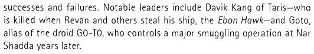

### Stat block notes (game mechanics, not feats)

- Revan and the GenoHaradan: Revan is rumored to have decimated the organization during his search for the Star Forge, but like so much of GenoHaradan history, this cannot be confirmed. (Source: *Knights of the Old Rebuplic Campaign Guide* (SWRPG Saga Edition), scan p.106)

## scan p.107 (scan page 107)

Page contents: GenoHaradan (cont.); Swoop Gangs (Black Vulkars and Hidden Beks of the Taris Undercity); Constant Warfare; The Great Sith War. (hand-read)

- **Ulic Qel-Droma**: "Were it not for the Jedi and their defeat of the Sith leader Ulic Qel-Droma, the galaxy might have been plunged into an inescapable chaos." Source: *Knights of the Old Rebuplic Campaign Guide* (SWRPG Saga Edition), scan p.107
  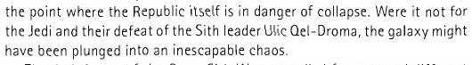

## scan p.108 (scan page 108)

Page contents: Mandalorian Wars adventures (Neo-Crusaders under Cassus Fett's philosophies); The Jedi Civil War; The Dark Wars begin. (hand-read)

## scan p.109 (scan page 109)

Page contents: Dark Wars (cont.); caption "A KT-4200 MILITARY DROID CARRIER UNLOADS A FORCE OF SENTINEL DROIDS TO ONDERON"; Mysterious Enemies; Betrayal. (hand-read)

### Stat block notes (game mechanics, not feats)

- Sion and Nihilus unite the Sith remnants: Occasionally a leader rises that can unite those warlords (for example, when Darth Sion and Darth Nihilus seize control of the Sith remnants), but eventually even those temporary alliances crumble. (Source: *Knights of the Old Rebuplic Campaign Guide* (SWRPG Saga Edition), scan p.109)
- Mysteries of the era: Zayne Carrick attempts to unravel the mystery behind the murder of his fellow Padawans against the backdrop of the Mandalorian Wars, while an amnesiac Revan retraces his steps to unlock the secrets of ancient Rakatan artifacts. (Source: *Knights of the Old Rebuplic Campaign Guide* (SWRPG Saga Edition), scan p.109)
- Betrayals of the era: Ulic Qel-Droma betrays the Jedi Order and becomes a Dark Lord of the Sith; the Jedi Covenant betrays their Padawans on Taris; a large segment of the Republic betrays its government to join the Sith during the Jedi Civil War. (Source: *Knights of the Old Rebuplic Campaign Guide* (SWRPG Saga Edition), scan p.109)

## scan p.110 (scan page 110)

Page contents: Betrayal (cont.); Hidden Dangers; caption "CASSUS FETT FENDS OFF A MARK I PATROL DROID"; The Dark Reaper; The Mass Shadow Generator (Malachor V). (hand-read)

## scan p.111 (scan page 111)

Page contents: Rakatan Mysteries; The Star Forge; New Powers on the Rise; The Hyperspace Navigators Guild; Hyperspace Travel (beacons). (hand-read)

### Stat block notes (game mechanics, not feats)

- Revan and the Star Forge: The rediscovery of the Star Forge is what allows Revan to transform his segment of the Republic fleet into a massive invasion force, and the Star Forge continues to crank out new weapons of war as quickly as the Sith Empire can overrun new worlds. (Source: *Knights of the Old Rebuplic Campaign Guide* (SWRPG Saga Edition), scan p.111)

## scan p.112 (scan page 112)

Page contents: Czerka Corporation (President Pollard Seario, HQ at Dreshdae on Korriban; HK assassin droids). (hand-read)

### Stat block notes (game mechanics, not feats)

- Operation Dark Harvest: For years, Adascorp headquarters is located on the massive starship Arkanian Legacy. However, the great ship is lost along with Lord Arkoh Adasca in his ill-fated attempt to secure galactic power through Operation Dark Harvest. Arkoh's scheme is to militarize massive Exogorths to enable them to decimate entire star systems. He tries to sell them in a bidding war between the Republic, the Mandalorians, and the Jedi. Unfortunately for Arkoh, the scheme falls apart when his lead researcher turns the Exogorths against the Arkanian Legacy. (Source: *Knights of the Old Rebuplic Campaign Guide* (SWRPG Saga Edition), scan p.112)
- Seario allies with the Sith: Second, Seario is more than happy to ally himself and his company with the Sith during the Jedi Civil War. Even though the Sith are defeated, the alliance is not fatal to the corporation. (Source: *Knights of the Old Rebuplic Campaign Guide* (SWRPG Saga Edition), scan p.112)

## scan p.113 (scan page 113)

Page contents: Caption "HARAEL ON THE RUN"; Lhosan Industries; Timeline intro and entries 4,000–3,996 BBY. (hand-read)

- **Exar Kun** — entry/section: Knights of the Old Republic Campaign Guide (Saga): "When Exar Kun arrives to stake his claim as Dark Lord of the Sith, he and Qel-Droma duel, but stop when ancient Sith spirits appear and declare them both Dark Lords of the Sith, master and apprentice." Source: *Knights of the Old Rebuplic Campaign Guide* (SWRPG Saga Edition), scan p.113
  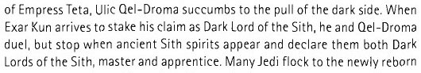
- **Mandalore the Indomitable; Ulic Qel-Droma** — entry/section: Knights of the Old Republic Campaign Guide (Saga): "The Krath's ability to control the planets they have conquered is strained until Ulic Qel-Droma defeats Mandalore the Indomitable in a duel on the planet Kuar." Source: *Knights of the Old Rebuplic Campaign Guide* (SWRPG Saga Edition), scan p.113
  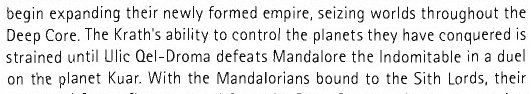

### Stat block notes (game mechanics, not feats)

- Thalien and Goravvus: In a move that demonstrates the power and influence of the company, chairman Jervo Thalien works with Goravvus to orchestrate the acceptance of Taris into the Republic to protect the planet and its supporting resource systems in the region. The plan succeds. However, once it becomes apparent that the Mandalorian invasion is going to reach Taris, Thalien wastes no time in pulling operations offworld. The resulting scandal threatens to devastate the company and Jervo Thalien personally, if it comes to light. Thalien works to make sure that never happens, but ultimately Goravvus thwarts him, enabling the company to become a strong supporter of the war and the Republic. (Source: *Knights of the Old Rebuplic Campaign Guide* (SWRPG Saga Edition), scan p.113)
- 4,000 BBY: 4,000 BBY: Satal and Aleema Keto discover ancient secrets of the Sith, including artifacts and tomes of knowledge, on their home planet of Empress Teta. Satal and Aleema Keto recruit hundreds of fellow aristocrats and form the Krath, a dark side cult based on Sith teachings. (Source: *Knights of the Old Rebuplic Campaign Guide* (SWRPG Saga Edition), scan p.113)
- 3,997 BBY Deneba: 3,997 BBY: The Jedi are ambushed by Krath forces during a conclave on the planet Deneba, causing massive Jedi casualties. After the battle, Ulic Qel-Droma departs and begins to infiltrate the upper echelons of the Krath. (Source: *Knights of the Old Rebuplic Campaign Guide* (SWRPG Saga Edition), scan p.113)
- 3,997 BBY Kun on Korriban: 3,997 BBY: Exar Kun, a Jedi apprentice, abandons his master to delve deeper into the secrets of the dark side, traveling the galaxy in search of Sith lore. On Korriban, Kun is educated in the ways of the Sith and soon is elevated to the rank of Dark Lord of the Sith. (Source: *Knights of the Old Rebuplic Campaign Guide* (SWRPG Saga Edition), scan p.113)
- 3,997 BBY Kun and Qel-Droma: 3,997 BBY: After the Jedi attempt to extract him from the Krath-held world of Empress Teta, Ulic Qel-Droma succumbs to the pull of the dark side. When Exar Kun arrives to stake his claim as Dark Lord of the Sith, he and Qel-Droma duel, but stop when ancient Sith spirits appear and declare them both Dark Lords of the Sith, master and apprentice. Many Jedi flock to the newly reborn Sith order, forming a hierarchy of lesser Sith Lords. (Source: *Knights of the Old Rebuplic Campaign Guide* (SWRPG Saga Edition), scan p.113)
- 3,996 BBY Kuar: 3,996 BBY: The Krath forces, under the control of the Dark Lords of the Sith, begin expanding their newly formed empire, seizing worlds throughout the Deep Core. The Krath's ability to control the planets they have conquered is strained until Ulic Qel-Droma defeats Mandalore the Indomitable in a duel on the planet Kuar. With the Mandalorians bound to the Sith Lords, their combined forces flow outward from the Deep Core and begin conquering planets across the galaxy. (Source: *Knights of the Old Rebuplic Campaign Guide* (SWRPG Saga Edition), scan p.113)
- 3,996 BBY Coruscant: 3,996 BBY: After months of conquering planets from the Deep Core to the Outer Rim, the Sith launch their attack against the capital planet of the Republic, Coruscant. During the battle, Ulic Qel-Droma is captured and subsequently put on trial for treason. (Source: *Knights of the Old Rebuplic Campaign Guide* (SWRPG Saga Edition), scan p.113)

## scan p.114 (scan page 114)

Page contents: Timeline 3,996–3,950 BBY. (hand-read)

- **Mandalore the Indomitable** — entry/section: Knights of the Old Republic Campaign Guide (Saga): "3,996 BBY: After an intense battle at Onderon, Mandalore the Indomitable is killed and the Mandalorians suffer a stunning defeat." Source: *Knights of the Old Rebuplic Campaign Guide* (SWRPG Saga Edition), scan p.114
  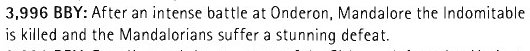
- **Darth Malak; Revan** — entry/section: Knights of the Old Republic Campaign Guide (Saga): "Revan defeats Darth Malak in a duel, the Republic defeats the Sith Empire, and the Jedi Civil War comes to an end." Source: *Knights of the Old Rebuplic Campaign Guide* (SWRPG Saga Edition), scan p.114
  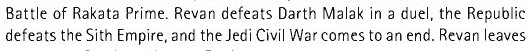
- **Darth Malak** — entry/section: Pull quote: ""SOMETIMES YOU HAVE TO ENTER THE DARKNESS TO SAVE THE LIGHT." —ALEK SQUINQUARGESIMUS" Source: *Knights of the Old Rebuplic Campaign Guide* (SWRPG Saga Edition), scan p.114
  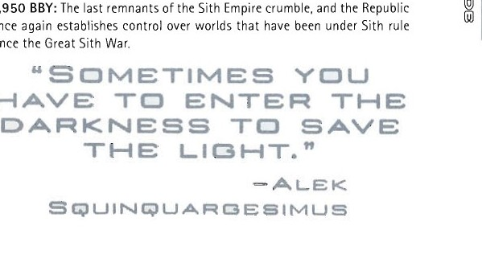
- **Aleema Keto**: "3,996 BBY: Aleema Keto, leading the forces of the Krath in battle near the Cron Cluster, is killed after activating a supernova-inducing weapon aboard her warship." Source: *Knights of the Old Rebuplic Campaign Guide* (SWRPG Saga Edition), scan p.114
  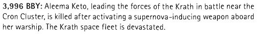
- **Exar Kun**: "3,996 BBY: Exar Kun and the remnants of the Sith are defeated at Yavin 4." Source: *Knights of the Old Rebuplic Campaign Guide* (SWRPG Saga Edition), scan p.114
  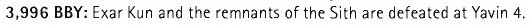
- **Kreia; Meetra Surik; Darth Sion; Darth Nihilus**: "3,951 BBY: Under the guidance of a disguised Darth Traya, the Jedi Exile defeats Darth Sion and Darth Nihilus." Source: *Knights of the Old Rebuplic Campaign Guide* (SWRPG Saga Edition), scan p.114
  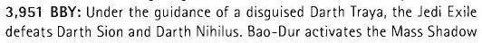
- **Kreia**: "Bao-Dur activates the Mass Shadow Generator on Malachor V again, destroying what is left of the planet, and Traya is defeated." Source: *Knights of the Old Rebuplic Campaign Guide* (SWRPG Saga Edition), scan p.114
  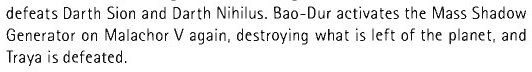

### Stat block notes (game mechanics, not feats)

- 3,996 BBY Cron Cluster: 3,996 BBY: Aleema Keto, leading the forces of the Krath in battle near the Cron Cluster, is killed after activating a supernova-inducing weapon aboard her warship. The Krath space fleet is devastated. (Source: *Knights of the Old Rebuplic Campaign Guide* (SWRPG Saga Edition), scan p.114)
- 3,996 BBY Yavin 4: 3,996 BBY: Exar Kun and the remnants of the Sith are defeated at Yavin 4. The Great Sith War comes to an end when Republic forces liberate Empress Teta. (Source: *Knights of the Old Rebuplic Campaign Guide* (SWRPG Saga Edition), scan p.114)
- 3,976 BBY: 3,976 BBY: Under the leadership of Mandalore the Ultimate, remnants of the Mandalorian clans begin testing the Republic's defenses by raiding Outer Rim worlds. (Source: *Knights of the Old Rebuplic Campaign Guide* (SWRPG Saga Edition), scan p.114)
- 3,973 BBY Cathar: 3,973 BBY: Cassus Fett leads the Mandalorian massacre on Cathar. Few Cathar survive the assault, but the Republic suppresses news of the attack, fearing it might destabilize reconstruction efforts. (Source: *Knights of the Old Rebuplic Campaign Guide* (SWRPG Saga Edition), scan p.114)
- 3,963 BBY Council: 3,963 BBY: As the Republic continues to battle the Mandalorians across all fronts, Revan attempts to persuade the Jedi Council to join the war. The Council refuses, claiming that their losses during the Great Sith War were too great. (Source: *Knights of the Old Rebuplic Campaign Guide* (SWRPG Saga Edition), scan p.114)
- 3,963 BBY Revanchists: 3,963 BBY: The Mandalorians overrun numerous Republic worlds, including Duro, Iridonia, Serroco, and Taris. Meanwhile, Revan discovers and reveals the truth about the massacre at Cathar, winning dozens of converts from the Jedi Order. These Jedi take a more active hand in the Mandalorian Wars and are branded the Revanchists. (Source: *Knights of the Old Rebuplic Campaign Guide* (SWRPG Saga Edition), scan p.114)
- 3,961 BBY: 3,961 BBY: Revan discovers the Rakatan star map at Kashyyyk. Revan travels to Malachor V and discovers the Trayus Academy, delving deeply into the Sith secrets contained within, (Source: *Knights of the Old Rebuplic Campaign Guide* (SWRPG Saga Edition), scan p.114)
- 3,960 BBY Malachor V: 3,960 BBY: Revan lures the Mandalorians to Malachor V, where a battle ensues between the Republic and the Mandalorians. Revan defeats Mandalore the Ultimate, activates the superweapon known as the Mass Shadow Generator, and shatters the Mandalorian fleet. The Mandalorian Wars officially end, and remnants of the opposition scatter throughout the galaxy. (Source: *Knights of the Old Rebuplic Campaign Guide* (SWRPG Saga Edition), scan p.114)
- 3,960 BBY Unknown Regions: 3,960 BBY: Revan and his apprentice, Malak, take a large segment of the Republic fleet and vanish into the Unknown Regions. They rediscover the Star Forge, declare themselves Dark Lords of the Sith, and corrupt the Republic forces under their control. (Source: *Knights of the Old Rebuplic Campaign Guide* (SWRPG Saga Edition), scan p.114)
- 3,959 BBY: 3,959 BBY: Darth Revan and Darth Malak return to the Republic, at the head of the newly constructed Sith Fleet. They begin their conquest of the galaxy, carving out a new Sith Empire and seizing control of Korriban, where they establish a new academy. (Source: *Knights of the Old Rebuplic Campaign Guide* (SWRPG Saga Edition), scan p.114)
- 3,958 BBY: 3,958 BBY: Many among the Republic's military forces defect to the Sith Empire, including Saul Karath. Jedi start to flock to Darth Revan's banner, and the Sith Empire begins to swallow up Republic worlds. The Sith carry out successful attacks at Foerost and Telos IV, among other worlds. (Source: *Knights of the Old Rebuplic Campaign Guide* (SWRPG Saga Edition), scan p.114)
- 3,957 BBY: 3,957 BBY: A Jedi task force captures Darth Revan aboard his flagship after Darth Malak turns on his master and attempts to kill him. Revan's memory is erased, and the Jedi flee with him back to Republic space. (Source: *Knights of the Old Rebuplic Campaign Guide* (SWRPG Saga Edition), scan p.114)
- 3,956 BBY relearning: 3,956 BBY: Revan once again turns to the Jedi Order and begins relearning the ways of the Force. Accompanied by Bastila Shan, Revan retraces his steps in the pursuit of the Star Forge, eventually discovering the truth behind his past. (Source: *Knights of the Old Rebuplic Campaign Guide* (SWRPG Saga Edition), scan p.114)
- 3,956 BBY Dantooine: 3,956 BBY: Darth Malak's forces devastate the Jedi Enclave on Dantooine. (Source: *Knights of the Old Rebuplic Campaign Guide* (SWRPG Saga Edition), scan p.114)
- 3,956 BBY Rakata Prime: 3,956 BBY: In the Lehon system, the Republic clashes with the Sith at the Battle of Rakata Prime. Revan defeats Darth Malak in a duel, the Republic defeats the Sith Empire, and the Jedi Civil War comes to an end. Revan leaves once more for the Unknown Regions. (Source: *Knights of the Old Rebuplic Campaign Guide* (SWRPG Saga Edition), scan p.114)
- 3,954 BBY assassinations: 3,954 BBY: Sith assassins, under orders from Darth Sion, begin a widespread assassination campaign against the Jedi. The Jedi are all but wiped out, and the Republic is left without its Jedi defenders for the first time in centuries. (Source: *Knights of the Old Rebuplic Campaign Guide* (SWRPG Saga Edition), scan p.114)
- 3,954 BBY unification: 3,954 BBY: The remnants of the Sith Empire are largely unified by Darth Sion and Darth Nihilus. Though some Sith warlords continue to squabble over territory, Sion and Nihilus represent the most unified front for the Sith during this time. (Source: *Knights of the Old Rebuplic Campaign Guide* (SWRPG Saga Edition), scan p.114)
- 3,951 BBY Mandalore: 3,951 BBY: Canderous Ordo, now the Mandalore, reunites the Mandalorian clans and aids in the fight against the remnants of the Sith Empire. (Source: *Knights of the Old Rebuplic Campaign Guide* (SWRPG Saga Edition), scan p.114)
- 3,951 BBY Malachor V: 3,951 BBY: Under the guidance of a disguised Darth Traya, the Jedi Exile defeats Darth Sion and Darth Nihilus. Bao-Dur activates the Mass Shadow Generator on Malachor V again, destroying what is left of the planet, and Traya is defeated. (Source: *Knights of the Old Rebuplic Campaign Guide* (SWRPG Saga Edition), scan p.114)

## scan p.115 (scan page 115)

Page contents: Chapter VIII: Galactic Gazetteer opener. (hand-read)

## scan p.116 (scan page 116)

Page contents: Gazetteer intro; Planets of the Old Republic; Alpheridies (Miraluka; Abron system; the Veil; colony Katarr). (hand-read)

## scan p.117 (scan page 117)

Page contents: Arkania (Adascopolis; Arkanian offshoots; Jedi academy established by Master Arca Jeth; Quermians); Belnar (Khil homeworld). (hand-read)

- **Arca Jeth** — entry/section: Pull quote: ""THE ONLY THING MORE DANGEROUS THAN A FOOLISH ARKANIAN IS A SMART ONE." —MASTER ARCA JETH" Source: *Knights of the Old Rebuplic Campaign Guide* (SWRPG Saga Edition), scan p.117
  

## scan p.118 (scan page 118)

Page contents: Cadomai Prime (Snivvian homeworld; transnovels); Cathar (tree-cities); Draethos (secret name "Thosa"; capital Avadrei). (hand-read)

## scan p.119 (scan page 119)

Page contents: Dantooine (Garang; Jedi enclave; Dantari; Rakatan temples); caption "A CONDUCTOR-CLASS LANDING CRAFT ON DANTOOINE"; Flashpoint (Flashpoint Station research facility). (hand-read)

## scan p.120 (scan page 120)

Page contents: Korriban (Dreshdae; Sith academy; Massassi and Kissai); Lehon (Rakata; Star Forge system); Malachor V header. (hand-read)

- **Darth Malak** — entry/section: Pull quote: ""IF YOU HAD NOT LED ME DOWN THE DARK PATH IN THE FIRST PLACE, WHAT DESTINY WOULD I HAVE FOUND?" —DARTH MALAK" Source: *Knights of the Old Rebuplic Campaign Guide* (SWRPG Saga Edition), scan p.120
  
