# Owner Material 037 — Star Wars D20 Drive folder (Core, Revised Core and Saga Edition): Sourcebooks/Knights of the Old Rebuplic Campaign Guide.pdf [Star Wars Roleplaying Game Saga Edition (2007)] (scan pages 121–180)

- **Source:** Wizards of the Coast Star Wars Roleplaying Game books, web enhancements, Living Force campaign modules and articles (2000–2010), from the owner's "Star Wars D20" Drive folder (only the three edition subfolders; "General" was not read, as instructed). Secondary source (licensed Legends reference). Scan OCR'd on the box; the scan stays box-only and is **not** published.
- **Method:** every scanned page was OCR'd and machine-screened sentence by sentence for power-relevant statements (fights, kills, defeats, Force feats, rankings, superweapons) that name a character on our roster; each kept sentence is quoted verbatim from the OCR text and has a crop of the printed passage directly under it. Pages with nothing power-relevant are still listed with what is on them.
- **Citation:** "*Knights of the Old Rebuplic Campaign Guide* (SWRPG Saga Edition), p.X" by printed page ("scan p.X" where no printed number applies). **Weight:** Licensed RPG material: a secondary source. Narrative text sums up Legends lore; game statistics are rules for players, not canon power levels, and rank lowest.

## scan p.121 (scan page 121)

Page contents: Malachor V lore; Manaan (Ahto City; Selkath; kolto); caption "AHTO CITY ON MANAAN"; Odryn header. (hand-read)

## scan p.122 (scan page 122)

Page contents: Peragus II (mining facility; asteroid belt after mining explosion). (hand-read)

## scan p.123 (scan page 123)

Page contents: Taris (ecumenopolis; Lhosan Industries; Upper City, Lower City, Undercity; rakghouls); Telerath header. (hand-read)

## scan p.124 (scan page 124)

Page contents: Telerath (Telerath Interstellar Banking Initiative; owned by Adascorp with a small share held by the Draay Trust); Telos IV (Thani; Telos Security Force; Czerka infiltration); Planetary Updates; Bespin (Tibanna; Empress Teta claim; Mandalorians destroy Tetan mining); Bothawui (Kothlis colony; Bothan Spynet). (hand-read)

## scan p.125 (scan page 125)

Page contents: Bothawui (cont.); Cerea (Planet 36-AFE-2C; Adascorp kidnaps a Cerean village); Coruscant; Dorin (Kel Dor Jedi Enclave, later exterminated by Sith assassins); Duro (devastated by the Mandalorians; Sith invasion of the Core staged from Duro). (hand-read)

## scan p.126 (scan page 126)

Page contents: Caption "A DEVASTATOR WAR DROID ON KORRIBAN"; Gamorr (Gamorrean mercenaries for the Krath and Sith); Iridonia (First Battle of Iridonia); Ithor (kolto research; Republic defense fleet; Sith saboteurs). (hand-read)

## scan p.127 (scan page 127)

Page contents: Ithor (cont.); Kashyyyk (Czerka control; renamed Edean); Mon Calamari; Naboo (explorer Kwilaan; Gungans); Nar Shaddaa (Exchange control); Rodia. (hand-read)

## scan p.128 (scan page 128)

Page contents: Caption "THE PERAGUS MINING FACILITY"; Rodia (Battle of Rodia vs. the Star Forge fleet); Ryloth; Sullust (Rimma Trade Route; SoroSuub); Tatooine (Czerka; Anchorhead); Trandosha (slaving rights to Wookiees). (hand-read)

### Stat block notes (game mechanics, not feats)

- Revan and Malak on Tatooine: The Mandalorians avoid the planet entirely, and the Sith visit the planet individually only when Revan and Malak seek out ancient Rakatan star maps to help find the Star Forge. (Source: *Knights of the Old Rebuplic Campaign Guide* (SWRPG Saga Edition), scan p.128)

## scan p.129 (scan page 129)

Page contents: Chapter IX: The Jedi opener. (hand-read)

## scan p.130 (scan page 130)

Page contents: The Jedi chapter intro (origin of the Sith; Great Hyperspace War); The Great Sith War era for the Jedi. (hand-read)

- **Ulic Qel-Droma**: "As the newly revived Sith Empire thrusts the galaxy into the conflict that would come to be called the Great Sith War, Ulic Qel-Droma cements his power by defeating the Mandalore and binding the Mandalorian warrior clans to his cause." Source: *Knights of the Old Rebuplic Campaign Guide* (SWRPG Saga Edition), scan p.130
  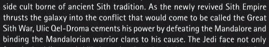

### Stat block notes (game mechanics, not feats)

- Kun and Qel-Droma turn: First the Jedi Knights Exar Kun and Ulic Qel-Droma turn to the dark side and ally themselves with the Krath, a dark-side cult borne of ancient Sith tradition. As the newly revived Sith Empire thrusts the galaxy into the conflict that would come to be called the Great Sith War, Ulic Qel-Droma cements his power by defeating the Mandalore and binding the Mandalorian warrior clans to his cause. (Source: *Knights of the Old Rebuplic Campaign Guide* (SWRPG Saga Edition), scan p.130)

## scan p.131 (scan page 131)

Page contents: The Restoration (3,995–3,966 BBY; Jedi Covenant; Mecrosa Order expunged; the Great Hunt); The Mandalorian Wars (3,965–3,960 BBY); The Jedi Civil War (3,959–3,956 BBY); The Dark Wars (3,955–3,951 BBY; Sith Triumvirate). (hand-read)

- **Bastila Shan; Revan** — entry/section: Knights of the Old Republic Campaign Guide (Saga): "A Jedi strike team, led by legendary Jedi Knight Bastila Shan, lands on Darth Revan's flagship, captures him, and brings him back to the Republic." Source: *Knights of the Old Rebuplic Campaign Guide* (SWRPG Saga Edition), scan p.131
  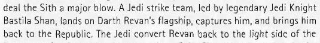
- **Vrook Lamar** — entry/section: Pull quote: ""IF WE'RE GOING TO HAVE A JEDI COUNCIL AT ALL, THEN SOMEBODY, SOMEWHERE, IS GOING TO DO WHAT IT TELLS THEM!" —MASTER VROOK LAMAR" Source: *Knights of the Old Rebuplic Campaign Guide* (SWRPG Saga Edition), scan p.131
  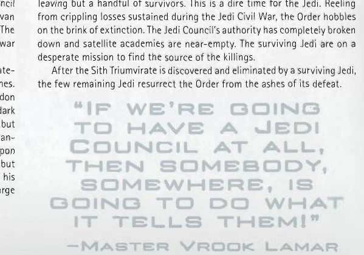
- **Mandalore the Ultimate**: "Once again the galaxy plunges into war as the Mandalorians, thought disorganized after their defeat in the Great Sith War, begin their onslaught of Republic worlds at the command of Mandalore the Ultimate." Source: *Knights of the Old Rebuplic Campaign Guide* (SWRPG Saga Edition), scan p.131
  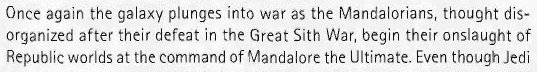
- **Revan**: "The Mandalorians are destroyed, but celebrations are cut short as Revan, already steeped in the dark side from his dealings with Sith remnants, flees to the Unknown Regions, taking a large piece of the Republic military with him." Source: *Knights of the Old Rebuplic Campaign Guide* (SWRPG Saga Edition), scan p.131
  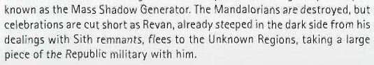
- **Revan; Darth Malak**: "With Revan's help the Jedi locate the Star Forge—the source of the Sith military's resurgence—and defeat Darth Malak." Source: *Knights of the Old Rebuplic Campaign Guide* (SWRPG Saga Edition), scan p.131
  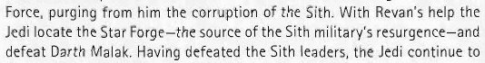

### Stat block notes (game mechanics, not feats)

- Revan at Malachor V: At Malachor V, Revan confronts Mandalore the Ultimate, drawing him into a trap and activating a superweapon known as the Mass Shadow Generator. The Mandalorians are destroyed, but celebrations are cut short as Revan, already steeped in the dark side from his dealings with Sith remnants, flees to the Unknown Regions, taking a large piece of the Republic military with him. (Source: *Knights of the Old Rebuplic Campaign Guide* (SWRPG Saga Edition), scan p.131)
- Capture of Revan: A Jedi strike team, led by legendary Jedi Knight Bastila Shan, lands on Darth Revan's flagship, captures him, and brings him back to the Republic. The Jedi convert Revan back to the light side of the Force, purging from him the corruption of the Sith. With Revan's help the Jedi locate the Star Forge—the source of the Sith military's resurgence—and defeat Darth Malak. (Source: *Knights of the Old Rebuplic Campaign Guide* (SWRPG Saga Edition), scan p.131)

## scan p.132 (scan page 132)

Page contents: Jedi Covenanter (secret sect formed in reaction to Exar Kun's Sith ascendancy; farseeing) and stats (Human Jedi 7, CL 7). (hand-read)

## scan p.133 (scan page 133)

Page contents: Jedi Shadow (Covenant Shadows) and stats (Human Jedi 7/Jedi Knight 3, CL 10); caption "A JEDI SHADOW SNEAKS ABOARD A HERALD-CLASS SHUTTLE". (hand-read)

## scan p.134 (scan page 134)

Page contents: Jedi Battlemaster and stats (Human Jedi 7/Jedi Knight 5, CL 12); caption "A JEDI BATTLEMASTER DISPATCHES A PAIR OF MARK I ASSAULT DROIDS"; Jedi Watchman. (hand-read)

- **Atris** — entry/section: Pull quote: ""WE ALL HAVE OUR HEROES. AND WHEN WE WATCH THEM FALL, WE DIE INSIDE." —MASTER ATRIS" Source: *Knights of the Old Rebuplic Campaign Guide* (SWRPG Saga Edition), scan p.134
  

## scan p.135 (scan page 135)

Page contents: Jedi Watchman stats (Jedi 7/Jedi Knight 5/Jedi Master 2); Guardians of Peace and Justice; Ulic Qel-Droma bio; caption "ULIC QEL-DROMA". (hand-read)

- **Arca Jeth; Ulic Qel-Droma**: "But when Arca falls fighting the Krath, Ulic infiltrates the cult, seeking revenge by learning the Krath's dark-side secrets and using them to try and destroy the organization." Source: *Knights of the Old Rebuplic Campaign Guide* (SWRPG Saga Edition), scan p.135
  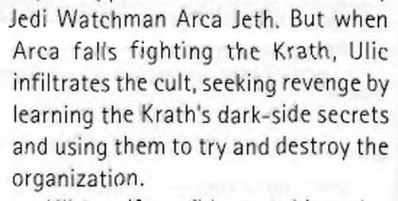
- **Ulic Qel-Droma**: "When Ulic is killed by a misguided "hero," he becomes one with the Force, a redeemed man." Source: *Knights of the Old Rebuplic Campaign Guide* (SWRPG Saga Edition), scan p.135
  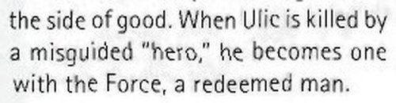

### Stat block notes (game mechanics, not feats)

- Ulic's youth and infiltration of the Krath: Ulic's naiveté regarding the dark side stems from spending his childhood not in the Jedi Temple, but with his brother Cay and cousin Duron on Alderaan, where he studies all forms of knowledge obsessively. Eventually his mother, a renowned Jedi, arranges for Ulic and Cay to apprentice under the fatherly Jedi Watchman Arca Jeth. But when Arca falls fighting the Krath, Ulic infiltrates the cult, seeking revenge by learning the Krath's dark-side secrets and using them to try and destroy the organization. (Source: *Knights of the Old Rebuplic Campaign Guide* (SWRPG Saga Edition), scan p.135)
- Ulic's fall: Ulic's self-confidence is his undoing. Intoxicated by power, he plunges into the dark side, teaming with Sith-aspirant Exar Kun. Becoming Kun's Sith apprentice, Ulic helps to create the Brotherhood of the Sith and sets out to forge a new Sith Empire. He wins the Mandalorians' loyalty and spreads genocidal-scale death with the Dark Reaper superweapon. However, when Ulic takes his brother's life, grief drives him to betray Kun and turn away from his dark ways. (Source: *Knights of the Old Rebuplic Campaign Guide* (SWRPG Saga Edition), scan p.135)
- Ulic's redemption: Severed from the Force by the great Jedi Nomi Sunrider, a humbled Ulic roams the galaxy. Eventually he arrives at frozen Rhen Var, where Nomi's daughter Vima seeks Ulic as her master, slowly returning him to the side of good. When Ulic is killed by a misguided "hero," he becomes one with the Force, a redeemed man. (Source: *Knights of the Old Rebuplic Campaign Guide* (SWRPG Saga Edition), scan p.135)

## scan p.136 (scan page 136)

Page contents: Ulic Qel-Droma (Redeemed) stats (Human Jedi 7/Jedi Knight 5/Sith apprentice 5, CL 17; talents incl. Diem So, Slashing Charge; feats incl. Double Attack, Mighty Swing, Whirlwind Attack); Zayne Carrick bio. (hand-read)

- **Ulic Qel-Droma**: "Ulic's cousin Duron shoulders the task of clearing the Qel-Droma name, destroying Sith remnants in the Cleansing of the Nine Houses and eradicating nightmare Sith creations such as silan, terentateks, and giant wyrms in the Great Hunt." Source: *Knights of the Old Rebuplic Campaign Guide* (SWRPG Saga Edition), scan p.136
  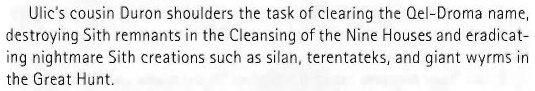
- **Lucien Draay**: "Lightsabers ablaze, Lucien and the other Jedi Masters stand over the slain corpses of his Padawan classmates." Source: *Knights of the Old Rebuplic Campaign Guide* (SWRPG Saga Edition), scan p.136
  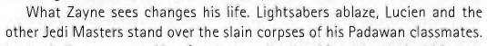

### Stat block notes (game mechanics, not feats)

- Zayne's childhood: The middle child of five born to Arvan and Reiva Carrick, Zayne Carrick makes friends easily as a boy. But at age four, his Force attunement prompts Jedi attentions, singling him out for a destiny far from his homeworld of Phaeda. Master Tokare of Dantooine perceives the boy's peculiar difficulties in wielding the Force but after the Great Sith War, the Jedi cannot afford to reject even the least capable candidates, regardless of their expected potential. Zayne proves to be a difficult student whose skill in the Force is meager, yet he shows progress at surprising times. (Source: *Knights of the Old Rebuplic Campaign Guide* (SWRPG Saga Edition), scan p.136)
- Zayne on Taris: Under Master Lucien Draay, good-natured Zayne ekes out an unexceptional apprenticeship on Taris—one grueling day at a time. Zayne's closest friends and fellow Padawans, including Shad Jelavan, are assigned to Jedi Masters on the planet, and with Shad's younger sister Shel also on Taris, life is good. By the time he is to be tested to become a Jedi Knight, Zayne has already almost caught the second-rate racketeer Marn "The Gryph" Hierogryph on several occasions, and is positive the eighth time will be the charm. (Source: *Knights of the Old Rebuplic Campaign Guide* (SWRPG Saga Edition), scan p.136)
- Padawan Massacre: On Zayne's ninth attempt, he finally succeeds. Unfortunately, the timing could not have been worse. Late for his classmates' knighting rite, he races back to the temple, leaving Gryph temporarily magnacuffed to his speeder, and barges in on the would-be ceremony. What Zayne sees changes his life. Lightsabers ablaze, Lucien and the other Jedi Masters stand over the slain corpses of his Padawan classmates. In shock, Zayne runs, taking Gryph along for the ride while the Jedi Masters give chase. Though they escape, Zayne is named the primary suspect in the "Padawan Massacre," and Gryph is identified as his accomplice. Descending into Taris's dilapidated sublevels, the fugitives hook up with two of Gryph's underworld contacts and flee the planet. (Source: *Knights of the Old Rebuplic Campaign Guide* (SWRPG Saga Edition), scan p.136)
- Zayne's quest: Zayne's quest to clear his name leads him into the company of Camper, Jarael, and Rohlan Dyre, but with his new outlaw friends, the fugitive Padawan spends the Mandalorian Wars putting the pieces of this puzzle together. (Source: *Knights of the Old Rebuplic Campaign Guide* (SWRPG Saga Edition), scan p.136)

## scan p.137 (scan page 137)

Page contents: Zayne Carrick (as of the Padawan Massacre) stats (Human Jedi 6/scoundrel 1, CL 7; phrik-alloy vambraces); Lucien Draay bio and stats (Human noble 3/Jedi 5/Jedi Knight 5/Jedi Master 2, CL 15; talents incl. Shii-Cho, WatchCircle Initiate; feats incl. Cleave, Linguist, Power Attack, Rapid Strike). (hand-read)

- **Lucien Draay**: "Heir to his family's fortune and respected name, Lucien Draay is son to one of the greatest Jedi sibyls." Source: *Knights of the Old Rebuplic Campaign Guide* (SWRPG Saga Edition), scan p.137
  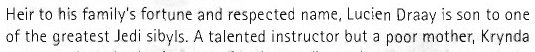
- **Lucien Draay**: "Lucien soon dominates the seers, but Krynda controls them all." Source: *Knights of the Old Rebuplic Campaign Guide* (SWRPG Saga Edition), scan p.137
  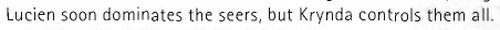

### Stat block notes (game mechanics, not feats)

- Lucien Draay (Saga CL 15): CL 15 Medium Human noble 3/Jedi 5JJedi Knight 5/Jedi Master 2 Destiny 2; Force 7; Dark Side 5 Init +14; Senses Perception +14 Languages Arkanian, Basic, Feeorin, High Galactic, Miralukese, Togruti Defenses Ref 30 (flat-footed 28), Fort 30, Will 30; Block, Deflect hp 121; Threshold 30 Immune fear effects Speed 6 squares Melee lightsab (Source: *Knights of the Old Rebuplic Campaign Guide* (SWRPG Saga Edition), scan p.137)
- Lucien's upbringing: Heir to his family's fortune and respected name, Lucien Draay is son to one of the greatest Jedi sibyls. A talented instructor but a poor mother, Krynda Draay neglects Lucien in favor of Jedi younglings who, like her, demonstrate affinity for peering into the vortex of the future and extracting pristine pearls of insight. Lucien takes after his father, Barrison, having the talents of a Jedi warrior rather than an augur. With his father dead in the Great Sith War and his mother unavailable, Lucien grows spiteful and develops a love-hate surrogate relationship with his family's confidant Haazen—a shrewd man who had failed in his Jedi training. (Source: *Knights of the Old Rebuplic Campaign Guide* (SWRPG Saga Edition), scan p.137)
- First WatchCircle: Haazen convinces Krynda to make Lucien the guardian of her young seers circle. Lucien soon dominates the seers, but Krynda controls them all. They become the First WatchCircle of Krynda's Jedi Covenant, a secret organization sworn to prevent the Sith's return by all necessary means. Lucien keeps the WatchCircle together despite their individual obligations to become Jedi Masters. Eventually, Lucien's WatchCircle is assigned to Taris, where they take on new Padawans, including Lucien's, Zayne Carrick. (Source: *Knights of the Old Rebuplic Campaign Guide* (SWRPG Saga Edition), scan p.137)
- Slaughter of the Padawans: During their Padawans' Jedi trials, the WatchCircle seers get what they have been waiting for—a terrifying vision of galactic turmoil and their own deaths. Worse, one of their Padawans seems destined to become a new Dark Lord! Panic-stricken and determined, the WatchCircle slaughters its students like nerf cattle. (Source: *Knights of the Old Rebuplic Campaign Guide* (SWRPG Saga Edition), scan p.137)
- Lucien hunts Zayne: When Zayne escapes, Lucien frames him for the murder of his classmates, earning the boy a death mark. Convinced Zayne is the envisaged "Dark Lord," Lucien obsessively hunts for him, brushing aside any obstacles to his vendetta against the Sith menace that left him parentless. (Source: *Knights of the Old Rebuplic Campaign Guide* (SWRPG Saga Edition), scan p.137)

## scan p.138 (scan page 138)

Page contents: Caption "LUCIEN DRAAY AND BASTILA SHAN"; Bastila Shan bio and stats (Jedi Civil War; Human Jedi 10/Jedi Knight 7, CL 17; talents incl. Battle Meditation, Improved Battle Meditation, Telepathic Link; feats incl. Dual Weapon Mastery I–III, Withdrawal Strike). (hand-read)

- **Bastila Shan**: "This sweeping Force power, which infuses allies with hope while simultaneously strangling enemy morale, has in the past reversed whole wars, and as the Jedi Civil War engulfs the galaxy, Bastila hopes to turn the tide toward Jedi favor." Source: *Knights of the Old Rebuplic Campaign Guide* (SWRPG Saga Edition), scan p.138
  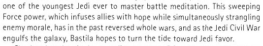
- **Revan; Bastila Shan**: "Revan asks her to come back from the dark side for both their sakes, and after witnessing Revan's compassion, Bastila returns to the light, going on to use her invaluable battle meditation to help defeat the Sith Empire." Source: *Knights of the Old Rebuplic Campaign Guide* (SWRPG Saga Edition), scan p.138
  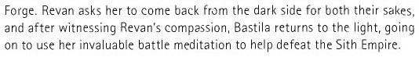

### Stat block notes (game mechanics, not feats)

- Bastila's youth: Born on Talravin, at an early age Bastila exhibits an independent streak and a startling Force acuity that inevitably leads to Jedi life. Her ability to affect minds blossoms with astounding speed and scope, and she becomes one of the youngest Jedi ever to master battle meditation. This sweeping Force power, which infuses allies with hope while simultaneously strangling enemy morale, has in the past reversed whole wars, and as the Jedi Civil War engulfs the galaxy, Bastila hopes to turn the tide toward Jedi favor. (Source: *Knights of the Old Rebuplic Campaign Guide* (SWRPG Saga Edition), scan p.138)
- Capture of Revan: She does just that, in the most direct way possible. Storming Darth Revan's own command ship, Bastila's Jedi strike team captures the Dark Lord. Thanks to Revan's treasonous apprentice Darth Malak, a turbolaser blast aimed at Revan's ship knocks him comatose, and Bastila uses the Force to keep Revan alive, establishing a telepathic bond between them. Upon returning to the Jedi Council with her Sith prize, she helps to concoct an audacious plan. (Source: *Knights of the Old Rebuplic Campaign Guide* (SWRPG Saga Edition), scan p.138)
- Mind-wipe of Revan: After using the Force to temporarily wipe Revan's memories, Bastila coaxes him into revealing priceless intelligence about the Sith enemy. The scheme is controversial at best. Mind-wiping is considered an immoral Force application, and there is no telling how Bastila's Force bond with the Dark Lord would affect her. Yet, with trepidation, the Council proceeds. (Source: *Knights of the Old Rebuplic Campaign Guide* (SWRPG Saga Edition), scan p.138)
- Bastila's fall and return: In the end, they fail to account for two distinct possibilities: that Bastila would fall in love with Revan; and that Bastila, purest of Jedi, would fall to the dark side. As Bastila watches Revan for Sithlike reversion, she becomes enamored of his unexpectedly compassionate nature. Amid this emotional turmoil, she is captured by Darth Malak, who twists her into his apprentice. With the roles of Sith and Jedi reverse, Bastila confronts Revan on the Star Forge. Revan asks her to come back from the dark side for both their sakes, and after witnessing Revan's compassion, Bastila returns to the light, going on to use her invaluable battle meditation to help defeat the Sith Empire. (Source: *Knights of the Old Rebuplic Campaign Guide* (SWRPG Saga Edition), scan p.138)

## scan p.139 (scan page 139)

Page contents: Jolee Bindo bio and stats (Jedi Civil War; Human Jedi 7/scoundrel 2/scout 2, CL 11; talents incl. Beast Trick, Force Persuasion, Force Pilot); Juhani bio. (hand-read)

- **Revan** — entry/section: Knights of the Old Republic Campaign Guide (Saga): "Here Revan comes to her aid again, this time defeating her in a duel and sparing her life." Source: *Knights of the Old Rebuplic Campaign Guide* (SWRPG Saga Edition), scan p.139
  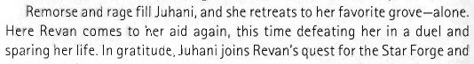
- **Juhani** — entry/section: Pull quote: ""JUST LET ME VENT MY ANGER! I NEED SOMEONE TO BLAME . . . SOMETHING, ANYTHING!" —JUHANI" Source: *Knights of the Old Rebuplic Campaign Guide* (SWRPG Saga Edition), scan p.139
  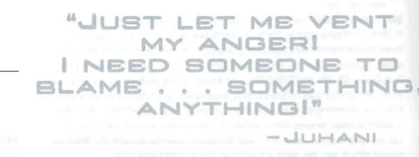

### Stat block notes (game mechanics, not feats)

- Jolee and Nayama: Jolee Bindo was once filled with a verve and gusto that never failed to make fellow Padawans like Nomi Sunrider smile, but witnessing his wife's corruption by the dark side scars him for life. In Bindo's time, it was not unusual for Jedi to wed. So when he marries his Force-sensitive wife Nayama, he enthusiastically trains her in the Jedi arts. Unfortunately, Bindo is not a Master; he is merely a Padawan. The end result is surprising only to him. When Exar Kun creates the Brotherhood of the Sith, Nayama is among his earliest Jedi recruits. When Kun orders his Sith brothers and sisters to murder their masters, husband and wife face off in mortal combat. Bindo emerges the victor, but he cannot strike down his better half. Spared, Nayama kills many Jedi, and the Sith proceed with activating the Dark Reaper superweapon, causing countless innocent deaths. Though Nayama is slain at the end of the Great Sith War, a sorrowful Bindo rejects promotion to knighthood and forsakes Jedi life. (Source: *Knights of the Old Rebuplic Campaign Guide* (SWRPG Saga Edition), scan p.139)
- Jolee on Kashyyyk: Full of regret for his contribution to a war as pointless as any other, Bindo takes up smuggling. However, when a starship mishap strands him in Kashyyyk's depths, Bindo opts to stay buried there for next twenty years. Only when a mind-wiped Revan arrives does Bindo come out of seclusion. To his credit, Bindo retains his sense of humor and his heart remains good. He helps the amnesiac Jedi stay true to the light and puts an end to another Sith superweapon, the Star Forge, partly reconciling himself to his past. (Source: *Knights of the Old Rebuplic Campaign Guide* (SWRPG Saga Edition), scan p.139)
- Juhani's early life: The lioness Juhani lived her life between extremes. A Cathar, she immigrates with her family to Taris after the Mandalorian Wars depredate her homeworld, but the change helps little. In fact, Xor—a hardened Twi'lek slaver and Mandalorian Neo-Crusader—murders her father, and her mother, drowning in the consequent debt, literally works herself to death. Juhani becomes indentured to the Taris Exchange criminal organization and seems doomed to live out her days a slave. Then, a Jedi Knight comes to her rescue. Wowed by her dashing hero, Revan, Juhani makes up her mind to likewise become a servant of the Force. (Source: *Knights of the Old Rebuplic Campaign Guide* (SWRPG Saga Edition), scan p.139)
- Juhani and Quatra: Young Juhani resourcefully finds her way to Dantooine. There she is accepted for Jedi training by Master Quatra, and for once, her future seems bright and clear. Juhani's training under Master Quatra progresses as many apprenticeships do, but over time Juhani's hot-tempered nature continues to create problems in her acceptance of the will of the Force. As she nears the end of her training, Juhani begins to lose control over her emotions, and Master Quatra knows it. Juhani gives into her fear and anger and apparently cuts down her Master; in truth, Quatra is merely testing Juhani, who fails disastrously. (Source: *Knights of the Old Rebuplic Campaign Guide* (SWRPG Saga Edition), scan p.139)
- Juhani spares Xor: Remorse and rage fill Juhani, and she retreats to her favorite grove—alone. Here Revan comes to her aid again, this time defeating her in a duel and sparing her life. In gratitude, Juhani joins Revan's quest for the Star Forge and crosses paths with her father's killer. Xor and his slavers ferociously attack her and Revan, and the Jedi defend themselves fiercely, critically wounding Xor. Yet, with Revan's help, Juhani refrains from slaying the slaver. She stays true to the Jedi Code, and as they continue their quest, Juhani becomes a pillar of the light side for Revan. (Source: *Knights of the Old Rebuplic Campaign Guide* (SWRPG Saga Edition), scan p.139)

## scan p.140 (scan page 140)

Page contents: Juhani (Jedi Civil War) stats (Cathar Jedi 8, CL 8; Claw Lock, Lightsaber Throw); Vandar Tokare bio and stats (Dark Wars; Small Jedi 7/Jedi Knight 5/Jedi Master 5, CL 17; Ataru, Battle Meditation, Force Suppression; feats incl. Strong in the Force, Triple Crit). (hand-read)

- **Darth Malak**: "Narrowly escaping an orbital bombardment of the Dantooine Jedi Enclave by Darth Malak's forces, Tokare goes on to fight in the final battle over Rakata Prime, where Darth Malak and the Sith are defeated." Source: *Knights of the Old Rebuplic Campaign Guide* (SWRPG Saga Edition), scan p.140
  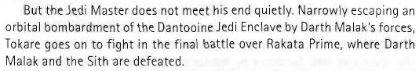

### Stat block notes (game mechanics, not feats)

- Tokare's prophecies: Though the future is always in motion, Tokare excels at reading portents. His wisdom is frequently questioned by contemporaries such as Master Vrook Lamar, but as history engulfs the future, the diminutive Jedi's insights repeatedly prove correct. When the Jedi Exile comes to Revan's side against the Mandalorians (and against the Jedi Order's wishes), Tokare insists she will ultimately stay true to the light. In a premonition he also foresees the destruction set to befall the galaxy in the Jedi Civil War. Sadly, the warnings of this prophecy are all for naught when the Jedi Council misinterprets it as a warning against engaging Mandalore the Ultimate in battle. The resulting series of events leads to the Sith's resurrection and the death of Master Tokare. (Source: *Knights of the Old Rebuplic Campaign Guide* (SWRPG Saga Edition), scan p.140)
- Tokare at Rakata Prime: But the Jedi Master does not meet his end quietly. Narrowly escaping an orbital bombardment of the Dantooine Jedi Enclave by Darth Malak's forces, Tokare goes on to fight in the final battle over Rakata Prime, where Darth Malak and the Sith are defeated. (Source: *Knights of the Old Rebuplic Campaign Guide* (SWRPG Saga Edition), scan p.140)
- Death on Katarr: To divine the identities of their hunters, Master Tokare meets with most of the hundred surviving Jedi on the planet Katarr. It is just the moment that the Sith Lord Darth Nihilus has been waiting for. Through an unholy dark-side technique, Nihilus murders every living being on Katarr, including Master Tokare. Perhaps Tokare's prescient faculties at last fail him, or perhaps Tokare's instincts lead him to become one with the Force. (Source: *Knights of the Old Rebuplic Campaign Guide* (SWRPG Saga Edition), scan p.140)

## scan p.141 (scan page 141)

Page contents: The Jedi Exile bio; The Jedi Exile (Dark Wars) stats (Human Jedi 7/Jedi Knight 5/soldier 1/officer 2, CL 15; feats incl. Echani Training, Improved Defenses, Martial Arts I); Visas Marr bio begins. (hand-read)

- **Vima Sunrider; Meetra Surik**: "After he leaves to fight Mandalorians in the early skirmishes before the outbreak of the Mandalorian Wars, she trains with other masters, including Vima Sunrider, who cautions the Jedi Exile to be mindful of her powers, particularly her aptitude for severing another's connection to the Force." Source: *Knights of the Old Rebuplic Campaign Guide* (SWRPG Saga Edition), scan p.141
  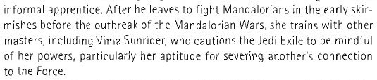
- **Meetra Surik**: "Thousands of soldiers the Exile had led in battle and befriended are killed instantly." Source: *Knights of the Old Rebuplic Campaign Guide* (SWRPG Saga Edition), scan p.141
  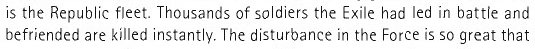
- **Meetra Surik**: "The disturbance in the Force is so great that the Jedi Exile instinctively severs herself from the Force before the backlash rips her to pieces." Source: *Knights of the Old Rebuplic Campaign Guide* (SWRPG Saga Edition), scan p.141
  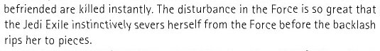
- **Revan**: "Afterward, she ventures into unknown territory searching for Revan, leaving her disciples to resurrect the Jedi." Source: *Knights of the Old Rebuplic Campaign Guide* (SWRPG Saga Edition), scan p.141
  
- **Darth Nihilus; Visas Marr**: "With the power of the Dark Side, Nihilus obliterates all life on Katarr—all but Visas Marr." Source: *Knights of the Old Rebuplic Campaign Guide* (SWRPG Saga Edition), scan p.141
  

### Stat block notes (game mechanics, not feats)

- Exile's training: The Jedi Exile's training begins on Dantooine as Jedi Knight Kavar's informal apprentice. After he leaves to fight Mandalorians in the early skirmishes before the outbreak of the Mandalorian Wars, she trains with other masters, including Vima Sunrider, who cautions the Jedi Exile to be mindful of her powers, particularly her aptitude for severing another's connection to the Force. (Source: *Knights of the Old Rebuplic Campaign Guide* (SWRPG Saga Edition), scan p.141)
- Malachor V: Within a decade, the Mandalorian Wars erupt in earnest. Inspired by Master Kavar's example, the Jedi Exile rallies alongside the charismatic Revan, and she becomes his most trusted general besides Malak by war's end. In the so-called Ani'la Akaan or "Great Last Battle" above Malachor V, Republic and Mandalorian armadas clash in Revan's carefully choreographed gambit. When the Mandalorians are in position, the Jedi Exile springs the trap, unleashing an apocalyptic weapon called the Mass Shadow Generator. The Mandalorian navy is decimated in a space-rending gravitational crush—as is the Republic fleet. Thousands of soldiers the Exile had led in battle and befriended are killed instantly. The disturbance in the Force is so great that the Jedi Exile instinctively severs herself from the Force before the backlash rips her to pieces. (Source: *Knights of the Old Rebuplic Campaign Guide* (SWRPG Saga Edition), scan p.141)
- Exile's excommunication: Grief-stricken and intractable, she returns alone to answer for herself and, by extension, Revan and his errant Jedi. With the pestilence of the Malachor V deaths clinging to the unrepentant Jedi, the Council is not kind. Though a similar decree had culled the seeds of the old Sith Empire from their own ranks, the Council excommunicates her, reasoning that, dead to the Force, permanent banishment is punishment enough for her. Like the denounced Jedi renegades of old, she too is now an exile. (Source: *Knights of the Old Rebuplic Campaign Guide* (SWRPG Saga Edition), scan p.141)
- Exile's return: However, after the war, word comes that the Jedi are being exterminated, and after nearly ten years, the Jedi Exile returns. What she finds is a ruined Jedi Order, and an enigmatic Jedi Master—Kreia, who also claims to have been exiled and stripped of her Force powers. Kreia's union with the Jedi Exile creates a vergence in the Force that reconnects them to the energy field surrounding all living things. With Kreia, the Jedi Exile seeks out Jedi survivors in an effort to reconstitute the Order, collecting informal Jedi pupils of her own, such as Mical and Visas Marr. However, when Kreia reveals her identity as Darth Traya, the Jedi Exile is forced to kill her mentor along with the Dark Lord's apprentices. Afterward, she ventures into unknown territory searching for Revan, leaving her disciples to resurrect the Jedi. (Source: *Knights of the Old Rebuplic Campaign Guide* (SWRPG Saga Edition), scan p.141)
- Visas on the Ravager: With the power of the Dark Side, Nihilus obliterates all life on Katarr—all but Visas Marr. Like all Miraluka, Visas is born Force-sensitive and physically blind, but when she awakes on Nihilus's ship, the Ravager, after Katarr's destruction, she realizes the Sith Lord has carved the flesh from her eye sockets so that she resembles him. Sundered by Nihilus's aura, young Visas can see only death in the Force. Accepting Nihilus's unspoken invitation, she pledges herself to the Dark Lord. (Source: *Knights of the Old Rebuplic Campaign Guide* (SWRPG Saga Edition), scan p.141)

## scan p.142 (scan page 142)

Page contents: Caption "VISAS MARR"; Visas Marr (Dark Wars) stats (Miraluka Jedi 7/Sith apprentice 2, CL 9); Atris bio begins. (hand-read)

- **Visas Marr; Meetra Surik**: "At last dispelling her grief for the butchery at Katarr, Visas leads the Jedi Exile to her Sith master, and together they defeat the Dark Lord." Source: *Knights of the Old Rebuplic Campaign Guide* (SWRPG Saga Edition), scan p.142
  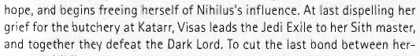

### Stat block notes (game mechanics, not feats)

- Visas Marr (Dark Wars): Saga CL 9 Medium Miraluka Jedi 7/Sith apprentice 2 (Source: *Knights of the Old Rebuplic Campaign Guide* (SWRPG Saga Edition), scan p.142)
- Visas turns against Nihilus: As Nihilus's Shadow Hand, Visas does her lord's bidding. This includes tracking down a disturbance in the Force that turns out to be the Jedi Exile. They cross lightsabers, and Visas is summarily beaten, subsequently vowing loyalty to her vanquisher. In the Jedi Exile's company, Visas finds renewed hope, and begins freeing herself of Nihilus's influence. At last dispelling her grief for the butchery at Katarr, Visas leads the Jedi Exile to her Sith master, and together they defeat the Dark Lord. To cut the last bond between herself and Nihilus, she peers beneath his death mask to look upon the face of pure evil. After the Dark Wars, Visas is pivotal in restoring the Jedi Order. (Source: *Knights of the Old Rebuplic Campaign Guide* (SWRPG Saga Edition), scan p.142)
- Atris's reforms: The Great Sith War induces great philosophical upheaval in the Jedi Order. In its aftermath, Atris, a Jedi historian, attempts to revise the broken system of Jedi apprenticeship. Atris argues that, with liberal instruction practices such as dozens of Padawans training under a single Jedi Master, the radical bond of reciprocal apprenticeship, and Jedi beginning their training in their teens and later, there is little wonder that Exar Kun and Ulic Qel-Droma fell to the dark side. Invoking thousand-year-old recommendations by Master Simikarty, she lobbies for reducing the number of apprentices Masters can take and for limiting the age of Jedi candidates. She also advocates prohibiting romantic involvement for Jedi. Had not the First Great Jedi Schism been started by two lovers? Atris even endorses adoption of a more austere interpretation of the Jedi Code favored by the famed Master Odan-Urr, in memory of his recent death. (Source: *Knights of the Old Rebuplic Campaign Guide* (SWRPG Saga Edition), scan p.142)
- Atris condemns Revan: Master Atris's arguments find powerful purchase, and her peers offer her a seat on the Jedi Council. When the Mandalorian Wars erupt, Atris is a staunch opponent of Jedi involvement. When Revan defies the council, Atris feels betrayed. She condemns Revan, his followers, and the "freethinking" teachings of his Jedi Master, fellow historian Kreia. Revan's eventual turn to the dark side comes as little surprise. (Source: *Knights of the Old Rebuplic Campaign Guide* (SWRPG Saga Edition), scan p.142)
- Katarr conclave: After the Jedi Civil War, the future looks bleak for the Jedi. Though they won, their infrastructure is decimated and some thing is systematically hunting them. Orchestrating an irresistible lure, Atris calls a Jedi conclave on Katarr, where most of the one hundred remaining Jedi meet. She then leaks knowledge of the session to bait their killer into the open. Atris gets what she wanted—at the expense of her Jedi comrades—when Darth Nihilus razes Katarr. Believing she can save the Jedi Order and once and for all shape it to her taste, Atris flees to Telos IV with the most important items from the Jedi Library, including Sith holocrons. There, she sets up a would-be Jedi praxeum. (Source: *Knights of the Old Rebuplic Campaign Guide* (SWRPG Saga Edition), scan p.142)

## scan p.143 (scan page 143)

Page contents: Atris (Dark Wars) stats (Human Jedi 7/Jedi Knight 5/Jedi Master 2/Sith apprentice 1, CL 15; Juyo, Force Suppression; Echani Training); Celeste Morne bio and stats (Human Jedi 7/scoundrel 2/Jedi Knight 3, CL 12; Dastardly Strike, Force Haze, Improved Sentinel Strike). (hand-read)

- **Meetra Surik; Atris** — entry/section: Knights of the Old Republic Campaign Guide (Saga): "But Atris's pride is no match for the Jedi Exile’s lightsaber prowess." Source: *Knights of the Old Rebuplic Campaign Guide* (SWRPG Saga Edition), scan p.143
  
- **Atris**: "Atris becomes a captive in her own sanctum until such time as her role in nearly destroying the Jedi can be judged by Mical and a new Jedi Council." Source: *Knights of the Old Rebuplic Campaign Guide* (SWRPG Saga Edition), scan p.143
  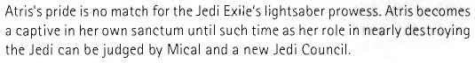

### Stat block notes (game mechanics, not feats)

- Atris (Dark Wars): Saga CL 15 Medium Human Jedi 7/Jedi Knight 5/Jedi Master 2/Sith apprentice 1 (Source: *Knights of the Old Rebuplic Campaign Guide* (SWRPG Saga Edition), scan p.143)
- Atris falls: At her Telos stronghold Atris is discovered by the Jedi Exile. Seemingly redeemed, she causes Atris great consternation, challenging the very crux of her rigid beliefs. This confusion manifests itself alternately as Atris helps the Jedi Exile find the remaining Jedi Masters, and as she succumbs to the whisperings of her Sith holocrons and Darth Traya—formerly Master Kreia. Atris's self-righteousness finally drives her into the dark side's embrace. But Atris's pride is no match for the Jedi Exile's lightsaber prowess. Atris becomes a captive in her own sanctum until such time as her role in nearly destroying the Jedi can be judged by Mical and a new Jedi Council. (Source: *Knights of the Old Rebuplic Campaign Guide* (SWRPG Saga Edition), scan p.143)
- Covenant Shadow: Secretive, unorthodox, and good at her job, Celeste Morne is one of the few mysterious Jedi known as Covenant Shadows. Like all Jedi Shadows, Morne has dedicated her life to wiping out the agents of the dark side through whatever means necessary. As a Covenant Shadow, she is completely off the Jedi Council's radar. She does not dress as a Jedi, she only rarely uses her lightsaber publicly, and she answers to no one except Lucien Draay. (Source: *Knights of the Old Rebuplic Campaign Guide* (SWRPG Saga Edition), scan p.143)
- Morne's origins: Originally from Ossus, Morne wandered the galaxy after her home planet was devastated in the Great Sith War, eventually being raised by Krynda Draay and coming under the command of her son when she began training as a Jedi Shadow. She has served for years as an undercover agent of the Jedi, though she vanishes without a trace in 3,963 BBY under mysterious circumstances. (Source: *Knights of the Old Rebuplic Campaign Guide* (SWRPG Saga Edition), scan p.143)

## scan p.144 (scan page 144)

Page contents: Starships: Jedi Covenant Shuttle — Eleaor Propulsion Baronial-class yacht (commissioned by the Draay Trust) and stats; caption "THE REVANCHISTS ARE THE FIRST JEDI TO LEAP INTO ACTION DURING THE MANDALORIAN WARS". (hand-read)

## scan p.145 (scan page 145)

Page contents: Chapter X: The Sith opener. (hand-read)

## scan p.146 (scan page 146)

Page contents: The Code of the Sith (epigraph: "Peace is a lie, there is only passion. Through passion, I gain strength. Through strength, I gain power. Through power, I gain victory. Through victory, my chains are broken. The Force shall free me." —The Code of the Sith); Sith history (King Adas, Rakatan invasion, Jen'jidai, Ajunta Pall, Naga Sadow, Freedon Nadd). (hand-read)

### Stat block notes (game mechanics, not feats)

- Sith'ari: This inflexible Sith ruler unites his world into a single kingdom, and claims the titles of both monarch and god of his people. History calls him King Adas, but according to legend, the Force bestows on him a different name: Sith'ari—the perfect being. Three thousand years before the founding of the Republic, Adas's hegemony is invaded by the Rakatan Infinite Empire, an immensely powerful interstellar nation. Here, later Sith would say, they prove their right to rule the galaxy. Outsmarting the technologically superior invaders, Adas conquers the conquerors, sacrificing his life in the process. (Source: *Knights of the Old Rebuplic Campaign Guide* (SWRPG Saga Edition), scan p.146)
- Jen'ari: These exiles, initially called Jen'jidai in the Sith tongue, easily conquer the reigning Sith overlord, earning their leader Ajunta Pall the new title Jen'ari or "Dark Lord" of the Sith. (Source: *Knights of the Old Rebuplic Campaign Guide* (SWRPG Saga Edition), scan p.146)
- Sadow invades: At last, around the year 5,000 BBY, the Sith Empire, led by the Dark Lord Naga Sadow, is ready and invades Republic space. (Source: *Knights of the Old Rebuplic Campaign Guide* (SWRPG Saga Edition), scan p.146)
- Nadd becomes a Dark Lord: But in a twist of irony, a few short centuries later, the Jedi Knight Freedon Nadd finds two Sith relics the Shadows missed. Taking instruction from both King Adas's holocron and Sadow's disembodied spirit, Nadd becomes a Dark Lord. In turn, he inculcates the Jedi Exar Kun into the Sith creed, consequently bringing the Republic to its knees as Kun's Brotherhood of the Sith instigates the Great Sith War. (Source: *Knights of the Old Rebuplic Campaign Guide* (SWRPG Saga Edition), scan p.146)

## scan p.147 (scan page 147)

Page contents: Sith history: The Restoration and the Mandalorian Wars; The Jedi Civil War (3,959–3,956 BBY); The Dark Wars (3,955–3,951 BBY); Using the Sith — Imperialists (rank structure; Darth Bandon named as serving Sith Lord). (hand-read)

- **Darth Malak; Revan** — entry/section: Knights of the Old Republic Campaign Guide (Saga): "Though the Sith Empire continues to grow for some months under the control of the traitorous Darth Malak, eventually the redeemed Revan slays his former apprentice and shatters the backbone of the reborn Sith Empire." Source: *Knights of the Old Rebuplic Campaign Guide* (SWRPG Saga Edition), scan p.147
  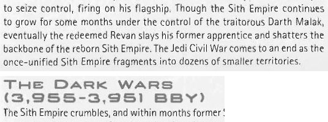
- **Revan; Darth Malak**: "They do not have to wait long, for soon Darth Revan and Darth Malak appear, resurrecting the Sith Empire in a Jedi Civil War." Source: *Knights of the Old Rebuplic Campaign Guide* (SWRPG Saga Edition), scan p.147
  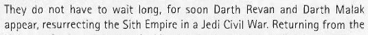
- **Darth Sion; Darth Nihilus**: "As the Sith squabble among themselves, fighting over the scraps of the Sith Empire, Darth Sion and Darth Nihilus engage in a campaign to wipe out the Jedi, with great success." Source: *Knights of the Old Rebuplic Campaign Guide* (SWRPG Saga Edition), scan p.147
  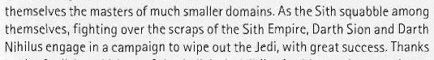
- **Atris; Darth Nihilus**: "Thanks to the foolish ambitions of the Jedi Atris, Nihilus is able to wipe out almost all of the remaining Jedi, leaving only a small handful alive." Source: *Knights of the Old Rebuplic Campaign Guide* (SWRPG Saga Edition), scan p.147
  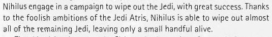

### Stat block notes (game mechanics, not feats)

- Sith Empire resurrected: They do not have to wait long, for soon Darth Revan and Darth Malak appear, resurrecting the Sith Empire in a Jedi Civil War. Returning from the Unknown Regions following the Mandalorian Wars, the two Sith Lords engage in a lightning-fast campaign to reestablish the Sith Empire and reclaim conquered worlds. (Source: *Knights of the Old Rebuplic Campaign Guide* (SWRPG Saga Edition), scan p.147)
- Malak's betrayal and end: At the moment the Jedi capture him, Darth Revan's own apprentice attempts to seize control, firing on his flagship. Though the Sith Empire continues to grow for some months under the control of the traitorous Darth Malak, eventually the redeemed Revan slays his former apprentice and shatters the backbone of the reborn Sith Empire. (Source: *Knights of the Old Rebuplic Campaign Guide* (SWRPG Saga Edition), scan p.147)
- Purge of the Jedi: As the Sith squabble among themselves, fighting over the scraps of the Sith Empire, Darth Sion and Darth Nihilus engage in a campaign to wipe out the Jedi, with great success. Thanks to the foolish ambitions of the Jedi Atris, Nihilus is able to wipe out almost all of the remaining Jedi, leaving only a small handful alive. (Source: *Knights of the Old Rebuplic Campaign Guide* (SWRPG Saga Edition), scan p.147)

## scan p.148 (scan page 148)

Page contents: Sith Navy and ground forces rank structure (Saul Karath as example admiral); Traditionalists, Secret Societies, Remnants; The Legions of the Sith; Sith Paraphernalia (Sith tremor sword, Sith war sword, Sith trooper armor). (hand-read)

## scan p.149 (scan page 149)

Page contents: Sith Trooper description and stats (CL 1); Sith Pilot (CL 2); Sith Commando (CL 2). (hand-read)

- **Kreia** — entry/section: Pull quote: ""TO BE UNITED BY HATRED IS A FRAGILE ALLIANCE AT BEST." —DARTH TRAYA" Source: *Knights of the Old Rebuplic Campaign Guide* (SWRPG Saga Edition), scan p.149
  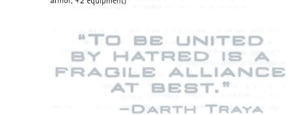

## scan p.150 (scan page 150)

Page contents: Sith Officer (CL 6); Sith Student (CL 4; academy headmaster Jorak Uln named as one of Exar Kun's original Sith acolytes); Sith Assassin description (Bladeborn). (hand-read)

### Stat block notes (game mechanics, not feats)

- Korriban academy: Already proficient in the Jedi arts, these marauders acquire new nefarious talents studying at the feet of the Sith academy headmaster Jorak Uln—one of Exar Kun's original Sith acolytes. (Source: *Knights of the Old Rebuplic Campaign Guide* (SWRPG Saga Edition), scan p.150)
- Sith assassins: Established by Darth Revan and heavily utilized by Darth Sion, these surreptitious butchers specialize in practical modes of Jedi execution. (Source: *Knights of the Old Rebuplic Campaign Guide* (SWRPG Saga Edition), scan p.150)

## scan p.151 (scan page 151)

Page contents: Sith Assassin stats (Human Jedi 4/scoundrel 2); caption "LEFT TO RIGHT: SITH TROOPER, SITH OFFICER, SITH ASSASSIN, SITH APPRENTICE". (hand-read)

## scan p.152 (scan page 152)

Page contents: Bladeborn stats (CL 10); Sith Mage description (Sorcerers of Tund) and stats (CL 8); Shadow Hand (Sith Apprentice) description. (hand-read)

- **Lucien Draay** — entry/section: Pull quote: ""FEAR IS YOUR ENEMY. DO NOT GIVE IT GROUND TO GROW." —MASTER LUCIEN DRAAY" Source: *Knights of the Old Rebuplic Campaign Guide* (SWRPG Saga Edition), scan p.152
  

## scan p.153 (scan page 153)

Page contents: Shadow Hand stats (CL 12); Dark Lord of the Sith (Sith Master) description (Darth Traya establishes the Sith Triumvirate) and stats (CL 14); Agents of Evil intro. (hand-read)

## scan p.154 (scan page 154)

Page contents: Exar Kun (Great Sith War) stats (Human Jedi 7/Jedi Knight 2/Sith apprentice 5/Sith Lord 6, CL 20; talents incl. Dark Scourge, Niman, Sith Alchemy; feats incl. Dual Weapon Mastery I–III, Flurry, Rapid Strike; possessions incl. Exar Kun's light battle suit); High Lady Brezwalt, Mecrosa Matriarch bio begins. (hand-read)

- **Freedon Nadd**: "Kun continues unabated, discovering and enslaving devolved Massassi Sith on Yavin 4, where he also repays Nadd by destroying the wraith with dark energy." Source: *Knights of the Old Rebuplic Campaign Guide* (SWRPG Saga Edition), scan p.154
  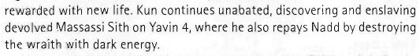

### Stat block notes (game mechanics, not feats)

- Kun and Nadd: The father of a half century of bloodshed, Exar Kun was the prized Padawan of Master Vodo-Siosk Baas, until his arrogance drove him to study under the Sith spirit of Freedon Nadd. Nadd nearly kills Kun by luring him to a Sith mausoleum and collapsing it. Crushed to near-death, Kun opens his heart to the dark side and is rewarded with new life. Kun continues unabated, discovering and enslaving devolved Massassi Sith on Yavin 4, where he also repays Nadd by destroying the wraith with dark energy. (Source: *Knights of the Old Rebuplic Campaign Guide* (SWRPG Saga Edition), scan p.154)
- "Because of you, the Sith will never die": However, Kun knows Nadd has been mentoring other Sith hopefuls. Tracking them down, he finds the dark side-embattled Jedi Ulic Qel-Droma, and as their lightsabers clash, an ancient Sith Lord appears to them across time. Branding Kun with the mark of a Dark Lord and Qel-Droma with that of a Shadow Hand, he declares, "Exar Kun, because of you, the Sith will never die." With that, the Great Sith War begins. (Source: *Knights of the Old Rebuplic Campaign Guide* (SWRPG Saga Edition), scan p.154)
- Great Sith War and Kun's end: Kun and Qel-Droma devastate the Republic. While Qel-Droma secures the allegiance of Krath dark side followers and the Mandalorians, Kun converts Jedi to the Brotherhood of the Sith. This commune of evil brings destruction from Coruscant's Senate Hall to Ossus's ancient Jedi Library, and unleashes the murderous Dark Reaper superweapon. However, when Qel-Droma loses his nerve, he leads the Jedi straight to Kun on Yavin 4. Unyielding, Kun drains the life energies of his Massassi to assure his essence lives beyond death. The Jedi launch a salvo of light side energy at the planet, trapping Kun's spirit there, but ravaging Yavin 4 in the process. (Source: *Knights of the Old Rebuplic Campaign Guide* (SWRPG Saga Edition), scan p.154)
- Tapani Day assassinations: So when the Great Sith War erupts, the young cutthroat Mecrosa matron High Lady Brezwalt III, part of a dynasty of Mecetti rulers of the Tapani Empire, brazenly endeavors to seize control of half the sector. During Tapani Day festivities, her Sith assassins attempt simultaneous assassinations of five of the eight rival house leaders, including Reena, Pelagia, Melissus, Calipsa, and Barong. Of these, only Pelagia foils the plot, while Houses Calipsa, Melissus, Barong, and a clump of Reena are absorbed into Mecetti Province. The Mecrosa Order, long a mere myth, now brutally showcases its reality. (Source: *Knights of the Old Rebuplic Campaign Guide* (SWRPG Saga Edition), scan p.154)

## scan p.155 (scan page 155)

Page contents: High Lady Brezwalt III (Restoration) stats (Human noble 7/Force adept 5/Sith Lord 4, CL 16; lightfoil; Sith Alchemy); Darth Revan, Prodigal Knight bio begins. (hand-read)

### Stat block notes (game mechanics, not feats)

- Cleansing of the Nine Houses: At last, Houses Pelagia and Melantha beg for Republic intervention, but with Exar Kun's war intensifying, no help comes. Sith Lady Brezwalt III stands poised to transform Tapani Sector into the Mecetti Empire, until Pelagian Jedi Shadows turn the tables. Infiltrating every Mecrosa chapter, the Jedi double agents wait. Then, when Kun is defeated, the Shadows spring their trap and the Jedi Order pounces. In this event, known as the Cleansing of the Nine Houses, Jedi Knights destroy the Mecrosa Order, and Mecetti nobles, anxious to save face, turn against Lady Brezwalt. (Source: *Knights of the Old Rebuplic Campaign Guide* (SWRPG Saga Edition), scan p.155)
- Revan's training: The early life of the rebellious Revan is shrouded in mystery. What is known is that his power blooms during the Restoration under Jedi Master Kreia, whose controversial tutelage significantly impacts Revan's thinking. Revan eventually passes from Padawan to Jedi Knight, but he seeks out other masters to round out his education, including the Twi'lek Zhar Lestin, under whom Revan apprentices alongside another Jedi: his future Sith cohort Malak. (Source: *Knights of the Old Rebuplic Campaign Guide* (SWRPG Saga Edition), scan p.155)
- Revan defies the Council: These distinct Jedi ideologies collide when the Mandalorians invade the Republic. Revan advocates revanchism—the retaking of territories lost to the invaders—but the Council staunchly opposes involvement. For Revan, sitting idly while the Republic took on the Mandalorian juggernaut is unthinkable. Consulting with Master Kreia, he makes up his mind to openly defy the Council. (Source: *Knights of the Old Rebuplic Campaign Guide* (SWRPG Saga Edition), scan p.155)
- Jedi crusade: As Jedi—such as his loyal friend Malak—flock to Revan's flag, the council warns that their aggressions could transform them into the very conquerors they fought. The moral lines are already blurring as Revan adopts Mandalorian Crusader rhetoric, calling his own cause a "Jedi crusade." The Force seems with Revan, however, as his Jedi beat the enemy back. Soon, the Republic military cedes control to Revan, without regret. After three long years, Revan vanquishes the Mandalorians' chieftain in single combat and shatters their navy. (Source: *Knights of the Old Rebuplic Campaign Guide* (SWRPG Saga Edition), scan p.155)
- Return as Sith: The Republic rejoices. Instead of joining the revelry, however, Revan and Malak vanish into unknown space, where Mandalorians supposedly linger. In truth, they have gone in search of Sith dogma and the Rakatan Star Forge Superweapon. One year later, they return. As the Council warned, the revanchist has become a conqueror. Darth Revan and Darth Malak now head a Sith Empire bent on conquest, and the Jedi meet their wayward son head on. (Source: *Knights of the Old Rebuplic Campaign Guide* (SWRPG Saga Edition), scan p.155)
- Revan captured and redeemed: The Jedi Civil War initially favors Revan, who wisely tries keeping the infrastructures of the Jedi and Republic intact, but his luck soon runs out. Betrayed by a power-hungry Malak, Revan is captured by Bastila Shan's Jedi strike team. His memories are then temporarily erased with the Force, and he is sent out as a Jedi sleeper to locate the Star Forge shipyard. Alongside Bastila, Revan does just that, forming an intimate bond with his captor and saving her from the dark side. In a bitter reunion, he also confronts Malak aboard the Star Forge and does away with his long-time friend and former apprentice. Yet, after the war, other memories haunt Revan. He strikes out for the Rim alone, searching for what he believes is the true Sith menace. (Source: *Knights of the Old Rebuplic Campaign Guide* (SWRPG Saga Edition), scan p.155)

## scan p.156 (scan page 156)

Page contents: Caption "DARTH REVAN DOES NOT TAKE FAILURE LIGHTLY"; Darth Revan (Jedi Civil War) stats (Human Jedi 7/Jedi Knight 5/Sith apprentice 3/Sith Lord 5, CL 20; feats incl. Triple Attack, Dual Weapon Mastery I; Darth Revan's armor); Darth Malak, Sith Magnus bio begins. (hand-read)

### Stat block notes (game mechanics, not feats)

- Alek rebels: Darth Malak was not always a model Dark Lord. He was once a compassionate Jedi Knight. In fact, Republic citizens' sufferings so move the young Jedi Alek Squinquargesimus during the Mandalorian Wars that he rebels—along with his good friend Revan—against the Jedi Council's decree of inaction. The young Jedi helps recruit thousands of Jedi to spearhead the war against the Mandalorians, and they drive back the invaders. (Source: *Knights of the Old Rebuplic Campaign Guide* (SWRPG Saga Edition), scan p.156)
- Alek understands the dark side: Just as he intends, Alek saves the galaxy. Victorious against the Mandalorians, he realizes that all his efforts may be for naught if a strong hand does not steer the galaxy. In actuality, besides himself, he knows he can trust only the soldiers he had fought alongside, because they are capable defenders. Sharing these thoughts with Revan, Alek finds his brother-in-arms agrees. Now Alek understands the dark side. It is named from ignorance: the ignorance of never having killed, of never having ordered friends to their deaths, of always thinking today is your day to die—all for cowards unwilling to fight for their own safety—and ignorance of what it means to wield so much power. Revan, of course, understands completely. (Source: *Knights of the Old Rebuplic Campaign Guide* (SWRPG Saga Edition), scan p.156)

## scan p.157 (scan page 157)

Page contents: Darth Malak (Jedi Civil War) stats (Human Jedi 7/Jedi Knight 5/Sith apprentice 4/Sith Lord 4, CL 20; Dominate Mind; Sith alchemical war sword; Darth Malak's armor); Darth Bandon, Sith Shadow Hand bio and stats begin (Human Jedi 7/Sith apprentice 3, CL 10). (hand-read)

- **Revan; Darth Malak** — entry/section: Knights of the Old Republic Campaign Guide (Saga): "The Republic conquest initially goes well, but in time, Malak sees Lord Revan as soft, resulting in a tension that culminates in a lightsaber duel; Malak loses his lower jaw to Revan's blade, necessitating a metallic jaw guard." Source: *Knights of the Old Rebuplic Campaign Guide* (SWRPG Saga Edition), scan p.157
  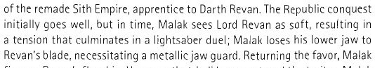
- **Darth Bandon; Revan** — entry/section: Knights of the Old Republic Campaign Guide (Saga): "With two dark side cronies in tow, Bandon confronts Revan but is killed by the former Sith Lord." Source: *Knights of the Old Rebuplic Campaign Guide* (SWRPG Saga Edition), scan p.157
  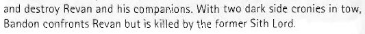
- **Revan; Darth Malak; Darth Bandon**: "As Revan grows more powerful, Darth Malak orders Darth Bandon to seek out and destroy Revan and his companions." Source: *Knights of the Old Rebuplic Campaign Guide* (SWRPG Saga Edition), scan p.157
  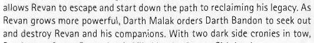

### Stat block notes (game mechanics, not feats)

- Malak's jaw and betrayal: Alek then becomes Darth Malak of the remade Sith Empire, apprentice to Darth Revan. The Republic conquest initially goes well, but in time, Malak sees Lord Revan as soft, resulting in a tension that culminates in a lightsaber duel; Malak loses his lower jaw to Revan's blade, necessitating a metallic jaw guard. Returning the favor, Malak fires on Revan's flagship. Unaware that Jedi have captured the traitor, Malak assumes the crown of ruling Dark Lord, inheriting the empire. With Admiral Saul Karath, Malak's fleet spreads terror, and he cultivates Darth Bandon and Bastila Shan as his pupils. However, Malak faces Revan again, this time as a reconditioned Jedi. In the rematch, Malak's twisted dream of protecting the galaxy dies with him. (Source: *Knights of the Old Rebuplic Campaign Guide* (SWRPG Saga Edition), scan p.157)
- Bandon defects: Bandon chafes under his Jedi Master, who aims to curb his natural anger and hatred. So when a mighty Sith Empire assaults Republic space, Bandon flees the repressive Jedi Order. Unleashing his cruelty within the Sith hierarchy, he immediately sparks interest from Darth Malak. Once Malak controls the Sith Empire, he makes Bandon his Sith apprentice. (Source: *Knights of the Old Rebuplic Campaign Guide* (SWRPG Saga Edition), scan p.157)
- Bandon's death: The bloodthirsty Darth Bandon wastes no time in building a double-bladed Sith lightsaber resembling that of Exar Kun, using it to impale a score of his former Jedi allies. Growing arrogant, Bandon inevitably sets his sights on Malak's mantle. But when Bandon kills the common Republic soldier Trask Ulgo, who sacrifices himself to save Revan after his Jedi reconditioning, the cocksure Bandon never imagines it will be the death of him. Ulgo's sacrifice allows Revan to escape and start down the path to reclaiming his legacy. As Revan grows more powerful, Darth Malak orders Darth Bandon to seek out and destroy Revan and his companions. With two dark side cronies in tow, Bandon confronts Revan but is killed by the former Sith Lord. (Source: *Knights of the Old Rebuplic Campaign Guide* (SWRPG Saga Edition), scan p.157)

## scan p.158 (scan page 158)

Page contents: Caption "ADMIRAL SAUL KARATH, TRAITOR TO THE REPUBLIC"; Darth Bandon stats conclude (Darth Bandon's fiber armor); Admiral Saul Karath bio and stats (Human soldier 5/noble 3/ace pilot 1/officer 7, CL 16). (hand-read)

### Stat block notes (game mechanics, not feats)

- Karath's early career: Corellian-born Saul Karath comes from tough working-class beginnings—made all the tougher when the Great Sith War turns his life upside down. The Navy provides a means of escape. Starting as a noncommissioned crewman, Karath serves as steward for Great Sith War naval hero Orley Vanicus—beginning a career that sees him trying nearly every duty aboard a starship at least once. He grows into a talented pilot and an even better tactician, known for acting on quality snap judgments. (Source: *Knights of the Old Rebuplic Campaign Guide* (SWRPG Saga Edition), scan p.158)
- Reciprocity, Courageous, Swiftsure: His skills for dealing with bureaucracy are less developed, with numerous setbacks in his career. But his remarkable ability to rebound allows him to survive and thrive. On Reciprocity, he finds success protecting convoys against pirates; later, as captain and then admiral on Courageous and Swiftsure, he leads the defense against the Mandalorians. The Navy, for Karath, is family. (Source: *Knights of the Old Rebuplic Campaign Guide* (SWRPG Saga Edition), scan p.158)
- Karath's betrayal: But when Darth Revan strikes, that family is shaken, and Karath makes his ultimate gamble to save it. Faced with the loss of his forces and command, Karath betrays the Republic, bringing Leviathan and other ships to the Sith, and devastating his protégé, Carth Onasi. The move is the greatest of ironies for Karath, who had mistrusted Jedi since the Sith War. Earlier, in the Mandalorian Wars, Karath immediately—and incorrectly—assumes on scant evidence that Zayne Carrick is a Mandalorian spy; other Jedi received similarly icy receptions. (Source: *Knights of the Old Rebuplic Campaign Guide* (SWRPG Saga Edition), scan p.158)
- "War's a funny thing": Karath initially hopes the disappearance of Revan from the scene would improve matters, but he soon finds that serving Malak is no easier. But as the highest-ranking official in Malak's service, he is not about to abandon his post. The preservation of his beloved Navy, and his status within it, overrules all other concerns. As he puts it, "War's a funny thing. It makes you do things you never thought you'd do." (Source: *Knights of the Old Rebuplic Campaign Guide* (SWRPG Saga Edition), scan p.158)

## scan p.159 (scan page 159)

Page contents: Caption "DARTH TRAYA, MASTER OF KINETIC COMBAT"; Darth Traya (Dark Wars) stats begin (Human Jedi 7/Jedi Knight 5/Jedi Master 5/Sith Lord 3, CL 20; Trakata, Triple Attack, Triple Crit). (hand-read)

- **Kreia** — entry/section: Knights of the Old Republic Campaign Guide (Saga): "Traya uses vast telekinetic powers to wield a trio of lightsabers against her, but she is ultimately killed by the person she considered her greatest disciple." Source: *Knights of the Old Rebuplic Campaign Guide* (SWRPG Saga Edition), scan p.159
  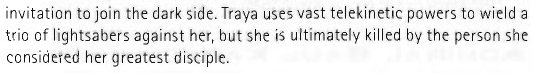
- **Kreia**: "As master to the galaxy's savior and its destroyers, Darth Traya seems a paradox." Source: *Knights of the Old Rebuplic Campaign Guide* (SWRPG Saga Edition), scan p.159
  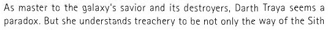
- **Kreia**: "This Sith Triumvirate is launched from Malachor V, intending to wipe out Traya's Jedi betrayers." Source: *Knights of the Old Rebuplic Campaign Guide* (SWRPG Saga Edition), scan p.159
  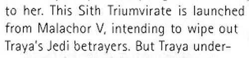
- **Darth Sion; Darth Nihilus; Kreia; Meetra Surik; Revan**: "As Sion and Nihilus unwittingly aid her by carrying out a massive assassination campaign against the Jedi, Traya seeks the Jedi Exile, Revan's old general, who had been severed from the Force." Source: *Knights of the Old Rebuplic Campaign Guide* (SWRPG Saga Edition), scan p.159
  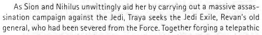
- **Meetra Surik; Kreia**: "In the Jedi Exile, who had wounded the Force at Malachor V, Traya believes she has found a way to destroy all traitors, including the Force itself." Source: *Knights of the Old Rebuplic Campaign Guide* (SWRPG Saga Edition), scan p.159
  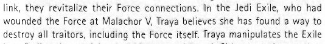
- **Kreia; Meetra Surik**: "Traya manipulates the Exile into finding the surviving Jedi Masters and Traya's Sith apprentices so that Traya can destroy them." Source: *Knights of the Old Rebuplic Campaign Guide* (SWRPG Saga Edition), scan p.159
  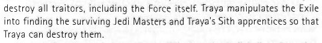

### Stat block notes (game mechanics, not feats)

- Kreia's conundrums: Before becoming a Sith, Kreia is a Jedi Master. A mystic and historian, her unused eyesight lies fallow as she relies on marathon meditations to penetrate the universe's mysteries. For decades, Kreia challenges her Padawans with difficult questions. "If a lightsaber loses its power, is it still a lightsaber?" she would ask. "And if a Jedi loses her powers, is she still a Jedi?" Her peers consider "Kreia's conundrums" quaint, but her Knights-in-training are spellbound. However, when Kreia's former students follow her one-time Padawan Revan to battle the Mandalorians, her rhetoric is denounced by Master Atris and the Jedi Council. (Source: *Knights of the Old Rebuplic Campaign Guide* (SWRPG Saga Edition), scan p.159)
- Trayus Academy: Kreia silently withdraws from the Jedi. Some believe she too has followed Revan, but she traces her Padawan's footsteps in a different way. Kreia is drawn to the Force echoes at Malachor V. Within its Trayus Academy, she encounters assassins left by Darth Revan, but instead of attacking, they present her with Sith hermetica. "The truths of the cosmos," these writings intimated, "are not intended for the sane." Intrigued, Kreia scours the texts through the Force, suspecting their authors were in fact pureblooded descendants of the Sith people. (Source: *Knights of the Old Rebuplic Campaign Guide* (SWRPG Saga Edition), scan p.159)
- Sith Triumvirate: Traya begins hunting Force-wounds, thus discovering and allying with the ghastly Darth Nihilus and monstrous Darth Sion. Coming to the Sith Empire's remnants as Revan's master, the remaining troopers also pledged their loyalty to her. This Sith Triumvirate is launched from Malachor V, intending to wipe out Traya's Jedi betrayers. But Traya underestimates her disciples' depravity. They turn on her and drain her Force powers. (Source: *Knights of the Old Rebuplic Campaign Guide* (SWRPG Saga Edition), scan p.159)
- Traya and the Exile: As Sion and Nihilus unwittingly aid her by carrying out a massive assassination campaign against the Jedi, Traya seeks the Jedi Exile, Revan's old general, who had been severed from the Force. Together forging a telepathic link, they revitalize their Force connections. In the Jedi Exile, who had wounded the Force at Malachor V, Traya believes she has found a way to destroy all traitors, including the Force itself. Traya manipulates the Exile into finding the surviving Jedi Masters and Traya's Sith apprentices so that Traya can destroy them. (Source: *Knights of the Old Rebuplic Campaign Guide* (SWRPG Saga Edition), scan p.159)
- Traya's death: At last, Traya reveals herself as a Sith, but the Jedi Exile refuses her invitation to join the dark side. Traya uses vast telekinetic powers to wield a trio of lightsabers against her, but she is ultimately killed by the person she considered her greatest disciple. (Source: *Knights of the Old Rebuplic Campaign Guide* (SWRPG Saga Edition), scan p.159)

## scan p.160 (scan page 160)

Page contents: Darth Traya stats conclude; Darth Sion, Lord of Pain bio; caption "DARTH SION HAS VANQUISHED MANY JEDI FOES". (hand-read)

- **Revan; Kreia; Darth Sion** — entry/section: Knights of the Old Republic Campaign Guide (Saga): "Surviving the Sith backstabbing following the Jedi Civil War, Sion’s abilities draw the eye of Revan's former master, the powerful Darth Traya." Source: *Knights of the Old Rebuplic Campaign Guide* (SWRPG Saga Edition), scan p.160
  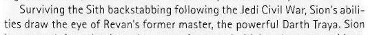
- **Darth Sion**: "Inevitably, probability has its day and Sion is struck down." Source: *Knights of the Old Rebuplic Campaign Guide* (SWRPG Saga Edition), scan p.160
  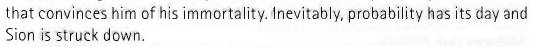
- **Darth Sion**: "And as he locks eyes with his attacker, Sion lets all his anger for being killed—all the hatred clotting his heart—explode." Source: *Knights of the Old Rebuplic Campaign Guide* (SWRPG Saga Edition), scan p.160
  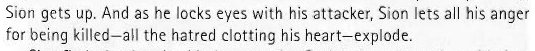
- **Darth Sion**: "Sion finds that keeping his decomposing flesh tethered together with dark side energy is inexplicably painful, and requires endless concentration on the rage that festers inside him—but immortality is immortality." Source: *Knights of the Old Rebuplic Campaign Guide* (SWRPG Saga Edition), scan p.160
  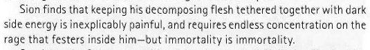
- **Darth Sion**: "It causes his intense hatred to flag, threatening his tenuous hold on life, so Sion decides to destroy the woman responsible for this weakness." Source: *Knights of the Old Rebuplic Campaign Guide* (SWRPG Saga Edition), scan p.160
  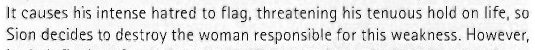
- **Meetra Surik**: "However, in their final confrontation, the Jedi Exile convinces the Dark Lord to release himself from his enslaving hatred." Source: *Knights of the Old Rebuplic Campaign Guide* (SWRPG Saga Edition), scan p.160
  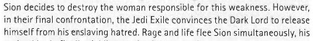

### Stat block notes (game mechanics, not feats)

- Lord of Pain is born: Hatred. Since time immemorial, Sion—possibly his given name—clotted his heart with hatred. Like all people, Sion was susceptible to infirmity of every kind—physical, emotional, mental—and, like all people, Sion suffered each of these to a degree that to another might not seem extraordinary, but which their sufferer might rightly term intolerable. Like all people, Sion was faced with the choice to endure his unspeakable pain as one more nameless person among many, or to imbue his suffering with the true but hollow uniqueness entitled the individual sufferings of all people. He chose the latter, and Darth Sion, Lord of Pain, was born. (Source: *Knights of the Old Rebuplic Campaign Guide* (SWRPG Saga Edition), scan p.160)
- Sion's death and survival: As a marauder for the Sith Empire during the Great Sith War, Sion flings himself at the Jedi, seeking death, but instead, he finds the opposite. Regularly surviving the frontline pandemonium, Sion acquires a pain tolerance that convinces him of his immortality. Inevitably, probability has its day and Sion is struck down. Yet death does not come for Darth Sion, and each centimeter of his failing body comes alive with anguish, multiplying that infinitely distant point of pain one thousandfold until his brain threatens to collapse. Improbably, Sion gets up. And as he locks eyes with his attacker, Sion lets all his anger for being killed—all the hatred clotting his heart—explode. (Source: *Knights of the Old Rebuplic Campaign Guide* (SWRPG Saga Edition), scan p.160)
- Sion severs Traya's hand: Surviving the Sith backstabbing following the Jedi Civil War, Sion's abilities draw the eye of Revan's former master, the powerful Darth Traya. Sion learns much from the shrew, but grows frustrated with her abstract teachings. He conspires with Darth Nihilus to strip her powers and eventually severs Traya's hand. Sion embarks on a Jedi-assassination spree, "dying" many more times, but always ending more enemy lives. (Source: *Knights of the Old Rebuplic Campaign Guide* (SWRPG Saga Edition), scan p.160)
- Sion's end: One Jedi especially gets underneath Sion's decrepit skin. The Jedi Exile proves remarkably resilient. Sion feels an alien feeling bud within him: not respect for the female Jedi, not admiration, but an emotion quite intolerable. It causes his intense hatred to flag, threatening his tenuous hold on life, so Sion decides to destroy the woman responsible for this weakness. However, in their final confrontation, the Jedi Exile convinces the Dark Lord to release himself from his enslaving hatred. Rage and life flee Sion simultaneously, his undead body finally yielding to absolute necrosis. (Source: *Knights of the Old Rebuplic Campaign Guide* (SWRPG Saga Edition), scan p.160)

## scan p.161 (scan page 161)

Page contents: Darth Sion (Dark Wars) stats (Human soldier 7/Sith apprentice 7/Sith Lord 5, CL 19; Dark Healing Field, Improved Dark Healing, Severing Strike); Darth Nihilus, Lord of Hunger bio; Darth Nihilus (Dark Wars) stats begin (Human Dark Side Aberration soldier 7/Sith apprentice 7/Sith Lord 5, CL 19). (hand-read)

### Stat block notes (game mechanics, not feats)

- Nihilus's hunger: Victim of the Mandalorian Wars, the man who became Nihilus lost everything: his possessions, his loved ones, and the will to live. While illness cannibalizes his body, a vast emptiness devours his humanity. Then, when all seems lost, he discovers that his emptiness hungered. The first time, he fed it unconsciously. Draining another being's life is frightening, nauseating, but for a euphoric moment, the memories, the illness, and the hunger disappeared. (Source: *Knights of the Old Rebuplic Campaign Guide* (SWRPG Saga Edition), scan p.161)
- Nihilus becomes the hunger: Darth Traya indeed teaches the newly christened Darth Nihilus to harness his life-draining gift to radical heights—so effectively, in fact, that Nihilus saps Traya's powers in a calculated double-cross. However, as Nihilus greedily consumes entire planets' life energy, the dark side macerates him even faster. But no matter. Nothing matters except his hunger. Before it devours him totally, Nihilus uses its power to displace his persona into his robes and armor. As his useless body disintegrates, he becomes living primitive intention; at last, the whole of the galaxy becomes food—for Nihilus has become the hunger. (Source: *Knights of the Old Rebuplic Campaign Guide* (SWRPG Saga Edition), scan p.161)
- Nihilus's fall: Ousting Traya with Darth Sion's help, Nihilus binges on the Force, nearly extinguishing the Jedi forever at Katarr. However, Traya reciprocates his betrayal by luring him into a confrontation with the Jedi Exile and Nihilus's own former apprentice. When Nihilus tries feeding on this Jedi, his hunger is mysteriously repelled, as if confronted by his exact polar opposite. Psychically starved by the effort, the Dark Lord falls to the Jedi, and Nihilus the man dissolves into oblivion. (Source: *Knights of the Old Rebuplic Campaign Guide* (SWRPG Saga Edition), scan p.161)

## scan p.162 (scan page 162)

Page contents: Darth Nihilus stats conclude; Starships: Interdictor-class warship (Leviathan prototype; Tactical Fire) and stats (CL 16); caption "AN INTERDICTOR-CLASS WARSHIP FIRES ON A PAIR OF FLEEING FORAY-CLASS BLOCKADE RUNNERS". (hand-read)

### Stat block notes (game mechanics, not feats)

- Leviathan: Only a single prototype, the Leviathan, comes out of the Corellian shipyards spaceworthy. To the Republic's regret, Admiral Saul Karath obtains command of the ship—and soon deserts for the Sith. (Source: *Knights of the Old Rebuplic Campaign Guide* (SWRPG Saga Edition), scan p.162)

## scan p.163 (scan page 163)

Page contents: Centurion-class battlecruiser (Ravager); caption "A WING OF CHELA-CLASS STARFIGHTERS LAUNCHES AN ATTACK ON A CENTURION-CLASS BATTLECRUISER". (hand-read)

- **Darth Nihilus**: "However, during the Dark Wars, the Sith Lord Darth Nihilus manages to resurrect one of the crushed battlecruisers from Malachor V, turning the wreck of the Ravager into a spaceworthy ghost ship." Source: *Knights of the Old Rebuplic Campaign Guide* (SWRPG Saga Edition), scan p.163
  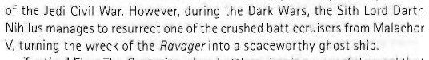

## scan p.164 (scan page 164)

Page contents: Derriphan-class battleship stats conclude. (hand-read)

- **Naga Sadow; Exar Kun**: "Though Sadow's ship, under Exar Kun's control, would eventually be destroyed at the conclusion of the war, knowledge of the ship's construction is handed down to a small number of Sith exiles who kept the secret of the ship's design." Source: *Knights of the Old Rebuplic Campaign Guide* (SWRPG Saga Edition), scan p.164
  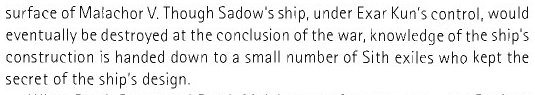
- **Revan; Darth Malak**: "When Darth Revan and Darth Malak return from the Unknown Regions and resurrect the Sith Empire, the exiles in possession of the plans for the Derriphan-class battleship turn the information over to Revan's forces." Source: *Knights of the Old Rebuplic Campaign Guide* (SWRPG Saga Edition), scan p.164
  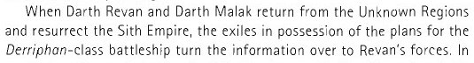

### Stat block notes (game mechanics, not feats)

- Sadow's ship raised: Though all of the Derriphan-class battleships were thought to be destroyed in the Great Hyperspace War, at least one survived. The ship, belonging to Naga Sadow, was buried on Yavin 4. During the Great Sith War, Exar Kun would raise the ship from the planet and put it back in to service, similar to the way that Darth Nihilus would raise the Ravager from the ruined surface of Malachor V. (Source: *Knights of the Old Rebuplic Campaign Guide* (SWRPG Saga Edition), scan p.164)

## scan p.165 (scan page 165)

Page contents: Herald-class shuttle description and stats (CL 11); Sith Interceptor description and stats (CL 5). (hand-read)

## scan p.166 (scan page 166)

Page contents: Droids: Sith assault droids — Czerka Corporation Mark I assault droid (CL 6) and Mark IV assault droid (CL 6). (hand-read)

## scan p.167 (scan page 167)

Page contents: Chapter XI: The Republic opener. (hand-read)

## scan p.168 (scan page 168)

Page contents: The Republic intro: before and after the Great Sith War (families Adasca, Zentine, Vanjervalis, Draay). (hand-read)

## scan p.169 (scan page 169)

Page contents: The Restoration (3,995–3,966 BBY; Commercial Protectorate Acts); The Mandalorian Wars (3,965–3,960 BBY); The Jedi Civil War (3,959–3,956 BBY); The Dark Wars (3,955–3,951 BBY). (hand-read)

- **Revan**: "His willingness to destroy the Republic's infrastructure is unlike the care Revan showed for preserving the worlds he conquered, and many battles mirror the mutually assured destruction so often seen in the Great Sith War." Source: *Knights of the Old Rebuplic Campaign Guide* (SWRPG Saga Edition), scan p.169
  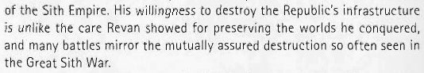
- **Revan**: "Revan's redemption breaks the Sith domination, but the citizens of the Republic see only hardships ahead." Source: *Knights of the Old Rebuplic Campaign Guide* (SWRPG Saga Edition), scan p.169
  

### Stat block notes (game mechanics, not feats)

- Commercial Protectorate Acts: The brainchild of economist Herron Morvis, the Coruscant Financial Exchange Establishment Act (the first of the so-called Commercial Protectorate Acts) restores the capital markets by making a simple bargain. Corporations listing their shares on the Coruscant Financial Exchange receive guarantees of protection on all trade routes within the Republic. (Source: *Knights of the Old Rebuplic Campaign Guide* (SWRPG Saga Edition), scan p.169)
- Taris accession: Even though it is improved, the Navy is too weak to protect such a distant world. Some, such as rising star Saul Karath, see the dangers, but the Admiralty, delighted with its additional funding, pays no heed. So when the Zayne Carrick affair causes civil order on Taris to collapse, the Mandalorians see their chance and launch a surprise invasion of the Republic. (Source: *Knights of the Old Rebuplic Campaign Guide* (SWRPG Saga Edition), scan p.169)
- Revan given command: A solid advantage in the Mandalorian Wars arrives only when a Jedi Knight calling himself Revan comes to the Republic's aid. Revan is so successful that the Republic yields operational control of its forces to him. (Source: *Knights of the Old Rebuplic Campaign Guide* (SWRPG Saga Edition), scan p.169)
- Karath turns traitor: Treachery is not limited to the Jedi. For many, the worst comes when Admiral Karath turns traitor, rupturing the Navy between loyal and Sith factions. (Source: *Knights of the Old Rebuplic Campaign Guide* (SWRPG Saga Edition), scan p.169)
- Malak's destruction: After a Jedi strike force captures the enemy commander, Darth Revan, and then sets him on a path of redemption, Darth Malak takes control of the Sith Empire. His willingness to destroy the Republic's infrastructure is unlike the care Revan showed for preserving the worlds he conquered, and many battles mirror the mutually assured destruction so often seen in the Great Sith War. (Source: *Knights of the Old Rebuplic Campaign Guide* (SWRPG Saga Edition), scan p.169)

## scan p.170 (scan page 170)

Page contents: Using the Republic; The Republic Navy (Joining the Navy, Life in the Navy, Naval Organization). (hand-read)

### Stat block notes (game mechanics, not feats)

- "Running a protection racket": The direct linkage between commerce and the Naval budget chafes the old-timers; Sith War veteran Orley Vanicus likens it to "running a protection racket." (Source: *Knights of the Old Rebuplic Campaign Guide* (SWRPG Saga Edition), scan p.170)
- Jack-of-all-trades: For those who serve as jacks-of-all-trades, such as Carth Onasi, the Navy offers a variety of experiences, from running spacelift missions for the Army to flying stealth starfighter patrols to trap pirates. (Source: *Knights of the Old Rebuplic Campaign Guide* (SWRPG Saga Edition), scan p.170)

## scan p.171 (scan page 171)

Page contents: Naval commissioned ranks (Admiral of the Fleet through Midships); caption "REPUBLIC TROOPERS HOLD POSITION AGAINST A SITH ONSLAUGHT"; The Republic Armies. (hand-read)

### Stat block notes (game mechanics, not feats)

- Karath's commission: Crew members can receive commissions on the recommendations of the Shipmaster or the ship's captain. Usually the result of years of service, this sometimes happens because of a crew member's act of heroism. Karath, who started as Vanicus's steward, followed that path. (Source: *Knights of the Old Rebuplic Campaign Guide* (SWRPG Saga Edition), scan p.171)
- Courageous: For example, Karath was captain of the Inexpugnable-class command vessel Courageous while waiting for his Merit Board to meet. (Source: *Knights of the Old Rebuplic Campaign Guide* (SWRPG Saga Edition), scan p.171)
- Karath's resignation rejected: Karath lost the Courageous after the battle of Serroco and resigned immediately on return to Coruscant; the Navy, mindful of his role in the encounter with Mandalore on the Arkanian Legacy, rejected his resignation and restored his command. (Source: *Knights of the Old Rebuplic Campaign Guide* (SWRPG Saga Edition), scan p.171)

## scan p.172 (scan page 172)

Page contents: Republic Armies (Ralltiir Corps, Graayson's Company); Joining Up; Army Organization (squad, battalion, brigade, corps); The Senate; Republic Personnel; Republic Naval Admiral description. (hand-read)

### Stat block notes (game mechanics, not feats)

- "We'd rather rent than own": Beyond the culture clash, which often manifests itself violently, the biggest expense of the Army—the vehicles hauled on ships—would be added to the Naval budget. "We'd rather rent than own," Admiral Veltraa once said. (Source: *Knights of the Old Rebuplic Campaign Guide* (SWRPG Saga Edition), scan p.172)
- Death on the Senate floor: It had met for years in ancient stonework chambers, but after Exar Kun kills Vodo Siosk-Baas on the Senate floor, Senators order the construction of a secure high-tech facility with no reminders of that fateful day. (Source: *Knights of the Old Rebuplic Campaign Guide* (SWRPG Saga Edition), scan p.172)
- Senators Graw and Goravvus: Some are lifetime appointments chosen by local potentates; others, such as Senator Graw of Ithor, face frequent trips home to stand for reelection. Thus, staffing for a Senator is not just a lucrative and educational experience for a young noble; it can also involve extensive travel. Senators from planets occupied during the Mandalorian Wars keep their seats, and some, such as Goravvus of Taris, actively organize resistance movements. (Source: *Knights of the Old Rebuplic Campaign Guide* (SWRPG Saga Edition), scan p.172)

## scan p.173 (scan page 173)

Page contents: Republic Navy Admiral stats (CL 15); Republic Navy Captain description and stats (CL 10). (hand-read)

### Stat block notes (game mechanics, not feats)

- Vanjervalis field tests: Occasionally, a captain with special experience is tapped to helm a larger vessel normally reserved for admirals; Karath, present at field tests of the Vanjervalis data systems, received Courageous while still waiting for his Merit Board to meet on his promotion to rear admiral. (Source: *Knights of the Old Rebuplic Campaign Guide* (SWRPG Saga Edition), scan p.173)

## scan p.174 (scan page 174)

Page contents: Republic Naval Lieutenant description and stats (CL 5); caption "LEFT TO RIGHT: REPUBLIC TROOPER, REPUBLIC PILOT, REPUBLIC OFFICER, REPUBLIC NAVAL OFFICER". (hand-read)

## scan p.175 (scan page 175)

Page contents: Republic Army Brigadier (CL 13); Republic Army Officer (CL 6); Republic Army Trooper description. (hand-read)

## scan p.176 (scan page 176)

Page contents: Republic Army Trooper (CL 1); Elite Republic Army Trooper (CL 2); Republic Army Recon Commando (CL 8). (hand-read)

## scan p.177 (scan page 177)

Page contents: Republic Personalities intro; Bao-Dur bio; sidebar "Bao-Dur's Cybernetic Arm" (Shield Breaker); Bao-Dur (Dark Wars) stats (Zabrak scoundrel 9, CL 9; feats incl. Flurry, Gearhead, Tech Specialist); Senator Haydel Goravvus bio begins. (hand-read)

### Stat block notes (game mechanics, not feats)

- Mass Shadow Generator: Bao-Dur is a highly talented inventor and technician. During the Mandalorian Wars, he serves with the Exile as a tech and refers to her as "General" even years after the war's end. He is responsible for creating the Mass Shadow Generator used to destroy Malachor V and end the Mandalorian Wars. However, the invention also kills a great number of his allies and own forces in the process. He does not escape without injury, losing most of his left arm in the battle. He builds himself an impressive new cybernetic replacement that features an energy binding instead of a mechanical elbow. (Source: *Knights of the Old Rebuplic Campaign Guide* (SWRPG Saga Edition), scan p.177)
- Bao-Dur's redemption: Bao-Dur is haunted for years by the outcome of Malachor V. He becomes a pacifist and attempts to redeem himself and repay his perceived debt to the galaxy. He ends up working in the rehabilitation efforts of Telos IV. There he once again encounters the General—now the Exile. He rejoins her, traveling with her in her quest for the Jedi and Sith. At the end of the Exile's quest, they return to Malachor V, where Bao-Dur programs his remote to reactivate the Mass Shadow Generator for a final time. (Source: *Knights of the Old Rebuplic Campaign Guide* (SWRPG Saga Edition), scan p.177)
- Corporate hatchet-man: Unable to gain a formal education, Goravvus spends his youth in the Lhosan Industries swoop bike factory in Machineville. Needing money during a labor action, the teenage Goravvus accepts payment from management to help break the strike, bringing him to the attention of corporate management. Such a wily, hungry young schemer is bound to go places. He does, and a corporate hatchet-man is born. Goravvus spends the next third of a century traveling the galaxy for Lhosan, undercutting regulations, blackmailing suppliers, and sabotaging competitors. The pinnacle of Goravvus's achievements—or so he thinks—comes when he helps Lhosan and other corporations use bribery to gain Taris's admission into the Republic. His reward: Taris's new Senate seat. (Source: *Knights of the Old Rebuplic Campaign Guide* (SWRPG Saga Edition), scan p.177)

## scan p.178 (scan page 178)

Page contents: Commander Carth Onasi bio begins. (hand-read)

### Stat block notes (game mechanics, not feats)

- Bao-Dur (Dark Wars): Saga CL 9 Medium Zabrak scoundrel 9 (Source: *Knights of the Old Rebuplic Campaign Guide* (SWRPG Saga Edition), scan p.178)
- Taris Resistance: But the Senate changes Goravvus for the better. This lifelong loner finds a family in the people of Taris. He openly challenges the business interests that put him in power, earning the scorn of Lhosan Chairbeing and former friend, Jervo Thalien. When civil order on Taris collapses, Goravvus disappears in shame, but the invasion of Taris by the Mandalorians offers a chance for redemption. In the Lower City, Goravvus organizes the remains of the planetary security force into the Taris Resistance. Goravvus's political skills are helpful as he forges an alliance with the Hidden Bek gang and blackmails aid from Thalien. When Taris ultimately falls, Goravvus escapes to the Republic, where the exiled Senator becomes a popular figure espousing the cause of people living on occupied worlds and providing funds for private efforts to rescue refugees. (Source: *Knights of the Old Rebuplic Campaign Guide* (SWRPG Saga Edition), scan p.178)
- Onasi joins the Navy: Carth Onasi's career path resembles that taken by his mentor, Saul Karath—which might explain the admiral's early fondness for this charismatic jack-of-all-trades. Born on Telos IV, Onasi works as both a mechanic and police officer before joining the local militia. When his heroics in a piracy sting bring him to the attention of a recruiter with the Republic Navy, he reluctantly leaves with his wife and son for a career in space. (Source: *Knights of the Old Rebuplic Campaign Guide* (SWRPG Saga Edition), scan p.178)
- Onasi frees Carrick: Onasi soon sees action, serving on the bridge of the Courageous during the Battle of Vanquo at the outbreak of the Mandalorian Wars. Now a lieutenant, he handles spacelift for the ground forces on Serroco, where he encounters fugitive Padawan Zayne Carrick. Believing Carrick's vision of impending planetary devastation, Onasi brings it to Karath's attention—only to discover that Karath suspects the boy of being a Mandalorian spy—and during a meeting on Adascorp's flagship, the Arkanian Legacy, Onasi frees Carrick. (Source: *Knights of the Old Rebuplic Campaign Guide* (SWRPG Saga Edition), scan p.178)

## scan p.179 (scan page 179)

Page contents: Caption "CARTH ONASI"; Carth Onasi (Jedi Civil War) stats (Human soldier 7/ace pilot 3, CL 10); Atton Rand bio. (hand-read)

- **Revan**: "After Revan defeats the Mandalorians and returns as the invading Darth Revan, Onasi again finds himself called to action." Source: *Knights of the Old Rebuplic Campaign Guide* (SWRPG Saga Edition), scan p.179
  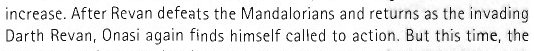

### Stat block notes (game mechanics, not feats)

- Telos bombed: The Mandalorian Wars continue for three years, during which Carth's skills increase. After Revan defeats the Mandalorians and returns as the invading Darth Revan, Onasi again finds himself called to action. But this time, the Navy is torn between loyalty to the Republic and service of the Sith—and, shockingly to Onasi, his one-time mentor Karath goes to the other side. Refusing to turn against the Republic, Onasi is further devastated when his homeworld is bombed by Karath. When his wife Morgana dies in his arms, Onasi—who believes his son, Dustil, to have also been killed—swears he will get revenge on his former friend and admiral. (Source: *Knights of the Old Rebuplic Campaign Guide* (SWRPG Saga Edition), scan p.179)
- Endar Spire: As the Jedi Civil War rages, Onasi—now a Commander—finds himself at the helm of the Endar Spire. Attacked by the Sith forces of Darth Malak above Taris, Onasi escapes alongside another Republic soldier, unaware that this new ally will lead him on an adventure that will change the galaxy and settle his score with Karath. (Source: *Knights of the Old Rebuplic Campaign Guide* (SWRPG Saga Edition), scan p.179)
- Atton Rand: Atton Rand is a veteran of both the Mandalorian Wars and the Jedi Civil War and at one time he was a member of the Republic military who defected to the Sith Empire. Atton Rand was trained during the Jedi Civil War to resist detection and manipulation through the Force, which allows him to remain free of Jedi influence. Atton encounters the Exile on Peragus and becomes an integral part of her efforts against the Sith Lords. He also harbors feelings for her, which often manifest as jealousy, especially toward Mical who is also an admirer, if from a different point of view. In fact, he regularly clashes with the Exile's companions throughout the journey. (Source: *Knights of the Old Rebuplic Campaign Guide* (SWRPG Saga Edition), scan p.179)

## scan p.180 (scan page 180)

Page contents: Atton Rand (Dark Wars) stats (Human scoundrel 3/soldier 2; Critical Strike, Sniper Shot); Armor: Republic light, combat, heavy armor; Table 11-1. (hand-read)

