# Owner Material 037 — Star Wars D20 Drive folder (Core, Revised Core and Saga Edition): Sourcebooks/Knights of the Old Rebuplic Campaign Guide.pdf [Star Wars Roleplaying Game Saga Edition (2007)] (scan pages 181–226)

- **Source:** Wizards of the Coast Star Wars Roleplaying Game books, web enhancements, Living Force campaign modules and articles (2000–2010), from the owner's "Star Wars D20" Drive folder (only the three edition subfolders; "General" was not read, as instructed). Secondary source (licensed Legends reference). Scan OCR'd on the box; the scan stays box-only and is **not** published.
- **Method:** every scanned page was OCR'd and machine-screened sentence by sentence for power-relevant statements (fights, kills, defeats, Force feats, rankings, superweapons) that name a character on our roster; each kept sentence is quoted verbatim from the OCR text and has a crop of the printed passage directly under it. Pages with nothing power-relevant are still listed with what is on them.
- **Citation:** "*Knights of the Old Rebuplic Campaign Guide* (SWRPG Saga Edition), p.X" by printed page ("scan p.X" where no printed number applies). **Weight:** Licensed RPG material: a secondary source. Narrative text sums up Legends lore; game statistics are rules for players, not canon power levels, and rank lowest.

## scan p.181 (scan page 181)

Page contents: Table 11-2 ranged weapons; remote grenade; commando special rifle; Starships intro; Aurek Tactical Strikefighter description; caption "A SITH INTERCEPTOR DOESN'T LAST LONG AGAINST THE AUREK TACTICAL STRIKEFIGHTER". (hand-read)

- **Saul Karath** — entry/section: Pull quote: ""THIS IS A NEW PHASE OF THE WAR. WE'RE GOING TO HAVE TO CHANGE HOW WE LOOK AT THINGS." —ADMIRAL SAUL KARATH" Source: *Knights of the Old Rebuplic Campaign Guide* (SWRPG Saga Edition), scan p.181
  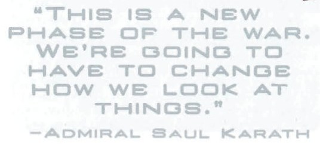

## scan p.182 (scan page 182)

Page contents: Aurek Tactical Strikefighter stats (CL 11); S-250 Chela-class starfighter (CL 10); Conductor-class short-haul landing craft description. (hand-read)

### Stat block notes (game mechanics, not feats)

- The Deadweight: For example, under Carth Onasi, the CXB-560 becomes The Deadweight. However, the ships can perform for a quality pilot, as Onasi shows in his rescue of Admiral Karath from the Courageous and later from the Arkanian Legacy. (Source: *Knights of the Old Rebuplic Campaign Guide* (SWRPG Saga Edition), scan p.182)

## scan p.183 (scan page 183)

Page contents: Zentine Dynamics Ministry-class orbital shuttle stats (CL 6); caption "A MINISTRY-CLASS ORBITAL SHUTTLE FLEES FROM TWO DAVAAB-TYPE MANDALORIAN STARFIGHTERS". (hand-read)

## scan p.184 (scan page 184)

Page contents: KT-400 military droid carrier (CL 6); Foray-class blockade runner (CL 15). (hand-read)

## scan p.185 (scan page 185)

Page contents: Hammerhead-class cruiser (CL 18); Inexpugnable-class tactical command vessel description (Courageous, Swiftsure). (hand-read)

### Stat block notes (game mechanics, not feats)

- Courageous and Swiftsure: One, Courageous, is helmed by then-Captain Karath at the Battle of Vanquo. Even though he loses the Courageous in the escape from Serroco, he helps Rendili/Vanjervalis incorporate the knowledge gained into the refit of Swiftsure, his next command, which would become the template for the entire production model. (Source: *Knights of the Old Rebuplic Campaign Guide* (SWRPG Saga Edition), scan p.185)

## scan p.186 (scan page 186)

Page contents: Caption "AN INEXPUGNABLE-CLASS TACTICAL COMMAND VESSEL IN FORMATION WITH THREE HAMMERHEAD-CLASS CRUISERS"; Inexpugnable-class stats (CL 19). (hand-read)

- **Carth Onasi** — entry/section: Pull quote: ""THE MILITARY'S LIKE LIFE. YOU GO WHERE IT TAKES YOU." —CARTH ONASI" Source: *Knights of the Old Rebuplic Campaign Guide* (SWRPG Saga Edition), scan p.186
  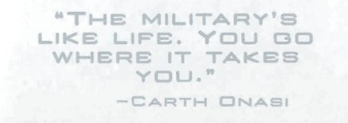

## scan p.187 (scan page 187)

Page contents: Chapter XII: The Mandalorians opener. (hand-read)

## scan p.188 (scan page 188)

Page contents: The Mandalorians intro (a movement, not a race). (hand-read)

### Stat block notes (game mechanics, not feats)

- Mandalore bested: Sensing an opportunity in the conflict between the Sith and the Republic, Mandalore the Indomitable directs his forces against the Empress Teta system, expecting to make an easy conquest. But fallen Jedi Ulic Qel-Droma bests the leader in single combat, an act which has immediate and long-term repercussions. As a term of the duel, the Mandalorian clans are obliged to swear allegiance to the Sith, joining them in their war against the Republic. Mandalore the Indomitable falls in battle and the Jedi eventually prevail, but for the Mandalorian warriors, the consequences linger long after the Sith War ends. (Source: *Knights of the Old Rebuplic Campaign Guide* (SWRPG Saga Edition), scan p.188)

## scan p.189 (scan page 189)

Page contents: Using the Mandalorians; Crusaders. (hand-read)

### Stat block notes (game mechanics, not feats)

- Neo-Crusaders: Soon, another leader rises with the name and mask of Mandalore. He calls upon the talents of advisors whose knowledge goes beyond the battlefield—Cassus Fett, Demagol, and others—to help him reshape Mandalorian identity. When an extremist cult calls for the reestablishment of the Crusader tradition, this Mandalore, "The Ultimate," uses that group as the foundation to reinvent the Mandalorian movement as a more disciplined, organized fighting force. (Source: *Knights of the Old Rebuplic Campaign Guide* (SWRPG Saga Edition), scan p.189)
- Dissidents silenced: Some see the cultivation of the "Neo-Crusaders" as a crass ploy, sacrificing Mandalorian tenets in the name of a larger goal. But dissidents are effectively silenced. When Rohlan Dyre risks his life to question the movement, Mandalore uses the warrior's fate as an example for not bucking authority. (Source: *Knights of the Old Rebuplic Campaign Guide* (SWRPG Saga Edition), scan p.189)
- Onslaught and defeat: Under the direction of Mandalore the Ultimate with the aid of Cassus Fett, the Mandalorians are successful in seizing countless worlds before a real defense can be mounted. ... When they finally fall to the Jedi Revan and his Republic forces at Malachor V, Mandalorians feel a new kind of shame. (Source: *Knights of the Old Rebuplic Campaign Guide* (SWRPG Saga Edition), scan p.189)
- Restoring the movement: The remaining Mandalorians, scattered and lacking in identity, face the Jedi Civil War and the tough years to follow. Some turn to crime. Others, such as Canderous Ordo, attempt to restore the Mandalorian movement to its original principles. (Source: *Knights of the Old Rebuplic Campaign Guide* (SWRPG Saga Edition), scan p.189)
- Canderous becomes Mandalore: Near the end of the Dark Wars, an honorable Mandalorian warrior named Canderous Ordo takes up the mantle of Mandalore and reunites the Mandalorians clans into one people again. Under his leadership, the clans restore much of their honor in helping defeat the last remaining Sith and begin establishing their place in the galaxy once more. (Source: *Knights of the Old Rebuplic Campaign Guide* (SWRPG Saga Edition), scan p.189)

## scan p.190 (scan page 190)

Page contents: Joining Up; the Resol'Nare (Six Actions), verbatim: "Baur, beskar'gom, / Ara'nov, aliit, / Mando'a bal Mand'alor— / An vencuyan mhi. // Education and armor, / Self-defense, our tribe, / Our language, our leader— / All help us survive."; dar'manda; Life in the Clans; caption "SOMETIMES EVEN JEDI ARE NO MATCH FOR MANDALORIANS". (hand-read)

## scan p.191 (scan page 191)

Page contents: Family and trade; Crusader Organization; The Neo-Crusaders (origins, "False War", Joining the Neo-Crusaders; dissident's phrase "put on a helmet and go"). (hand-read)

### Stat block notes (game mechanics, not feats)

- Fett refines the cult: Sensing an opportunity, Mandalore and aide-de-camp Cassus Fett encourage the movement. Cassus refines the one-time cult's organizational strategies for use on a larger scale—the big time, as it were. And it becomes big, indeed. The Mandalorians who first tested the Republic in the so-called "False War" find that they are at a distinct advantage with Neo-Crusaders as their vanguard. (Source: *Knights of the Old Rebuplic Campaign Guide* (SWRPG Saga Edition), scan p.191)
- Fett on Taris: On Taris, as on other worlds, Cassus Fett gives citizens a choice: join the Mandalorians as warriors, or sit quietly and work as manufacturers for the clans as de facto slaves. Many—including a host of criminals from the prisons the Mandalorians empty—go with the recruiters to planetary staging centers. (Source: *Knights of the Old Rebuplic Campaign Guide* (SWRPG Saga Edition), scan p.191)

## scan p.192 (scan page 192)

Page contents: Life as a Neo-Crusader; Neo-Crusader Organization (Neo-Crusader, Rally Master, Marshal); The Scattering; Mandalorian Personnel; Mandalorian Crusader description. (hand-read)

### Stat block notes (game mechanics, not feats)

- Armor colors: Neo-Crusader: The basic warrior, Mandalorian Neo-Crusaders wear identical blue armor. The color-coding, Cassus Fett contends, makes it easier for new recruits to recognize authority even when they do not speak Mando'a. ... Where the Crusaders had formed up around whatever warriors seemed to be most lethal—Rohlan was one—the Rally Masters are Mandalore the Ultimate's trusted lieutenants on the ground. (Source: *Knights of the Old Rebuplic Campaign Guide* (SWRPG Saga Edition), scan p.192)
- Gold armor: Neo-Crusader Marshal: Cassus Fett is among the first of Mandalore's top advisors to accept the gold-colored Neo-Crusader armor as an example that even those at the top should give up individualism. But the gold armor's value as a status symbol quickly deteriorates. Some, such as science advisor Demagol, refuse to take on the new appearance—and Mandalore the Ultimate soon distributes the golden armor as rewards to everyone from his personal vanguard to anyone who desires differentiation from the Rally Masters—all the way down to Demagol's own aides. Admitting defeat on this one point, Fett later argues for unique armors for the truly special—including himself. (Source: *Knights of the Old Rebuplic Campaign Guide* (SWRPG Saga Edition), scan p.192)

## scan p.193 (scan page 193)

Page contents: Caption "LEFT TO RIGHT: MANDALORIAN CRUSADER, NEO-CRUSADER, NEO-CRUSADER RALLY MASTER, NEO-CRUSADER SHOCK TROOPER"; Mandalorian Crusader stats (CL 3); Mandalorian Neo-Crusader description (hut'uun). (hand-read)

## scan p.194 (scan page 194)

Page contents: Neo-Crusader Rally Master stats (CL 6); Neo-Crusader Marshal description. (hand-read)

### Stat block notes (game mechanics, not feats)

- Golden marshal armor: Initially, the golden suits of marshals are reserved for a handful of Mandalore the Ultimate's closest advisors. Cassus Fett is one of the earliest to take on the armor, in a show of his support for the color-coded hierarchical system he helps to implement. But even before the assault on the Republic begins, Mandalore has begun to devalue the position, rewarding his personal vanguard with the gold-colored armor. (Source: *Knights of the Old Rebuplic Campaign Guide* (SWRPG Saga Edition), scan p.194)

## scan p.195 (scan page 195)

Page contents: Neo-Crusader Marshal stats (CL 10); Neo-Crusader Shock Trooper description (first seen boarding the Courageous; report to Cassus Fett) and stats (CL 5); Mandalorian Personalities intro; Bendak Starkiller bio begins. (hand-read)

### Stat block notes (game mechanics, not feats)

- Bendak in the mines of Vanquo: Born into a mining family, Gorse Bendak follows his forefathers into that rough trade, traveling from worksite to worksite on the Outer Rim. His last posting, however, changes his life forever. Bendak is deep in the mines at a worksite on the dayside of Vanquo when the Mandalorians invade the planet as part of their sneak attack on the Republic. Discovering the invaders above, Bendak remains holed up in the shafts, using mining implements to mount a makeshift—and deadly—personal defense. It takes two weeks and a dozen Mandalorians to finally bring Bendak to heel—and, sensing his abilities, they immediately offer to recruit him into their ranks. Seeing no alternative in slavery, Bendak agrees. (Source: *Knights of the Old Rebuplic Campaign Guide* (SWRPG Saga Edition), scan p.195)

## scan p.196 (scan page 196)

Page contents: Bendak Starkiller stats (Human soldier 8/scoundrel 1/gladiator 3, CL 12; customized heavy blaster pistol); Demagol bio begins; caption "DEMAGOL". (hand-read)

- **Revan**: "But when Revan's forces defeat the Mandalorians once and for all, Bendak is a warrior without an army." Source: *Knights of the Old Rebuplic Campaign Guide* (SWRPG Saga Edition), scan p.196
  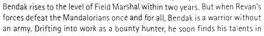
- **Galen Marek**: "Many citizens come to bet on Starkiller in the arena, where dozens of duelists meet their deaths against the warrior." Source: *Knights of the Old Rebuplic Campaign Guide* (SWRPG Saga Edition), scan p.196
  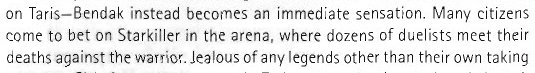

### Stat block notes (game mechanics, not feats)

- Field Marshal to bounty hunter: Bendak's career as a Mandalorian Neo-Crusader is brief but fruitful. The Mandalorians train him well in the ways of weaponry, and the fast study Bendak rises to the level of Field Marshal within two years. But when Revan's forces defeat the Mandalorians once and for all, Bendak is a warrior without an army. Drifting into work as a bounty hunter, he soon finds his talents in great demand. (Source: *Knights of the Old Rebuplic Campaign Guide* (SWRPG Saga Edition), scan p.196)
- Starkiller of the Taris arena: When Bendak accidentally kills the daughter of a nobleman, he finds himself with a huge bounty on his own head. Even though he does not fear death, Bendak is unable to work, so he turns to friend and employer Ajuur the Hutt. Ajuur encourages Bendak to don his old armor again and enter the gladiatorial rings of Taris, adding the stage name "Starkiller" to his own. Initially concerned about looking like a circus act—Mandalorians are hated on Taris—Bendak instead becomes an immediate sensation. Many citizens come to bet on Starkiller in the arena, where dozens of duelists meet their deaths against the warrior. Jealous of any legends other than their own taking root, the Sith forces that now rule Taris outlaw death matches. Irritated, Bendak Starkiller goes into retirement, still hoping for the day when a truly worthy opponent arrives. (Source: *Knights of the Old Rebuplic Campaign Guide* (SWRPG Saga Edition), scan p.196)

## scan p.197 (scan page 197)

Page contents: Demagol stats (noble 3/scoundrel 9/soldier 3, CL 15; Cybernetic Surgery, Surgical Expertise); Rohlan Dyre bio begins. (hand-read)

### Stat block notes (game mechanics, not feats)

- The flesh carver: Little is known in the Republic about the origins of "Doctor" Demagol, whose name is a contraction of the Mando'a phrase demar agol, "to carve flesh." More than happy to dirty his gloves in the biological study of his "research subjects," the so-called flesh carver is fastidious, preferring to remain inside his climate-controlled armor, his true face hidden from all. No one knows Demagol's species or planet of origin—much to the surprise of Republic investigators. (Source: *Knights of the Old Rebuplic Campaign Guide* (SWRPG Saga Edition), scan p.197)
- Dissecting Jedi: Demagol's most pernicious project involves Jedi. Demagol dismisses explanations of Jedi powers involving what he termed "the so-called Force" as superstitious claptrap. He further doubts the theories of his own assistant and sometime rival, Pulsipher, that Jedi and Sith powers arose from artifacts crafted by an ancient and mysterious science. Instead, Demagol seeks a biological explanation for the powers—through dissection. Jedi are kidnapped by Mandalorians on the Outer Rim and secretly delivered to Demagol's laboratory—a "visit to the doctor" from which they would never recover. (Source: *Knights of the Old Rebuplic Campaign Guide* (SWRPG Saga Edition), scan p.197)
- Demagol captured on Flashpoint: Later, during the "False War" that immediately preceded the Mandalorians' invasion of the Republic, Demagol sets up shop in the captured research station on Flashpoint. Captured Jedi, originally dispatched by Revan to scout the Mandalorian lines, are delivered to him. The Jedi would have lost their lives, but for Zayne Carrick, Gryph, and the Mandalorian deserter Rohlan Dyre. They capture Demagol and convince the Mandalorians that the scientist is dead. In fact, they intend to give Demagol to his one-time research subjects to return to Coruscant for questioning. But that tantalizing interrogation is not to be; the prisoner in the Jedi's care falls into a coma en route, drugged in an evident attempt to avoid questions forever. (Source: *Knights of the Old Rebuplic Campaign Guide* (SWRPG Saga Edition), scan p.197)
- Demagol and Fett: While active, Demagol enjoys a status within the clans that far outstrips his contributions as a warrior. He is believed to be a close confederate and advisor of Mandalore the Ultimate. Cassus Fett regards Demagol as a rival for Mandalore's attention, and Demagol has tweaked Fett by refusing to don Neo-Crusader armor. The devilish doctor is independent to a fault. (Source: *Knights of the Old Rebuplic Campaign Guide* (SWRPG Saga Edition), scan p.197)
- Rohlan's leadership: However others regard him, the only identity Rohlan ever seeks for himself is that of a competent warrior, and the warrior in spiked armor displays that competence time and again. Apart from fealty to Mandalore, the clans observe no hierarchy, but Mandalorians will follow a strong leader on the battlefield. Mandalorian warriors respect experience, clustering around veterans both to learn and to stay alive. Rohlan earns that respect, and over the years leads countless warriors into battle. (Source: *Knights of the Old Rebuplic Campaign Guide* (SWRPG Saga Edition), scan p.197)
- Rohlan questions: But as the Mandalorians' campaigns on the Outer Rim grow closer to Republic space, Rohlan begins to question the events surrounding him. The Neo-Crusader cultists he once ridiculed are in ascendance. Order is being imposed on the organic flow of Mandalorian life. And Mandalore the Ultimate's stratagems against the Republic seem to Rohlan to be too clever by half—deceptions not worthy of the Mando'ade. As with most conflicts in his life, Rohlan attacks this head-on, asking questions. When he fails to receive answers from Mandalore or his lieutenants, Rohlan decides to find out for himself. As soon as one raid is successfully completed, he slips away in search of answers. When his actions are discovered, he is captured and returned to the front—where he runs again. (Source: *Knights of the Old Rebuplic Campaign Guide* (SWRPG Saga Edition), scan p.197)

## scan p.198 (scan page 198)

Page contents: Rohlan Dyre stats (Human scoundrel 1/soldier 9/elite trooper 3, CL 13); Cassus Fett bio begins. (hand-read)

### Stat block notes (game mechanics, not feats)

- Demagol: Saga CL 15 Medium noble 3/scoundrel 9/soldier 3 (Source: *Knights of the Old Rebuplic Campaign Guide* (SWRPG Saga Edition), scan p.198)
- Rohlan fakes his death: The cycle continues until the Mandalorians invade the Republic in force, when chance brings Rohlan into the company of renegade Padawan Zayne Carrick. Joining in common cause, Zayne and Rohlan capture the demonic Mandalorian scientist Demagol on Flashpoint. In the process, Zayne helps Rohlan fake his own death before the Mandalorians, leaving him to continue his pursuit for truth. (Source: *Knights of the Old Rebuplic Campaign Guide* (SWRPG Saga Edition), scan p.198)
- "Rohlan the Questioner": Ironically, Mandalore the Ultimate twists the news of Rohlan's supposed demise into a legend in which "Rohlan the Questioner" proclaims that Mandalorians should never question authority. Thus, the curious warrior's efforts are corrupted into propaganda promoting the very uniformity he doubted. (Source: *Knights of the Old Rebuplic Campaign Guide* (SWRPG Saga Edition), scan p.198)
- Master tactician: As a tactician, Fett has few equals. He deals the Cathar a defeat so complete the scattered remnants of the species fear to speak of it for years. He helps engineer the "False War," a period of limited engagement with the Republic on the Outer Rim. In it, the Mandalorians feign weakness until the true strength of the rejuvenated Republic Navy can be determined. Fett also designs the Onslaught, the surprise invasion of the Republic along three fronts, taking advantage of a weakness created by Zayne Carrick's notorious escape from Taris. (Source: *Knights of the Old Rebuplic Campaign Guide* (SWRPG Saga Edition), scan p.198)
- Fett and the Neo-Crusaders: Where earlier Mandalorians had conquered systems without bringing them into the warrior fold, Fett gives the clans what they need to capitalize on their conquests. He finds a solution in the Neo-Crusaders, a fringe sect of warriors willing to trade individualism and independence for uniformity and order. Fett convinces Mandalore the Ultimate to embrace the cult, spreading its members among the clans to promote Neo-Crusader ideals. By the time the Mandalorians invade the Republic, a system is in place to quickly convert conquered peoples into new warriors for the cause. Fett even plays a role as a symbol for the system, donning golden Neo-Crusader armor for a time. (Source: *Knights of the Old Rebuplic Campaign Guide* (SWRPG Saga Edition), scan p.198)
- War Forges and Taris traffic: Fett also revolutionizes Mandalorian war production, setting up War Forges near the Neo-Crusaders' staging areas. These massive facilities on Jebble, Tarnith, and elsewhere quickly come online, ready to supply new Neo-Crusader armor and weapons to new recruits. Fett's strategic contributions also extend to relatively mundane matters. During the siege of Taris, the colossal logjam created by invasion forces, captured vehicles, and attempted escapees threatens to bog the Mandalorians down for months. Grasping the problem, Fett personally oversees traffic control from a headquarters in the former Jedi Tower—still finding time to lead a successful assault on the Taris Resistance. (Source: *Knights of the Old Rebuplic Campaign Guide* (SWRPG Saga Edition), scan p.198)
- Fett's family: Less is known of Fett personally. His peers are few, and friends fewer; he reportedly relishes the passing of perceived rivals Demagol and Pulsipher. Like many warriors, Cassus Fett has a family in the clans—including at least one son. But even though he shares the same surname as later famous Mandalorians, Jango and Boba Fett, historians have yet to establish the nature of their relationship, if any exists. (Source: *Knights of the Old Rebuplic Campaign Guide* (SWRPG Saga Edition), scan p.198)

## scan p.199 (scan page 199)

Page contents: Cassus Fett stats (Human noble 7/soldier 3/officer 7, CL 17); Mandalore the Indomitable bio. (hand-read)

- **Aleema Keto** — entry/section: Knights of the Old Republic Campaign Guide (Saga): "The simple nature of the great warrior is no match for Aleema's seductive voice." Source: *Knights of the Old Rebuplic Campaign Guide* (SWRPG Saga Edition), scan p.199
  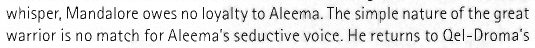
- **Cassus Fett** — entry/section: Pull quote: ""IT'S THE NOMAD'S CURSE. WE MOVE ON BEFORE WE'RE FINISHED." —CASSUS FETT" Source: *Knights of the Old Rebuplic Campaign Guide* (SWRPG Saga Edition), scan p.199
  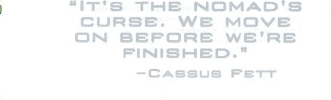

### Stat block notes (game mechanics, not feats)

- Rohlan Dyre: Saga CL 13 Medium Human scoundrel 1/soldier 9/elite trooper 3 (Source: *Knights of the Old Rebuplic Campaign Guide* (SWRPG Saga Edition), scan p.199)
- The Indomitable: Before the Great Sith War, a Taung warrior—whose original name is lost to history—rises through the clans to take the title. Mythosaur axe in hand, this Mandalore—called the "Indomitable" by his people for his fighting spirit—leads the Mando'ade on many successful campaigns. He is peerless when it comes to inspiring his troops, and his overly simplistic view of galactic affairs suits the Crusader consciousness well. (Source: *Knights of the Old Rebuplic Campaign Guide* (SWRPG Saga Edition), scan p.199)
- The wager at Empress Teta: Sensing an opportunity in a galaxy torn by strife, the Indomitable brings his forces to the Empress Teta system, then controlled by the fallen Jedi Ulic Qel-Droma and his Krath ally Aleema Keto. There, Mandalore challenges Qel-Droma to single combat—offering not only his allegiance, but also that of all the clans if he fails to emerge victorious. Qel-Droma wins the battle, and true to his word, Mandalore kneels before the dark Jedi. (Source: *Knights of the Old Rebuplic Campaign Guide* (SWRPG Saga Edition), scan p.199)
- Foerost, Coruscant, and the end: At Qel-Droma's side, the Indomitable commands Mandalorian forces against the shipyards at Foerost and other targets. And alongside Aleema, he leads an abortive invasion of Coruscant. But he fails to comprehend the treacherous game going on between his new masters. When Aleema betrays Qel-Droma, Mandalore sneaks off to find and warn the dark Jedi—but not before making sure that Aleema's orders are carried out to the letter. His honor will not allow him to do otherwise—even though, as some in the clans whisper, Mandalore owes no loyalty to Aleema. The simple nature of the great warrior is no match for Aleema's seductive voice. He returns to Qel-Droma's service, meeting his fate, like many others, in the Sith War's chaotic end. (Source: *Knights of the Old Rebuplic Campaign Guide* (SWRPG Saga Edition), scan p.199)

## scan p.200 (scan page 200)

Page contents: Mandalore the Indomitable stats (Near-Human noble 7/soldier 8/elite trooper 4, CL 19; Mythosaur axe); Mandalore the Ultimate bio; caption "MANDALORE THE INDOMITABLE (LEFT) AND MANDALORE THE ULTIMATE (RIGHT)". (hand-read)

### Stat block notes (game mechanics, not feats)

- The Ultimate's coterie: Seeking to cleanse the stain of the clans' servitude to Ulic Qel-Droma, the Ultimate surrounds himself with a coterie of able and deadly individuals, including Cassus Fett and Demagol. Cultivating the fringe Neo-Crusader movement into a key regulative element of his forces, the Ultimate sets his people on a course of conquest. (Source: *Knights of the Old Rebuplic Campaign Guide* (SWRPG Saga Edition), scan p.200)
- The False War: First, he leads the clans to victories against nonaligned worlds on the Outer Rim, never threatening the Republic's interests. But thereafter, Mandalore maneuvers the Republic into a series of small proxy and brushfire wars, harassing border resource worlds. He holds back the full force of the Mando'ade during this "False War," waiting until the time is ripe to invade in force. The strategy is an overwhelming success—although the un-Mandalorian nature of the approach raises questions from some, including the warrior Rohlan Dyre. (Source: *Knights of the Old Rebuplic Campaign Guide* (SWRPG Saga Edition), scan p.200)
- "Politics is simply the continuation of war by other means": Time and again, the Ultimate displays a cunning willingness to use "soft weaponry," as he calls it, alongside the deadlier implements of war. After Rohlan's disappearance, the wily Mandalore spins the warriors doubts into a legend promoting the acceptance of his own authority. Mandalore personally attends Lord Adasca's secret summit meeting in an attempt to lure part of the Republic's power base to his own cause. His skillful arguments, playing upon fissures between the Jedi and the Republic, draws the surprise of those present. "Politics is simply the continuation of war by other means," he says. (Source: *Knights of the Old Rebuplic Campaign Guide* (SWRPG Saga Edition), scan p.200)

## scan p.201 (scan page 201)

Page contents: Mandalore the Ultimate stats (noble 5/soldier 7/elite trooper 1/officer 5, CL 18; cortosis Mythosaur axe); Canderous Ordo, Mandalore the Preserver bio. (hand-read)

- **Mandalore the Ultimate; Canderous Ordo**: "The crushing defeat at Malachor V and Mandalore the Ultimate's death finally reveal the Neo-Crusader hypocrisy, shaking Canderous to his core." Source: *Knights of the Old Rebuplic Campaign Guide* (SWRPG Saga Edition), scan p.201
  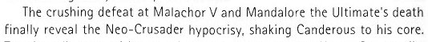

### Stat block notes (game mechanics, not feats)

- Cynical eye: He participates in many battles and rules with a stern hand, brooking no insubordination from his inferiors. But as time and the invasion progress, the increasingly busy warrior finds it easier to co-opt those whose assistance he requires, eventually undermining his own Neo-Crusader hierarchy by passing out titles and ranks first to favorite henchmen and later to anyone whose support he desires. Where Mandalore the Indomitable expected blind obedience, Mandalore the Ultimate's more cynical eye sees dissension as one more tactical problem to be solved. Mandalore the Ultimate carries a ceremonial version of Mandalore the Indomitable's Mythosaur axe. Infused with cortosis and other materials, it is capable of delivering an electric charge. (Source: *Knights of the Old Rebuplic Campaign Guide* (SWRPG Saga Edition), scan p.201)
- Canderous converts: "Ordo" is Canderous's surname and also the name of his Mandalorian clan and homeworld. Clan Ordo fights as Mandalorian Crusaders in the Great Sith War under Mandalore the Indomitable and the Sith Ulic Qel-Droma. With Indomitable's death and Qel-Droma's abandonment, however, apprehension sweeps through the Crusaders. That's when Mandalore the Ultimate appears—and the Neo-Crusaders. Canderous, devoted to the Resol'Nare and traditional Canons of Honor, considers these warriors disturbed. However, he cannot argue with their war record. Once Ultimate openly sponsors them, Canderous converts to the new Mandalorian way. (Source: *Knights of the Old Rebuplic Campaign Guide* (SWRPG Saga Edition), scan p.201)
- Thug-for-hire: The Neo-Crusaders achieve staggering power, but soon Canderous notices chinks in the beskar'gam. As Ultimate enlists more and more conquered peoples, outright criminals began flooding the Mandalorians, and the Resol'Nare goes by the wayside. The crushing defeat at Malachor V and Mandalore the Ultimate's death finally reveal the Neo-Crusader hypocrisy, shaking Canderous to his core. The clans disperse, with many abandoning the Canons of Honor. Shamefully, Canderous becomes a thug-for-hire. (Source: *Knights of the Old Rebuplic Campaign Guide* (SWRPG Saga Edition), scan p.201)
- Mask of Mandalore: But during the Jedi Civil War, Canderous returns to glory. He teams with his former enemy Revan, reconditioned by the Jedi, and joins the Star Forge quest. Helping crush the Sith Empire restores Canderous's honor. In thanks, Revan returns to him the traditional mask of Mandalore, and Canderous sets out to reunite the Mandalorians. (Source: *Knights of the Old Rebuplic Campaign Guide* (SWRPG Saga Edition), scan p.201)
- Mandalore the Preserver: In so doing, Canderous happens upon an ailing Taung claiming to be the true Mandalore, and calling Mandalore the Ultimate a usurper with Sith ties. Before dying, this nameless Mandalorian presents his armor and clan to Canderous, asking him to preserve the old ways. Canderous takes the armor for himself, integrating the Mandalore mask into its helmet. Canderous's unification efforts are spotty, but in the Dark Wars, his loyal Mandalorians fight beside Republic troops and storm Darth Nihilus's ship with the Jedi Exile. As his disillusioned people descend into greater lawlessness, an aging Canderous fights to keep Mandalorian tradition alive. (Source: *Knights of the Old Rebuplic Campaign Guide* (SWRPG Saga Edition), scan p.201)

## scan p.202 (scan page 202)

Page contents: Table 12-1 armor; Canderous Ordo stats (Human soldier 7/elite trooper 6/officer 3, CL 16; implants, Basilisk war droid); Armor: Neo-Crusader light armor, Mandalorian combat suit. (hand-read)

## scan p.203 (scan page 203)

Page contents: Table 12-2 melee weapons; Neo-Crusader battle armor and assault armor; Mythosaur axe; stunning gauntlet; Droids: Basilisk war droid description. (hand-read)

- **Mandalore the Indomitable; Ulic Qel-Droma** — entry/section: Knights of the Old Republic Campaign Guide (Saga): "The war droid is capable of melee action with its huge claws, as Ulic Qel-Droma finds when the mounted Mandalore the Indomitable meets him for their fateful duel." Source: *Knights of the Old Rebuplic Campaign Guide* (SWRPG Saga Edition), scan p.203
  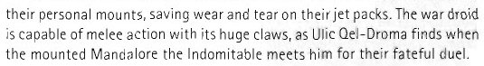

### Stat block notes (game mechanics, not feats)

- Ultimate's axe: Crafted from the calcified bones of the extinct monster for which it is named, the Mythosaur axe is one ceremonial weapon that can be deadly. Mandalore the Ultimate's variation, atop a staff, uses modern metals and an energy cell to achieve double the damage. (Source: *Knights of the Old Rebuplic Campaign Guide* (SWRPG Saga Edition), scan p.203)

## scan p.204 (scan page 204)

Page contents: Basilisk war droid stats (CL 6); caption "A MANDALORIAN WARRIOR RIDING A BASILISK WAR DROID"; Mandalorian Starships intro. (hand-read)

## scan p.205 (scan page 205)

Page contents: MandalMotors note; Davaab-type starfighter (CL 8); caption "A KYRAMUD-TYPE BATTLESHIP PROTECTS A FLIGHT OF SHAADLAR-TYPE TROOPSHIPS DURING A PLANETARY INVASION"; Shaadlar-type troopship description. (hand-read)

## scan p.206 (scan page 206)

Page contents: Shaadlar-type troopship stats (CL 15); Teroch-type fast attack gunship (CL 10); Jehavey'ir-type assault ship description. (hand-read)

### Stat block notes (game mechanics, not feats)

- Teroch-type gunships: In the early days of the Mandalorian Wars, the 18-meter-long Teroch-type gunships are tasked with returning captured Jedi to Demagol on Flashpoint for evaluation. The fast-attack ship that mistakenly whisked a captured Jarael from Vanquo arrived long before the Last Resort, which followed it into hyperspace moments later. (Source: *Knights of the Old Rebuplic Campaign Guide* (SWRPG Saga Edition), scan p.206)

## scan p.207 (scan page 207)

Page contents: Jehavey'ir-type assault ship stats (CL 18); Kyramud-type battleship description. (hand-read)

### Stat block notes (game mechanics, not feats)

- Jas'galaar: Rohlan Dyre spends three years managing a group of shock troopers on the battleship Jas'galaar. (Source: *Knights of the Old Rebuplic Campaign Guide* (SWRPG Saga Edition), scan p.207)

## scan p.208 (scan page 208)

Page contents: Kyramud-type battleship stats (CL 20); Kandosii-type dreadnaught description and stats (CL 20); caption "TWO JEHAVEY'IR-TYPE ASSAULT SHIPS PATROL THE SPACE ABOVE A CAPTURED WORLD WITH A KANDOSII-TYPE DREADNAUGHT". (hand-read)

- **Gormer (Nomad)** — entry/section: Pull quote: ""WE'RE NOMADS. WE DON'T HAVE HEADQUARTERS." —GORMER" Source: *Knights of the Old Rebuplic Campaign Guide* (SWRPG Saga Edition), scan p.208
  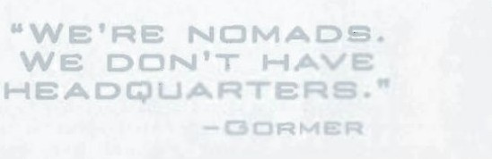

### Stat block notes (game mechanics, not feats)

- Fission warheads: During the Mandalorian Wars, the heavy concussion missiles, formidable on their own, can be tipped with fission warheads on the orders of Mandalore or Cassus Fett. Such weapons are used more than once, most notoriously in the immolation of the cities of Serroco. (Source: *Knights of the Old Rebuplic Campaign Guide* (SWRPG Saga Edition), scan p.208)

## scan p.209 (scan page 209)

Page contents: Chapter XIII: Allies and Opponents opener. (hand-read)

## scan p.210 (scan page 210)

Page contents: Chapter intro; Notable Personalities; Lord Arkoh Adasca bio. (hand-read)

### Stat block notes (game mechanics, not feats)

- Arkoh Adasca: Arkoh Adasca is the eighth member of the House of Adasca to rise to the title of Lord. The youthful and charismatic Arkoh captures the imagination of the Arkanians. Though he is not the Arkanian political leader, his mannerisms and demeanor allow him to project and assume more power than he is truly entitled to. Arkoh successfully raises the Arkanian sense of superiority over other species through subtle but enticing arguments. He also uses his persuasive skills to convince otherwise loyal Arkanians to aid him in the ill-fated Project Black Harvest, even though the Republic would consider such actions treasonous. Arkoh is supremely confident in his position and abilities. Although he projects an image of an honorable and ethical leader, this is merely a front for his schemes and vast ambition. Ultimately, his overconfidence leads to his destruction, significantly damaging his company in the process. (Source: *Knights of the Old Rebuplic Campaign Guide* (SWRPG Saga Edition), scan p.210)

## scan p.211 (scan page 211)

Page contents: Lord Arkoh Adasca (Mandalorian Wars) stats (Arkanian noble 7/corporate agent 6, CL 13); Brianna (The Last Handmaiden) bio; caption "GO-TO AND BRIANNA OPEN NEGOTIATIONS"; Brianna stats (Human soldier 9/melee duelist 1, CL 10). (hand-read)

- **Arkoh Adasca** — entry/section: Pull quote: ""WE NO LONGER SEEK CONTRACTS. BUT WE MAY ACCEPT ALLIES." —LORD ARKOH ADASCA" Source: *Knights of the Old Rebuplic Campaign Guide* (SWRPG Saga Edition), scan p.211
  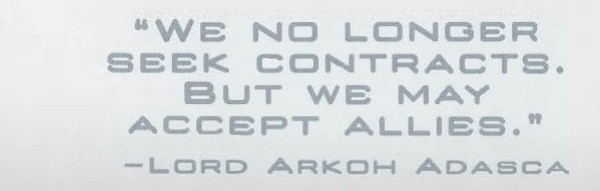

### Stat block notes (game mechanics, not feats)

- Cassus Fett: Saga CL 17 Medium Human noble 7/soldier 3/officer 7 (Source: *Knights of the Old Rebuplic Campaign Guide* (SWRPG Saga Edition), scan p.211)
- The Last Handmaiden: Brianna is one of the handmaidens in service to Jedi Master Atris on Telos IV. The daughter of a forbidden love affair between her Jedi Master mother and Echani father, she lives her life trying to make up for her shameful parentage—at least as it is seen in Echani culture. Her fellow handmaidens have no respect for her. At Master Atris' request, she steals the Ebon Hawk, forcing the Exile to come to Telos IV to retrieve it. She travels with the Exile all the way to Malachor V. (Source: *Knights of the Old Rebuplic Campaign Guide* (SWRPG Saga Edition), scan p.211)

## scan p.212 (scan page 212)

Page contents: Brianna stats cont. (Echani Training); Calo Nord bio and stats (Human scout 3/soldier 4/bounty hunter 4/gunslinger 2, CL 13); Marn "The Gryph" Hierogryph bio. (hand-read)

- **Revan**: "Ultimately, it takes a person of equal power to defeat him, as Revan does when the bounty hunter tries to prevent his escape from Taris in the Ebon Hawk." Source: *Knights of the Old Rebuplic Campaign Guide* (SWRPG Saga Edition), scan p.212
  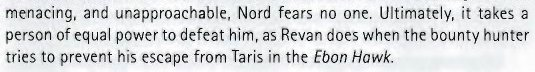

### Stat block notes (game mechanics, not feats)

- Calo Nord: Calo Nord is a ruthless bounty hunter, known to work at various times for the Sith, the Republic, and finally for the Exchange. Thought originally to have been a slave, rumors suggest that he killed his original owners, his parents who had sold him, the bounty hunters who came after him, and even the slavers. He learns to become a lethal bounty hunter in his own right. Cold, menacing, and unapproachable, Nord fears no one. Ultimately, it takes a person of equal power to defeat him, as Revan does when the bounty hunter tries to prevent his escape from Taris in the Ebon Hawk. (Source: *Knights of the Old Rebuplic Campaign Guide* (SWRPG Saga Edition), scan p.212)
- "I am a mastermind!": Falsely accused as an accomplice to the murders of the Padawans on Taris, Marn "The Gryph" Hierogryph's immediate impulse is to protest: "I am not an accomplice! I am a mastermind!" And that is, indeed, the fondest ambition of this Snivvian flim-flam artist. Gryph found his calling as a youth when he discovered money—and his uncanny ability to talk others into giving him theirs. (Source: *Knights of the Old Rebuplic Campaign Guide* (SWRPG Saga Edition), scan p.212)
- Sent offworld: Snivvians are obsessed with living their lives in pursuit of art, so Gryph's interest in the criminal arts does not draw the scorn of his fellows on Cadomai. But Gryph's avocation is con artistry, and after enough Snivvians feel the sting of his antics, his parents send him offworld. There begins for Gryph a life in the study of the galaxy's more notorious—as well as some of its less successful—career criminals. (Source: *Knights of the Old Rebuplic Campaign Guide* (SWRPG Saga Edition), scan p.212)
- Gryph and Zayne: Gryph is in danger of joining the latter group when he first encounters Zayne Carrick, who is assigned to capture him. Zayne succeeds on the final try, only to find both of them framed for the Padawan Massacre. Overcoming his impulse to run away and save his own skin, Gryph sees possibilities in working con games with someone with Jedi talents. There begins a long and sometimes rocky partnership, with Gryph's financial goals frequently at odds with Zayne's quest for justice. But the Snivvian flourishes during the partnership, reforging his relationship with the Hidden Beks and annoying enough people to boost the bounty on his head into the six-figure range. For Gryph, that is all part of keeping score. (Source: *Knights of the Old Rebuplic Campaign Guide* (SWRPG Saga Edition), scan p.212)
- Hirelings: Gryph has one hireling in Slyssk, a meek Trandoshan starship thief. He also refers to Zayne as a henchman, although the two are constantly renegotiating the terms of their partnership. (Source: *Knights of the Old Rebuplic Campaign Guide* (SWRPG Saga Edition), scan p.212)

## scan p.213 (scan page 213)

Page contents: GO-TO stats cont. (The Visionary, Goto's yacht); HK-47 bio. (hand-read)

### Stat block notes (game mechanics, not feats)

- GO-TO: GO-TO is better known to his underlings and the outside world as Goto, a Human male. Thanks to skilled holographic manipulation, virtually no one suspects that Goto is, in fact, an alias of a scheming droid. As a highly intelligent infrastructure-planning system, GO-TO was originally programmed to aid the Republic in reconstruction after the Jedi Civil War. However, he eventually breaks his programming to follow Republic law and opts to help stabilize the Republic in any manner he sees fit. Using his alias, he establishes a smuggling operation that gets him into the Exchange, leading their Telos operations. He also establishes the HK-50 assassin-droid factory to aid his stabilization efforts. GO-TO orchestrates the capture of the Exile as one of the bounties he places on all Jedi and Sith, who he considers destabilizing factors. GO-TO ends up accompanying and aiding the Exile, hoping that doing so will stabilize the Republic. GO-TO is destroyed in a showdown with HK-47 and his own HK-50s on Malachor V. (Source: *Knights of the Old Rebuplic Campaign Guide* (SWRPG Saga Edition), scan p.213)
- HK-47: HK-47 is a lethal assassin droid, albeit one with a sharp wit combined with a barely concealed hatred of organic "meatbags." He serves Revan, both before and after the Dark Lord's capture. In fact, at one point his memories are concealed even from himself, by Revan's own hand. Though HK-47's primary function is concealed, this cannot completely hide the fact that the droid is more than it seems, nor can it hide the droid's attitude. After rejoining Revan on Tatooine, HK-47's full personality eventually appears when Revan's true past is revealed. He continues serving Revan through the search and destruction of the Star Forge. Little is known about HK-47's travels for the next five years. Though he travels with the Jedi Exile for a while, he eventually convinces the imitation HK-50 droids to join his cause, leading them against GO-TO on Malachor V. (Source: *Knights of the Old Rebuplic Campaign Guide* (SWRPG Saga Edition), scan p.213)

## scan p.214 (scan page 214)

Page contents: HK-47 (Jedi Civil War) stats (4th-degree droid soldier 7/elite trooper 2, CL 9); Jarael bio; caption "THE MOOMO WILLIWAW (LEFT) AND THE LAST RESORT (RIGHT)". (hand-read)

### Stat block notes (game mechanics, not feats)

- Jarael and Camper: For someone who has spent much of her life living in a junkyard, Jarael attracts the interest of a wide variety of people, and not only because of her savage beauty—which is considerable. Powerful individuals from Lord Adasca to Squint to Demagol learn that Jarael might be more than she acknowledges—or realizes. Her public persona is that of a scrappy, acrobatic fighter used to life in harsh places. She appears to be an Arkanian Offshoot, although her pointed ears are not shared by that subspecies. She visits the Offshoot villages of Arkania for only the first time as an adult. Her sole mission in life has been caring for the increasingly addled inventor known as Camper. Jarael never discusses the fate that Camper saved her from years before—but in protecting her, he changes her life. (Source: *Knights of the Old Rebuplic Campaign Guide* (SWRPG Saga Edition), scan p.214)
- Jarael a pawn: Jarael's mission to protect Camper from his own past fails when the two—against Jarael's better judgment—are thrown into the company of fugitives Zayne Carrick and Marn Hierogryph. Immediately after Jarael and Camper part company with them, Camper falls ill, and Jarael finds herself forced to turn to Adascorp—the medical conglomerate Camper has been running from—for help. Jarael then becomes a pawn in Lord Adasca's galactic game to pry knowledge from Camper. When Camper escapes, going his own way, she blames herself. (Source: *Knights of the Old Rebuplic Campaign Guide* (SWRPG Saga Edition), scan p.214)
- Jarael's training: Working to piece her life back together, Jarael returns to Zayne Carrick's company. She focuses on physical training, and even begins to explore her nascent Force sensitivity. Jarael uses a shockstaff of Camper's design, capable of delivering a charge that temporarily numbs the flesh it strikes. (Source: *Knights of the Old Rebuplic Campaign Guide* (SWRPG Saga Edition), scan p.214)

## scan p.215 (scan page 215)

Page contents: Jarael stats (Arkanian Offshoot scout 5/soldier 3, CL 8; Strong in the Force); Mira bio and Mira (Dark Wars) stats (Human scout 5/soldier 1, CL 6; wrist launcher). (hand-read)

- **Eejee Vamm; Jarael** — entry/section: Pull quote: ""I didn't know an Offshoot could be such an asset in the diplomacy department." —Eejee Vamm" Source: *Knights of the Old Rebuplic Campaign Guide* (SWRPG Saga Edition), scan p.215
  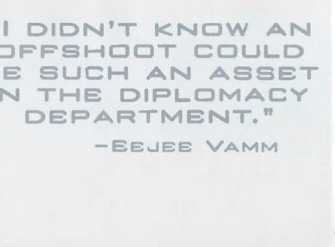

### Stat block notes (game mechanics, not feats)

- Mira and Hanharr: Mira is a young female Human bounty hunter with the unconventional preference for capturing targets rather than killing them. Even though the Wookiee Hanharr attempts to kill her, Mira spares his life, earning his life debt. Hanharr again tries to kill her, both for his Exchange boss and to free himself from the debt. When he again fails, Mira leaves him for dead. Hanharr returns unexpectedly on Malachor V, where once again, Mira refuses to kill him. After becoming involved in the Exile's capture on Nar Shaddaa, Mira joins the travelers with the Exile. She joins the Ebon Hawk crew's rescue mission and remains with them through the end at Malachor V. (Source: *Knights of the Old Rebuplic Campaign Guide* (SWRPG Saga Edition), scan p.215)

## scan p.216 (scan page 216)

Page contents: Mission Vao (in Taris Undercity) stats (Twi'lek scoundrel 4, CL 4); Dob and Del Moomo bio; caption "MISSION VAO ATTEMPTS REPAIRS ON T3-M4". (hand-read)

### Stat block notes (game mechanics, not feats)

- Mission Vao: Mission Vao is a bright, cheerful, young Twi'lek who grows up in the rough Undercity of Taris. Though her skills are less than reputable, she is nonetheless loyal to her Wookiee friend Zaalbar and her troublesome brother Griff. She and Zaalbar travel with Revan after he helps Zaalbar escape slavers on Taris. Her skills prove to be extremely useful, but she is also on a mission of her own—trying to catch up with her brother. She succeeds, only to discover that he was more dishonest than she imagined. She and Revan succeed in bailing him out of yet another unlikely scheme, before they part ways and she follows Revan in his search for the Star Forge. (Source: *Knights of the Old Rebuplic Campaign Guide* (SWRPG Saga Edition), scan p.216)
- Expelled from the herd: Violent and stupid where their fellow Ithorians are peaceful and contemplative, brothers Dob and Del Moomo are expelled from the herd for its own safety. Unable to grasp traditional Ithorian values (or many other concepts, for that matter), Dob and Del venture forth into the galaxy as muscle—or muscleheads—for hire. (Source: *Knights of the Old Rebuplic Campaign Guide* (SWRPG Saga Edition), scan p.216)
- "My brother wouldn't pull a poisoned stake out of my hide": Whenever the brothers serve as bodyguards, bounty hunters, or assassins, the description "would-be" always applies. Few of their endeavors are successful; most are torpedoed by their own back-stabbing feuds. "My brother wouldn't pull a poisoned stake out of my hide," Del once said. "At least, he didn't the first two times." (Source: *Knights of the Old Rebuplic Campaign Guide* (SWRPG Saga Edition), scan p.216)
- Moomos for hire: Yet the two mysteriously continue to be recommended for jobs in the highest levels of Republic society, including assignments for Krynda's Jedi Covenant and industrialist Jervo Thalien. During the siege of Taris, they come into a temporary alliance with Zayne Carrick's gang, cooperating until such time as they can turn him in for a bounty—if they can remember to do it. (Source: *Knights of the Old Rebuplic Campaign Guide* (SWRPG Saga Edition), scan p.216)
- Moomo Williwaw: The brothers do not lack for resources, as evidenced by their insanely over-armed starship, the Moomo Williwaw. The interior of the ship continues the theme: Dob and Del are obsessed with weapons of all kinds, and their ship is littered with implements of destruction from hundreds of cultures. It has provided the Moomos the one education that seems to have taken: Del specializes in demolitions, and Dob is a treasure-trove of information about melee weapons. They rarely use the same weapons twice, preferring to pull something new out of their collection. ... The only distinguishing characteristic between the two is a scar over Del's right eye, gained in childhood when Dob shoved his brother's head into a working trash compactor. (In Dob's defense, Del did agree to look.) (Source: *Knights of the Old Rebuplic Campaign Guide* (SWRPG Saga Edition), scan p.216)

## scan p.217 (scan page 217)

Page contents: Dob and Del Moomo stats (Ithorian scout 3/soldier 4/bounty hunter 3, CL 10); T3-M4 bio; T3-M4 (Jedi Civil War) stats (2nd-degree droid nonheroic 2/scoundrel 6, CL 6). (hand-read)

- **Meetra Surik**: "T3 is believed to have remained with the Exile after the Sith are defeated at Malachor V." Source: *Knights of the Old Rebuplic Campaign Guide* (SWRPG Saga Edition), scan p.217
  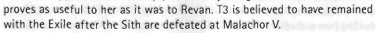

### Stat block notes (game mechanics, not feats)

- T3-M4: T3-M4 is a highly customized and advanced utility droid, upgraded specifically for Taris Exchange boss Davik Kang. However, T3 ends up in the hands of Revan, who makes use of the droid's abilities during the search for the Star Forge. The droid remains with the Ebon Hawk, after Revan parts with the ship before departing to the Unknown Regions at the end of the Jedi Civil War. T3 reappears with the ship years later, joining with the Exile. The droid proves as useful to her as it was to Revan. T3 is believed to have remained with the Exile after the Sith are defeated at Malachor V. (Source: *Knights of the Old Rebuplic Campaign Guide* (SWRPG Saga Edition), scan p.217)

## scan p.218 (scan page 218)

Page contents: Zaalbar bio and Zaalbar (Jedi Civil War) stats (Wookiee scout 4, CL 4); Other Allies and Opponents; Czerka Associates and Czerka Associate stats (CL 1); Czerka Scientist description. (hand-read)

### Stat block notes (game mechanics, not feats)

- Zaalbar's life debt: Zaalbar has been Mission Vao's Wookiee protector and companion since they teamed up while living in the Undercity of Taris. Unfortunately, he is captured by slavers, forcing Mission to seek Revan's help to mount a rescue. In gratitude, Zaalbar owes a life debt to Revan, causing both he and Mission to join in what would ultimately become the search for the Star Forge. Among the worlds they visit is Zaalbar's homeworld, Kashyyyk. He is not welcome however, having been banished for the culturally inexcusable use of his climbing claws in combat. His brother Chuundar has taken over the position of chieftain, and Zaalbar is imprisoned for returning. Fortunately, Revan is able to uncover Chuundar's slaving activities, locate their father, and lead a revolt against Chuundar and the Czerka Corporation slavers. Despite the promise of becoming a future chieftain, Zaalbar honors his life debt and continues with Revan through the destruction of the Star Forge. (Source: *Knights of the Old Rebuplic Campaign Guide* (SWRPG Saga Edition), scan p.218)

## scan p.219 (scan page 219)

Page contents: Czerka Scientist stats (CL 2); GenoHaradan Assassin (CL 10); Krath Adept (CL 4). (hand-read)

## scan p.220 (scan page 220)

Page contents: Krath Commander (CL 6); Krath Warrior description and stats (CL 1); caption "A KRATH WAR DROID FOLLOWS A KRATH WARRIOR INTO BATTLE". (hand-read)

- **Mandalore the Indomitable; Ulic Qel-Droma**: "Drawn from the militaries of conquered Deep Core worlds, Krath warriors are the staple forces of the Krath army prior to the defeat of Mandalore the Indomitable by Ulic Qel-Droma." Source: *Knights of the Old Rebuplic Campaign Guide* (SWRPG Saga Edition), scan p.220
  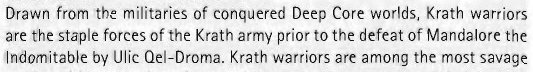

## scan p.221 (scan page 221)

Page contents: Starships intro; The Ebon Hawk description and stats (CL 8); Koros Spaceworks CX-133 Krath Chaos fighter description and stats (CL 7). (hand-read)

- **Revan**: "The Ebon Hawk is the prized possession of Taris Exchange boss Davik Kang—at Jeast until an amnesiac Darth Revan takes it away from him." Source: *Knights of the Old Rebuplic Campaign Guide* (SWRPG Saga Edition), scan p.221
  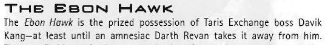

### Stat block notes (game mechanics, not feats)

- The Ebon Hawk: The Ebon Hawk is the prized possession of Taris Exchange boss Davik Kang—at least until an amnesiac Darth Revan takes it away from him. (Source: *Knights of the Old Rebuplic Campaign Guide* (SWRPG Saga Edition), scan p.221)

## scan p.222 (scan page 222)

Page contents: Caption "A KRATH CHAOS FIGHTER FIRES AT AN S-100 STINGER"; Krath command ship (Koros Spaceworks Supremacy-class attack ship, CL 17); The Visionary, Goto's Yacht description. (hand-read)

- **Meetra Surik**: "Ultimately, the Visionary is destroyed when the cloaking device is disabled by the Exile, enabling GO-T0's enemies to target the ship." Source: *Knights of the Old Rebuplic Campaign Guide* (SWRPG Saga Edition), scan p.222
  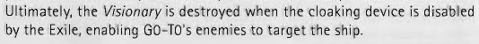

### Stat block notes (game mechanics, not feats)

- The Visionary: The Visionary, commonly called Goto's Yacht, is the prototype Eleaor Propulsion Starscape-class yacht. Through his datalinks, GO-TO discovers Eleaor is expanding into luxury starships, and he calculates that a stronger Eleaor Propulsion would aid his Republic-stabilization efforts. He commissions the prototype for himself, and Eleaor goes on to produce a successful, if expensive, class of yacht. GO-TO hires Nar Shaddaa shipyards to upgrade the weaponry and install formidable interior defensive systems, including turrets and a minefield. This also includes an effective cloaking device that protects the Visionary from enemy attacks as the ship orbits Nar Shaddaa. Ultimately, the Visionary is destroyed when the cloaking device is disabled by the Exile, enabling GO-TO's enemies to target the ship. (Source: *Knights of the Old Rebuplic Campaign Guide* (SWRPG Saga Edition), scan p.222)

## scan p.223 (scan page 223)

Page contents: Eleaor Propulsion Starscape-class yacht stats (CL 13; stygium crystal cloaking device); caption "TWO LETHISK-CLASS ARMED FREIGHTERS ESCORT THE VISIONARY"; Droids intro; Krath war droid description (Conclave on Deneba) and stats (CL 5). (hand-read)

## scan p.224 (scan page 224)

Page contents: Rakatan guardian droid (CL 5; Revan encounters them searching for the Star Forge); Beasts: kath hound (CL 3); rakghoul (CL 4) and rakghoul disease. (hand-read)

## scan p.225 (scan page 225)

Page contents: Star Wars Miniatures advertisement comic ("WITH STAR WARS MINIATURES AND ROLEPLAYING GAMES, ANYTHING'S POSSIBLE!"). Dialogue verbatim: Krayt: "TREMBLE, CADE SKYWALKER, BEFORE THE TERRIBLE POWER OF I, DARTH KRAYT, WHO ALONG WITH DARTH TALON AND DARTH NIHL, WILL BRING YOU TO YOUR KNEES!" Cade: "HA! IT IS YOU WHO SHOULD TREMBLE BEFORE ME, FOR I AM A TOUGH AS NAILS BOUNTY HUNTER!" Deliah Blue: "HE'S TOUGH!" Boba Fett: "I'M A BOUNTY HUNTER TOO! AND YOU, CADE SKYWALKER, ARE MY BOUNTY!" "AND I GUESS I'LL TAKE THE PINK GIRL TOO." Luke: "STAY AWAY FROM MY GREAT-GRANDSON!" "EH, HOW'D YOU GET HERE!" "I SHOULD ASK YOU THE SAME THING!" Krayt: "SILENCE! LET'S BRING IT BACK TO ME! FOR I, DARTH KRAYT, WILL--URKK!" Han Solo: "YAHOO! YOU'RE ALL CLEAR, KID!" Cade: "SOMEONE TELL ME HOW THIS IS HAPPENING!" (hand-read)

### Stat block notes (game mechanics, not feats)

- Miniatures ad: "Tremble, Cade Skywalker": TREMBLE, CADE SKYWALKER, BEFORE THE TERRIBLE POWER OF I, DARTH KRAYT, WHO ALONG WITH DARTH TALON AND DARTH NIHL, WILL BRING YOU TO YOUR KNEES! / HA! IT IS YOU WHO SHOULD TREMBLE BEFORE ME, FOR I AM A TOUGH AS NAILS BOUNTY HUNTER! (Source: *Knights of the Old Rebuplic Campaign Guide* (SWRPG Saga Edition), scan p.225)
- Miniatures ad: "You're all clear, kid!": I'M A BOUNTY HUNTER TOO! AND YOU, CADE SKYWALKER, ARE MY BOUNTY! AND I GUESS I'LL TAKE THE PINK GIRL TOO. / STAY AWAY FROM MY GREAT-GRANDSON! / SILENCE! LET'S BRING IT BACK TO ME! FOR I, DARTH KRAYT, WILL--URKK! / YAHOO! YOU'RE ALL CLEAR, KID! / SOMEONE TELL ME HOW THIS IS HAPPENING! (Source: *Knights of the Old Rebuplic Campaign Guide* (SWRPG Saga Edition), scan p.225)

## scan p.226 (scan page 226)

Page contents: Back cover: tagline "THIS IS BUT A TASTE OF THE DARK SIDE." and product blurb for the Knights of the Old Republic Campaign Guide (©2008). (hand-read)

