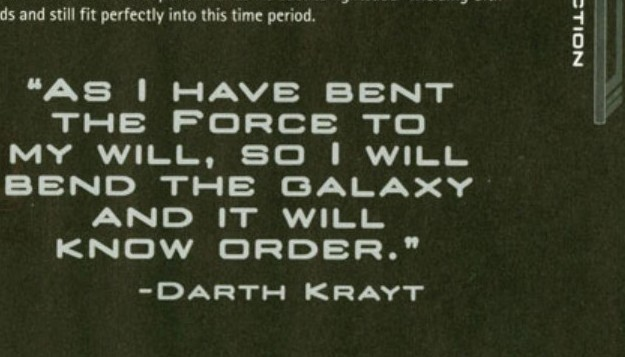
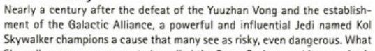
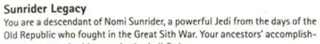
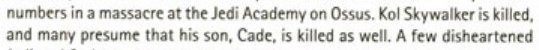
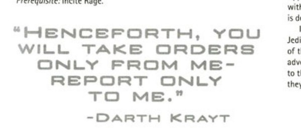
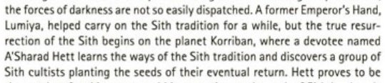
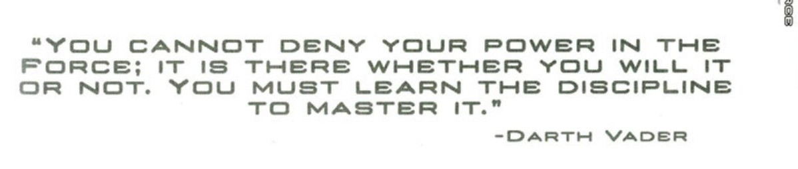

# Owner Material 037 — Star Wars D20 Drive folder (Core, Revised Core and Saga Edition): Sourcebooks/Legacy Era Campaign Guide.pdf [Star Wars Roleplaying Game Saga Edition (2007)] (scan pages 1–60)

- **Source:** Wizards of the Coast Star Wars Roleplaying Game books, web enhancements, Living Force campaign modules and articles (2000–2010), from the owner's "Star Wars D20" Drive folder (only the three edition subfolders; "General" was not read, as instructed). Secondary source (licensed Legends reference). Scan OCR'd on the box; the scan stays box-only and is **not** published.
- **Method:** every scanned page was OCR'd and machine-screened sentence by sentence for power-relevant statements (fights, kills, defeats, Force feats, rankings, superweapons) that name a character on our roster; each kept sentence is quoted verbatim from the OCR text and has a crop of the printed passage directly under it. Pages with nothing power-relevant are still listed with what is on them.
- **Citation:** "*Legacy Era Campaign Guide* (SWRPG Saga Edition), p.X" by printed page ("scan p.X" where no printed number applies). **Weight:** Licensed RPG material: a secondary source. Narrative text sums up Legends lore; game statistics are rules for players, not canon power levels, and rank lowest.

## scan p.1 (scan page 1)

Page contents: Cover: Star Wars Roleplaying Game, Legacy Era Campaign Guide (Rodney Thompson, Sterling Hershey, Gary Astleford). (hand-read)

## scan p.2 (scan page 2)

Page contents: Title page: Legacy Era Campaign Guide; Rodney Thompson, Sterling Hershey, Gary Astleford. (hand-read)

## scan p.3 (scan page 3)

Page contents: Credits; First Printing: March 2009; ©2009 Lucasfilm Ltd. (hand-read)

## scan p.4 (scan page 4)

Page contents: Table of contents (species, heroic traits, Force-users in the Legacy era, Imperial Knights, Force-using traditions, vehicles and starships, campaign, planets, Galactic Alliance, Empire, Jedi remnants, Underworld, personalities incl. Cade Skywalker, Darth Krayt, Darth Talon, Darth Wyyrlok, Antares Draco, Marasiah Fel, Azlyn Rae). (hand-read)

## scan p.5 (scan page 5)

Page contents: Art page (no text). (hand-read)

## scan p.6 (scan page 6)

Page contents: Introduction: the Legacy era begins over 130 years after the Battle of Yavin; Darth Krayt's Empire; Roan Fel's insurgency. (hand-read)

- **Darth Krayt** — entry/section: Pull quote: ""AS I HAVE BENT THE FORCE TO MY WILL, SO I WILL BEND THE GALAXY AND IT WILL KNOW ORDER." —DARTH KRAYT" Source: *Legacy Era Campaign Guide* (SWRPG Saga Edition), scan p.6
  

### Stat block notes (game mechanics, not feats)

- The Dark Times: Obi-Wan Kenobi once called the period between the fall of the Republic and the rise of the Galactic Empire the "Dark Times." (Source: *Legacy Era Campaign Guide* (SWRPG Saga Edition), scan p.6)
- The Legacy era: The Legacy era begins over 130 years after the Battle of Yavin. The galaxy is ruled by a tyrannical dictator, a Sith Lord named Darth Krayt. Darth Krayt and his new Sith have reestablished the Galactic Empire. The Jedi are scattered to the distant corners of the galaxy, and the only hope for democracy lies with the fleeing exiles of the Galactic Alliance. Yet the Empire is divided, with the former Emperor, Roan Fel, leading an insurgency against the Sith Lord that deposed him. (Source: *Legacy Era Campaign Guide* (SWRPG Saga Edition), scan p.6)

## scan p.7 (scan page 7)

Page contents: Timeline: The Galactic Alliance (28 ABY–126 ABY); The Ossus Project; The Sith-Imperial War (127 ABY–130 ABY). (hand-read)

- **Kol Skywalker**: "Nearly a century after the defeat of the Yuuzhan Vong and the establishment of the Galactic Alliance, a powerful and influential Jedi named Kol Skywalker champions a cause that many see as risky, even dangerous." Source: *Legacy Era Campaign Guide* (SWRPG Saga Edition), scan p.7
  

### Stat block notes (game mechanics, not feats)

- The Ossus Project: Nearly a century after the defeat of the Yuuzhan Vong and the establishment of the Galactic Alliance, a powerful and influential Jedi named Kol Skywalker champions a cause that many see as risky, even dangerous. What Skywalker proposes comes to be called the Ossus Project, and its premise is bold: to take Yuuzhan Vong terraforming biotechnology and use it to rebuild devastated worlds. ... The Yuuzhan Vong are blamed for the sabotage, Kol Skywalker and the Jedi are accused of complicity, and the Sith divide the galaxy once more. (Source: *Legacy Era Campaign Guide* (SWRPG Saga Edition), scan p.7)
- The Moff Council and the Sith: The Moff Council, unbeknownst to Emperor Roan Fel, has been working behind the scenes to reach an agreement with the Sith. The Sith emerge as a fighting force on the side of the Empire, openly opposing the Galactic Alliance and the Jedi Order. With the aid of these dark Force-users, the revitalized Empire sweeps across the galaxy. (Source: *Legacy Era Campaign Guide* (SWRPG Saga Edition), scan p.7)

## scan p.8 (scan page 8)

Page contents: Timeline continued: Battle of Caamas; Ascent of the Empire (130 ABY–136 ABY); The Imperial Civil War (137 ABY and Beyond); caption "A SMUGGLER WATCHES HV-7 LOADING DROIDS PLACING CARGO ON HER SHIP". (hand-read)

- **Cade Skywalker** — entry/section: Pull quote: ""TIME AND AGAIN THE GALAXY—WHICH WE SERVED—TURNED AGAINST US! AND WE KEEP COMING BACK FOR MORE! THAT'S REAL CLEVER OF US, ISN'T IT?" —CADE SKYWALKER" Source: *Legacy Era Campaign Guide* (SWRPG Saga Edition), scan p.8
  

### Stat block notes (game mechanics, not feats)

- Battle of Caamas: At the end of the Battle of Caamas, after his superiors order him to surrender, Admiral Gar Stazi of the Galactic Alliance takes a remnant of the Core Fleet and flees, leaving the Empire in control of the galaxy. (Source: *Legacy Era Campaign Guide* (SWRPG Saga Edition), scan p.8)
- Krayt seizes the Empire: Following the destruction of the Jedi Order at Ossus, Darth Krayt seizes control of the Empire by force. He murders the man he believes is Emperor Roan Fel—a man later revealed to be a decoy—and demands the fealty of the Moff Council. When the Moffs acquiesce, Darth Krayt becomes the new Emperor, and the Sith Lords and apprentices under his command become the new rulers of the galaxy. (Source: *Legacy Era Campaign Guide* (SWRPG Saga Edition), scan p.8)
- The Imperial Civil War: Seven years after the Battle of Caamas, the Empire-in-exile, under the command of Roan Fel, begins concerted efforts to undermine Krayt's authority. By disrupting the plans of the Sith, this Imperial insurgency sparks an all-out civil war. Meanwhile, Admiral Stazi and the remnants of the Galactic Alliance Core Fleet continue to engage in hit-and-run attacks against Imperial forces. (Source: *Legacy Era Campaign Guide* (SWRPG Saga Edition), scan p.8)
- Cade rejects his destiny: The reappearance of Cade Skywalker, the son of Kol Skywalker, offers a glimmer of hope to those who long for freedom. Cade, however, has rejected his destiny time and again, meaning that the galaxy may need other heroes to step up and do what he will not. (Source: *Legacy Era Campaign Guide* (SWRPG Saga Edition), scan p.8)

## scan p.9 (scan page 9)

Page contents: Chapter I: Species (title page). (hand-read)

## scan p.10 (scan page 10)

Page contents: Species in the Legacy era; Krayt's Empire treats all species more or less equally; Mon Calamari punished. (hand-read)

## scan p.11 (scan page 11)

Page contents: Chagrian species description. (hand-read)

## scan p.12 (scan page 12)

Page contents: Chagrian description continued, personality, homeworld Champala, Chagrian species traits (radiation resistance); Chiss description. (hand-read)

### Stat block notes (game mechanics, not feats)

- Thrawn rallies the Imperial remnants: Originating on the cold world of Csilla in the Unknown Regions, the Chiss are largely unknown to the greater galactic community until five years after the Battle of Yavin, when a Chiss known as Grand Admiral Thrawn rallies the Imperial remnants and goes to war against the New Republic. (Source: *Legacy Era Campaign Guide* (SWRPG Saga Edition), scan p.12)

## scan p.13 (scan page 13)

Page contents: Chiss culture, personality, traits; Codru-Ji description. (hand-read)

- **Moff Fehlaaur** — entry/section: Pull quote: ""COINCIDENCES CAN ALWAYS BE LINKED IN A SUGGESTIVE MANNER." —MOFF FEHLAAUR" Source: *Legacy Era Campaign Guide* (SWRPG Saga Edition), scan p.13
  

### Stat block notes (game mechanics, not feats)

- Thrawn exiled: The culture of the Chiss is based on a strict code of conduct. As a rule, they do not attack an enemy unless they are attacked first. Thrawn ignores this imperative when he seizes control of the Imperial remnant, and consequently he is exiled from his people. (Source: *Legacy Era Campaign Guide* (SWRPG Saga Edition), scan p.13)

## scan p.14 (scan page 14)

Page contents: Codru-Ji description (Wyrwulves), traits (Dual Weapon Mastery bonus feat, extra arms, skilled grappler); Klatooinian description. (hand-read)

## scan p.15 (scan page 15)

Page contents: Nagai traits (Lightning Reflexes, Soothing Voice, tehk'la blade familiarity). (hand-read)

- **Darth Nihl** — entry/section: Pull quote: ""I HAVE PROVEN MY LOYALTY—AND MY WORTH—COUNTLESS TIMES..." —DARTH NIHL" Source: *Legacy Era Campaign Guide* (SWRPG Saga Edition), scan p.15
  

## scan p.16 (scan page 16)

Page contents: Weequay description (Quay totems) and species traits. (hand-read)

## scan p.17 (scan page 17)

Page contents: Yuuzhan Vong description (Ossus Project sabotage, Zonama Sekot) and species traits (Force Immunity, Technophobic, amphistaff familiarity). (hand-read)

## scan p.18 (scan page 18)

Page contents: Zeltron description and species traits (Empathy, Pheromones). (hand-read)

- **Bantha Rawk** — entry/section: Pull quote: ""NEVER SEEN A ZELTRON JEALOUS BEFORE..." —BANTHA RAWK" Source: *Legacy Era Campaign Guide* (SWRPG Saga Edition), scan p.18
  

## scan p.19 (scan page 19)

Page contents: Chapter II: Heroic Traits (title page). (hand-read)

## scan p.20 (scan page 20)

Page contents: Heroic traits intro; Legacies; choosing a legacy (Skywalker, Solo, Organa, Antilles). (hand-read)

## scan p.21 (scan page 21)

Page contents: Creating a legacy character (Legacy destiny; Destiny Point to get a 20 on a skill check). (hand-read)

## scan p.22 (scan page 22)

Page contents: The Legacy destiny; sidebar "Famous Legacies vs. Canon" (Cade Skywalker, Roan Fel; Thrackan Sal-Solo vs. Han Solo); embracing/denying your legacy (example: Cade Skywalker's early efforts to shun the path of the Jedi); caption "JEDI OF THE HALCYON LEGACY HAVE THEIR OWN TRADITIONS". (hand-read)

## scan p.23 (scan page 23)

Page contents: Sidebar "Using the Legacy Destiny" (GM may apply bonuses and penalties only at dramatic or climactic points). (hand-read)

### Stat block notes (game mechanics, not feats)

- Ackbar Legacy: You are a descendant of Admiral Ackbar, one of the most famous leaders of the Rebel Alliance. Your family has a tradition of military leadership and benevolence. (Source: *Legacy Era Campaign Guide* (SWRPG Saga Edition), scan p.23)
- Antilles Legacy: You are a descendant of Wedge Antilles, Rogue Squadron pilot and military leader of the New Republic. Your family has a tradition of military service and is renowned for its piloting skills. (Source: *Legacy Era Campaign Guide* (SWRPG Saga Edition), scan p.23)
- Darklighter Legacy: You are a descendant of the Darklighter family, the famous family from Tatooine that produced such heroes as Biggs and Gavin Darklighter. Your family has served proudly in the Imperial Navy and in the Rebel Alliance, and is renowned for both its piloting skill and its dedication to a cause. (Source: *Legacy Era Campaign Guide* (SWRPG Saga Edition), scan p.23)

## scan p.24 (scan page 24)

Page contents: Sidebar "Creating Your Own Legacies": Pick a Lineage; Consider Legacy Restrictions; Create a Destiny Point Use. (hand-read)

### Stat block notes (game mechanics, not feats)

- Fel Legacy: You are a descendant of Baron Soontir Fel, former Imperial Pilot and loyal subject of the Empire of the Hand, and a relative of the current Emperor-in-exile, Roan Fel. (Source: *Legacy Era Campaign Guide* (SWRPG Saga Edition), scan p.24)
- Fett Legacy: You are a descendant of Boba Fett, notorious bounty hunter and the leader of the Mandalorian people, or another famous member of his clan. Your family (in this case, the Fett Clan) is known for its skill in battle and its ruthlessness, as well as its efforts to restore the Mandalorian people to greatness. (Source: *Legacy Era Campaign Guide* (SWRPG Saga Edition), scan p.24)
- Fey'lya Legacy: You are a descendant of Borsk Fey'lya, a politician in the New Republic and a shrewd leader. Your family is renowned for its skill in the arena of politics, as well as its cunning in all social matters. (Source: *Legacy Era Campaign Guide* (SWRPG Saga Edition), scan p.24)
- Halcyon/Horn Legacy: You are a descendant of Corran Horn, a Corellian police officer-turned-Jedi, as well as the famous Jedi Keiran Halcyon. Your family is known for its skill with mind-affecting Force powers as well as its investigative skills, not to mention its long-standing association with the fringe thanks to your ancestor Mirax Terrik. (Source: *Legacy Era Campaign Guide* (SWRPG Saga Edition), scan p.24)

## scan p.25 (scan page 25)

Page contents: Legacies: Koon, Koth, Mundi, Nadon, Nunb, Organa, Qel-Droma, Secura, Skywalker. (hand-read)

### Stat block notes (game mechanics, not feats)

- Koon Legacy: You are a descendant of Plo Koon, a Kel Dor Jedi Master who fought valiantly in the Clone Wars and served on the Jedi Council. Your family is known for its skill with the Force, as well as its dedication to the Jedi Order. (Source: *Legacy Era Campaign Guide* (SWRPG Saga Edition), scan p.25)
- Koth Legacy: You are a descendant of Eeth Koth, a Zabrak Jedi Master who served on the Jedi Council in the days of Anakin Skywalker's training. Your family is known for its ability to endure great hardships and to fight well beyond when most others would have given up. (Source: *Legacy Era Campaign Guide* (SWRPG Saga Edition), scan p.25)
- Mundi Legacy: You are a descendant of Ki-Adi-Mundi, a member of the Jedi Council who fought and died during the Clone Wars. Your family is known for its combat prowess as well as its penchant for logic and discourse. (Source: *Legacy Era Campaign Guide* (SWRPG Saga Edition), scan p.25)
- Nadon Legacy: You are a descendant of Momaw Nadon, an Ithorian scientist who was exiled during the height of Palpatine's Empire. (Source: *Legacy Era Campaign Guide* (SWRPG Saga Edition), scan p.25)
- Nunb Legacy: You are a descendant of Nien Nunb, Lando Calrissian's copilot at the Battle of Endor. Your family is well known for its piloting skills as well as its contributions to freeing the galaxy from oppression. You may also be related to the famous Rogue Squadron pilot, Aril Nunb. (Source: *Legacy Era Campaign Guide* (SWRPG Saga Edition), scan p.25)
- Organa Legacy: You are a descendant of Bail Organa, the Senator from Alderaan who helped found the Rebel Alliance. (Source: *Legacy Era Campaign Guide* (SWRPG Saga Edition), scan p.25)
- Qel-Droma Legacy: You are a descendant of the famous Qel-Droma family of Jedi, with such distinguished ancestors as Ulic, Cay, and Duron Qel-Droma. Your family is known for its strength in the Force and its ability to put itself at the center of galaxy-shaking events. (Source: *Legacy Era Campaign Guide* (SWRPG Saga Edition), scan p.25)
- Secura Legacy: You are a descendant of the Twi'lek Jedi Aayla Secura, who fought on the side of the Republic throughout the Clone Wars. Your family is known for combat prowess, as well as its impulsive and mercurial clan members. (Source: *Legacy Era Campaign Guide* (SWRPG Saga Edition), scan p.25)
- Skywalker Legacy: You are a descendant of Anakin and Luke Skywalker, two of the most famous beings in the galaxy. Your family is known for its strong connection to the Force, as well as its skill with spacecraft and other piloted vehicles. (Source: *Legacy Era Campaign Guide* (SWRPG Saga Edition), scan p.25)

## scan p.26 (scan page 26)

Page contents: Other destinies continued: Discovery (Jedi in hiding after Ossus; Emperor Fel takes control of Bastion), Education, Redemption. (hand-read)

- **Nomi Sunrider** — entry/section: Legacy Era Campaign Guide (Saga): "Sunrider Legacy You are a descendant of Nomi Sunrider, a powerful Jedi from the days of the Old Republic who fought in the Great Sith War." Source: *Legacy Era Campaign Guide* (SWRPG Saga Edition), scan p.26
  

### Stat block notes (game mechanics, not feats)

- Solo Legacy: You are a descendant of Han Solo, the smuggler and general in the Rebel Alliance who helped free the galaxy from Imperial oppression. Your family is known for its recklessness and grit, as well as its connections to the fringe. (Source: *Legacy Era Campaign Guide* (SWRPG Saga Edition), scan p.26)
- Sunrider Legacy: You are a descendant of Nomi Sunrider, a powerful Jedi from the days of the Old Republic who fought in the Great Sith War. Your ancestors' accomplishments are standard lessons in the Jedi Order. (Source: *Legacy Era Campaign Guide* (SWRPG Saga Edition), scan p.26)
- Tarpals Legacy: You are a descendant of Captain Tarpals, the Gungan who fought alongside the Jedi to liberate Naboo from the Trade Federation. Your family is renowned for its dedication to the Gungan people, as well as its bravery and willingness to fight for freedom. (Source: *Legacy Era Campaign Guide* (SWRPG Saga Edition), scan p.26)
- Tetsu Legacy: You are a descendant of Greedo, the notorious bounty hunter, and a member of the Tetsu clan. Your family is known for its aggressive pursuit of prey, as well as its arrogance and overbearing. (Source: *Legacy Era Campaign Guide* (SWRPG Saga Edition), scan p.26)
- Vao Legacy: You are a descendant of Mission Vao, a Twi'lek who fought alongside the amnesiac Darth Revan during the days of the Jedi Civil War. Your family (and clan) is renowned for its pluck and survivability, as well as its loyalty and devotion to its allies. (Source: *Legacy Era Campaign Guide* (SWRPG Saga Edition), scan p.26)

## scan p.27 (scan page 27)

Page contents: Rescue destiny; New Talents for Heroic Classes; Jedi in the Legacy era; New Jedi Consular talents: Aggressive Negotiator, Consular's Wisdom, Entreat Aid. (hand-read)

- **Kol Skywalker; Cade Skywalker**: "Kol Skywalker is killed, and many presume that his son, Cade, is killed as well." Source: *Legacy Era Campaign Guide* (SWRPG Saga Edition), scan p.27
  

### Stat block notes (game mechanics, not feats)

- Massacre at Ossus: The war between the Empire and the Galactic Alliance decimates the Jedi. They are driven from their temple on Coruscant and lose many of their numbers in a massacre at the Jedi Academy on Ossus. Kol Skywalker is killed, and many presume that his son, Cade, is killed as well. (Source: *Legacy Era Campaign Guide* (SWRPG Saga Edition), scan p.27)
- Fel and the Jedi: Emperor Roan Fel and his supporters do not regard the Jedi as allies, nor do they actively seek their destruction. (Source: *Legacy Era Campaign Guide* (SWRPG Saga Edition), scan p.27)

## scan p.28 (scan page 28)

Page contents: New Jedi Guardian talent Defensive Acuity; Jedi Sentinel talent Dark Side Bane; Lightsaber Combat talents Cortosis Gauntlet Block, Precision; Nobles in the Legacy era (Imperial Mission "Victory Without War"); Provocateur talent tree: Cast Suspicion, Distress to Discord, Friend or Foe, Seize the Moment. (hand-read)

## scan p.29 (scan page 29)

Page contents: Caption "A NAGAI PROVOCATEUR"; Provocateur talents continued (Stymie, True Betrayal); Scoundrels in the Legacy era. (hand-read)

## scan p.30 (scan page 30)

Page contents: New Misfortune talents Seducer, Seize Object; Yuuzhan Vong Biotech talent tree: Biotech Adept, Bugbite, Curved Throw, Surprising Weapons, Veiled Biotech; caption "A SHAPER INSTALLS A BIOTECH REPLACEMENT ARM"; Scouts in the Legacy era. (hand-read)

## scan p.31 (scan page 31)

Page contents: Versatility talents: Defensive Protection, Quick on Your Feet, Ready and Willing, Unbalancing Adaptation; Soldiers in the Legacy era (Battle of Caamas surrender; Admiral Stazi's Core Fleet); Brute Squad talent tree: Gang Leader. (hand-read)

## scan p.32 (scan page 32)

Page contents: Brute Squad talents: Melee Assault, Melee Brute, Melee Opportunist, Squad Brutality, Squad Superiority; Brawler talents Grabber, Hammerblow, Strong Grab; Weapon Specialist talent Improved Suppression Fire; Skills: Mechanics (Biotech Adaptation: graft technology, mechanical enhancements; Refit Antiquated Vehicle or Weapon). (hand-read)

## scan p.33 (scan page 33)

Page contents: Sidebar "Connecting Objects Together" (hybrid biotech/non-biotech devices; GM guidance). (hand-read)

### Stat block notes (game mechanics, not feats)

- Connecting Objects Together: For example, you could use the skill to connect recording devices to Yuuzhan Vong bugs like Jariah Syn does before rescuing Cade Skywalker from Coruscant. (Source: *Legacy Era Campaign Guide* (SWRPG Saga Edition), scan p.33)

## scan p.34 (scan page 34)

Page contents: Table 2-1 feats (Attack Combo, Autofire Assault, Autofire Sweep, Biotech Specialist, Biotech Surgery, Brink of Death, Feat of Strength, Fatal Hit, Galactic Alliance Military Training, Grapple Resistance, Knock Heads, Multi-Grab, Rancor Crush, Return Fire, Returning Bug, Vehicle Systems Expertise, Zero Range); Use the Force vs. Yuuzhan Vong (Move Light Object, Sense Force). (hand-read)

## scan p.35 (scan page 35)

Page contents: Use the Force vs. Yuuzhan Vong continued (Sense Surroundings, Telepathy); Feats: Attack Combo (Fire and Strike), Attack Combo (Melee), Attack Combo (Ranged), Autofire Assault, Autofire Sweep, Biotech Specialist. (hand-read)

## scan p.36 (scan page 36)

Page contents: Biotech Specialist continued; Biotech Surgery; Brink of Death; Feat of Strength; Table: biotech modification traits (armor, device, vehicle, weapon traits). (hand-read)

## scan p.37 (scan page 37)

Page contents: Caption "DARTH AZARD ISSUES A FATAL HIT."; Feats: Fatal Hit, Galactic Alliance Military Training, Grapple Resistance, Knock Heads, Multi-Grab, Rancor Crush. (hand-read)

## scan p.38 (scan page 38)

Page contents: Feats: Return Fire, Returning Bug, Vehicle Systems Expertise, Zero Range; sidebar Bonus Feats (Jedi, Noble, Scoundrel, Scout, Soldier bonus feat lists). (hand-read)

- **Deliah Blue** — entry/section: Pull quote: ""WE CAN ONLY PUSH THE ENGINES SO HARD!" —DELIAH BLUE" Source: *Legacy Era Campaign Guide* (SWRPG Saga Edition), scan p.38
  

## scan p.39 (scan page 39)

Page contents: Chapter III: Prestige Classes (title page). (hand-read)

## scan p.40 (scan page 40)

Page contents: Prestige classes intro; new talents for existing prestige classes. (hand-read)

## scan p.41 (scan page 41)

Page contents: Caption "A CHISS BODYGUARD."; Bounty hunter talents: Force Hunter talent tree (Force Blank, Lightsaber Evasion, Precision Fire, Steel Mind, Strong-Willed, Telekinetic Resistance); Elite trooper talents: Protection talent tree (Armored Guard). (hand-read)

## scan p.42 (scan page 42)

Page contents: Carbineer talent tree: Blowback, Close Contact, Multiattack Proficiency (rifles), Old Faithful, Opportunity Fire, Rifle Master, Shoot from the Hip, Snap Shot; Jedi Knight talents: Jedi Refugee talent tree (Cover Your Tracks, Difficult to Sense, Force Veil). (hand-read)

## scan p.43 (scan page 43)

Page contents: Jedi Network talent; Officer talents: Fugitive Commander talent tree (Disciplined Trickery, Group Perception, Hasty Withdrawal, Stalwart Subordinates, Stay in the Fight, Stealthy Withdrawal); sidebar "Order of Rerolls". (hand-read)

## scan p.44 (scan page 44)

Page contents: Sith apprentice talents: Sith Commander talent tree (Desperate Measures, Focus Terror, Incite Rage, Power of Hatred); Table 3-1 prestige classes (Imperial Knight, Shaper); Imperial Knight prestige class description. (hand-read)

- **Darth Krayt** — entry/section: Pull quote: ""HENCEFORTH, YOU WILL TAKE ORDERS ONLY FROM ME—REPORT ONLY TO ME." —DARTH KRAYT" Source: *Legacy Era Campaign Guide* (SWRPG Saga Edition), scan p.44
  

### Stat block notes (game mechanics, not feats)

- Imperial Knights: The Imperial Knights are Jedi who dedicate themselves to the preservation of the new Galactic Empire and the defense of Emperor Roan Fel—not unlike the Royal Guard that once protected Emperor Palpatine, though their training in the Force distinguishes them from that organization. (Source: *Legacy Era Campaign Guide* (SWRPG Saga Edition), scan p.44)
- Imperial Knights since Krayt: Casualties within the Order have been high since Darth Krayt declared himself Emperor. The remaining Imperial Knights continue to serve Roan Fel closely, with many fighting an insurgent war against the Sith and their Imperial forces. (Source: *Legacy Era Campaign Guide* (SWRPG Saga Edition), scan p.44)

## scan p.45 (scan page 45)

Page contents: Caption "ANTARES DRACO, IMPERIAL KNIGHT"; Table 3-2 Imperial Knight; Examples of Imperial Knights in Star Wars: Sigel Dare, Antares Draco, Marasiah Fel, Mohrgan Fel, Roan Fel, Ganner Krieg, Azlyn Rae, Treis Sinde, Elke Vetter; requirements; game rule information. (hand-read)

## scan p.46 (scan page 46)

Page contents: Imperial Knight class features: Defense bonuses, talents; Knight's Armor talent tree (Armored Augmentation I/II, Armor Mastery, Cortosis Defense, Cortosis Retaliation); Knight's Resolve talent tree (Knight's Morale, Oath of Duty, Praetoria Ishu, Praetoria Vonil, Strength of the Empire); Force techniques. (hand-read)

- **Ganner Krieg** — entry/section: Pull quote: ""WE HAVE SWORN AN OATH OF LOYALTY—AND THE EMPEROR HAS SPOKEN." —GANNER KRIEG" Source: *Legacy Era Campaign Guide* (SWRPG Saga Edition), scan p.46
  

## scan p.47 (scan page 47)

Page contents: Shaper prestige class description; Table 3-4 The Shaper; Examples of Shapers in Star Wars: Ahsi Yim, Ch'Gang Hool, Ghithra Dal, Kae Kwaad, Kotaa Zun-qin, Mezhan Kwaad, Nen Yim, Qelah Kwaad, Suung Aruh, Taug Molou, Tih Qigah, Tjulan Kwaad, Tsun Qel, Yakun Kwaad, Yal Phaath, Zhul Yim; requirements. (hand-read)

## scan p.48 (scan page 48)

Page contents: Shaper game rule information and class features: Implant talent tree (Adrenaline, Precision, Resilience, Speed, Strength Implant); Shaper talent tree (Biotech Mastery, Expedient Mending, Expert Shaper, Master Mender, Skilled Implanter); Shaper Lore; Shaper Hand. (hand-read)

## scan p.49 (scan page 49)

Page contents: Chapter IV: The Force (title page). (hand-read)

## scan p.50 (scan page 50)

Page contents: The Force in the Legacy era: dark side holds sway; Jedi hunted. (hand-read)

### Stat block notes (game mechanics, not feats)

- Sith rule: Not since the days of Darth Revan and Darth Malak have the Sith ruled so convincingly. (Source: *Legacy Era Campaign Guide* (SWRPG Saga Edition), scan p.50)

## scan p.51 (scan page 51)

Page contents: Force-users in the Legacy era; Jensaarai targeted; non-Jedi traditions and the Sith; The Hidden Temple (Taivas). (hand-read)

### Stat block notes (game mechanics, not feats)

- Jedi bounties: Darth Krayt has placed exorbitant bounties on the surviving Jedi, leading every bounty hunter, scoundrel, and thug to search for any signs of a lightsaber or Force use. Darth Maladi—Krayt's spymaster and the head of Sith Intelligence—has a complete listing of every active Jedi as of the massacre at Ossus, which she uses to determine the value of each bounty (usually 5,000 credits x the CL of the Jedi). (Source: *Legacy Era Campaign Guide* (SWRPG Saga Edition), scan p.51)
- Captured Jedi: From there, the Sith bring the Jedi back to Coruscant, whereupon the prisoner is turned over to Darth Maladi for interrogation and eventual execution. (Source: *Legacy Era Campaign Guide* (SWRPG Saga Edition), scan p.51)
- Join or die: Whereas the Sith of the past were simply content to eradicate the other Force-users of the galaxy, Darth Krayt at least gives members of other Force traditions a choice: They can join him and pledge their loyalty to the Sith Lord, or they can die. (Rarely does he afford a Jedi the same choice.) (Source: *Legacy Era Campaign Guide* (SWRPG Saga Edition), scan p.51)
- Harboring Jedi: Though Darth Krayt offers members of non-Jedi Force traditions the opportunity to join his side, he is less lenient with those who are found to harbor Jedi on the run. When the Sith discover that a sect of Force-users has been harboring a Jedi, they show no mercy and make no offer to join the Sith; the organization is simply wiped out and the Jedi brought back to Coruscant for questioning. (Source: *Legacy Era Campaign Guide* (SWRPG Saga Edition), scan p.51)
- The Hidden Temple: Under the guidance of Grand Master Luke Skywalker, the Jedi Order rebuilds itself and grows to incredible heights after the war with the Yuuzhan Vong. However, the growth and prosperity of the Jedi Order ends with the onset of the Sith-Imperial War. To keep the Jedi tradition alive in the face of extinction, Jedi Master Nat Skywalker leads the construction of a secret temple and keeps its existence hidden even from other Jedi. (Source: *Legacy Era Campaign Guide* (SWRPG Saga Edition), scan p.51)
- Hidden Temple misdirection: Rumors still persist in many Imperial circles that such a fleet exists, and this is exactly the kind of misdirection that Nat Skywalker planned when he chose the design for the Hidden Temple. (Source: *Legacy Era Campaign Guide* (SWRPG Saga Edition), scan p.51)

## scan p.52 (scan page 52)

Page contents: Sidebar "Imperial Knight Lightsabers": synthetic crystals from Palpatine's treatise The Book of Anger; white-bladed lightsabers. (hand-read)

### Stat block notes (game mechanics, not feats)

- Hidden Temple renewed: Following Cade Skywalker's escape from Imperial clutches, the Hidden Temple sees renewed activity, and several surviving Jedi Knights and Jedi Masters congregate there to meet with one another and plot a course for the surviving members of the Order. (Source: *Legacy Era Campaign Guide* (SWRPG Saga Edition), scan p.52)
- Imperial Knights' charge: They are charged with protecting the most wanted individual in the galaxy from Darth Krayt, the self-proclaimed ruler of the Galactic Empire. The Imperial Knights must not only protect their leader physically but also protect his secrecy and keep him from being located by those who would hunt him down. It is the goal of every Imperial Knight to see Roan Fel safely returned to his rightful place as Emperor of the galaxy. (Source: *Legacy Era Campaign Guide* (SWRPG Saga Edition), scan p.52)
- The Book of Anger: Instead, the Imperial Knights create synthetic crystals using techniques first detailed in Emperor Palpatine's writings, specifically in one of his treatises on the dark side of the Force: The Book of Anger. (Source: *Legacy Era Campaign Guide* (SWRPG Saga Edition), scan p.52)

## scan p.53 (scan page 53)

Page contents: The Malevolence continued: tomb-guarding cults as time capsules for lost lore. (hand-read)

- **Lumiya; Darth Krayt**: "A former Emperor's Hand, Lumiya, helped carry on the Sith tradition for a while, but the true resurrection of the Sith begins on the planet Korriban, where a devotee named A'Sharad Hett learns the ways of the Sith tradition and discovers a group of Sith cultists planting the seeds of their eventual return." Source: *Legacy Era Campaign Guide* (SWRPG Saga Edition), scan p.53
  

### Stat block notes (game mechanics, not feats)

- Resurrection of the Sith: A former Emperor's Hand, Lumiya, helped carry on the Sith tradition for a while, but the true resurrection of the Sith begins on the planet Korriban, where a devotee named A'Sharad Hett learns the ways of the Sith tradition and discovers a group of Sith cultists planting the seeds of their eventual return. Hett proves to be the catalyst for this event, and his ascension to the rank of Sith Lord seals the galaxy's fate. (Source: *Legacy Era Campaign Guide* (SWRPG Saga Edition), scan p.53)
- Acolytes: Darth Maladi has the largest collection of acolytes at her disposal, which is not surprising given her penchant for using agents outside of the Sith Order (including her Sith spies). (Source: *Legacy Era Campaign Guide* (SWRPG Saga Edition), scan p.53)
- Rule of One: A'Sharad Hett emerges from Korriban as Darth Krayt, leader of the new Sith Order. He rescinds the Rule of Two put in place by Darth Bane thousands of years ago, which limited the Sith to a single master and apprentice. He issues the Rule of One: the declaration that there will be one Sith Order composed of many Sith Lords and apprentices, all united under his rule. (Source: *Legacy Era Campaign Guide* (SWRPG Saga Edition), scan p.53)
- Controlling the Sith: However, unlike previous iterations of the Sith Order, Darth Krayt succeeds in controlling the petty ambitions of the Sith Lords under his command and focuses their rage against the Jedi Order. (Source: *Legacy Era Campaign Guide* (SWRPG Saga Edition), scan p.53)
- The Malevolence: The original members of the Malevolence were recruited in secret by Darth Andeddu to serve as his disciples. Upon his death, he charged them with guarding his tomb until he one day rose to lead them again. (Source: *Legacy Era Campaign Guide* (SWRPG Saga Edition), scan p.53)

## scan p.54 (scan page 54)

Page contents: Sidebar "Darth Krayt's Holocron"; Force powers: Ballistakinesis, Combustion, Dark Transfer, Detonate. (hand-read)

### Stat block notes (game mechanics, not feats)

- Darth Krayt's Holocron: There is a secret known only to two individuals in the galaxy that could prove to be the catalyst for great change: Darth Krayt, Emperor of the galaxy and ruler of the Sith, is dying. However, this is not the only secret shared by Darth Krayt and Darth Wyyrlok. (Source: *Legacy Era Campaign Guide* (SWRPG Saga Edition), scan p.54)
- Krayt's holocron: Since Darth Krayt discovered the true extent of his body's degradation, the Sith Lord has been crafting a holocron to store the sum total of his knowledge as well as his beliefs and philosophies. However, at the height of the Sith-Imperial War, this holocron is not yet complete. Despite this fact, the holocron is still a repository for great knowledge, including many secrets and bits of lore known only to Darth Krayt himself. (Source: *Legacy Era Campaign Guide* (SWRPG Saga Edition), scan p.54)

## scan p.55 (scan page 55)

Page contents: Force powers: Enlighten, Force Shield, Lightning Burst, Obscure, Prescience, Stagger. (hand-read)

## scan p.56 (scan page 56)

Page contents: Force talents: Alter (Move Massive Object), sidebar "Move Object Reality Check", Control (Telekinetic Stability), Dark Side (Dark Preservation); Force techniques: Detoxify Poison, Improved Ballistakinesis, Improved Dark Transfer. (hand-read)

## scan p.57 (scan page 57)

Page contents: Force techniques: Improved Detonate, Improved Enlighten, Improved Lightning Burst, Improved Obscure, Improved Force Shield, Improved Stagger; sidebar "Death Sticks" with Death Stick Rules. (hand-read)

### Stat block notes (game mechanics, not feats)

- Death sticks: However, Death Sticks also have a second purpose, at least for Cade Skywalker and others like him. As a former Jedi Padawan, Cade's connection to the Force is strong, and, as a result, he is more able to sense the drug's effects on Force sensitivity. As Cade discovers after obtaining death sticks from the pirate Rav, deathstick use dulls one's connection to the Force, at least for a short while. Cade uses death sticks to prevent the Force spirits of his ancestors from visiting him as frequently. (Source: *Legacy Era Campaign Guide* (SWRPG Saga Edition), scan p.57)

## scan p.58 (scan page 58)

Page contents: Other Force-Using Traditions; The Disciples of Twilight (Dyspeth); Disciple of Twilight talent tree: Cloak of Shadow, Phantasm. Caption: "A DISCIPLE OF TWILIGHT". (hand-read)

### Stat block notes (game mechanics, not feats)

- Founder of the Disciples: The founder, known only as Twilight, is rumored to have been a former Jedi who left the Jedi Order in search of a new beginning. Using her Force abilities, Twilight sought to unite other Force-sensitive colonists in an effort to adapt to the darkness of their new home. (Source: *Legacy Era Campaign Guide* (SWRPG Saga Edition), scan p.58)

## scan p.59 (scan page 59)

Page contents: Disciple of Twilight talents: Revelation, Shadow Armor, Shadow Vision; The Ember of Vahl (Vahla, six Chosen of Vahl); Vahla bounty hunters; membership. (hand-read)

### Stat block notes (game mechanics, not feats)

- Vahl: Vahl is an embodiment of the destructive nature of the dark side of the Force. It is thought that the original Vahl was a powerful Force adept who led her people to take control of their lost homeworld prior to being destroyed by the Jedi. She is often depicted as a mature female Vahla with smoldering black eyes and flowing ash-white hair. (Source: *Legacy Era Campaign Guide* (SWRPG Saga Edition), scan p.59)

## scan p.60 (scan page 60)

Page contents: Ember of Vahl talent tree: Initiate of Vahl, Reading the Flame, Sword of Vahl, Vahl's Brand, Vahl's Flame; sidebar "New Species: Vahla" with Vahla species traits (+2 Int, -2 Con; Medium; speed 6; Dark Side Stigma; Force Sensitivity; Cartilaginous Skeleton; Basic and Vahla). (hand-read)

- **Darth Vader (Anakin Skywalker)** — entry/section: Pull quote: ""YOU CANNOT DENY YOUR POWER IN THE FORCE; IT IS THERE WHETHER YOU WILL IT OR NOT. YOU MUST LEARN THE DISCIPLINE TO MASTER IT." —DARTH VADER" Source: *Legacy Era Campaign Guide* (SWRPG Saga Edition), scan p.60
  
