# Owner Material 037 — Star Wars D20 Drive folder (Core, Revised Core and Saga Edition): Sourcebooks/Legacy Era Campaign Guide.pdf [Star Wars Roleplaying Game Saga Edition (2007)] (scan pages 61–120)

- **Source:** Wizards of the Coast Star Wars Roleplaying Game books, web enhancements, Living Force campaign modules and articles (2000–2010), from the owner's "Star Wars D20" Drive folder (only the three edition subfolders; "General" was not read, as instructed). Secondary source (licensed Legends reference). Scan OCR'd on the box; the scan stays box-only and is **not** published.
- **Method:** every scanned page was OCR'd and machine-screened sentence by sentence for power-relevant statements (fights, kills, defeats, Force feats, rankings, superweapons) that name a character on our roster; each kept sentence is quoted verbatim from the OCR text and has a crop of the printed passage directly under it. Pages with nothing power-relevant are still listed with what is on them.
- **Citation:** "*Legacy Era Campaign Guide* (SWRPG Saga Edition), p.X" by printed page ("scan p.X" where no printed number applies). **Weight:** Licensed RPG material: a secondary source. Narrative text sums up Legends lore; game statistics are rules for players, not canon power levels, and rank lowest.

## scan p.61 (scan page 61)

Page contents: Chapter V: Equipment and Droids (title page). (hand-read)

## scan p.62 (scan page 62)

Page contents: Equipment in the Legacy era: retro equipment; Imperial restrictions under Darth Krayt; Biotech descriptor and special rules. (hand-read)

## scan p.63 (scan page 63)

Page contents: Tehk'la Blade continued: Nagai fighting style; bleeding damage. (hand-read)

### Stat block notes (game mechanics, not feats)

- Long-handle lightsaber: A weapon favored by the Sith Lord Darth Nihl, the long-handle lightsaber caters to a particular fighting style. (Source: *Legacy Era Campaign Guide* (SWRPG Saga Edition), scan p.63)
- Shock whip: Fast and cruel, the shock whip is the chosen weapon of the Mistryl Shadow Guards and is also used by the Sith Lord Darth Maleval. (Source: *Legacy Era Campaign Guide* (SWRPG Saga Edition), scan p.63)

## scan p.64 (scan page 64)

Page contents: Ranged weapons: Blaster Carbine, Double-Barreled; Blaster Carbine, Hunting; Blaster Carbine, Sporting. (hand-read)

### Stat block notes (game mechanics, not feats)

- Double-barreled carbine: Cade Skywalker carries a custom double-barreled blaster carbine, modified for him by Bantha Rawk. (Source: *Legacy Era Campaign Guide* (SWRPG Saga Edition), scan p.64)
- Hunting carbine: The Wookiee bounty hunter Chak carries a hunting blaster carbine. (Source: *Legacy Era Campaign Guide* (SWRPG Saga Edition), scan p.64)
- Sporting carbine: The bounty hunter Jariah Syn uses a sporting blaster carbine on occasion. (Source: *Legacy Era Campaign Guide* (SWRPG Saga Edition), scan p.64)

## scan p.65 (scan page 65)

Page contents: Table 5-2 Ranged Weapons (concealed dart launcher, snap shot and bluebolt blaster pistols, double-barreled/hunting/sporting blaster carbines, heavy assault blaster rifle, razor bug, thud bug); Blaster Pistol, Bluebolt; Blaster Pistol, Snap Shot. (hand-read)

### Stat block notes (game mechanics, not feats)

- Bluebolt pistol: Deliah Blue uses a bluebolt blaster pistol. (Source: *Legacy Era Campaign Guide* (SWRPG Saga Edition), scan p.65)
- Snap shot pistol: Morrigan Corde uses a snap shot blaster pistol in emergencies. (Source: *Legacy Era Campaign Guide* (SWRPG Saga Edition), scan p.65)

## scan p.66 (scan page 66)

Page contents: Blaster Rifle, Heavy Assault; Concealed Dart Launcher; Razor Bug; Thud Bug; Equipment: Biotech Tool Kit; Comlink, Hands-Free. (hand-read)

### Stat block notes (game mechanics, not feats)

- Heavy assault rifle: Morrigan Corde carries a heavy assault blaster rifle on difficult missions, such as when she breaks into the Sith Temple on Coruscant to rescue Cade Skywalker. (Source: *Legacy Era Campaign Guide* (SWRPG Saga Edition), scan p.66)
- Dart launcher: Deliah Blue often uses a concealed dart launcher to bring down her targets quickly and without causing lethal damage. (Source: *Legacy Era Campaign Guide* (SWRPG Saga Edition), scan p.66)

## scan p.67 (scan page 67)

Page contents: Hands-free comlink continued; Spy Bug; Table 5-3 Equipment (spy bug, bio-implants: body spikes, cosmetic enhancements, enhanced vision, natural armor, natural weapon, poison filter, replacement body part); Yuuzhan Vong Biotech template (cost, availability, armor, equipment, weapons). (hand-read)

- **Darth Krayt** — entry/section: Pull quote: ""I HAD NEVER SEEN A SHIP LIKE THE ONE THAT ENGULFED ME, OR WARRIORS LIKE THE ONES I FACED, OR WEAPONS LIKE THE ONES THAT DOWNED ME." —DARTH KRAYT" Source: *Legacy Era Campaign Guide* (SWRPG Saga Edition), scan p.67
  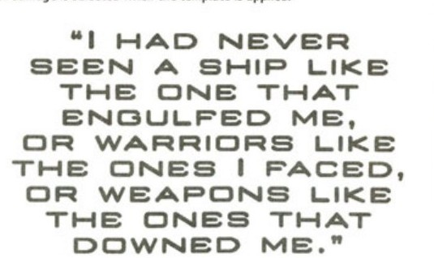

### Stat block notes (game mechanics, not feats)

- Hands-free comlink: Morrigan Corde frequently uses a hands-free comlink. (Source: *Legacy Era Campaign Guide* (SWRPG Saga Edition), scan p.67)

## scan p.68 (scan page 68)

Page contents: Bio-Implants and the Law continued: Imperial decrees covering all Sith; bribery. (hand-read)

## scan p.69 (scan page 69)

Page contents: Bio-implants: Cosmetic Enhancements, Body Spikes, Enhanced Vision, Natural Armor, Natural Weapon, Poison Filter, Replacement Body Parts. Caption: "TWO YUUZHAN VONG DEAL WITH AN FEG-SERIES PILOT DROID." (hand-read)

## scan p.70 (scan page 70)

Page contents: Sidebar "Living Vehicle Template" (CL, SR, hit points, natural healing, dovin basals, tractor beams, weapons); Droids; First-Degree Droids; PI-Series Medical Assistant Droid with stat block (CL 0). (hand-read)

### Stat block notes (game mechanics, not feats)

- PI-Series droids: The Sith Lord Darth Maladi makes extensive use of PI-Series medical assistant droids. Since much of her work takes place in a laboratory, these droids assist the Sith without disturbing her, which is something that her living assistants could never do. (Source: *Legacy Era Campaign Guide* (SWRPG Saga Edition), scan p.70)

## scan p.71 (scan page 71)

Page contents: 3Z3 Medical Droid with stat block (CL 1); BL-39 Interrogator Droid. Caption: "A BL-39 INTERROGATION DROID CORNERS A CODRU-JI JEDI." (hand-read)

### Stat block notes (game mechanics, not feats)

- K2-3Z3: The Imperial Army makes extensive use of 3Z3 medical droids. One such droid, K2-3Z3, saw to the medical treatment of Sergeant Harkas of Joker Squad after a skirmish against Fel loyalists on Borosk. (Source: *Legacy Era Campaign Guide* (SWRPG Saga Edition), scan p.71)

## scan p.72 (scan page 72)

Page contents: BL-39 Interrogator Droid stat block (CL 1); Second-Degree Droids; FEG-Series Pilot Droid with stat block (CL 1). (hand-read)

### Stat block notes (game mechanics, not feats)

- BL-39 droids: Moff Nyna Calixte often employs BL-39 interrogator droids in her duties as the Director of Imperial Intelligence. (Source: *Legacy Era Campaign Guide* (SWRPG Saga Edition), scan p.72)
- Feejee 13: The pirate captain Rav used an FEG-Series pilot droid named FEG-13 ("Feejee 13") on raids. (Source: *Legacy Era Campaign Guide* (SWRPG Saga Edition), scan p.72)

## scan p.73 (scan page 73)

Page contents: Holocam Droid with stat block (CL 0); Roving Eye Observation Droid. (hand-read)

- **Darth Talon** — entry/section: Pull quote: ""NO THREAT, NO PURPOSE." —DARTH TALON" Source: *Legacy Era Campaign Guide* (SWRPG Saga Edition), scan p.73
  

## scan p.74 (scan page 74)

Page contents: Roving Eye Observation Droid stat block (CL 0); Fourth-Degree Droids; Z65 Patrol Droid with stat block (CL 3). (hand-read)

### Stat block notes (game mechanics, not feats)

- Roving Eye droids: Darth Krayt uses several Roving Eye observation droids to closely monitor the training of his disciples, including the brief training received by Cade Skywalker on Coruscant. (Source: *Legacy Era Campaign Guide* (SWRPG Saga Edition), scan p.74)

## scan p.75 (scan page 75)

Page contents: LV8-Series Guard Droid (Baktoid Industrial Systems) with stat block (CL 4). Caption: "TWO LV8-SERIES GUARD DROIDS FIGHT ALONGSIDE A Z65 PATROL DROID." (hand-read)

## scan p.76 (scan page 76)

Page contents: Aggressor-Series Battle Droid (Farrfin Droidworks) with stat block (CL 1); IX-6 Heavy Combat Droid (Verpine). (hand-read)

- **Darth Krayt**: "When the Galactic Alliance crumbles and the Darth Krayt takes his place upon the throne, Imperial officials order the Roche collective to immediately cease production of the IX-6 heavy combat droid and destroy all existing models." Source: *Legacy Era Campaign Guide* (SWRPG Saga Edition), scan p.76
  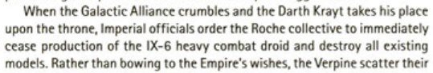

### Stat block notes (game mechanics, not feats)

- Aggressor droids: Darth Krayt keeps several Aggressor-Series battle droids, using them as training droids for his Sith underlings, including the training of Cade Skywalker. (Source: *Legacy Era Campaign Guide* (SWRPG Saga Edition), scan p.76)
- IX-6 droids: Darth Krayt keeps at least a few IX-6 heavy combat droids, using them as training droids for his Sith underlings. (Source: *Legacy Era Campaign Guide* (SWRPG Saga Edition), scan p.76)

## scan p.77 (scan page 77)

Page contents: IX-6 Heavy Combat Droid stat block (CL 5); LON-29 Battle Droid Commander (Balmorran Arms). Caption: "AN LON-29 BATTLEDROID COMMANDER, ATTENDED BY TWO IX-6 COMBAT DROIDS." (hand-read)

### Stat block notes (game mechanics, not feats)

- LON-29 droids: Darth Krayt has a small contingent of LON-29 battle droids, which he uses as training droids for his Sith underlings. (Source: *Legacy Era Campaign Guide* (SWRPG Saga Edition), scan p.77)

## scan p.78 (scan page 78)

Page contents: LON-29 Battle Droid Commander stat block (CL 6); Fifth-Degree Droids; HV-7 Loading Droid with stat block (CL 1). (hand-read)

- **Jariah Syn** — entry/section: Pull quote: ""JUST GET ON IT, DROID, BEFORE I REARRANGE YOUR INSIDES WITH MY BLASTER. YOU AIN'T NO TREASURED PART OF MY PAST." —JARIAH SYN" Source: *Legacy Era Campaign Guide* (SWRPG Saga Edition), scan p.78
  

## scan p.79 (scan page 79)

Page contents: Chapter VI: Vehicles and Starships (title page). (hand-read)

## scan p.80 (scan page 80)

Page contents: Vehicles and starships in the Legacy era: regulations, refitted vehicle template reference. (hand-read)

## scan p.81 (scan page 81)

Page contents: Speeder Bikes; Model 67 Shrieker Speeder Bike (Ikas-Adno) with stat block (CL 6); QuickFire Speeder Bike (Mobquet). Caption: "A QUICKFIRE SPEEDER BIKE (LEFT) AND A MODEL 67 SHRIEKER (RIGHT)." (hand-read)

### Stat block notes (game mechanics, not feats)

- Model 67 Shriekers: Bantha Rawk and his brood own several Model 67 Shriekers, which they use to travel across their home on Iego. (Source: *Legacy Era Campaign Guide* (SWRPG Saga Edition), scan p.81)

## scan p.82 (scan page 82)

Page contents: QuickFire Speeder Bike stat block (CL 7; Black Sun); Airspeeders; GPE-3300 Twin Engine Airspeeder (Galactic Power Engineering) with stat block (CL 6). Caption: "A GALACTIC ALLIANCE PROVOCATEUR LEAPS FROM A VELTISS-2 AIRSPEEDER ONTO A GPE-3300." (hand-read)

## scan p.83 (scan page 83)

Page contents: Veltiss-2 Airspeeder stat block (CL 6); Starfighters: Imperial restrictions; Besh-Type Personal Starfighter. Caption: "BESH-TYPE FIGHTERS ATTACK A YZ-2500 HEAVY TRANSPORT." (hand-read)

### Stat block notes (game mechanics, not feats)

- Veltiss-2: Moff Nyna Calixte owns a Veltiss-2 airspeeder, which she uses to move about Coruscant. (Source: *Legacy Era Campaign Guide* (SWRPG Saga Edition), scan p.83)

## scan p.84 (scan page 84)

Page contents: Besh-Type Personal Starfighter (Slayn & Korpil) with stat block (CL 8); Phoebos-class Starfighter (Ubrikkian Transports). Caption: "R-28 STARFIGHTERS EVADE FIRE FROM A GLADIUS-CLASS LIGHT FREIGHTER." (hand-read)

## scan p.85 (scan page 85)

Page contents: Phoebos-class Starfighter stat block (CL 8); R-28 Starfighter (Incom). (hand-read)

- **Ronto (pilot)** — entry/section: Pull quote: ""LADY, IF YOU HAD WINGS, I COULD FLY YOU." —RONTO" Source: *Legacy Era Campaign Guide* (SWRPG Saga Edition), scan p.85
  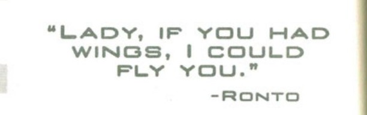

### Stat block notes (game mechanics, not feats)

- R-28 prototype: A'Sharad Hett owned an early prototype R-28 starfighter, which he crashed before being captured by the Yuuzhan Vong. (Source: *Legacy Era Campaign Guide* (SWRPG Saga Edition), scan p.85)

## scan p.86 (scan page 86)

Page contents: R-28 Starfighter stat block (CL 10); X-83 TwinTail Starfighter (Incom; secret manufacturing). Caption: "TWO X-83 TWINTAIL FIGHTERS ESCORT A J-1 SHUTTLE." (hand-read)

## scan p.87 (scan page 87)

Page contents: X-83 TwinTail Starfighter stat block; Space Transports; Gladius-class Light Freighter (Kuat Systems Engineering). (hand-read)

- **Morrigan Corde; Jor Torlin** — entry/section: Pull quote: ""NICE TASTE IN WEAPONS, TORLIN. NICE SHIP TOO." —MORRIGAN CORDE" Source: *Legacy Era Campaign Guide* (SWRPG Saga Edition), scan p.87
  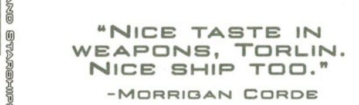

### Stat block notes (game mechanics, not feats)

- The Raider: The bounty hunter Jor Torlin uses a Gladius-class light freighter, called the Raider. (Source: *Legacy Era Campaign Guide* (SWRPG Saga Edition), scan p.87)

## scan p.88 (scan page 88)

Page contents: Gladius-class Light Freighter stat block (CL 9); GPE-7300 Space Transport (Galactic Power Engineering) with stat block (CL 7). (hand-read)

### Stat block notes (game mechanics, not feats)

- GPE-7300: Azlyn Rae, an Imperial Knight, uses a GPE-7300 as her personal space transport. (Source: *Legacy Era Campaign Guide* (SWRPG Saga Edition), scan p.88)

## scan p.89 (scan page 89)

Page contents: Helot-class Medium Space Transport (Sienar/Cygnus Design Cooperative) with stat block (CL 7); J-1 Shuttle (Koensayr; the Jedi Shuttle). Caption: "A PHOEBOS-CLASS FIGHTER ZIPS PAST A GPE-7300 TRANSPORT." (hand-read)

### Stat block notes (game mechanics, not feats)

- The Mynock: The Mynock, Cade Skywalker's ship, is a Helot-class medium space transport. (Source: *Legacy Era Campaign Guide* (SWRPG Saga Edition), scan p.89)

## scan p.90 (scan page 90)

Page contents: J-1 Shuttle stat block (CL 8); MC-24a Light Shuttle (Mon Calamari) with stat block (CL 6); YX-1980 Space Transport (Corellian Engineering Corporation). (hand-read)

## scan p.91 (scan page 91)

Page contents: YX-1980 Space Transport deck plan (1 square = 1.5 meters): Bridge, Crew Quarters, Navicomputer, Cargo Bays, Promenade, Passenger Quarters, Passenger Lounge/Galley, Refreshers, Engine Compartments. (hand-read)

## scan p.92 (scan page 92)

Page contents: YZ-2500 Heavy Transport (Corellian Engineering Corporation) continued, with stat block (CL 12); used by Galactic Alliance Core Fleet and crime lords. (hand-read)

### Stat block notes (game mechanics, not feats)

- The Grinning Liar: The Grinning Liar, used by the smugglers Kee and Chak, is a YX-1980 space transport. (Source: *Legacy Era Campaign Guide* (SWRPG Saga Edition), scan p.92)

## scan p.93 (scan page 93)

Page contents: Chapter VII: Legacy Era Campaigns (title page). (hand-read)

## scan p.94 (scan page 94)

Page contents: Legacy era campaigns: legacies, inclusivity of all eras, darkness of the era. (hand-read)

## scan p.95 (scan page 95)

Page contents: Violence as law; challenging assumptions; Introducing the Legacy Era (key points list); Advancing Existing Heroes; Heroes from All Eras; Heroes from the Past (carbon freezing). (hand-read)

### Stat block notes (game mechanics, not feats)

- Twisted assumptions: The cold, calculating Moff Nyna Calixte is at once an active Imperial agent and also the mother of Cade Skywalker, helping her son in defiance of the Empire she serves. (Source: *Legacy Era Campaign Guide* (SWRPG Saga Edition), scan p.95)
- Current Emperor: The current Emperor is Darth Krayt, a tyrannical man garbed in massive armor. (Source: *Legacy Era Campaign Guide* (SWRPG Saga Edition), scan p.95)
- Deposed Emperor: The deposed Emperor, Roan Fel, leads an Empire-in-exile, opposing the Sith-ruled Empire with many of the same resources and troops. (Source: *Legacy Era Campaign Guide* (SWRPG Saga Edition), scan p.95)
- Carbonite: One of the most iconic moments in the Star Wars saga happens in The Empire Strikes Back when Han Solo is frozen in carbonite. (Source: *Legacy Era Campaign Guide* (SWRPG Saga Edition), scan p.95)

## scan p.96 (scan page 96)

Page contents: Oubliettes; Iego (beings cease to age); droid heroes; Using Heroes from Campaigns Past (recordings). Caption: "LEGACY BOUNTY HUNTER". (hand-read)

## scan p.97 (scan page 97)

Page contents: Heroic Legacies continued: inherited skills and traits; Skywalkers and Solos; rules for legacies in Chapter 2. (hand-read)

- **Jaina Solo; Han Solo** — entry/section: Legacy Era Campaign Guide (Saga): "Han Solo is a skilled mechanic and a cunning warrior, and so too is Jaina Solo." Source: *Legacy Era Campaign Guide* (SWRPG Saga Edition), scan p.97
  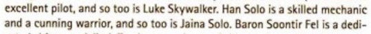

### Stat block notes (game mechanics, not feats)

- Vector: In the Vector story, a Jedi Shadow by the name of Celeste Morne becomes trapped in an oubliette, a Sith device that serves as a stasis pod and preserves the life of the person sleeping inside. After thousands of years, the oubliette is unearthed by miners and then sold to smugglers, who in turn sell the oubliette to a historian who hands it over to none other than Darth Vader. (Source: *Legacy Era Campaign Guide* (SWRPG Saga Edition), scan p.97)
- The Muur Talisman: Moreover, the oubliette also houses an artifact known as the Muur Talisman, which has the ability to create and control creatures known as rakghouls, as well as the spirit of a long-dead Sith Lord named Karness Muur. When Darth Vader opens this oubliette, he unleashes not just a Jedi from the past but also a plague of rakghouls, an ancient Sith Lord spirit, and an artifact of great power. (Source: *Legacy Era Campaign Guide* (SWRPG Saga Edition), scan p.97)
- Inherited traits: Anakin Skywalker is an excellent pilot, and so too is Luke Skywalker. Han Solo is a skilled mechanic and a cunning warrior, and so too is Jaina Solo. Baron Soontir Fel is a dedicated, driven, and disciplined man, and so too is his son, Jagged. (Source: *Legacy Era Campaign Guide* (SWRPG Saga Edition), scan p.97)

## scan p.98 (scan page 98)

Page contents: Heirloom Items; Heirloom Items Rules (Extra Modification, Legendary Icon, Steeped in the Dark Side, Symbol of the Light); Sample Heirloom Items: Anakin Solo's Lightsaber; sidebar "Heirloom Lightsabers". (hand-read)

- **Ulic Qel-Droma; Exar Kun**: "The personal blaster rifle of a hero of the Mandalorian Wars or a lightsaber wielded by a dreaded Sith Lord is more than just another piece of equipment; it is a piece of history, It has become legendary because it is strongly associated with the power and destiny of its owner and is closely tied to that person's fate; for example, Ulic Qe!-Droma's lightsaber and Exar Kun's battle armor were both integral in helping those characters fulfill their destinies, Such rare items are classified as heirloom items, and each is unique." Source: *Legacy Era Campaign Guide* (SWRPG Saga Edition), scan p.98
  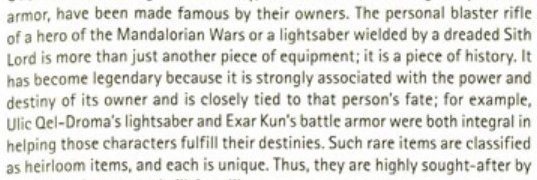
- **Anakin Solo; Darth Vader (Anakin Skywalker); Luke Skywalker** — entry/section: Anakin Solo's Lightsaber: "After Anakin Solo dies on the planet Myrkr, his lightsaber finds its way into the hands of Ganner Rhysode and even Anakin's uncle, Luke Skywalker, who wields it in a duel against Supreme Overlord Shimrra." Source: *Legacy Era Campaign Guide* (SWRPG Saga Edition), scan p.98
  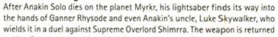

### Stat block notes (game mechanics, not feats)

- Heirloom examples: for example, Ulic Qel-Droma's lightsaber and Exar Kun's battle armor were both integral in helping those characters fulfill their destinies. (Source: *Legacy Era Campaign Guide* (SWRPG Saga Edition), scan p.98)
- Anakin Solo's Lightsaber: After Anakin Solo dies on the planet Myrkr, his lightsaber finds its way into the hands of Ganner Rhysode and even Anakin's uncle, Luke Skywalker, who wields it in a duel against Supreme Overlord Shimrra. The weapon is returned to Han Solo, who lays his son's lightsaber to rest in Chewbacca's memorial tree on Kashyyyk. (Source: *Legacy Era Campaign Guide* (SWRPG Saga Edition), scan p.98)

## scan p.99 (scan page 99)

Page contents: Sample heirloom items: Boba Fett's Mandalorian Armor; Chewbacca's Bowcaster; Emperor Palpatine's Lightsaber; Han Solo's Heavy Blaster Pistol (BlasTech DL-44); Luke Skywalker's Lightsaber. (hand-read)

- **Chewbacca** — entry/section: Legacy Era Campaign Guide (Saga): "Chewbacca's Bowcaster The favored weapon of the loyal and dedicated hero Chewbacca, this bowcaster represents decades of battle prowess in the hands of one of the greatest Wookiees of all time." Source: *Legacy Era Campaign Guide* (SWRPG Saga Edition), scan p.99
  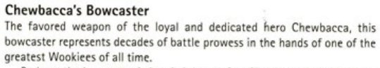
- **Obi-Wan Kenobi** — entry/section: Pull quote: ""YOUR FATHER'S LIGHTSABER. THIS IS THE WEAPON OF A JEDI KNIGHT. NOT AS CLUMSY OR RANDOM AS A BLASTER . . . AN ELEGANT WEAPON FOR A MORE CIVILIZED TIME." —OBI-WAN KENOBI" Source: *Legacy Era Campaign Guide* (SWRPG Saga Edition), scan p.99
  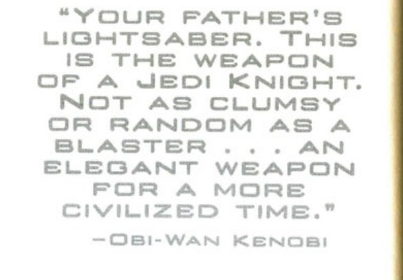
- **Boba Fett** — entry/section: Boba Fett's Mandalorian Armor: "Reassembling Boba Fett's armor might be the subject of a personal quest undertaken by a hero in a Legacy era campaign, or the reassembled suit could be worn by an enemy wishing to capitalize on the armor's legendary status." Source: *Legacy Era Campaign Guide* (SWRPG Saga Edition), scan p.99
  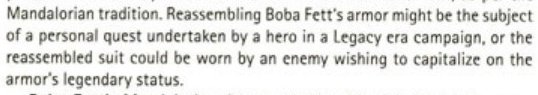
- **Chewbacca**: "Chewbacca's Bowcaster: Medium bowcaster (3d10 damage) and legendary icon (grants favorable circumstances on Charisma-based skill checks, except for Use the Force checks)." Source: *Legacy Era Campaign Guide* (SWRPG Saga Edition), scan p.99
  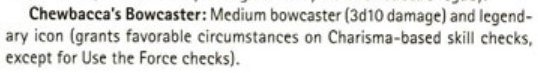
- **Luke Skywalker** — entry/section: Luke Skywalker's Lightsaber: "Luke Skywalker's Lightsaber: Medium lightsaber (2d8 damage) and legendary icon (grants favorable circumstances on Charisma-based skill checks, except for Use the Force checks)." Source: *Legacy Era Campaign Guide* (SWRPG Saga Edition), scan p.99
  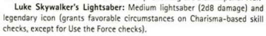

### Stat block notes (game mechanics, not feats)

- Boba Fett's armor: The famous bounty hunter Boba Fett wore a special suit of patchwork Mandalorian armor for decades. The Mandalorian armor is outfitted with dozens of special modifications, making it the ideal suit of armor for any bounty hunter or mercenary. (Source: *Legacy Era Campaign Guide* (SWRPG Saga Edition), scan p.99)
- Chewbacca's Bowcaster: The favored weapon of the loyal and dedicated hero Chewbacca, this bowcaster represents decades of battle prowess in the hands of one of the greatest Wookiees of all time. (Source: *Legacy Era Campaign Guide* (SWRPG Saga Edition), scan p.99)
- Palpatine's lightsaber: This red-bladed lightsaber belonged to one of the galaxy's most fearsome dictators. Constructed in the style of all Sith lightsabers, Emperor Palpatine's lightsaber practically drips with the dark side of the Force. This lightsaber is a sacred artifact to the Sith of the Legacy era, and any hero who comes to possess it will likely be stalked by agents of Darth Krayt until the weapon is secured. (Source: *Legacy Era Campaign Guide* (SWRPG Saga Edition), scan p.99)
- Han Solo's DL-44: This iconic BlasTech DL-44 heavy blaster pistol, the preferred sidearm of the galaxy's most famous smuggler, could have been handed down through the Solo family, or it might have been entrusted to a respected friend of the Solo family, such as Wedge Antilles or one of his descendants. (Source: *Legacy Era Campaign Guide* (SWRPG Saga Edition), scan p.99)
- Luke Skywalker's Lightsaber: Once the lightsaber of Anakin Skywalker before his transformation into Darth Vader, this blue-bladed lightsaber was given to Luke Skywalker by Obi-Wan Kenobi on Tatooine and served as Luke's primary weapon until the fateful duel on Cloud City. Years later, the lightsaber reappeared in the hands of Luke's clone, and was then handed down through the Skywalker family via Mara Jade Skywalker and their son, Ben Skywalker. (Source: *Legacy Era Campaign Guide* (SWRPG Saga Edition), scan p.99)

## scan p.100 (scan page 100)

Page contents: Everything Has a Place (example Neo-Crusader campaign); Evolving Designs (X-83 as evolution of X-wing; HWK-2000 example). (hand-read)

- **Roan Fel**: "By the end of your campaign, the heroes have a chance to shatter the Neo-Crusader resurgence, battle the forces of the Empire, earn the favor of Roan Fel's Empire-in-exile, and defeat the Sith Lord in whose affairs they have meddied." Source: *Legacy Era Campaign Guide* (SWRPG Saga Edition), scan p.100
  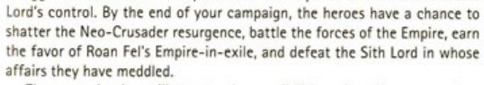

### Stat block notes (game mechanics, not feats)

- Moldy Crow: For example, say you have a player in your campaign who is very interested in the HWK-290 space transport (Kyle Katarn's Moldy Crow, found on page 118 of The Force Unleashed Campaign Guide). (Source: *Legacy Era Campaign Guide* (SWRPG Saga Edition), scan p.100)

## scan p.101 (scan page 101)

Page contents: Weapon Template: Antiquated (cont.); Weapon Template: Refitted; Vehicle Template: Antiquated. (hand-read)

## scan p.102 (scan page 102)

Page contents: Vehicle Template: Antiquated (cont.); Vehicle Template: Refitted; Age of Shadow; The Dark Side; Sith Overlords. (hand-read)

## scan p.103 (scan page 103)

Page contents: Jedi Bounty; Servitude & Slavery; The Three-Way War. (hand-read)

### Stat block notes (game mechanics, not feats)

- Slavery: However, Darth Krayt knows that freedom is also a breeding ground for dissent, and as such he has abolished many of the anti-slavery laws that have been in place since the fall of Palpatine's Empire. (Source: *Legacy Era Campaign Guide* (SWRPG Saga Edition), scan p.103)
- Showdown: Just like the eventual showdown between the heroes of the Rebellion and Jabba the Hutt, eventually the heroes will realize that the only way to escape their debts is to deal with the crime lord directly (Source: *Legacy Era Campaign Guide* (SWRPG Saga Edition), scan p.103)

## scan p.104 (scan page 104)

Page contents: Challenging Assumptions; Heroes and Villains; Secret Identities. (hand-read)

### Stat block notes (game mechanics, not feats)

- Hero and villain: For example, Cade Skywalker's story begins with him as a young Jedi, but later in life he turns into a bitter, violent bounty hunter, challenging our assumptions about the Skywalker lineage. Cade captures and turns in a fellow Jedi, Hosk Trey'lis, setting himself up as an enemy of the Jedi and something of a villain. However, Cade's guilt eventually gets to him, and he allows himself to be captured in order to free Hosk from the Sith. (Source: *Legacy Era Campaign Guide* (SWRPG Saga Edition), scan p.104)
- Secret identities: Moff Nyna Calixte secretly maintains an alter-ego of Morrigan Corde, an Imperial agent with far more freedom to act than the Moff herself. Similarly, the Imperial Knight Azlyn Rae maintains an alter-ego as a bounty hunter (her profession in the time between her Jedi training and her recruitment into the Imperial Knights). (Source: *Legacy Era Campaign Guide* (SWRPG Saga Edition), scan p.104)
- Two methods: as Morrigan Corde, Nyna Calixte watches out for her son Cade and tries to help him escape the Empire, but she herself must prove her unwavering loyalty and cruelty as an Imperial Moff. The second goal is accomplished by taking a different approach to how the character achieves her goals. As an Imperial Moff, Nyna Calixte uses politics, subtlety, and manipulation to achieve her ends, but as Morrigan Corde she uses big blasters, explosives, jet packs, and violence to accomplish her goals. (Source: *Legacy Era Campaign Guide* (SWRPG Saga Edition), scan p.104)

## scan p.105 (scan page 105)

Page contents: Chapter VIII: Galactic Gazetteer (title page). (hand-read)

## scan p.106 (scan page 106)

Page contents: Galactic Gazetteer intro; Space Travel (Imperial Space Ministry customs; Deep Core Security Zone; Core Worlds Security Zone; Hyperspace Security Net). (hand-read)

## scan p.107 (scan page 107)

Page contents: Planets of the Legacy Era; Bastion (stats; Knowledge (Galactic Lore) and (Tactics) DCs); Champala (stats). Caption: "AN AT-AHT ON BASTION." (hand-read)

### Stat block notes (game mechanics, not feats)

- Bastion: The planet is currently under the control of Roan Fel and his Empire-in-exile, and it is defended by a massive space fleet. (Source: *Legacy Era Campaign Guide* (SWRPG Saga Edition), scan p.107)
- Bastion defenses: Bastion is as well defended as Coruscant, which is why Darth Krayt has not launched an attack on the planet. (Source: *Legacy Era Campaign Guide* (SWRPG Saga Edition), scan p.107)

## scan p.108 (scan page 108)

Page contents: Champala Knowledge DCs; Csilla (stats; Bureaucracy and Galactic Lore DCs); Daluuj (stats). Caption: "MT DROPSHIPS ON DALUUJ." (hand-read)

### Stat block notes (game mechanics, not feats)

- Chiss Ascendancy: Darth Krayt's Galactic Empire allows the Chiss Ascendancy to retain much of its autonomy. It controls the Ascendancy by making many heads of the Chiss houses into high-ranking officials within the Empire. (Source: *Legacy Era Campaign Guide* (SWRPG Saga Edition), scan p.108)

## scan p.109 (scan page 109)

Page contents: Daluuj Knowledge DCs; Iego (stats; Galactic Lore and Life Sciences DCs: Diathim and Maelibi, Angels and Demons); Klatooine (stats). (hand-read)

## scan p.110 (scan page 110)

Page contents: Klatooine Knowledge DCs (Council of Elders; Klatooinian Trade Guild; wintrium); Lok (stats and DCs); Munto Codru (stats and DCs). Caption: "MUNTO CODRU". (hand-read)

### Stat block notes (game mechanics, not feats)

- Brogar's Safe House: Lok is the home of Brogar's Safe House, a place where criminals can pay a local crime lord (an Advozse named Brogar) for protection against the government, bounty hunters, or other criminals. (Source: *Legacy Era Campaign Guide* (SWRPG Saga Edition), scan p.110)

## scan p.111 (scan page 111)

Page contents: Munto Codru Life Sciences DCs (Codru-Ji; wyrwulves); Nagi (stats and DCs; Tofs; Saijo); Ossus (stats; Life Sciences DCs: Ysanna). Caption: "NEUTRALIZER-CLASS BOMBERS ATTACK OSSUS." (hand-read)

## scan p.112 (scan page 112)

Page contents: Ossus Galactic Lore DCs; Socorro (stats and DCs); Sriluur (stats and DCs); Zeltros (stats). (hand-read)

- **Darth Krayt**: "25 Ossus was home to the Jedi until Darth Krayt's Empire wiped out the temple there." Source: *Legacy Era Campaign Guide* (SWRPG Saga Edition), scan p.112
  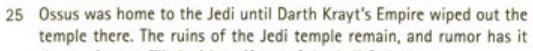

### Stat block notes (game mechanics, not feats)

- Ossus Project: The planet was reinvigorated by Kol Skywalker's Ossus Project. Thanks to the terraforming efforts of Yuuzhan Vong shapers, Ossus is now a lush planet covered in forests. (Source: *Legacy Era Campaign Guide* (SWRPG Saga Edition), scan p.112)
- Ossus temple: Ossus was home to the Jedi until Darth Krayt's Empire wiped out the temple there. (Source: *Legacy Era Campaign Guide* (SWRPG Saga Edition), scan p.112)
- The Crimson Axe: The Crimson Axe, a ship owned by the Feeorin pirate Rav, is grounded near an ancient sarlacc pit on Socorro. It serves as a base of operations for Rav's gang, as well as a bounty post, gambling hall, and cantina. (Source: *Legacy Era Campaign Guide* (SWRPG Saga Edition), scan p.112)

## scan p.113 (scan page 113)

Page contents: Zeltros DCs; Zonama Sekot (stats; Galactic Lore, Life Sciences and Physical Sciences DCs); Planetary Updates; Bespin (Cloud City in decline). (hand-read)

### Stat block notes (game mechanics, not feats)

- Sekot: Sekot, the sentient mind of the planet, is both intelligent and Force-sensitive, though its skill with the Force is untrained at best. (Source: *Legacy Era Campaign Guide* (SWRPG Saga Edition), scan p.113)
- Baron-Administrator: With much of the city abandoned, the current Baron-Administrator (a shrewd Ithorian named Ormo Haddon) has attempted to revitalize the economy by ordering all of the businesses and residential areas to move to more central locations, creating a populated nexus of commerce surrounded by abandoned outskirts. (Source: *Legacy Era Campaign Guide* (SWRPG Saga Edition), scan p.113)

## scan p.114 (scan page 114)

Page contents: Bothawui; Cerea; Coruscant; Dorin (ransom worlds). (hand-read)

- **Palpatine (Darth Sidious)**: "Coruscant has been returned almost perfectly to its state under the reign of Emperor Palpatine, with Star Destroyers constantly in orbit over the world, stormtroopers on every street corner, and Sith Lords lurking in the shadows." Source: *Legacy Era Campaign Guide* (SWRPG Saga Edition), scan p.114
  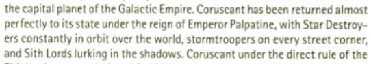

### Stat block notes (game mechanics, not feats)

- Bothawui: Unlike his predecessors, Darth Krayt knows that the Bothans cannot be trusted to sit idly by while their power and influence is taken away by the Empire. Rather than allowing Bothawui to once again foment rebellion, Krayt orders his Moffs to offer prestigious positions throughout the Empire to Bothans with influence on Bothawui, setting them up with large payrolls and giving them a great deal of power in the new Empire. Bothan leaders who refuse the bribes of the new Empire meet a more sinister fate. (Source: *Legacy Era Campaign Guide* (SWRPG Saga Edition), scan p.114)
- Coruscant: Moreover, Darth Krayt does not tolerate any unrest, dissent, or lawlessness under his watchful eyes. Summary executions are common for even the most casual of offenses. (Source: *Legacy Era Campaign Guide* (SWRPG Saga Edition), scan p.114)

## scan p.115 (scan page 115)

Page contents: Dorin (Dorin Run); Duro; Gamorr; Iridonia (Feldrona prison colony); Ithor. (hand-read)

### Stat block notes (game mechanics, not feats)

- Duro's favored son: With its favored son, Gar Stazi, leading the remnants of the Galactic Alliance Core Fleet, Duro has become a world commonly held up by the Empire as an example of what happens when you defy the Sith and Imperial law. (Source: *Legacy Era Campaign Guide* (SWRPG Saga Edition), scan p.115)
- Iridonia: When Darth Krayt seizes power, Iridonia is among the first worlds to openly pledge its allegiance to the new Emperor. ... The planet Iridonia has contributed more apprentices to the new Sith Order than any other world, a fact that has prompted Darth Krayt to consider Iridonia one of the primary training places of his Sith Lords. (Source: *Legacy Era Campaign Guide* (SWRPG Saga Edition), scan p.115)
- Ossus Project and Ithor: When Kol Skywalker's Ossus Project is first announced, Ithorian scientists are skeptical that the Yuuzhan Vong would be able to terraform their world once more. (Source: *Legacy Era Campaign Guide* (SWRPG Saga Edition), scan p.115)

## scan p.116 (scan page 116)

Page contents: Ithor (recovery); Kashyyyk (blockade); Mon Calamari. Caption: "AN MC-24A SPACE TRANSPORT ABOVE THE MON CALAMARI SHIPYARDS." (hand-read)

### Stat block notes (game mechanics, not feats)

- Kashyyyk: Darth Krayt and his Empire did not forget Kashyyyk's contributions to overthrowing Palpatine's Galactic Empire. However, knowing that the Wookiees could not be bribed as easily as, say, the Bothans, the Empire has blockaded the world and destroyed all of the Wookiee shipyards and spaceports. (Source: *Legacy Era Campaign Guide* (SWRPG Saga Edition), scan p.116)
- Mon Calamari: The Galactic Alliance, with help from Mon Calamari insiders, steals a prototype Star Destroyer from the Mon Calamari shipyards. In a rage, Lord Krayt orders the extermination of one-tenth of the Mon Calamari people. The rest of the Mon Calamari have been rounded up and placed in work camps. Darth Krayt is using the people of Mon Calamari as an example of what will happen when people openly defy the Empire, and he has made a promise to eventually exterminate not only the people of Mon Calamari but also their culture, history, and any other lasting effect they might have on the galaxy. (Source: *Legacy Era Campaign Guide* (SWRPG Saga Edition), scan p.116)

## scan p.117 (scan page 117)

Page contents: Mon Calamari (concentration camps); Naboo; Nar Shaddaa; Rodia (Jedi hunting academies); Ryloth (Sith recruiters). (hand-read)

- **Roan Fel; Palpatine (Darth Sidious)**: "Though still possessed of a strong independent streak, the people of Naboo come to accept their status under Emperor Roan Fel, who proves to be a far more benevolent than Palpatine ever was." Source: *Legacy Era Campaign Guide* (SWRPG Saga Edition), scan p.117
  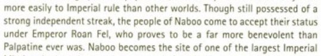

### Stat block notes (game mechanics, not feats)

- Naboo: the people of Naboo come to accept their status under Emperor Roan Fel, who proves to be a far more benevolent than Palpatine ever was. ... All of that changes when Darth Krayt drives Roan Fel out and seizes the Imperial throne for himself. (Source: *Legacy Era Campaign Guide* (SWRPG Saga Edition), scan p.117)

## scan p.118 (scan page 118)

Page contents: Ryloth (cont.; slave trade); Sullust (ransom world; SoroSuub; secret underground cities); Tatooine; Trandosha. (hand-read)

### Stat block notes (game mechanics, not feats)

- Tatooine: Though Darth Krayt actually hails from Tatooine, the Empire largely ignores the world. (Source: *Legacy Era Campaign Guide* (SWRPG Saga Edition), scan p.118)

## scan p.119 (scan page 119)

Page contents: Chapter IX: The Galactic Alliance (title page). (hand-read)

## scan p.120 (scan page 120)

Page contents: History of the Galactic Federation of Free Alliances: Yuuzhan Vong invasion, Killik-Chiss crisis, Galactic Alliance-Confederation War, Ossus Project crisis, war with the resurgent Empire. (hand-read)

### Stat block notes (game mechanics, not feats)

- Alliance-Confederation War: Jacen Solo, aided by a Sith named Lumiya, manipulate the crisis and the Alliance government in a bid to seize galactic power. Through legal and political maneuverings, Jacen Solo and Supreme Commander Niathal displace the Chief of State Cal Omas. Jacen becomes Darth Caedus, and as his power grows, the Galactic Alliance weakens. (Source: *Legacy Era Campaign Guide* (SWRPG Saga Edition), scan p.120)
