# Owner Material 037 — Star Wars D20 Drive folder (Core, Revised Core and Saga Edition): Sourcebooks/Legacy Era Campaign Guide.pdf [Star Wars Roleplaying Game Saga Edition (2007)] (scan pages 121–180)

- **Source:** Wizards of the Coast Star Wars Roleplaying Game books, web enhancements, Living Force campaign modules and articles (2000–2010), from the owner's "Star Wars D20" Drive folder (only the three edition subfolders; "General" was not read, as instructed). Secondary source (licensed Legends reference). Scan OCR'd on the box; the scan stays box-only and is **not** published.
- **Method:** every scanned page was OCR'd and machine-screened sentence by sentence for power-relevant statements (fights, kills, defeats, Force feats, rankings, superweapons) that name a character on our roster; each kept sentence is quoted verbatim from the OCR text and has a crop of the printed passage directly under it. Pages with nothing power-relevant are still listed with what is on them.
- **Citation:** "*Legacy Era Campaign Guide* (SWRPG Saga Edition), p.X" by printed page ("scan p.X" where no printed number applies). **Weight:** Licensed RPG material: a secondary source. Narrative text sums up Legends lore; game statistics are rules for players, not canon power levels, and rank lowest.

## scan p.121 (scan page 121)

Page contents: Battle of Caamas and surrender; Organization; The Triumvirate; Galactic Senate; Galactic Courts; The Jedi Order; Member Worlds and Systems. (hand-read)

### Stat block notes (game mechanics, not feats)

- Battle of Caamas: The Empire achieves ultimate victory at the Battle of Caamas. Admiral Gar Stazi, commander of the Galactic Alliance Core Fleet, refuses to surrender and flees with his ships. ... Not long after the transfer of power, Darth Krayt overthrows Emperor Roan Fel and seizes the Imperial throne. (Source: *Legacy Era Campaign Guide* (SWRPG Saga Edition), scan p.121)
- Triumvirate: In order to prevent a single person from seizing power, as Jacen Solo did during the Galactic Alliance-Confederation War, the Chief of State position is officially and formally eliminated, and replaced by a three-person Triumvirate elected by the Senate. (Source: *Legacy Era Campaign Guide* (SWRPG Saga Edition), scan p.121)

## scan p.122 (scan page 122)

Page contents: Sidebar "Military Ranks": Galactic Alliance Army officers (General, Major General, Lt. General, Colonel, Lt. Colonel, Major, Captain, Lieutenant) and enlisted (Sergeant Major, Sergeant, Corporal, Private); Galactic Alliance Navy officers (Admiral, Vice Admiral, Rear Admiral, Commodore, Captain, Lieutenant, Ensign), starfighter officers (Commander, Wing Commander, Flight Officer, Spacer 1st Class, Spacer) and enlisted (Chief, Apprentice); Specialized Teams: Commando Teams and Rescue Teams assignments. (hand-read)

## scan p.123 (scan page 123)

Page contents: Supreme Commander (after the Solo-Niathal coup); Galactic Alliance Fleets; Galactic Alliance Army; The Alliance Remnant. Caption: "A GALACTIC ALLIANCE OFFICER OBSERVES A TRI-SCYTHE-CLASS FRIGATE." (hand-read)

### Stat block notes (game mechanics, not feats)

- The Alliance Remnant: After the defeat of the Alliance fleet at the Battle of Caamas and the surrender of the Galactic Alliance, Admiral Stazi's Alliance Core Fleet flees the battlefield and forms the core of a new resistance. The Admiral steadfastly refuses to surrender and continues to take the fight to the Empire. (Source: *Legacy Era Campaign Guide* (SWRPG Saga Edition), scan p.123)

## scan p.124 (scan page 124)

Page contents: Sidebar "Alliance Fragments": scattered resistance after the surrender; small victories are still victories. (hand-read)

### Stat block notes (game mechanics, not feats)

- The Wheel: The observation is not lost on Emperor Fel, who tries to forge an alliance with his one-time enemy. Unfortunately, the Sith learn of Fel's plan, and when Admiral Stazi meets with Fel's representative at the Wheel, Sith agents use subterfuge to scuttle the plan while making the Admiral believe that Emperor Fel's agents planned to eliminate him. (Source: *Legacy Era Campaign Guide* (SWRPG Saga Edition), scan p.124)
- The Imperious: When the opportunity arises to capture the Imperious, one of the Empire's newest and most advanced Star Destroyers, the Admiral puts aside his suspicions of a trap and sets out to capture the prize. Ultimately he succeeds, but loses his flagship (the Indomitable) in the process. (Source: *Legacy Era Campaign Guide* (SWRPG Saga Edition), scan p.124)
- Mon Calamari reprisal: The Sith retaliate, not against Stazi but against the Mon Calamari who aided in the attack. Stazi underestimates the depth of Sith anger and revenge as Darth Krayt authorizes the wholesale slaughter of millions of Mon Calamari and places the remaining population in concentration camps. (Source: *Legacy Era Campaign Guide* (SWRPG Saga Edition), scan p.124)
- Alliance Fragments: Inspired by Admiral Stazi, a few scattered ships and settlements initially attempt organized opposition. Unfortunately, the Empire moves swiftly against any open resistance efforts. The Imperial crackdown escalates once Darth Krayt seizes power, whereupon even minor resistance efforts are met with overwhelming force and cruelty. (Source: *Legacy Era Campaign Guide* (SWRPG Saga Edition), scan p.124)

## scan p.125 (scan page 125)

Page contents: The Galactic Alliance Army; GAC Teams: Ad Hoc Teams (Imperial Infiltration, Sith Elimination), Dedicated Teams (Womp Rats, Mon Calamari Rescue); Venom Assault Squads. (hand-read)

## scan p.126 (scan page 126)

Page contents: Venom Zero; Elite Squadrons; Rogue Squadron (CF9 Crossfire); sidebar "Using the Galactic Alliance Core Fleet". Caption: "VENOM ASSAULT TROOPERS RAID AN IMPERIAL STAR DESTROYER." (hand-read)

### Stat block notes (game mechanics, not feats)

- Rogue Squadron: Their successful operations include the theft of the Star Destroyer Imperious, and the "rescue" of Admiral Stazi from the doomed Indomitable. (Source: *Legacy Era Campaign Guide* (SWRPG Saga Edition), scan p.126)

## scan p.127 (scan page 127)

Page contents: Farsight Squadron (Twilight RC-2); Fireblue Squadron (I4 Ionizer); Phantom Squadron (in the spirit of Wraith Squadron); Twisted Star Squadron (Jumpstar HPF); The Mon Calamari Resistance Network. (hand-read)

- **Darth Krayt**: "After Admiral Stazi and the Galactic Alliance Core Fleet steal the prototype Star Destroyer imperious from the Dac shipyards, with help from former Triumvirate member Gial Gahan, Darth Krayt orders the execution of millions of Mon Calamari and has the remaining Mon Calamari rounded up into internment camps." Source: *Legacy Era Campaign Guide* (SWRPG Saga Edition), scan p.127
  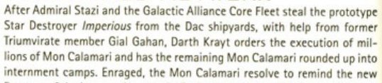

### Stat block notes (game mechanics, not feats)

- Mon Calamari Resistance: After Admiral Stazi and the Galactic Alliance Core Fleet steal the prototype Star Destroyer Imperious from the Dac shipyards, with help from former Triumvirate member Gial Gahan, Darth Krayt orders the execution of millions of Mon Calamari and has the remaining Mon Calamari rounded up into internment camps. Enraged, the Mon Calamari resolve to remind the new Emperor of the lessons they taught Emperor Palpatine. (Source: *Legacy Era Campaign Guide* (SWRPG Saga Edition), scan p.127)

## scan p.128 (scan page 128)

Page contents: The Ackbar Trail; Alliance Personnel; sidebar "Creating Your Own Units, Squadrons, and Starship Crews". (hand-read)

- **Jaius Yorub** — entry/section: Pull quote: ""YOU REFUSE TO ACCEPT THE FACT THAT YOU HAVE BECOME A SYMBOL, AND THE FLEET NEEDS THAT. SOMETHING AROUND WHICH OTHERS CAN RALLY." —JAIUS YORUB" Source: *Legacy Era Campaign Guide* (SWRPG Saga Edition), scan p.128
  
- **Admiral Ackbar; Grand Moff Tarkin**: "The Trail was named in honor of Admiral Ackbar's famous journey from slavery under Grand Moff Tarkin to becoming a Rebel Alliance Admiral who defeated his former masters, the original Galactic Empire." Source: *Legacy Era Campaign Guide* (SWRPG Saga Edition), scan p.128
  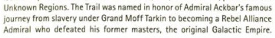

## scan p.129 (scan page 129)

Page contents: Galactic Alliance Core Fleet Commando (Elite Commando CL 10, Human soldier 4/scout 3/elite trooper 3); Galactic Alliance Core Fleet Covert Agent (CL 5, Human scoundrel 2/scout 3; talents Disinformation, Shocking Revelation, Sneak Attack); Galactic Alliance Army Officer intro. (hand-read)

### Stat block notes (game mechanics, not feats)

- Covert Agents: Galactic Alliance Core Fleet agents are scattered across the galaxy. Though the network is not large, many agents are stationed in prime positions to provide Admiral Stazi and the fleet with the data they need to fight the Empire and, more importantly, raid for supplies. (Source: *Legacy Era Campaign Guide* (SWRPG Saga Edition), scan p.129)

## scan p.130 (scan page 130)

Page contents: Galactic Alliance Army Officer (CL 11, Human noble 3/soldier 4/officer 4). Caption: "LEFT TO RIGHT: GALACTIC ALLIANCE TROOPER, SCOUT, PILOT, AND OFFICER". (hand-read)

## scan p.131 (scan page 131)

Page contents: Galactic Alliance Army Trooper (CL 2, nonheroic 7); Galactic Alliance Navy Captain (CL 10, noble 7/officer 3); Galactic Alliance Navy Junior Officer intro. (hand-read)

### Stat block notes (game mechanics, not feats)

- Navy Captains: Brave, skilled, and dedicated leaders, these officers are inspired by Admiral Stazi's gall, tenacity, and creativity. (Source: *Legacy Era Campaign Guide* (SWRPG Saga Edition), scan p.131)

## scan p.132 (scan page 132)

Page contents: Alliance Navy Junior Officer (CL 6, nonheroic 4/noble 5). Caption: "LEFT TO RIGHT: VENOM ASSAULT TROOPER, GALACTIC ALLIANCE COMMANDO, GALACTIC ALLIANCE INTELLIGENCE OFFICER, NAVAL OFFICER." (hand-read)

## scan p.133 (scan page 133)

Page contents: Galactic Alliance Navy Crew (CL 2); Galactic Alliance Navy Gunner (CL 5, nonheroic 4/soldier 4); Galactic Alliance Pilot (CL 5, nonheroic 3/soldier 4). (hand-read)

## scan p.134 (scan page 134)

Page contents: Mon Calamari Resistance Member (CL 2); Influential Personalities; Admiral Gar Stazi. Caption: "ADMIRAL GAR STAZI". (hand-read)

### Stat block notes (game mechanics, not feats)

- Admiral Gar Stazi: Admiral Gar Stazi is a long-time commander in the Galactic Alliance forces. During the Sith-Imperial War, he commands the Core Fleet responsible for defending Coruscant and the Core Worlds. He is also responsible for saving the fleet, along with many other Galactic Alliance ships, from the Imperial trap at the Battle of Caamas. The Admiral had expected a trap, whereas the Triumvirate believed the battle to be an opportunity to inflict major damage on Imperial forces. When his superiors order the surrender of the fleet, and essentially the Galactic Alliance, the Admiral leads all willing ships out of the system through obscure hyperspace routes, successfully bypassing Imperial starships and mines. (Source: *Legacy Era Campaign Guide* (SWRPG Saga Edition), scan p.134)
- Admiral Gar Stazi: His successes in the seven years following the collapse of the Galactic Alliance have forced the Sith Empire to target him directly. The intolerant Sith have punished and replaced those unable to capture the Admiral. Despite the obvious threat that Gar Stazi poses to Imperial security, most competent enemies respect his abilities. (Source: *Legacy Era Campaign Guide* (SWRPG Saga Edition), scan p.134)
- Admiral Gar Stazi: At one point, he considers forging an alliance with Emperor Fel against the Sith. Although Imperial agents thwart this endeavor, it demonstrates that Admiral Stazi's willingness to consider radical plans of action against the Sith Empire. (Source: *Legacy Era Campaign Guide* (SWRPG Saga Edition), scan p.134)
- Admiral Gar Stazi: His own life is a small price to pay for galactic freedom and democracy, as he proves when he sends his flagship, the Indomitable, on a collision course with the Mon Calamari shipyards in order to secure a strategic victory. Fortunately for the Alliance Remnant, and arguably the entire galaxy, his friends and aides forcibly remove him from the ship before it is destroyed. (Source: *Legacy Era Campaign Guide* (SWRPG Saga Edition), scan p.134)

## scan p.135 (scan page 135)

Page contents: Admiral Gar Stazi (CL 16, Medium Duros noble 5/soldier 2/officer 9; Destiny 3; Force 8; alternate talents from Starships of the Galaxy); Andurgo (CL 9, Small Dug scoundrel 7/ace pilot 2; CF9 Crossfire starfighter). (hand-read)

### Stat block notes (game mechanics, not feats)

- Andurgo: Andurgo is a member of Rogue Squadron and one of the few Dugs serving in the Galactic Alliance Core Fleet. Indeed, he is one of the few Dugs to leave Malastare. Andurgo's arrogant self-confidence would be unbearable were he not a great pilot. He revels in the excitement of starfighter combat and loves to show off. His recklessness insures that his wingmen have their hands full just trying to keep the wild Dug alive. To Andurgo, that is their entire purpose. (Source: *Legacy Era Campaign Guide* (SWRPG Saga Edition), scan p.135)

## scan p.136 (scan page 136)

Page contents: Bail Antilles (CL 10, Human nonheroic 6/noble 8); Commander Jhoram Bey (CL 12, Medium Weequay soldier 7/ace pilot 5; Destiny 2; Force 6). (hand-read)

### Stat block notes (game mechanics, not feats)

- Bail Antilles: Bail Antilles comes from a family dedicated to governmental service. His family name combined with his personal charisma and connections allow him to rise through the Galactic Government and ultimately be voted in as a member of the Triumvirate. He is known to carefully consider all options, and is not beholden to any specific policy or organization. He is level headed and often provides the swing vote between the other two members of the Triumvirate, Gial Gahan and Nu Toreena. (Source: *Legacy Era Campaign Guide* (SWRPG Saga Edition), scan p.136)
- Bail Antilles: Bail casts the deciding vote to engage the Empire at the Battle of Caamas. He hopes that a quick victory over the Empire might stop member worlds from leaving the Galactic Alliance. The Imperial victory forces the Galactic Alliance to surrender, and Bail has no choice but to go along. Like the other members of the Triumvirate, he is replaced by an administrator loyal to Emperor Fel. (Source: *Legacy Era Campaign Guide* (SWRPG Saga Edition), scan p.136)
- Commander Jhoram Bey: Commander Jhoram Bey leads Rogue Squadron during its assignment to the Galactic Alliance Core Fleet. The large Weequay's strong personality and commanding presence keep the irregular squadron mates in order. While the Rogues appear to lack discipline, there is a difference between parade-ready and combat-ready, and the squad under Bey's command is always the latter. (Source: *Legacy Era Campaign Guide* (SWRPG Saga Edition), scan p.136)
- Commander Jhoram Bey: When the Admiral attempts to remain on board the Indomitable in order to guide it on a collision course with the Mon Calamari shipyards, Bey resorts to knocking the Admiral unconscious (on Captain Jorus's orders) to ensure that Stazi survives as the Alliance's leader. In order to teach the squadron leader a lesson, Admiral Stazi promotes Bey to be his second-in-command over the Galactic Alliance Core Fleet. (Source: *Legacy Era Campaign Guide* (SWRPG Saga Edition), scan p.136)

## scan p.137 (scan page 137)

Page contents: Commander Jhoram Bey stats continued (alternate talents/feats from Starships of the Galaxy); Anj Dahl (CL 8, Medium Human scoundrel 7/ace pilot 1); Gial Gahan intro. (hand-read)

- **Darth Krayt** — entry/section: Legacy Era Campaign Guide (Saga): "Gial is killed by Darth Krayt personally, and he is but the first." Source: *Legacy Era Campaign Guide* (SWRPG Saga Edition), scan p.137
  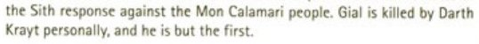

### Stat block notes (game mechanics, not feats)

- Anj Dahl: Anj Dahl joins Rogue Squadron several years after the Battle of Caamas. She's young, talented, and enthusiastic. She's also known to incite trouble between her squadron mates simply for her own amusement. She's spent most of her short adult life with the Galactic Alliance Core Fleet. The constant feeling that everything could end at any moment probably contributes to her embracement of all that is fun in life. Anj is also a capable scrounger, able to obtain parts and supplies at most spaceports without raising alarms. She does even better when aided by Galactic Alliance Core Fleet sympathizers. (Source: *Legacy Era Campaign Guide* (SWRPG Saga Edition), scan p.137)
- Gial Gahan: Gial Gahan is a revered member of the Triumvirate before its fall to the Empire. Prior to this, Gial served as governor of the Hub, liaison to the Mon Calamari defense forces, liaison to the Jedi Order, and the Senator of Mon Calamari. (Source: *Legacy Era Campaign Guide* (SWRPG Saga Edition), scan p.137)
- Gial Gahan: He is the only Triumvirate member to vote against engaging the Empire at the disastrous Battle of Caamas. He has no desire to surrender the Galactic Alliance to the Empire, but is left with little choice in the end. Although Emperor Fel retains the Triumvirate in his new government, Gial Gahan and the other Alliance members are quickly replaced with loyal Imperial bureaucrats. (Source: *Legacy Era Campaign Guide* (SWRPG Saga Edition), scan p.137)
- Gial Gahan: Dismayed at what this turn of events has done to the galaxy and especially the Mon Calamari people, he secretly begins to equip the Galactic Alliance Core Fleet with supplies, bacta, and Mon Calamari recruits. His ultimate donation comes soon enough, when he provide the codes and required access to allow Galactic Alliance Core Fleet forces to steal the advanced Star Destroyer Imperious from the Hub. Fearing that the theft of the ship will endanger the Mon Calamari people, he arranges to take all of the blame for the deed. True to his prediction, he is arrested shortly after the attack. However, not even Gial Gahan could predict the ruthlessness of the Sith response against the Mon Calamari people. Gial is killed by Darth Krayt personally, and he is but the first. (Source: *Legacy Era Campaign Guide* (SWRPG Saga Edition), scan p.137)

## scan p.138 (scan page 138)

Page contents: Gial Gahan (CL 14, Medium Mon Calamari noble 14; Destiny 2; Force 7); Monia Gahan (CL 8, Mon Calamari scoundrel 4/scout 3/ace pilot 1; Xcalq-3GA "Slicer Special"); Hondo Karr intro. (hand-read)

### Stat block notes (game mechanics, not feats)

- Monia Gahan: Inspired by the bravery of her uncle, Gial Gahan, Monia Gahan leaves the Mon Calamari defense forces shortly after the Sith place the Quarren in power over Mon Calamari. Though young, she is a skilled pilot, and her connection to her uncle makes her a vital link between him and the Galactic Alliance Core Fleet. Quickly she is assigned to Rogue Squadron, later serving as Andurgo's wingman. She also participates in the critical mission to steal the Star Destroyer Imperious from the Hub, by using her considerable slicing skills to take control the Hub's weapon defenses. She escapes the Sith's retribution with the help of a pair of Imperial Knights, and is instrumental in rekindling discussions of an alliance between the Galactic Alliance and Roan Fel's Empire-in-exile. (Source: *Legacy Era Campaign Guide* (SWRPG Saga Edition), scan p.138)
- Hondo Karr: Hondo Karr was never one to completely follow any ideology or command structure. A Mandalorian by birth, Karr ends up serving as an Imperial stormtrooper. However, in keeping with his Mandalorian values, Karr's dedication is to his comrades and commander, not to the Empire itself. He dislikes the treatment of military units as expendable, and he sees the end of his Imperial career once the Sith take control. (Source: *Legacy Era Campaign Guide* (SWRPG Saga Edition), scan p.138)
- Hondo Karr: Karr nearly dies at the hands of the Sith Lord Maleval, after Karr attacks the Sith for killing his lieutenant. Fortunately, Karr's loyalty in his fellow troopers is not misplaced. They open fire on the Sith Lord, and Karr walks away with his life. Karr disappears and is a presumed dead, but eventually makes his way to the Galactic Alliance Core Fleet. His combat experience and piloting skill earn him a slot in Rogue Squadron. However, his sour demeanor doesn't change much. Still, he considers the Alliance cause worthy of his effort. Admiral Stazi puts Karr's Imperial background to good use by placing him in command of the infiltration unit that boards and steals the Star Destroyer Imperious. (Source: *Legacy Era Campaign Guide* (SWRPG Saga Edition), scan p.138)

## scan p.139 (scan page 139)

Page contents: Hondo Karr (CL 10, Medium Human soldier 7/elite trooper 3; Mando'a); Nu Toreena (CL 4, Medium Ithorian nonheroic 12). Caption: "HONDO KARR". (hand-read)

### Stat block notes (game mechanics, not feats)

- Nu Toreena: Nu Toreena is a member of the Triumvirate before the Battle of Caamas, and arguably the weakest politically. She seeks to bring the war with the Empire to a quick end, no matter what the risk. As an Ithorian, she knows the horror of losing a homeworld in a vicious war, as her people lost Ithor during the Yuuzhan Vong invasion. She has no wish to see that happen to the Galactic Alliance. When Rear Admiral Piers Petan proposes a plan to ambush Emperor Fel's flagship over Caamas, Toreena fully backs the effort, despite the fact that it would mean stripping Coruscant of its protective fleet. After the Imperials spring their trap at the Battle of Caamas, Toreena and the other members of the Triumvirate are forced to surrender the Galactic Alliance to the Empire. Emperor Fel replaces the entire Triumvirate, Toreena is widely blamed for supporting the risky battle plan, and her political career comes to an abrupt end. (Source: *Legacy Era Campaign Guide* (SWRPG Saga Edition), scan p.139)

## scan p.140 (scan page 140)

Page contents: Ronto (CL 8, Medium Klatooinian scoundrel 7/ace pilot 1); Captain Jaius Yorub (CL 13, Medium Sullustan noble 4/soldier 4/officer 5). (hand-read)

### Stat block notes (game mechanics, not feats)

- Ronto: Ronto is a Klatooinian pilot with Rogue Squadron. He confidently tears into opposing squadrons with measured skill, and finds wild pilots such as Andurgo to be needlessly reckless. He earns a tough reputation after surviving being shot down over Mon Calamari in the raid to steal the Imperious. He is rescued from an Imperial detention facility shortly thereafter by Monia and Imperial Knights. (Source: *Legacy Era Campaign Guide* (SWRPG Saga Edition), scan p.140)
- Captain Jaius Yorub: A career naval officer, Yorub is a competent captain and a stalwart supporter of Admiral Stazi. Captain Yorub commands the Scythe-class battle cruiser Indomitable for many years before and after the fall of the Galactic Alliance. As the Admiral's flagship, it leads the retreat from the Battle of Caamas and becomes the headquarters for the Galactic Alliance Core Fleet. Captain Yorub serves as Admiral Stazi's advisor for many years after the Battle of Caamas, but he is never able to convince the Admiral of his importance as an icon as well as a fleet leader. When it came time for Commander Bey to choose between obeying Admiral Stazi or obeying Captain Yorub at the battle for the Imperious, Bey chose to obey Yorub and saved the Admiral's life. Shortly thereafter, the wounded Captain Yorub was killed when he rammed the Indomitable into the Mon Calamari shipyards. (Source: *Legacy Era Campaign Guide* (SWRPG Saga Edition), scan p.140)

## scan p.141 (scan page 141)

Page contents: Table 9-1: Alliance Armor (Galactic Alliance armor 6,000, +4/+3, 9 kg, Military; Venom assault armor 17,000, +10/+1, 38 kg, Military); Alliance Armor: Galactic Alliance Armor (light), Venom Assault Armor (heavy; jump jets, +2 Strength, 24 hours vacuum); Alliance Equipment: Table 9-2 (Xcalq-3GA "Slicer Special" portable computer 7,500, 2 kg; Xcalq stealth pack 1,500). (hand-read)

## scan p.142 (scan page 142)

Page contents: Xcalq Stealth Pack (+5 equipment bonus); Alliance Starfighters; BB-2 Starfire Fighter-Bomber (SoroSuub). Caption: "BB-2 STARFIRES ESCORT A CRIX-CLASS ASSAULT SHUTTLE." (hand-read)

## scan p.143 (scan page 143)

Page contents: BB-2 Starfire Fighter/Bomber stats (CL 13, Gargantuan; regenerating shields); CF9 Crossfire Starfighter (Incom; Coldstar ion tri-engine; built-in hyperdrive and navicomputer). (hand-read)

## scan p.144 (scan page 144)

Page contents: CF9 Crossfire Starfighter (CL 12, Gargantuan; two-seater with aft gunner); I4 Ionizer Starfighter (Koensayr; CL 11; quad medium ion cannons, disruptor torpedoes). (hand-read)

## scan p.145 (scan page 145)

Page contents: Jumpstar HPF Starfighter (Hyperspace Pursuit Fighter; S-thread marker missiles; DC 15/DC 25 Use Computer tracking; CL 9); RC-2 Twilight Scoutship (Incom; stealth from StealthX X-wing). Caption: "A JUMPSTAR HPF". (hand-read)

## scan p.146 (scan page 146)

Page contents: RC-2 Twilight Scoutship stats (CL 10; Stealth Technology -10); Alliance Space Transports; Crix-class Armored Shuttle (Mon Calamari shipyards/Corellian Engineering Corporation; DC-4a diplomatic courier, A-2s assault shuttle). Caption: "TWO TWILIGHT SCOUTSHIPS DEPART A SHASHORE-CLASS FRIGATE." (hand-read)

### Stat block notes (game mechanics, not feats)

- Crix-class Armored Shuttle: Even the ship's class designation shares a history with both company's homeworlds: Rebel and New Republic hero Crix Madine was born on Corellia, and later helped to defend Mon Calamari against the reborn Emperor's World Devastators. (Source: *Legacy Era Campaign Guide* (SWRPG Saga Edition), scan p.146)

## scan p.147 (scan page 147)

Page contents: Crix-class Diplomatic Courier Shuttle (CL 13) and Crix-class Assault Shuttle (CL 15); MT Dropship (Corellian Engineering Corporation; 200 troops; not hyperspace capable; CL 15). (hand-read)

## scan p.148 (scan page 148)

Page contents: MT Dropship stats continued; Scarlet Star (Modified YT-2400 Transport, CL 10, Unique); Alliance Capital Ships; Sabertooth-class Assault & Rescue Vessel (grappling "teeth", explosive bolts; Tactical Fire). (hand-read)

## scan p.149 (scan page 149)

Page contents: Sabertooth-class Assault & Rescue Vessel stats (CL 17); ShaShore-class Frigate (Mon Calamari; interchangeable bow blades; Tactical Fire; CL 18). Caption: "A SABERTOOTH-CLASS FRIGATE TRADES FIRE WITH AN ARDENT-CLASS FAST FRIGATE." (hand-read)

## scan p.150 (scan page 150)

Page contents: ShaShore-class Frigate stats continued; Alternate Blade Configurations (Long Range Sensor Pod, Communications Jammer, Concussion Barrage Blades); Scythe-class Battle Cruiser (backbone of the Galactic Alliance fleet; "cross of fire"; fleet carrier; Tactical Fire). (hand-read)

- **Jaius Yorub** — entry/section: Pull quote: ""THOUGH BATTLES HAVE BEEN LOST, THE ALLIANCE STILL LIVES. WE HAVE NOT SURRENDERED, WE DO NOT CONCEDE THE STARS. WE WILL WIN BACK OUR BIRTHRIGHT." —JAIUS YORUB" Source: *Legacy Era Campaign Guide* (SWRPG Saga Edition), scan p.150
  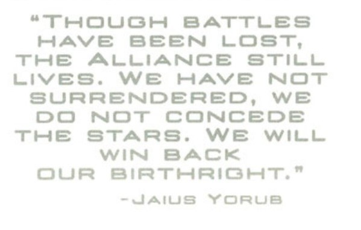

## scan p.151 (scan page 151)

Page contents: Scythe-class Battle Cruiser stats (CL 22; Cross of Fire); Indomitable (Scythe-class Battle Cruiser, CL 23; 5,200 expert crew). (hand-read)

### Stat block notes (game mechanics, not feats)

- Indomitable: The Indomitable is the famous flagship of Admiral Stazi and the Galactic Alliance Core Fleet, a symbol of the Galactic Alliance's power throughout the Sith-Imperial War. When Admiral Stazi uses the ship to lead a desperate retreat from the Imperial trap at the Battle of Caamas, the ship becomes a symbol of the Core Fleet's unwillingness to yield to tyranny, in spite of the Galactic Alliance's surrender. The Indomitable is destroyed in Admiral Stazi's attempt to capture the Star Destroyer Imperious at the Mon Calamari shipyards. Captain Yorub rams the Indomitable into the shipyard ring, destroying a third of the structure and massively damaging the rest, seriously inhibiting Imperial starship construction and repair. (Source: *Legacy Era Campaign Guide* (SWRPG Saga Edition), scan p.151)

## scan p.152 (scan page 152)

Page contents: Indomitable weapons continued; Tri-Scythe-class Frigate (three parallel blades; Tactical Fire; CL 18); Deep Space Camps; the Black Redoubt (mobile spacedock, starship tenders, Golan Defense Platform with hyperdrive). (hand-read)

## scan p.153 (scan page 153)

Page contents: Spinward-class Tender (Colossal frigate; repair and resupply vessel, almost a miniature spacedock; CL 15); Golan VIII Space Defense Platform (hyperdrive for relocation; turbolasers, point-defense, torpedoes, missile batteries, two starfighter squadrons; Tactical Fire; CL 25). (hand-read)

## scan p.154 (scan page 154)

Page contents: Golan VIII weapons; Mobile Spacedock 220 (Rendili Star Drive mobile shipyard; drydock for ships up to ShaShore-class; the Galactic Alliance has one, understaffed; cannot move while ships docked; ribs retracted for hyperspace; CL 20). (hand-read)

## scan p.155 (scan page 155)

Page contents: Chapter X: The Galactic Empire (title art). (hand-read)

## scan p.156 (scan page 156)

Page contents: Chapter introduction; Darth Krayt's Empire: continuation of Palpatine's Empire; history from the Yuuzhan Vong invasion through the Ossus Project and the Sith proposal brought by Moff Nyna Calixte to the Council of Moffs, who pressure Emperor Roan Fel into accepting the Sith proposal, just as they had pressured him into the war in the first place. (hand-read)

### Stat block notes (game mechanics, not feats)

- Sith proposal: Along the way, the Sith approach Moff Nyna Calixte with a proposal, promising to join the war on the side of the Empire and counter the Jedi, who were tipping the war in the Galactic Alliance's favor. Calixte brings the proposal before the Council of Moffs, who pressure Emperor Roan Fel into accepting the Sith proposal, just as they had pressured him into the war in the first place. With that acceptance, the Sith join the war. (Source: *Legacy Era Campaign Guide* (SWRPG Saga Edition), scan p.156)

## scan p.157 (scan page 157)

Page contents: Differences from Palpatine's Empire (open Sith Lords, less humanocentrism); The Sith Lords: Darth Krayt supreme ruler, commands the Coruscant Defense Fleet; Sith apprentices and rite of passage; Sith Lords as military overseers, regional rulers, and Jedi hunters; captured Jedi brought to Coruscant to be tortured and interrogated by Darth Maladi. (hand-read)

- **Darth Wyyrlok III** — entry/section: Pull quote: ""HE IS YOUR SERVANT, MY LORD, AS ARE WE ALL. WE LIVE OR DIE AS YOU COMMAND." —DARTH WYYRLOK" Source: *Legacy Era Campaign Guide* (SWRPG Saga Edition), scan p.157
  

### Stat block notes (game mechanics, not feats)

- Battle of Caamas: The decisive battle comes at Caamas, where the Empire forces the Galactic Alliance to surrender, Darth Krayt deposes Emperor Fel and takes the throne for himself, completing the transition from a galaxy under Alliance rule to one under the sole dominion of the Galactic Empire. (Source: *Legacy Era Campaign Guide* (SWRPG Saga Edition), scan p.157)

## scan p.158 (scan page 158)

Page contents: Sidebar The Emperor's Hands: "A select few Sith Lords are given the title of Emperor's Hand, a tradition that Darth Krayt has resurrected from the days of Palpatine. These Hands function as the Emperor's agents throughout the galaxy, performing secret tasks at Krayt's whim. The position of Emperor's Hand is one of great honor, and it is fought over among the Sith Lords viciously. Many of the Sith struggle to prove their worthiness to Darth Krayt in hopes of becoming the next Hand, both to become one of the Emperor's most trusted agents but also to get close enough to him to be in position should the Emperor stumble and the chance to strike him down arise. Rumors exist that Krayt has at least one non-Sith Hand, though none of the Sith Lords have ever seen or heard from such an individual." The Council of Moffs (six members: three civilian, three military); Regional Governors & Sector Government; Moffs. (hand-read)

## scan p.159 (scan page 159)

Page contents: Independent Affiliates (Hapes Consortium, Chiss Ascendancy); The Sector Rangers; The New Nobility (Bothawui); Sidebar Imperial Legacy: "One of the most appealing aspects of the Legacy era is the fact that items from the past have just as much of a place in the present as they did in bygone eras. Nowhere is this more true than in the case of the Empire. Almost any weapons, piece of technology, character archetype, or concept that held true in the Dark Times, Rebellion era, or New Republic era is perfectly acceptable for use in the Legacy era. For example, the Galactic Empire under Palpatine had dozens of different types of stormtroopers, including RadTroopers, Imperial Storm Commandos, Jumptroopers, and so forth. The Empire under Darth Krayt has all of these things as well, and more. Gamemasters might need to adapt some concepts to the realities of the Legacy era, but for the most part anything that has existed in the past for the Empire can exist for the Empire in the Legacy era." (hand-read)

## scan p.160 (scan page 160)

Page contents: Sith Spies; The Imperial Mission (head Moff Konrad Rus; Victory Without War program; Joker Squad stormtrooper Jes Gistang entered Imperial service through the Imperial Mission; secretly an information-gathering organization; Rus reports directly to the Emperor). (hand-read)

## scan p.161 (scan page 161)

Page contents: Skull Squadron (1st Imperial Center Core Defense Squadron; Predator-class starfighters; defense of Coruscant; invitation only; current commander Gunn Yage, the daughter of Moff Rulf Yage); Joker Squad (new breed of stormtrooper, specialists); Roan Fel's Empire-in-Exile (Bastion; daughter Marasiah). (hand-read)

### Stat block notes (game mechanics, not feats)

- Empire-in-exile: When Darth Krayt deposes Emperor Roan Fel, killing his body double and seizing the throne, he does more than install himself as the ruler of the galaxy: He creates a faction within the Empire that rebels against Sith rule. Following Krayt's ascent to the position of Emperor, Roan Fel, the third Emperor of the Fel Dynasty, flees with his most loyal associates into exile. Retreating to Bastion, Roan Fel sets up his own Empire-in-exile, drawing his most trusted allies close to him and opposing Darth Krayt's Empire. (Source: *Legacy Era Campaign Guide* (SWRPG Saga Edition), scan p.161)
- Empire-in-exile survives: Roan Fel's Empire is no friend of the Sith, and despite only semi-successful efforts to court alliances with both the Galactic Alliance Core Fleet and the remaining Jedi, the Empire-in-exile has managed to repel Darth Krayt's forces and foil attempts on the lives of both Roan Fel and his daughter, Marasiah. (Source: *Legacy Era Campaign Guide* (SWRPG Saga Edition), scan p.161)

## scan p.162 (scan page 162)

Page contents: Caption: "AN AT-RCT FIRES ON ROAN FEL'S LOYALISTS." Empire-in-exile turmoil; The Imperial Knights (personal bodyguards of Emperor Roan Fel; trained on Bastion; combat not contemplation; armor using materials found in Darth Vader's armor; cortosis gauntlets); Stormtroopers (any species, male and female); Imperial Personnel. (hand-read)

- **Darth Vader (Anakin Skywalker)**: "The Imperial Knights wear specially crafted armor that uses materials found in the armor of one of the greatest Imperial duelists of all time, Darth Vader." Source: *Legacy Era Campaign Guide* (SWRPG Saga Edition), scan p.162
  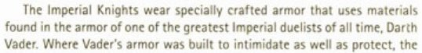

## scan p.163 (scan page 163)

Page contents: Imperial Knight (CL 11; Medium Human Jedi 7/Imperial Knight 4; Talents Armor Mastery, Block, Deflect, Force Intuition, Redirect Shot, Oath of Duty; cortosis gauntlet); Imperial Missionary (CL 4; nonheroic 3/noble 3). (hand-read)

- **Roan Fel** — entry/section: Legacy Era Campaign Guide (Saga): "SMIAWE) HLOVIVE OHA <x BBLavHD IMPERIAL KNIGHT The Imperial Knights are among the most talented and dangerous Forceusers in the galaxy, Skilled in combat, they train under the tutelage of their Imperial masters, learning all they need to know to defend Emperor Roan Fel against all those who would harm him." Source: *Legacy Era Campaign Guide* (SWRPG Saga Edition), scan p.163
  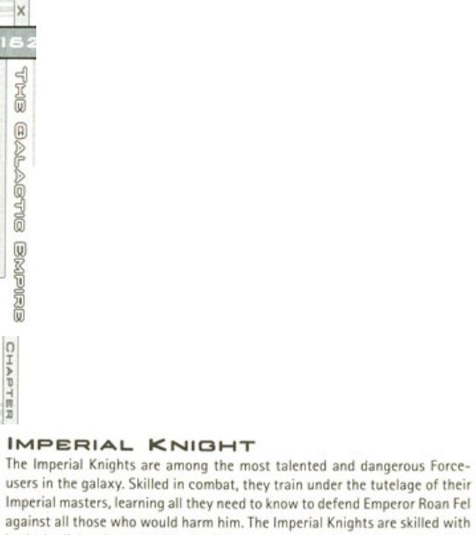

## scan p.164 (scan page 164)

Page contents: Caption: "LEFT TO RIGHT: IMPERIAL KNIGHT, IMPERIAL OFFICER, IMPERIAL MISSIONARY, KNIGHTHUNTER." Joker Squad Stormtroopers (407th stormtrooper division; command of Ran "Hardcase" Harkas). (hand-read)

### Stat block notes (game mechanics, not feats)

- Battle of Borosk: A part of the 407th stormtrooper division, Joker Squad is responsible for the elimination of the 908th stormtrooper division, which had defected to the Emperor-in-exile, Roan Fel. Joker Squad encounters the rebellious stormtroopers on Borosk and manages to defeat the rebels, though Joker Squad is killed almost to a man. The reformed Joker Squad operates under the command of Ran "Hardcase" Harkas, who has rebuilt the squad since the Battle of Borosk. (Source: *Legacy Era Campaign Guide* (SWRPG Saga Edition), scan p.164)

## scan p.165 (scan page 165)

Page contents: Caption: "LEFT TO RIGHT: ALIEN STORMTROOPER, IMPERIAL PILOT, IMPERIAL ARMY OFFICER, JOKER SQUAD STORMTROOPER." Joker Squad Stormtrooper (CL 3; nonheroic 9; ARC-9965 blaster rifle); Joker Squad Demolitionist (CL 3). (hand-read)

## scan p.166 (scan page 166)

Page contents: Joker Squad Heavy Weapons Specialist (CL 3); Knighthunters (1,001st stormtrooper division under the Sith; phrik-laced electrostaffs, sonic weapons, jet-black armor based on Coruscant Guard armor); Knighthunter (CL 7; nonheroic 7/soldier 5; Talents Armored Defense, Improved Armored Defense, Juggernaut); Sith Spy description (Bothawui, Dorin). (hand-read)

## scan p.167 (scan page 167)

Page contents: Sith Spy (CL 3); Skull Squadron Pilot (handpicked; urban flying above Coruscant; a few retired to greater things, including Moff Rulf Yage; CL 8; soldier 7/ace pilot 1; Talents Armored Defense, Devastating Attack, Elusive Dogfighter, Penetrating Attack, Weapon Specialization (heavy weapons)). (hand-read)

- **Gunn Yage** — entry/section: Pull quote: ""STAY FROSTY, SKULLS." —GUNN YAGE" Source: *Legacy Era Campaign Guide* (SWRPG Saga Edition), scan p.167
  

## scan p.168 (scan page 168)

Page contents: Influential Personalities. Nyna Calixte (Morrigan Corde): member of the Council of Moffs and Director of Imperial Intelligence; romantically involved with Moff Morlish Veed; once married to Rulf Yage; mother of Gunn Yage; Imperial Intelligence HQ on Bothawui. Caption: "NYNA CALIXTE AND HER ALTER-EGO, MORRIGAN CORDE." Stat block CL 15 (scout 4/scoundrel 3/noble 7/gunslinger 1). (hand-read)

- **Darth Krayt**: "However, in recent times she has resurrected her alter ego to rescue her son from the clutches of Darth Krayt." Source: *Legacy Era Campaign Guide* (SWRPG Saga Edition), scan p.168
  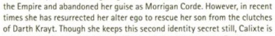

### Stat block notes (game mechanics, not feats)

- Morrigan Corde: However, Nyna Calixte has a secret. She leads a double life as Morrigan Corde, a special agent for Imperial Intelligence that is not afraid to get a job done—whatever the costs. Calixte first assumed the persona of Morrigan Corde during the Sith-Imperial War, and in this guise she met and fell in love with Kol Skywalker. After giving birth to a son, Cade, Calixte returned to the Empire and abandoned her guise as Morrigan Corde. However, in recent times she has resurrected her alter ego to rescue her son from the clutches of Darth Krayt. Though she keeps this second identity secret still, Calixte is clearly torn between her love for her son and her duty to the Empire. (Source: *Legacy Era Campaign Guide* (SWRPG Saga Edition), scan p.168)

## scan p.169 (scan page 169)

Page contents: Darth Azard: Quarren Sith Lord in command of the Imperial Third Outer Rim Fleet; master of the double-bladed lightsaber; studies Darth Vader; battlefield demotions and promotions; relishes punishing the Mon Calamari; mission to root out the Galactic Alliance Core Fleet. Stat block CL 15 (Jedi 3/soldier 5/Sith apprentice 4/Sith Lord 3). (hand-read)

- **Darth Vader (Anakin Skywalker)** — entry/section: Legacy Era Campaign Guide (Saga): "A competent military commander and a master of the double-bladed lightsaber, Darth Azard believes in many of the same philosophies as Darth Vader, whose history Azard has studied closely." Source: *Legacy Era Campaign Guide* (SWRPG Saga Edition), scan p.169
  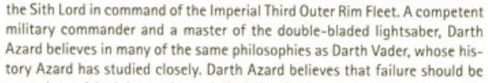
- **Darth Krayt** — entry/section: Legacy Era Campaign Guide (Saga): "DARTH KRAYT Arguably the most powerful man in the galaxy, Darth Krayt is both the leader of the Sith and the reigning Emperor." Source: *Legacy Era Campaign Guide* (SWRPG Saga Edition), scan p.169
  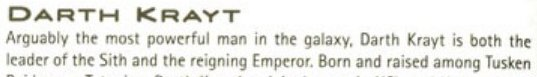
- **Palpatine (Darth Sidious); Obi-Wan Kenobi; Luke Skywalker**: "As Palpatine's Empire rises, Hett returns to his home planet where he clashes with Obi-Wan Kenobi who, unbeknownst to Hett, has been watching over the infant Luke Skywalker, After his duel with Kenobi, Hett is forced to flee Tatooine in disgrace." Source: *Legacy Era Campaign Guide* (SWRPG Saga Edition), scan p.169
  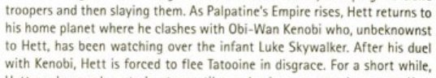
- **Roan Fel**: "In the meantime, his new Sith Order has forged an important alliance with Emperor Roan Fel, lending their aid in the defeat of the Galactic Alliance and the Jedi." Source: *Legacy Era Campaign Guide* (SWRPG Saga Edition), scan p.169
  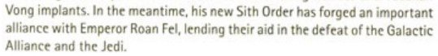

### Stat block notes (game mechanics, not feats)

- Origin of Darth Krayt: Born and raised among Tusken Raiders on Tatooine, Darth Krayt's original name is A'Sharad Hett. Trained as a Jedi Knight, Hett manages to survive Order 66 by escaping his clone troopers and then slaying them. As Palpatine's Empire rises, Hett returns to his home planet where he clashes with Obi-Wan Kenobi who, unbeknownst to Hett, has been watching over the infant Luke Skywalker. After his duel with Kenobi, Hett is forced to flee Tatooine in disgrace. For a short while, Hett works as a bounty hunter, until one day he pursues a bounty to Korriban. Once there, Hett stumbles upon an ancient Sith holocron and begins to learn the secrets of the Sith. Oddly, time seems to pass more slowly for Hett than for the galaxy at large, and when he leaves Korriban, he discovers that Palpatine's Empire has fallen. (Source: *Legacy Era Campaign Guide* (SWRPG Saga Edition), scan p.169)
- Vong captivity and the new Sith: Hett explores the Unknown Regions and is captured by a Yuuzhan Vong scouting expedition. Trapped aboard a Yuuzhan Vong ship, Hett encounters another former Jedi, Vergere. Subjected to torment in Yuuzhan Vong torture devices, Hett allows Vergere's words to seduce him into surrendering to his agony and to the dark side. During his torment, Hett begins to have visions of a new Sith Order and a galaxy under his control. Eventually, Hett frees himself from the Yuuzhan Vong and makes his way back to Korriban, whereupon he adopts a new Sith name: Darth Krayt. On Korriban, Darth Krayt begins rebuilding the Sith. His influence expands, but when it becomes clear that he cannot live long enough to fulfill his vision, Darth Krayt begins placing himself in stasis, issuing his orders telepathically while artificially extending his lifespan with a combination of healing trances and Yuuzhan Vong implants. In the meantime, his new Sith Order has forged an important alliance with Emperor Roan Fel, lending their aid in the defeat of the Galactic Alliance and the Jedi. (Source: *Legacy Era Campaign Guide* (SWRPG Saga Edition), scan p.169)

## scan p.170 (scan page 170)

Page contents: Caption: "DARTH KRAYT AND DARTH WYYRLOK." Darth Krayt stat block CL 20 (Jedi 7/Jedi Knight 4/Sith apprentice 4/Sith Lord 5; Talents incl. Dark Side Adept, Dark Side Master, Jar'Kai, Niman, Visions; Feats incl. Triple Crit (lightsabers), Whirlwind Attack; vonduun crab-shell armor, 2 lightsabers, Yuuzhan Vong bio-implants). (hand-read)

### Stat block notes (game mechanics, not feats)

- DANTH WYYRLOK Darth Krayt (Saga CL 20): CL 20 Medium Human Jedi 7/Jedi Knight 4/Sith apprentice 4/Sith Lord 5 Destiny 3; Force 10; Dark Side 20 Init +11; Senses darkvision; Use the Force Languages Basic, Bocce, Sith Defenses Ref 36 { Tusken {flat-footed 33), Fort 38, Will 38; Block, Deflect, Lightsaber Defense, Melee Defense, Jar'Kai, Niman hp 135; Threshold 38 Immune fear (Source: *Legacy Era Campaign Guide* (SWRPG Saga Edition), scan p.170)
- Krayt declares himself Emperor: By the end of the Sith-Imperial War, Darth Krayt declares himself Emperor. However, his body suffers the effects of having lived far beyond its natural lifespan. The Yuuzhan Vong implants used to extend his life begin to consume him. Furthermore, healing trances and Force healing become less effective. Darth Krayt knows that his time is limited unless a new solution is found. At one point he captures Cade Skywalker, an heir to the Skywalker bloodline gifted with incredible healing powers, in the hopes that one day he will be able to harness those same powers to prolong his life. (Source: *Legacy Era Campaign Guide* (SWRPG Saga Edition), scan p.170)

## scan p.171 (scan page 171)

Page contents: Caption: "DARTH MALADI." Darth Maladi: Devaronian master of espionage, assassination, and interrogation; Sith alchemy and Yuuzhan Vong bioengineering; largest network of Sith spies ("Sith Intelligence"); a "true" Sith born and raised on Korriban (like Darth Talon); Darth Krayt's personal physician. Stat block CL 15 (Jedi 3/noble 5/Sith apprentice 4/Sith Lord 3; acute observation). (hand-read)

### Stat block notes (game mechanics, not feats)

- Darth Maladi Darth Maladi (Saga CL 15): CL 15 Medium Devaronian Jedi 3/noble 5/Sith apprentice 4/Sith Lord 3 Destiny 2; Force 7; Dark Side 14 Init +13; Senses Perception +14 Languages Basic, Bocce, Bothese, Devaronese, Durese, High Galactic, Huttese, Mon Calamarian, Quarrenese, Ryl, Shyriiwook (understand only) Defenses Ref 29 (flat-footed 28), Fort 28, Will 30 hp 97; Thre (Source: *Legacy Era Campaign Guide* (SWRPG Saga Edition), scan p.171)
- Krayt's physician: Darth Maladi also serves as Darth Krayt's personal physician and is constantly in search of ways to slow his body's decay. When other Sith Lords are wounded in battle, they do not trust their care to the mundane doctors and medical droids of the Empire; they come to Darth Maladi. (Source: *Legacy Era Campaign Guide* (SWRPG Saga Edition), scan p.171)

## scan p.172 (scan page 172)

Page contents: Caption: "DARTH MALEVAL." Darth Maleval: one of the Empire's most capable Jedi hunters; Quarren Sith Lord; weapon of choice the shock whip. Stat block CL 13 (Jedi 7/Sith apprentice 5/Sith Lord 1). Darth Nihl introduction. (hand-read)

### Stat block notes (game mechanics, not feats)

- Terror: Darth Krayt assigns Darth Maleval to missions targeting insurgents or rebels, using the Quarren Sith Lord to spread terror among the enemies of the Empire. Darth Maleval's targets are put on display to the galaxy as a means of pointing out what happens to those who oppose the Sith rule. ... The Sith Lord has been known to leave his targets alive but savagely maimed as a warning to others who would betray the Empire. (Source: *Legacy Era Campaign Guide* (SWRPG Saga Edition), scan p.172)
- Rise of Darth Nihl: The man who would eventually take the name Darth Nihl was once a Nagai warlord and a scourge of the Unknown Regions before joining the Sith. Darth Nihl used his latent skill with the Force to lead bands of marauders in raids all across his world, well outside of the domain of the Galactic Alliance. While rebuilding the Sith, Darth Krayt encounters Darth Nihl and offers him a place within the Sith Order. Nihl agrees, undergoes the training to become a Sith Lord, and rises to the rank of Emperor's Hand after his predecessor dies under mysterious circumstances. (Source: *Legacy Era Campaign Guide* (SWRPG Saga Edition), scan p.172)

## scan p.173 (scan page 173)

Page contents: Darth Nihl stat block CL 16 (Nagai soldier 7/officer 3/Sith apprentice 5/Sith Lord 1; long-handle lightsaber; Talents Armored Defense, Assault Tactics, Block, Deflect, Indomitable, Melee Smash, Severing Strike, Shift Defense I, Stunning Strike, Weapon Specialization (lightsabers)). Darth Talon introduction. (hand-read)

- **Darth Talon; Darth Nihl; Darth Krayt** — entry/section: Legacy Era Campaign Guide (Saga): "With her master dead by her hands, Darth Talon becomes Darth Krayt's Hand, a special agent for the Emperor and the counterpart to Darth Nihl The Twi'lek Sith Lord is fast, agile, and has a diverse array of skills that makes her one of the most deadly combatants around." Source: *Legacy Era Campaign Guide* (SWRPG Saga Edition), scan p.173
  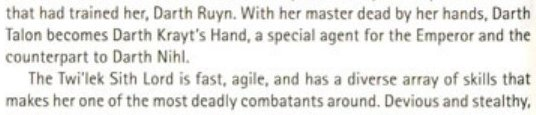
- **Darth Talon** — entry/section: Legacy Era Campaign Guide (Saga): "Despite her relative inexperience, Darth Talon is still one of the most formidable lightsaber duelists in the Sith Order." Source: *Legacy Era Campaign Guide* (SWRPG Saga Edition), scan p.173
  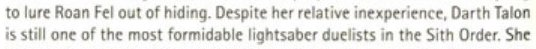

### Stat block notes (game mechanics, not feats)

- Darth Nihl (Saga CL 16): CL 16 Medium Nagai Soldier 7/officer 3/Sith apprentice 5/Sith Lord 1 Destiny 3; Force 8; Dark Side 14 Init +16; Senses Perception +10 Languages Basic, Nagaian Defenses Ref 34 (flat-footed 31), Fort 33, Will 32; Block, Deflect, Shift Defense|hp 145; Threshold 33 Immune fear effects Speed 6 squares Melee long-handle lightsaber +21 (2 (Source: *Legacy Era Campaign Guide* (SWRPG Saga Edition), scan p.173)
- Ossus: Darth Nihl is a master of the long-handle lightsaber, for which he has developed his own unique fighting style. A man filled with arrogance, rage, and loathing, Darth Nihl shows no mercy toward his enemies. As the Emperor's Hand, Darth Nihl executes the will of Darth Krayt, and the Nagai Sith Lord particularly relishes dealing with Jedi who escaped the attack on Ossus (which Darth Nihl himself led). (Source: *Legacy Era Campaign Guide* (SWRPG Saga Edition), scan p.173)
- Becoming the Hand: The final step on her path to becoming a Sith Lord comes when she is ordered by Darth Krayt to slay the Sith Lord that had trained her, Darth Ruyn. With her master dead by her hands, Darth Talon becomes Darth Krayt's Hand, a special agent for the Emperor and the counterpart to Darth Nihl. (Source: *Legacy Era Campaign Guide* (SWRPG Saga Edition), scan p.173)
- Duelist: Devious and stealthy, Darth Talon is willing to lie in wait for her prey, as she does when attempting to lure Roan Fel out of hiding. Despite her relative inexperience, Darth Talon is still one of the most formidable lightsaber duelists in the Sith Order. She helps oversee the training of Cade Skywalker in the ways of the Sith during his brief captivity on Coruscant. Following his escape, she resumes her duties as an Emperor's Hand. (Source: *Legacy Era Campaign Guide* (SWRPG Saga Edition), scan p.173)

## scan p.174 (scan page 174)

Page contents: Caption: "DARTH TALON." Darth Talon stat block CL 13 (Twi'lek Jedi 7/Sith apprentice 5/Sith Lord 1). Darth Wyyrlok: the third Sith Lord to bear the name; Chagrian; Darth Krayt's closest aide and confidante; Loremaster of the Sith; master of illusions. (hand-read)

- **Darth Wyyrlok III** — entry/section: Legacy Era Campaign Guide (Saga): "Known as the Loremaster of the Sith, Darth Wyyrlok is one of the greatest scholars of Jedi, Sith, and other Force-using traditions in the galaxy." Source: *Legacy Era Campaign Guide* (SWRPG Saga Edition), scan p.174
  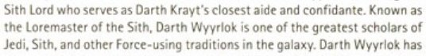
- **Darth Wyyrlok III** — entry/section: Legacy Era Campaign Guide (Saga): "In fact, so powerful are Darth Wyyrlok’s mind tricks that he manages to convince nearly a dozen lightsaber-wielding dark side cultists on Prakith that they should fight and kill one another, proving once again that the Sith are masters of bending the galaxy to their will." Source: *Legacy Era Campaign Guide* (SWRPG Saga Edition), scan p.174
  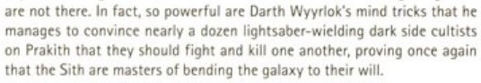
- **Darth Maladi; Darth Krayt** — entry/section: Pull quote: ""OUR LORD KEEPS HIS OWN SECRETS, AND WE, AS LOYAL SITH, ARE BOUND TO OBEY WITHOUT QUESTION." —DARTH MALADI" Source: *Legacy Era Campaign Guide* (SWRPG Saga Edition), scan p.174
  

### Stat block notes (game mechanics, not feats)

- Prakith cultists: He is a master of illusions, capable of using the Force to trick his enemies' minds into seeing things that are not there. In fact, so powerful are Darth Wyyrlok's mind tricks that he manages to convince nearly a dozen lightsaber-wielding dark side cultists on Prakith that they should fight and kill one another, proving once again that the Sith are masters of bending the galaxy to their will. (Source: *Legacy Era Campaign Guide* (SWRPG Saga Edition), scan p.174)

## scan p.175 (scan page 175)

Page contents: Darth Wyyrlok stat block CL 16 (Chagrian Jedi 5/noble 3/Sith apprentice 4/Sith Lord 4; Illusion talent). Antares Draco: highest-ranking member of the Imperial Knights; an ancestor was a member of the Inquisitorius under Palpatine; involved with Marasiah Fel. Stat block CL 15 (Jedi 7/Imperial Knight 8). (hand-read)

### Stat block notes (game mechanics, not feats)

- Darth Wyyrlok (Saga CL 16): CL 16 Medium Chagrian Jedi 5/noble 3/Sith apprentice 4/Sith Lord 4 Destiny 3; Force 8; Dark Side 16 Init +13; Senses low-light vision; Perception +16 Languages Basic, Bocce, Chagri, Cheunh, High Galactic, Huttese, Nagaian, Quarrenese, Ryl, Sith, Yuuzhan Vong Defenses Ref 30 (flat-footed 30), Fort 31, Will 33 hp 123; Threshold 31 Immu (Source: *Legacy Era Campaign Guide* (SWRPG Saga Edition), scan p.175)
- Antares Draco (Saga CL 16): CL 16 Chagrian Jedi 5/noble 3/Sith apprentice 4/Sith Lord 4 Destiny 3; Force 8; Dark Side 16 Init +13; Senses low-light vision; Perception +16 Languages Basic, Bocce, Chagri, Cheunh, High Galactic, Huttese, Nagaian, Quarrenese, Ryl, Sith, Yuuzhan Vong Defenses Ref 30 (flat-footed 30), Fort 31, Will 33 hp 123; Threshold 31 Immune fear (Source: *Legacy Era Campaign Guide* (SWRPG Saga Edition), scan p.175)
- Vendaxa rescue: Antares Draco's loyalty is far from blind. Though sworn to follow the orders of the Emperor, Draco has defied Roan Fel's wishes on a few occasions, such as the time he traveled to Vendaxa to rescue Marasiah. (Source: *Legacy Era Campaign Guide* (SWRPG Saga Edition), scan p.175)

## scan p.176 (scan page 176)

Page contents: Fehlaaur (Fehlaaur'aitel'loro): Chiss liaison, member of the Moff Council, Director of the Imperial Diplomatic Corps; keeps balance on the council along with Konrad Rus. Stat block CL 11 (Chiss noble 8/officer 3). (hand-read)

- **Moff Geist** — entry/section: Pull quote: ""IT WAS TIME FOR THE MOFFS TO REASSERT THEIR AUTHORITY LIKE IN THE OLD DAYS—BACK IN THE REMNANT!" —MOFF GEIST" Source: *Legacy Era Campaign Guide* (SWRPG Saga Edition), scan p.176
  

### Stat block notes (game mechanics, not feats)

- Made a Moff: When word of the failure of the Ossus Project reaches Csilla, the Ascendancy attempts to recall Fehlaaur, not wanting one of their number to be drawn into the impending conflict. In order to keep the Ascendancy tightly bound to the Empire, Roan Fel grants Fehlaaur the title of Moff and makes him the Director of the Imperial Diplomatic Corps and a member of the Council of Moffs. (Source: *Legacy Era Campaign Guide* (SWRPG Saga Edition), scan p.176)

## scan p.177 (scan page 177)

Page contents: Marasiah Fel ("Sia"): daughter of the deposed Emperor; diplomat with the Imperial Mission; full-fledged Imperial Knight; envoy to sympathetic worlds; romantically linked to Antares Draco. Stat block CL 10 (noble 5/Jedi 4/Imperial Knight 1). (hand-read)

- **Roan Fel; Marasiah Fel** — entry/section: Pull quote: ""I LOVE MY DAUGHTER, BUT THE FATE OF THE EMPIRE—OF THE GALAXY—IS AT STAKE!" —EMPEROR ROAN FEL" Source: *Legacy Era Campaign Guide* (SWRPG Saga Edition), scan p.177
  

### Stat block notes (game mechanics, not feats)

- Marasiah Fel (Saga CL 10): CL 10 Medium Human noble 5/Jedi 4/Imperial Knight 1 Destiny 1; Force 5 Init +12; Senses Perception +12 Languages Basic, Bocce, High Galactic, Huttese Defenses Ref 28 (flat-footed 26), Fort 24, Will 24 hp 60; Threshold 24 a Speed 4 squares Melee lightsaber +14 (2d8+5) Ranged hold-out blaster +12 (3d4+5) Atk Options Weapon Finesse Spec (Source: *Legacy Era Campaign Guide* (SWRPG Saga Edition), scan p.177)

## scan p.178 (scan page 178)

Page contents: Roan Fel: rightful ruler to many; leader of the Empire-in-exile; Darth Krayt's most wanted enemy; trained as an Imperial Knight. Stat block CL 20 (Jedi 3/noble 6/Imperial Knight 5/officer 6; Talents incl. Band of Brothers, Oath of Duty, Strength of the Empire, Trust). (hand-read)

- **Roan Fel** — entry/section: Legacy Era Campaign Guide (Saga): "Trained as an Imperial Knight and skilled in the arts of military leadership and diplomacy, Roan Fel throws his support behind the Imperial Mission early and often, and works hard to make sure that the Jedi are not targeted as enemies during the Sith-Imperial War." Source: *Legacy Era Campaign Guide* (SWRPG Saga Edition), scan p.178
  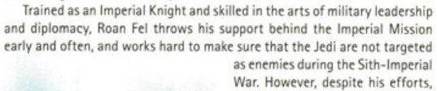
- **Marasiah Fel; Roan Fel** — entry/section: Pull quote: ""THE JEDI HAVE NOTHING TO FEAR FROM MY FATHER. ROAN FEL IS NOT YOUR ENEMY. HE NEVER TRULY WAS." —MARASIAH FEL" Source: *Legacy Era Campaign Guide* (SWRPG Saga Edition), scan p.178
  

### Stat block notes (game mechanics, not feats)

- Emperor Roan Fel (Saga CL 20): CL 20 Medium Human Jedi 3/noble 6/Imperial Knight 5/officer 6 Destiny 3; Force 9; Dark Side 4 Init +10; Senses Perception +19 Languages Basic Defenses Ref 35 (flat-footed 34), Fort 34, Will 36 hp 157; Threshold 34 Speed 4 squares Melee lightsaber +22 (2d8+12) or Melee lightsaber +17/+17 (2d8+12) with Double Attack Ranged by weapon +1 (Source: *Legacy Era Campaign Guide* (SWRPG Saga Edition), scan p.178)
- Exile on Bastion: Trained as an Imperial Knight and skilled in the arts of military leadership and diplomacy, Roan Fel throws his support behind the Imperial Mission early and often, and works hard to make sure that the Jedi are not targeted as enemies during the Sith-Imperial War. However, despite his efforts, the Sith prevail and the Jedi are nearly eradicated. After the Galactic Alliance's surrender, Emperor Fel is forced into hiding when Darth Krayt seizes the throne. In the intervening years, he has cultivated quite a following of loyalists and still manages to hold the planet of Bastion, despite Krayt's knowledge that the planet serves as the capital of the Empire-in-exile. (Source: *Legacy Era Campaign Guide* (SWRPG Saga Edition), scan p.178)

## scan p.179 (scan page 179)

Page contents: Caption: "ORON JAEGER." Oron Jaeger: Roan Fel loyalist; cybernetically enhanced Human commanding the 501st Legion; "permanent bird's-eye view of the battlefield." Stat block CL 12 (soldier 10/officer 2). Azlyn Rae introduction. (hand-read)

### Stat block notes (game mechanics, not feats)

- Battle of Corulag: After suffering a head wound at the Battle of Corulag during the Sith-Imperial War, Jaeger opts to receive a neural interface cybernetic implant before returning to Imperial service. Jaeger uses his cybernetic implant to remain in constant communications with his central command post, allowing him to relay orders much faster than most battlefield commanders. (Source: *Legacy Era Campaign Guide* (SWRPG Saga Edition), scan p.179)
- Ossus survivor to Imperial Knight: A member of the Jedi Order prior to the rise of Darth Krayt, Azlyn Rae escapes the massacre of the Jedi at Ossus and wanders the galaxy for a short while in disguise, eventually taking up bounty hunting as a profession. When she encounters the Imperial Knights, they recognize her Force training and offer to let her join their ranks. ... When Cade escapes from the clutches of the Empire at Coruscant, the Imperial Knights send Rae to track down the young Skywalker heir and follow him to the site of the hidden Jedi Temple. When the Imperial Knights follow Rae into the temple, her ties to the Jedi Order is revealed. (Source: *Legacy Era Campaign Guide* (SWRPG Saga Edition), scan p.179)

## scan p.180 (scan page 180)

Page contents: Caption: "AZLYN RAE." Azlyn Rae stat block CL 11 (Jedi 5/scout 3/bounty hunter 1/Imperial Knight 2). Konrad Rus: head of the Imperial Mission; soft-spoken member of the Council of Moffs; outwardly supports Darth Krayt; a pragmatist. Stat block CL 10 (noble 10). (hand-read)

