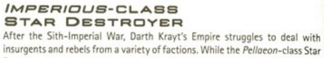
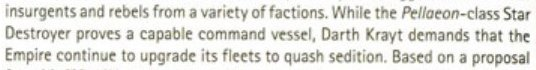
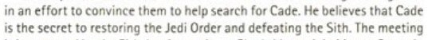
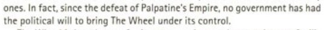
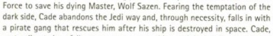
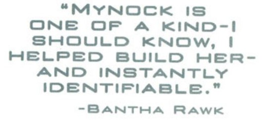
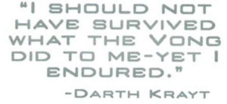

# Owner Material 037 — Star Wars D20 Drive folder (Core, Revised Core and Saga Edition): Sourcebooks/Legacy Era Campaign Guide.pdf [Star Wars Roleplaying Game Saga Edition (2007)] (scan pages 181–225)

- **Source:** Wizards of the Coast Star Wars Roleplaying Game books, web enhancements, Living Force campaign modules and articles (2000–2010), from the owner's "Star Wars D20" Drive folder (only the three edition subfolders; "General" was not read, as instructed). Secondary source (licensed Legends reference). Scan OCR'd on the box; the scan stays box-only and is **not** published.
- **Method:** every scanned page was OCR'd and machine-screened sentence by sentence for power-relevant statements (fights, kills, defeats, Force feats, rankings, superweapons) that name a character on our roster; each kept sentence is quoted verbatim from the OCR text and has a crop of the printed passage directly under it. Pages with nothing power-relevant are still listed with what is on them.
- **Citation:** "*Legacy Era Campaign Guide* (SWRPG Saga Edition), p.X" by printed page ("scan p.X" where no printed number applies). **Weight:** Licensed RPG material: a secondary source. Narrative text sums up Legends lore; game statistics are rules for players, not canon power levels, and rank lowest.

## scan p.181 (scan page 181)

Page contents: Caption: "ASTRAAL VAO AND KONRAD RUS." Astraal Vao: sister of noted Jedi Shado Vao; Twi'lek missionary; trusted friend of Marasiah Fel; trusted confidant of Konrad Rus, unaware he confides in Darth Krayt; Force-sensitive, untrained. Stat block CL 5 (noble 5). Morlish Veed: Supreme Commander of the Imperial military and highest-ranking member of the Council of Moffs. (hand-read)

### Stat block notes (game mechanics, not feats)

- Protecting Marasiah: Astraal Vao has spent many years trying to protect her friend from the Imperial agents who have hunted her since her father was deposed. Astraal Vao must constantly perform a balancing act when it comes to her friend Marasiah; Astraal continues to serve the Empire and the Imperial Mission loyally but also hides her friend from it, for fear that Marasiah might be harmed. (Source: *Legacy Era Campaign Guide* (SWRPG Saga Edition), scan p.181)
- Thwarted ambition: At the conclusion of the Sith-Imperial War, Veed expects to be made Emperor as thanks for helping dispose of Roan Fel; instead, he watches silently as Darth Krayt assumes the throne. Veed is forced to pledge his allegiance to the Sith Lord instead. ... Moff Veed is romantically involved with Nyna Calixte, a fact that creates tension between Veed and Moff Rulf Yage. (Source: *Legacy Era Campaign Guide* (SWRPG Saga Edition), scan p.181)

## scan p.182 (scan page 182)

Page contents: Morlish Veed stat block CL 15 (soldier 4/noble 6/officer 5). Gunn Yage: leader of Skull Squadron; daughter of Moff Rulf Yage and Nyna Calixte (making her Cade Skywalker's half-sister); formerly 181st Imperial Fighter Wing. Stat block CL 9 (soldier 7/ace pilot 2). Rulf Yage introduction: most decorated Grand Admiral; Navy representative on the Council of Moffs; formerly Skull Squadron commander when assigned to Bastion; Star Destroyer Ephin Sarreti, Imperial Second Outer Rim Fleet. (hand-read)

### Stat block notes (game mechanics, not feats)

- Command of Skull Squadron: Prior to taking command of Skull Squadron (a post she earned without any leverage from her father), Gunn serves in the 181st Imperial Fighter Wing alongside some of the greatest pilots in the Imperial Navy. When she is offered a chance at command, she takes it with some reservations, knowing that she would be stationed near her father. Since taking command of Skull Squadron, she has reduced the squadron's fatality rate by over 80% and earned the respect and loyalty of her fellow pilots. (Source: *Legacy Era Campaign Guide* (SWRPG Saga Edition), scan p.182)

## scan p.183 (scan page 183)

Page contents: Rulf Yage stat block CL 13 (soldier 7/ace pilot 3/officer 3). Imperial Ranged Weapons: ARC-9965 Blaster Rifle (BlasTech; upgrade over E-11; autofire consumes 10 shots; 40 shots; retractable stock); Heavy Blaster Cannon (Merr-Sonn BB-23 used by Joker Squad heavy weapons specialists; braced as Large weapon; area effect; 10 shots). (hand-read)

### Stat block notes (game mechanics, not feats)

- Grand Admiral and Moff: Eventually, Rulf is promoted to the rank of Admiral, though trouble in his personal life begins to wear on him. When Nyna Calixte leaves him for Morlish Veed, Yage throws himself into his career, trying not to let his bitterness overwhelm him. By the conclusion of the Sith-Imperial War, Rulf Yage has been promoted to Grand Admiral, and his actions at the massacre at Ossus earn him not only the title of Moff but also a seat on the Council of Moffs. Despite his high rank, Rulf Yage is not nearly as cunning or devious when it comes to politics as his fellow Moffs, a fact that Nyna Calixte points out to him as the reason Morlish Veed is the High Moff and Yage is not. (Source: *Legacy Era Campaign Guide* (SWRPG Saga Edition), scan p.183)

## scan p.184 (scan page 184)

Page contents: Table 10-1: Imperial Ranged Weapons (Heavy blaster cannon 4,200, 4d12, S, 22 kg, Military; ARC-9965 1,400, 3d8, stun yes, S/A, 5 kg, Military). Table 10-2: Imperial Armor (Cortosis gauntlet 1,500, 1 kg, Rare; Imperial Knight armor 7,000, +8/+2/+3, 16 kg, Rare; Knighthunter armor 6,000, +7/+2/+3, 13 kg, Military). Imperial Armor: Cortosis Gauntlet (opposed unarmed attack deactivates lightsaber for 2 minutes; Severing Strike exception); Imperial Knight Armor ("modeled after the armor worn by Darth Vader during the Galactic Civil War"; no life support; phrik filaments let DR apply against lightsabers); Knighthunter Armor (solid black; combines designs of Palpatine's Coruscant Guards and the storm commandos; neck connector grants +5 equipment bonus to Will Defense against Use the Force checks). (hand-read)

## scan p.185 (scan page 185)

Page contents: Imperial Vehicles intro. Kybuck Speeder Bike (Arakyd; CL 5) stat block; laser cannon. All Terrain Riot Control Transport (AT-RCT): urban successor to the AT-ST; open cockpit; crowd control and riot suppression; increased use due to insurgency of Galactic Alliance Core Fleet remnants and Roan Fel's Empire-in-exile. Stat block CL 8; double medium blaster cannons; suppression cannons (stun ignores 6-square restriction). (hand-read)

### Stat block notes (game mechanics, not feats)

- Kybuck on Vendaxa: Darth Talon uses a speeder bike of this make on Vendaxa when she travels to the world in pursuit of Marasiah Fel. (Source: *Legacy Era Campaign Guide* (SWRPG Saga Edition), scan p.185)

## scan p.186 (scan page 186)

Page contents: All Terrain Armored Heavy Transport (AT-AHT): Kuat Drive Yards successor to the AT-AT; CL 14 stat block; carries 8 speeder bikes or 3 AT-RCTs. Imperial Starfighters intro. Fury-class Starfighter (SoroSuub): "The preferred method of transportation for the Sith Lords in the Empire"; design hearkens back to the Cutlass-9; three engines; charcoal-colored exterior. Caption: "A FURY-CLASS FIGHTER FIRES ON A IF-9 CROSSFIRE STARFIGHTER." (hand-read)

## scan p.187 (scan page 187)

Page contents: Fury-class Starfighter stat block CL 12. Predator-class Starfighter (Sienar Fleet Systems): mainstay of the Imperial Navy's starfighter corps; shielded; hyperdrive; two cockpit styles; stat block CL 11. Caption: "PREDATOR-CLASS FIGHTERS ATTACK A SIGMA-CLASS SHUTTLE." (hand-read)

## scan p.188 (scan page 188)

Page contents: Neutralizer-class Bomber (Sienar; adapted from Predator design during the Sith-Imperial War; used for air strikes on positions suspected of harboring Roan Fel sympathizers); stat block CL 11; 10 proton torpedoes. Imperial Space Transports intro. Nune-class Imperial Shuttle: "the spiritual heir to the Lambda-class shuttle"; modular interior. Caption: "I4 IONIZERS FIRE ON A NUNE-CLASS SHUTTLE." (hand-read)

## scan p.189 (scan page 189)

Page contents: Nune-class Imperial Shuttle stat block CL 13. Sigma-class Long-Range Shuttle (Sienar Fleet Systems): favored by Imperial officials who prefer to be their own pilots; used for Core-to-Outer Rim travel; more like a luxury transport. Imperial Knights use modified Sigma-class shuttles carrying up to three Predator-class starfighters. Stat block CL 12; Imperial Knight variant (Cargo 30 tons; Carried Craft 3 Predator-class starfighters). (hand-read)

## scan p.190 (scan page 190)

Page contents: Imperial Capital Ships intro. Ardent-class Fast Frigate (Kuat Drive Yards): used to break enemy picket lines; commanders "tend to be men and women with nerves of ice"; Tactical Fire ability; stat block CL 19. Pellaeon-class Star Destroyer (Kuat Drive Yards): "Named for one of the most famous Grand Admirals in the history of the Empire, Gilad Pellaeon"; heavily slanted forward hull; command ships and flagships; Tactical Fire (+2 attack bonus to allies). (hand-read)

## scan p.191 (scan page 191)

Page contents: Pellaeon-class Star Destroyer stat block CL 28. Caption: "A PELLAEON-CLASS STAR DESTROYER EXCHANGES FIRE WITH A SCYTHE-CLASS CRUISER." Imperious-class Star Destroyer: Mon Calamari-modified Pellaeon design; smaller crew, better shielding, gravity mines; Tactical Fire grants 20 bonus hit points. (hand-read)

- **Darth Krayt**: "IMPERIOUS-CLASS STAR DESTROYER After the Sith-Imperial War, Darth Krayt's Empire struggles to deal with nsurgents and rebels from a variety of factions." Source: *Legacy Era Campaign Guide* (SWRPG Saga Edition), scan p.191
  
- **Darth Krayt**: "While the Pellaeon-class Star Destroyer proves a capable command vessel, Darth Krayt demands that the Empire continue to upgrade its fleets to quash sedition." Source: *Legacy Era Campaign Guide* (SWRPG Saga Edition), scan p.191
  

### Stat block notes (game mechanics, not feats)

- Imperious-class proposal: Based on a proposal from Moff Rulf Yage, the Imperial Navy turns the schematics for the Pellaeon-class Star Destroyer (originally designed by Kuat Drive Yards) over to the Imperial forces in charge of Mon Calamari. The Empire then forces Mon Calamari engineers to modify the plans to produce an improved model, much as the old Imperial I-class Star Destroyer was upgraded to the Imperial II-class ship. (Source: *Legacy Era Campaign Guide* (SWRPG Saga Edition), scan p.191)
- Theft of the Imperious: The Galactic Alliance Core Fleet steals the first prototype of the Imperious-class Star Destroyer (the Imperious itself) from the shipyards at Mon Calamari. After a brutal battle at the shipyards, the Galactic Alliance flees with the Imperious to a secret rendezvous point. Admiral Gar Stazi renames the stolen vessel the Alliance, and Darth Krayt, livid that the Mon Calamari could allow the ship to be stolen, decimates the Mon Calamari population and forces the remaining Mon Calamari to build several new Imperious-class Star Destroyers in the hopes that they will break the resolve of the Galactic Alliance Core Fleet. (Source: *Legacy Era Campaign Guide* (SWRPG Saga Edition), scan p.191)

## scan p.192 (scan page 192)

Page contents: Imperious-class Star Destroyer stat block CL 29 (Regenerating Shields; 50 gravity mines). Sidebar "Gravity Mines": Empire relies on gravity mines instead of interdiction starships; mass shadow 3x3 area pulls ships from hyperspace; magnetic variant attaches to target ship (grapple +10); Reflex 12, 20 hp, DT 10. Table: Gravity mine launcher (2 emplacement points, Military, 5,000); standard (Military, 1,000); magnetic (Military, 4,000). (hand-read)

## scan p.193 (scan page 193)

Page contents: Chapter XI: The Fringe (chapter title spread). (hand-read)

## scan p.194 (scan page 194)

Page contents: Fringe intro: "Living on the fringe of society is never easy. However, in the Legacy era, times are particularly rough and dangerous." Remnants of the Jedi Order: the Sith-Imperial War concludes with the fall of the Jedi Temple on Coruscant and the attack on the Jedi Academy on Ossus; "some speculate that as much as half of the Jedi Order survives the massacre"; Sith secretly sabotaged the Yuuzhan Vong terraforming on Ossus; Yuuzhan Vong shaper Nei Rin hidden below the Ossus academy. (hand-read)

### Stat block notes (game mechanics, not feats)

- Massacre on Ossus: Among the dead are Kol Skywalker and, many presume, his son Cade. (Source: *Legacy Era Campaign Guide* (SWRPG Saga Edition), scan p.194)
- Finding Cade: Seven years after the massacre on Ossus, Jedi Master Wolf Sazen and Jedi Knight Shado Vao search for Cade Skywalker, whom Wolf believes is still alive. They succeed in finding the troubled Skywalker and try to convince him to return to the Jedi Order. Thanks to a vision he receives, Sazen believes Skywalker could be a rallying point for all Jedi. Others are less optimistic about Skywalker's future. Ultimately, Cade asks to restart his training, and Wolf obliges. During this time, they discover the Yuuzhan Vong shaper Nei Rin and her protectors hidden well below the Ossus academy. Master K'Kruhk is given custody of the surviving Jedi artifacts that the Yuuzhan Vong had protected for so many years. (Source: *Legacy Era Campaign Guide* (SWRPG Saga Edition), scan p.194)

## scan p.195 (scan page 195)

Page contents: Hosk Trey'lis stat block CL 10 (Medium Bothan Jedi 7/noble 2/Jedi Knight 1; Force powers Force thrust (2), move object, rebuke, vital transfer (2); Force Power Mastery (vital transfer); Languages Basic, Bocce, Bothan, Yuuzhan Vong). Caption: "HOSK TREY'LIS FENDS OFF AN AGGRESSOR-SERIES BATTLE DROID." (hand-read)

### Stat block notes (game mechanics, not feats)

- Rescue attempt and the academy's destruction: Cade's training is incomplete when he rushes off to save Hosk Trey'lis from the Sith, attempting to break him out of the Sith temple on Coruscant. As Wolf and the others await Cade's return, Imperial forces return to investigate the ruined academy. Unable to locate the surviving Jedi, a suspicious Sith commander orders the complete destruction of the academy ruins by orbital bombardment. (Source: *Legacy Era Campaign Guide* (SWRPG Saga Edition), scan p.195)
- Hidden Temple: At the beginning of the Sith-Imperial War, Kol Skywalker orders the creation of a secret Hidden Temple. Unfortunately, it is incomplete when the Ossus massacre occurs. Very few Jedi know of its existence. However, a Jedi Council of three masters know and control the Hidden Temple: Master Tili Qua and two of the oldest surviving Masters, K'Kruhk and T'ra Saa. They secretly work to bring other Jedi to the temple and have located some Masters, a few Jedi Knights, and many younglings and Padawans. (Source: *Legacy Era Campaign Guide* (SWRPG Saga Edition), scan p.195)
- Hosk Trey'lis: Hosk Trey'lis, a Bothan Jedi healer, works with Kol Skywalker and the Yuuzhan Vong to terraform the ravaged planet of Ossus. An atypical Bothan in many respects, Hosk values healing, patience, and communing with the Force far more than the political scheming or spying that many of his species hold in high regard. Hosk avoids the Ossus massacre and goes into hiding. Years later, he unknowingly and accidentally runs into Cade Skywalker, Jariah Syn, and Deliah Blue. Although he suspects Cade was a Jedi, he does not recognize the young Skywalker. Cade, in an attempt to hide his true self from his companions, turns Hosk over to the bounty hunter's guild for one of the standing bounties on Jedi. (Source: *Legacy Era Campaign Guide* (SWRPG Saga Edition), scan p.195)
- Death of Hosk Trey'lis: Darth Krayt takes a personal interest in Hosk's healing abilities, and an even greater interest in the possibility that Hosk might be used to draw Cade to the Sith Lord. Although Cade eventually enters the Sith temple to rescue Hosk, he is ultimately unable to do so. In a dramatic encounter, Darth Krayt kills Hosk in an attempt to turn Cade to the dark side. Hosk, however, is not so easily defeated. He forgives Cade and even seeks Cade's forgiveness for failing to withstand Sith interrogation. A peaceful healer to the end, his body disappears, and he becomes a Force spirit. (Source: *Legacy Era Campaign Guide* (SWRPG Saga Edition), scan p.195)

## scan p.196 (scan page 196)

Page contents: Kol Skywalker stat block CL 14 (Medium Human Jedi 7/Jedi Knight 5/Jedi Master 2; Strong in the Force; Dual Weapon Mastery I; Severing Strike; Force powers battle strike, farseeing, Force thrust, mind trick, move object, rebuke (2), surge, vital transfer). (hand-read)

- **Kol Skywalker** — entry/section: Pull quote: ""I AM KOL SKYWALKER, SERVANT OF THE LIVING FORCE. NONE OF YOU WILL PASS!" —KOL SKYWALKER" Source: *Legacy Era Campaign Guide* (SWRPG Saga Edition), scan p.196
  
- **Kol Skywalker**: "Kol is killed in the Ossus massacre." Source: *Legacy Era Campaign Guide* (SWRPG Saga Edition), scan p.196
  

### Stat block notes (game mechanics, not feats)

- Padawans Kol Skywalker (Saga CL 14): CL 14 Medium Human Jedi 7/Jedi Knight 5/Jedi Master 2 Destiny 2; Force 7, Strong in the Force Init +15; Senses Use the Force +20 Languages Basic, Bocce, Huttese Defenses Ref 31 (flat-footed 27), Fort 28, Will 25; Block, Deflect hp 116; Threshold 28 Speed 6 squares Melee lightsaber +18 (2d8+8) or Melee lightsaber +16 (3d8+8) with Rapi (Source: *Legacy Era Campaign Guide* (SWRPG Saga Edition), scan p.196)
- Kol Skywalker: Kol Skywalker, a direct descendent of Anakin and Luke Skywalker, serves on the Jedi Council prior to the collapse of the Galactic Alliance. He is a vocal proponent for assimilating the Yuuzhan Vong into galaxy society, and works with them to restore worlds damaged during the Yuuzhan Vong invasion. He champions the Ossus Project and works closely with Yuuzhan Vong shapers to repair the planet. (Source: *Legacy Era Campaign Guide* (SWRPG Saga Edition), scan p.196)
- Marriage to Morrigan Corde: Although he lives by the Jedi Code, Kol's life is unconventional in many respects. He falls in love and briefly marries an Imperial agent named Morrigan Corde, but she leaves him shortly after the birth of their son, Cade. He dislikes politics, becoming involved only when absolutely necessary. He prefers working and remaining at the Jedi temple on Ossus. When war breaks out between the Empire and Galactic Alliance, he argues that defending the peace is preferable to winning the war. (Source: *Legacy Era Campaign Guide* (SWRPG Saga Edition), scan p.196)
- Death on Ossus: Kol is killed in the Ossus massacre. He falls while fighting off a torrent of Sith attackers, including Darth Nihl. His death enables other Jedi to escape, including Jedi Master Wolf Sazen, Cade Skywalker, Shado Vao, and many younglings and Padawans. (Source: *Legacy Era Campaign Guide* (SWRPG Saga Edition), scan p.196)

## scan p.197 (scan page 197)

Page contents: Shado Vao stat block CL 10 (Medium Twi'lek Jedi 7/Jedi Knight 3; double-bladed lightsaber; Dual Weapon Mastery I; Visions). (hand-read)

### Stat block notes (game mechanics, not feats)

- Shado Vao: Shado Vao survives the Ossus massacre by piloting a shuttle carrying the last Jedi survivors, including many Padawans and Jedi Master Wolf Sazen. Years later, he joins Master Sazen in a search for Sazen's former Padawan, and Shado's childhood friend, Cade Skywalker. Ensuing adventures and skirmishes with the Sith give Shado Vao many opportunities to display his prowess with the double-bladed lightsaber. (Source: *Legacy Era Campaign Guide* (SWRPG Saga Edition), scan p.197)
- Vow regarding Cade: Shado is calm and cool even in the heat of battle, and often engages his enemy in a verbal duel as well as a physical one. He is glad to see Cade return to further his Jedi training, but he is wary of how close to the dark side Skywalkers often tread. Shado has vowed to kill Cade, should he ever turn to the dark side. (Source: *Legacy Era Campaign Guide* (SWRPG Saga Edition), scan p.197)
- Wolf Sazen: Jedi Master Wolf Sazen is Kol Skywalker's apprentice before becoming Cade Skywalker's master and teacher. A follower of the living Force, Sazen is serious, thoughtful, and forward-thinking. Sazen believes his own destiny to be tied closely with that of his apprentice, Cade. The young Padawan first displays his amazing yet disturbing healing ability to bring Sazen back from the brink of death at the Ossus massacre. (Source: *Legacy Era Campaign Guide* (SWRPG Saga Edition), scan p.197)
- The empty sleeve: Sazen loses his right arm fighting Darth Nihl on Ossus. He elects not to replace the lost arm, and instead retrains himself to use his left arm instead. His "empty sleeve" serves as a reminder to the Sith that, no matter what the cost, the Jedi will continue to fight them. (Source: *Legacy Era Campaign Guide* (SWRPG Saga Edition), scan p.197)

## scan p.198 (scan page 198)

Page contents: Wolf Sazen stat block CL 15 (Medium Zabrak Jedi 7/Jedi Knight 6/Jedi Master 2; Languages Basic, Huttese, Ryl, Zabrak; Perception may reroll). The Underworld: "Not since the Dark Times has the underworld seen such an influx of beings from all walks of life." Black Sun: reinvented many times; openly displays its logo in some Outer Rim systems; Vigos act with far more autonomy than in previous eras. (hand-read)

- **Cade Skywalker**: "He believes that Cade is the secret to restoring the Jedi Order and defeating the Sith." Source: *Legacy Era Campaign Guide* (SWRPG Saga Edition), scan p.198
  

### Stat block notes (game mechanics, not feats)

- Search for Cade: Seven years after Ossus, Sazen calls some of the remaining Jedi together in an effort to convince them to help search for Cade. He believes that Cade is the secret to restoring the Jedi Order and defeating the Sith. The meeting is interrupted by the Sith, but it convinces Shado Vao to join Master Sazen in the effort. The two travel for some time and eventually locate Cade. At the young Skywalker's request, Master Sazen restarts his training. The training ends abruptly when the emotional and unstable Cade rushes off to save Hosk Trey'lis from the Sith. (Source: *Legacy Era Campaign Guide* (SWRPG Saga Edition), scan p.198)

## scan p.199 (scan page 199)

Page contents: Black Sun (cont.): Vigos "get along just well enough to benefit from their association"; resources include gunships, starfighters, speeder bikes and occasional warships; stranglehold over key worlds temporarily diminished by the resurgent Sith Empire. Stat blocks: Black Sun Thug CL 2 (nonheroic 6); Black Sun Lieutenant CL 7 (noble 3/scoundrel 4); Black Sun Vigo CL 14 (noble 7/crime lord 7). (hand-read)

## scan p.200 (scan page 200)

Page contents: Brogar's Cantina and Safe House: on Lok; safe house for criminals on the run for a negotiated fee; "Although most patrons believe otherwise, protection is not guaranteed"; meeting place for freighter pilots; security of door attendant, Z65 patrol guard droids and bouncers. Brogar stat block CL 5 (Medium Advozse scoundrel 5). Sidebar "New Species: Advozse": from the geologically unstable world of Riflor (three suns); "survivors and tremendous pessimists"; hairless, pug-faced, black horn. Traits: -2 Dex, +2 Con, +2 Wis; Medium; Speed 6 squares; Heightened Awareness (reroll Perception); Low-Light Vision; Natural Armor +1; Languages Advb and Basic. (hand-read)

- **Brogar** — entry/section: Pull quote: ""WHAT PART OF 'SAFE HOUSE' DO YOU NOT UNDERSTAND?" —BROGAR" Source: *Legacy Era Campaign Guide* (SWRPG Saga Edition), scan p.200
  

### Stat block notes (game mechanics, not feats)

- Brogar: Brogar is the owner of his own cantina on the planet Lok. His cantina doubles as a safe house for criminals, including those running from the Empire or from other criminals. Brogar is tough and smart, and he knows when to back down from a fight, especially to protect his cantina. Credits are key to getting along with Brogar. He also works to maintain good relations with influential crime lords. While he tolerates almost anyone entering the cantina for business, he fears Imperial interference and angering the wrong people. (Source: *Legacy Era Campaign Guide* (SWRPG Saga Edition), scan p.200)

## scan p.201 (scan page 201)

Page contents: The Crimson Axe: formidable pirate vessel captained by the Feeorin pirate Rav; vertical configuration shaped like a primitive axe head; ramming capability; tractor beam; crew bears the Bloody Bones symbol (red X-shaped mark). Stat block CL 17 (Colossal frigate; 150 prisoners). Caption: "THE CRIMSON AXE". (hand-read)

### Stat block notes (game mechanics, not feats)

- Sacking of Ossus and Socorro base: During the war between the Galactic Alliance and the Empire, the Crimson Axe ransacks defeated bases and settlements, or occasionally sifts through the debris fields of massive space battles. The crew delights in easy pickings and quick scores. One of the ship's greatest achievements is the sacking of the Jedi temple on Ossus, two days after it falls to Sith and Imperial forces. The defeat of the Galactic Alliance and the reemergence of the Empire under Sith control makes piracy more difficult. At the end of the war, the Crimson Axe is forced to return to its earlier ways, though it occasionally benefits from the ongoing battles between the Sith Empire and its enemies. Eventually, Rav decides that there is better and easier money to be made in bail bonds and acting as a coordinator for bounty hunters. Rav turns the ship into his base of operations on Socorro, dropping the tall, pointed vessel into a massive, ancient sarlacc pit in an outcropping above the Killee Wasteland. (Source: *Legacy Era Campaign Guide* (SWRPG Saga Edition), scan p.201)

## scan p.202 (scan page 202)

Page contents: Crimson Axe weapons. Sidebar "Using the Crimson Axe": early Legacy era Rav's pirates active anywhere; after Rav settles on Socorro the ship can be a base for bounty hunters; Rav charges extra fees, offers items on credit to keep associates in his debt; Rav's court of scoundrels, killers, bounty hunters and pirates. (hand-read)

### Stat block notes (game mechanics, not feats)

- Rav: Rav is a pirate-turned-bounty hunter who runs his own bounty clearinghouse. He is tough, nasty, controlling, and manipulative. He constantly schemes to keep his associates and underlings in his debt, and therefore under his control. Years of successful piracy have granted him untold numbers of credits, as well as connections with thousands of criminals, from powerful crime lords to petty thieves. The Feeorin's reputation instills fear throughout the underworld, and his reach extends from the Outer Rim to the lowest levels of Coruscant. Most lesser criminals, and even many crime lords, will not intentionally cross Rav without due cause. A few even contract their bounties through him, for an additional fee, of course. (Source: *Legacy Era Campaign Guide* (SWRPG Saga Edition), scan p.202)
- Lost leg and eye: Rav is massive and very strong. Early in his pirate career, he lost the lower part of his right leg fighting with a rival. As usual, Rav came out on top, killing his opponent in the fight. His lost leg was replaced with a cybernetic attachment resembling a mechanical clawed talon. He lost his left eye in a boarding action. This he replaced with a cybernetic implant that appears to be a diseased or damaged eye, leaving his opponents to believe that his eyesight is diminished on that side. The eye is further highlighted by a pale X-shaped tattoo center directly on it. As is the case with all of his pirates, Rav sports a scar-covered Bloody Bones tattoo on his left shoulder. (Source: *Legacy Era Campaign Guide* (SWRPG Saga Edition), scan p.202)

## scan p.203 (scan page 203)

Page contents: Rav stat block CL 12 (Medium Feeorin noble 5/scoundrel 3/crime lord 4; Languages Basic, Bocce, Feeorin, Gamorrean, Huttese, Rodese, Ryl, Shyriiwook; possessions prosthetic leg, cybernetic eye, death sticks). Rik's Cantina: Coruscant underworld bar hidden deep in the lower levels near the government districts; approach through failed Yuuzhan Vong terraforming areas (Vongspawn); "fighting is not allowed"; owner Hutt Queen Jool lives in a swamp under the premises. (hand-read)

### Stat block notes (game mechanics, not feats)

- Contacts in the Sith Empire: Rav deals with nearly anyone, especially those he can exert control over. He has contacts at the highest levels of the Sith Empire—including Darth Maladi and Moff Nyna Calixte—mainly to deal with the ever-increasing bounty on Cade Skywalker, one of Rav's former crewmen. Rav remains at odds with his ex-crewman, but if he can make some credits off of him, so be it. (Source: *Legacy Era Campaign Guide* (SWRPG Saga Edition), scan p.203)
- Queen Jool: Queen Jool is the current owner of Rik's Cantina, a cantina in the lowest levels of Coruscant. It's a sign of how different times are in this era, that a Hutt can live—and would want to live—on Coruscant. Her highly effective information brokerage service is powered by a massive database, where she keeps all of the information she gathers from her customers and contacts. She readily and easily accesses her database through a cybernetic implant that replaces her left eye, which she lost years ago to a disgruntled client. Her trademark bejeweled implant reflects her self-selected name. (Source: *Legacy Era Campaign Guide* (SWRPG Saga Edition), scan p.203)
- Honest broker: Queen Jool is reputed to be an honest broker. She knows her information must be reliable and she must be sincere to keep the customers coming in, and, more importantly, keep them willing to pay her. Her vast database also ensures a lot of repeat business. She carefully guards its physical location, and its security protocols are extensive. Customized hardware is required to access and decrypt its transmissions. Queen Jool is quite happy to facilitate meetings, but limits her direct involvement in her customers' business in order to remain something of a neutral third party. However, she does have her favorites, for whom she is willing to go the extra mile. Ever the eager hostess, she makes sure that many of her customers believe that they are among her favorites, whether or not they actually are. (Source: *Legacy Era Campaign Guide* (SWRPG Saga Edition), scan p.203)

## scan p.204 (scan page 204)

Page contents: Queen Jool stat block CL 9 (Large Hutt noble 3/scoundrel 3/scout 3; Languages Basic, Bocce, Bothese, High Galactic, Huttese, Shyriiwook; cybernetic eye linked to private database). Caption label: "QUEEN JOOL". Jak stat block CL 6 (Medium Nautolan soldier 6). (hand-read)

### Stat block notes (game mechanics, not feats)

- Jak: Jak is Queen Jool's personal bodyguard and an enforcer for Rik's Cantina. The Nautolan is completely loyal to the Hutt and is such a fixture in the cantina that those who deal with Queen Jool regularly almost forget he's there, observing and working in the background. At her command, he deals with any threat or anyone causing her trouble, usually by tossing them unceremoniously out the front door of the cantina. Jak is strong but silent, quite willing to play the part of hired muscle who's paid not to think too much. His first priority is protecting Jool, so he keeps a watchful eye over the entire room, especially when unfamiliar clients are present. (Source: *Legacy Era Campaign Guide* (SWRPG Saga Edition), scan p.204)

## scan p.205 (scan page 205)

Page contents: Finn stat block CL 5 (Medium Sakiyan scoundrel 4; tranquilizer drops). Sidebar "New Species: Sakiyan" (recovered from page image; absent from OCR): "Sakiyans hail from the tropical world of Saki, located in Hutt Space. Their acute senses and nigh-supernatural perception evolved from a need to survive the fierce predators of their homeworld. Sakiyans are hairless, and their skin color ranges from jet-black to deep purple and crimson. They have large craniums, for the Sakiyan brain is nearly twice the size of the average Human brain." Traits: Ability Modifiers None; Medium; Speed 6 squares; Darkvision (cannot perceive colors in total darkness); Conditional Bonus Feat (Skill Focus (Perception) if Perception trained); Lightning Reflexes (+2 species bonus to Reflex Defense); Languages Basic and Sakiyan. The Wheel: massive ring-shaped space station in the Besh Gorgon system, Mid Rim; four spokes and central tower; gravity adjustment zones. (hand-read)

### Stat block notes (game mechanics, not feats)

- Finn: Finn is the head bartender and chief enforcer of Rik's Cantina, though most newcomers would hardly believe so. Finn is aloof, seemingly detached, and often appears unfazed by anything that happens in the cantina. Despite his demeanor, Finn is a skilled bouncer and brawler. He defends the place efficiently, and often in subtle ways. More than one disruptive guest has found that the "free drink" Finn offered up to quell an ugly situation turned out to contain a tranquilizer or similar additive. Finn is equally capable of taking down a troublemaker with his blaster or even his bare hands, remaining calm and collected all the while. (Source: *Legacy Era Campaign Guide* (SWRPG Saga Edition), scan p.205)

## scan p.206 (scan page 206)

Page contents: The Wheel: neutral territory through the Clone Wars, the Rebellion era, and recent wars; escaped permanent damage during the Yuuzhan Vong invasion; "since the defeat of Palpatine's Empire, no government has had the political will to bring The Wheel under its control"; Golden Star casino and Toran's Resort and Retreat; starship services up to Colossal (frigate); weapons disallowed aboard; four squadrons of starfighters and 20 gunships and frigates. The Wheel stat block CL 19 (Colossal station). (hand-read)

- **Palpatine (Darth Sidious)**: "In fact, since the defeat of Palpatine's Empire, no government has had the political will to bring The Wheel under its control." Source: *Legacy Era Campaign Guide* (SWRPG Saga Edition), scan p.206
  

### Stat block notes (game mechanics, not feats)

- Rules of The Wheel: Pol Temm currently owns the station. In keeping with the station's strict goal of neutrality, he disallows weapons and fighting while onboard. In theory, only his own security forces and other authorized personnel are allowed to be armed. In fact, it is common practice for visitors to find ways of smuggling their own weapons aboard, often in pieces. (Source: *Legacy Era Campaign Guide* (SWRPG Saga Edition), scan p.206)

## scan p.207 (scan page 207)

Page contents: Pol Temm stat block CL 13 (Medium Kel Dor noble 10/crime lord 3; Kel Dor antiox breath mask). Wheel Security: well-paid, nonlethal approach; stat block CL 7 (nonheroic 8/soldier 3/elite trooper 1). (hand-read)

### Stat block notes (game mechanics, not feats)

- Pol Temm: Pol Temm is the current owner and administrator of The Wheel. He is one of the few beings to have lived most of his life on the station, giving him a vested interest in its continued existence. Pol has served The Wheel in many capacities over the years. He worked as a dealer and bouncer in the casinos, held security positions, served aboard the station's patrol ships, and eventually worked his way into the management and command structure. When some vengeful pirates had the previous owner assassinated during the Sith-Imperial War, Pol activated a long developed plan to transfer ownership of the station to himself. Few questioned the move, as he was the second-in-command at the time, and his reputation was above any suggestion that he might be involved in the death of his friend and predecessor. (Source: *Legacy Era Campaign Guide* (SWRPG Saga Edition), scan p.207)
- Leadership: Though he regards himself as generally honest, Pol knows the type of clientele that typically visits the station. While he prefers to take the high road whenever possible, ultimately he does what is needed to protect the station and its neutrality. He is strong willed, highly confident, and popular among the station's inhabitants and security forces. He is a skilled negotiator, but willing to use a heavy hand when necessary to preserve The Wheel's security and reputation. His able leadership has caused a resurgence in the station's popularity, and thus improved its financial fortunes as well. As a Kel Dor, Pol Temm must wear a mask throughout most of the station. (Source: *Legacy Era Campaign Guide* (SWRPG Saga Edition), scan p.207)

## scan p.208 (scan page 208)

Page contents: Wheel Security (cont.). Wheel Thug stat block CL 4 (nonheroic 3/soldier 3). Other Fringe Personalities intro. Bantha Rawk: chief mechanic at the Selonian shipyards in the Corellia system; custom weaponry; compound Rawk's Nest on Iego; married to Droo; teenage daughter Ahnah, teenage son Skeeto, adopted son Micah. Caption: "NAT SKYWALKER, AKA 'BANTHA RAWK'". (hand-read)

### Stat block notes (game mechanics, not feats)

- "Bantha" Rawk: Once a Jedi named Nat Skywalker who left the Jedi Order, "Bantha" Rawk is a chief mechanic at the Selonian shipyards in the Corellia system. A large, tough Human, Bantha is better known for his side business: creating custom weaponry for those with credits to spare. His handiwork is carried by some of the finest bounty hunters in the galaxy, and includes Cade Skywalker's distinctive double-barreled blaster carbine. (Source: *Legacy Era Campaign Guide* (SWRPG Saga Edition), scan p.208)

## scan p.209 (scan page 209)

Page contents: Caption label: "CADE SKYWALKER". (hand-read)

- **Cade Skywalker**: "Fearing the temptation of the dark side, Cade abandons the Jedi way and, through necessity, falls in with a pirate gang that rescues him after his ship is destroyed in space." Source: *Legacy Era Campaign Guide* (SWRPG Saga Edition), scan p.209
  

### Stat block notes (game mechanics, not feats)

- Last of the Skywalkers: Cade is the last of the Skywalkers, and like his predecessors, the Force is strong in him. And, like many of them, he struggles to find his way between the dark side and the light side. (Source: *Legacy Era Campaign Guide* (SWRPG Saga Edition), scan p.209)
- After Ossus: Temperamental and often selfish, Cade tries to suppress and forget his lineage after the Ossus massacre. After losing his father, Kol Skywalker, Cade uses an extraordinary healing power that taps into the dark side of the Force to save his dying Master, Wolf Sazen. Fearing the temptation of the dark side, Cade abandons the Jedi way and, through necessity, falls in with a pirate gang that rescues him after his ship is destroyed in space. Cade, pretending to be a fellow scavenger, proves his worth by helping the pirates sack the ruined Jedi Academy on Ossus. Cade becomes an enthusiastic and effective bounty hunter in the years that follow, working alongside his on-and-off lover Deliah Blue and long-time friend Jariah Syn out of his ship the Mynock (see page 219). (Source: *Legacy Era Campaign Guide* (SWRPG Saga Edition), scan p.209)
- Return to training: Cade soon discovers that the Skywalker legacy is not so easily cast aside, as the remaining Jedi and the new Sith take interest in his lineage and abilities. After battles with Darth Nihl and Darth Talon, Cade quickly concludes that he needs to return to his Jedi training, if nothing else than for self-defense. His old Master, Wolf Sazen, agrees to restart his training in the ruins of the Ossus academy. The training exposes Cade's tormented psyche and age-old fears. (Source: *Legacy Era Campaign Guide* (SWRPG Saga Edition), scan p.209)
- Capture and escape: In an effort to right a previous wrong, Cade abandons his training once again in order to save Hosk Trey'lis from the Sith. However, the Sith are waiting for him, and Cade is captured in the Sith Temple on Coruscant. For a time, he pretends to go along with Darth Krayt's teachings, learning much about the Sith Lord, his enemies, and even his own unusual healing abilities. Ultimately, Cade is unable to save Hosk from Darth Krayt, but he escapes the Sith Temple with help from a mother he didn't know existed, and his mostly loyal friends. (Source: *Legacy Era Campaign Guide* (SWRPG Saga Edition), scan p.209)
- Becoming a crusader: With each new experience and exploit, Cade becomes less the selfish, credit-hungry bounty hunter and more the respectful crusader, determined to settle old debts. However, given his personality and past, it is a sure bet that his future will remain unsettled and dangerous for a long time to come. (Source: *Legacy Era Campaign Guide* (SWRPG Saga Edition), scan p.209)

## scan p.210 (scan page 210)

Page contents: Cade Skywalker stat block CL 11 (Medium Human Jedi 3/scout 5/soldier 1/bounty hunter 2; Strong in the Force; Dark Side 4; Force powers dark transfer, Force disarm, Force thrust, move object; Power of the Dark Side; possessions blast vest, Kol Skywalker's lightsaber, modified double-barreled blaster carbine (no stock)). Chak stat block CL 8 (Medium Wookiee scoundrel 5/scout 3). Caption label: "KEE AND CHAK". (hand-read)

### Stat block notes (game mechanics, not feats)

- Chak: Chak is the Wookiee captain of the Grinning Liar, a smuggling ship of note in some circles (see page 219 for the ship's statistics). These days, he works with a young Devaronian named Kee (see page 213). Chak has been around long enough to remember the Clone Wars and the subsequent enslavement of the Wookiees. He ran some legitimate supply runs to the Jedi Academy on Ossus, in the years before its destruction. Chak is unafraid of taking risks, particularly when the pay is good or he has a vested personal interest. He is known as a fiercely loyal friend, and an equally ferocious enemy. (Source: *Legacy Era Campaign Guide* (SWRPG Saga Edition), scan p.210)

## scan p.211 (scan page 211)

Page contents: Choka Skell stat block CL 7 (Medium Yuuzhan Vong soldier 7; amphistaff forms; razor bugs; vonduun crab-shell armor; Force immunity, technophobic). (hand-read)

### Stat block notes (game mechanics, not feats)

- Choka Skell: Choka Skell is a Yuuzhan Vong warrior and the fierce protector of a shaper named Nei Rin (see page 215). Choka and his fellow Yuuzhan Vong are offworld when the Sith attack and destroyed the Jedi Temple on Ossus. Choka dutifully follows Nei Rin's orders to preserve and protect what little remains. More importantly, the proud warrior stays at Nei Rin's side when she decides to remain on Ossus to further investigate the Sith sabotage of the Yuuzhan Vong coral seeds. (Source: *Legacy Era Campaign Guide* (SWRPG Saga Edition), scan p.211)
- Dedication: Choka Skell is completely dedicated to the task of protecting the shaper and following her orders. While the protection of the Jedi artifacts on Ossus is important, to Choka it is secondary to Nei Rin's survival. Choka served on Ossus long enough to regard the Jedi as fellow warriors, worthy of respect in life and death. However, he remains as dedicated and violent as any Yuuzhan Vong warrior of the past. He has a particular hatred for the pirates who ransacked the Jedi Temple, second only to that of the Sith attackers themselves. (Source: *Legacy Era Campaign Guide* (SWRPG Saga Edition), scan p.211)
- Deliah Blue: Deliah Blue is Cade Skywalker's Zeltron mechanic, fellow bounty hunter, and sometimes lover. The Zeltrons are known for their hedonistic and fun-loving ways, and while Deliah is no exception, she is more adventurous than many. She uses her natural empathic abilities to her advantage, whether chasing a bounty or chasing Cade. Deliah is a decent gunner and pilot, but she's an exceptional mechanic, well known for her skill in keeping Cade's troublesome ship, the Mynock, flying. Deliah, Cade, and Jariah Syn work as a bounty hunting team until Cade feels compelled to pursue his own path after encountering the Sith and the Jedi. Deliah continues to work with Jariah, but her true loyalty is to Cade. (Source: *Legacy Era Campaign Guide* (SWRPG Saga Edition), scan p.211)

## scan p.212 (scan page 212)

Page contents: Deliah Blue stat block CL 9 (Medium female Zeltron scout 4/scoundrel 5; bluebolt blaster pistol; concealed dart launcher; empathy, pheromones). Haako stat block CL 2 (Small Chadra-Fan scout 3). Sidebar "New Species: Chadra-Fan" (verified from page image): "Chadra-Fan are small humanoids with flat faces, round dark eyes, large ears, and flat noses. Their entire bodies, except for their oversized hands, are covered in fur. Chadra-Fan are compulsive tinkerers. Any mechanical device left within reach has the potential to be disassembled and reconstructed. Exuberant in the extreme, they like virtually everyone they meet. It takes quite a lot of abuse to curtail or obliterate their cheery disposition. They don't survive well on their own and constantly seek companionship." Traits: -2 Wis, +2 Cha; Small; Speed 4 squares; Darkvision; Tinkerer (reroll Mechanics; repairs restore extra 1d8 hp; Mechanics always a class skill); Languages Basic and Chadra-Fan. (hand-read)

### Stat block notes (game mechanics, not feats)

- Haako: Haako is a longtime inhabitant of The Wheel (see page 204) and very knowledgeable about those who come and go aboard the station. Credits easily buy the Chadra-Fan's primitive surveillance services and temporary loyalty. He is not especially bright, but his employers find that his enthusiasm and observational skills enable him to succeed at the lesser tasks they assign to him. Haako is always looking for his next payment, so he keeps careful track of who boards the station and when, so that he might reconnect with former employers with credits to spare for his services. He often finds that this information is also useful to other visitors, and thus his own pocketbook. Jor Torlin, a Sith agent, occasionally uses Haako's eyes and ears to keep abreast of visitors to The Wheel. (Source: *Legacy Era Campaign Guide* (SWRPG Saga Edition), scan p.212)

## scan p.213 (scan page 213)

Page contents: Caption label: "JARIAH SYN". Jariah Syn stat block CL 9 (Medium Human scout 5/scoundrel 2/bounty hunter 2; Biotech Specialist; sporting blaster carbine; 2 thud bugs). (hand-read)

### Stat block notes (game mechanics, not feats)

- Jariah Syn: Jariah Syn is a pirate and bounty hunter through and through. He looks after Number One—himself—first in all situations. Despite this attitude, he occasionally discounts his self-centered nature to take advantage of a given situation, or simply for survival. He is extremely cynical and places pragmatism above all else, including loyalty. As a bounty hunter, he prefers to take his quarry in the easiest way, even if it means killing his target, if the pay is the same. Such attitudes often put him at odds with his companions, usually Deliah Blue and Cade Skywalker. (Source: *Legacy Era Campaign Guide* (SWRPG Saga Edition), scan p.213)
- Sparing Cade: Jariah is a longtime friend of Cade, since the day the young Skywalker was first brought aboard the Crimson Axe after his near fatal battle with Imperial fighters over Ossus. Jariah perceives him from the outset as a kindred spirit and likely ally. Jariah convinces the pirate captain Rav to spare Cade, at least long enough for Cade to lead the gang safely through the destroyed Jedi Temple to ransack the place. (Source: *Legacy Era Campaign Guide* (SWRPG Saga Edition), scan p.213)
- Hatred of the Jedi: Jariah and Cade continue to work together even after leaving Rav's service and striking out on their own as bounty hunters. Though he dislikes Cade's leadership, Jariah is loyal until he discovers Cade's Jedi past. Jariah has a long-standing hatred of the Jedi, as one was responsible for the death of his father. After this revelation, Jariah's loyalty to Cade remains uncertain at best, despite the fact that each has risked much to save the other. Jariah is a competent pilot, serving as copilot aboard Cade's starship, the Mynock. Jariah is an expert in illegal weaponry and manipulating Yuuzhan Vong biotechnology—skills he picked up while serving aboard the Crimson Axe, from a Yuuzhan Vong crew member. He also picked up a bad gambling habit that rarely serves him well. (Source: *Legacy Era Campaign Guide* (SWRPG Saga Edition), scan p.213)

## scan p.214 (scan page 214)

Page contents: Caption label: "JOR TORLIN". Jor Torlin stat block CL 11 (Medium Human scoundrel 5/scout 3/bounty hunter 3; Dark Side 14; heavy blaster rifle). (hand-read)

- **Kee (smuggler); Chak (Wookiee bounty hunter)** — entry/section: Pull quote: ""NO ONE WANTS TO SEE AN UNHAPPY WOOKIEE." —KEE" Source: *Legacy Era Campaign Guide* (SWRPG Saga Edition), scan p.214
  

### Stat block notes (game mechanics, not feats)

- Jor Torlin: Jor Torlin is a Human Sith spy who does the Empire's bidding in exchange for handsome fees. Having received rudimentary Force training in his youth, Jor Torlin uses what little he knows of the Force, specifically the dark side, to aid him in his assignments. Typically, Torlin is assigned to tasks that require him to locate individuals, making him something of a bounty hunter. However, typically he is only required to locate these individuals and then report back to his Sith superiors (often directly to Darth Maladi), rarely getting involved in the capture of targets. Torlin has spent many years chasing individuals around the darkest, dirtiest, and most dangerous corners of the galaxy, from Nar Shaddaa to the Wheel, and he knows how to handle himself even when the odds are against him. Jor Torlin's ship is a Gladius-class light freighter (see page 86) called the Raider. (Source: *Legacy Era Campaign Guide* (SWRPG Saga Edition), scan p.214)
- Kee: Kee is a loyal friend to the Wookiee smuggler captain Chak (see page 209). She serves as copilot and mechanic aboard his ship, the Grinning Liar. A highly skilled tech, she has some ability to manipulate Yuuzhan Vong biotechnology. Kee likes to break the rules and buck the system. It is unusual for female Devaronians to travel the galaxy, looking for adventure. Kee's sharp tongue and somewhat abrasive attitude often get her into trouble, but she usually has Chak around to bail her out. (Source: *Legacy Era Campaign Guide* (SWRPG Saga Edition), scan p.214)

## scan p.215 (scan page 215)

Page contents: Kee stat block CL 3 (Medium Devaronian scoundrel 3; Biotech Mastery). Sidebar "New Species: Devaronian" (verified from crop): from Devaron; among the first species to develop interstellar travel; males common in spaceports; females remain home, raise young and run the government of Devaron; males hairless, red-tinted skin, horns ("not unlike the devils of a thousand myths"); females furred, hornless. Traits: +2 Dex, -2 Wis, -2 Cha (males) or +2 Int, +2 Wis, -2 Dex (females); Medium; Speed 6 squares; Conditional Bonus Feat (Skill Focus (Deception)); Natural Curiosity (+1 insight bonus on attacks vs. a target); Languages Basic and Devaronese. Liaan Lah stat block CL 6 (Medium Yuuzhan Vong soldier 6). (hand-read)

### Stat block notes (game mechanics, not feats)

- Liaan Lah: Liaan Lah is a Yuuzhan Vong warrior and the somewhat less experienced bodyguard of the shaper Nei Rin (see page 215). Like Choka Skell (see page 210), Liaan is dedicated to Nei Rin and remains with her when the shaper decides to stay on Ossus after the Jedi Temple is attacked by the Sith. Liaan holds the Jedi in highest regard and believes their legacy—their surviving artifacts—to be worth protecting even though it forces the Yuuzhan Vong to remain in hiding on Ossus. (Source: *Legacy Era Campaign Guide* (SWRPG Saga Edition), scan p.215)

## scan p.216 (scan page 216)

Page contents: Liaan Lah stat block (cont.; vonduun crabshell armor, amphistaff, 4 razor bugs). Naxy Screeger stat block CL 2 (Medium Sakiyan nonheroic 3/scoundrel 1; Gambler). Caption label: "NEI RIN AND CHOKA SKELL". (hand-read)

### Stat block notes (game mechanics, not feats)

- Naxy Screeger: Naxy Screeger is an irritating Sakiyan gambler, short on cash but long on excuses. The talkative fringer always has something to say, whether it is an excuse, minor threat, or bungled insult. Just about anyone who knows Naxy also knows someone he owes money to. His grasp of Basic is tenuous, but he doesn't let that stop him. Naxy eventually irritates the pirate Rav by skipping out on a bail bond, thereby earning a bounty large enough to attract the attention of Cade Skywalker and the Mynock crew. They catch the Sakiyan at Brogar's Cantina, along with the Jedi Hosk Trey'lis, and turn Naxy over to Rav. The cunning, or lucky, Screeger survives Rav's wrath. However, it's debatable how much longer he can get by on wits alone, particularly after he helps Cade Skywalker and the Mynock crew finagle Chak's ship, the Grinning Liar, out of the pirate lord's clutches. (Source: *Legacy Era Campaign Guide* (SWRPG Saga Edition), scan p.216)
- Nei Rin: Nei Rin is the Yuuzhan Vong shaper behind the Ossus Project, the experiment to terraform ravaged worlds using Yuuzhan Vong biotechnology. The project is masterminded and supported by the Jedi Order, which hopes to rehabilitate worlds damaged in the Yuuzhan Vong invasion and change galactic opinion about the Yuuzhan Vong themselves. A highly skilled shaper, Nei Rin believes herself worthy of the task. She is therefore shocked when the experiments begin to go awry on other worlds, but not on Ossus itself. The Vong coral seeds, designed to repair damaged ecosystems, soon infect the inhabitants of those worlds, causing painful and lethal mutations to the populace. The Empire uses the ensuing outrage to divide the galaxy, taking advantage of the situation by going to war against the Galactic Alliance. (Source: *Legacy Era Campaign Guide* (SWRPG Saga Edition), scan p.216)
- Protecting the legacy: After Nei Rin leaves Ossus to investigate the cause of the mutations, the Sith attack the Jedi Academy on Ossus, killing the inhabitants and scattering what's left of the Jedi Order. The shaper returns shortly thereafter to witness the devastation. Nei Rin and her bodyguards (Choka Skell and Liaan Lah) are indebted to the Jedi and honor-bound to protect their legacy—a collection of Jedi artifacts and other items that survived the raids. They also provide honorable services for the fallen Jedi, especially Kol Skywalker. (Source: *Legacy Era Campaign Guide* (SWRPG Saga Edition), scan p.216)

## scan p.217 (scan page 217)

Page contents: Nei Rin stat block CL 12 (Medium Yuuzhan Vong noble 7/shaper 5; villip, shaper hand). Niffla stat block CL 1 (Small Toydarian nonheroic 3). (hand-read)

### Stat block notes (game mechanics, not feats)

- Sith sabotage: Nei Rin and her bodyguards have remained hidden under the temple, protecting the Jedi legacy. Nei Rin has also determined that the failed terraforming operations on other worlds are the result of Sith sabotage. Nei Rin, freed from the guilt of the failed experiment by this revelation, remains dedicated to making the project a success. She hopes to reveal the true source of the mutations and clear the Yuuzhan Vong name throughout the galaxy. (Source: *Legacy Era Campaign Guide* (SWRPG Saga Edition), scan p.217)
- Niffla: Niffla is a Toydarian infomerchant and Imperial informant known to work the Hub shipyards at Mon Calamari. She's in it for the credits, and she'll deal with anyone—Imperial officers, high-ranking politicians, or criminals. She admits that the Sith Empire pays the best, especially for information regarding the Alliance Remnant, Admiral Stazi's fleet, the Jedi, or their sympathizers. She's also tasked with keeping an eye on suspected Mon Calamari freedom fighters. She's sneaky, stealthy, and underhanded. She works alone, mainly because she doesn't trust anyone. (Source: *Legacy Era Campaign Guide* (SWRPG Saga Edition), scan p.217)
- Niffla and the Imperious: Niffla spies on Gial and Monia Gahan for the Empire prior to the theft of the Imperious. Although she receives a hefty fee for the information she provides, Niffla is forced to remain on board Admiral Valan's flagship—in the brig—until the Mon Calamari are lured into a trap. Niffla languishes in the brig for days before anyone thinks to release her after the trap fails spectacularly. Niffla takes the hint and disappears from Imperial view, setting out to find new buyers for her information, at least until her small part in the disastrous plan is long forgotten. (Source: *Legacy Era Campaign Guide* (SWRPG Saga Edition), scan p.217)

## scan p.218 (scan page 218)

Page contents: Vongspawn (read from page image): "Vongspawn are beings that have been infected and mutated by sabotaged Yuuzhan Vong coral seeds. Most Vongspawn become outcasts, left to struggle with the painful and violent disease on their own. Naturally, they often become violent or desperate in their search for a cure. The highest concentration of these unfortunate beings is thought to be in the lower levels of Coruscant." Vongspawn Coral Seeds: term started as a curse word; dormant sabotaged seeds must be activated by a Sith using the dark side; disease attack 1d20+10 vs. Fortitude, -1 persistent step, new attack every 5 minutes; Destiny Point can turn a hit into a miss; cure DC 40 Treat Injury. Vongspawn Template (persistent condition until cured; spiky growths prevent normal armor; unarmed hits make secondary 1d20+10 infection attack). Fringe Starships intro; A519 Invader Close Support Starfighter (Kuat Drive Yards; pirate fleets and Black Sun intimidation forces). Caption: "TWO INVADERS ESCORT A NEMESIS-CLASS SHIP." (hand-read)

## scan p.219 (scan page 219)

Page contents: A519 Invader rules: Burst Fire at short or point-blank range (penalty reduced from -5 to -2 for pilots with the feat); heavy-duty shielding and hardened armor cost maneuverability. A519 Invader stat block CL 8 (Huge starfighter; twin double laser cannons; Cost 125,000 (70,000 used)). Nemesis-class Patrol Ship: Corellian Engineering Corporation, predates the Sith-Imperial War; popular with law enforcement; can be flown by two crew; Black Sun obtains many through intermediaries and record manipulation, used in the Outer Rim in support of armed swoops or speeder bikes. Stat block CL 6 (Colossal space transport; carries 6 speeder bikes; Cost 180,000 (95,000 used)). (hand-read)

## scan p.220 (scan page 220)

Page contents: Grinning Liar: YX-1980 space transport used by smugglers Chak and Kee; enhanced armor plating and hull reinforcement; at Kee's request Chak upgraded the forward laser cannons. Stat block CL 8 (Colossal* space transport; Hyperdrive x1). Mynock: Cade Skywalker's personal transport, an old Helot-class medium transport rebuilt by Bantha Rawk and Deliah Blue; "one tough, fast hunk of junk"; hyperdrive .5 past lightspeed; Deliah installed hefty shields. Caption label: "THE MYNOCK AND THE GRINNING LIAR". (hand-read)

- **Chak (Wookiee bounty hunter)** — entry/section: Pull quote: ""THE GRINNING LIAR WAS A LOAN—NOT A GIFT. I WANT MY SHIP BACK. NOW." —CHAK" Source: *Legacy Era Campaign Guide* (SWRPG Saga Edition), scan p.220
  

## scan p.221 (scan page 221)

Page contents: The Mynock stat block CL 9 (Colossal* space transport; medium, heavy and quad laser cannons; Hyperdrive x0.5 (backup x8)). Beasts intro: "In the Legacy era, there are threats beyond the Empire and the Sith, beyond the criminal syndicates and bounty hunter guilds. Predators lurk on every world, among them primitive beasts that hunt to survive." Shaped Beast: creatures altered by Yuuzhan Vong shapers, do not suffer from their shaped state, can be detected by Force-users. Shaped Beast Template (each modification +1 CL): Armored Defenses (+3), Enhanced Resilience, Improved Natural Weapons, Increased Aggression (+2 rage bonus), Poison Attack. (hand-read)

- **Bantha Rawk** — entry/section: Pull quote: ""MYNOCK IS ONE OF A KIND—I SHOULD KNOW, I HELPED BUILD HER—AND INSTANTLY IDENTIFIABLE." —BANTHA RAWK" Source: *Legacy Era Campaign Guide* (SWRPG Saga Edition), scan p.221
  

## scan p.222 (scan page 222)

Page contents: Shaped Gundark stat block CL 15 (Medium beast 10; constrict; poison bite). Vanx: vicious carnivorous pack hunter native to Vendaxa; packs of 5 to 20 led by an "alpha". Vanx stat block CL 2; Vanx Alpha CL 5 (Pack Lord). (hand-read)

- **Darth Krayt** — entry/section: Pull quote: ""I SHOULD NOT HAVE SURVIVED WHAT THE VONG DID TO ME—YET I ENDURED." —DARTH KRAYT" Source: *Legacy Era Campaign Guide* (SWRPG Saga Edition), scan p.222
  

## scan p.223 (scan page 223)

Page contents: Appendix: every character, creature, droid, vehicle and starship in the book, sorted by Challenge Level with page numbers (characters and creatures table, CL 1 onward). (hand-read)

## scan p.224 (scan page 224)

Page contents: Appendix (cont.): remaining characters and creatures, droids, vehicles and starships with CL and page numbers. (hand-read)

## scan p.225 (scan page 225)

Page contents: Back cover. Header (unattributed): "EVERY GENERATION HAS ITS OWN CHALLENGES TO FACE, ITS OWN BATTLES TO WIN." Blurb: "More than a century has passed since the Emperor's death at the Battle of Endor. The tyrannical Sith once again rule the galaxy, and the Empire has been reborn. The heroes of old are gone, but their descendants represent the starlight in the darkness. In the Legacy Era, your heroes become the galaxy's last hope, challenging the Empire, battling the Sith, and upholding the legacies of their ancestors." Features list: new talents, feats, prestige classes, equipment; rules for creating legacy characters; information for running campaigns set in the Legacy Era; characters, starships, and technology from the Legacy comics series. ©2009 Lucasfilm; ISBN 978-0-7869-5051-5; US $39.95. (hand-read)

