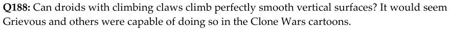
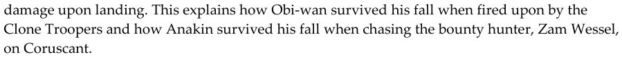

# Owner Material 037 — Star Wars D20 Drive folder (Core, Revised Core and Saga Edition): Sourcebooks/Official FAQ and Errata Compilation.pdf [Star Wars Roleplaying Game Saga Edition (2007)] (scan pages 1–60)

- **Source:** Wizards of the Coast Star Wars Roleplaying Game books, web enhancements, Living Force campaign modules and articles (2000–2010), from the owner's "Star Wars D20" Drive folder (only the three edition subfolders; "General" was not read, as instructed). Secondary source (licensed Legends reference). Scan OCR'd on the box; the scan stays box-only and is **not** published.
- **Method:** every scanned page was OCR'd and machine-screened sentence by sentence for power-relevant statements (fights, kills, defeats, Force feats, rankings, superweapons) that name a character on our roster; each kept sentence is quoted verbatim from the OCR text and has a crop of the printed passage directly under it. Pages with nothing power-relevant are still listed with what is on them.
- **Citation:** "*Official FAQ and Errata Compilation* (SWRPG Saga Edition), p.X" by printed page ("scan p.X" where no printed number applies). **Weight:** Licensed RPG material: a secondary source. Narrative text sums up Legends lore; game statistics are rules for players, not canon power levels, and rank lowest.

## p.1 (scan page 1)

Page contents: Official F.A.Q. and Errata Compilation Thread (v.1.2): compilation of official and semi-official clarifications from game developers taken from Wizards of the Coast's Star Wars forums and homepage. Contents: Official F.A.Q. Compilation Thread; Official Errata Compilation Thread; errata for Saga Edition Core Rulebook (p51), Starships of the Galaxy (p68), Knights of the Old Republic (p69), The Force Unleashed (p70), Scum & Villainy (p72), Clone Wars (p74). Answers are comments by game designers such as Rodney Thompson and Gary Sarli; forum compiler name omitted per exclusions. Forums since wiped; points to the "The Saga Continues" forum. (hand-read)

## p.2 (scan page 2)

Page contents: F.A.Q. intro: official responses in red, unconfirmed interpretations in blue. Q1 designer answer: "a clarification from a designer/developer/editor doesn't have to be 'official' -- i.e. published -- to tell you the correct interpretation of an ambiguous statement"; errata differs because the text changes and "Lucas Licensing has contractual approval over anything published under that license". (hand-read)

## p.3 (scan page 3)

Page contents: Character Basics. Q2 raising Int/Wis/Con later grants extra skills, languages, Force powers, hit points, class starting feats ("Saga is very retroactive friendly"). Q3 Trandoshan limbs all regrow in 1d10 days. Q4 Wookiees no extra benefit with Improved Force Trance. Q5 Weapon Familiarity changes weapon type in all ways (Wookiee bowcaster with Weapon Focus/Specialization (rifles); Gungan cesta/atlatl). Q6 racial abilities are not virtual talents. Q7 Yuzzem Martial Arts III damage caps at d12. (hand-read)

## p.4 (scan page 4)

Page contents: Q8 Thaakwaash are Medium (LucasArts overruled Large). Classes: Q9-Q10 non-Force-sensitive characters can multiclass into Jedi ("ideal choice for such concepts as Darth Vader's training droids, an alternate General Grievous, or for Antarian Rangers"). Q11 starting wealth guideline (level x [level-1]) x 2,000 credits, doubled for a noble with Wealth; ~60% income on upkeep ("D&D doesn't have an Imperial Revenue Service"); a favor worth 2,000 x CL, a long-term ally 40,000 x CL x % availability. Q12 higher-level characters start with max Force Points (5 + 1/2 level) and Destiny Points = level/5 (min 1). (hand-read)

## p.5 (scan page 5)

Page contents: Talents. Q13 Lightsaber Defense x3 + Jar'Kai max +6 (Makashi needs a single lightsaber). Soldier/Jedi can use Harm's Way then Deflect. Q14 Equilibrium resets condition track and removes effects. Q15 Dark Side talents don't automatically raise Dark Side Score. Q16 thrown lightsaber is improvised without Lightsaber Throw. Q17 rerolls stack (Zabrak with Acute Senses gets three Perception checks). Q18 Adept Negotiator no use limit; needs line of sight. (hand-read)

## p.6 (scan page 6)

Page contents: Q19 Redirect Shot uses normal weapon damage plus your level bonus. Q20 Block doesn't damage weapons. Q21 Sith Dark Healing uses combined Sith Apprentice + Sith Lord levels. Q22 Dark Healing can crit and be deflected, not redirected. Q23 Stunning Strike should be damage roll. Q24 only Chapter 6 talent trees are Force talents, plus Force Traditions (Jensaarai, Witches of Dathomir); six Force talent trees (9/28/07). Q25 you are not your own ally. Q26 same-named talents are the same talent. (hand-read)

## p.7 (scan page 7)

Page contents: Q27 Force Haze broken by harmful actions (mind trick, Force lightning) but not Battle Strike. Q28 Deflect + Evasion on an area attack negates the rest. Q29 Harm's Way compares the attack to the soldier's Reflex Defense. Q30 Dark Healing affected by DR ("Pretty much everything except lightsabers is effected by damage reduction"). Q31 Force Pilot treats you as trained in Pilot (devs disagree with RAW). Q32 Coordinate can be taken 5 times. Q33 darkvision trumps Total Concealment from darkness. Q34 Elusive Target has no effect against area attacks. (hand-read)

## p.8 (scan page 8)

Page contents: Q35 Lightsaber Form talents require a lightsaber (Sith Sword an exception for Block/Deflect-based talents); Sokan unarmed is a house rule. Q36 Destiny-Point auto-hits can't be Blocked/Deflected (Force Fortification can turn critical into normal damage). Q37 Noble ranged-attack talents don't trigger on area attacks. Q38 Bullseye. Q39 Redirect Shot works on blasters, lasers and turbolasers not suffering the -20 penalty ("in Dark Empire, Luke redirects a shot from an AT-AT's laser cannons"); splash is secondary; Deflect doesn't work against grenades, missiles or flamethrowers. (hand-read)

## p.9 (scan page 9)

Page contents: Deflect cannot stop oversized capital-ship weapons ("A shot from a star destroyer's turbolaser is so wide that the blade can't possibly deflect enough of the shot to be meaningful"). Summary of Deflect and Redirect Shot rules (nullify single shots; half vs. autofire; redirect one shot within point blank range using your own modifiers; fire-linked counts as single weapon; stun shots can be deflected not redirected). Skills: Q40 take 10 on Initiative only when initiating; Q41 "considered trained for purposes of this talent" qualifies for feats/talents/prestige classes. (hand-read)

## p.10 (scan page 10)

Page contents: Q42 Sense Surroundings ignores cover/concealment for Perception (a Jedi could sense beings in another room; no line of sight granted; works vs. total cover/concealment). Q43 surviving movie-scale falls: Jump and Acrobatics each knock off 3 m (DC 15, +3 m per 10 over); falls over 60 m treated as 60 m (terminal velocity, 20d6 cap); worked example of a Jedi falling from a high window on Coruscant using Surge, reducing to a 39 m fall (13d6). Q44 Ride is a nonheroic class skill. Q45 Total Replacement Cyborg healed with Treat Injury. (hand-read)

## p.11 (scan page 11)

Page contents: Feats. Q46 Point Blank Shot doesn't extend to short range. Q47 Quick Draw: drawing a lightsaber includes activating it; holstering includes deactivating; not for picking up or sleight of hand. Q48 fighting defensively + Melee Defense work together. Q49 Far Shot doesn't work with Redirect Shot. Q50 Force Training can't be a class bonus feat (only level 1/3/6/9/12/15/18 feats or human bonus feat). Q51 Martial Arts increases Crush damage; Sneak Attack doesn't apply to Crush. (hand-read)

## p.12 (scan page 12)

Page contents: Q52 Martial Arts increases natural weapon dice (Cathar claw 1d6 -> 1d8 with Martial Arts I, 1d12 with III). Q53 Point Blank Shot applies to area weapons. Q54 Bantha Herder and Forceful Blast mutually exclusive. Q55 Dive for Cover behind full cover = immune. Q56 Unified Squadron works at starship scale. Q57 Tae-Jitsu + Dodge = two dodge targets. Q58 martial arts basics feats not prerequisites for Martial Artist talents. Q59 Tech Specialist can add slots to a prosthesis ("voids the cybernetic replacement's warranty (that's a joke)"). Q60 Enhanced Strength on a cybernetic arm doesn't raise Strength. Q61 Total Replacement Cyborg treated as 6 devices. (hand-read)

## p.13 (scan page 13)

Page contents: The Force. Q62 Battle Strike +1d6/2d6/3d6. Q63 Force Point can regain Negate Energy as a reaction then use it. Q64 "line of sight and" vs. "or" a limited range (someone in a box). Q65 regaining a power is a reaction. Q66 Move Object can't fly yourself ("The buddy system doesn't work either"). Q67 Vital Transfer not on yourself. Q68 Negate Energy doesn't work vs. Force lightning. (hand-read)

## p.14 (scan page 14)

Page contents: Q69 Rebuke only works vs. Force powers. Q70 Sever Force condition track only on Force powers; blocks Force Point spending (Damage Reduction 10, Dark Healing, Equilibrium). Q71 Move Object throwing a stormtrooper at another: both take damage based on your roll (up to 16d6). Q72 Mind Trick on a stormtrooper leader mid-firefight "might distract him for one round, but then he's going to realize that his buddies are shooting at you". Q73 Force Shield reacts to an incoming attack and protects against it. Heroic Traits: Q74 begins (lowering Dark Side Score as a swift action vs. Atoning meditation). (hand-read)

## p.15 (scan page 15)

Page contents: Q74 lowering Dark Side Score is a swift action (GM may require meditation). Q75 Force Point bonus can be declared after the roll but before the result. Q76 Destiny Points spendable any time, need not relate to destiny by RAW. Q77 "Destiny Point war": a point spent to make an attack miss can't be countered; extra rounds possible; no interrupting another's turn without Quicken Power. Q78 atonement: spend 1 FP, GM adjudicates a long period (at least an adventure as "a total saint" or a week to months offstage); GM decides success. (hand-read)

## p.16 (scan page 16)

Page contents: Atonement one point at a time; GM controls the throttle. Q79 Dark Side Score "represents you being psychologically damaged by your actions"; atone or live with it ("killing younglings because they might come back to fight you when they grow up"); "using Force lightning to save a busload of orphans from certain death is acceptable, but you will still get a DSP"; torture to save lives still earns a DSP. Equipment: Q80 licenses per weapon type, like a driver's license. (hand-read)

## p.17 (scan page 17)

Page contents: Q81 combat gloves count as both unarmed and simple; bonuses overlap, don't stack. Q82 ion and frag grenades don't damage attended objects. Q83 folded-stock rifle uses rifle feats. Q84 Attune Armor, Second Skin, Tech Specialist armor bonuses are halved by Improved Armor Defense. Q85 nets maintain Pin via 6-square trailing rope. Q86 autofire and stun are mutually exclusive. (hand-read)

## p.18 (scan page 18)

Page contents: Q87 Gungan energy balls: thrown by hand, simple via atlatl, accurate simple via cesta; single target; not usable in grenade launchers. Q88 energy cells last indefinitely. Q89 unlit lightsaber is about Tiny for concealment ("I refuse to believe that my blaster pistol is the same size as an ewok"); since Scum and Villainy weapons are objects two sizes smaller. Q90 armor has 1 upgrade slot, powered armor 2. Q91 strip once, enlarge once. Q92 a Dual Geared item has no slots. Q93 personal proton torpedo launcher (Rebellion Era Campaign Guide) ammo. (hand-read)

## p.19 (scan page 19)

Page contents: Proton torpedoes ~5 kg, 200 credits. Q94 gas grenades (Rebellion Era Campaign Guide) deal no damage, only condition track ("SOURCE: Order 66 podcast #78"). Q95 flame cannon ~15 kg. Q96 mortar loading is flavor. Q97 bracing a rotary blaster cannon still applies. Q98 scatter gun has no splash. Q99 Katarn-class armor is medium (heavy armor proficiency grants helmet package). Q100 ascension gun add-on via dual gear. Q101 shooting a living target with the ascension gun is GM purview. (hand-read)

## p.20 (scan page 20)

Page contents: Q102 can't fire an ascension gun while on the zip line. Q103 glowing defoliator range/radius unknown ("Rodney was away from his notes"); affects Vong gear and ships like organisms (4d10x2 on impact and each round). Q104 scatter gun at medium range triggers no on-hit abilities. Q105 shock stick mounted like a bayonet. Q106 Bothan weapon template (KotOR) has no interaction with shock-boxing gloves. Q107 subcutaneous comlink can summon a ship with recall slave circuitry. Q108 prosthesis upgrades before or after install. Q109 droid systems on a Total Replacement Cyborg count against carrying capacity. (hand-read)

## p.21 (scan page 21)

Page contents: Combat. Q110 level damage bonus applies to all attacks (autofire, flamethrower, Ithorian bellow) except Force lightning. Q111 activating a lightsaber is a swift action (combat example erroneous). Q112 double weapon double Strength only with a single attack. Q113 Force powers provoke only if the GM says. Q114 can't tumble as part of a charge (quotes Tumble and Charge rules text). Q115 forced movement doesn't provoke. (hand-read)

## p.22 (scan page 22)

Page contents: Q116 condition track penalties apply to damage threshold. Q117 unarmed attacks are light melee simple weapons. Q118 no double Strength with unarmed. Q119 shields protect vs. Force lightning and Force slam; DR protects vs. ion. Q120 ion damage vs. living creatures (quarter damage, no condition track, can't kill); vs. cyborgs, droids and devices (half damage, two steps on condition track if threshold exceeded); cyborgs suffer full stun, droids immune. Q121 swift actions can't be readied directly but you can trade down. (hand-read)

## p.23 (scan page 23)

Page contents: Q122 readied withdrawal renders an attack moot (example with "a big honkin' vibro-ax"). Q123 can't choose not to threaten. Q124 aid another for ranged attacks and weapon batteries (Ref Def 10, +2 per gun). Q125 criticals multiply damage. Q126 grappling has three states: grabbed, grappled, pinned (Pin or Trip feats for trained attackers). Q127 grab with an unarmed melee attack (-5 untrained). (hand-read)

## p.24 (scan page 24)

Page contents: Q128 grabbed: can't move, -2 attacks unless natural or light weapon. Q129 grapple via opposed grapple check after a successful grab. Q130 grappled effects plus Pin, Crush, Trip, Throw or light-weapon hit. Q131 Pin. Q132 pinned: no actions, loses Dex to Reflex, lasts until attacker's next turn; maintained by opposed checks. Q133 no new melee attack roll needed to maintain. (hand-read)

## p.25 (scan page 25)

Page contents: Q134 attacker keeps Dex vs. a pin. Q135 grapple involves only three rolls (grab attack, opposed check, damage). Q136 defender winning only foils the attack. Q137 escaping: grabs automatic (number equal to level), grapple via Acrobatics vs. last opposed result, pin only by winning on attacker's turn; nets full-round DC 15 Acrobatics or DC 20 Strength. Q138 grabbed/grappled can still fight. Q139 pinned can do nothing (no Force powers, Serenity, Block, Deflect, or cutting out with a lightsaber). Q140 worked grappling example begins. (hand-read)

## p.26 (scan page 26)

Page contents: Grappling example (Amy pins Bob in round 1, fails to maintain in round 2, Bob escapes via Acrobatics; round 3 grapple with a knife). Q141 DR doesn't stack (Nautolan DR 2 + Damage Reduction 10 = DR 10); use the most appropriate type. Q142 Fighting Defensively + Melee Defense on a standard-action attack, not full attack. (hand-read)

## p.27 (scan page 27)

Page contents: Q143 unarmed strikes can be dual wielded (Trandoshan Mercenary example). Q144 only one reaction per action (can't Deflect then Negate Energy). Q145 mounted combat: Ride works like Pilot, a mount is its own creature. Q146 mount's movement is its own; controlling it in battle is a move action. Q147 rider gets no charge bonuses/penalties (now see "Fighting from Mounts" sidebar, The Unknown Regions p28). Q148 rider and mount can both attack. Q149 grappling/tripping while mounted as with a speeder bike. (hand-read)

## p.28 (scan page 28)

Page contents: Q150 Use the Mount as Cover is a reaction. Q151 area attack misses vs. a droideka or ship: halve then apply to shields, DR, hp. Q152 natural 1 on an area attack misses the area entirely. Q153 cones, bursts and splashes keep the Revised/D&D shapes. (hand-read)

## p.29 (scan page 29)

Page contents: Diagram "BURSTS": grid illustration; "The Red Squares are a 1 square burst. The Blue Squares are a 2 square burst. The Green Squares are a 3 square burst. The Yellow Squares are a 4 square burst." (hand-read)

## p.30 (scan page 30)

Page contents: Diagram "CONES" ("6-SQUARE CONES"): "The cone starts at an intersection on the battle grid (one of the corners of your space) and then extends outward for 6 squares in a 90-degree arc. Unlike normal range calculations, however, count diagonals using the old method -- that is, 1 square for the first and all odd diagonals, and 2 squares for the second and all even diagonals." (hand-read)

## p.31 (scan page 31)

Page contents: Diagram "SPLASH": "The red square is no splash. Blue squares are 1 square splash. X Splash means you have a circle with radius X. That means the green squares are radius 2, the yellow squares are radius 3, and the purple squares are radius 4." (hand-read)

## p.32 (scan page 32)

Page contents: Vehicles. Q154 how a PC or unique crew affects vehicle stats (Initiative, Perception, Reflex Defense with pilot's heroic level, attack rolls with +2 for trained pilot firing pilot weapons, BAB, grapple size modifiers Large +5 to Colossal [station] +35, skills; ship's computer Int as Use Computer bonus). Q155 can specialize with starship weapons (heavy weapons); Penetrating Shot passes DR not shields. Q156 dogfight is a standard action. Q157 bonus damage applied before multipliers. (hand-read)

## p.33 (scan page 33)

Page contents: Q158 ion grenade vs. a piloted speeder bike damages it ("You are essentially the speeder bike's attended object"; the Imperial repulsor sled's ion net). Q159 beginning a dogfight gives the foe first attack. Q160 no fighting defensively or total defense in a dogfight. Q161 two TIEs dogfighting an X-Wing can aid another (Pilot check or attack, not both). Q162 disengaging needs no standard action. Q163 AT-AT 6x12 to match the mini. Q164 starfighter pilot Aim conditions begin. (hand-read)

## p.34 (scan page 34)

Page contents: Aim only after a complete stop or end of round 1 into round 2. Q165 capital ship aid another (copilot for Pilot, commander for Use Computer; Mechanics up to GM). Q166 vehicles can suppress and be suppressed. Q167 5-point shield recharge for capital ships intentional. Q168 Battle Strike dice multiply with vehicle weapons; no auto-20 effects. Q169 can't aim then Attack Run (or Charging Fire with a charge). Q170 Starships of the Galaxy weapon emplacement points begin. (hand-read)

## p.35 (scan page 35)

Page contents: Unsized weapons assume medium (Dynamic-class freighter double medium blaster cannon, 1 EP); systems counted as listed (Medium Transport's 4 point-defense double laser cannons; Citadel-class cruiser laser and ion cannons); autofire weapons not double/triple/quad are fire-linked. Q171 Z-95 triple blasters can be swapped for 4d10x2. Q172 Focused Fire uses a single system including batteries. Q173 fire-link needs one base weapon (single light turbolaser + fire-link (4) = 5d10x5 quartet). Q174 Quad, Fire-linked and Cannon Enhancement stack on a heavy blaster cannon (up to 11d10). (hand-read)

## p.36 (scan page 36)

Page contents: Q175 weapon batteries: add that many weapon systems and group them (6 turbolasers for a +10 aid another battery). Q176 stock ships under 10 EP can still gain EP (5 EP ship becomes 7). Q177 Synchronized Fire only with pairs (3 sets of 2). Q178 only Table 3-9 stock values can be lowered, not Table 3-8 base stats. Q179 Colossal ships can't mount turbolasers; Table 3-5 footnote should read Colossal (frigate) or larger (official errata). Q180 Snap Roll or Vehicular Combat, not both. (hand-read)

## p.37 (scan page 37)

Page contents: Q181 Attack Formation Zeta Nine: lose 20 SR when the maneuver ends. Q182 Angle Deflector Shields worked example (SR 20 vs. boss and mook). Q183 Serenity can't give an automatic natural 20 with a vehicle weapon ("your attack roll" means a personal weapon); includes the Luke Skywalker Death Star explanation. (hand-read)

### Stat block notes (game mechanics, not feats)

- Designer clarification: Luke and the targeting computer (Death Star trench run): Originally, this was part of the justification for why Luke had to turn off his targeting computer to use the Force and blow up the Death Star. With the targeting computer off, the proton torpedoes basically became improvised ranged weapons, and he was limited to a very short-range shot (within the same starship-scale square) due to the lack of computer assistance. However, Luke could use his personal ranged attack bonus and thus qualify for using a Destiny Point (or even battle strike, which we originally considered making his first Force power). (Source: *Official FAQ and Errata Compilation* (SWRPG Saga Edition), p.37)

## p.38 (scan page 38)

Page contents: Serenity distinction lost in condensing. Q184 Light Fighter vs. Interceptor template (components sell back at 1/4 value; 5-square interceptor costs 95,000). Q185 Focused Fire selects one weapons system, no battery bonuses, no -5 autofire penalty, a GM tool. Q186 any spare EP can be converted to cargo; designer explains the footnote wording. (hand-read)

## p.39 (scan page 39)

Page contents: Footnote rephrased by the managing editor during typesetting. Q187 Vehicle Fire Effects can cycle two rounds up, one down; prepared actions possible ("Rodney suggests ruling against such actions"). Droids: Q188 climbing claws can't climb perfectly smooth surfaces (Grievous in the Clone Wars cartoons created his own handholds). Q189 droids can take Jedi levels but never Force Sensitivity. Q190 stock droid equipment doesn't encumber. Q191 B1 battle droid prices cover stock loadouts. (hand-read)

- **General Grievous**: "It would seem Grievous and others were capable of doing so in the Clone Wars cartoons." Source: *Official FAQ and Errata Compilation* (SWRPG Saga Edition), p.39
  

### Stat block notes (game mechanics, not feats)

- Designer clarification: Grievous climbing smooth surfaces: Q188: Can droids with climbing claws climb perfectly smooth vertical surfaces? It would seem Grievous and others were capable of doing so in the Clone Wars cartoons. A: No. In that case, I'd argue that he was creating his own hand holds by clamping into the metal itself, making it a Rough Surface. (Source: *Official FAQ and Errata Compilation* (SWRPG Saga Edition), p.39)

## p.40 (scan page 40)

Page contents: Q192 droid talents only for appropriate class levels (skills unrestricted). Prestige Classes: Q193 a Crime Lord's dead minion is replaced only by spending a talent. Q194 Force Disciple, Jedi Master and Sith Lord "any Force talent tree" includes Force traditions. Q195 Officer and Crime Lord Command Cover levels stack, max +5. Q196 Command Cover doesn't stack with normal cover. Q197 Crime Lords can take Force talents. Q198 Tough as Durasteel is a class ability (+2 every even level). (hand-read)

## p.41 (scan page 41)

Page contents: Official Errata Compilation Thread (archive.org link): unannounced official changes supported by designers, plus Starships of the Galaxy errata. E1 missing "Table 9-1: Actions in Combat" (known error). E2 Assault feat (official optional rule; prerequisite Double Attack or Dual Weapon Mastery I, BAB +6; spend a Force Point to make two attacks as a standard action). E3 Bespin imports/exports backwards. E4 Block and Deflect stop natural 20s. E5 Cleave "Adjust 1 square" removed. (hand-read)

## p.42 (scan page 42)

Page contents: E6 cones use the standard d20 format (diagram "SQUARE CONES"). E7 Cybernetic Prosthesis table reference is p141. E8 Deflect and Redirect Shot clarifications (Dark Healing deflectable not redirectable; natural 20s and autofire deflectable; not vs. Destiny Point auto-crits; stun deflectable not redirectable ("Not really sure why"); energy splash deflected cancels splash; not grenades or missiles). (hand-read)

## p.43 (scan page 43)

Page contents: E9 Educated talent grants advanced knowledge. E10 Equilibrium removes disease, poison, radiation and persistent conditions. E11 Expert Grappler +2 on opposed grapple checks. E12 falls over 60 m treated as 60 m (explains Obi-Wan's and Anakin's falls). E13 grappling as three states (grabbed, grappled, pinned) with begin and terminate conditions. (hand-read)

- **Obi-Wan Kenobi; Darth Vader (Anakin Skywalker)**: "This explains how Obi-wan survived his fall when fired upon by the Clone Troopers and how Anakin survived his fall when chasing the bounty hunter, Zam Wessel, on Coruscant." Source: *Official FAQ and Errata Compilation* (SWRPG Saga Edition), p.43
  

### Stat block notes (game mechanics, not feats)

- E12: Falling Damage (Clarification): If you fall from a height of greater than 60 meters (the height you need to reach terminal velocity for 20d6 damage), the distance for purposes of being reduced by Acrobatics and Jump is treated as only being 60 meters. For example, if you fell/jumped from 1,000 meters up, but you made an Acrobatics/Jump check high enough to reduce the falling distance by 60 meters, you take no damage upon landing. This explains how Obi-wan survived his fall when fired upon by the Clone Troopers and how Anakin survived his fall when chasing the bounty hunter, Zam Wessel, on Coruscant. (Source: *Official FAQ and Errata Compilation* (SWRPG Saga Edition), p.43)

## p.44 (scan page 44)

Page contents: Grappling transitions (grab attack, Pin feat with Crush, Trip feat with Throw, light weapon hit, simple escape, Acrobatic escape) and a three-round worked example. E14 Ion Damage begins (quarter damage to normal creatures). (hand-read)

## p.45 (scan page 45)

Page contents: Ion damage cont. (cyborgs, droids, devices half damage, two condition steps; can't kill). E15 one license per item type, but every purchase has a waiting period and paperwork. E16 line of sight and Force powers. E17 Long Range Sniping: Far Shot, targeting scope and accurate weapon stack (range penalty table; a trained sniper can hit at 300 squares (450 meters) with no penalty). E18 Maiming Foes (official optional rule: -5 attack, half damage, maimed instead of killed; see Severing Strike). (hand-read)

## p.46 (scan page 46)

Page contents: E19 Main Character Stat Changes (Errata) for chapter 15 characters (Reflex Defenses of Darth Vader, Luke Skywalker, Boba Fett, General Grievous; Vader BAB; Han Solo; Grievous; R2-D2). E20 Mechanics untrained (official optional rule: no take 10/20; failure moves object -1 step or destroys if disabled). E21 Noble BAB +10/+11/+12 at 14th-16th. E22 ARC Trooper Reflex 23 (flat-footed 21) and Delay Damage. E23 readying is a standard action. E24 Ride armor check penalty only for fast mount/dismount. (hand-read)

### Stat block notes (game mechanics, not feats)

- E19: Main Character Stat Changes (Errata): Many of the characters presented in chapter 15 have incorrect Reflex Defenses. The correct values are shown below: Darth Vader: Ref: 40 (37 flat-footed) Luke Skywalker: Ref: 28 (25 flat-footed) Boba Fett: Ref: 36 (33 flat-footed) General Grievous: Ref: 35 (31 flat-footed) Vader's Base Attack Bonus should be +18, not +17. His lightsaber attacks and his grapple check should all be one point higher (+23 normal, +21 with Rapid Strike, +18/+18 with Double Attack, & +16/+16 with Double Attack & Rapid Strike; Grapple +21). Han Solo's normal attack with his heavy blaster pistol should be at +12 to hit, not +14. General Grievous' last lightsaber attack entry (the one that accounts for dual wielding and triple attack) should have +9 to hit with each attack, not +11. R2-D2's attack with electroshock probe should be +9, not +10. Also, his ranged attack should be +8, not +14. (Source: *Official FAQ and Errata Compilation* (SWRPG Saga Edition), p.46)

## p.47 (scan page 47)

Page contents: E25 Scout hit points text says "scoundrels" (should be Scout's). E26 skills intro still references saving throws. E27 Sniper Rifle and Submachine Gun (official optional rule): Blaster rifle, sniper (1,200 credits military, 3d8, Large, 5.5 kg, accurate, no autofire/stun, 50 shots); Subrepeating blaster (1,000 credits military, 3d6, Medium, 1.7 kg, autofire-only, inaccurate, retractable stock); "[The above weapons were originally in the book before they got dropped in the editing process. ... for now, Mr. Hutt was kind enough to give them back to us.]" E28 Stealth and speed: +0 for 1-6 squares, -5 for 7-12, -10 for 13+. (hand-read)

## p.48 (scan page 48)

Page contents: Hidden Movement (+0 at normal speed, -10 for Run/Sprint). E29 Telepathy: beat distance DC or Will Defense, whichever is greater (Darth Vader example). E30 thrown lightsabers are improvised without the talent. E31 Unique Starship Crews (vehicle stat derivation repeated). (hand-read)

### Stat block notes (game mechanics, not feats)

- E29: Telepathy Force Ability (Clarification): When making a Use the Force check to use the Telepathy option of the Use the Force skill you must meet either the target DC for distance or overcome the target's Will Defense, whichever DC is greater. For example, if Darth Vader attempted to use telepathy to communicate with a known Force user in hiding in a different quadrant of the galaxy, he would need to beat a DC of 30, possibly higher if said Force user was particularly strong-willed. (Source: *Official FAQ and Errata Compilation* (SWRPG Saga Edition), p.48)

## p.49 (scan page 49)

Page contents: Unique crews cont. E32 Viper Series Probe Droid lists Use Computer trained for a 1st-level scout (known error; note on reprogramming). E33 Weapon Familiarity (Wookiee bowcasters, Gungan cesta/atlatl). Thread sign-off and edits (updated for the October '07 errata). Starships of the Galaxy ERRATA: capital ship weapons only on Colossal (frigate) or larger; Gaining Emplacement Points (Table 3-9 only); Gravity Well Projectors 3x3. (hand-read)

## p.50 (scan page 50)

Page contents: Starships of the Galaxy errata cont.: Jedi starfighter "Consumables None" should read "Consumables 1 week"; Medical Suite/Passenger Quarters use ship's cost modifier; Virago (Gargantuan, 10x10) and Theta-class shuttle (Colossal, 4x4) fighting spaces reversed; Unique Starship Crews repeated. (hand-read)

## p.51 (scan page 51)

Page contents: Saga Edition Core Rulebook Errata and Official Clarifications (Updated October 2008), same text as d720: p27 Gungan and p32 Wookiee Weapon Familiarity ("Wookiees treat bowcasters as rifles instead of exotic weapons."); class level sidebar; Base Attack Bonus not applied to damage; Jedi class skills add Jump and Mechanics; Force Intuition, Force Persuasion; Resilience; Block (melee area attacks, Force Point for adjacent character). (hand-read)

## p.52 (scan page 52)

Page contents: Core errata cont.: Deflect; Lightsaber Throw; new sidebar "Sensing the Dark Side" (verbatim: "You must be aware that your target has a Dark Side Score of 1+ to use talents, feats, or other abilities that depend on your target having a Dark Side Score. Witnessing a target performing an action that would earn an increase to one's Dark Side Score (such as using a Force power with the [dark side] descriptor) satisfies this requirement. Gamemasters may also waive this requirement when you encounter an opponent that you know to have a Dark Side Score due to previous encounters (such as having past experience with stormtroopers or Sith Lords) or for opponents taking no particular precautions to conceal the presence of a Dark Side Score (such as thugs, bounty hunters, crime lords, etc.)."); Wealth; Fool's Luck; Hyperdriven; Soldier defenses; Harm's Way. (hand-read)

## p.53 (scan page 53)

Page contents: Core errata cont.: Stunning Strike; Table 4-1; Taking 10 (Rorworr Wookiee Climb example); Acrobatics; Table 4-2; Jump Down; Mechanics (jury-rig, aid another untrained); Ride (armor check penalty, Use Mount as Cover as a reaction). (hand-read)

## p.54 (scan page 54)

Page contents: Core errata cont.: Stealth (Conceal Item, Pick Pocket, Sleight of Hand standard actions); Use the Force (Sense Force for Dark Side Scores, Sense Surroundings duration, Telepathy vs. Will Defense or base DC, Move Light Object as ranged attack); Acrobatic Strike +2; Burst Fire prerequisites and -10 without Str 13; Cleave; Force Training 1 + Wis powers. (hand-read)

## p.55 (scan page 55)

Page contents: Core errata cont.: Rapid Shot and Rapid Strike prerequisites removed (-5 penalties); Weapon Focus; Whirlwind Attack "target"; regaining a power is a reaction; Force stun example removed; Battle Strike DC 15; new [telekinetic] descriptor text. (hand-read)

## p.56 (scan page 56)

Page contents: Core errata cont.: telekinetic descriptor added to Force disarm, Force grip, Force slam, Force thrust, move object; natural 20 regains all powers; Force Disarm (12 squares; "disarm attempt"); Force Grip (12 squares; DC 15 2d6 and single swift action; size modifiers; maintaining is a standard action, DC 15 + damage to concentrate); Force Lightning vs. Reflex Defense; Force Slam size modifiers. (hand-read)

## p.57 (scan page 57)

Page contents: Core errata cont. (as d720): Force Stun vs. Fortitude with size modifiers; Force Thrust; Move Object (12 squares, maintenance, damage ends it); Disciplined Strike "area effect"; Rebuke; Sever Force "As DC 25"; Surge free action (running start; Destiny Point +4 squares and free jumping); Telekinetic Power. (hand-read)

## p.58 (scan page 58)

Page contents: Core errata cont.: Telekinetic Savant; Vital Transfer (may heal less, not yourself); Force Perception, Force Pilot; Force Point Recovery second paragraph removed; Destiny Point acts out of turn once per encounter; Weapon Groups (Spacehound scoundrel example for Weapon Focus (heavy weapons)); unarmed and natural weapons light simple; one alternate setting at a time. (hand-read)

## p.59 (scan page 59)

Page contents: Core errata cont.: autofire stun max range 6 squares; stun damage entry; Table 8-3 and 8-4 stun columns ("Yes"; stun baton 2d6; stun grenade 4d6); accurate (sporting blaster pistol/rifle, bowcaster) and inaccurate weapons footnotes; sporting blaster rifle 100; Bowcasters ("Wookiees treat bowcasters as rifles, not exotic weapons."); ion grenade "normal damage". (hand-read)

## p.60 (scan page 60)

Page contents: Core errata cont.: ion pistol; Cybernetic Prosthesis p141; critical hits negated by Block, Deflect, Vehicular Combat or a Destiny Point; single reaction per action; Charge replacement text; draw a weapon includes activating ("a lightsaber can be drawn and activated as a single move action if you are proficient in the weapon"); Aim no benefit to area attacks; Area Attacks begin. (hand-read)

